# 2014年山西省公务员录用考试《行测》题

<!-- gwy:overview:start -->
> **山西 · 2014 · 行测 · 统考** ｜ 120 题 · 图片 15 处 · 答案随题折叠

| 题型模块 | 题量 | 题号 |
| --- | ---: | ---: |
| 常识判断 | 20 | 1–20 |
| 言语理解与表达 | 30 | 21–50 |
| 数量关系 | 15 | 51–65 |
| 判断推理 | 35 | 66–100 |
| 资料分析 | 20 | 101–120 |
| **合计** | **120** | |

导航：[题型与作答说明](#题型与作答说明) · [题目](#题目) · [材料 1](#材料-1)
<!-- gwy:overview:end -->

> 候选采集稿。参考答案及解析来自粉笔页面，不代表官方答案或真实高分答卷；来源使用许可与原卷对应关系仍需人工核实。

## 题型与作答说明

常识判断

（20题）

根据题目要求，在四个选项中选出一个最恰当的答案。

言语理解与表达

（30题）

本部分包含表达与理解两方面的内容，请根据题目要求，在四个选项中选出一个最恰当的答案

数量关系

（15题）

在这部分试题中，每道题呈现一段表现数字关系的文字，要求你迅速、准确的计算出答案。

判断推理

（35题）

本部分包含图形推理、定义判断、类比推理和逻辑判断四个部分，根据要求选出符合要求的一项。

资料分析

（20题）

所给出的图、表、文字或综合资料均有若干个问题要你回答，请根据材料提供的信息进行分析、比较、计算和判断处理。

## 题目

### 第 1 题

根据《中华人民共和国公务员法》规定，下列有关公务员制度的说法正确的是：

A. 公务员工资由其职务决定

B. 我国实行公务员职位分类制度

C. 公务员职务实行选任制和委任制

D. 挂职锻炼是公务员交流的方式之一

第 1 题 · 答案与解析

**参考答案（粉笔题库参考内容）**

B

**解析**

A项错误，新《中华人民共和国公务员法》第七十九条规定：“公务员实行国家统一规定的工资制度。公务员工资制度贯彻按劳分配的原则，体现工作职责、工作能力、工作实绩、资历等因素，保持不同领导职务、职级、级别之间的合理工资差距。国家建立公务员工资的正常增长机制。”因此，公务员工资不只是职务决定，还与多种因素相关。

B项正确，新《中华人民共和国公务员法》第十六条规定：“国家实行公务员职位分类制度。公务员职位类别按照公务员职位的性质、特点和管理需要，划分为综合管理类、专业技术类和行政执法类等类别。根据本法，对于具有职位特殊性，需要单独管理的，可以增设其他职位类别。各职位类别的适用范围由国家另行规定。”

C项错误，新《中华人民共和国公务员法》第四十条第一款规定：“公务员领导职务实行选任制、委任制和聘任制。公务员职级实行委任制和聘任制。”

D项错误，新《中华人民共和国公务员法》第六十九条规定：“国家实行公务员交流制度。公务员可以在公务员和参照本法管理的工作人员队伍内部交流，也可以与国有企业和不参照本法管理的事业单位中从事公务的人员交流。交流的方式包括调任、转任。”

故正确答案为B。

**考点**：行政法

**来源**：2014年四川省公务员录用考试《行测》题第7题

### 第 2 题

以下案件不是由人民检察院立案侦查的是：

A. 某市公安局警察利用职权非法搜查案

B. 某法官徇私枉法案

C. 某公司骗取出口退税案

D. 王某告公安机关刑讯逼供案

第 2 题 · 答案与解析

**参考答案（粉笔题库参考内容）**

C

**解析**

根据《刑事诉讼法》第十九条规定：刑事案件的侦查由公安机关进行，法律另有规定的除外。人民检察院在对诉讼活动实行法律监督中发现的司法工作人员利用职权实施的非法拘禁、刑讯逼供、非法搜查等侵犯公民权利、损害司法公正的犯罪，可以由人民检察院立案侦查。对于公安机关管辖的国家机关工作人员利用职权实施的重大犯罪案件，需要由人民检察院直接受理的时候，经省级以上人民检察院决定，可以由人民检察院立案侦查。自诉案件，由人民法院直接受理。

A、B、D三项正确，非法搜查，徇私枉法，刑讯逼供等案件，可以由人民检察院立案侦查。

C项错误，骗取出口退税由公安机关立案侦查。

本题为选非题，故正确答案为C。

**考点**：诉讼法

**来源**：2014年四川省公务员录用考试《行测》题第8题

### 第 3 题

随着城市化、现代化的快速发展，我国许多大城市面临“垃圾围城”的问题，地方政府必须采取多种办法解决垃圾问题。这是因为，垃圾处理是一项：

A. 社会公共服务

B. 基础公共服务

C. 经济公共服务

D. 公共安全服务

第 3 题 · 答案与解析

**参考答案（粉笔题库参考内容）**

A

**解析**

政府的管理职能包括：政治职能、经济职能、文化职能和社会公共服务职能。基本公共服务包括三个基本点，一是保障人类的基本生存权；二是满足基本尊严（或体面）和基本能力的需要；三是满足基本健康的需要，需要政府及社会为每个人提供基本的健康保障和环境保障。随着经济的发展和人民生活水平的提高，社会基本公共服务的范围会逐步扩展，水平也会逐步提高。垃圾处理属于保护生态环境和自然资源的职能。A项正确。

故正确答案为A。

**来源**：2014年四川省公务员录用考试《行测》题第12题

### 第 4 题

以下有关经济指标的说法正确的是：

A. 恩格尔系数越大，说明一个家庭越富裕

B. CPI指数越大，表明居民的就业率越高

C. 货币供应量越大，说明居民的消费水平越高

D. 基尼系数的数值越接近0，表明收入分配越公平

第 4 题 · 答案与解析

**参考答案（粉笔题库参考内容）**

D

**解析**

A项错误，恩格尔系数是食品支出总额占个人消费支出总额的比重。推而广之，一个国家越穷，每个国民的平均收入中（或平均支出中）用于购买食物的支出所占比例就越大，随着国家的富裕，这个比例呈下降趋势。

B项错误，CPI是居民消费价格指数的英文简称。居民消费价格指数，是一个反映居民家庭一般所购买的消费商品和服务价格水平变动情况的宏观经济指标。通常是观察通货膨胀水平的重要指标，与就业率无关。

C项错误，货币供应量，是指一国在某一时期内为社会经济运转服务的货币存量，它由包括中央银行在内的金融机构供应的存款货币和现金货币两部分构成，并不能反映居民消费水平。

D项正确，基尼系数是20世纪初意大利经济学家基尼，根据劳伦茨曲线所定义的判断收入分配公平程度的指标，是比例数值，是国际上用来综合考察居民内部收入分配差异状况的一个重要分析指标。其值在0和1之间，越接近0就表明收入分配越是趋向平等，反之，收入分配越是趋向不平等。

故正确答案为D。

**考点**：宏观经济与调控政策

**来源**：2014年四川省公务员录用考试《行测》题第10题

### 第 5 题

中国人民银行下调金融机构人民币存贷款基准利率的政策属于：

A. 紧缩性财政政策

B. 紧缩性货币政策

C. 扩张性财政政策

D. 扩张性货币政策

第 5 题 · 答案与解析

**参考答案（粉笔题库参考内容）**

D

**解析**

财政政策，是指国家根据一定时期政治、经济、社会发展的任务而规定的财政工作的指导原则，通过财政支出与税收政策的变动来影响和调节总需求。增加政府支出，可以刺激总需求，从而增加国民收入，反之则抑制总需求，减少国民收入。税收对国民收入是一种收缩性力量，因此，增加政府税收，可以减少国民收入，从而抑制总需求，反之，则增加国民收入，刺激总需求。财政政策是国家整个经济政策的组成部分。

货币政策，是指政府或中央银行为影响经济活动所采取的措施，尤指控制货币供给以及调控利率的各项措施，用以达到特定或维持政策目标。本题中人民银行调整基准利率属于货币政策，货币政策的类型包括：（1）扩张性的货币政策：降低基准利息率、降低存款准备金率、降低再贴现率；（2）紧缩性的货币政策：提高利息率、提高存款准备金率、提高再贴现率；（3）稳健的货币政策。降低基准利息率是扩张性的货币政策。所以D项正确。

故正确答案为D。

**考点**：宏观经济与调控政策

**来源**：2014年四川省公务员录用考试《行测》题第11题

### 第 6 题

2013年5月15日，北极理事会部长级会议在瑞典宣布，接受中国、印度、意大利、日本、韩国和新加坡6国成为理事会正式观察员。

下列表述正确的是：

A. 北极圈埋藏着全世界80%尚未开采的石油资源

B. 北极是北半球最寒冷的地区，温度比南极更低

C. 北极理事会正式观察员没有投票权，但有权参加理事会各种会议和活动

D. 北极航道主要有两条：一条是美国沿岸的“西北航道”，一条是西伯利亚沿岸的“东北航道”

第 6 题 · 答案与解析

**参考答案（粉笔题库参考内容）**

C

**解析**

A项错误，石油分布主要集中在中东地区，包揽了全球约61.5%的储量。B项错误，世界上最冷的地方在南极洲，年平均气温在–25℃以下，绝对最低气温达–88.3℃，也曾出现过–94.5℃的记录。这是由于那里的纬度高，而且是一个冰封的大陆，同时又是世界上风暴最大的地区。C项正确，北极理事会成立于1996年，是由加拿大、丹麦、芬兰、冰岛、挪威、瑞典、俄罗斯和美国8个成员国组成的政府间组织，主要协商、讨论与北极有关的事务。该组织的观察员不具有投票权，也无权在年会上发言，但在北极议题上具有合法的权利。D项错误，北极航道是由两条航道构成：加拿大沿岸的“西北航道”和西伯利亚沿岸的“东北航道”（又称“北方航道”，是由两艘德国货船开辟出的一条商路，西起西欧，穿过西伯利亚与北冰洋毗邻海域，绕过白令海峡到达中、日、韩等国港口）。

故正确答案为C。

**考点**：其他

**来源**：2014年四川省公务员录用考试《行测》题第9题

### 第 7 题

下列古代典籍中，哪一部不是以年号命名的：

A. 《昭明文选》

B. 《太平广记》

C. 《永乐大典》

D. 《康熙字典》

第 7 题 · 答案与解析

**参考答案（粉笔题库参考内容）**

A

**解析**

A项正确，《昭明文选》是中国现存编选最早的诗文总集，因是梁代昭明太子萧统（501年—531年）主持编选的，故称《昭明文选》，昭明是谥号不是年号；

B项错误，《太平广记》是宋代人编的一部大书，全书500卷，目录10卷，取材于汉代至宋初的野史小说及释藏、道经等和以小说家为主的杂著，属于类书，由于成书于宋代太平兴国三年（978年），且与《太平御览》同时编纂，所以叫《太平广记》，太平是年号；

C项错误，《永乐大典》编撰于明朝永乐年间，初名《文献大成》，是中国百科全书式的文献集，这一古代文化宝库汇集了七八千种古今图书，是一部集大成的旷世大典，《不列颠百科全书》称其为“世界有史以来最大的百科全书”，永乐是年号；

D项错误，《康熙字典》在清朝康熙年间由文华殿大学士兼户部尚书张玉书及经筵讲官、文渊阁大学士兼吏部尚书陈廷敬担任主编，参考明代的《字汇》、《正字通》两书写成，是一套成书于康熙五十五年（1716年）的详细汉语字典，重印至今不辍，康熙是年号。

本题为选非题，故正确答案为A。

**考点**：文学常识

**来源**：2014年四川省公务员录用考试《行测》题第13题

### 第 8 题

以下是我国历史上比较著名的文学作品，将其按产生年代排序正确的是：

A. 《两都赋》《西游记》《红楼梦》《西厢记》《阿房宫赋》

B. 《西厢记》《红楼梦》《阿房宫赋》《西游记》《两都赋》

C. 《西游记》《阿房宫赋》《两都赋》《红楼梦》《西厢记》

D. 《两都赋》《阿房宫赋》《西厢记》《西游记》《红楼梦》

第 8 题 · 答案与解析

**参考答案（粉笔题库参考内容）**

D

**解析**

《两都赋》是汉代文学家、史学家班固创作的大赋，分《西都赋》《东都赋》两篇；《西游记》是中国古典四大名著之一，是中国古代一部浪漫主义长篇神魔小说，作者吴承恩，成书于16世纪明朝中叶；《红楼梦》是清朝曹雪芹所作；《西厢记》由王实甫写于元代；《阿房宫赋》是唐代著名诗人杜牧创作的一篇借古讽今的赋体散文。所以按时间顺序为《两都赋》《阿房宫赋》《西厢记》《西游记》《红楼梦》。D项正确。

故正确答案为D。

**考点**：文学常识

**来源**：2014年四川省公务员录用考试《行测》题第15题

### 第 9 题

以下对中国绘画艺术家的表述不正确的是：

A. 唐代的吴道子被称为“画圣”

B. 当代画家徐悲鸿最擅长画马

C. “扬州八怪”之一郑板桥擅长画竹

D. 吴冠中创作了巨幅国画《江山如此多娇》

第 9 题 · 答案与解析

**参考答案（粉笔题库参考内容）**

D

**解析**

A项正确，吴道子，唐代画家，汉族，阳翟（今河南禹州）人。画史尊称吴生，因其深信黄老道学，后改名为“道玄”，被后世尊称为“画圣”，被民间画工尊为祖师。B项正确，徐悲鸿，现代画家、美术教育家。对当时中国画坛影响甚大，与张书旗、柳子谷三人被称为画坛的“金陵三杰”，所作国画彩墨浑成，尤以奔马享名于世。C项正确，郑板桥，清代书画家、文学家，“扬州八怪”之一，其诗、书、画均旷世独立，世称“三绝”，擅画兰、竹、石、松、菊等植物，其中画竹已50余年，成就最为突出，著有《板桥全集》。D项错误，1959年9月，值新中国成立10周年之际，傅抱石与关山月合作了《江山如此多娇》，不是吴冠中所作。

本题为选非题，故正确答案为D。

**考点**：文学常识

**来源**：2014年四川省公务员录用考试《行测》题第16题

### 第 10 题

我国四大名亭是因古代文人雅士的诗歌文章而闻名的景点。它们分别是：

A. 湖心亭、醉翁亭、兰亭、枫叶亭

B. 湖心亭、醉翁亭、陶然亭、爱晚亭

C. 揽月亭、醉翁亭、兰亭、爱晚亭

D. 鹤归亭、陶然亭、醉翁亭、爱晚亭

第 10 题 · 答案与解析

**参考答案（粉笔题库参考内容）**

B

**解析**

四大名亭，是因我国古代文人雅士的诗歌文章而闻名的景点。它们分别是：醉翁亭，坐落在安徽滁州市西南琅琊山麓，是安徽省著名古迹之一，宋代大散文家欧阳修写的传世之作《醉翁亭记》写的就是此亭；陶然亭，位于北京市西城区，康熙三十四年工部郎中江藻取唐代诗人白居易《与梦得沽酒闲饮且约后期》中“更待菊黄家酝熟，与君一醉一陶然”，为亭题名“陶然”；爱晚亭，位于湖南省长沙市湘江西岸、岳麓山清风峡中，始建于1792年，名字来源于杜牧的《山行》；湖心亭，位于浙江杭州西湖中央，胡来朝作《湖心亭柱铭》“四季笙歌，尚有穷民悲月夜；六桥花柳，浑无隙地种桑麻”。B项正确。

故正确答案为B。

**考点**：文学常识

**来源**：2014年四川省公务员录用考试《行测》题第14题

### 第 11 题

下列中国名花与其美称对应正确的是：

A. 牡丹——花魁

B. 杜鹃——花中君子

C. 月季——花中皇后

D. 荷花——凌波仙子

第 11 题 · 答案与解析

**参考答案（粉笔题库参考内容）**

C

**解析**

A项错误，牡丹花被拥戴为“花中之王”，与之相关的文化和绘画作品很丰富，素有“国色天香”“富贵之花”“花中之王”的美称；B项错误，杜鹃花被称为“花中西施”，是世界上最著名的花卉之一；C项正确，月季被称为“花中皇后”，又称“月月红”，蔷薇科，常绿、半常绿低矮灌木，四季开花，多红色或粉色，偶有白色和黄色，可作为观赏植物，也可作为药用植物，亦称月季花；D项错误，荷花在中国已有3000多年的历史，荷花是睡莲科植物，它的地下茎横行于池塘底部的淤泥中，称为莲鞭，有“出淤泥而不染”的美称，被誉为“水中芙蓉”。

故正确答案为C。

**考点**：文化常识

**来源**：2014年四川省公务员录用考试《行测》题第18题

### 第 12 题

下列剧种与其代表作对应正确的是：

A. 昆曲——《天仙配》

B. 黄梅戏——《梁山伯与祝英台》

C. 京剧——《霸王别姬》

D. 豫剧——《空城计》

第 12 题 · 答案与解析

**参考答案（粉笔题库参考内容）**

C

**解析**

A项错误，《天仙配》是黄梅戏的代表作，流行于大江南北，在海外亦有较高声誉；B项错误，《梁山伯与祝英台》是中国民间四大爱情故事之一，与《白蛇传》《孟姜女》《牛郎织女》并称中国古代四大民间传说，是越剧的代表作；C项正确，《霸王别姬》是京剧相当重要的戏码之一，此剧原名《楚汉争》，根据昆曲《千金记》和《史记·项羽本纪》编写而成；D项错误，《空城计》又名《抚琴退兵》，京剧传统经典剧目，取材于《三国演义》第95回。

故正确答案为C。

**考点**：文化常识

**来源**：2014年四川省公务员录用考试《行测》题第17题

### 第 13 题

四川青城山、江西龙虎山、安徽齐云山与湖北武当山合称道教四大名山。四大名山中属于中国丹霞地貌且被列入《世界遗产名录》的是：

A. 青城山

B. 龙虎山

C. 齐云山

D. 武当山

第 13 题 · 答案与解析

**参考答案（粉笔题库参考内容）**

B

**解析**

龙虎山位于江西省鹰潭市西南20公里处贵溪市境内，是道教正一派的祖庭。东汉中叶，正一道创始人张道陵（本名张陵）曾在此炼丹，传说“丹成而龙虎现”，山因得名。据道教典籍记载，张陵第四代孙张盛在三国或西晋时已赴龙虎山定居，此后张天师后裔世居龙虎山，至今承袭63代，历经1900多年。北京时间2010年8月2日，龙虎山与龟峰被一并列入《世界自然遗产名录》。B项正确。

故正确答案为B。

**考点**：中国地理

**来源**：2014年四川省公务员录用考试《行测》题第19题

### 第 14 题

下列国家和首都对应正确的是：

A. 新西兰——惠灵顿

B. 意大利——米兰

C. 加拿大——蒙特利尔

D. 澳大利亚——悉尼

第 14 题 · 答案与解析

**参考答案（粉笔题库参考内容）**

A

**解析**

A项正确，惠灵顿，新西兰首都、港口和主要商业中心，全国政治中心，新西兰全国第二大城市，是大洋洲国家中人口最多的首都。

B项错误，罗马为意大利首都，是意大利最大的城市，也是其国家政治、经济、文化和交通中心，世界著名的历史文化名城，古罗马帝国的发祥地，因建城历史悠久而被昵称为“永恒之城”。

C项错误，渥太华，加拿大首都，地处安大略省东南部与魁北克省交界处，横跨渥太华河，面积4715平方公里，春季市内一片葱绿，到处可见大块草地上开放着色彩艳丽的郁金香花，因此渥太华又称“郁金香城”。

D项错误，堪培拉是澳大利亚的首都，在澳大利亚所有城市里排名第八。

故正确答案为A。

**考点**：世界地理

**来源**：2014年四川省公务员录用考试《行测》题第20题

### 第 15 题

关于3D打印技术，下列说法正确的是：

A. 该技术的思想起源于英国

B. 该技术尚不能打印建筑、骨骼等庞大或特殊的物品

C. 打印所使用的材料可为金属粉末、陶瓷粉末、塑料等

D. 打印的过程通常是进行预先切片，然后进行三维设计，再打印成品

第 15 题 · 答案与解析

**参考答案（粉笔题库参考内容）**

C

**解析**

3D打印，即快速成型技术的一种，它是一种以数字模型文件为基础，运用粉末状金属或塑料等可粘合材料，通过逐层打印的方式来构造物体的技术。A项错误，3D打印技术的核心制造思想最早起源于19世纪末的美国，到20世纪80年代后期3D打印技术发展成熟并被广泛应用；B项错误，3D打印技术目前可以打印建筑、骨骼等庞大或特殊的物品；C项正确，打印所使用的材料可为金属粉末、陶瓷粉末、塑料等；D项错误，打印的过程为先进行三维设计，然后进行切片处理，再完成打印。

故正确答案为C。

**考点**：科技理论与成就

**来源**：2014年四川省公务员录用考试《行测》题第1题

### 第 16 题

下列说法正确的是：

A. 雨后想看到彩虹必须面对太阳

B. 光的三原色和颜料的三原色都是红绿蓝

C. 光在空气中的传播速度慢于在水中的传播速度

D. 警告类标识一般用红色是因为红色波长最长、传播最远

第 16 题 · 答案与解析

**参考答案（粉笔题库参考内容）**

D

**解析**

A项错误，彩虹又称天虹，简称虹，是气象中的一种光学现象。下雨之后，必须背对阳光才能看见彩虹。B项错误，光的三原色是红、绿、蓝；颜料的三原色是品红、黄、蓝。C项错误，空气相对于水是光疏介质，光在空气中折射率比水小。折射率是光在真空中速度与光在该介质中速度的比值，折射率越大，光的传播速度越小。因此光在空气中传播速度更快。D项正确，警告类标识一般用红色是因为红色波长最长、传播最远。

故正确答案为D。

**考点**：物理常识

**来源**：2014年四川省公务员录用考试《行测》题第2题

### 第 17 题

下列说法正确的是：

A. 油锅起火立即用水扑灭，并迅速熄灭炉火

B. 电路保险丝（片）熔断，用铜线代替以保护电器

C. 身上着火，就地打滚，或用厚重衣物覆盖压灭火苗

D. 停电的夜晚发现煤气泄漏后，点燃蜡烛查找泄漏原因

第 17 题 · 答案与解析

**参考答案（粉笔题库参考内容）**

C

**解析**

A项错误，油锅一旦起火，严禁用水往锅里浇，因为冷水遇到高温热油会形成“炸锅”，使油火到处飞溅，很容易造成火灾和人员伤亡；

B项错误，保险丝的作用是为了让其在超过一定电流的情况下熔断，从而起到保护电路和电器的作用，它的材料必须熔点低、电阻大，这样才能在过载的情况下熔断，如果换成铁丝或铜丝，铁铜丝熔点相当高，可能电线皮烧着了但铁铜丝仍然不会断电，线中仍有电，电线温度会持续升高，后果不堪设想；

C项正确，身上着火时，就地打滚或用厚重衣物覆盖压灭火苗是正确的做法；

D项错误，煤气泄漏后遇明火会引发火灾甚至爆炸，应先关闭煤气，打开窗户通风。

故正确答案为C。

**考点**：生活常识

**来源**：2014年四川省公务员录用考试《行测》题第3题

### 第 18 题

现代火炮按弹道特征可分为榴弹炮、迫击炮和加农炮，其中迫击炮弹道的特征是：

A. 初速小，弹道比较弯曲

B. 初速小，弹道比较平直

C. 初速大，弹道比较平直

D. 初速大，弹道比较弯曲

第 18 题 · 答案与解析

**参考答案（粉笔题库参考内容）**

A

**解析**

迫击炮弹道弯曲，炮身短，初速小，射角为45°-85°，变装药号数较多，适于对遮蔽物后的目标射击。迫击炮问世以来，被广泛运用于战争，尤其是山地战和堑壕战，配合步兵小单位（连、排、班）作战，为步兵之制式火力支援武器。A项符合。

故正确答案为A。

**考点**：其他

**来源**：2014年四川省公务员录用考试《行测》题第4题

### 第 19 题

关于生活常识，下列表述不正确的是：

A. 打呵欠是一种深呼吸动作，吸入大量氧气，呼出二氧化碳

B. 向日葵从发芽到花盘盛开之前，其叶子和花盘在白天追随太阳从东转向西

C. 唐三彩由于斑斓的釉色常常被误认为是瓷器，其实它是陶器

D. 海水对光的吸收使得大海呈绿色或蓝色，海水深时是绿色，浅时是蓝色

第 19 题 · 答案与解析

**参考答案（粉笔题库参考内容）**

D

**解析**

水对于各种光线的吸收是有选择的，不同深度的海水，吸收不同波长的光线。对光线里的红橙色长光波，海水吸收得多，但反射得少；对短波部分的蓝青色光波，海水吸收得少，却反射得多。海水深时是蓝色，浅时是绿色。海水的颜色主要由水分子和悬浮颗粒对光的散射所决定，所以混浊程度不同的海水颜色也不同。近岸的海水悬浮颗粒多，而且颗粒也大，所以从远海到近岸水域，海水颜色依次由深蓝逐渐变浅。在含沙量较多的河口附近，海水中有大量陆地植物分解产生的浅黄色物质，因此海水看上去为淡绿色。D项错误。

本题为选非题，故正确答案为D。

**考点**：生活常识

**来源**：2014年四川省公务员录用考试《行测》题第6题

### 第 20 题

生活中常见的条形码是将宽度不等的多个黑条和白条，按一定的编码规则排列，用以表达一组信息的图形标示符。下列关于条形码的表述不正确的是：

A. 日本人最早使用了条形码

B. 要将条形码转化成有意义的信息，需要扫描和译码

C. 条形码有输入速度快、采集信息量大、可靠性高等优点

D. 通用商品条形码一般由前缀部分、制造厂商代码、商品代码和校验码组成

第 20 题 · 答案与解析

**参考答案（粉笔题库参考内容）**

A

**解析**

A项错误，最早被打上条形码的产品是箭牌口香糖。条形码技术最早产生在风声鹤唳的20世纪20年代，诞生于美国威斯汀豪斯的实验室里。一位名叫约翰·科芒德的性格古怪的发明家“异想天开”地想对邮政单据实现自动分检，那时候对电子技术应用方面的每一个设想都使人感到非常新奇。B项正确，要将条形码转化成有意义的信息，需要扫描和译码。C项正确，条形码有输入速度快、采集信息量大、可靠性高等优点。D项正确，通用商品条形码一般由前缀部分、制造厂商代码、商品代码和校验码组成。

本题为选非题，故正确答案为A。

**考点**：生活常识、科技理论与成就

**来源**：2014年四川省公务员录用考试《行测》题第5题

### 第 21 题

有人断言，如果中医不能\_\_\_\_\_\_\_\_，随着老一代中医纷纷故去，中国将只能成为教科书上的“中医故乡”。

A. 前赴后继

B. 生生不息

C. 薪火相传

D. 继往开来

第 21 题 · 答案与解析

**参考答案（粉笔题库参考内容）**

C

**解析**

文段强调的重点是如果中医不能传承下去，中国只能成为“中医故乡”。A项“前赴后继”的意思是前面的人冲上去了，后面的人也紧跟上去，形容奋勇向前，连续不断，B项“生生不息”指变化或新生事物的发生没有终止，形容不断地生长、繁殖，C项“薪火相传”古时候比喻形骸有尽而精神不灭，后人用来比喻学问和技艺代代相传，D项“继往开来”是指继承前人的事业，开辟未来的道路。结合文段强调的重点，C项“薪火相传”符合文段语境，当选。

故正确答案为C。

**考点**：对应关系-前后呼应、成语填空

**来源**：2014年四川省公务员录用考试《行测》题第21题

### 第 22 题

“文化搭台，经济唱戏”的最大危害，是将文化仅仅看作是经济的工具和仆佣，＿＿＿＿＿＿文化本身的价值，由此将文化完全＿＿＿＿＿＿＿为商品。

依次填入画横线部分最恰当的一项是：

A. 忽视 贬低

B. 疏忽 等同

C. 无视 异化

D. 漠视 降格

第 22 题 · 答案与解析

**参考答案（粉笔题库参考内容）**

C

**解析**

第一空，根据“将文化仅仅看作是经济的工具和仆佣”，可以判断出这是主观故意的想法，且程度较重。C项“无视”意为不放在眼里、不认真对待，D项“漠视”意为冷淡地对待，不注意，二者均符合文意，且程度较重，保留。A项“忽视”与B项“疏忽”是近义词，均指粗心大意，并非主观故意，且程度较轻，排除。

第二空，根据文意可知，横线处需体现文化脱离自身属性、被扭曲成商品的过程，强调本质上的改变。C项“异化”为马克思主义经济理论专用术语，意为转让、疏远、脱离，填入文段意在表达文化脱离其本质成为商品，符合文意，当选。D项“降格”意为降低标准、身份等，而文中并没有对文化与商品进行比较，孰高孰低不得而知，与文意不符，排除。

故正确答案为C。

**考点**：实词填空、对应关系-前后呼应、词的辨析-程度轻重、词的辨析-词义侧重

**来源**：2014年四川省公务员录用考试《行测》题第24题

### 第 23 题

当我们经历艰难终于抵达故乡的时候，突然发现，眼前的村镇与记忆中的故乡相去甚远，“家”已经面目模糊，＿＿＿＿的老人和年幼的孩子等着归人，这让已经适应大城市的人们由此觉得故乡越显＿＿＿＿。

A. 衰弱 凋敝

B. 怯弱 陌生

C. 孱弱 萧瑟

D. 羸弱 疏离

第 23 题 · 答案与解析

**参考答案（粉笔题库参考内容）**

A

**解析**

第一空，横线处所在句子只是在客观地形容老人年纪大，并不带任何修饰成分和感情色彩。A项“衰弱”指身体精力、机能等减退，事物由强变弱，符合文意，保留；D项“羸弱”用法较为书面，侧重强调身体不好，符合文意，保留。B项“怯弱”重在强调胆小、胆怯，C项“孱弱”指瘦弱，衰弱，胆小怕事，软弱无能，均含贬义，排除。

第二空，A项“凋敝”强调衰败，不景气，可强调乡村发展较落后，符合语境，当选。D项“疏离”指疏远隔离，常用来形容城市之间人与人之间的关系，文段是在形容故乡的状态，排除。

故正确答案为A。

【文段出处】《回不回家》

**考点**：实词填空、对应关系-前后呼应、词的辨析-搭配对象、词的辨析-词义侧重

**来源**：2014年四川省公务员录用考试《行测》题第22题

### 第 24 题

美国爆发金融危机，必然＿＿＿＿＿欧元国家的金融投资，使欧元区的金融机构蒙受重大损失，并在一段较长的时间逐渐暴露出来，引发一次次的金融＿＿＿＿＿＿。

A. 打击 风暴

B. 重创 恐慌

C. 影响 危机

D. 波及 动荡

第 24 题 · 答案与解析

**参考答案（粉笔题库参考内容）**

B

**解析**

第一空，结合前后文“金融危机”“使金融机构蒙受重大损失”可知，感情色彩偏消极，且“必然”体现程度很重。C、D两项“影响”和“波及”均为中性词且表述过轻，排除。

第二空，“引发”连接前后为因果关系，所填词语修饰“金融危机”带来的后果，B项“金融恐慌”即带来了恐惧惊慌，符合文意，当选。A项“金融风暴”又称“金融危机”，二者不是因果关系，不符合逻辑，排除。

故正确答案为B。

**考点**：关联关系-因果关系、实词填空、对应关系-前后呼应、词的辨析-搭配对象

**来源**：2014年四川省公务员录用考试《行测》题第23题

### 第 25 题

2012年新修改的民事诉讼法增加了对公益诉讼制度的规定，这是环境公益诉讼在程序法方面的进步，但仍然缺少具体规定来＿＿＿＿＿＿。而在司法实践中，由于相关法律条文的缺失，导致法院不受理环保诉讼的情况＿＿＿＿＿＿。依次填入画横线处最恰当的一项是：

A. 支撑 屡屡发生

B. 解释 不足为奇

C. 支持 时有发生

D. 指导 屡见不鲜

第 25 题 · 答案与解析

**参考答案（粉笔题库参考内容）**

A

**解析**

第一空，“新修改的民事诉讼增加了对公益诉讼制度的规定”，而仍没有“具体规定”予以“支撑”或“支持”，故可排除B、D两项。

第二空，“屡屡发生”与“时有发生”虽然都可指某种情况时常发生，但前者频率相对更高，也更加符合当下“法院不受理环保诉讼”的实际情况。

故正确答案为A。

**考点**：混搭填空、词的辨析-搭配对象、词的辨析-词义侧重

**来源**：2014年四川省公务员录用考试《行测》题第25题

### 第 26 题

今天，我们就要离开大学了。退回用旧的学生证，提着行李回头一望，空空荡荡的宿舍、行色匆匆的同学，校园时光，就这样结束了。青春总有不舍，但无须＿＿＿＿。4年前，我们相逢，共同拥有一段美好时光；如今，不如＿＿＿＿地挥手道别，祝福彼此，勇敢奔赴前程！

A. 遗憾 潇洒

B. 沮丧 洒脱

C. 后悔 淡然

D. 惋惜 淡定

第 26 题 · 答案与解析

**参考答案（粉笔题库参考内容）**

A

**解析**

第一空，“但”表转折，空格前有“无须”表否定，说明空格处与“不舍”是近义关系，且根据后文“4年前，我们相逢，共同拥有一段美好时光”可知，体现感情色彩偏积极，应选词义轻重、感情色彩相关的词。“沮丧”“后悔”所表达的感情色彩过于消极，且程度较重。排除B、C两项。

第二空，对比A、D两项。空格处所填词语修饰“挥手道别”这一动作。A项“潇洒”指行为自然大方，不呆板，不拘束，多用来形容神态和容貌，也形容举止；D项“淡定”意为冷静，镇定，形容内在心态。因此，选“潇洒”更为恰当。

故正确答案为A。

【词汇积累】

遗憾：因未能称心如愿而惋惜。

惋惜：表示对某事感到同情、可惜。

沮丧：灰心失望。

后悔：为自己过去做错的事情感到遗憾和愧疚。

**考点**：实词填空、词的辨析-程度轻重、词的辨析-词义侧重

**来源**：2014年四川省公务员录用考试《行测》题第26题

### 第 27 题

对一个领导而言，要想使事业获得成功，必须学会\_\_\_\_\_\_\_，就是要敏锐、全面地观察和分析，正确估计发展方向和力度，这样才会在具体的管理行为中\_\_\_\_\_\_\_，选择恰当的时机与人选来完成任务。

依次填入画横线部分最恰当的一项是：

A. 因势利导 一举两得

B. 高屋建瓴 游刃有余

C. 审时度势 有的放矢

D. 统筹兼顾 全力以赴

第 27 题 · 答案与解析

**参考答案（粉笔题库参考内容）**

C

**解析**

第一空，与以“就是”为标志的解释对应，后文内容对横线处所要填入的成语进行解释说明。由“要敏锐、全面地观察和分析，正确估计发展方向和力度”一句中的“估计”一词可知，C项“审时度势”最为恰当，当选。A项“因势利导”指顺着事情的发展趋势加以引导，侧重于“引导”；B项“高屋建瓴”形容居高临下的形势，现指对事物把握全面，了解透彻；D项“统筹兼顾”意为通盘筹划，照顾到各有关方面。A、B、D三项均未体现对发展方向的“估计”，排除。

以第二空验证，“选择”是有针对性的，故横线处用“有的放矢”最为准确。

故正确答案为C。

**考点**：对应关系-前后呼应、成语填空

**来源**：2014年四川省公务员录用考试《行测》题第27题

### 第 28 题

像徜徉在夏天夜晚的星空下，为那壮丽的景色而\_\_\_\_\_\_\_，我真的是无限\_\_\_\_\_\_\_于我赖以思考和交往的中国文字，并\_\_\_\_\_\_\_于它的再生活力和奇特魅力。

A. 迷醉 钟情 震惊

B. 陶醉 偏爱 惊讶

C. 沉迷 垂青 惊叹

D. 痴迷 倾心 震撼

第 28 题 · 答案与解析

**参考答案（粉笔题库参考内容）**

A

**解析**

第一空，考查词语的感情色彩。“徜徉”“壮丽的景色”描绘出唯美的画面，是积极的感情倾向，而C项“沉迷”指迷惑，深深陷入，带有消极的感情倾向，故排除C项。

第二空，因为文中并没有对比，所以“偏爱”无从谈起，故排除B项。

第三空，考查近义词辨析。中国文字的“再生活力”震撼着作者的心灵，“奇特魅力”让作者惊讶，选“震惊”最为恰当，同时也验证了A项。

故正确答案为A。

**考点**：实词填空、词的辨析-感情色彩、词的辨析-词义侧重

**来源**：2014年四川省公务员录用考试《行测》题第28题

### 第 29 题

在食品安全治理上，公众监督很有必要。但从监督治理的＿＿＿＿来看，公众监督不应该成为监管部门卸责的借口。食品安全＿＿＿＿太多的专业领域，公众不是专家，不具有科学的＿＿＿＿手段和方法。

A. 途径 涉及 检验

B. 路径 涉及 检测

C. 路径 牵涉 检测

D. 途径 牵扯 检验

第 29 题 · 答案与解析

**参考答案（粉笔题库参考内容）**

B

**解析**

第一空，考查近义词辨析。“途径”与“路径”均有方式、方法之意，前者使用范围更广，后者更为书面化。填入第一空均可。

第二空，根据搭配，较易排除D项“牵扯”，“牵扯”常与“精力”等词搭配使用，而非文段中的“专业领域”。对比“涉及”与“牵涉”，后者搭配范围较为消极，“牵涉”其中的事件往往是不太好的事件，如贪污腐败等，而“涉及”相对更为中性，使用范围更广。“食品安全”问题尚未严重到极其败坏的程度，故据此排除C项。

第三空，考查固定搭配，“食品安全”是用科学手段和方法“检测”出来的，而非“检验”，故排除A项。

故正确答案为B。

**考点**：实词填空、词的辨析-搭配对象

**来源**：2014年四川省公务员录用考试《行测》题第29题

### 第 30 题

唐朝社会的各色人物在唐朝文人笔下\_\_\_\_\_\_\_，活灵活现。世界名著中有著名的四大吝啬鬼形象，即阿巴贡、泼留希金、夏洛克和葛朗台，而唐朝文人笔下的吝啬和贪婪之人亦\_\_\_\_\_\_\_，这些生活在社会各阶层的人，被唐代文人刻画得\_\_\_\_\_\_\_，读来呼之欲出，令人不禁莞尔。

A. 惟妙惟肖 不相上下 绘声绘色

B. 跃然纸上 大相径庭 酣畅淋漓

C. 栩栩如生 毫不逊色 入木三分

D. 引人入胜 风格各异 活灵活现

第 30 题 · 答案与解析

**参考答案（粉笔题库参考内容）**

C

**解析**

第一空，横线处与“活灵活现”构成近义并列，形容人物生动形象，D项“引人入胜”指十分吸引人的，使人沉醉的优美的境界，多搭配“情节”，搭配不当，排除。

第二空，根据“读来呼之欲出，令人不禁莞尔”可知，唐朝文人笔下的人物形象同四大吝啬鬼一样，生动形象。B项“大相径庭”比喻相差很远，大不相同，与文意不符，排除。A项“不相上下”、C项“毫不逊色”均可体现二者的对比，保留。

第三空，横线处搭配“刻画”，“刻画得入木三分”为固定搭配，C项当选。A项“绘声绘色”形容描述得生动逼真，与“刻画”搭配不当，排除。

故正确答案为C。

【成语积累】

惟妙惟肖：形容描写或模仿得非常好，非常逼真。

不相上下：分不出高低好坏。形容水平相当，用于人与物。

绘声绘色：形容叙述、描写生动逼真。

跃然纸上：形容描写、刻画得非常生动逼真。

大相径庭：表示彼此相差很远或矛盾很大。

酣畅淋漓：形容非常畅快、舒适。常指文章绘画，文艺作品感情饱满，笔意流畅，情感得到充分抒发。含褒义。

栩栩如生：栩栩，活泼生动的样子。指艺术形象非常逼真，如同活的一样。含褒义。

毫不逊色：相比之下，都在伯仲之间，不相上下。

入木三分：形容书法极有笔力。现多比喻分析问题很深刻。含褒义。

引人入胜：现多用来指风景或文艺作品特别吸引人。

风格各异：思想特点或艺术特点完全不同。

活灵活现：形容描述或模仿的人或事物生动逼真。

**考点**：关联关系-并列关系、对应关系-前后呼应、成语填空、词的辨析-搭配对象

**来源**：2014年四川省公务员录用考试《行测》题第30题

### 第 31 题

逆境可以增长人的见解，改善人的心地，锻炼人的体质，使一个青年能够担当起生活的重任，同时能够知道怎样享受人生，这些财富都是一帆风顺者很难获得的。

最能表达这段话意思的是：

A. 逆境出人才

B. 挫折使人成长

C. 穷人的孩子早当家

D. 历经风雨才能见彩虹

第 31 题 · 答案与解析

**参考答案（粉笔题库参考内容）**

B

**解析**

文段中“可以”“使”“能够”等词均可体现文段在论述“逆境”的作用，而“增长见解”“改善心地”“锻炼体质”“担当重任”以及“享受人生”均可看作为“成长”的体现。结合选项可知，B项为正确答案，当选。

A项“出人才”这一作用过于狭隘，无法包含“享受人生”的部分，排除；C项将“逆境”窄化为“穷”，排除；D项“彩虹”意味着成功，但材料中逆境对人的作用并未能体现出到了成功的程度，排除。

故正确答案为B。

**考点**：关联词-并列

**来源**：2014年四川省公务员录用考试《行测》题第31题

### 第 32 题

随着私人权利越来越受到重视，夫妻之间以契约方式设定彼此权利义务的情况越来越多。这些协议大都有共同的特点，即身份权与财产权紧密结合，并常常以财产利益归属作为协议的最终法律后果。现代婚姻变得如此脆弱，山盟海誓已经让人没有了安全感，人们更加倾向于以契约方式来维护婚姻的安全，来保障婚姻破裂后自己的财产权益。

这段文字主要谈论婚姻中夫妻间契约的：

A. 出现背景

B. 存在条件

C. 主要功能

D. 法律效力

第 32 题 · 答案与解析

**参考答案（粉笔题库参考内容）**

A

**解析**

文段开篇以“随着”为标志，开始介绍夫妻契约越来越多的背景，随后介绍协议的特点，最后进一步论述在婚姻变得愈发脆弱没有安全感的情况下，倾向于以契约方式来维系婚姻安全。总而言之，整个文段重在论述夫妻间契约为何会出现，结合选项可知A项最为恰当，当选。

B项为迷惑选项，夫妻间契约的存在条件应为夫妻双方自愿，或双方同意等，即在这个基础之上方可签订，故与文意不符，排除；C项在文中虽然出现，但并非文段重点，排除；D项为无中生有，排除。

故正确答案为A。

**来源**：2014年四川省公务员录用考试《行测》题第35题

### 第 33 题

文学有宣传的作用，但宣传不能代替文学；文学有教育的作用，但教育不能代替文学。文学作品能产生潜移默化、塑造灵魂的效果，当然也会做出腐蚀心灵的坏事，但这二者都离不开读者的生活经历和他们所受的教育。经历、环境、教育等等都是读者身上、心上的积累，它们能抵抗作品的影响，也能帮助读者理解作品。读者对每一本书都是“各取所需”。只有日积月累、不断接触，才能在不知不觉间受到影响，发生变化。

这段文字意在说明：

A. 文学的影响常是潜移默化的

B. 文学的教育作用常为人们所忽视

C. 文学作品的影响力受读者背景的影响

D. 文学作品的宣传作用并非天然产生的

第 33 题 · 答案与解析

**参考答案（粉笔题库参考内容）**

C

**解析**

文段首先简要介绍了文学的作用，接着通过转折关联词“但”引出文段的重点，即文学作品的作用离不开读者的生活经历和他们所受的教育。随后进一步对观点进行论证。结合选项可知，C项是对该内容的同义替换，当选。

A项，文段重点强调“文学”与“读者”的关系，选项偏离文段中心，且“潜移默化”属于转折之前表述片面，排除；

B项，属于转折之前非重点，表述片面，排除；

D项，侧重于文学作品的宣传作用，并非文段重点，且表述不够直接明确，排除。

故正确答案为C。

**考点**：主题词、关联词-转折

**来源**：2014年四川省公务员录用考试《行测》题第33题

### 第 34 题

瓷器原是一大俗之物，是日常生活用品，最初脱胎于陶器。历经数千年，它才终于摆脱最初的粗陋面目，登堂入室，成了大雅的艺术品，但是用于日常生活的瓷器器皿还是用于日常生活，并未因成了价值连城的艺术品而失去世俗性。世俗是瓷器厚实而庞大的艺术基础，在这个基础上，它才一步步登高，越来越好，艺无止境，美无止境。可见大雅寓于大俗之中，无俗也就无雅，雅俗其实是一体的。

这段文字意在强调：

A. 日常生活需求是瓷器艺术发展的动力

B. 瓷器艺术的发展经历了由俗变雅的漫长过程

C. 瓷器艺术的俗与雅之间是相互依存、辩证统一的关系

D. 粗陋的生活用品在演变成精美艺术品的同时仍保持着世俗性

第 34 题 · 答案与解析

**参考答案（粉笔题库参考内容）**

C

**解析**

文段为“分—总”结构，前面叙述瓷器的发展过程，最后通过“可见”引导结论，得出文段的主旨句为“大雅寓于大俗之中，无俗也就无雅，雅俗其实是一体的”。由主旨句可知在瓷器的发展过程中雅俗是并存的、统一的关系，对应C项。

A、B、D三项皆未提到雅和俗并存的关系，排除。

故正确答案为C。

**考点**：关联词-因果

**来源**：2014年四川省公务员录用考试《行测》题第32题

### 第 35 题

是否构成抄袭，要结合主观动机和客观结果两方面来判断：主观上是有意还是无意，有没有欺诈的成分；客观上自己是否从中获利，是否对原作者造成伤害。当人们依据这一标准再度审视古往今来那些有着抄袭倾向的“借鉴”时，怎样的行为应该受到舆论谴责，渐渐明朗。比如文学创作领域，早在17世纪，莎士比亚就曾经身陷“抄袭门”，其作品中的很多句子均与前人作品雷同。绝大多数的人默许了莎翁的“抄袭”，甚至坚定不移地将其奉为文坛巨匠，这是因为在他所处的时代，这样的借鉴有利于传播知识、惠及大众，而对原作者不构成实质性的伤害或者伤害几乎可以忽略不计。

下列陈述符合作者观点的是：

A. 句子雷同是判定是否为抄袭的重要标准

B. 为传播知识的“借鉴”会得到读者赞同

C. 时代局限使得抄袭行为不能被明确界定

D. 在特定时代，对原作者造成实质侵害的抄袭才会被谴责

第 35 题 · 答案与解析

**参考答案（粉笔题库参考内容）**

D

**解析**

文段先对抄袭从主观、客观两方面进行了界定，再由文学领域的莎士比亚曾深陷“抄袭门”一事，对特殊时代的特殊情况进行了分析，即只要借鉴有利于传播知识、惠及大众，而对原作者没有实质性的伤害，则抄袭可以不被追究与谴责。结合选项，D项表述正确，当选。

A项本身不符合文段一开始提出的主观、客观两个标准，排除；B项“得到读者赞同”与“绝大多数的人默许了······这样的借鉴有利于传播知识、惠及大众”比较可知，“默许”和“赞同”程度不同，不可替换，排除；C项由原文可知，抄袭是可以明确界定的，只是不同时代标准不同而已，对特殊时代的特殊情况，可以视情况而论，排除。

故正确答案为D。

**考点**：细节判断题

**来源**：2014年四川省公务员录用考试《行测》题第34题

### 第 36 题

金融危机之后，美国众多企业家纷纷呼吁“重新回归制造业”。他们为美国“再工业化”开出的药方是：由人工智能、机器人和数字化制造武装美国企业，以使美国制造可以和中国劳工竞争。中国恐怕要早做筹谋，缔造新的竞争优势。

下列最适合做这段文字标题的是：

A. 机器人挑战中国制造

B. 中国制造前景堪忧

C. 美国缔造新竞争优势

D. 美国重回制造业

第 36 题 · 答案与解析

**参考答案（粉笔题库参考内容）**

A

**解析**

文段重点阐述了美国企业家希望通过人工智能、机器人、数字化的方法使美国重新回归制造业，而这要求中国要缔造新的竞争优势。全文着重分析的是美国在工业中运用人工智能、机器人、数字化对中国制造业的挑战。结合选项可知，A项概括全面，且“中国制造”的概括十分适合作为标题，当选。B项，仅提到“中国制造”，主题词不全，排除；C、D两项重在阐述美国，忽略了最后对中国造成的影响，排除。

故正确答案为A。

**考点**：标题填入题

**来源**：2014年四川省公务员录用考试《行测》题第36题

### 第 37 题

有位投资者重点考察了A城和B城。在A城，他坐在街头擦皮鞋，擦皮鞋大婶先把他的一只鞋的鞋带解开，擦完等他付了钱才系上。这个细节让他不得不怀疑这个城市市民的道德水准——一定是有人擦完鞋没付钱跑掉过。在B城，他搭了5次出租车，下车前，5位司机都提示：先生，请带好您的随身物品。最终，他把企业办在了B城，B城因此有5000人上岗就业，B城的税务部门每年也因此获得了上亿元的税收——这就是一位擦鞋大婶和几位出租车司机的影响力。

这段文字旨在说明：

A. 我们每个人都有各自的影响力

B. 投资者选址时会更看重居民的道德水准

C. 人的影响力是稳定的，细心的人才能发现

D. 某人不经意的行为会影响他人的重大决定

第 37 题 · 答案与解析

**参考答案（粉笔题库参考内容）**

A

**解析**

文段列举了一位投资者对A、B两城考察的情况，根据A城擦皮鞋大婶的行为，他得出该城市民素质不高的结论，而B城出租车司机的行为让他得出相反的结论，所以他将企业办在了B城，根据这个结果作者引出了文段的重点内容——每个人都有一定影响力。A项与文段主旨相同，当选。

B项还在就事论事讨论“投资者选址”一事，未触及故事背后的道理，排除；C项“细心”文段未体现，排除；D项中“影响他人的重大决定”并非文段重点，文段最终落脚点为他人重大决定带来的更大的影响，如文段中为城市带来的巨大税收，排除。

故正确答案为A。

注：四个选项均不够理想，文段其实想通过这个故事提醒每个人应该注意自己的行为，因为有可能产生巨大影响。退而求其次，A项与文段的契合度更高。

**考点**：关联词-因果、分述句特征-举例子

**来源**：2014年四川省公务员录用考试《行测》题第40题

### 第 38 题

作为石油的伴侣，天然气的生成条件要比石油更为多样化，石油要达到一定的埋藏深度才能大量生成，而天然气则从浅到深都可，浅的也许只有几百米，深的则有上万米。就物质来源说，石油以水中浮游的动植物有机质为主，而天然气还可以有高等植物等有机质。对于成因，目前地质科学界绝大多数的专家都赞成有机说，认为石油和天然气就是由远古时代死去的各种生物体转化而成。

不能从这段文字中得知的是：

A. 石油比天然气埋藏深

B. 石油大多由水生生物转化而成

C. 石油和天然气都是由各种生物体转化的

D. 水中浮游的动植物有机质也是天然气的来源

第 38 题 · 答案与解析

**参考答案（粉笔题库参考内容）**

A

**解析**

根据提问方式可知，本题为细节判断题，将选项信息和原文信息进行对比即可。

A项，原文只是强调“而天然气则从浅到深都能生成，浅的也许只有几百米，深的则有上万米”，故原文中并没有将石油和天然气的埋藏深度作对比，无中生有，当选；

B项，文段先是提到“就物质来源说，石油以水中浮游的动植物有机质为主”，最后又说明“石油和天然气就是由远古时代死去的各种生物体转化而成”，故石油大多是由水生生物转化而成的，表述正确，排除；

C项，文段最后一句提到“石油和天然气就是由远古时代死去的各种生物体转化而成”，表述正确，排除；

D项，文段中提到“石油以水中浮游的动植物有机质为主，而天然气还可以有······”，说明天然气也是可以以水中浮游的动植物有机质为来源的，表述正确，排除。

本题为选非题，故正确答案为A。

**考点**：细节判断题

**来源**：2014年四川省公务员录用考试《行测》题第41题

### 第 39 题

在位于美国洛杉矶市中心的汉考克公园里，有一连串的沥青坑，被叫做“拉布雷亚沥青坑”。几万年来，天然沥青不断地从地下裂缝中汨汨而出，在公园里形成池塘。这种沥青池塘的表面常常覆盖着一层水，动物走进去饮水，会被陷在里面，最终溺死。其他食肉动物看到被陷动物，企图捕食，结果也被陷在里面无力自拔。最终，它们都变成一堆化石保存下来，由此形成了动物墓地。

下列说法与原文相符的是：

A. 动物墓地形成于几万年前

B. 动物墓地的化石是食肉动物形成的

C. 汉考克公园的池塘是由沥青构成的

D. 动物墓地的形成源于沥青池塘的构造

第 39 题 · 答案与解析

**参考答案（粉笔题库参考内容）**

D

**解析**

本题为细节主旨化题目。由文段可知，正是因为“沥青坑”下面是沥青，上面是水的构造，才使得动物因饮水而溺死其中，最终形成动物墓地。D项为文段主旨的同义表述，当选。

A项错误，动物墓地是在几万年的过程中形成的，而非“几万年前”，排除；B项错误，化石由食肉动物构成与原文不符，原文是说由动物构成，而不单单是食肉动物，偷换概念，排除；C项错误，池塘由沥青构成，而原文中提到除了沥青之外，表面还有一层水，与文意相悖，排除。

故正确答案为D。

**考点**：细节判断题

**来源**：2014年四川省公务员录用考试《行测》题第42题

### 第 40 题

现收藏于陕西省博物馆的八棱金杯，是唐代比较有代表性的作品，1970年发掘出土。此杯为国家一级文物，高6.4厘米，侈口八角，圈足。八个面之间以连珠式图案相分割，分别装饰有拍板、吹箫、弹奏琵琶等人物浮雕图案，人物形象高鼻深目，明显是当时的西域胡人形象。此外，还有忍冬纹、卷草纹，以及山石、飞鸟、蝴蝶等装饰图案。这件文物对研究唐代金属工艺、造型艺术、文化交流、歌舞音乐以及服装穿戴等社会现象都有极大帮助。

下列说法与原文不相符的是：

A. 唐代时已有箫、琵琶等音乐器具

B. 当时西域与唐王朝有一定文化交流

C. 八棱金杯是唐王朝赠送给西域的礼品

D. 金杯的八个面之间以连珠式图案相分割

第 40 题 · 答案与解析

**参考答案（粉笔题库参考内容）**

C

**解析**

A项，根据“现收藏于陕西省博物馆的八棱金杯，是唐代比较有代表性的作品······装饰有拍板、吹箫、弹奏琵琶等人物浮雕图案”可知，表述正确，排除；

B项，根据“人物形象高鼻深目，明显是当时的西域胡人形象”可知，当时西域与唐王朝应有一定交流，表述正确，排除；

C项，“八棱金杯是唐王朝赠送给西域的礼品”文段并未提及，无中生有，当选；

D项，根据“八个面之间以连珠式图案相分割”可知，该项表述正确，排除。

本题为选非题，故正确答案为C。

**考点**：细节判断题

**来源**：2014年四川省公务员录用考试《行测》题第37题

### 第 41 题

一个重公德、讲卫生、有礼貌的文明社会或文明城市，并不是靠“五讲四美”的群众运动或制定诸如“吐痰罚款”等措施所能建立起来的。倘使每个公民没有发自内心的需要，认为讲公德和自己的利益休戚相关，倘使没有这种公民意识的自觉，那么，无论依靠多么严厉的强制手段，也是无济于事的。

对这段文字的主旨概括最准确的是：

A. 建设文明社会不能靠强制手段

B. 公民意识对建设文明社会至关重要

C. 公德与私利对于建设文明社会同等重要

D. 参与公共事务是建设文明社会的重要途径

第 41 题 · 答案与解析

**参考答案（粉笔题库参考内容）**

B

**解析**

第一句叙述了背景，接着通过“倘使”引导的反面论证揭示出文段重点，对假设部分的正面判定即为文段主旨。文中两个“倘使”所强调的“内心的需要”与“公民意识”都是意识层面的内容，B项是对该内容的同义替换，当选。

A项：表述不够直接明确，排除；

C项：“私利”在原文中无从体现，排除；

D项：“参与公共事务”的前提仍为建立“公民意识”，与原文强调的不一致，主体概念错误，排除。

故正确答案为B。

**考点**：关联词-对策

**来源**：2014年四川省公务员录用考试《行测》题第38题

### 第 42 题

一个极有想象力、经济价值极高的创意，很可能被用于道德上非常坏的目的，甚至被用来破坏人类文明乃至毁灭人类。一直以来的一个错误观念是，一个能赚钱的创意就是一个好的创意。现在必须改变观念：＿＿＿＿＿＿＿＿＿＿。

填入画横线部分最恰当的一句是：

A. 创意的好坏是无法用金钱来衡量的

B. 人文价值应该渗透到产业和经济中

C. 想象力才是评价一个创意价值的重要标准

D. 一个好的创意应该是一个有益于人类文明的创意

第 42 题 · 答案与解析

**参考答案（粉笔题库参考内容）**

D

**解析**

由“改变观念”可知，横线处填入的观点应与前文相反，前文的观点是“价值高的创意可能是破坏人类文明的创意”，与其相反的观点应该是“价值高的创意不应该破坏人类文明”。结合选项，D项符合文意。

A项，“无法用金钱来衡量”表述不明确，排除；

B项，未出现“人类文明”这一核心话题，排除；

C项，偏离“人类文明”这一核心话题，且“想象力”属于顿号之前的内容，表述片面，排除。

故正确答案为D。

**考点**：横线在结尾

**来源**：2014年四川省公务员录用考试《行测》题第39题

### 第 43 题

很多人都认为癌症是“现代病”，因为“从前听都没听说过”。最近，貌似又有些研究支持这一观点。近日，英国《每日邮报》一则报道被引入国内，并引起了很多人的关注：两位科学家通过研究木乃伊，发现古人无癌，癌症是“人造现代病”，甚至说“工业革命以来，人类的死亡率开始急速飙升”。对医学史以及癌症稍有了解的人大概都会觉得这个结论非常怪异，“人类的死亡率”从来都是100%，何来“飙升”？自然界中的各种致癌因素，比如紫外线、环境毒素、霉变食物、致癌病毒等，也都古已有之。不过，报道所描述的研究倒是真实存在的，相关论文发表于最新一期《自然癌症综述》。

作者认为：

A. 癌症与工业化关系密切

B. 现代人患癌症的比例增大

C. 癌症应归咎于环境污染

D. 癌症从古到今都是存在的

第 43 题 · 答案与解析

**参考答案（粉笔题库参考内容）**

D

**解析**

由原文中“很多人都认为”“貌似”“非常怪异”可知，作者对于“癌症是‘现代病’”的观点是持否定态度的。换言之，作者认为“癌症并非‘现代病’”，而是从古到今均有发生的病症，对应D项。A项：此观点属于有的人的观点，而非作者的观点，排除；B项：此结论是科学家的研究成果，也不是作者的观点，排除；C项：文中没有体现，排除。

故正确答案为D。

**考点**：分述句特征-举例子、分述句特征-引入铺垫

**来源**：2014年四川省公务员录用考试《行测》题第43题

### 第 44 题

在互联网时代，因为要证明自己的存在，所以人们在数字世界里不断分享，不断交流。但事实上，这种对联系的渴望，与其说是一种治疗方法，还不如说是一种病症。它表达着我们害怕孤独的焦虑，但并不能解决问题，相反它使我们与外界更为隔绝。同时我们已经失去独处的能力，而这种独处才能让我们集中注意力思考问题，找到自我，在找到自我的同时，才可能与他人产生更好的联系。

这段文字意在说明：

A. 只有独处才能找到自我

B. 在现代社会人们更加害怕孤独

C. 要学会独处，否则会更孤独

D. 现代数字媒体让人们失去独处的能力

第 44 题 · 答案与解析

**参考答案（粉笔题库参考内容）**

C

**解析**

首句为背景介绍，随后由转折关联词“但”引导提出问题，最后通过“这种独处才能让我们集中……才可能与他人产生更好的联系”这样一个必要条件引导的对策来解决问题，所以对策即为本段的主旨，对应C项。

B、D两项并非对策表述，非文段重点，容易排除；而A项是本题最大的干扰项，A项只提到了“找到自我”，这一结果并不全面，文段中还包括“与他人的联系”，故排除。

故正确答案为C。

**考点**：关联词-对策

**来源**：2014年四川省公务员录用考试《行测》题第44题

### 第 45 题

其实，正如新文化运动不可能完全动摇儒学在中国文化中的牢固地位一样，时下的“注水”文章与满天飞的概念也不会将清代朴学的实证精神彻底扼杀。好大喜功、虚无缥缈，跟在西方所谓脚后搬弄几个名词，只会产生出一堆文字垃圾，既不能长久立足，也会为西方的学术界所不齿。相反，如果我们不丢弃自己的学术传统，扎扎实实做学问，反而可以在西方人面前建立一个强有力的对立面。

通过这段文字，作者想要表达的主要观点是：

A. 坚守我国学术传统方能大有可为

B. 虚浮的学术氛围使我国学术难有成就

C. 我国的传统学术研究可与西方并驾齐驱

D. 当下，做学术应强化清代朴学的实证精神

第 45 题 · 答案与解析

**参考答案（粉笔题库参考内容）**

A

**解析**

文段开篇以新文化运动未能动摇儒学地位作类比，指出时下虚浮的学术风气不会彻底扼杀清代朴学的实证精神，从而体现传统学术精神具有顽强生命力。随后批判了好大喜功、照搬西方名词的学术做法，强调这类行为只会产生文字垃圾，既难以立足也不被西方学术界认可。最后基于前文的论述，通过反面论证引出核心观点，即坚持自身的学术传统，踏踏实实做学问，方可在西方学术界面前建立强有力的对立面。A项，“坚守我国学术传统方能大有可为”精准契合文段核心观点，当选。

B项，“虚浮的学术氛围”只概括了文段的批判部分，未涉及作者的核心主张，排除；

C项，“与西方并驾齐驱”文段仅提及“建立强有力的对立面”，并未体现“并驾齐驱”，偷换概念，排除；

D项，“清代朴学”为举例引入，文段强调的是整体的“学术传统”，而非单一的朴学精神，排除。

故正确答案为A。

【文段出处】《李亦男：再兴朴学》

**考点**：分述句特征-其他

**来源**：2014年四川省公务员录用考试《行测》题第45题

### 第 46 题

大脑是生物体内结构和功能最复杂的器官，同时也是高超、精巧和完善的信息处理系统。人类大脑的神经细胞总数约为10^12个，相当于整个银河系星体的总数。此外，还有比神经细胞多10到50倍的神经胶质细胞。大脑掌管着人类的语言、思维、感觉、情绪、运动等高级活动，这些都与大脑网络的神经元之间或者神经元集群之间的拓扑结构密切相关，它从本质上决定了整个大脑的功能。

这段文字旨在说明：

A. 大脑的生理结构为其处理复杂信息提供了基础

B. 大脑含有丰富的神经细胞和神经胶质细胞

C. 大脑网络的拓扑结构决定了整个大脑功能

D. 大脑的结构精巧完善，功能强大复杂

第 46 题 · 答案与解析

**参考答案（粉笔题库参考内容）**

C

**解析**

文段首句对大脑作出概括性定义，进而详细阐述细胞的数量，最后强调大脑掌管各种活动这一重要功能，而这一功能的实现与“拓扑结构”密切相关，尾句以“从本质上决定”的表述强调“拓扑结构”的重要性。结合选项可知，C项为文段中心的同义表述，当选。

A项“生理结构”文段中未曾提及，排除；B、D两项虽在文段中有所提及，但并非文段重点，排除。

故正确答案为C。

**考点**：主题词、关联词-因果

**来源**：2014年四川省公务员录用考试《行测》题第50题

### 第 47 题

①如果说，人生是一部越写越快的书，那么，一场病便是一个句号，一段承前启后的空白

②病中，其实是阅读和思考的大好季节

③因为病，你被甩出了正常的生活轨道，那么你就可以更从容更客观更冷静地审视自己，反思病前的生活，设计病后的日子

④读书疲劳时，你还可以读画册、画报、乃至小人书，学学当年鲁迅的“聊借画图怡倦眼”

⑤当抗生素、生理盐水、氨基酸和葡萄糖水点点滴滴注入你的血管时，你的灵魂也同时得以洗涤和净化

⑥因为静卧，你可以听新闻、听音乐，读你平时想读又来不及读的许多好书

将以上句子重新排列，语序正确的是：

A. ①②③⑥⑤④

B. ②⑥④⑤③①

C. ②③⑥①④⑤

D. ③①②⑤⑥④

第 47 题 · 答案与解析

**参考答案（粉笔题库参考内容）**

B

**解析**

对比选项，确定首句。①句通过“人生”引出“病”这一话题，②句介绍病中是阅读与思考的季节，均适合做首句，保留A、B、C三项。③句由“因为”引出原因解释，属于解释说明内容，不适合作为首句，排除D项。

对比A、B、C三项，发现区别是②句后接③句还是⑥句。②句介绍病中是阅读与思考的季节，引出“阅读与思考”两个话题，③句介绍病中可以审视自己，反思病前的生活，设计病后的日子，即病中有利于“思考”，⑥句介绍病中静卧时能够读书，即病中可“阅读”，按照②句提出的“阅读与思考”两个话题，应先介绍“阅读”再介绍“思考”，故⑥句在③句前，对应B项，排除A、C两项。

故正确答案为B。

**考点**：确定顺序、确定首句-非首句特征

**来源**：2014年四川省公务员录用考试《行测》题第47题

### 第 48 题

①笑是一种复杂的神经反射作用，当外界的一种笑料变成信号，通过感官传入大脑皮层，大脑皮层接到信号，就会立刻指挥肌肉动作起来

②小则嫣然一笑，笑容可掬，这不过是一种轻微的肌肉动作

③笑，是心情愉快的表现，对于健康是有益的

④捧腹大笑，手舞足蹈，甚至全身肌肉、骨骼都动员起来了

⑤一般的微笑，就是这样

⑥大则是爽朗的笑，放声的笑，不仅脸部肌肉在动作，就是发声器官也动作起来

将以上6个句子重新排列，语序正确的是：

A. ①⑤②⑥④③

B. ③①②⑤⑥④

C. ①③②⑤④⑥

D. ③①⑤②④⑥

第 48 题 · 答案与解析

**参考答案（粉笔题库参考内容）**

B

**解析**

对比选项，判断首句，①③两句难以判断首句。通过观察题干可知，②句“小则”、⑥句“大则”、④句“捧腹大笑”程度不断加重，故可知三者顺序为②⑥④，排除C、D两项。⑤句出现指代词“就是这样”，指代一般的微笑，②句中的“小则嫣然一笑……轻微的肌肉动作”为一般的微笑，故根据指代词确定②⑤两句捆绑，对应B项。

故正确答案为B。

**考点**：确定捆绑、确定顺序

**来源**：2014年四川省公务员录用考试《行测》题第48题

### 第 49 题

一个小孩拿起石头，打碎了商店的窗玻璃。做错了事情的孩子跑掉了，商店老板自认倒霉，拿出一笔钱去买玻璃重新安上；这下，玻璃店有了生意，赚到了一笔小钱；玻璃店店主用这笔钱去面包店买了面包，面包店又有活干了；面包店老板又去农民那里买进了几斤面粉…仅仅碎了一块玻璃，却带动了社会上许多行业的发展，甚至创造了就业机会，这可真是坏事变成好事的绝佳案例！这个虚拟的案例正是经济学中一个著名的理论──破窗理论。

根据破窗理论，下列说法正确的是：

A. 打碎玻璃的损失及卖出玻璃的收益都促进了经济的增长

B. 如果玻璃不被打碎，商店老板也可能主动更换玻璃

C. 用于买玻璃的钱也能通过其他途径促进经济发展

D. 按照破窗理论，打碎玻璃有助于社会经济的发展

第 49 题 · 答案与解析

**参考答案（粉笔题库参考内容）**

D

**解析**

本题为细节主旨化题目。文段通过介绍小孩打破玻璃，商店重买玻璃，玻璃店获益；玻璃店用此收益买面包，面包店获益等一系列连锁购买，得出“打破玻璃”带动了诸多行业的发展，促进了社会经济的发展。结合选项可知，D项为这一理论的同义表述，当选。

A项错误在于，并非“打碎玻璃的损失”而是“卖出玻璃的收益”促进经济增长，排除；B项“商店老板主动更换玻璃”文段中未体现，排除；C项“其他途径”无从体现，排除。

故正确答案为D。

**考点**：细节判断题

**来源**：2014年四川省公务员录用考试《行测》题第46题

### 第 50 题

网络时代，个别知识分子因公共表达遭受攻击，一度感到委屈，他们在自我辩护的过程中经常提及其主张的知识依据。在与大众互动的过程中，他们单纯依靠知识权威。殊不知，如互联网这样的公共平台，并非单一的学术交流场域，一种观点所受到的褒贬不仅取决于它与学术权威的距离，大众情感、历史传统等因素同样会产生影响。社会精英如果一味踏空置虚，势必与民众渐行渐远。

这段文字意在说明：

A. 现在知识分子仅凭知识难以进行自我辩护

B. 社会精英要认同大众情感并遵循历史传统

C. 社会精英应避免因推崇知识与理性而与大众对立

D. 大众情感、历史传统决定着个人观点能否被接纳

第 50 题 · 答案与解析

**参考答案（粉笔题库参考内容）**

B

**解析**

文段首先指出在网络时代，个别知识分子在与大众互动中单纯依靠知识权威，后文通过“殊不知”进行转折引出文段重点，即在公共平台中，一种观点所受到的褒贬还会受到大众情感、历史传统的影响。尾句通过反面论证强化观点，故文段重点在于转折后的内容，对应B项。

A项，为文段转折之前的内容，非重点，排除；

C项“避免”表述不够直接明确，排除；

D项“决定”表述程度过重，文段仅强调影响，排除。

故正确答案为B。

**考点**：关联词-对策、关联词-转折

**来源**：2014年四川省公务员录用考试《行测》题第49题

### 第 51 题

盒子里有红、黄、绿三种颜色的大小相等的球，其中红球有7个，黄球有5个，从盒中任意拿出一个球，拿到黄球的可能性为1/3，问拿到绿球的可能性是：

A. 1/3

B. 1/4

C. 1/7

D. 1/5

第 51 题 · 答案与解析

**参考答案（粉笔题库参考内容）**

D

**解析**

依据条件，黄球有5个，拿到黄球的可能性为1/3，则盒中总球数为5 ÷ 1/3 = 15个。则绿球的个数=15-7-5=3个，故拿到绿球的可能性为3/15=1/5。

故正确答案为D。

**考点**：给情况求概率

**来源**：2014年四川省公务员录用考试《行测》题第51题

### 第 52 题

五名工人按甲-乙-丙-丁-戊的顺序轮流值夜班，每人值班1天休息4天。某日乙值夜班，问再过789天该谁值班：

A. 甲

B. 乙

C. 丙

D. 戊

第 52 题 · 答案与解析

**参考答案（粉笔题库参考内容）**

A

**解析**

5人依次每人值班1天，则5天一个周期。在789天中，一共经历789/5=157个周期余4天，即经过157个周期后还有4天没人值班。而今天是乙值班，再过4天轮到甲。

故正确答案为A。

**考点**：周期余数问题

**来源**：2014年四川省公务员录用考试《行测》题第54题

### 第 53 题

甲、乙两辆型号不同的挖掘机同时挖掘一个土堆，连续挖掘8小时即可将土堆挖平。现在先由甲单独挖，5小时后乙也加入挖掘队伍，又过了5小时土堆被挖平。已知甲每小时比乙能多挖35吨土，则如果土堆单独让乙挖，需要多少个小时：

A. 10

B. 12

C. 15

D. 20

第 53 题 · 答案与解析

**参考答案（粉笔题库参考内容）**

D

**解析**

设乙每小时挖x吨土，则甲每小时挖（x+35）吨土。依据题意可列方程：8(x+x+35)=5(x+35)+5(x+x+35)，解得x=70。故单独让乙挖，所需要的时间为8(x+x+35)/x = 20小时。

故正确答案为D。

**考点**：给具体单位型

**来源**：2014年四川省公务员录用考试《行测》题第52题

### 第 54 题

某钢铁厂生产一种特种钢材，由于原材料价格上涨，今年这种特种钢材的成本比去年上升了20%。为了推销该种钢材，钢铁厂仍然以去年的价格出售，这种钢材每吨的盈利下降40%，不过销售量比去年增加了80%，那么今年生产该种钢材的总盈利比去年增加了多少：

A. 4%

B. 8%

C. 20%

D. 54%

第 54 题 · 答案与解析

**参考答案（粉笔题库参考内容）**

B

**解析**

依据题意，可列表如下：

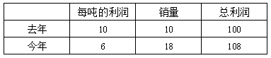

设去年每吨的利润为10，销量为10，总利润为100；则今年每吨的利润为6，销量为18，总利润为108。故今年的总盈利比去年增加了(108 - 100)/100 × 100% = 8%。

故正确答案为B。

**考点**：经济利润问题

**来源**：2014年四川省公务员录用考试《行测》题第53题

### 第 55 题

某宾馆有6个空房间，3间在一楼，3间在二楼。现有4名客人要入住，每人都住单间，都优先选择一楼房间。问宾馆共有多少种安排：

A. 24

B. 36

C. 48

D. 72

第 55 题 · 答案与解析

**参考答案（粉笔题库参考内容）**

D

**解析**

依据条件，4名客人都优先选择一楼，一楼共3个房间。故可先从4名客人当中抽取3名住在一楼，共C_4^3 种选法；将抽取的3名客人都安排到一楼，即将3名客人全排列，共A_3^3 种排法；剩下的1人只能住在二楼，共C_3^1种选法。分步相乘，故宾馆一共可有：C_4^3 × A_3^3 × C_3^1 = 4 × 6 × 3 = 72种排法。

故正确答案为D。

**考点**：基础排列组合

**来源**：2014年四川省公务员录用考试《行测》题第60题

### 第 56 题

数字3、5至少都出现一次的三位数有多少个：

A. 48

B. 52

C. 54

D. 60

第 56 题 · 答案与解析

**参考答案（粉笔题库参考内容）**

B

**解析**

数字3、5至少都出现一次的三位数，一共有以下情况：

（1）3和5都只出现1次，另外一个数从0-9（去掉3和5）中选取，有8种选择，3个数的排列A_3^3，一共有8×A3^3 = 48中。但是0不能放在百位，故要去掉035和053这两种情况，故共有48-2=46种；

（2）3出现2次、5出现1次，5的位置决定三位数的结果，故根据5可从百十个位中挑选有3种结果，可得共有3种；

（3）3出现1次、5出现2次，3的位置决定三位数的结果，故根据3可从百十个位中挑选有3种结果，可得共有3种。

则全部的情况数一共有46+3+3=52种情况。

故正确答案为B。

**考点**：基础排列组合

**来源**：2014年四川省公务员录用考试《行测》题第57题

### 第 57 题

速算比赛，小李全对的概率为95%，小杨全对的概率为92%，问这次比赛两人中只有一个人全对的概率为（  ）。

A. 0.046

B. 0.076

C. 0.122

D. 0.874

第 57 题 · 答案与解析

**参考答案（粉笔题库参考内容）**

C

**解析**

只有一人全对有两种情况，只有小李全对或只有小杨全对。

只有小李全对的概率为95%×（1－92%）＝7.6%；

只有小杨全对的概率为（1－95%）×92%＝4.6%；

故只有一人全对的概率为7.6%＋4.6%＝12.2%。

故正确答案为C。

**考点**：给概率求概率

**来源**：2014年四川省公务员录用考试《行测》题第56题

### 第 58 题

将2万本书籍分给某希望小学9个班的学生。在9个班中，其中1个班有学生32人，其余8个班人数相同且在40到50人之间。如每名学生分到的书本数相同，问每人分到了多少本书：

A. 40

B. 50

C. 60

D. 80

第 58 题 · 答案与解析

**参考答案（粉笔题库参考内容）**

B

**解析**

设每人分到了x本书，在其余8个班中每个班均有y名同学。则依据条件，可列式为：32x+8xy=20000，化简后得：x（4＋y）＝2500。x、y均为整数，则可推出2500能被x整除，观察选项，只有B项50可以满足。

故正确答案为B。

**考点**：和差倍比问题

**来源**：2014年四川省公务员录用考试《行测》题第59题

### 第 59 题

某游乐园提供打折的团体门票。当团队人数低于50时，票价为10元/人；团队人数在51~100时，票价为8元/人；团队人数超过100时，票价为5元/人。某校甲班有50多人，乙班不足50人，如果以班为单位分别购买门票，两个班一共应付944元；如果两个班联合起来作为一个团体购票，一共要付530元。问乙班有多少人？（  ）

A. 46

B. 47

C. 48

D. 49

第 59 题 · 答案与解析

**参考答案（粉笔题库参考内容）**

C

**解析**

依据条件，两个班联合起来作为一个团体购票，共花费530元。530并非8的倍数，故可推出两个班总人数应在100人以上。设甲班有x人，乙班有y人，则可列方程组10y + 8x = 944，5(x + y) = 530

，解得x=58，y=48。故乙班有48人。

故正确答案为C。

**考点**：分段计算问题、和差倍比问题

**来源**：2014年四川省公务员录用考试《行测》题第55题

### 第 60 题

在一场篮球比赛中，甲、乙、丙、丁共得125分，如果甲再多得4分，乙再少得4分，丙的分数除以4，丁的分数乘以4，则四人得分相同。问甲在这场比赛中得了多少分：

A. 24

B. 20

C. 16

D. 12

第 60 题 · 答案与解析

**参考答案（粉笔题库参考内容）**

C

**解析**

设经过相应转化后四人得分均为x分，则可逆向推出甲的得分为x-4；乙的得分为x+4；丙的得分为4x；丁的得分为x/4。则可列方程为：x − 4 + x + 4 + 4x + x/4=125，解得x=20，则甲的分数为20-4=16。

故正确答案为C。

**考点**：和差倍比问题

**来源**：2014年四川省公务员录用考试《行测》题第58题

### 第 61 题

8个人比赛国际象棋，约定每两人之间都要比赛一局，胜者得2分，平局得1分，负的不得分。在进行了若干局比赛之后，发现每个人的分数都不一样。问最多还有几局比赛没比：

A. 3

B. 7

C. 10

D. 14

第 61 题 · 答案与解析

**参考答案（粉笔题库参考内容）**

D

**解析**

8人比赛，每2人都要比赛一场，则共需要进行C_8^2=28场比赛。由比赛规则可知，每比赛一场就会产生2分，则28场一共产生比分28×2=56分。要使未开赛的比赛尽可能的多，则应让未产生的比分尽可能的多，就应让已产生的比分尽可能的少。已知经过若干局之后，每个人的得分均不相同，要让已产生的比分最少，可使8个人的得分分别为0、1、2、3、4、5、6、7分，即共产生比分28分，还有56-28=28分比分尚未产生。每比赛一场产生2分，则最多还有28/2=14场比赛尚未开赛。

故正确答案为D。

**考点**：非典型最值问题

**来源**：2014年四川省公务员录用考试《行测》题第63题

### 第 62 题

学校体育部采购一批足球和篮球，足球和篮球的定价分别为每个80元和100元。由于购买数量较多，商店分别给予足球25%、篮球20%的折扣，结果共少付了22%。问购买的足球和篮球的数量之比是多少：

A. 4 ：5

B. 5 ：6

C. 6 ：5

D. 5 ：4

第 62 题 · 答案与解析

**参考答案（粉笔题库参考内容）**

B

**解析**

设足球共买了x个，篮球共买了y个，依据条件足球和篮球的定价分别为每个80元和100元，商店分别给予足球25%、篮球20%的折扣，可知给出了折扣率，所以每个足球少付80 × 25% = 20元，每个篮球少付100 × 20% = 20元，已知结果共少付了22%，可得足球少付总钱数 + 篮球少付总钱数=原来总钱数×22%，列式为20x+20y=22%×(80x+100y)，化简可得x:y=5:6。

故正确答案为B。

**考点**：经济利润问题

**来源**：2014年四川省公务员录用考试《行测》题第61题

### 第 63 题

沿一个平面将长、宽和高分别为8、5和3厘米的长方体切割为两部分，问两部分的表面积之和最大是多少平方厘米：

A. 206

B. 238

C. 158 + 16√34

D. 158+10√73

第 63 题 · 答案与解析

**参考答案（粉笔题库参考内容）**

C

**解析**

要使切割后的两部分表面积之和最大，则应让切割面最大，则两部分的表面积之和便分解为原长方体表面积＋两个切割面表面积。原长方体表面积为（8×5＋8×3＋5×3）×2＝158平方厘米；切割面最大的表面积为沿着长边切割的斜面（即沿着图中线处切割），则两个切割面表面积为2×8×√(3^2+5^2) = 16√34平方厘米。则切割后两部分的表面积之和最大为158 + 16√34平方厘米。

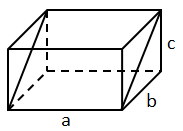

故正确答案为C。

**考点**：几何公式类-立体图形

**来源**：2014年四川省公务员录用考试《行测》题第62题

### 第 64 题

小明和小华计算甲、乙两个不同自然数的积（这两个自然数都比1大）。小明把较大的数字的个位数错看成了一个更大的数字，其计算结果为144，小华却把乘号看成了加号，其计算结果为28。问两个数的差为多少？

A. 16

B. 12

C. 8

D. 4

第 64 题 · 答案与解析

**参考答案（粉笔题库参考内容）**

A

**解析**

使用代入排除思想解题，设两个数分别为x、 y，根据题意可列方程：x+y=28。

A项：当两数之差为16时，即x-y=16，解得x=22，y=6。小明把较大的数的个位数错看成一个更大的数，当错看成24时，24×6=144，满足条件，A项当选；

B项：当两数之差为12时，即x-y=12，解得x=20，y=8。20×8 = 160，故小明必须要把较大的数20错看成一个更小的数18才可得到144，故B项不满足条件，排除；

C项：当两数之差为8时，即x-y=8，解得x=18，y=10。较小数10不能够被144整除，不满足条件，排除；

D项：当两数之差为4时，即x-y=4，解得x=16，y=12。需要将x看小才可以得到144，不满足条件，排除。

故正确答案为A。

**来源**：2014年四川省公务员录用考试《行测》题第64题

### 第 65 题

甲、乙、丙三个工厂承接A和B两批完全相同的加工订单，如果甲厂和乙厂负责A订单而丙厂负责B订单，则丙厂要比甲厂和乙厂晚15天完成；如在上述条件下甲厂分配1/3的生产资源或者乙厂分配1/5的生产资源用于B订单的生产，则A、B两个订单同时完成。问如果合并三个工厂的生产能力，第几天可以完成A订单的生产任务：

A. 22

B. 24

C. 25

D. 26

第 65 题 · 答案与解析

**参考答案（粉笔题库参考内容）**

D

**解析**

根据条件，在甲分配1/3的生产资源或乙分配1/5的生产资源给丙后，用于两个订单的工作效率相同，可列式：2/3甲 + 乙 = 丙 + 1/3甲；甲+4/5乙=丙+1/5乙。化简后得甲:乙=3:5。设甲的工作效率为3，乙的工作效率为5，则丙的工作效率为6。设开始A、B两订单的完工时间分别为t天、t+15天，则根据A、B订单量相等，可列式：（3+5）t=6（t+15），解得t=45。则A的订单量为(3 + 5) × 45 = 360。

那么三厂合并合力加工A订单，需要：360/(3+5+6) = 360/14 = 25 5/7天，即第26天可以完成A订单。

故正确答案为D。

**考点**：给效率比例型

**来源**：2014年四川省公务员录用考试《行测》题第65题

### 第 66 题

从所给的四个选项中，选择最合适的一个填入问号处，使之呈现一定的规律性。

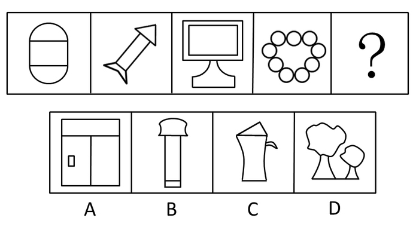

A. A

B. B

C. C

D. D

第 66 题 · 答案与解析

**参考答案（粉笔题库参考内容）**

B

**解析**

本题考点为图形推理中的属性——对称性。题干中的4个图形都是轴对称图形，选项中只有B项的图形是轴对称图形，其他三项为非轴对称图形，因此，本题答案为B选项。

故正确答案为B。

**考点**：属性规律-对称性

**来源**：2014年四川省公务员录用考试《行测》题第66题

### 第 67 题

从所给的四个选项中，选择最合适的一个填入问号处，使之呈现一定的规律性。

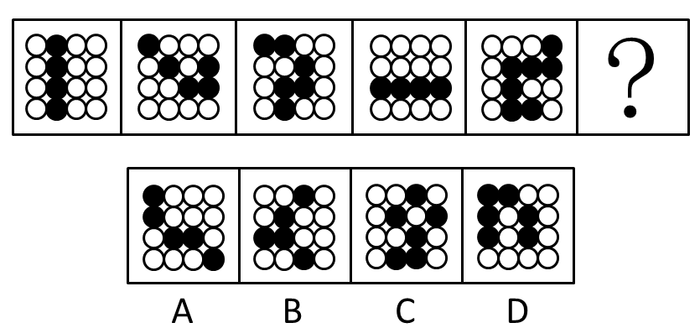

A. A

B. B

C. C

D. D

第 67 题 · 答案与解析

**参考答案（粉笔题库参考内容）**

A

**解析**

本题考查的是位置类中的其他位置问题。题干中4个图形中的白色圆圈都被黑色圆圈连成的线分割成了两部分。A项满足这一条件，当选；B项被分成了三部分，排除；C项被分成了四部分，排除；D项被分成了一部分，排除。

故正确答案为A。

**考点**：数量规律-素、黑白块类

**来源**：2014年四川省公务员录用考试《行测》题第67题

### 第 68 题

从所给的四个选项中，选择最合适的一个填入问号处，使之呈现一定的规律性：

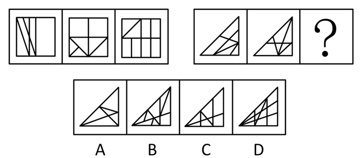

A. A

B. B

C. C

D. D

第 68 题 · 答案与解析

**参考答案（粉笔题库参考内容）**

C

**解析**

考查封闭区间。第一组图形中封闭区间分别为6、7、8；已知第二组图形中封闭区间分别为6、7、？。故“？”处图形应为8 个封闭区间。

故正确答案为C。

**考点**：数量规律-面

**来源**：2014年四川省公务员录用考试《行测》题第68题

### 第 69 题

从所给的四个选项中，选择最合适的一个填入问号处，使之呈现一定的规律性。

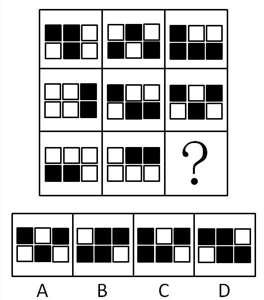

A. A

B. B

C. C

D. D

第 69 题 · 答案与解析

**参考答案（粉笔题库参考内容）**

B

**解析**

本题考查的是元素叠加中的黑白叠加问题。由题干得出的规律为黑＋白＝黑，黑＋黑＝白，白＋白＝白，白＋黑＝黑。

故正确答案为B。

**考点**：样式规律-黑白运算

**来源**：2014年四川省公务员录用考试《行测》题第69题

### 第 70 题

左边给定的是纸盒的外表面，右面哪一项能由它折叠而成？

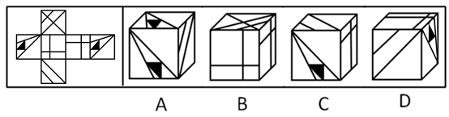

A. A

B. B

C. C

D. D

第 70 题 · 答案与解析

**参考答案（粉笔题库参考内容）**

A

**解析**

本题属于空间重构类，考查六面体，先将立体图的外表面一一标记，如下所示：

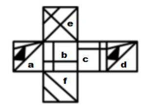

A项：由面a、d、f三个面组成，面a、d相隔较远不易看，暂时搁置；

B项：由面b、c、e三个面组成，在面e寻找一个唯一的点，开始顺时针画边，如下图所示。题干中边4对应的是面a，而选项中边4对应的是面b或c，排除；

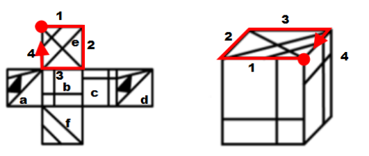

C项：由面f、b（或c）、a（或d）组成，在面f寻找一个唯一的点，开始顺时针画边，如下图所示。题干中边3对应的是面c内部的大块空白四边形，而选项中边3对应的不是大块空白四边形，排除；

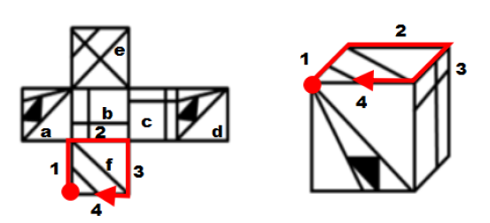

D项：由面f、b或c、a或d（ac不能同时出现，bd不能同时出现）组成，在面f寻找一个唯一的点，开始顺时针画边，如下图所示。题干中边2对应的是面b，而选项边2对应的是面a或d，排除。

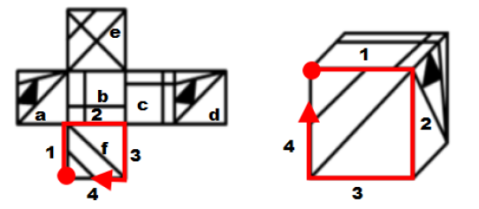

故正确答案为A。

**考点**：空间类-空间重构-六面体

**来源**：2014年四川省公务员录用考试《行测》题第70题

### 第 71 题

某所高中调查学生参加社团的情况，发现在象棋社社员中，只要是高二（3）班学生，则其一定也是校篮球队的队员。

由此可以推出：

A. 甲是象棋社社员，且甲是篮球队员，则甲是高二（3）班学生

B. 乙是高二（3）班学生，且乙是篮球队员，则乙是象棋社社员

C. 丙是象棋社社员，且丙不是篮球队员，则丙不是高二（3）班学生

D. 丁不是象棋社社员，且丁也不是篮球队员，则丁不是高二（3）班学生

第 71 题 · 答案与解析

**参考答案（粉笔题库参考内容）**

C

**解析**

第一步：翻译题干。

象棋社社员且高二（3）班学生→校篮球队队员

第二步：逐一分析选项。

A项：翻译为象棋社社员且篮球队队员→高二（3）班学生，篮球队队员属于对题干的肯后，无法推出确定性结论，排除；

B项：翻译为高二（3）班学生且篮球队队员→象棋社社员，篮球队队员属于对题干的肯后，无法推出确定性结论，排除；

C项：象棋社社员且-篮球队队员→—高二（3）班学生，-篮球队队员属于对题干的否后，根据逆否规则，可以推出-象棋社社员或-高二（3）班学生，又有丙是象棋社社员，根据或关系否一推一的推理规则，可以推出丙不是高二（3）班的学生，当选；

D项：-象棋社社员且-篮球队队员→—高二（3）班学生，-篮球队队员属于对题干的否后，根据逆否规则，可以推出-象棋社社员或-高二（3）班学生，又有丁不是象棋社社员，肯定或关系的其中一项，无法推出确定性结论，排除。

故正确答案为C。

**考点**：常规翻译

**来源**：2014年四川省公务员录用考试《行测》题第92题

### 第 72 题

某些公务员是行政管理专业的。因此，某些行政管理专业的人做管理工作。

上述推理如果成立，必须补充以下哪项作为前提：

A. 所有公务员都做管理工作

B. 某些公务员不是做管理工作的

C. 某些行政管理专业的人不是公务员

D. 所有行政管理专业的人都是公务员

第 72 题 · 答案与解析

**参考答案（粉笔题库参考内容）**

A

**解析**

本题属于三段论推理。题设的条件：存在公务员是行政管理专业的，即“有的公务员→行政管理专业”等价于“有的行政管理专业→公务员”，题设的结论：存在行政管理专业的人做管理工作，即“有的行政管理专业→做管理”。在公务员与管理工作之间，缺少一个衔接条件，方向应从条件指向结论，A项所有公务员都做管理工作，即“公务员→做管理”，满足要求。

故正确答案为A。

**考点**：集合推理

**来源**：2014年四川省公务员录用考试《行测》题第93题

### 第 73 题

研究人员对年龄在40~70岁的990人的电话采访和实验室化验结果进行分析发现：乐观者“坏”胆固醇（即低密度脂蛋白）高的可能性较低，而“好”胆固醇（即高密度脂蛋白）较高，这对心脏有保护作用，有助于抵消“坏”胆固醇。因此，研究认为这是心理健康与身体健康息息相关的又一证据，乐观的性情可能对人体健康有一些实实在在的好处。

以下哪项如果为真，最能支持上述研究结论：

A. 目前该研究尚未发现乐观程度和总的胆固醇水平之间产生联系的原因

B. 乐观者的生活方式更为健康，这使得他们血液中的脂类与其他人群有差别

C. 被采访的乐观者中有大量运动爱好者，经常锻炼能使其患心脏病的风险降低

D. 实验中，乐观程度得分每增加5分，每100毫升血液中的高密度脂蛋白就增加1毫克，这意味着罹患心脏病的风险降低3%

第 73 题 · 答案与解析

**参考答案（粉笔题库参考内容）**

D

**解析**

第一步：找到论点论据。

论点：乐观的性情对人体健康有好处。

论据：乐观者“好”胆固醇高，对心脏有保护作用。

第二步：判断加强方式。本题论点论据话题一致，都在说乐观对健康有好处，故可以考虑补充新论据加强论点。

第三步：逐一分析选项。

A项：涉及的“未发现原因”与论点无关，属于无关选项，排除；

B项：涉及的脂类，虽然胆固醇属于脂类，但没有明确说明该脂类是胆固醇，属于无关选项，排除；

C项：说明乐观者心脏病风险低另有他因，削弱了题干，排除；

D项：用实验数据证明乐观者高密度脂蛋白高，有利于降低心脏病风险，补充论据加强，当选。

故正确答案为D。

**考点**：补充论据

**来源**：2014年四川省公务员录用考试《行测》题第94题

### 第 74 题

全球变暖在大多数人看来已经是一个不争的事实，但某气候变化研究机构却发表数据称，从1997年年初至2012年8月，全球总体气温变化仅为0°C。该机构据此认为，全球变暖趋势已经中止。

下列哪项如果为真，不能质疑该研究机构的结论？

A. 气候观察所选择的时间起点和终点十分关键，否则会扭曲研究结论

B. 对研究全球气候变化而言，十几年的数据只是一个短期数据，并不能说明问题

C. 最新研究结果显示，相比于人类活动，全球气候变化更多受地球自身运动的影响

D. 目前全球气温记录所依赖的电脑模型存在缺陷，真实的气候变化远比其反映的要复杂

第 74 题 · 答案与解析

**参考答案（粉笔题库参考内容）**

C

**解析**

第一步：找出论点论据。

论点：全球变暖趋势已经中止。

论据：从1997年年初至2012年8月，全球总体气温变化仅为0°C。

第二步：逐一判断选项。

A项，质疑所选择的时间起点和终点，削弱论据，排除。

B项，质疑了论据中所使用的数据周期太短，削弱论据，排除。

C项，题干话题是全球变暖是否中止，非全球变暖的影响因素，无关选项，当选。

D项，通过说明电脑模型存在缺陷，质疑论据不可靠，削弱论据，排除。

第三步：再次标注答案。

本题为选非题，故正确答案为C。

**考点**：削弱选非题

**来源**：2014年四川省公务员录用考试《行测》题第95题

### 第 75 题

调查显示，选择多种方式投资的人往往比只从事本职工作的人更富有。因此，选择多种方式投资有助于人们获得财富。

下列哪项如果为真，最能反驳上述观点？

A. 能进行多种方式投资的人的学历普遍较高

B. 选择多种方式投资的风险比只从事本职工作大

C. 人们只有拥有一定财富后才会选择多种方式投资

D. 有些只从事本职工作的人比选择多种方式投资的人更富有

第 75 题 · 答案与解析

**参考答案（粉笔题库参考内容）**

C

**解析**

第一步：找出论点和论据。

论点：选择多种方式投资有助于人们获得财富。

论据：选择多种方式投资的人往往比只从事本职工作的人更富有。

第二步：逐一分析选项。

A项：在选择多种方式投资的同时，这群人学历普遍还高，提出了另外一个有助于人们获得财富的原因，属于他因削弱，保留；

B项：选择多种方式投资风险大不代表不能获得财富，不能削弱，排除；

C项：指出是有一定财富的人才会选择多种方式投资，而不是选择多种方式投资的人变富有了，属于因果倒置，保留；

D项：有些只从事本职工作的人比选择多种方式投资的人更富有，并不能否认选择多种方式投资的人会获得财富，不能削弱，排除。

对比A、C项，C项的因果倒置削弱力度强于A项的他因，择优选择C项。

故正确答案为C。

**考点**：因果倒置

**来源**：2014年四川省公务员录用考试《行测》题第96题

### 第 76 题

今天的美国人比1965年美国人运动量减少了32%，预计到2030年将减少46%；在中国，与1991年相比，人们运动量减少45%，预计到2030年将减少51%。缺少运动已经成为一个全球性问题。

以下哪项如果为真，最能支持上述观点？

A. 其他国家人们的运动量情况和中国、美国大致相同

B. 人们保持健康的方式日益多样化，已不仅局限于运动

C. 中国和美国都是运动量缺乏这一问题较为严重的国家

D. 在运动量方面，中国和美国分别是亚洲和美洲最有代表性的国家

第 76 题 · 答案与解析

**参考答案（粉笔题库参考内容）**

A

**解析**

第一步：找到论点论据。

论点：缺少运动已经成为一个全球性问题。

论据：美国人、中国人的运动量都在大幅下降。

本题论点说的是全球缺少运动，论据说的是美国人、中国人缺少运动，二者话题不一致，加强考虑搭桥，即证明美国人、中国人代表全球或者全球其他地区的人也缺少运动。

第二步：逐一分析选项。

A项，若其他国家人们运动量与中国、美国大致相同，则说明其他国家也存在运动量大幅下降的问题，进而缺少运动成为一个全球性问题。该项在论点与论据之间建立联系，加强论证，当选。

B项，题干论点为缺少运动是否是全球性问题，与保持健康的方式无关。该项为无关项，排除。

C项，中国和美国都是运动量缺乏这一问题较为严重的国家，不能用情况比较严重的国家推出全球的情况，切断论点和论据直接的联系，拆桥项，排除。

D项，中国和美国分别可以代表亚洲和美洲，但仅凭亚洲和美洲不能代表全球。该项不能支持，排除。

第三步：再次标注答案。

故正确答案为A。

**考点**：加强-实验类、搭桥

**来源**：2014年四川省公务员录用考试《行测》题第97题

### 第 77 题

近年来，猫成为A国野生动物的最大威胁，这些猫（包括宠物猫和流浪猫、野猫、农场猫等“无主猫”）每年捕杀动物的数量达上百亿。有动物慈善机构建议可以给猫佩戴有铃铛的项圈。戴有这样项圈的猫比其他猫的猎捕成功率至少降低三分之一，捕杀数量将因此而大幅减少。

以下哪项如果为真，最能对该建议形成质疑？

A. 猫进行捕杀时，并不会顾及铃铛的响声

B. 这一举措将导致猫食物链的断裂，可能导致该国猫的大量死亡

C. 有数据显示，近年来死于车辆碾压、中毒的野生动物数量在急剧上升

D. 给“无主猫”戴上项圈难度很大，而绝大部分动物由“无主猫”捕杀

第 77 题 · 答案与解析

**参考答案（粉笔题库参考内容）**

D

**解析**

第一步：找到论点论据。

论点：给猫佩戴有铃铛的项圈能减少被猫捕杀的野生动物数量。

论据：带有这样项圈的猫，猎捕成功率降低。

第二步：判断削弱方式。本题论点需要多个论据证明，故可以考虑补充新论据削弱论点。

第三步：逐一分析选项。

A项：涉及的是猫捕杀的意愿，与论点无关，属于无关选项，排除；

B项：说明该举措会导致猫的大量死亡，那么猫对野生动物的捕杀数量自然会下降，加强了论点，排除；

C项：涉及的是野生动物死亡的其他原因，与论点无关，属于无关选项，排除；

D项：说明该举措对“无主猫”难以实现，而“无主猫”恰恰是捕杀野生动物数量最大的群体，所以该措施的效果值得质疑，削弱论点，当选。

故正确答案为D。

**考点**：削弱论点

**来源**：2014年四川省公务员录用考试《行测》题第98题

### 第 78 题

“万夫一力，天下无敌”说的就是团结。团结出凝聚力，出生产力，出战斗力，团结可以战胜艰难险阻，创造人间奇迹。一个组织的成员只有团结一致，这个组织才能高效率地运作；一个组织的成员如果能团结一致，也就一定能产生超出各个体之和的整体效益。

由此可以推出：

A. 只有团结一致，才能战胜各种艰难险阻

B. 一个高效率运作的组织其成员之间一定是团结一致的

C. 一个组织的成员若不团结一致，就会相互内耗，影响整体效益

D. 一个组织只有高效率地运作，才能产生超出各个体之和的整体效益

第 78 题 · 答案与解析

**参考答案（粉笔题库参考内容）**

B

**解析**

第一步：翻译题干。

（1）团结→战胜艰难险阻；

（2）高效率运作→团结；

（3）团结→产生超出各个体之和的整体效益。

第二步：逐一翻译选项并判断正误。

A项：战胜艰难险阻→团结，是对（1）的肯后，无法推出绝对化结论，错误；

B项：高效率运作→团结，是（2）的同义替换，正确；

C项：-团结→—整体效益，是对（3）的否前，无法推出绝对化结论，错误；

D项：产生超出各个体之和的整体效益→高效率运作，题干没有提到整体效益与高效率运作的直接关系，该项是对（3）的肯后，无法推出绝对化结论，错误。

故正确答案为B。

**考点**：常规翻译

**来源**：2014年四川省公务员录用考试《行测》题第100题

### 第 79 题

心理学家德威克用10年时间对400名五年级小学生进行实验，发现被夸聪明的孩子更容易放弃、缺乏自信、不敢冒险。后来她重复实验时把不同社会阶层都纳入了自己的实验，都发现了相同的结果，不论男女，连学龄前的孩子也未能幸免被表扬后带来的负面效应。

以下哪项如果为真，最能支持上述研究结论？

A. 表扬并不一定都具有积极作用，效果因表扬的具体内容和形式而有天壤之别

B. 一份关于表扬的综合调查结果显示，被表扬的学生变得更倾向于规避风险和缺乏独立精神

C. 一项对积极表扬组和无表扬组的学生的学习成绩对比研究显示，他们的学习成绩差异不显著

D. 研究发现，表扬对最聪明的女孩影响最大，她们大部分在一项“失败反应”的测试中都崩溃了

第 79 题 · 答案与解析

**参考答案（粉笔题库参考内容）**

B

**解析**

第一步：找出论点和论据。

论点：被夸聪明的孩子更容易放弃、缺乏自信、不敢冒险。

论据：不同社会阶层，不论男女，都不能幸免被表扬后带来的负面效应。

第二步：逐一分析选项。

A项：表扬不一定有积极作用，不明确是否一定有消极作用，不能支持，排除；

B项：被表扬的学生会倾向于规避风险和缺乏独立精神，解释了为什么被表扬有负面影响，能加强，保留；

C项：涉及的学习成绩与论点无关，属于无关选项，排除；

D项：表扬使得最聪明女孩在测试中都崩溃了，举例说明了被表扬有负面影响，能加强，保留；

比较B、D两项，B项是解释论点，D项是举例加强，B项加强力度更强。

故正确答案为B。

**考点**：补充论据

**来源**：2014年四川省公务员录用考试《行测》题第99题

### 第 80 题

老王对老李说：“除非你在今天之内按照合同要求支付货款，否则我们法庭上见。”

以下哪项判断的含义与上述判断不同？

A. 只有老李今天按照合同的要求支付货款，老王才不会将他告上法庭

B. 如果老李今天按照合同的要求支付货款，那么老王不会将他告上法庭

C. 如果老李今天不按照合同的要求支付货款，那么老王就会将他告上法庭

D. 如果老王没有将老李告上法庭，那么老李在今天按照合同的要求支付货款

第 80 题 · 答案与解析

**参考答案（粉笔题库参考内容）**

B

**解析**

第一步：翻译题干。

\-法庭上见→老李在今天之内按照合同要求支付货款。

第二步：逐一翻译选项并判断正误。

A项：-告上法庭→老李今天按照合同的要求支付货款，是对题设推理的肯前，可以推出，正确；

B项：老李今天按照合同的要求支付货款→—告上法庭，是对题设推理的肯后，无法推出绝对化结论，错误；

C项：-老李今天按照合同的要求支付货款→告上法庭，是对题设推理的同义替换，正确；

D项：-告上法庭→老李今天按照合同的要求支付货款，同A项，正确。

本题为选非题，故正确答案为B。

**考点**：常规翻译

**来源**：2014年四川省公务员录用考试《行测》题第91题

### 第 81 题

试图控制他人对自己印象的形成过程被称为印象管理。

根据上述定义，下列行为不属于印象管理的是：

A. 在面试时，考生小李有意附和主考官的言论

B. 小赵上课迟到了，向老师道歉，解释迟到原因

C. 小周年龄不大就秃顶了，他每次见客户都戴上帽子

D. 老孙在工作中兢兢业业，勤勤恳恳，吃苦在前，享受在后

第 81 题 · 答案与解析

**参考答案（粉笔题库参考内容）**

D

**解析**

第一步：查找关键词。

“试图控制”“对自己印象的形成过程”。

第二步：逐一分析选项。

A项：小李有意附和是试图给考官留下好印象，排除；

B项：道歉和解释原因是试图控制他人不留下对自己不好的印象，排除；

C项：每次见客户都戴上帽子体现了控制他人对自己印象形成，排除；

D项：勤勤恳恳地工作并没有体现控制他人对自己印象形成，当选。

本题为选非题，故正确答案为D。

**考点**：拆词

**来源**：2014年四川省公务员录用考试《行测》题第71题

### 第 82 题

行政法律关系根据行政权力的作用范围不同分为外部行政法律关系和内部行政法律关系。行政机关与公民、法人和其他组织之间作为管理和被管理关系的是外部行政法律关系；双方当事人作为上下级的从属关系是内部行政法律关系。

根据上述定义，下列行为属于内部行政法律关系的是：

A. 某省公安厅表彰省交警大队的“英模干警”

B. 某卫生局检查所辖范围内的餐饮企业

C. 某大学对违纪学生进行处罚

D. 某企业到税务局纳税

第 82 题 · 答案与解析

**参考答案（粉笔题库参考内容）**

A

**解析**

第一步：找出定义关键词。

“上下级的从属关系”。

第二步：逐一分析选项。

A项：省公安厅和省交警大队是属于上下级的从属关系，符合定义，当选；

B项：卫生局和餐饮企业是管理和被管理关系，属于外部行政法律关系，不符合定义，排除；

C项：大学不属于行政机关，不符合定义，排除；

D项：税务局和企业是管理和被管理关系，属于外部行政法律关系，不符合定义，排除。

故正确答案为A。

**考点**：常规问法

**来源**：2019年福建省选调生考试《行政职业能力测验》第75题

### 第 83 题

语言规划是指政府或社会团体对语言文字及其使用进行的有组织、有目的、有计划的人工干预与管理，主要包括语言地位规划、语言本体规划。

根据上述定义，下列不属于语言规划的是：

A. 立法推广普通话

B. 制定简化字总表

C. 国家语委规范网络用语

D. 大学发展语言教育产业

第 83 题 · 答案与解析

**参考答案（粉笔题库参考内容）**

D

**解析**

第一步：找出定义关键词。

主体：“政府或社会团体”。

第二步：逐一分析选项。

A项：立法的主体一定是政府，而且是人为的干预，排除。

B项：主体不是很明确，因此属于不确定项，保留。

C项：主体是国家，且规范行为属于人为的干预，排除。

D项：主体大学不属于“政府或社会团体”范畴。因此相比于B项，D项一定不属于语言规划，当选。

本题为选非题，故正确答案为D。

**考点**：主客体

**来源**：2014年四川省公务员录用考试《行测》题第73题

### 第 84 题

社会支持系统通常是指来自社会各方面包括父母、亲戚、朋友等给予个体的精神或物质上的帮助和支持的系统，它的目标是使个体重新恢复到和谐的心理状态和优良的生活中。

根据上述定义，下列不属于社会支持系统的是：

A. 小陈高考失败，父母对其进行安慰

B. 张某因为失恋，心情不好，找朋友倾诉

C. 小赵心情不好时，就听自己偶像的歌曲缓解情绪

D. 平时工作压力很大，李某就经常和同事出去唱歌吃饭

第 84 题 · 答案与解析

**参考答案（粉笔题库参考内容）**

C

**解析**

第一步：查找关键词。

“社会各方面包括父母、亲戚、朋友等”。

第二步：逐一分析选项。

A项：父母给予精神上的支持，属于社会支持系统，排除；B项：朋友在精神上支持鼓励，属于社会支持系统，排除；D项：朋友在精神上支持，属于社会支持系统，排除；C项：小赵听偶像的音乐，并不是来自社会各方面包括父母、亲戚、朋友等的支持，不属于社会支持系统，当选。

本题为选非题，故正确答案为C。

**考点**：主客体

**来源**：2014年四川省公务员录用考试《行测》题第74题

### 第 85 题

私德是指人们在不直接涉及对社会整体的义务和责任的私人生活和私人交往中应当遵循的道德准则，主要包括个人生活习惯、行为风度、性格特点以及处理爱情、婚姻、家庭问题的道德等。

根据上述定义，下列不属于私德的是（    ）。

A. 刘某个性张扬，喜欢穿戴各种新潮服饰

B. 张某遵纪守法，从没干过违法犯罪的事情

C. 李某很勤快，家里所有家务活都是他做的

D. 王某是个公务员，他和邻居相处得很好

第 85 题 · 答案与解析

**参考答案（粉笔题库参考内容）**

B

**解析**

第一步：判断题干中的关键词。

关键词：道德准则；个人生活习惯、行为风度、性格特点以及处理爱情、婚姻、家庭问题的道德等。

第二步：逐一分析选项。

A项，穿戴服饰是个人的生活习惯，符合定义，排除。

B项，遵纪守法属于法律层面，不是道德准则，不符合定义，当选。

C项，做家务活属于处理家庭问题的道德，符合定义，排除。

D项，与邻居相处属于行为风度、性格特点，符合定义，排除。

第三步：再次标注答案。

本题为选非题，故正确答案为B。

**考点**：单定义-其他句式

**来源**：2014年四川省公务员录用考试《行测》题第75题

### 第 86 题

习得性无助是指将多次失败无条件地归因于自身因素的个体，会习得是一种自我失控感，认为自己的一切努力都是无效的，因此会放弃努力，被动屈从，变得淡漠而毫无激情。

根据上述定义，下列不属于习得性无助的是：

A. 小红因弹钢琴出错屡遭母亲训斥，她认为自己没有音乐天分，不再愿意练钢琴了

B. 小李曾交往过好几个女朋友，但都以分手告终，于是他认为自己没有魅力，再也不敢和女孩交往了

C. 小王工作中粗心大意，常出现失误，被领导批评几次后工作细致了许多，近期再没被领导批评过

D. 小张大学所学的专业相对冷门，在多次求职无果后，他便不再对外出工作抱有热情

第 86 题 · 答案与解析

**参考答案（粉笔题库参考内容）**

C

**解析**

第一步：查找关键词。

“认为自己的一切努力都是无效的”、“会放弃努力，被动屈从”。

第二步：逐一分析选项。

A项：屡遭母亲训斥后认为没有音乐天分不再愿意弹琴，符合定义关键词，排除；B项：分手之后认为自己没有魅力再也不敢和女孩交往，符合定义关键词，排除；C项：失误被领导批评后工作细致很多，不符合定义关键词“放弃努力”，当选；D项：多次求职无果后不再对外出工作抱有热情，符合定义关键词，排除。

本题为选非题，故正确答案为C。

**考点**：原因结果

**来源**：2014年四川省公务员录用考试《行测》题第76题

### 第 87 题

定金是指根据约定一方向对方给付一定数额的金钱作为债权担保的担保方式。债务人履行债务后，定金应当抵作价款或者回收。给付定金的一方不履行约定的债务的，无权要求返还定金；收受定金的一方不履行约定的债务的，应当双倍返还定金。

根据上述定义，下列属于定金的是：

A. 小张订婚时按照双方的商定送给女方5万元的礼金

B. 由于车源紧俏，小陈在买车时为了能立即提车而同意向4S店多支付1万元

C. 某公司为了确保员工在下一年继续在该公司上班，扣留部分工资至第二年发放

D. 小李在看中某套二手房后向房东支付了2万元，双方约定，在一周内房东将此房出售给小李

第 87 题 · 答案与解析

**参考答案（粉笔题库参考内容）**

D

**解析**

第一步：查找关键词。

“债权担保”。

第二步：逐一分析选项。

A项：5万元的礼金不是债权担保，排除；B项：向4S店多支付1万元不是债权担保，排除；C项：扣留部分工资不是债权担保，排除；D项：向房东支付2万元，双方约定在一周内房东将此房出售给小李，他们之间形成了债权担保关系，当选。

故正确答案为D。

**考点**：单定义-其他句式

**来源**：2014年四川省公务员录用考试《行测》题第77题

### 第 88 题

公共产品也被称为“公共物品”，系指一种非排他性的物品或者服务。

根据上述定义，下列属于公共产品的是：

A. 社区治安

B. 经济适用房

C. 高速公路

D. 牧民草地

第 88 题 · 答案与解析

**参考答案（粉笔题库参考内容）**

C

**解析**

第一步：查找关键词。

“公共物品”、“非排他性”、“物品或者服务”。

第二步：逐一分析选项。

A项：社区治安是一种社会秩序，且治安只针对小区内的人，具有排他性，排除；

B项：不属于公共物品，排除；

C项：属于公共物品，当选；

D项：不属于公共物品，排除。

故正确答案为C。

**考点**：单定义-其他句式

**来源**：2014年四川省公务员录用考试《行测》题第79题

### 第 89 题

对比效应是一种社会知觉偏见，指评价一个人或一件事时，受到最近接触到的其他人或事的影响，导致对这个人或这件事的评价发生歪曲，作出不客观的评价。

根据上述定义，下列属于对比效应的是？

A. 实验表明，模拟审判团对形象差的被告判的刑期更长

B. 和很多人一样，老王也认为理想的家庭应该是“男主外，女主内”

C. 小李认为自己能进入某知名外企工作是由于自身优秀，而小罗只是运气好

D. 面试时如果前一个考生表现平平，考官往往会给其后面的考生偏高的分数

第 89 题 · 答案与解析

**参考答案（粉笔题库参考内容）**

D

**解析**

第一步：查找关键词。

“社会知觉偏见”、“受到其他人或事的影响，作出不客观的评价”。

第二步：逐一分析选项。

A、B、C三项均没有体现受到其他人或事的影响，作出不客观的评价，均排除；

D项：考官根据前一个考生的表现平平给后面的考生的分数偏高，符合定义关键词，当选。

故正确答案为D。

**考点**：原因结果

**来源**：2014年四川省公务员录用考试《行测》题第78题

### 第 90 题

正强化，又叫做积极强化，是采用鼓励的方法来肯定某种行为，使个体感到有利，从而愿意保持自己的积极行为。根据上述定义，下列属于正强化的是（    ）。

A. 甲发现在英语角没有人嘲笑他的口语发音，他以后就经常去英语角

B. 乙上课发言受到老师的公开表扬，他后来发言的次数明显增多了

C. 丙的办公室失窃了，从此他每次离开办公室都要检查门窗

D. 丁有一次上班迟到碰到领导，他以后再也不敢迟到了

第 90 题 · 答案与解析

**参考答案（粉笔题库参考内容）**

B

**解析**

第一步：判断题干中的关键词。

方式：采用鼓励的方法。

目的：肯定某种行为，使个体感到有利，从而愿意保持自己的积极行为。

第二步：逐一分析选项。

A项，经常去英语角的原因是没有人嘲笑他的口语发音而不是因为被鼓励，不符合定义，排除。

B项，发言受到表扬因而发言次数增加属于因受到鼓励从而愿意保持自己积极发言的行为，符合定义，当选。

C项，因被窃而检查门窗的原因不是因为被鼓励，不符合定义，排除。

D项，不敢迟到的原因是因为曾经迟到碰到过领导而不是被鼓励，不符合定义，排除。

第三步：再次标注答案。

故正确答案为B。

**考点**：方式目的

**来源**：2014年四川省公务员录用考试《行测》题第80题

### 第 91 题

家用电器：洗衣机

A. 游戏厅：游戏机

B. 台式电脑：笔记本

C. 北京大学：中文系

D. 交通工具：大巴车

第 91 题 · 答案与解析

**参考答案（粉笔题库参考内容）**

D

**解析**

第一步：判断题干词语间逻辑关系。

家用电器与洗衣机属于包容关系中的种属关系。

第二步：判断选项词语间逻辑关系。

A项游戏厅与游戏机、C项北京大学与中文系不属于种属关系，B项台式电脑与笔记本属于并列关系，均排除。

故正确答案为D。

**考点**：逻辑关系-包容关系

**来源**：2014年四川省公务员录用考试《行测》题第85题

### 第 92 题

国会：议员

A. 论坛：网民

B. 监狱：犯人

C. 法院：法官

D. 企业：工会

第 92 题 · 答案与解析

**参考答案（粉笔题库参考内容）**

A

**解析**

第一步：判断题干词语间逻辑关系。

国会和议员是渠道和人物的对应关系，即：国会是议员们发表言论和看法的途径。

第二步：判断选项词语间逻辑关系。

A项：论坛是网民们发表言论和看法的途径，与题干逻辑关系一致，当选；

B项：犯人被关押在监狱里，监狱不是犯人发表言论和看法的途径，与题干逻辑关系不一致，排除；

C项：法院是一个国家机关，是法官的工作地点，并且法院是个具体的地点，题干中的国会是个抽象名词，法院不是法官发表言论和看法的途径，与题干逻辑关系不一致，排除；

D项：有的企业是有工会的，所以企业和工会是或然的组成关系，企业不是工会发表言论和看法的途径，与题干逻辑关系不一致，排除。

故正确答案为A。

**考点**：逻辑关系-对应关系

**来源**：2014年四川省公务员录用考试《行测》题第81题

### 第 93 题

树木：煤炭

A. 汽油：石油

B. 象牙：大象

C. 树脂：琥珀

D. 太阳：能源

第 93 题 · 答案与解析

**参考答案（粉笔题库参考内容）**

C

**解析**

第一步：判断题干词语间逻辑关系。

树木经过成千上亿年的沉淀变化形成煤炭，前者是后者的原材料。

第二步：判断选项词语间逻辑关系。

A项：汽油是从石油中分解出来的，石油是汽油的原材料，与题干词语顺序相反，排除；

B 项：象牙是大象身体的一部分，二者是组成关系，排除；

C项：树脂经过成千上万年的沉淀变化形成琥珀，前者是后者的原材料，当选；

D项：太阳可以提供能源，二者不是原材料的对应关系，排除。

故正确答案为C。

**考点**：逻辑关系-对应关系

**来源**：2014年四川省公务员录用考试《行测》题第82题

### 第 94 题

电：手机

A. 风：风车

B. 螺旋桨：直升机

C. 水：船

D. 光：植物

第 94 题 · 答案与解析

**参考答案（粉笔题库参考内容）**

A

**解析**

第一步：判断题干词语间逻辑关系。

电是手机运行的动力来源，二者为动力来源的对应关系。

第二步：判断选项词语间逻辑关系。

A项：风是风车运行的动力来源，二者为动力来源的对应关系，与题干逻辑关系一致，当选；

B项：螺旋桨是直升机的组成部分，二者为组成关系，与题干逻辑关系不一致，排除；

C项：船可以在水上行驶，二者为地点对应关系，与题干逻辑关系不一致，排除；

D项：光是植物生长的必要条件，二者为必要条件的对应关系，与题干逻辑关系不一致，排除。

故正确答案为A。

**考点**：逻辑关系-对应关系

**来源**：2014年四川省公务员录用考试《行测》题第83题

### 第 95 题

唐诗：七律（    ）。

A. 曲艺：越剧

B. 自行车：汽车

C. 瓷器：茶杯

D. 哺乳动物：老虎

第 95 题 · 答案与解析

**参考答案（粉笔题库参考内容）**

C

**解析**

第一步：判断题干词语间逻辑关系。

题干两词是交叉关系。七律即七言律诗，七言律诗是中国近体诗的一种，唐诗泛指创作于唐代的诗。有一部分七言律诗创作于唐朝，也属于唐诗的范畴。

第二步：判断选项词语间逻辑关系。

A项，越剧和曲艺是包容关系，越剧是曲艺的一种，不符合题干逻辑关系，排除。

B项，自行车和汽车是并列关系，二者没有交集，不符合题干逻辑关系，排除。

C项，瓷器和茶杯是交叉关系，有一部分茶杯是陶瓷的，符合题干逻辑关系，当选。

D项，哺乳动物和老虎是包容关系，老虎是众多哺乳动物中的一种，不符合题干逻辑关系，排除。

第三步：再次标注答案。

故正确答案为C。

**考点**：逻辑关系-交叉关系

**来源**：2014年四川省公务员录用考试《行测》题第84题

### 第 96 题

见异思迁：忠贞不二

A. 汗马功劳：汗牛充栋

B. 刚愎自用：刚正不阿

C. 一饭千金：忘恩负义

D. 厝火积薪：扬汤止沸

第 96 题 · 答案与解析

**参考答案（粉笔题库参考内容）**

C

**解析**

第一步：判断题干词语间逻辑关系。

见异思迁与忠贞不二属于反义词。

第二步：判断选项词语间逻辑关系。

A项：汗马功劳是指在战场上建立战功，现指辛勤工作做出的贡献；汗牛充栋形容藏书非常多。二者不属于反义词，排除。B项：刚愎自用形容十分固执自信，不考虑别人的意见；刚正不阿指刚强正直，不逢迎。二者不属于反义词，排除。C项：一饭千金比喻厚厚地报答对自己有恩的人；忘恩负义是忘记别人对自己的好处，反而做出对不起别人的事。二者属于反义词，当选。D项：厝火积薪比喻潜伏着很大危险；扬汤止沸比喻办法不彻底，不能从根本上解决问题。二者不属于反义词，排除。

故正确答案为C。

**考点**：语义关系-反义关系

**来源**：2014年四川省公务员录用考试《行测》题第86题

### 第 97 题

邀请：拒绝：接受

A. 问候：咒骂：感谢

B. 道歉：真诚：虚伪

C. 威胁：妥协：报警

D. 建议：反对：接纳

第 97 题 · 答案与解析

**参考答案（粉笔题库参考内容）**

D

**解析**

第一步：判断题干词语间逻辑关系。

拒绝邀请和接受邀请均为动宾短语，且拒绝和接受是反义关系。

第二步：判断选项词语间逻辑关系。

A项：咒骂和感谢并非反义关系，咒骂也不能和问候构成动宾短语，与题干逻辑关系不一致，排除；

B项：真诚和虚伪可以看成反义，但是真诚地道歉、虚伪地道歉是偏正短语，构不成动宾短语，与题干逻辑关系不一致，排除；

C项：妥协、报警均不能和威胁构成动宾短语，且妥协和报警并不是反义关系，与题干逻辑关系不一致，排除；

D项：反对建议、接纳建议可以构成动宾短语，且反对和接纳是反义关系，当选；

故正确答案为D。

**考点**：语义关系-反义关系、语法关系

**来源**：2014年四川省公务员录用考试《行测》题第87题

### 第 98 题

白丁：布衣：百姓

A. 冠军：亚军：季军

B. 须眉：手足：男子

C. 总角：垂髫：小孩

D. 学士：硕士：博士

第 98 题 · 答案与解析

**参考答案（粉笔题库参考内容）**

C

**解析**

第一步：判断题干词语间逻辑关系。

白丁、布衣都是指百姓，属于比喻象征义。

第二步：判断选项词语间逻辑关系。

A项：冠军、亚军和季军是并列关系，与题干逻辑关系不一致，排除；

B项：须眉指男子，但手足指的是兄弟，不是男子，与题干逻辑关系不一致，排除；

C项：总角和垂髫都是指小孩，属于比喻象征义，与题干逻辑关系一致，当选；

D项：学士、硕士和博士属于并列关系，与题干逻辑关系不一致，排除。

故正确答案为C。

**考点**：语义关系-比喻象征义

**来源**：2014年四川省公务员录用考试《行测》题第88题

### 第 99 题

士兵：军队：保卫（    ）。

A. 鲜花：花园：休闲

B. 衣服：商场：消费

C. 教室：学校：研究

D. 建筑：城市：旅游

第 99 题 · 答案与解析

**参考答案（粉笔题库参考内容）**

A

**解析**

第一步：判断题干词语间逻辑关系。

军队是由士兵组成的，二者是组成关系，军队的主要作用是保卫，二者是对应关系。

第二步：判断选项词语间逻辑关系。

A项，花园是由鲜花组成的，花园的主要作用是休闲，符合题干的逻辑关系，当选。

B项，商场不一定都是由衣服组成的，而且商场的作用是消费的场所，不符合题干的逻辑关系，排除。

C项，教室可以组成学校，但是学校的主要作用不是研究，不符合题干的逻辑关系，排除。

D项，建筑可以组成城市，但是城市的主要作用不是旅游，不符合题干的逻辑关系，排除。

第三步：再次标注答案。

故正确答案为A。

**考点**：逻辑关系-包容关系、逻辑关系-对应关系

**来源**：2014年四川省公务员录用考试《行测》题第89题

### 第 100 题

（  ）对于   教师   相当于（  ） 对于  树木

A. 学生 小鸟

B. 校长 小草

C. 医生 鲜花

D. 学校 森林

第 100 题 · 答案与解析

**参考答案（粉笔题库参考内容）**

C

**解析**

A项：学生和教师属于并列关系，而小鸟和树木不属于并列关系，排除；

B项：校长和教师属于交叉关系，小草和树木是并列关系，排除；

C项：医生和教师属于并列关系，二者都是职业，鲜花和树木也属于并列关系，二者都是植物，当选；

D项：教师在学校工作，二者是对应关系，但是森林和树木是组成关系，排除。

故正确答案为C。

**考点**：逻辑关系-并列关系

**来源**：2014年四川省公务员录用考试《行测》题第90题

## 材料 1

**（一）根据所给材料，回答第101-105题**

        据海关统计，2011年1—9月，某省实现进出口总额293.8亿美元，比上年同期增长59.4%，增速比上年同期提升5.5个百分点，高出全国进出口增速34.8个百分点。其中，出口150.5亿美元，增长28.8%，高出全国出口增速6.1个百分点；进口143.3亿美元，增长1.1倍，高出全国进口增速85.8个百分点。

        1—9月，全省超亿美元贸易伙伴达36个，比上年同期增加6个，其中，德国、印度等国后来居上，超过日本、韩国成为该省主要贸易伙伴。该省对美国实现进出口30.3亿美元，增长93.1%，位居次席。而其对韩国、马来西亚和日本分别实现进出口7.0亿美元、6.0亿美元和5.4亿美元，分别增长41.5%、2.9%和7.4%，分列五、六、七位。

        受上年基数较大影响，全省对东盟双边贸易进出口呈现下降趋势。1—9月，全省对东盟实现进出口15.1亿美元，下降24.9%。

### 第 101 题

2009年1—9月，该省进出口总额约为多少亿美元？

A. 100

B. 120

C. 150

D. 180

第 101 题 · 答案与解析

**参考答案（粉笔题库参考内容）**

B

**解析**

根据题干所求“2009年1—9月，该省进出口总额”,结合材料数据时间为2011年1—9月，可判定此题为间隔基期问题。定位材料第一段可得“2011年1—9月，某省实现进出口总额293.8亿美元，比上年同期增长59.4%，增速比上年同期提升5.5个百分点”，则2010年1—9月同比增长率为59.4%–5.5%=53.9%。根据间隔增长率公式可得r=r1+r2+r1×r2=59.4%+53.9%+59.4%×53.9%≈0.6+0.54+0.6×0.54≈1.46，即2011年1—9月该省实现进出口总额比2009年1—9月增长了约146%。故2009年1—9月该省进出口总额为现期量/(1 + 间隔增长率) =293.8/(1 + 146%) ≈ 294/2.5 ≈ 117亿美元，与B项最为接近。

故正确答案为B。

**考点**：文字资料、间隔基期

**来源**：2014年四川省公务员录用考试《行测》题第101题

### 第 102 题

2010年1—9月，该省对美国进出口贸易额是对韩国进出口贸易额的多少倍：

A. 4.3

B. 3.8

C. 3.2

D. 2.5

第 102 题 · 答案与解析

**参考答案（粉笔题库参考内容）**

C

**解析**

根据题干“2010年1—9月，······是······的多少倍”，结合材料数据时间为2011年1—9月，可判定此题为基期倍数问题。定位材料第二段可得：2011年1—9月，对美国实现进出口30.3亿美元，增长93.1%，对韩国实现进出口7.0亿美元，增长41.5%。则2010年1—9月该省对美国进出口贸易额为30.3/(1+93.1%)，对韩国进出口贸易额为7.0/(1+41.5%)。故2010年1—9月，该省对美国进出口贸易额是对韩国进出口贸易额的30.3/(1+93.1%) ÷ 7.0/(1+41.5%) = 30.3/1.931 × 1.415/7.0 ≈ 30/2.0 × 1.4/7 = 3倍，与C项最接近。

故正确答案为C。

**考点**：基期倍数、文字资料

**来源**：2014年四川省公务员录用考试《行测》题第102题

### 第 103 题

2011年1—9月，该省进出口贸易状况为：

A. 顺差7.2亿美元

B. 逆差7.2亿美元

C. 顺差8.2亿美元

D. 逆差8.2亿美元

第 103 题 · 答案与解析

**参考答案（粉笔题库参考内容）**

A

**解析**

定位材料第一段可得：2011年1—9月，该省实现进出口总额293.8亿美元，出口150.5亿美元；进口143.3亿美元，出口额＞进口额，为顺差，150.5-143.3=7.2，故2011年1—9月，该省进出口贸易状况为顺差7.2亿美元。

故正确答案为A。

**考点**：文字资料、简单加减计算

**来源**：2014年四川省公务员录用考试《行测》题第103题

### 第 104 题

将2011年1—9月间该省贸易伙伴按进出口总额从高到低排序不正确的是：

A. 韩国，日本

B. 美国，东盟

C. 东盟，韩国

D. 马来西亚，德国

第 104 题 · 答案与解析

**参考答案（粉笔题库参考内容）**

D

**解析**

定位材料第二段和最后一段可得：2011年1—9月间该省贸易伙伴进出口总额分别为韩国7.0亿美元、日本5.4亿美元、美国30.3亿美元、东盟15.1亿美元、马来西亚6.0亿美元，A、B、C三个选项均符合要求；而由材料第二段可知“德国、印度等国后来居上，超过日本、韩国成为该省主要贸易伙伴”，说明2011年1—9月该省对德国进出口贸易总额超过韩国，而对韩国贸易总额大于对马来西亚贸易总额，则对德国贸易总额大于对马来西亚贸易总额，故D项错误。

本题为选非题，故正确答案为D。

**考点**：排序类、文字资料

**来源**：2014年四川省公务员录用考试《行测》题第104题

### 第 105 题

能够从上述资料中推出的是：

A. 2011年1—9月，该省对日贸易占全省对外贸易比重同比上升

B. 2011年1—9月，该省进口额占同期全国进口额比重同比上升

C. 2011年1—9月，全国进出口贸易同比增速超过三成

D. 2010年1—9月，该省对东盟贸易额不足20亿美元

第 105 题 · 答案与解析

**参考答案（粉笔题库参考内容）**

B

**解析**

A项：定位材料第一段可得：2011年1—9月，该省进出口总额比上年同期增长b=59.4%；定位材料第二段可得：2011年1—9月，该省对日本进出口总额比上年同期增长a=7.4%。根据两期比重比较结论，当a＜b时比重下降，错误；

B项：定位材料第一段可得：2011年1—9月，该省进口额比上年同期增长1.1倍，高出全国进口增速85.8个百分点。即该省进口额增速a大于全国进口增速b，根据两期比重比较结论，当a＞b时比重上升，正确；

C项：定位材料第一段可得：2011年1—9月，该省进出口总额比上年同期增长59.4%，高出全国进出口增速34.8个百分点。则全国进出口额增长速度为59.4%–34.8%=24.6%＜30%，即小于三成，错误；

D项：定位材料最后一段可得：2011年1—9月，全省对东盟实现进出口15.1亿美元，下降24.9%。则2010年1~9月，该省对东盟贸易额为

15.1/(1-24.9%) ＞ 20亿美元，错误。

故正确答案为B。

**考点**：文字资料、综合分析

**来源**：2014年四川省公务员录用考试《行测》题第105题

## 材料 2

（二）根据材料，回答第106-110题。

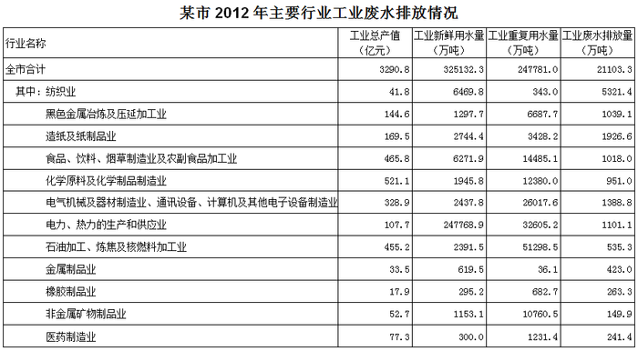

### 第 106 题

表中工业重复用水量从多到少排名第5的行业是：

A. 纺织业

B. 造纸及纸制品业

C. 石油加工、炼焦及核燃料加工业

D. 化学原料及化学制品制造业

第 106 题 · 答案与解析

**参考答案（粉笔题库参考内容）**

D

**解析**

定位表格材料第四列可得：工业重复用水量从多到少排名前5名的行业依次是石油加工、炼焦及核燃料加工业，电力、热力的生产和供应业，电气机械及器材制造业、通讯设备、计算机及其他电子设备制造业，食品、饮料、烟草制造业及农副食品加工业，化学原料及化学制品制造业。则第五名是化学原料及化学制品制造业。

故正确答案为D。

**考点**：直接找数、统计表

**来源**：2014年四川省公务员录用考试《行测》题第106题

### 第 107 题

表中工业总生产值排名第2的行业，其工业新鲜用水量占全市工业新鲜用水总量的比重约为：

A. 0.2%

B. 0.7%

C. 1.9%

D. 5.5%

第 107 题 · 答案与解析

**参考答案（粉笔题库参考内容）**

C

**解析**

根据题干“······占······比重······”，可判定此题为现期比重问题。定位表格材料第二列可得：工业总产值排名第二的行业是食品、饮料、烟草制造业及农副食品加工业；定位表格材料第三列可得：食品、饮料、烟草制造业及农副食品加工业新鲜用水量为6271.9万吨，全市总计为325132.3万吨。故根据比重计算公式可得比重=部分/整体=6271.9/325132.3≈ 6271.9/330000 ≈ 1.9%，与C项最接近。

故正确答案为C。

**考点**：现期比重、统计表

**来源**：2014年四川省公务员录用考试《行测》题第107题

### 第 108 题

将表中各行业按照万元产值工业废水排放量从低到高排列，以下排序正确的是：

A. 黑色金属冶炼及压延加工业，化学原料及化学制品制造业

B. 电力、热力的生产和供应业，非金属矿物制品业

C. 石油加工业、炼焦及核燃料加工业，橡胶制品业

D. 纺织业，金属制品业

第 108 题 · 答案与解析

**参考答案（粉笔题库参考内容）**

C

**解析**

根据题干“将表中各行业按照万元产值工业废水排放量从低到高排列”， 万元产值工业废水排放量= 工业废水排放量/产值，可判定此题为比值比较问题。定位表格材料第二列和最后一列可得：

A项：黑色金属冶炼为1039.1/144.6≈1000/140≈7，化学原料为951/521.1 ≈ 950/520 ≈ 2，前者＞后者，错误；

B项：电力、热力生产为1101.1/107.7≈1100/110=10，非金属矿物制品业为149.9/52.7 ≈ 150/50 = 3，前者＞后者，错误；

C项：石油加工为535.3/455.2≈540/460≈1.2，橡胶制品为263.3/17.9≈ 260/18 ≈ 14，前者＜后者，正确；

D项：纺织业为5321.4/41.8≈ 5300/40 ≈ 130，金属制品业为423/33.5≈ 420/34 ≈ 12，前者＞后者，错误。

故正确答案为C。

**考点**：比值比较、统计表

**来源**：2014年四川省公务员录用考试《行测》题第108题

### 第 109 题

表中工业重复用水量高于工业新鲜用水量的行业有几个：

A. 8

B. 9

C. 10

D. 11

第 109 题 · 答案与解析

**参考答案（粉笔题库参考内容）**

B

**解析**

定位表格材料第三列和第四列可得：工业重复用水量高于工业新鲜用水量的行业有：黑色金属冶炼及压延加工业，造纸及纸制品业，食品、饮料、烟草制造业及农副食品加工业，化学原料及化学制品制造业，电气机械及器材制造业、通讯设备、计算机及其他电子设备制造业，石油加工、炼焦及核燃料加工业，橡胶制品业，非金属矿物制品业和医药制造业共9个行业。

故正确答案为B。

**考点**：直接找数、统计表

**来源**：2014年四川省公务员录用考试《行测》题第109题

### 第 110 题

能够从上述资料中推出的是：

A. 全市工业新鲜用水量超过工业废水排放量的20倍

B. 表中有4个行业的工业产值超过该市工业总产值的10%

C. 造纸及纸制品业的单位工业产值工业新鲜用水量高于纺织业

D. 工业新鲜用水量最高的行业废水排放量高于工业重复用水量最高的行业

第 110 题 · 答案与解析

**参考答案（粉笔题库参考内容）**

D

**解析**

A项：定位表格材料第二行的第三列和最后一列可得：全市工业新鲜用水量为325132.3万吨，工业废水排放量为21103.3万吨，而325132.3 ＜ 21103.3 × 20 = 422066，错误；

B项：定位表格材料第二列可得：该市工业总产值为3290.8亿元，则工业总产值的10%为3290.8 × 10% = 329.08亿元。查看表可知，有食品、饮料、烟草制造业及农副食品加工业，化学原料及化学制品制造业和石油加工业、炼焦及核燃料加工业3个行业的工业产值超过该市工业总产值的10%，错误；

C项：定位表格材料第五行和第三行可得：造纸及纸制品业的单位工业产值工业新鲜用水量为2744.4/169.5≈2700/170≈16，纺织业的单位工业产值工业新鲜用水量为6469.8/41.8 ≈ 6500/42 ≈ 155，前者＜后者，错误；

D项：定位表格材料第三列可得：工业新鲜用水量最高的行业是电力、热力的生产和供应业，其废水排放量为1101.1万吨；定位表格材料第四列可得：工业重复用水量最高的是石油加工、炼焦及核燃料加工业，其废水排放量为535.3万吨，1101.1＞535.3，正确。

故正确答案为D。

**考点**：统计表、综合分析

**来源**：2014年四川省公务员录用考试《行测》题第110题

## 材料 3

（三）根据材料，回答第111—115题。

        2012年，A省完成港口货物吞吐量13.3亿吨，同比增长14.2%，其中，外贸货物吞吐量2.0亿吨，增长24.5%。港口货物吞吐量中，集装箱吞吐量达878.0万标准集装箱，增长3.1%。

        2012年末，全省公路里程14.2万公里，新增1071.1公里。年末高速公路里程3755公里。铁路营业里程1642.1公里，铁路正线延展长度2381.8公里。

        2012年末，全省民用汽车保有量458.1万辆，净增84.9万辆，分别增长22.8%和97.5%。年末私人汽车保有量338.2万辆，净增74.9万辆，分别增长28.5%和106%。其中私人轿车保有量216.5万辆，净增56.4万辆，分别增长35.2%和59.3%。

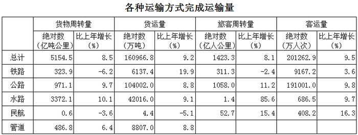

### 第 111 题

2011年，A省完成港口货物吞吐量约为多少亿吨：

A. 10.8

B. 11.6

C. 13.3

D. 15.5

第 111 题 · 答案与解析

**参考答案（粉笔题库参考内容）**

B

**解析**

根据题干所求“2011年，A省完成港口货物吞吐量”，结合材料数据时间为2012年，可判定此题为基期计算问题。定位文字材料第一段， 2012年，A省完成港口货物吞吐量13.3亿吨，同比增长14.2%。根据基期量计算公式：基期量 = 现期量/(1+增长率)可知，2011年A省完成港口货物吞吐量为13.3/(1+14.2%) ≈13.3/1.14 ≈ 11.7亿吨，与B项最接近。

故正确答案为B。

**考点**：基期计算、综合资料

**来源**：2014年四川省公务员录用考试《行测》题第111题

### 第 112 题

2011年末，该省除私人轿车之外的私人汽车保有量为多少万辆：

A. 103.2

B. 109.9

C. 121.7

D. 140.2

第 112 题 · 答案与解析

**参考答案（粉笔题库参考内容）**

A

**解析**

定位文字材料第三段可得：2012年私人汽车保有量为338.2万辆，比2011年增长74.9万辆，私人轿车保有量为216.5万辆，比2011年增长56.4万辆。则2011年私人汽车保有量为（338.2-74.9）=263.3万辆；2011年私人轿车保有量为（216.5-56.4）=160.1万辆。故2011年末，除私人轿车之外的私人汽车保有量为(263.3-160.1)=103.2万辆。

故正确答案为A。

**考点**：简单加减计算、综合资料

**来源**：2014年四川省公务员录用考试《行测》题第112题

### 第 113 题

2012年，A省下列各项同比增长最快的是：

A. 铁路货运量

B. 公路货物周转量

C. 水路货运量

D. 民航货物周转量

第 113 题 · 答案与解析

**参考答案（粉笔题库参考内容）**

A

**解析**

定位表格数据可得：铁路货运量增长率为19.9%，公路货物周转量增长率为9.7%，水路货运量增长率为9.1%，民航货物周转量增长率为–3.6%，所以铁路货运量增长最快。

故正确答案为A。

**考点**：直接找数、综合资料

**来源**：2014年四川省公务员录用考试《行测》题第113题

### 第 114 题

表中的4种客运方式中，2012年平均每人次运输距离高于2011年水平的有几种：

A. 1

B. 2

C. 3

D. 4

第 114 题 · 答案与解析

**参考答案（粉笔题库参考内容）**

B

**解析**

据题干“2012年平均每人次······高于2011年水平·····”，可判定此题为两期平均数比较问题。而平均每人次运输距离为旅客周转量/客运量，根据两期平均数比较结论，当分子的增长率大于分母的增长率时，平均数上升。所以只要旅客周转量增长率大于客运量增长率，2012年平均每人次运输距离就高于2011年每人次运输距离。定位表格材料可得：只有公路、水路符合。

故正确答案为B。

**考点**：两期平均数比较、综合资料

**来源**：2014年四川省公务员录用考试《行测》题第114题

### 第 115 题

关于该省交通运输状况，能够从上述资料中推出的是：

A. 2012年末，高速公路里程占全省公路总里程比重超过3%

B. 2012年，该省客运平均每人次运输距离超过100公里

C. 2012年，管道货物周转量超过货物周转总量的一成

D. 2010年末，全省民用汽车保有量超过300万辆

第 115 题 · 答案与解析

**参考答案（粉笔题库参考内容）**

D

**解析**

A项：定位文字材料第二段可得：2012年末，全省公路里程14.2万公里，高速公路里程3755公里。则高速公路里程占全省公路总里程的比重为3755/142000 × 100% ≈ 2.6% ＜ 3%，错误；

B项：定位表格材料可得：2012年该省旅客周转量为1423.3亿人公里，客运量为201262.9万人次。若2012年该省客运平均每人次运输距离超过100公里，则2012年该省旅客周转量应大于 201262.9万人次×100公里/人次 ≈ 20.1亿人次×100公里/人次 = 2010亿人公里，而1423.3＜2010，错误；

C项：定位表格材料可得：2012年管道货物周转量486.8亿吨公里，货物总周转量5154.5亿吨公里，486.8 ＜ 5154.5 × 10% = 515.45，不足10%，错误；

D项：定位文字材料最后一段可得：2012年末，全省民用汽车保有量458.1万辆，净增84.9万辆，分别增长22.8%和97.5%。则2010年末，全省民用汽车保有量为458.1 - 84.9 - 84.9/(1+97.5%)≈ 373 - 85/1.98 ≈ 373 - 43 = 330 ＞ 300，正确。

故正确答案为D。

注：D项计算公式为458.1 - 84.9 - 84.9/(1+97.5%)，计算略烦琐，可通过排除其他选项得出正确答案。

**考点**：综合分析、综合资料

**来源**：2014年四川省公务员录用考试《行测》题第115题

## 材料 4

（四）根据材料，回答第116-120题。

        2012年，我国矿产品对外贸易活跃，进出口额9919亿美元，同比增长3.6%，其中，进口额同比增长1.4%，出口额同比增长7.6%。

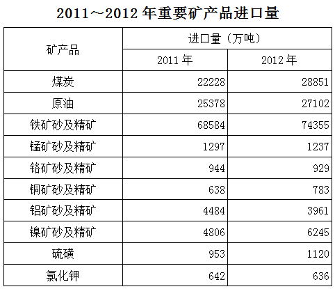

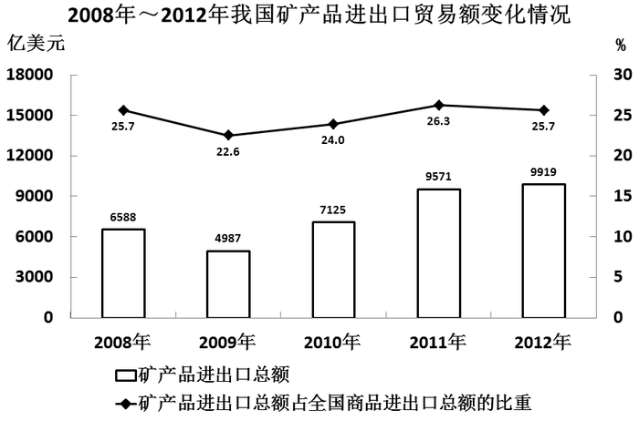

### 第 116 题

2011年我国矿产品进口总额约是出口总额的多少倍：

A. 1.5

B. 1.8

C. 2.1

D. 2.5

第 116 题 · 答案与解析

**参考答案（粉笔题库参考内容）**

B

**解析**

方法一：根据题干“2011年······是······的多少倍”，结合材料数据时间为2012年，可判定此题为基期倍数问题。定位文字材料可得：2012年，我国矿产品进出口额同比增长3.6%，其中，进口额同比增长1.4%，出口额同比增长7.6%。故根据线段法的距离与量成反比的结论，2011年进出口额之比（基期量之比）等于增长率之差的反比，即2011年进口总额/2011年出口总额= (7.6% − 3.6%)/(3.6% − 1.4%)=4%/2.2%≈1.8。

备注：增长率 = 增长量/基期量，量即为分母，所以一定要格外注意，基期量之比等于增长率之差的反比，而非现期量之比，只是不严谨时会用现期量代替基期量进行近似估算。

方法二：根据题干“2011年······是······的多少倍”，结合材料数据时间为2012年，可判定此题为基期倍数问题。定位文字材料可得：2012年，我国矿产品进出口额同比增长3.6%，其中，进口额同比增长1.4%，出口额同比增长7.6%。根据“2012年矿产品进口额增长量+2012年矿产品出口额增长量=2012年矿产品进出口额增长量”,结合公式“增长量=基期量×增长率”，可得“2011年矿产品进口额×1.4%+2011年矿产品出口额×7.6%=（2011年矿产品进口额+2011年矿产品出口额）×3.6%”，化简得“2011年矿产品出口额×4%=2011年矿产品进口额×2.2%”，则2011年矿产品进口额：2011年矿产品出口额=4%: 2.2% ≈ 1.8。

故正确答案为B。

**考点**：基期倍数、综合资料

**来源**：2014年四川省公务员录用考试《行测》题第116题

### 第 117 题

图中矿产品进出口总额占全国商品进出口总额比重最低的年份，当年全国商品进出口总额约为多少万亿美元：

A. 2.2

B. 2.6

C. 3.0

D. 3.6

第 117 题 · 答案与解析

**参考答案（粉笔题库参考内容）**

A

**解析**

根据题干“······占······比重······”，可判定此题为现期比重问题。定位图表材料可得：矿产品进出口总额占全国商品进出口总额比重最低的年份为2009年，矿产品进出口总额为4987亿美元，占全国商品进出口总额比重为22.6%。故2009年全国商品进出口总额=部分/比重=4987/22.6%≈4987/23% ≈ 21700亿美元 = 2.17万亿美元，与A项最接近。

故正确答案为A。

**考点**：现期比重、综合资料

**来源**：2014年四川省公务员录用考试《行测》题第117题

### 第 118 题

表中2012年进口量与上年相比增幅超过10%的矿产品有几类：

A. 2

B. 3

C. 4

D. 5

第 118 题 · 答案与解析

**参考答案（粉笔题库参考内容）**

C

**解析**

根据题干“2012年······与上年相比增幅超过10%······”,可判定本题为一般增长率问题。2012年进口量与上年相比增幅超过10%，即(2012年进口量 - 2011年进口量)/2011年进口量 ＞ 10%，两边同时乘以“2011年进口量”并转化一下可得，2012年进口量＞2011年进口量+10%×2011年进口量=1.1×2011年进口量，故只需判定2012年进口量＞1.1×2011年进口量即可。定位表格材料可得：2012年进口量大于1.1×2011年进口量的矿产品有煤炭、铜矿砂及精矿、镍矿砂及精矿、硫磺共4类。

故正确答案为C。

**考点**：一般增长率、综合资料

**来源**：2014年四川省公务员录用考试《行测》题第118题

### 第 119 题

2012年铁矿砂及精矿进口量约占黑色金属（铁、锰、铬）矿砂及精矿进口总量的：

A. 52%

B. 80%

C. 97%

D. 99%

第 119 题 · 答案与解析

**参考答案（粉笔题库参考内容）**

C

**解析**

根据题干“2012年······占······总量的······”，结合材料数据时间为2012年，可判定本题为现期比重问题。定位表格材料可得2012年铁、锰、铬矿砂及精矿的进口总量。故2012年铁矿砂及精矿进口量约占黑色金属（铁、锰、铬）矿砂及精矿进口总量的比重= 部分/整体 =74355/(74355 + 1237 + 929) ≈ 74400/(74400 + 1200 + 900)= 74400/76500 ≈ 97%。

故正确答案为C。

**考点**：现期比重、综合资料

**来源**：2014年四川省公务员录用考试《行测》题第119题

### 第 120 题

关于我国矿产品进出口贸易，能够从上述资料中推出的是：

A. 2008—2012年间矿产品进出口总额年复合增长率为50%

B. 2012年是近4年来矿产品进出口总额同比增幅最高的一年

C. 2011—2012年硫磺月均进口量超过100万吨

D. 2011—2012年原油总体进口量高于煤炭

第 120 题 · 答案与解析

**参考答案（粉笔题库参考内容）**

D

**解析**

A项：定位图表材料可得，2008年和2012矿产品进出口总额分别为6588亿美元和9919亿美元，可求得2012年相对于2008年的增长率为(9919 − 6588)/6588 = 3331/6588 ≈ 50%，平均到4个年份就无法保证年复合增长率为50%，错误；

B项：定位图表材料，从材料图中可看出2010年矿产品增长量大于2012年矿产品增长量，但是基期量最低，根据增长率 = 增长量/基期量可知2010年矿产品进出口总额同比增幅高于2012年矿产品进出口总额同比增幅，错误；

C项：定位表格材料可得：2011年和2012年硫磺进口量分别为953万吨和1120万吨。而953＜100×12=1200，1120＜100×12=1200，错误；

D项：定位表格材料可得：原油2011—2012年总体进口量约为(2.54+2.71)=5.25亿吨，而煤炭的进口量为2.22+2.89=5.11亿吨，故前者＞后者，正确。

故正确答案为D。

**考点**：综合分析、综合资料

**来源**：2014年四川省公务员录用考试《行测》题第120题

