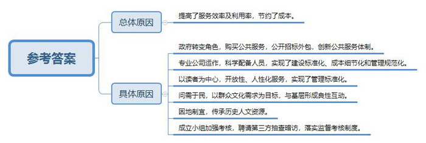
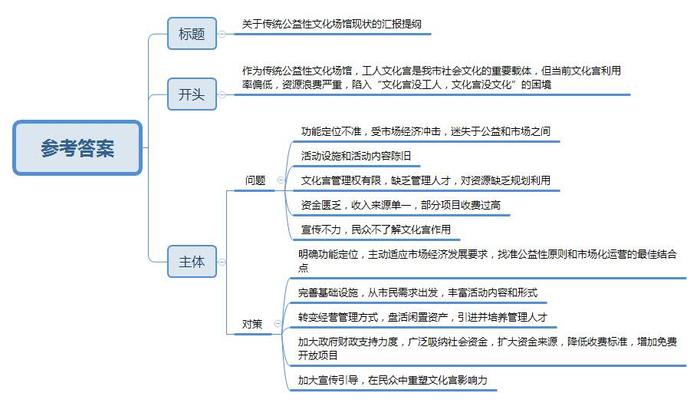
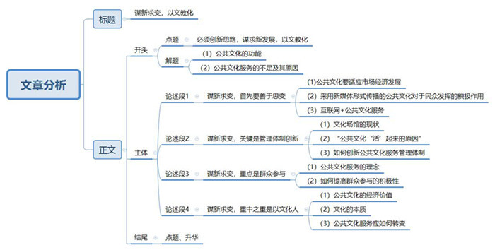

# 2015年公务员多省联考《申论》题（山西卷）

<!-- gwy:overview:start -->
> **山西 · 2015 · 申论 · 统考** ｜ 4 题 · 图片 4 处 · 答案随题折叠

导航：[题目](#题目) · [材料 1](#材料-1)
<!-- gwy:overview:end -->

> 候选采集稿。参考答案及解析来自粉笔页面，不代表官方答案或真实高分答卷；来源使用许可与原卷对应关系仍需人工核实。

## 给定材料

### 材料 1

近日，中办、国办下发《关于加快构建现代化公共文化服务体系的意见》（下称《意见》）强调，要按照全面建成小康社会的总体要求，构建体现时代发展趋势、适应社会主义初级阶段基本国情和市场经济要求，符合文化发展规律、具有中国特色的现代公共文化服务体系，为实现中华民族伟大复兴的中国梦提供强大精神动力和文化支撑。

《意见》及附件《国家基本公共文化服务指导标准（2015—2020）》还要求给群众提供“对路子”的公共文化服务。一者，要对文化场馆的社会功能、服务群体等重新定位，使之回归公益属性，并为文化场馆的建设、维护和运行提供充足的政策和资金支持。二者，要以明确的考核机制，倒逼相关部门将文化场馆不仅要建好，更要利用好，提升服务品质，提高可利用率，增强自身魅力。与此同时，也要大力引导、鼓励老百姓走进文化场馆，在全社会营造全民阅读、全民学习之风。

文化部公共文化司某负责人表示，2014年，全国财政一般公共预算中文化体育与传媒支出达到2753亿元，比2011年增加了860亿元，对公共文化体系建设给予了重点支持。今后还要进一步加大投入力度，其中一部分要用来采购公共文化产品，低票价或者直接购买版权服务民众等形式，将成为文化部的公共文化重点工作任务之一。

### 材料 2

随着奥运会、世博会、世园会、亚运会等一系列重大文化体育活动在我国召开，一大批地标级精品场馆纷纷涌现。鸟巢、水立方等奥运场馆在世界享有盛誉，S市由世博会中国馆改造而成的中华艺术宫已经投入使用。中国国学中心、国家美术馆、中国工艺美术馆等国家级重点文化工程集中落户于北京奥林匹克公园，众多新兴文化场馆已经具有国际一流水准。与此同时，工人文化宫、文化馆、少年宫等传统公益性质的文化场所也不断增加。某权威网站发布的信息显示，截至2013年底，全国县级以上文化馆、群众艺术馆有3000多个，文化站超过4万个，村（社区）文化室25万个。我国现有博物馆4165家，在过去10年时间里增长一倍。

尽管我国文化馆、博物馆等公共文化设施总数不断增加，但相对于发达国家而言，总体发展程度仍然较低。据了解，英国伦敦市有400多个大小剧院、音乐厅及现场音乐表演场地，每10万人拥有1.4个剧场，每10平方公里拥有1.3个剧场，每年大型剧场的入场人次达1240万；近600个图书馆，公共图书馆有395家，平均每10万人拥有5家公共图书馆，人均藏书量5本；22座国家级博物馆，200余座非国家级别的博物馆，每10平方公里有1.1座博物馆，即每个社区附近都会有博物馆。而我国平均40万人拥有一座博物馆。

贫困地区一直是我国公共文化服务体系均衡发展的难点，这些地区财力小，文化事业投入十分有限。以广西来宾为例，2003年至2008年，在农村文化方面的投入比重不到文化投入的10%，2008年以前没有市级群众艺术馆、图书馆、博物馆、影剧院，大部分县级图书馆、文化馆达不到部颁三级标准。

农村如此，在某些大中城市则是另一番景象。某市社科院曾对本市2209名市民的公共文化服务体系参与度和满意度进行调查。结果显示，尽管近年来政府对公共文化服务体系的建设投入了大量人力、财力、物力，但部分公共文化设施、公共文化活动、文化惠民项目的利用率和参与度较低，设施、资金等资源的利用效率和投入收效比亟待提高。其中，针对博物馆、美术馆、科技馆、纪念馆和陈列馆的调查数据显示，24.4%的受访者一年中从未去过这5类场所，61.6%的人平均每年去1到5次。而市民对文化馆的年均光顾次数更低，93.7%的人平均每年到馆5次以下，其中，58.6%的人没去过文化馆，35.1%的人每年到馆次数为1到5次。针对公众满意度的调查结果显示，对基层文化场所和文化馆的服务表示满意和基本满意的市民，分别只有34.2%和40.8%。

### 材料 3

公共文化服务场馆的利用率偏低，是文化事业发展中的“老大难”。特别是一些传统的公益性质文化场馆，因为缺少有吸引力的“内容”而门庭冷落，造成巨大浪费。

“我刚来文化宫那会儿，这儿真的是火啊！”H市总工会A工人文化宫主任高先生说。1983年，他从部队复员后，就一直在这里工作，亲眼目睹了文化宫由盛而衰，从辉煌到冷清的全过程。“那时，文化宫人来人往，电影晚场场场爆满，光是帮我们卖票、检票、维持秩序的长期固定义务员就有五六个。现在，电影院每天的上座率不到10%，有时候工作人员甚至比观众还多。”他道出了大家的普遍感受。

“那时在文化宫，能看电影、溜冰、跳舞、唱歌、参加运动，从早到晚都是人山人海，我们职工除了睡觉几乎都在里面值班，假期就更谈不上休息了。”回忆起十几年前的工人文化宫，57岁的老职工谭梦林仍充满激情。

“我有20多年没去过文化宫了。”生于上个世纪60年代的白女士说，“很怀念以前在文化宫看电影、唱卡拉OK、参加培训的日子。现在可供选择的文化活动丰富多样，而文化宫的活动设施和活动内容却相对比较陈旧。”

原因在哪里呢？“房屋破损、设备陈旧、功能单调”，大家几乎异口同声地回答。“跟各种新兴商业文化场所相比，仿佛仍停留在50多年前。收入当然也就大不如前了。”H市总工会B工人文化宫金主任说。“观众冷清，再加上文化经营管理人才也极其缺乏，有些文化宫已有名存实亡之虞。”一位不愿意透露姓名的文化宫工作人员说。

“虽然日渐没落，但谁也不知道怎么改变。资产不是我们的，我们也没这权利，那也只好就这么闲置着。”金主任说，虽然文化宫地处城市最繁华的商业街区，面积也有85亩之多，但他们甚至连出租都没搞过。后来也曾想要重新建设，但一直苦于没钱。

H市总工会C工人文化宫，位于该市最繁华的商贸经济圈的中心，这栋8层的建筑被淹没在周围的高楼和广告牌中。遒劲有力的“工人之家”4个毛笔字，是该市第一任市长刘伯承元帅亲自题写的。如今，一层南面租给了麦当劳、新标识等企业做商业经营，北面租给游戏厅；二层和三层租给张生记酒店；六至八层为H市工会办公室；可供文化宫实际使用的楼层只有四层和五层。在文化宫有限的使用空间内，只能提供很少的文化娱乐活动。四层开设了台球室，吸引了一些年轻人，但由于价格不便宜，通常顾客都很少；五层的健身中心设施陈旧，灯光昏暗。

一层的电玩游戏厅有不少年轻人进出，但被问及是否知道工人文化宫的作用时，他们显得一脸茫然。

“现在的文化宫毫无‘文化’可言！”家住文化宫附近的王刚说，“以前凭着工会会员证就可以在文化宫参加各种免费文化娱乐，现在什么都没有了。”

“文化宫里没工人，文化宫里没文化。这是职工们当前反映比较大的问题。”H市总工会宣教部部长朱和顺分析说，工人文化宫的迷失，是因为其在市场经济中对自身定位的矛盾与摇摆。一方面文化宫受到了经济体制改革、企业发展和多元文化的冲击；另一方面工人文化宫原本是总工会财政全额拨款，但是后来逐渐改成了差额拨款，再后来就成了自行收支、自负盈亏。为了生存，一些工人文化宫不得不出租场地和举办培训班。

### 材料 4

早上6点多，虽是星期天，B市F区的李艳梅还是让儿子张岩赶快起床，尽早到B市少年宫办理英语辅导班注册缴费手续，“早起的鸟儿才能抢到食，报名那天，要不是去得早，就抢不到名额了。”

“名额抢完了，当天我们外语俱乐部所有英语班都报满了，要报名的话，就得等我们今年开秋季班的时候，记着要早点来，不然又抢不到了。”少年宫外语俱乐部一位英语教师告诉记者，今年报名首日，近万人将伸缩门挤成了“麻花”。

对此，有学者说：少年宫学科类辅导班招生如此火爆，显然是对其功能定位的严重扭曲。

上世纪50年代，Z市少年宫美术兴趣小组的学员何水法和沈曙，每到周末都会一起去学画，素描、风景、水粉、水彩样样不落。后来他们一个成了著名的国画家，一个则做了画院院长，同时期的美术学员中还有潘公凯，他后来成了中央美术学院院长。

不过，与社会发展一样，半个多世纪后，很多地方的少年宫搬了地方、盖了新楼，各项设施也与时俱进。和大部分的少年宫一样，上世纪80年代初，Z市少年宫也不再叫少年宫，而是改为Z市青少年活动中心。跟随名字一同改变的是“成长乐园”变成严肃的“第二课堂”。Z市青少年活动中心主任黄建明说，从校内教育追到校外教育，他是最好的见证人。

随着时代变迁，少年宫的地位开始尴尬，原则上的公益性质难以保障，高额的开支使得少年宫在公益和市场的两边徘徊，免费也在逐步向收费转变。黄建明坦言，不变肯定没有发展。“少年宫必须跟着时代脉搏前进，在运作模式、管理体制、教育方式上做出改变。”

### 材料 5

在S市市民文化节活动现场，白领社团在这个由张爱玲故居改建而成的活动中心里卖力表演。古朴的砖红色建筑里，从顶楼到底楼人头攒动。放牛班的春天合唱团，让农民工子弟爱上音乐，带着自信放声歌唱；S市首个由政府支持、社会力量承办的艺术品跳蚤市场也顺利开市，50余个摊位中，吉他、素描、面具、艺术铁壶等琳琅满目；在A社区文化活动中心举办的学生艺术作品展上，17岁的万婕大方叫卖起了自己做的“地球皂”。据统计，S市市民文化节开幕当天共举办各类文化活动1651场，就近参加文化活动的市民达100万人次。

“S市从来不缺文化活动及各类文化节，但从没有一个节日能像市民文化节一样包含如此多的活动类别且如此‘接地气’。”有市民如此评价。

“给百姓更多出彩的机会，也为市民享受文化艺术活动打造‘零门槛’。市民文化节这个平台是给市民大众的。我们的报名点、初赛都设在老百姓家门口，就是希望更多市民都能有所参与。”B社区文化馆负责人萧女士说。

此前，C社区文化中心的社区活动虽多，但更偏重于老人和儿童，该中心韩主任并不满足。“我们所在的社区，白领上班族特别多，因此我们也应该重视为白领们提供更多适合他们的文化活动项目，尽可能满足每一个居民的需要。”

### 材料 6

2014年，Q市A社区的居民迟秋菊和刘世云没想到，作为居民代表，她们委托社区专职管理员在“文化超市”网站上订制的柳腔剧订单，居然在一周后就得以兑现，这出自己免费点单点来的大戏，让老百姓初尝了说了算的“当家”的惊喜；小伙儿王维涛没想到，凭借吹笛子的才艺，竟能自荐登上过去想都不敢想的大舞台，深入到基层的“五王”（指歌王、舞王、琴王、戏王、秀王）才艺达人海选，让他正经过了把明星瘾；泡惯了图书馆的袁琳琳没想到，借阅图书再无须卡着下班前的时间点，24小时自助图书馆和书店的相继开张，为和她一样的爱书人保留了一团彻夜的灯火……

2014年，一场面向所有市民、零门槛的才艺选秀活动——“五王”大赛在全市如火如荼地展开。这场报名人数超过2万人，原创节目数量超过3000个，观看人数已逾20万人次的大规模海选，将普通市民推到了舞台的中心。

这个名为“文化超市”的舞台实际上是一个“陈列”了综艺演出、图书、戏剧、电影、艺术培训等丰富文化产品的特殊网站，它为包括39万外来人口在内的80万居民建立起不可思议的自主“舞台”：使用者只需登录，并选择所需的产品内容，不出两周就能收获兑现；而借助“超市”的舞台，更多拥有才艺的民间达人也自荐登台亮相，上传自编自导的节目，丰富供居民自选的产品内容。

在网站的留言板上，无论文化产品的消费者还是制造者，个人意愿得到满足的市民个个难掩惊喜。在市民纷纷走向台前，高调分享贴心服务带来的生活中的小幸福的背后，是逐年加大投入力度并已纳入财政预算的文化服务专项资金的保障。

### 材料 7

M市的“新兴城区现代公共文化服务社会化的标准化建设”项目被文化部列入2014年国家文化创新工程。其中W新区近年来探索公共文化服务项目外包，实行社会化运作，提高了服务效率和利用率，引起了社会的高度关注。

“政府是公共服务的提供者，不一定是生产者；是规则的制定者和执行的监管者，不一定是直接操作者，政府向社会组织购买公共服务，是对公共服务体制的破冰尝试，也是‘服务型政府’与‘小政府’两种方向融合的必然结果。”W新区相关领导说，从购买文艺演出到定制大型晚会再到新区图书馆服务外包，新区的公共文化服务逐步走出一条具有特色的社会化运作之路。

W新区购买公共服务时，根据群众的需求和新区实际情况确定“买什么，向谁买，怎么买”，通过公开招标，将新区图书馆的建设、管理、运行和服务外包给专业公司。该公司严格按照要求，配备各艺术门类专业人员和管理人员，实行免费开放，举办各类文化活动，实现了建设标准化、成本细节化和管理规范化。

W新区图书馆自建馆以来，全年无休，免费开放，通过图书馆24小时还书箱以及图书馆数字资源无地域限制、无时间约束的开放性服务，保证了对读者服务24小时不间断。在图书馆购置新书方面，把选书和购书的权利交给读者，以读者满意为出发点和落脚点，坚持“图书馆服务与社区服务相结合”“市民服务与企业服务相结合”“实体服务与网络服务相结合”“普遍化服务与个性化服务相结合”，实现了管理标准化。

W新区文化馆在为街道、社区、企业等提供基本的公共文化服务的同时，采取调查问卷、座谈会等多种方式问需于民，将群众文化需求定位为文化馆的工作目标，与基层形成了良好的互动交流的服务模式。文化馆还注重将富有新区地域特色的文化传承纳入各类公益性社会文化组织的培育和建设，让新区丰富、优秀的历史人文资源“活起来”。

据介绍，W新区成立了由财政、审计、纪委、文化行政部门组成的考核小组，对外包公司的业务进行考核。考核小组制定了外包服务质量考核表，满分为100分，从队伍建设、公共服务、管理规章、群众满意度等方面进行考评。考核评分不得低于80分，80分以下对服务外包公司提出整改要求，如整改不力则终止服务合同。同时，政府聘请了第三方对两馆的服务人群、服务单位进行抽样调查和暗访。通过把监管落实为可见可控的考核制度对服务外包进行监管，避免“一包了之”。区某位领导说：“我们不做运动员，只做裁判员。”

试点表明，W新区购买公共文化服务基本实现了以最节约成本购买最优化的服务的预期目标，公共文化服务体系建设呈现出蓬勃发展、整体推进、重点突破的良好态势。

### 材料 8

新媒体正在改变我们的文化吗？手机阅读、数字报纸、杂志、移动电视、触摸媒体……新兴媒体正越来越多地出现在当下生活中，并日益侵入生活的各个层面，面对如此强大的新媒体扑面而来，专业人士展开了多次主题讨论。参与讨论的部分学者认为，新媒体的出现其实是以消解我们传统文化的主流价值为目的的。它以消解、嘲讽为手段，寻找的是一个对立面，而且这种对立面越强烈、越离谱越好，这样就容易产生一种传播效果。这种以消解传统价值为目的的新媒体使文化“下游化”了，这种文化没有经过理性的加工，缺少质感，没有逻辑的支撑，容易情绪化。对此，也有人表示不赞同，认为在谈到“改变我们的文化”这样一个概念时，存在着某个阶层的语义预设，也就是说这是站在传统文化的优势立场上进行的言说。他们认为，新媒体时代的到来，真正应该考虑的问题是，传统文化的代言人如何才能找到自己新的立足点。

## 题目

### 第 1 题

**根据给定资料，概括目前我国文化场馆发展中面临的问题。（20分）**

关联材料：材料 1、材料 2、材料 3、材料 4、材料 5、材料 6、材料 7、材料 8

作答要求：

要求：内容全面、条理清楚、语言准确，不超过200字。

第 1 题 · 答案与解析

**参考答案（粉笔题库参考内容）**

一、发展程度较低，公共文化设施人均拥有量低；二、城乡发展不均衡，贫困地区文化事业投入少，市县级文化场馆不达标；三、利用率低，投入收效比亟待提高；四、群众参与度较低，满意度较低；五、设施和活动内容陈旧，功能单一，服务品质不高；六、管理体制不完善，缺少管理人才；七、定位扭曲，在公益和市场间徘徊迷失；八、缺少社会化运作，缺乏发展活力；九、与群众需求有差距，缺乏吸引力；十、缺少政府政策和资金支持。

**解析**

**参考答案说明：**本参考答案从“发展程度”“城乡发展”“利用率低”“群众参与度、满意度”“设施及服务”“管理”“定位”“社会化运作”“群众需求”“政府支持”等方面来介绍我国文化场馆发展中面临的问题，并且每条要点之间没有交叉。

**考点**：问题类

**来源**：2015年公务员多省联考《申论》题（山西卷）

### 第 2 题

**请分析给定资料7中W新区现代公共文化服务社会化运作的做法成功的原因。（15分）**

关联材料：材料 7

作答要求：

要求：观点明确、分析深入，不超过200字。

第 2 题 · 答案与解析

**参考答案（粉笔题库参考内容）**

提高了服务效率及利用率，节约了成本。

一、政府转变角色，购买公共服务，公开招标外包，创新公共服务体制。

二、专业公司运作，科学配备人员，实现了建设标准化、成本细节化和管理规范化。

三、以读者为中心，开放性、人性化服务，实现了管理标准化。

四、问需于民，以群众文化需求为目标，与基层形成良性互动。

五、因地制宜，传承历史人文资源。

六、成立小组加强考核，聘请第三方抽查暗访，落实监督考核制度。

**解析**

**参考答案说明：**本参考答案从“总体原因-具体原因”这一逻辑进行了分条撰写。各条要点之间在内容上相互并列，有一定的先后顺序，先给出“总体原因”，再逐条去写“具体原因”，满足了题目中“观点明确”这一要求。

**考点**：原因类

**来源**：2015年公务员多省联考《申论》题（山西卷）

### 第 3 题

**为整顿规范传统的公益性质文化场馆，使之回归公共文化服务功能，H市市委、市政府选派工作小组赴H市总工会调查了解情况，请你以H市总工会的名义，根据给定资料3，草拟一份汇报资料提纲。（25分）**

关联材料：材料 3

作答要求：

要求：紧扣给定资料，问题全面明确，建议具体可行，不超过400字。

第 3 题 · 答案与解析

**参考答案（粉笔题库参考内容）**

关于传统公益性文化场馆现状的汇报提纲

作为传统公益性文化场馆，工人文化宫是我市社会文化的重要载体，但当前文化宫利用率偏低，资源浪费严重，陷入“文化宫没工人，文化宫没文化”的困境。具体问题汇报如下：

一、功能定位不准，受市场经济冲击，迷失于公益和市场之间。

二、活动设施和活动内容陈旧。

三、文化宫管理权有限，缺乏管理人才，对资源缺乏规划利用。

四、资金匮乏，收入来源单一，部分项目收费过高。

五、宣传不力，民众不了解文化宫作用。

建议做如下改善：

一、明确功能定位，主动适应市场经济发展要求，找准公益性原则和市场化运营的最佳结合点。

二、完善基础设施，从市民需求出发，丰富活动内容和形式。

三、转变经营管理方式，盘活闲置资产，引进并培养管理人才。

四、加大政府财政支持力度，广泛吸纳社会资金，扩大资金来源，降低收费标准，增加免费开放项目。

五、加大宣传引导，在民众中重塑文化宫影响力。

**解析**

**参考答案说明**：本题要求围绕“H市传统公益性文化场馆”写一份汇报资料提纲，因此不必考虑行文格式，保险起见，本题写了标题。本参考答案宏观上分成了“问题”和“对策”两个要素。在“问题”内部，又从“功能定位”“活动设施与内容”“资金”“宣传”“管理”等不同的话题进行了分条撰写。各条要点之间在内容上相互并列，没有交叉。在“对策”内部，又从“功能定位”“活动设施与内容”“资金”“宣传”“管理”等不同的话题进行了分条撰写。各条要点之间在内容上相互并列，没有交叉。

**考点**：总结类

**来源**：2015年公务员多省联考《申论》题（山西卷）

### 第 4 题

**阅读给定资料，结合实际，以“谋新求变，文以化人”为话题，自选角度，自拟题目写一篇文章。（40分）**

关联材料：材料 1、材料 2、材料 3、材料 4、材料 5、材料 6、材料 7、材料 8

作答要求：

要求：

（1）自拟题目，紧密结合实际；

（2）观点鲜明、正确，认识全面深入，逻辑结构严谨；

（3）表达简洁，字迹清楚，1000字左右。

第 4 题 · 答案与解析

**参考答案（粉笔题库参考内容）**

**谋新求变，以文教化**

“文化”者，“以文教化”。公共文化承载着社会教化、化育人心的重要功能。然而，近年来我国公共文化服务却普遍存在“短板”，要么设施陈旧，要么产品匮乏，要么功能单一，要么重收益、轻公益。究其根源，是公共文化服务创新不够，实用性和利用率不高，未能发挥文化的化育作用。因此，必须创新思路，谋求新发展，以文教化。

**谋新求变，首先要善于思变**。“变则通，通则久”。在市场经济条件下，公共文化不能游离于市场经济之外，而应主动适应市场经济发展要求，不断创新公共文化产品，提高服务品质。同时，要主动适应新媒体发展。网上订单、在线观看、上传自编自导节目……一些城市利用新媒体，创办网上“文化超市”，让市民充分享受了文化带来的幸福。在“互联网+”的风口，“互联网+公共文化服务”不仅有助于打破时空界限，而且有助于将文化的作用真正突显出来、发挥出来。

**谋新求变，关键是管理体制创新。**“变，需要动力，更需要支撑。”当前，很多文化场馆不是意识不到“改变”的紧迫性，而是囿于体制，无权变革，或没有资金盘活资源。W市之所以能让公共文化“活”起来，得益于公共文化服务社会化运作，但归根结底是管理体制的变革。因此，政府要转变角色，一是发挥主导作用，加大资金扶持力度和监管力度，二是激发各类社会主体参与公共文化服务的积极性，三是提高文化场馆自身生存能力和成长性。

**谋新求变，重点是群众参与。**再“好吃”的文化大餐，不符合百姓胃口也是浪费。要通过实地走访、小区问卷、网络征集、媒体公示、座谈会等，问需于民，“摸清”群众的文化需求。要坚持文化活动“零门槛”，文化项目层次化、多样化，尽可能吸引更多市民参与其中。这样，一可以提高公共文化配送资源的使用效率，二可以有效对接市民文化需求，发挥广大群众在文化建设中的主人翁地位和主体性作用，引导群众人人参与，在文化建设中自我化育。

**谋新求变，重中之重是以文化人。**时下，很多人看重市场经济条件下公共文化的经济价值。但文化归根到底是作用于人的，以文“化人”才是文化的本质所在。公共文化服务应由重“文”向重“化”转变，充分发挥公共文化塑造人、熏陶人、培养人、武装人、引导人的作用。只有坚持“以文化人”，才能真正提升人们的道德精神面貌，提高人们的文化素养！

大化流行，生生不息，日新月异。破解公共文化发展难题，必须谋新求变，必须坚持以文教化。是时，文化馨香将扑面而来，每个人都沐浴其中……

**文章分析：**

**谋新求变，以文教化**

【**标题的优点**：首先，范文的标题突出了“谋新求变，文以化人”这一主题。其次，它在形式上简洁明快，一目了然。】

“文化”者，“以文教化”。公共文化承载着社会教化、化育人心的重要功能。然而，近年来我国公共文化服务却普遍存在“短板”，要么设施陈旧，要么产品匮乏，要么功能单一，要么重收益、轻公益。究其根源，是公共文化服务创新不够，实用性和利用率不高，未能发挥文化的化育作用。因此，必须创新思路，谋求新发展，以文教化。

【**开头的优点：**★内容方面：范文的开头是紧扣“公共文化服务”这一主题展开的。首先，开头第一句话点出主题，做到了主题明确。其次，对“公共文化服务”这一主题进行了分析阐述，指出了（1）“公共文化”的功能；（2）“公共文化服务”的不足及原因。文字表达方面：使用了若干个“要么”这一关联词，使语言表达有逻辑性，此外长短句配合使用，使语言表达有节奏感。】

**谋新求变，首先要善于思变。**“变则通，通则久”。在市场经济条件下，公共文化不能游离于市场经济之外，而应主动适应市场经济发展要求，不断创新公共文化产品，提高服务品质。同时，要主动适应新媒体发展。网上订单、在线观看、上传自编自导节目……一些城市利用新媒体，创办网上“文化超市”，让市民充分享受了文化带来的幸福。在“互联网+”的风口，“互联网+公共文化服务”不仅有助于打破时空界限，而且有助于将文化的作用真正突显出来、发挥出来。

【**论述段1的优点：**★观点句：范文的观点句是紧扣“公共文化服务”这一文章主题提出的。形式上，它在段首处直接写出，位置突出，容易发现。内容上，关键词突出，内容要点明确，可以明显看出它是从“思变、创新”等入手，指出了“公共文化服务”如何创新发展。★论述内容：（1）介绍了“公共文化要适应市场经济发展”；（2）介绍了“采用新媒体形式传播的公共文化对于民众发挥的积极作用”；（3）介绍了“互联网+公共文化服务”。在论述方法上采用了“讲道理、摆事实”相结合的方式进行展开的，做到了论述有力。】

**谋新求变，关键是管理体制创新。**“变，需要动力，更需要支撑。”当前，很多文化场馆不是意识不到“改变”的紧迫性，而是囿于体制，无权变革，或没有资金盘活资源。W市之所以能让公共文化“活”起来，得益于公共文化服务社会化运作，但归根结底是管理体制的变革。因此，政府要转变角色，一是发挥主导作用，加大资金扶持力度和监管力度，二是激发各类社会主体参与公共文化服务的积极性，三是提高文化场馆自身生存能力和成长性。

【**论述段2的优点：**★观点句：范文的观点句是紧扣“公共文化服务”这一文章主题提出的。形式上，它在段首处直接写出，位置突出，容易发现。内容上，关键词突出，内容要点明确，可以明显看出它是从“管理体制创新”入手，指出了如何“创新公共文化服务”。★论述内容：（1）介绍了“文化场馆的现状”；（2）介绍了“公共文化‘活’起来的原因”；（3）介绍了“如何创新公共文化服务管理体制”。在论述方法上采用了“讲道理、摆事实”相结合的方式进行展开的，做到了论述有力。】

**谋新求变，重点是群众参与。**再“好吃”的文化大餐，不符合百姓胃口也是浪费。要通过实地走访、小区问卷、网络征集、媒体公示、座谈会等，问需于民，“摸清”群众的文化需求。要坚持文化活动“零门槛”，文化项目层次化、多样化，尽可能吸引更多市民参与其中。这样，一可以提高公共文化配送资源的使用效率，二可以有效对接市民文化需求，发挥广大群众在文化建设中的主人翁地位和主体性作用，引导群众人人参与，在文化建设中自我化育。

【**论述段3的优点：**★观点句：范文的观点句是紧扣“公共文化服务”这一文章主题提出的。形式上，它在段首处直接写出，位置突出，容易发现。内容上，关键词突出，内容要点明确，可以明显看出它是从“群众参与”入手，指出了如何“创新发展公共文化服务”。★论述内容：（1）介绍了“公共文化服务的理念”；（2）介绍了“如何提高群众参与的积极性”。在论述方法上采用了讲道理的方式进行展开的，做到了论述透彻。】

**谋新求变，重中之重是以文化人。**时下，很多人看重市场经济条件下公共文化的经济价值。但文化归根到底是作用于人的，以文“化人”才是文化的本质所在。公共文化服务应由重“文”向重“化”转变，充分发挥公共文化塑造人、熏陶人、培养人、武装人、引导人的作用。只有坚持“以文化人”，才能真正提升人们的道德精神面貌，提高人们的文化素养！

【**论述段4的优点：**★观点句：范文的观点句是紧扣“公共文化服务”这一文章主题提出的。形式上，它在段首处直接写出，位置突出，容易发现。内容上，关键词突出，内容要点明确，可以明显看出它是从“以文化人”入手，指出了如何“创新发展公共文化服务”。★论述内容：（1）介绍了“公共文化的经济价值”；（2）介绍了“文化的本质”；（3）介绍了“公共文化服务应如何转变”。在论述方法上采用了“讲道理、摆事实”相结合的方式进行展开的，做到了论述有力。】

大化流行，生生不息，日新月异。破解公共文化发展难题，必须谋新求变，必须坚持以文教化。是时，文化馨香将扑面而来，每个人都沐浴其中……

【**结尾的优点**：（1）再次提到了主题“公共文化服务”；（2）提出了对策。】

**解析状态：unknown（来源未提供）**

**考点**：文章写作题

**来源**：2015年公务员多省联考《申论》题（山西卷）

