# 2015年山西省公务员录用考试《行测》题

<!-- gwy:overview:start -->
> **山西 · 2015 · 行测 · 统考** ｜ 120 题 · 图片 107 处 · 答案随题折叠

| 题型模块 | 题量 | 题号 |
| --- | ---: | ---: |
| 常识判断 | 20 | 1–20 |
| 言语理解与表达 | 30 | 21–50 |
| 数量关系 | 15 | 51–65 |
| 判断推理 | 35 | 66–100 |
| 资料分析 | 20 | 101–120 |
| **合计** | **120** | |

导航：[题型与作答说明](#题型与作答说明) · [题目](#题目) · [材料 1](#材料-1)
<!-- gwy:overview:end -->

> 候选采集稿。参考答案及解析来自粉笔页面，不代表官方答案或真实高分答卷；来源使用许可与原卷对应关系仍需人工核实。

## 题型与作答说明

常识判断

（20题）

常识判断

言语理解与表达

（30题）

言语理解与表达

数量关系

（15题）

数量关系

判断推理

（35题）

判断推理

资料分析

（20题）

资料分析

## 题目

### 第 1 题

下列关于国际经济组织的叙述不正确的是：

A. “博鳌亚洲论坛”是一个非政府、非营利的国际组织

B. 欧洲联盟是集政治实体和经济实体于一身的区域一体化组织

C. 亚太经济合作组织是亚太地区最高级别的政府间经济合作机制

D. 石油输出国组织是以亚洲、欧洲、拉丁美洲的一些主要石油生产国结成的国际性石油组织

第 1 题 · 答案与解析

**参考答案（粉笔题库参考内容）**

D

**解析**

A项：“博鳌亚洲论坛”是2001年成立的非官方、非营利性、定期、定址的国际组织，正确；B项：欧盟是区域一体化组织的典型代表，集政治和经济于一身，正确；C项：亚太经济合作组织是亚太地区重要的经济合作论坛，也是亚太地区最高级别的政府间经济合作机制，正确；D项：石油输出国组织，中文音译为欧佩克，随着成员的增加，欧佩克发展成为亚洲、非洲和拉丁美洲一些主要石油生产国的国际性石油组织，不包括欧洲，错误。

本题为选非题，故正确答案为D。

### 第 2 题

“正义不仅要实现，而且要以看得见的方式实现”，这句话体现了程序正义，即裁判结论要得到人们的普遍认可，裁判者必须确保判决符合公正、正义的要求。下列说法违背了程序正义的是：

A. 刑事案件的判处要重证据，不轻信口供

B. 罚款应当由作出罚款决定的行政机关收缴

C. 与案件有利害关系的审判人员，应当回避

D. 证人证言必须在法庭上经过询问、质证并查证属实后才能作为定案依据

第 2 题 · 答案与解析

**参考答案（粉笔题库参考内容）**

B

**解析**

程序正义，即看得见的正义，意思是说：案件不仅要判得正确、公平，并完全符合实体法的规定和精神，而且还应当使人感受到判决过程的公平性和合理性。而我国实施罚款决定和罚款收缴分离的原则，是为了加强对罚款活动的监督。故B项说法违背了程序正义。

本题为选非题，故正确答案为B。

### 第 3 题

面对我国人多地少、土地后备资源不足的基本国情以及土地资源浪费的严峻形势，“节约集约用地”成为缓解土地供需矛盾的根本出路，是确保经济社会可持续发展的战略抉择。

①G市对黄河北岸的连片荒山进行“人工改造”，使其成为适合城市的建设土地

②L市通过土地改革，使城乡建设用地对接，实现农村建设用地入市流转和使用

③M市在多地进行了“三旧”改造试点，对以前的旧村庄、旧厂房、低效利用的城镇土地进行整理开发，盘活再利用

④某开发区的工业用地综合容积率达到1.4以上，远超国内平均水平

问以上符合“节约集约土地”的是：

A. ①②

B. ②③

C. ③④

D. ①④

第 3 题 · 答案与解析

**参考答案（粉笔题库参考内容）**

C

**解析**

①对荒山“人工改造”做到了不占耕地，但荒山改造难度较大，很难成为适合城市建设的土地，投入产出比可能较低，并没有从实际上节省用地，不符合。

②属于土地改革的内容，实现农村建设用地入市流转和使用，但要占用未利用的土地，未体现节约集约用地，不符合。

③对旧村庄、旧厂房进行改造，“盘活再利用”，做到了合理安排土地，提高了土地利用效率，体现了节约集约用地，符合。

④《国土资源部关于推进土地节约集约利用的指导意见》第2条第7项规定，合理确定城市用地规模和开发边界，强化城市建设用地开发强度、土地投资强度、人均用地指标整体控制，提高区域平均容积率，优化城市内部用地结构，促进城市紧凑发展，提高城市土地综合承载能力。此处工业建设用地容积率高于全国平均水平，提高了土地利用强度，属于节约集约用地的措施，符合。

故正确答案为C。

### 第 4 题

行政法是调整行政活动的法律规范的总称，分为一般行政法和特别行政法两个部分。下列法律属于一般行政法的是：

A. 《国防法》

B. 《预算法》

C. 《国家安全法》

D. 《公务员法》

第 4 题 · 答案与解析

**参考答案（粉笔题库参考内容）**

D

**解析**

一般行政法又称为普通行政法，是指适用于所有（或者大多数）行政机关行政活动领域的行政法规范，主要包括行政组织法、行政行为法和行政救济法。比如《公务员法》《行政处罚法》《行政复议法》等。而特别行政法是指规范某一特定行政领域的行政法，如《治安管理处罚法》《海关法》《教育法》等。题干中《国防法》《预算法》《国家安全法》都是针对某一特定领域而适用的法，《公务员法》适用于所有公务员的管理，属于一般行政法。

故正确答案为D。

### 第 5 题

关于中国历史上的改革和变法，下列说法不正确的是：

A. 秦穆公任用商鞅实行变法

B. 戊戌变法的目标是推行君主立宪制

C. 管仲主张通过改革实现齐国的富国强兵

D. 王安石变法意在消除冗兵、冗官、冗费的危机

第 5 题 · 答案与解析

**参考答案（粉笔题库参考内容）**

A

**解析**

公元前356年秦孝公任用商鞅进行变法图强，而非秦穆公，A项错误。

本题为选非题，故正确答案为A。

### 第 6 题

下列诗句与其所描写的季节对应正确的是：

A. 儿童散学归来早，忙趁东风放纸鸢——春季

B. 忽如一夜春风来，千树万树梨花开——夏季

C. 小荷才露尖尖角，早有蜻蜓立上头——秋季

D. 碧云天，黄花地，西风紧，北雁南飞——冬季

第 6 题 · 答案与解析

**参考答案（粉笔题库参考内容）**

A

**解析**

A项：“儿童散学归来早，忙趁东风放纸鸢”，出自《村居》，描写出了一幅春天孩子们在村旁的芳草地上放风筝的图画，是一幅自然景物和活动着的人物融合在一起的，充满生机、春意盎然的农村生活图画，正确；B项：“千树万树梨花开”描写的是雪景，属于冬季，排除；C项：荷花属于夏季的景色，排除；D项：“碧云天，黄花地”描写的是秋季，排除。

故正确答案为A。

### 第 7 题

关于唐宋八大家，下列表述不正确的是：

A. 提倡骈文，反对散文

B. 除韩愈、柳宗元外，其余都是北宋人

C. 《永州八记》的作者是唐宋八大家之一

D. 唐宋八大家是唐宋古文运动的中心人物

第 7 题 · 答案与解析

**参考答案（粉笔题库参考内容）**

A

**解析**

以韩愈为代表的唐宋八大家“提倡散文，反对骈文”，给予当时和后世的文坛以深远的影响，A项不正确。唐宋八大家，是唐宋时期以写诗歌和散文为主的八位文学家的合称，即唐代的韩愈、柳宗元和宋代的苏洵、苏轼、苏辙（合称三苏）、欧阳修、王安石、曾巩八人。其中韩愈、柳宗元是唐代古文运动的领袖，欧阳修、三苏等四人是宋代古文运动的核心人物，王安石、曾巩是临川文学的代表人物。他们先后掀起的古文革新浪潮，使诗文发展的陈旧面貌焕然一新。B、D两项正确。《永州八记》是唐代文学家柳宗元被贬为永州司马时，借写山水游记书写胸中愤郁的散文，C项正确。

本题为选非题，故正确答案为A。

### 第 8 题

图中人物的服饰，与下列哪部作品中描写的人物最为接近？

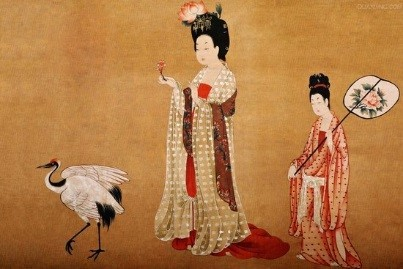

A. 关汉卿的《窦娥冤》

B. 白居易的《长恨歌》

C. 吴敬梓的《儒林外史》

D. 汉乐府《孔雀东南飞》

第 8 题 · 答案与解析

**参考答案（粉笔题库参考内容）**

B

**解析**

图中女子穿的是大唐宽松华美的服饰。A项关汉卿是元朝的；B项白居易为唐朝人，《长恨歌》中所描写的正是杨贵妃，因而与图中女子服饰最为一致；C项吴敬梓是清朝人；D项汉乐府的《孔雀东南飞》取材于东汉献帝年间发生在庐江郡的一桩婚姻悲剧。

故正确答案为B。

### 第 9 题

下列革命根据地和主要创立者对应错误的是：

A. 海陆丰根据地——彭湃

B. 湘鄂西根据地——方志敏

C. 左右江根据地——邓小平、张云逸

D. 陕甘边根据地——刘志丹、习仲勋

第 9 题 · 答案与解析

**参考答案（粉笔题库参考内容）**

B

**解析**

本题考查毛中特。

湘鄂西革命根据地是1928年7月，河邺军、红六军在湖北公安县会师，组成中国工农红军第二军团，贺龙任总指挥，周逸群任政治委员，孙德清任参谋长，柳直荀任政治部主任。而方志敏把马克思主义与赣东北实际相结合，创造了一整套建党、建军和建立红色政权的经验，毛泽东称之为“方志敏式”根据地，B项对应错误。

本题为选非题，故正确答案为B。

### 第 10 题

下列选项中成语与所涉人物对应不正确的是：

A. 图穷匕见——荆轲

B. 高山流水——伯牙

C. 破釜沉舟——项羽

D. 投笔从戎——岳飞

第 10 题 · 答案与解析

**参考答案（粉笔题库参考内容）**

D

**解析**

东汉班超投笔从戎，不是岳飞，D项对应错误。

本题为选非题，故正确答案为D。

### 第 11 题

京剧是我国的国粹，下列关于京剧的说法正确的：

A. 青衣属于京剧行当中的“净”

B. 京剧起源于山西、河北一带

C. 常香玉是京剧的四大名旦之一

D. 《贵妃醉酒》是梅兰芳的代表剧目

第 11 题 · 答案与解析

**参考答案（粉笔题库参考内容）**

D

**解析**

A项：“净”是京剧表演主要行当之一，俗称花脸，而青衣是中国戏曲中旦行的一种，是女性角色的扮演者，北方剧种多称青衣，南方剧种多称正旦，错误；B项：京剧是原来在南方演出的三庆、四喜、春台、和春4个徽调班社，陆续进京演出，同来自湖北的汉调艺人合作，相互影响，又接受了昆曲、秦腔的部分剧目、曲调和表演方法，并吸收了一些民间曲调，逐渐融合、演变，发展成为京剧，错误；C项：京剧四大名旦是梅兰芳、程砚秋、尚小云、荀慧生，错误；D项：梅兰芳是“梅派”唱腔的创始人，代表戏京剧有《贵妃醉酒》《霸王别姬》等，正确。

故正确答案为D。

### 第 12 题

下列宗教与其经典对应不正确的是：

A. 基督教——《圣经》

B. 道教——《黄庭经》

C. 佛教——《南华真经》

D. 伊斯兰教——《古兰经》

第 12 题 · 答案与解析

**参考答案（粉笔题库参考内容）**

C

**解析**

C项错误，《南华真经》又名《南华经》《庄子》，是战国早期庄子及其门徒后学所著，到了汉代道教出现以后，便尊之为《南华经》，且封庄子为南华真人，该经书是道教的经典。

A项正确，《圣经》作为基督教的经典，对欧洲的社会思想起了长期的统治作用。作为一部包括历史、律法、文学的百科全书，对欧洲的社会生活、历史演变、哲学发展和文学艺术产生极为深远的影响。

B项正确，《黄庭经》，又名《老子黄庭经》，道家养生修仙专著；内容包括《皇庭外景玉经》和《皇庭内景玉经》；两晋年间，新增《中景经》。由天师道魏华存自创门户而普传于世。

D项正确，《古兰经》是伊斯兰教唯一的根本经典。它是伊斯兰教先知穆罕默德在23年的传教过程中陆续宣布的“真主启示”的汇集。“古兰”一词系阿拉伯语Qur'an的音译，意为“宣读”“诵读”或“读物”。

本题为选非题，故正确答案为C。

### 第 13 题

从科学认识发展的历程来看，万有引力定律的发现经历了三个过程：①牛顿对万有引力的证明；②哥白尼提出“日心说”；③开普勒发现行星运动定律。这三个过程按时间先后排序正确的是：

A. ①②③

B. ②③①

C. ③②①

D. ②①③

第 13 题 · 答案与解析

**参考答案（粉笔题库参考内容）**

B

**解析**

①万有引力定律是1687年牛顿在《自然哲学的数学原理》上发表的；②“日心说”是由哥白尼在1543年发表的《天体运行论》中提出的；③德国天文学家开普勒提出的关于行星运动的三大定律，第一和第二定律发表于1609年，第三定律发表于1619年。正确的顺序应该是②③①。

故正确答案为B。

### 第 14 题

下列湖泊及其成因对应错误的是：

A. 云南滇池——构造湖

B. 新疆天池——冰川湖

C. 杭州西湖——河成湖

D. 敦煌月牙湖——风成湖

第 14 题 · 答案与解析

**参考答案（粉笔题库参考内容）**

C

**解析**

杭州西湖是海成湖而非河成湖，海成湖原系海湾，后湾口处由于泥沙沉积而将海湾与海洋分隔开而成为湖泊，通常称为泻湖 ，C项错误。河成湖形成往往与河流的发育和河道变迁有着密切关系，且主要分布在平原地区。因受地形起伏和水量丰枯等影响，河道经常迁徙，因而形成了多种类型的河成湖。构造湖是由地壳运动内力的作用，包括地质构造运动所产生的地壳断陷、坳陷和沉陷等所形成的各种构造凹地，如向斜凹地、地堑及其他断裂凹地所产生的构造湖盆，经贮水、积水而形成的湖泊，滇池符合，A项正确。冰川湖是由冰川挖蚀成的洼坑和水碛物堵塞冰川槽谷积水而成的一类湖泊，天池符合，B项正确。风成湖是因沙漠中沙丘间的洼地低于潜水面，由四周沙丘汇集洼地而形成，月牙湖符合，D项正确。

本题为选非题，故正确答案为C。

### 第 15 题

病虫害一直以来都是森林最危险的敌人之一，每年在中国造成的直接经济损失达到数十亿元，对生态环境的破坏更是难以估量。科学家发现，经常暴发病虫害的森林大多是一些：

A. 阴生树种为主的次生林

B. 阳生树种为主的次生林

C. 种群简单、树种单一的人工林

D. 种群复杂、种类繁多的自然林

第 15 题 · 答案与解析

**参考答案（粉笔题库参考内容）**

C

**解析**

病虫害常对农、林、牧业等造成不良影响。种群简单、树种单一的人工林更经常暴发病虫害。

故正确答案为C。

### 第 16 题

关于板块构造学说，下列说法错误的是：

A. 六大板块是对地球表面陆地板块部分的划分

B. 建立在大陆漂移和海底扩张学说的基础上

C. 喜马拉雅山脉是由两大板块碰撞挤压形成的

D. 火山、地震等地质灾害主要是发生在板块边缘

第 16 题 · 答案与解析

**参考答案（粉笔题库参考内容）**

A

**解析**

A项错误，全球地壳六大板块有太平洋板块、亚欧板块、非洲板块、美洲板块、印度洋板块和南极洲板块，其中除太平洋板块几乎全为海洋外，其余五个板块既包括大陆又包括海洋。

B项正确，大陆漂移学说是一种关于地壳构造运动的科学假说，由德国气象学家魏格纳首先提出和倡导。海底扩张学说是解释地壳结构和地壳运动的假说，是大陆漂移学说的新形式和进一步的发展。而板块构造学说是在大陆漂移学说和海底扩张学说的基础上发展起来的，对地球上的海陆变化乃至整个地壳运动，作出了新的解释。

C项正确，喜马拉雅山脉是由印度洋板块与欧亚大陆板块相互碰撞和交叠相挤形成的。

D项正确，火山爆发是地球内部的熔融物质在板块挤压的作用下形成的。地震引发的原因是板块与板块之间相互挤压碰撞，造成板块边缘产生错动和破裂。而板块与板块之间地壳运动活跃，因此，火山、地震等地质灾害主要发生在各大板块彼此间的交界处。

本题为选非题，故正确答案为A。

### 第 17 题

关于我国地理，下列表述正确的是：

A. 泰山、华山、恒山、衡山和庐山被称为“五岳”

B. 南海有东沙、西沙、中沙、南沙四个群岛

C. 西藏自治区是我国面积最大的省级行政区

D. 华北平原是我国面积最大的平原

第 17 题 · 答案与解析

**参考答案（粉笔题库参考内容）**

B

**解析**

A项：五岳分别是东岳泰山、南岳衡山、西岳华山、北岳恒山、中岳嵩山，排除；B项：南海有四个群岛，分别是东沙群岛、西沙群岛、中沙群岛、南沙群岛，正确；C项：新疆维吾尔自治区是中国陆地面积最大的省级行政区，排除；D项：东北平原是中国最大的平原，排除。

故正确答案为B。

### 第 18 题

海洋动物科学考察的结果显示，近十年来，许多海洋“有壳类”动物，如贝类、螺类和虾蟹类等，有外壳变薄、变软的趋势，这种现象的主要原因是：

A. 海洋“有壳类”动物面临食物短缺的困境，经常出现营养不良

B. 外壳轻便的海洋动物更易于游动、捕食和躲避天敌

C. 海水升温导致海洋动物的生长成熟周期缩短

D. 二氧化碳排放过多导致海水酸化

第 18 题 · 答案与解析

**参考答案（粉笔题库参考内容）**

D

**解析**

全球气候变暖造成的负面影响正在进一步扩大，海洋酸化便是其中之一。一项最新研究成果显示，海水酸化导致包括贝类在内的众多小型海洋动物外壳和骨骼变薄。

故正确答案为D。

### 第 19 题

关于计算机，下列说法不正确的是：

A. 平板电脑属于小型计算机

B. 计算机断电后内存中的信息会丢失

C. 计算机的性能并非完全依靠于CPU

D. 机器语言可以被计算机硬件直接执行

第 19 题 · 答案与解析

**参考答案（粉笔题库参考内容）**

A

**解析**

平板电脑、个人PC等属于微型计算机的范畴，而小型计算机是相对于大型计算机而言的一种概念，仍比微型计算机的硬件规模、计算能力等高出很多。

本题为选非题，故正确答案为A。

### 第 20 题

下列说法不正确的是：

A. 眨眼可以湿润眼球，正常人平均每分钟要眨眼十几次

B. 小孩多理发能有效促进头发长得更快、更密、更粗壮

C. 当我们停止运动后，肌肉会变软，但不会变成脂肪

D. 眼泪中溶有许多不同的盐，所以是咸的

第 20 题 · 答案与解析

**参考答案（粉笔题库参考内容）**

B

**解析**

A项：正常人的眼皮，每分钟大约要眨动15次，可以起到清洁和湿润眼球的作用，正确。B项：人的头发，是从头皮里面的毛囊长出来的。剪掉或者刮掉头皮外面的头发，头皮内的毛囊是没法知道的，更不可能存在一个反馈系统，促使毛囊长出更多更密的头发来。剃光孩子的头发，新长出的头发是显得更加密一些更加粗一些，其实这只是因为剃光了头发，新头发长出来时，不再像原来的头发那样长短不一，而是同一时间一起生长，自然就显得比起原始头发厚一些。孩子头发的浓密与否、粗细颜色，主要取决于家庭遗传，加上后天的营养和保养，错误。C项：当停止力量练习后，原本紧张结实的肌肉就会变得松弛、萎缩，不会变成脂肪，正确。D项：眼泪中溶有许多不同的盐，食物中的盐分被肠道吸收后进入血液。眼泪是由泪腺分泌的，当血液流过泪腺时，部分盐分便随之渗入眼泪中了，正确。

本题为选非题，故正确答案为B。

### 第 21 题

尼采把母鸡下蛋的啼叫和诗人的歌唱相提并论，说都是“痛苦使然”。这个家常而＿＿＿＿的比拟，也恰恰符合中国文艺传统里一个＿＿＿＿的意见：苦痛比快乐更能产生诗歌，好诗主要是不愉快、烦恼或“穷愁”的表现和发泄。在中国古代，这个意见不但是诗文理论里的常谈，而且成为写作实践里的套路。

依次填入画横线部分最恰当的一项是：

A. 形象 主流

B. 通俗 主观

C. 尖刻 偏执

D. 生动 流行

第 21 题 · 答案与解析

**参考答案（粉笔题库参考内容）**

D

**解析**

第一空，修饰“比拟”，即比方，C项“尖刻”指说话尖酸，待人冷酷、苛求，搭配不当，排除。

第二空，搭配意见，B项“主观”搭配不当，排除。对比“主流”与“流行”，A项“主流”更侧重于强调事物发展的主要方面、主要趋向，而D项“流行”则强调在一段时期内十分盛行，广泛传播，根据文段最后一句可知，文段要强调在中国古代，这种意见是非常流行的，被广泛接受的，而“主流”不能体现出在当时那个时间段很流行，故“流行”更为合适。

故正确答案为D。

【文段出处】《诗可以怨》

### 第 22 题

阿伦特指出，歧视是一项不可分割的政治权利，实际且正当的目标不是完全＿＿＿＿歧视，而是控制在社会领域。如今的时代与阿伦特发布的这些论述的时代已经＿＿＿＿＿＿，种族歧视已绝对成为“政治不正确”。

依次填入画横线部分最恰当的一项是：

A. 消灭 天差地别

B. 解除 泾渭分明

C. 消除 截然不同

D. 破除 相去甚远

第 22 题 · 答案与解析

**参考答案（粉笔题库参考内容）**

C

**解析**

第一空考查搭配，根据“不是······而是······”表达反义并列可知，横线与“控制”语义相反，表达让歧视没有消失的含义，A项“消灭”、C项“消除”符合语义，保留。B项“解除”意为去掉、除掉，常搭配解除警报、解除武装，D项“破除”意为废除、打破，常搭配破除封建迷信、破除陋习，此二者都无法与“歧视”做搭配，故排除。

第二空用以形容“时代”不同，C项“截然不同”更为恰当，当选。A项“天差地别”现多用以形容事物之间差距很大，与文意不符，排除。

故正确答案为C。

【文段出处】《歧视与隔阂》

### 第 23 题

在这种只关心自身利益尤其是选举利益的短视逻辑下，西方领导人“忘记”了向公众解释这种＿＿＿＿的方式是无法持续的，它必将会损害到国家的未来。由于他们弃难择易，放松了道德要求，因而“负债经济”成了一种必然。

填入画横线部分最恰当的一项是：

A. 以邻为壑

B. 掩耳盗铃

C. 削足适履

D. 寅吃卯粮

第 23 题 · 答案与解析

**参考答案（粉笔题库参考内容）**

D

**解析**

根据“短视逻辑”、“无法持续的，它必将会损害到国家的未来”及“负债经济”可知，横线处所提及的方式指只考虑当下，而损害未来的方式，且“负债”也能体现出现在预支了未来之意，对应D项“寅吃卯粮”，意为寅年吃了卯年的粮食，形容入不敷出，预先借支，符合文意。A项“以邻为壑”意为嫁祸于人或把困难、问题推给别人；B项“掩耳盗铃”意为捂住耳朵去偷铃，比喻自己欺骗自己；C项“削足适履”意为脚大鞋小，为了穿上鞋而把脚削去一点儿，比喻无原则地迁就现成条件或不顾客观条件生搬硬套。均与文意不符，排除。

故正确答案为D。

### 第 24 题

“意外惊喜”不是游客在朝鲜可以经常遇到的东西，因为导游会＿＿＿＿地规划你的行程，通常不惜绕远路也要避免你接触普通朝鲜民众。可喜的是，一些非政府组织正在＿＿＿打破这层厚重面纱。

依次填入画横线部分最恰当的一项是：

A. 周密 企图

B. 谨慎 试图

C. 严密 努力

D. 审慎 考虑

第 24 题 · 答案与解析

**参考答案（粉笔题库参考内容）**

B

**解析**

本题可从第二空入手。根据“可喜的是”可知，非政府组织的做法是积极、主动的，横线处应体现他们正在尝试或努力打破“厚重面纱”这一现实障碍。B项“试图”指主动尝试、打算做某事，C项“努力”指付出行动、尽力去做，均符合文意，保留。A项“企图”多含贬义，指图谋不正当之事，与文段积极的感情色彩不符，排除；D项“考虑”指仅停留在思考层面，未体现实际行动，与“正在”的进行时态不匹配，排除。

第一空，由“不惜绕远路也要避免你接触普通朝鲜民众”可知，横线处所填词语应体现导游为避免游客接触普通民众，行事小心、有所顾忌地规划行程。B项“谨慎”侧重言行慎重、小心，符合文意，当选。C项“严密”侧重计划周密、无疏漏，强调行程的严谨性，而文段重点是导游为规避接触民众而“小心翼翼”地安排行程，并非强调行程无漏洞，与文意不符，排除。

故正确答案为B。

【文段出处】《巨无霸指数走进朝鲜》

### 第 25 题

防范理财“陷阱”，不仅是投资者个人的大事，也应当成为金融机构＿＿＿＿＿＿的职责。既是对投资者负责，也是＿＿＿＿金融机构自身品牌和形象的需要。

依次填入画横线部分最恰当的一项是：

A. 不可推卸 提升

B. 不容置疑 塑造

C. 必不可少 提高

D. 当仁不让 打造

第 25 题 · 答案与解析

**参考答案（粉笔题库参考内容）**

A

**解析**

第一空搭配“职责”，A项“不可推卸”最为恰当，因为“推卸”一词最常搭配的名词即为职责、责任等；B项“不容置疑”意为不允许提出怀疑，表示真实可信；C项“必不可少”即一定不能缺少，鲜与“职责”搭配；D项“当仁不让”意为碰到应当做的事情就主动去做，不必退让，侧重于强调主动承担，而非理应承担。故基本可确定正确答案为A项。

以第二空做验证，“提升品牌和形象”为常见固定搭配。

故正确答案为A。

【文段出处】《金融机构有“内鬼” 防范理财“陷阱”需合力》

### 第 26 题

200年前，徽班进京、花雅之争，更为通俗的京剧最终战胜昆曲，＿＿＿了整个梨园。但京剧如今却处境尴尬。近年来，对昆曲打捞热度不减，国粹京剧反倒像一个＿＿＿的贵族。

依次填入画横线部分最恰当的一项是：

A. 占据 失意

B. 垄断 落寞

C. 统治 失宠

D. 霸占 没落

第 26 题 · 答案与解析

**参考答案（粉笔题库参考内容）**

D

**解析**

本题第二空为突破口。“没落的贵族”为极常见的固定搭配，用以形容京剧的衰败景象。A项“失意”常用以形容人在某个阶段不如意，不得志，一般多形容个人，少形容一个集体；B项“落寞”侧重于强调孤单、寂寞之意，难以体现出衰败之意；C项“失宠”更易排除，失去（某人的）宠爱，多形容“嫔妃”，少形容“贵族”。故基本可确定正确答案为D项。再以第一空做验证。“霸占了整个梨园”，体现出京剧以一种非常强悍的姿态独占梨园，与文意相符。A项“占据”语义稍轻；B项“垄断”多用于经济贸易方面的把持与独占；C项“统治”意为强力控制，勉强符合文意，但败在了“失宠”一词。

故正确答案为D。

【出处】《京剧自娱自乐只能等死》

### 第 27 题

新技术和新媒体的出现，使人的阅读内容、阅读媒介、阅读习惯发生了变化，呈现多元化、数字化、个性化的特点，读者被多样化地细分，“界面”阅读受到年轻人＿＿＿＿。伴随便利而来的是娱乐化的泛滥，这是一个泛娱乐化的时代，一切文化都心甘情愿地成为娱乐的＿＿＿＿＿＿，以分得一杯娱乐的残汁，而思考愈发远遁。

依次填入画横线部分最恰当的一项是：

A. 追捧 附庸

B. 认可 陪衬

C. 青睐 注脚

D. 欢迎 随从

第 27 题 · 答案与解析

**参考答案（粉笔题库参考内容）**

A

**解析**

本题可从第二空入手。由第二空与前文“泛娱乐化”及后文“分得一杯娱乐的残汁”对应可知，“文化”在“娱乐”面前地位低微。C项“注脚”意为对某事所作的说明或解释，与文意不符，故排除。A项“附庸”指依附别的人或事物而存在的人或事物；B项“陪衬”即（次要事物）置于主要事物附近，使主要事物更加突出；D项“随从”即跟随、陪同，均包含次要、低微之意，但仔细对比分析可以发现，“附庸”一词所表达的附属地位较之于“陪衬”“随从”程度更重，含有如果失去了依附主体便无法单独存在之意，这更能表现出“文化”对“娱乐”的一种依托与附属状态，故A项为正确答案。

以第一空做验证，“追捧”意为追逐捧场，相较于“认可”“青睐”“欢迎”，与整个文段所体现出的作者对于“泛娱乐化”这一时代现象所持有的消极倾向相符合。

故正确答案为A。

### 第 28 题

世界上有一种人，他们觉得看书的目的，并不是为了写批评或介绍。他们＿＿＿＿＿＿地浏览，每到有什么意见，就随手在书边的空白上注几个字，写一个问号或感叹号。这种＿＿＿＿随感并非他们对于整部书的结论，因为是随时批识，也许前后矛盾，说话过火，他们也懒得去理会，＿＿＿＿是消遣。

依次填入画横线部分最恰当的一项是：

A. 不慌不忙 零星 反正

B. 漫无目的 零散 毕竟

C. 随心所欲 凌乱 本来

D. 慢条斯理 零碎 无非

第 28 题 · 答案与解析

**参考答案（粉笔题库参考内容）**

A

**解析**

本题可从第二空入手，与前文“注几个字”“写一个问号或感叹号”对应可知，“这种随感”很少，很简短。A项“零星”意为细碎的、少量的，与文意相符，保留；B项“零散”侧重分散，分散不代表数量少，排除；C项“凌乱”侧重强调不整齐的状态，D项“零碎”侧重强调不完整，文段侧重的是少，均排除。

第一空、第三空，代入验证，A项“不慌不忙”体现浏览的状态从容淡定，“反正”表达在任何情况下结果都是一样的，即最终的结果都是“消遣”，与文意相符，当选。

故正确答案为A。

【文段出处】《写在人生边上（序）》

### 第 29 题

人类历史的进程，充满着错综复杂的矛盾，理想的＿＿＿＿与搏斗，社会的＿＿＿＿与变革，历史的＿＿＿＿与前进，绘制出人类自己创造自己、自己发展自己的扑朔迷离、色彩斑斓的画卷。

依次填入画横线部分最恰当的一项是：

A. 摩擦 发展 曲折

B. 碰撞 平稳 反复

C. 冲突 动荡 迂回

D. 对抗 挑战 起伏

第 29 题 · 答案与解析

**参考答案（粉笔题库参考内容）**

C

**解析**

第一空，横线处所填词语与“搏斗”构成并列关系，体现理想之间激烈碰撞、对抗的状态。B项“碰撞”、C项“冲突”、D项“对抗”均能体现较强的矛盾对立，符合文意，保留。A项“摩擦”指轻微的矛盾或冲突，程度过轻，无法与“搏斗”的激烈程度对应，排除。

第二空，横线处所填词语与“变革”构成并列关系，体现社会发生剧烈变动、革新的特点。C项“动荡”指局势、情况不稳定，能体现社会层面的矛盾与变化，符合文意，保留。B项“平稳”指安定稳定，与“变革”所表达的变化、革新之意矛盾，排除；D项“挑战”指面临的困难或考验，与“变革”之间并非近义并列关系，无法体现社会层面的矛盾与变动，排除。

第三空，代入验证。横线处所填词语与“前进”构成并列关系，C项“迂回”指曲折前行，与“前进”共同体现历史进程中曲折发展、逐步向前的状态，符合文意，当选。

故正确答案为C。

【文段出处】《进入哲学思考》

### 第 30 题

我们的文化出口从电影扩展到电视剧，实际上是从“中国印象”转变为“中国故事”。电影是短诗，往往＿＿＿；电视剧是长篇，能翔实而真切地表现生活。电视剧能在“细无声”处沁润人心，日日与剧相伴，海外观众会在＿＿＿间把剧作带进生活，又在生活中＿＿＿剧作。

依次填入画横线部分最恰当的一项是：

A. 轻描淡写 不知不觉 复制

B. 浮光掠影 潜移默化 认同

C. 意犹未尽 耳濡目染 实现

D. 囫囵吞枣 天长日久 模仿

第 30 题 · 答案与解析

**参考答案（粉笔题库参考内容）**

B

**解析**

第一空用以形容“短诗般的电影”，与之后的“翔实真切的长篇电视剧”做反义对应，A项“轻描淡写”多指说话、作文时将某些事情轻轻带过；B项“浮光掠影”比喻观察不细致，印象不深刻，均可；C项“意犹未尽”指意思还没有表达完，主语往往为人，和“电影”搭配不当，应为“让人、令人意犹未尽”，排除； D项“囫囵吞枣”为贬义词，比喻不经过分析辨别，照原样笼统地接受，与文意不符，故排除。

第二空考查语义对应，文中“‘细无声’处沁润人心”与“潜移默化”中的“潜”“默”对应，基本确定正确答案为B项。

以第三空做验证，观众不会在生活中“复制”剧作，而是对国产电视剧产生认同感，进而更喜欢看剧，故“认同”亦最为合适，A项“复制”可以排除。

故正确答案为B。

【出处】《国产剧自信地讲好中国故事》

### 第 31 题

微电网是包含本地化半自主运行的电源、负荷和电热储能设施的集群。相对于大电网，它自成一体，单独控制，可以与大电网连接，并网运行，也可以断开连接，以“孤岛模式”自行运行。微电网作为具有向参与者和传统电网提供双向效益的特点，体现了分布式电力系统的发展方向，也为电网的发展开辟了一条崭新路径。

下列说法与原文相符的是：

A. 微电网是以“孤岛模式”运行的本地化电网

B. 微电网是与传统电网并网运行的集群

C. 微电网的出现分散了传统电网的效益

D. 大电网可能因与微电网并行而受益

第 31 题 · 答案与解析

**参考答案（粉笔题库参考内容）**

D

**解析**

细节判断题，与原文一一对应。由文段中微电网“可以与大电网连接，并网运行，也可以断开连接，以‘孤岛模式’自行运行”可知，A、B两项都仅片面提及其中一个部分，故与原文不符，排除。根据微电网“具有······双向效益的特点”可知，C项表述有误，排除。D项中“可能”一词用法平和准确，与文意相符，当选。

故正确答案为D。

【文段出处】《微电网寻路中国：为电网发展开辟崭新路径》

### 第 32 题

大唐帝国的开放品格和强盛国力，对周边国家产生了强大影响。作为唐朝手工业产品的各种生活用品和工艺品，对海外诸国都有着磁石般的吸引力。域外对从唐朝舶来的丝绸、瓷器等物品的追逐，就好比时下潮人对苹果手机和iPad的垂青一样，唐三彩也裹挟在这种洪流中漂洋过海，生根发芽。

这段文字接下来最有可能论述的是：

A. 唐朝对周边国家的巨大影响力

B. 域外崇尚唐朝物品的各种表现

C. 唐朝货品的运输路径和方式

D. 唐三彩在域外的流传和影响

第 32 题 · 答案与解析

**参考答案（粉笔题库参考内容）**

D

**解析**

接语题重点关注文段尾句。文段从帝国的影响具体到唐朝的生活用品和工艺品，最后提出更为微观具体的“唐三彩”这一核心概念，作为对下文的引出，有且仅有D项提及“唐三彩”。

故正确答案为D。

### 第 33 题

随着计量经济学的发明和日益完善，学术研究日益严谨，数据、方法才说明一切，特别是数据最显重要。但是，这种学术发展趋势暗藏着危险。现代计量经济学之发达，其专业程度之深，已让人目瞪口呆，这一学科的任务之一就是通过大样本研究，寻找经济变量之间的相关性，进而从中得出某些政策结论。这种大样本研究具有抽象性，在此过程中很可能舍弃了一些重要信息。如果沉醉于计量方法形式上的巨大魅力，看不到其中暗含的缺陷，就容易被数据所带来的虚假安全感所欺骗。

对这段文字的主旨，概括最准确的是：

A. 强调计量经济学方法在学术研究中的绝对地位

B. 批评一味迷信经济学计量方法的学术研究趋势

C. 说明完善样本选择对计量经济学的重要意义

D. 解释如何通过经济变量分析得出政策结论

第 33 题 · 答案与解析

**参考答案（粉笔题库参考内容）**

B

**解析**

文段首句指出当下的学术研究极为重视数据这一大背景，随后以“但是”提出这种趋势暗藏危险。然后进一步具体到现代计量经济学，先提出其发达、专业的现状，进而指出其研究依托的样本具有抽象性这一问题。尾句以反面论证的形式提出作者的观点，即对于当下沉醉于计量经济学的魅力而忽视其缺陷，会带来不良后果。B项为作者观点的同义替换，当选。

A项与作者态度相反，与文意相悖，排除；C项“完善样本”在文段中并无体现，属于无中生有，排除；D项对应文段尾句，作者观点之前的内容，非重点，排除。

故正确答案为B。

### 第 34 题

树可长至参天凌云却依然青葱碧绿，靠的是木质部的导管将根部吸收的水分一路运输到树梢。根据最新的研究结果，植物学家发出警告，气候变化所导致的部分地区干旱化除了会威胁地下水的供应，还会损害木质部运输水分的能力，从而令森林处于危险状态。研究者表示，在干旱条件下，树木会极力地从地下吸取水分，而在此过程中，会有太多气泡被吸入木质部。当这些气泡在导管中堵塞，便会阻断水流供应，令树木缺水而死。

根据这段文字，最新的研究结果是：

A. 树木木质部越粗越有利于水分供应

B. 极端天气会破坏树木木质部的生物结构

C. 湿润的气候条件更有利于参天大树的生长

D. 导管中大量气泡的存在会阻断树木水分的供应

第 34 题 · 答案与解析

**参考答案（粉笔题库参考内容）**

D

**解析**

重点关注最新研究结果的具体内容，做一一比对。A项木质部越粗为无中生有，排除；B项极端天气为干旱天气的概念扩大，且文段中提及损害的是木质部的能力而非木质部的生物结构，排除；C项并非最新研究结果，而是为人们熟知的常识，排除；D项对应文段尾句，亦是最新研究的重要成果，当选。

故正确答案为D。

### 第 35 题

在充满着复杂流动性的转型中国，小说家对时代的整体性把握将越来越不可能，任何想从整体上对时代命名的企图和冲动将不得不最终沦为可笑的“堂•吉诃德”。但是这也给写作提供了一个全新的思路，既然把握大的时代已经不可能，那么就可以仔细打量那些被大时代所遮蔽的现代人生活中的小，让文学真正回到它的本源——文学是人学，文学应关注个体在此岸世界的存在，关注那些与个体生命存在有关的尊严、自由及其异化问题，关注与真诚、美好、焦虑、敬畏等与文学和人有关的基本问题。

这段文字意在说明文学创作：

A. 思路应从整体转为个体

B. 环境发生了巨大变化

C. 本源与个体生命有关

D. 题材应趋向多元化

第 35 题 · 答案与解析

**参考答案（粉笔题库参考内容）**

A

**解析**

文段开篇介绍现状，接着通过转折关联词“但是”重点强调一种“全新的思路”，即从对时代的整体把握转变为对生活中的个体的关注，后文对新思路进行详细的解释说明，故文段意在强调思路的转换，应从关注大的时代转为关注个体，对应A项。

B项，“环境发生了巨大变化”对应文段“在充满着复杂流动性的转型中国”，为背景引入内容，非重点，排除；

C项，“本源与个体生命有关”为解释说明内容，非重点，排除；

D项，“多元化”文段未提及，无中生有，排除。

故正确答案为A。

【出处】《“微小时代”里的城市文学新转型》

### 第 36 题

学术著述必须得有注释，而注释也是力求克服主观性，努力追求学术见解的公允性、合理性、可被接受性的重要途径之一，其本身也是正文论证部分所展开的学术对话的附随性表现。但有必要认识到的是，注释的规范要求不是独立的，也不仅仅只是一套技术，而是与学术论证的规范要求相一致。

这段文字意在强调：

A. 学术论著要体现出客观性

B. 学术论著注释要克服主观性

C. 论著注释必须符合学术规范

D. 学术论著正文与注释同等重要

第 36 题 · 答案与解析

**参考答案（粉笔题库参考内容）**

C

**解析**

文段首先提出学术著述必须得有注释，以此保证学术见解的公允性与合理性。随后以转折关联词“但”引出文段重点，即对于注释的规范要求必须与学术论证相一致，C项为文段中心的同义替换。A项论述主体不一致，排除；B项，属于转折之前的内容，非重点，排除；D项，“正文与注释同等重要”无中生有，排除。

故正确答案为C。

【文段出处】《独断主义盛行是文科领域最大的问题》

### 第 37 题

当《枪支管理法》通过的时候，受到该法禁止的攻击性武器之中，有一种是仿苏式半自动步枪AK47。仅此一种型号，美国民间当时就已经有100万支。最近20年美国校园不断发生恶性枪击事件，见诸世界各大媒体，并引发了一场有关《枪支管理法》的大讨论。看了大量的类似报道，国人一定会想为什么美国允许公民拥有枪支。

作者接下来最有可能介绍的是：

A. 美国各界对《枪支管理法》的观点

B. 近年来美国发生的各类枪击案件的特点

C. 当前美国政府对于民间枪支的管理制度

D. 美国各个时期的法律关于公民拥有枪支的规定

第 37 题 · 答案与解析

**参考答案（粉笔题库参考内容）**

D

**解析**

本题为接语选择题，需通读全文，重点关注文段最后讨论的核心话题，尾句提到“国人一定会想为什么美国允许公民拥有枪支”，换言之文段接下来应该为国人介绍美国允许公民拥有枪支的原因。对比四个选项，只有D项从历史渊源这个角度为国人分析了美国允许公民拥有枪支的原因。A、B两项为文段中已经论述的内容，不可作为接语题的正确答案；而C项当前的管理制度并不能够作为原因支撑观点。

故正确答案为D。

【出处】《美国不禁枪真正原因是中国人永远无法理解的》

### 第 38 题

失去对自然声音感悟的人是最可悲的，当有人说“风景美得像一幅画”时，境界便低了，因为画是静的，自然的风景是活的、动的；而除了目视，自然还提供了各种声音，这种双重的组合才使自然超拔出人所能创造的境界。世上有无数艺术家，全是从自然中吸取灵感，但再好的艺术家，总无法完全捕捉自然的魂魄，因为自然是有声音有画面的，还是活的，时刻都在变化的。

这段文字意在说明：

A. 欣赏自然需要视觉、听觉的全方位体验

B. 大自然为艺术家提供了取之不尽的材料

C. 自然风景超出了人所能创造的境界

D. 取法自然才能创造出杰出的作品

第 38 题 · 答案与解析

**参考答案（粉笔题库参考内容）**

A

**解析**

文段先从正反两方面进行对比，得出“自然是活的，不仅提供美景还提供声音”这一结论。尾句再以艺术家无法捕捉自然的魂魄来强调自然是声音与画面的结合，是活的。综合文段两句得知，作者反复强调自然由画面和声音组合的这一特性，由此可知欣赏自然时需要视觉、听觉的全方位体验，即A项表述。

B、C、D三项的共性问题在于均未提及文段中强调的重要主题词——声音，均排除。

故正确答案为A。

【出处】《随风吹笛》

### 第 39 题

婚姻，就是为了和一个人相濡以沫，共度今生，任何以钱财为目的的爱情和婚姻，都是不正确的。诚然，爱情也是要有块地方来承载的，而婚姻显然也要有个房子来遮风挡雨的，尤其是作为家庭最大财富的房子，还在不断增值的情况下。但是，现在不少人总是抱着某种目的去找对象，而忽视了感情本身。毕竟，婚姻的目的不是为了结束单身生活，而是为了创造一个属于自己的家庭，享受承担责任、被人需要的快乐。

下列最适合做这段文字标题的是：

A. 蜗居年代：寻找婚姻的避风港

B. 裸婚时代：我们拿什么去结婚

C. 悲剧：今天结婚，明天就离婚

D. 婚姻：算房产账，更算感情账

第 39 题 · 答案与解析

**参考答案（粉笔题库参考内容）**

D

**解析**

通过阅读文段得知，文段包含两个重要的主题词，即房子和感情。作者对于此二者的态度是婚姻显然需要有个房子来遮风挡雨，但不可因此而忽视了感情本身，D项中“更”字体现了作者的态度观点。

故正确答案为D。

【出处】《结婚就像合伙开公司 婚姻要算房产账》

### 第 40 题

提到保健品，首要问题不是为什么要买，而是为什么不买。在每个日渐老去的人身上，都潜伏着若隐若现的苦恼——关节炎、老年痴呆症······这催生了一个试图阻止病痛的庞大产业——保健品产业。去年，美国人花在保健品上的钱约为280亿美元，比购买健身房会员卡的钱还要多出50亿美元。但保健品真的有用吗？保健品介于食品和药品之间，是一种定义模糊、范围很广却缺乏监管的消费品。据说有了它们，人们不吃食物和药物，也能同时拥有营养和健康，因此又被称为营养保健品。

作者对保健品的态度是：

A. 怀疑其功效

B. 认为有益健康

C. 反对人们食用

D. 认为该产业前途光明

第 40 题 · 答案与解析

**参考答案（粉笔题库参考内容）**

A

**解析**

文段考查作者的态度观点。作者介绍背景现状后提出问题，“保健品真的有用吗？”后文中又以“据说”一词共同体现出作者对于保健品保健作用的怀疑。B、D两项与作者观点相反；C项程度过重。

故正确答案为A。

【文段出处】《保健品到底有多保健》

### 第 41 题

①这些霜花团团簇簇的，很有点花园的气象

②一旦太阳从山峦中升起来，印着霜花的玻璃窗就像魔镜一样，散发出奇诡的光辉

③早晨，迎接我的是一夜寒流和冷月，以及凝结在玻璃窗上的霜花

④这天的霜花不似往日的，总是呈树的形态

⑤想必霜花也知道立春了吧

⑥你能从中看出喇叭形的百合花来，也能看出重瓣的玫瑰和单瓣的矢车菊来

将以上6个句子重新排列，语序正确的是：

A. ⑤③④⑥②①

B. ③⑤④①⑥②

C. ⑤④③⑥①②

D. ③④⑤②①⑥

第 41 题 · 答案与解析

**参考答案（粉笔题库参考内容）**

B

**解析**

从选项中判断首句。对比③句和⑤句，③句引出霜花这一文段主题词，相较于⑤句中的一句感慨更适合做首句，故排除A、C两项。观察句子可发现①句出现指代词“这些霜花”，即可以判断①前面是②还是④，②句围绕的是“玻璃窗”，④句围绕“霜花”，故根据指代词捆绑④①捆绑，排除D项。

故正确答案为B。

【出处】《春天是一点一点化开的》

### 第 42 题

①如果把信息看做是一种自我资源，那么信息的公开透明就会被当做是一种权宜之计

②这说明，公开透明不仅是一个技术问题，更是一个深层次的理念问题

③面对一些突发性公共事件，许多地方都会在第一时间发布信息，这极大地增进了人们对政府的信任支持

④在这个意义上，公开透明的问题，本质上是一个以人为本的问题；政府公信力的打造，与政府服务人民紧密相连

⑤也有一些信息发布的效果并不好，究其原因，就在于发布的并非是公众关注的信息，甚至对公众的关切质疑刻意回避

⑥反之，如果树立服务型政府理念，认识到政府信息的公共资源属性，尊重人民的知情权，公开透明就会成为一种主动选择

将以上6个句子重新排列，语序正确的是：

A. ①④③⑤②⑥

B. ③⑤①④②⑥

C. ①③⑤⑥②④

D. ③⑤②①⑥④

第 42 题 · 答案与解析

**参考答案（粉笔题库参考内容）**

D

**解析**

本题考查语句的排序。从选项中判断首句。对比①③两句，不好判断哪句更适合做首句。通过观察可以发现，⑥句中“反之”表示反义并列，且为“如果”句式，①句与其内容相反，句式一致，故需将①⑥捆绑衔接，且以④句做验证。④句揭示了问题的本质并提出了对策，符合段尾句的特征。

故正确答案为D。

【出处】《让公信力在阳光下生长》

### 第 43 题

①二十世纪五六十年代，许多信息灵通人士认为苏美之间的核战争不可避免

②预测是否实现，依赖于人们如何作出反应

③因为人们意识到了它的可能性

④任何预测都不是自我实现的或非自我实现的

⑤但是这场核战争并未发生

⑥并推动了核武器控制和其他安排来确保它不发生

将以上6个句子重新排列，语序正确的是：

A. ④①③⑤⑥②

B. ②①⑤④③⑥

C. ②①⑤③④⑥

D. ④②①⑤③⑥

第 43 题 · 答案与解析

**参考答案（粉笔题库参考内容）**

D

**解析**

本题从首句入手判断难度较大，可从后文的捆绑集团中确定答案。①⑤两句以核战争为共同信息，且以“但是”表达相反语义，衔接紧密，故排除A项。

观察句子可知，只有②句和④句谈论到“预测”，可以根据共同信息捆绑确定②④捆绑，排除B、C两项。

验证D项，符合逻辑顺序，当选。

故正确答案为D。

【出处】《文明的冲突与世界秩序的重建》

### 第 44 题

有许多长寿的人，你问他们常吃什么食品，他们回答说：“什么都吃，并无特殊的禁忌。”但有许多东西他们只尝一口，就敏锐地判断出成色。读书也是一样，好的书，是人参燕窝熊掌，人生若不大快朵颐，岂不白在世上潇洒走过一回？坏的书，是腐肉砒霜氰化物，浪费了时间贻误了性命。名著一般多是经过了许多年代的考验，是被大师们的智慧研磨了无数遭的精品。读的时候，像烈火烹油的满汉全席，为大享乐。

这段文字旨在说明：

A. 读书要有所选择

B. 名著如美食般余味无穷

C. 物质和精神食粮同样重要

D. 鉴别书籍比鉴别美食更困难

第 44 题 · 答案与解析

**参考答案（粉笔题库参考内容）**

A

**解析**

文段以对美食的判断选择做引入，重点论述读书亦是如此，即应该粗中取精，有选择地阅读，故A项为正确答案。B项“余味无穷”非文段重点 ，排除；C、D两项为无关对比 ，排除。

故正确答案为A。

【文段出处】《阅读是一种孤独》

### 第 45 题

酒可以渲染气氛，有助于谈兴，故浪漫倜傥的诗人无不喜欢这个调儿。二十来岁即位列“初唐四杰”之冠的王勃，据说他在写《滕王阁》七言古诗和《滕王阁序》时，先磨墨数升，继而酣饮，然后拉起被子覆面而睡，醒来后抓起笔一挥而就，一字不易。李白当年奉诏为玄宗写《清平调》时，也是在烂醉之下用水泼醒后完成的。“钟鼓馔玉不足贵，但愿长醉不复醒。古来圣贤皆寂寞，惟有饮者留其名。”他的《将进酒》字字都含酒香。<u>如果把他所有写酒的诗拿去压榨，也许可以榨出半壶高粱酒来。</u>

划横线的句子说明李白：

A. 是最钟情于酒的诗人

B. 写了很多关于酒的诗篇

C. 写酒的诗多为经典之作

D. 酒是写诗时不可或缺的

第 45 题 · 答案与解析

**参考答案（粉笔题库参考内容）**

B

**解析**

文段首句阐明诗人与酒的密切关系，后以王勃、李白为例加以论证。画横线句子以把诗拿去压榨能压榨出半壶高粱酒这样生动的形式，表现出李白关于酒的诗作之多。A项“最钟情”、C项“经典之作”无中生有，文段没有涉及，排除； D项“不可或缺”一词程度过重，并不是所有的诗句都含有酒，排除。

故正确答案为B。

【出处】《诗人与酒》

### 第 46 题

在经济学领域有“后发劣势”的概念。这指的是落后国家由于发展较迟，因此对发达国家进行模仿，模仿有两种形式，一种是模仿制度，另一种是模仿技术和工业化模式。由于是后发国家，所以可以在没有基础制度的情况下通过技术模仿实现快速发展。然而，这一模仿虽然相对容易实现，但会给长期的发展留下许多隐患。事实上，当前我国老工业基地所面临的一系列问题，＿＿＿＿＿＿＿。

填入画横线部分最恰当的一句是：

A. 正是我国在工业化进程中后发劣势的体现

B. 仅仅依靠市场这只无形的手是无法解决的

C. 意味着我国传统产业的转型升级必须走向纵深

D. 可通过淘汰落后产能和行业兼并重组等政策加以实现

第 46 题 · 答案与解析

**参考答案（粉笔题库参考内容）**

A

**解析**

语句填空注意与前文的衔接。文段首先提出“后发劣势”的概念，并进行详细论述。段中以“然而”一词做转折，强调其为发展中国家带来的发展隐患，最后以我国老工业基地所面临的一系列问题作为例证，进一步论述“后发劣势”这一概念。故填入横线的语句应以“后发劣势”呼应前文。

故正确答案为A。

【出处】《落后国家经济发展中的“后发劣势”》

### 第 47 题

公共舆论是各种社会意见的集合，在不同意见表象的背后都有着内在的理性认知逻辑。再简单的意见都有其“道理”，并非只是人们情绪化的反映，情绪往往是伴随一定的认知逻辑出现的。就政府形象舆论而言，影响人们对政府评价的意见，除了个体的利益诉求和直接体验外，很大程度上是基于人们对社会的基本认知态度和价值选择，这就构成了人们对政府形象认知的基础逻辑。当人们从自身的认知逻辑出发，能够对政府的行政作为进行合理的逻辑构架时，就可以得出积极的、肯定性的意见评价；而当人们无法从认知逻辑上对政府决策对其管理行为加以合理解释时，自然就会形成消极的、否定性的意见评价。

这段文字主要评论：

A. 应从理性逻辑层面解读公共舆论

B. 公共舆论的形成有其内在逻辑基础

C. 应引导大众理性分析政府行政决策

D. 个体认知逻辑决定了对政府形象认知的差异

第 47 题 · 答案与解析

**参考答案（粉笔题库参考内容）**

D

**解析**

文段从公共舆论这一大概念入手，具体到政府形象舆论，并分析人们对政府形象认知的基础逻辑构成。尾句从积极、消极两个方面分析人们对政府形象的认知差异。由此分析可知，文段重点的同义替换为D项。A、B两项偷换文段主体，并非公共舆论而是政府形象舆论，排除；C项的对策为无中生有，文段中并无体现，并且未建立起认知逻辑与认知结果之间的关系，排除。

故正确答案为D。

【文段出处】《政府形象传播的舆情分析》

### 第 48 题

未来政府财政预算改革的基本取向是建立公共财政，预算资金安排要体现公共性、政策性的客观要求。由于节能具有鲜明的公益性特征，属于社会共同需要的范畴，因此，公共预算设立节能项目与公共预算的改革方向是吻合的。在我国财政经济实力不断增强的背景下，加之必要的预算结构调整，我国的财政经常性预算已具备支持节能支出的财力基础。为此，政府需要通过调整预算支出结构，保证财政用于节能预算的资金投入。

最适合这段文字的标题是：

A. 建立公共财政，推进实施政府财政预算改革

B. 加大政府公共财政预算，推进节能项目建设

C. 建立政府公共财政，设立节能项目公共预算

D. 推进政府财政改革，确保节能项目资金投入

第 48 题 · 答案与解析

**参考答案（粉笔题库参考内容）**

C

**解析**

文段从建立公共财政这一未来政府财政预算改革的大方向入手，具体到具有公共性的节能预算，以“因此”为标志强调公共预算应设立节能项目。后半部分以我国财政经济实力不断增强为大背景，论述了设立节能项目预算的可行性。故总而言之，文段的重点在于设立节能项目的公共预算。A项未包含“节能”这一明显主题词，排除；B、D两项中的建设节能项目、确保节能项目资金投入表述有误，排除。

故正确答案为C。

【出处】《我国财政支出结构优化的政策思路》

### 第 49 题

中国书法与汉字密切相关，而汉字同其他文字一样，有形、音、义三要素。书写者总是为显“义”而构形，而并非为构“形”而构“形”，为书写而书写。现在的问题是，“书法”研究者仅着眼于书写者的构“形”和接受者的识“形”、观“形”，把书写者显“义”和接受者会“义”的目的丢掉了。这样，研究者尽管把汉字的“形”分析得头头是道，但抽掉了汉字的“文化”这一核心内容，便不能认识汉字及其显示形态的功能价值。

下列哪一说法与作者的观点相符？

A. 中国书法历来重视展示汉字的内涵

B. 书法研究应兼顾汉字的“形”与“义”

C. 书法研究者应将汉字的“义”放在首位

D. 书法欣赏中存在得“义”忘“形”的倾向

第 49 题 · 答案与解析

**参考答案（粉笔题库参考内容）**

B

**解析**

文段首先指出书法书写者应为显“义”而构形，而并非为构“形”而构“形”。随后提出当下书法研究者在研究过程中的问题所在，即仅着眼于书写者的构“形”和接受者的识“形”、观“形”，把书写者显“义”和接受者会“义”的目的丢掉了。最后以反面论证的形式再次突出强调不能只顾“形”而忽视“义”。故文段重点强调书法研究应兼顾“形”与“义”，对应B项。

A项与文段主旨无关，排除；

C项没有提到“形”，文段谈论的是“形”与“义”的关系，表述片面，排除；

D项与文段观点完全相反，排除。

故正确答案为B。

【出处】《中国书法：作为一种文化》

### 第 50 题

哥伦比亚大学的心理学教授罗伯特·海尔曾经做过实验，发现喜欢虐待、生性残忍的人在辨识富有情感意涵的词汇与一般词汇时，脑波无明显差异，而普通人的脑波则表现出不同。进一步研究表明，前者负责辨识字的语言皮质以及负责赋予字义的边缘系统的链接出了问题。正因如此，他们的情感较常人淡薄，在面对痛苦时不会引发焦虑，甚至对于恐惧没有感受。犯罪心理学研究表明，那些暴力犯罪者通常是这种缺乏同理心的人，他们无法设身处地为别人着想或同情别人，亦很难受到良心谴责。

下列说法与原文相符的是：

A. 喜欢虐待、生性残忍的人没有同理心

B. 普通人与暴力犯罪者的脑波有所不同

C. 暴力犯罪者在辨识文字时往往存在困难

D. 难以受到良心谴责是缺乏同理心者的特征之一

第 50 题 · 答案与解析

**参考答案（粉笔题库参考内容）**

D

**解析**

细节判断题，与原文一一对应。A、B两项均属于概念偷换，并且是两个选项之间的互换，根据文段中，没有同理心、缺乏同理心的应是“暴力犯罪者”，而与普通人脑波不同的才是“喜欢虐待、生性残忍的人”，排除A、B两项；C项为无中生有，排除；D项为文段尾句的同义替换，且“······之一”的表述也比较严谨，当选。

故正确答案为D。

【文段出处】《公共场合暴力事件解析：暴徒心理不宜过度解读》

### 第 51 题

有红、黄、蓝三种颜色的木棍若干根，所有木棍的长度都是整数厘米，且同一颜色的木棍长度也相同。已知用两红两黄、两红两蓝和两黄两蓝的木棍拼成的长方形，面积分别为20、28和35平方厘米。问蓝色木棍的长度是多少厘米：

A. 8

B. 7

C. 5

D. 4

第 51 题 · 答案与解析

**参考答案（粉笔题库参考内容）**

B

**解析**

根据题意列式可得，红×黄＝20、红×蓝＝28、黄×蓝＝35，观察发现，涉及蓝色的式子都是7的倍数，而红色与黄色，不可能是7的倍数。所以蓝色棍子的长度一定是7的倍数，只有B项符合。

故正确答案为B。

### 第 52 题

将10名运动员平均分成两组进行对抗赛，问有多少种不同的分法：

A. 120

B. 126

C. 240

D. 252

第 52 题 · 答案与解析

**参考答案（粉笔题库参考内容）**

B

**解析**

分组问题，只要把第一组5个人选出来，那么另一组5个人也确定了。但是因为两组没有先后之分，所以需要除以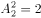，则不同的分法共有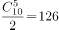种。

故正确答案为B。

### 第 53 题

甲、乙二人分别从A、B两地驾车同时出发，匀速相向而行，甲车的速度是乙车的,两车开出6小时后相遇，相遇后以原速继续前进。问甲比乙晚几个小时到达目的地：

A. 2

B. 3

C. 4

D. 5

第 53 题 · 答案与解析

**参考答案（粉笔题库参考内容）**

D

**解析**

方法一：两车速度比是2∶3，所以同时出发两车相遇时，路程比为2∶3，两车所走的路程和等于全程。甲车6小时走了全程的，则走完全程需要15小时；乙车6小时走了全程的，则走完全程需要10小时。所以甲比乙晚15－10＝5小时到达目的地。

方法二：设甲、乙速度分别为2、3，则A、B两地距离为（2＋3）×6＝30，甲走完12，还剩18，还需要9小时才能走完；乙走完18，还剩12，还需要4小时才能走完，因此差值为5小时。

故正确答案为D。

### 第 54 题

甲、乙、丙三个施工队，乙的工效与甲、丙两队合作的工效相等，丙的工效是甲、乙两队合作工效的四分之一。现有一项工程，据测算，三队合作30个工作日可完成。如果由甲队单独来做，需要多少个工作日:

A. 60

B. 96

C. 100

D. 150

第 54 题 · 答案与解析

**参考答案（粉笔题库参考内容）**

C

**解析**

根据题意可得，工作效率：乙＝甲＋丙，4丙＝甲＋乙。化简可得，丙＝甲，乙＝甲，所以甲、乙、丙的工作效率之比为3∶5∶2。

设甲、乙、丙的工作效率分别为3、5、2，则总工作量为（3＋5＋2）×30＝300，如果甲队单独做，则需要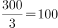天。

故正确答案为C。

### 第 55 题

某医院药品仓库有14600克浓度为98%的酒精。问加入多少克蒸馏水之后，可以稀释成浓度正好为73%的消毒酒精：

A. 4600

B. 5000

C. 9600

D. 19600

第 55 题 · 答案与解析

**参考答案（粉笔题库参考内容）**

B

**解析**

方法一：根据浓度公式，设加入x克蒸馏水，可列式得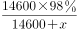，计算得x＝5000。

方法二：设加入的蒸馏水为x克。，根据线段法可知，溶液质量比与浓度差之比成反比，有x:14600=(98%-73%):(73%-0%)，解得x=5000克。

故正确答案为B。

### 第 56 题

甲、乙、丙三人同时从起点出发，匀速跑向100米外的终点，并在到达终点后立刻匀速返回起点。甲第一个到达终点时，乙和丙分别距离终点20米和36米。问当丙到达终点时，乙距离起点多少米：

A. 60

B. 64

C. 75

D. 80

第 56 题 · 答案与解析

**参考答案（粉笔题库参考内容）**

C

**解析**

当甲到达终点时，甲、乙、丙所跑的路程分别为100米、80米、64米，所以乙、丙的速度之比为80∶64。因为一直保持匀速，当丙到达终点时，设乙所跑路程为X，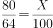，则，解得X＝125米，所以这时乙距离起点有200－125＝75米。

故正确答案为C。

### 第 57 题

某高校学生宿舍实行用电定额制，每个月定额内每度电0.5元，超过定额后每度电涨价60%。某寝室上月用电35度，交费22元。问每个宿舍的用电定额是每个月多少度：

A. 16

B. 20

C. 26

D. 30

第 57 题 · 答案与解析

**参考答案（粉笔题库参考内容）**

B

**解析**

方法一：设每个宿舍的用电定额是每个月x度，根据题意有：元，解得x=20度。

方法二：超过定额后每度电涨价0.5×60%＝0.3元。假设35度电没有超过定额，则宿舍应交费元，而现在多交了22-17.5=4.5元，是超过定额后涨价产生的费用，故超过定额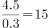度。所以每个宿舍的用电定额是35-15=20度。

故正确答案为B。

### 第 58 题

某市针对虚假促销的专项检查中，发现某商场将一套茶具加价4成再以8折出售，实际售价比原价还高24元。问这套茶具的原价是多少元：

A. 100

B. 150

C. 200

D. 250

第 58 题 · 答案与解析

**参考答案（粉笔题库参考内容）**

C

**解析**

设原价为x元，根据题意有：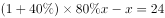，解得x=200。

故正确答案为C。

### 第 59 题

把一个半径为3厘米的金属小球放到半径为5厘米且装有水的圆柱形烧杯中。如全部浸入后水未溢出，则水面比未放入小球之前上升多少厘米：

A. 1.32

B. 1.36

C. 1.38

D. 1.44

第 59 题 · 答案与解析

**参考答案（粉笔题库参考内容）**

D

**解析**

小球的体积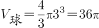，设烧杯水面上升的高度为h，则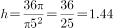。

故正确答案为D。

### 第 60 题

某工厂接了一批订单，要生产2400件产品。在开始生产10天后，由于工艺改进每天多生产30件产品，结果提前2天交货，问该厂没有改进工艺前，每天能生产多少件产品：

A. 100

B. 120

C. 150

D. 180

第 60 题 · 答案与解析

**参考答案（粉笔题库参考内容）**

B

**解析**

设没有改进工艺前，每天生产x件，根据题意有，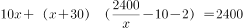，化简得，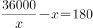，代入选项，可知x＝120件。

故正确答案为B。

### 第 61 题

把若干个大小相同的水立方摆成如图形状，从上向下数，摆1层有1个立方体，摆2层共有4个立方体，摆3层共有10个立方体，问摆7层共有多少个立方体：

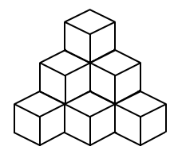

A. 60

B. 64

C. 80

D. 84

第 61 题 · 答案与解析

**参考答案（粉笔题库参考内容）**

D

**解析**

第一层有1个；第二层比第一层多2个，即1+2=3个；第三层比第二层多3个，即3+3=6个；······依此规律，第四、五、六、七层分别有10、15、21、28个，所以7层共有1+3+6+10+15+21+28=84个立方体。

故正确答案为D。

### 第 62 题

小赵每工作9天连休三天，某次他在周五、周六和周日连休，问他下一次在周六、日连休是在本次连休之后的第几周：

A. 3

B. 5

C. 7

D. 9

第 62 题 · 答案与解析

**参考答案（粉笔题库参考内容）**

B

**解析**

方法一：列表可得（打√表示休息日）

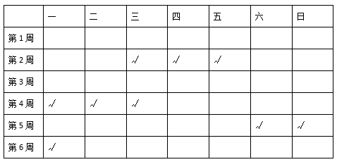

由表格可知，下一次在周六、日连休是在本次连休之后的第5周。

方法二：每工作9天连休三天，周期为12天，设第n个周期小赵周六、周日连休，则有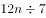余数为0或1（连休的三天可以是周五周六周日、也可以是周六周日周一，休息的最后一天必然是周日或者周一）。当n=3时，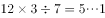，因此下一次周六、周日连休是在本周后的第5周。

故正确答案为B。

### 第 63 题

甲乙两个班的士兵同时从起点出发，向10公里外的目的地匀速急行军，甲乙两班的速度分别为每分钟250米和200米。行军途中，甲班每看到一次信号弹，就会以n×20%（n为当前已看到信号弹的次数）的原速度向后行军1分钟，随后恢复原来的速度继续向前行军，最后乙班比甲班先到达目的地。问甲班在行军途中至少看到了几次信号弹：

A. 6

B. 7

C. 8

D. 9

第 63 题 · 答案与解析

**参考答案（粉笔题库参考内容）**

A

**解析**

如果没有发射信号弹，则甲班需要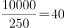分钟到达终点，乙班需要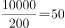分钟。最后乙班比甲班先到达目的地，所以甲班在行军过程中，因为信号弹拖延了最少10分钟。第一次看到信号弹，向后行军1×20%×250×1＝50米，共拖延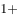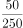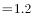分钟；第二次看到信号弹，向后行军2×20%×250×1＝100米，共拖延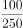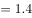分钟。依次代入选项，A项，如果甲班在行军中看到6次信号弹，则共拖延1.2＋1.4＋1.6＋1.8＋2＋2.2＝10.2分钟，符合题意。

故正确答案为A。

### 第 64 题

商店本周从周一到周日出售A、B两种季节性商品，其中A商品每天销量相同，而B商品每天的销量都是前一天的一半。已知周五和周六，A、B两种商品的销量之和分别为220件和210件，问从周一到周日A商品总计比B商品多卖出多少件：

A. 570

B. 635

C. 690

D. 765

第 64 题 · 答案与解析

**参考答案（粉笔题库参考内容）**

D

**解析**

设周五A、B两种商品的销量分别为x、y件，根据题意可得，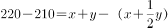，解得y=20，所以周五A的销量=220-20=200件，A商品这周共销售200×7=1400件。B商品这周销量总量为5+10+20+40+80+160+320＝635件。所以这周A商品比B商品多卖1400－635＝765件。

故正确答案为D。

### 第 65 题

在一次产品质量抽查中，某批次产品被抽出10件样品进行检验，其中恰有两件不合格品，如果对这10件样品逐件进行检验，则这两件不合格品恰好在第五次被全部检出的概率是：

A. 

B. 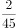

C. 

D. 

第 65 题 · 答案与解析

**参考答案（粉笔题库参考内容）**

A

**解析**

因两件不合格品需要在第五次恰好检查出来，则需要在前四次中检查出一件，第五次检查出一件。因第五次是固定的，则只考虑到前四次检查即可，共有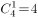种可能。在全部的10件样品中共有两件次品检查出共有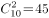种可能。故恰好在第五次检查出的概率＝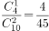。

故正确答案为A。

### 第 66 题

从所给的四个选项中，选项最合适的一个填入问号处，使之呈现一定的规律性：

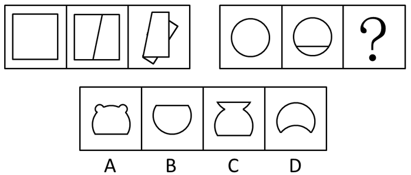

A. A

B. B

C. C

D. D

第 66 题 · 答案与解析

**参考答案（粉笔题库参考内容）**

B

**解析**

第一组图形中，图1沿着图2中的线条折叠组成图3，照此规律，第二组图形中，图1沿着图2的线条将其折叠组成图3，即为B项。（注：第二组图沿着图2的线条无论怎么折叠都不可能折出A、C、D三项的样子，因此，本题不必再考虑折叠方向。）

故正确答案为B。

### 第 67 题

从所给四个选项中，选择最合适的一个填入问号处，使之呈现一定的规律性：

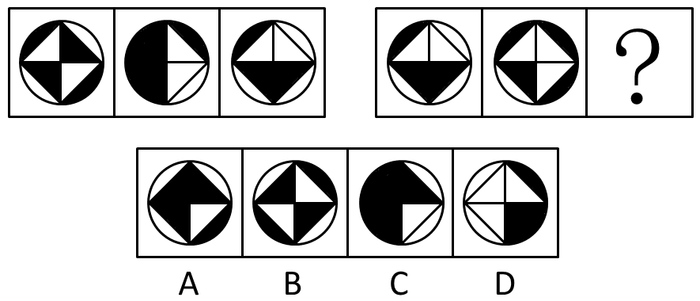

A. A

B. B

C. C

D. D

第 67 题 · 答案与解析

**参考答案（粉笔题库参考内容）**

C

**解析**

元素组成相似，优先考虑样式规律。观察发现，题干图形轮廓和分割区域相同，且黑块数量不同，考虑黑白运算。根据第一组图形可得到运算规律：黑+黑=黑，白+白=黑，白=黑=白，黑+白=白；第二组前两个图形按照此规律运算得到C项。

故正确答案为C。

### 第 68 题

从所给的四个选项中，选项最合适的一个填入问号处，使之呈现一定的规律性：

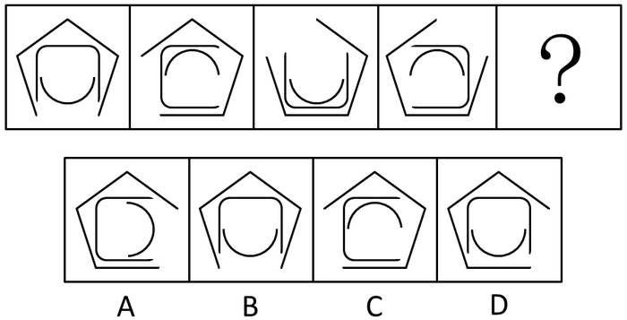

A. A

B. B

C. C

D. D

第 68 题 · 答案与解析

**参考答案（粉笔题库参考内容）**

D

**解析**

元素组成相同，考虑位置变化。最外侧图形依次顺时针旋转72度，排除B、C两项，最内侧图形依次上下翻转，因此，最内侧应该选向上开口的图形，排除A项。（提示：此题看开口方向的变化更容易帮助解题。）

故正确答案为D。

### 第 69 题

请从所给的四个选项中，选项最合适的一个填入问号处，使之呈现一定的规律性：

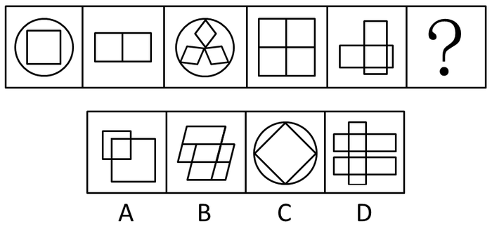

A. A

B. B

C. C

D. D

第 69 题 · 答案与解析

**参考答案（粉笔题库参考内容）**

B

**解析**

元素组成凌乱，属性无明显规律，考虑数量变化。观察题干图形可以推知，由直线构成的封闭空间数量分别为1、2、3、4、5，故问号处应选择直线构成的封闭空间数量为6的图形，对比选项，只有B项符合。

故正确答案为B。

### 第 70 题

从所给的四个选项中，选择最合适的一个填入问号处，使之呈现一定的规律性：

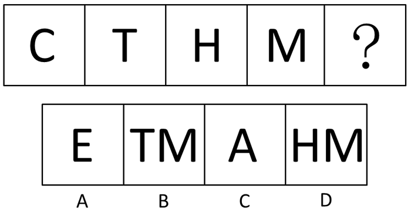

A. A

B. B

C. C

D. D

第 70 题 · 答案与解析

**参考答案（粉笔题库参考内容）**

B

**解析**

思路一：元素组成不同，考虑属性和数量规律。题干图形出现规整的字母，考虑对称性，题干都是轴对称图形，排除B、D两项，继续观察，题干都是全开放图形，C项为半开半闭图形，排除。

思路二：元素组成不同，考虑属性和数量规律。题干图形中出现线条交叉，考虑点数量，图中交点的数量分别为0、1、2、3，因此，需要选择交点数量为4的图形。

本题两种思路均可，故正确答案为A\\B。

（提示：本题图形特征倾向考对称性，但交点数的规律更为单一且明确，故粉笔倾向此题答案选A或B均可。）

### 第 71 题

从所给的四个选项中，选择最合适的一个填入问号处，使之呈现一定规律性：

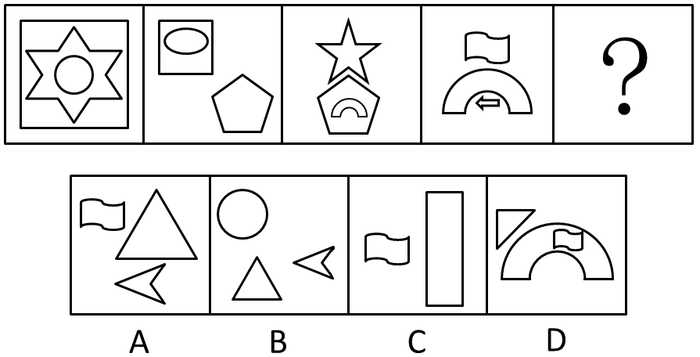

A. A

B. B

C. C

D. D

第 71 题 · 答案与解析

**参考答案（粉笔题库参考内容）**

A

**解析**

元素组成凌乱，属性无明显规律，考虑数量变化。每个图形均由三种元素构成，排除C项，并且后图均存在且只存在一个与前图相同的元素，排除B、D两项。

故正确答案为A。

### 第 72 题

从所给的四个选项中，选择最合适的一个填入问号处，使之呈现一定的规律性：

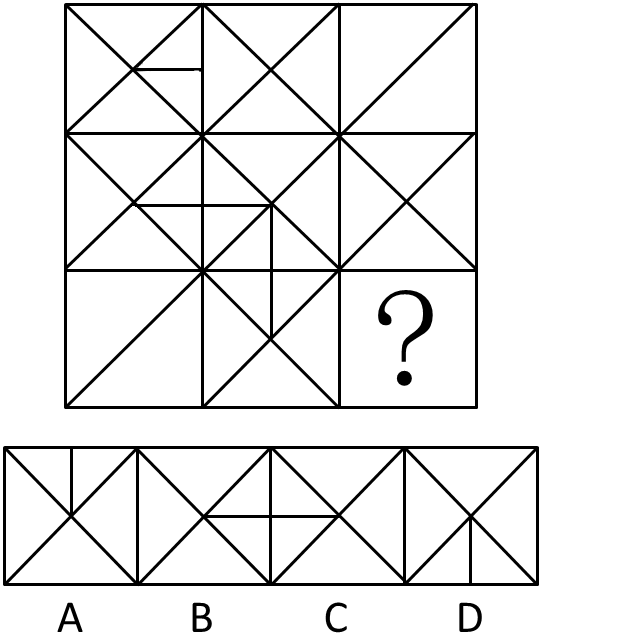

A. A

B. B

C. C

D. D

第 72 题 · 答案与解析

**参考答案（粉笔题库参考内容）**

A

**解析**

元素组成相似，且相同线条重复出现，优先考虑样式规律中的加减同异，但按行看还是按列看均无规律。继续观察发现，把九宫格整体当作一个大图形，其内部的线条比较规整，考虑对称性。整个大图形沿着左下至右上的对称轴方向对称（如下图所示），故“？”处补充的图形应该使整个大图形沿着左下至右上的对称轴方向完全对称，只有A项符合

故正确答案为A。

### 第 73 题

从所给的四个选项中，选择最合适的一个填入问号处，使之呈现一定的规律性：

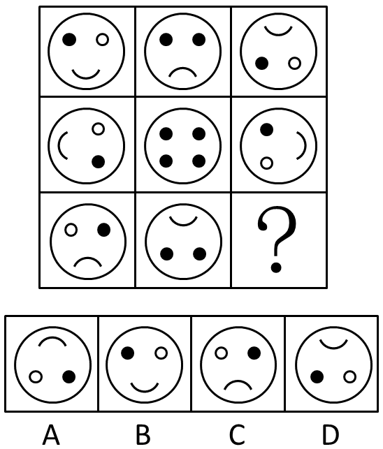

A. A

B. B

C. C

D. D

第 73 题 · 答案与解析

**参考答案（粉笔题库参考内容）**

A

**解析**

元素组成相似，考虑其位置变化。以中心图形为中心，四周图形沿中心图形形成米字形对应，米字形任意一条线上两端的图形组成完全一致，将其一端的图形旋转180度可得到另一端的图形（如下图），故将图1旋转180度的图形为正确答案。

故正确答案为A。

### 第 74 题

左边给定的是纸盒外表面的展开图，右边哪一项能由它折叠而成？请把它找出来：

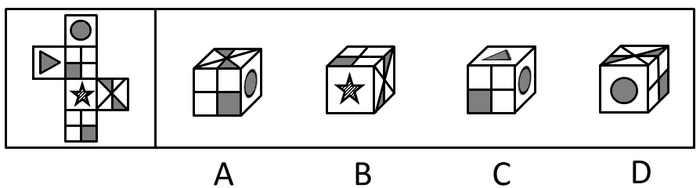

A. A

B. B

C. C

D. D

第 74 题 · 答案与解析

**参考答案（粉笔题库参考内容）**

D

**解析**

A项：正面是已知图中的面3或6（如下图），可以从该面上选取一点画边，发现A项正面的第四条边与圆形所在面相邻，而已知面3是第二条边与圆形面相邻，面6是第一条边与圆形面相邻，因此错误；

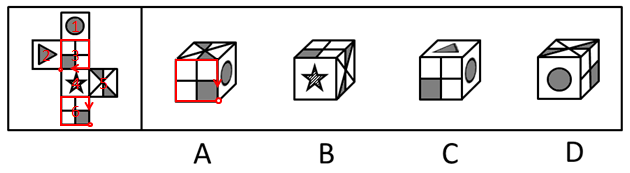

B项：面4和面5的公共边与已知图形不符，B项中面5应该上黑下白（如下图），因此错误；

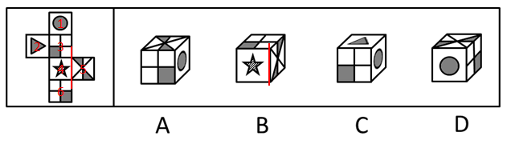

C项：正面是已知图中的面3或6（如下图），可以从该面上选取一点画边，发现C项正面的第三条边与圆形所在面相邻，而已知面3是第二条边与圆形面相邻，面6是第一条边与圆形面相邻，因此错误。

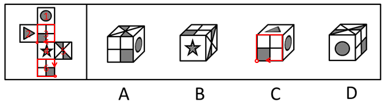

故正确答案为D。

### 第 75 题

左边给定的是纸盒外表面的展开图，右边哪一项能由它折叠而成？请把它找出来：

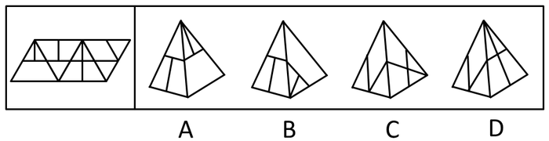

A. A

B. B

C. C

D. D

第 75 题 · 答案与解析

**参考答案（粉笔题库参考内容）**

B

**解析**

A项：给出的两面分别为已知图形中的面1和面2，如下图：

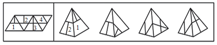

已知图形旋转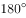可得到下图，此时A项的面2与已知图形面2摆放位置一致，而旋转后的图形面1中竖线在下，A项面1中竖线在上，与题干不符，排除；

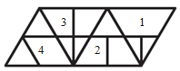

B项：给出的面也是已知图形中的面1和面2，与题干相符，当选；

C项：给出的面为已知图形中的面3和面4，二者的公共边与已知图形不相符（如下图），排除；

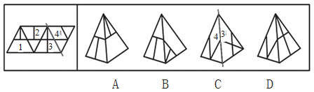

D项：给出的面为已知图形中的面3和面4，二者的左右顺序与已知图形不相符，排除。

故正确答案为B。

### 第 76 题

德商是指一个人的人格和道德品质，其内容包括体贴、尊重、容忍、宽容、诚实、负责、平和、忠心、礼貌、幽默等各种美德。

根据上述定义，下列属于德商的是：

A. 小徐善于把握机会，具有非凡胆略和魄力

B. 小史喜欢挑战新鲜事物，对世界和他人充满探索欲望

C. 小陈对环境的适应能力很强，在恶劣的环境下也能生存

D. 小吴能理解别人的疾苦，考虑别人的感受，关心别人的生活

第 76 题 · 答案与解析

**参考答案（粉笔题库参考内容）**

D

**解析**

定义关键词：“人格和道德品质”。

分析选项：A项中的胆略和魄力、B项中的欲望和C项中的适应能力均不属于人格和道德品质的范畴，排除；D项中理解别人的疾苦、考虑别人的感受、关心别人的生活属于人格和道德品质的范畴，并且与定义后面提到的体贴、尊重相对应，符合题意，当选。

故正确答案为D。

### 第 77 题

社会壁垒是指在国际贸易中一国以其他国家劳动者的劳动环境和生存权利为借口而采取的贸易保护措施。

根据上述定义，下列属于社会壁垒的是：

A. 甲国认为乙国制衣业雇佣童工现象严重，因而取消了该国的贸易订单

B. 甲国在从乙国进口的奶粉中发现某种重金属含量超标，即终止了该项贸易

C. 甲国受经济危机影响，国内工人大批失业，为给工人创造就业机会，甲国政府终止了与多国的进口贸易

D. 甲国认为乙国汽车制造业的从业人员素质较低，会对汽车的安全性产生影响，因而取消了从乙国进口汽车的订单

第 77 题 · 答案与解析

**参考答案（粉笔题库参考内容）**

A

**解析**

第一步：找出定义关键词。

（1）方式：以其他国家劳动者的劳动环境和生存权利为借口；（2）结果：贸易保护。

第二步：逐一分析选项。

A项：雇用童工现象严重符合以劳动者的生存权利为借口，取消贸易订单符合贸易保护行为，符合定义，当选；

B项：奶粉中重金属超标不符合关键词（1），排除；

C项：为国内工人创造就业机会不符合关键词（1）中的以其他国家的劳动者为借口，排除；

D项：担心的是由于从业人员素质低最终会导致汽车安全性受影响，不符合关键词（1）中的劳动环境和生存权利，不如A项直接明确，排除。

故正确答案为A。

### 第 78 题

创伤后压力反应是指在遭遇或对抗重大压力后，其心理状况产生失调后遗症，但这个现象是经历创伤后所产生的合理结果，而非患者心理状态原本就有问题。

根据上述定义，下列不属于创伤后压力反应的是：

A. 小王连续面试失败后经常失眠，变得易怒、过度警觉、失忆和易受惊吓

B. 一位二战老兵晚景凄凉，妻离子散，不久前又诊断出患有危及性命的重病

C. 小吴在地震中死里逃生后，一听到楼板响就高度紧张，担心掉下来砸了自己

D. 在中东国家，饱受战争之苦的人一谈到四处盘旋的轰炸机就吓得想四处躲藏

第 78 题 · 答案与解析

**参考答案（粉笔题库参考内容）**

B

**解析**

定义关键词：（1）条件：在遭遇或对抗重大压力后；（2）结果：心理状况产生失调后遗症、非患者心理状态原本就有问题。A项连续面试失败、B项妻离子散、C项死里逃生及D项的饱受战争之苦都与关键词（1）中的重大压力相符合，但是B项中患有危及性命的重病并非由于妻离子散所引起，且不属于心理上的问题，B项的结果与定义不相符合，当选；相比之下，A、C、D三项中的结果属于遭遇压力后产生的心理状况失调，均排除。

本题为选非题，故正确答案为B。

### 第 79 题

法定孳息是指依一定的法律关系由原物所生的物，是原物的所有权人进行租赁、投资等特定的民事法律活动而应当获得的合法收益。

根据上述定义，下列属于法定孳息的是：

A. 甲投资国债获得的分红

B. 某农民承包的果园产出的水果

C. 宠物商店的纯种狗配种生出的小狗

D. 甲借给乙的钱，乙购买彩票中了10万元大奖

第 79 题 · 答案与解析

**参考答案（粉笔题库参考内容）**

A

**解析**

第一步：找出定义关键词。

“依一定的法律关系由原物所生的物”、“原物的所有权人进行租赁、投资等特定的民事法律活动”、“应当获得的合法收益”。

第二步：逐一分析选项。

A项：甲通过投资国债获得收益，符合“原物的所有权人进行租赁、投资等特定的民事法律活动”、“应当获得的合法收益”，符合定义，当选；

B项：该农民不是果园的所有权人，不符合“原物的所有权人进行租赁、投资等特定的民事法律活动”，不符合定义，排除；

C项：宠物商店并未进行租赁、投资等活动，不符合“原物的所有权人进行租赁、投资等特定的民事法律活动”，不符合定义，排除；

D项：乙用向甲借的钱买彩票，乙不属于这份钱的所有权人，不符合“原物的所有权人进行租赁、投资等特定的民事法律活动”，不符合定义，排除。

故正确答案为A。

### 第 80 题

共情是指能设身处地地体验他人的处境，对他人情绪情感具备感受力或理解力。

根据上述定义，下列属于共情的是：

A. 己所不欲，勿施于人

B. 先天下之忧而忧，后天下之乐而乐

C. 纸上得来终觉浅，绝知此事要躬行

D. 老吾老以及人之老，幼吾幼以及人之幼

第 80 题 · 答案与解析

**参考答案（粉笔题库参考内容）**

A

**解析**

定义关键词：“能设身处地地体验他人的处境，对他人情绪情感具备感受力或理解力”。

A项含义为：如果自己身体不想要的结果或精神不情愿被这样对待，就不要使别人遭受不想要的结果和得到不想要的对待；B项含义为：在天下人忧愁之前忧愁，在天下人快乐之后快乐。体现出作者把国家、民族的利益摆在首位，为祖国的前途、命运担忧分愁，为天底下的人民幸福出力的远大政治抱负；C项含义为：从书本上得到的知识终归是浅显的，最终要想认识事物或事理的本质，还必须自己亲身实践；D项含义为：在赡养孝敬自己的长辈时不应忘记其他与自己没有亲缘关系的老人，在抚养教育自己的小辈时不应忘记其他与自己没有血缘关系的小孩。

A项表达了设身处地体验他人处境的含义，当选；B项中“忧乐”并非对人情绪情感的感受，而是一种高尚情怀，排除；C项所指为切身实践的重要性，并未涉及体验他人的处境，排除；D项同样没有涉及对“情绪情感”的感受，排除。

故正确答案为A。

### 第 81 题

生态工艺指的是把大自然的法则应用于社会物质生产，模拟生物圈物质运动过程，设计无废料的生产，以闭路循环的形式，实现资源充分合理的利用，使生产过程保持生态学上的洁净。

根据上述定义，下列符合生态工艺的生产模式是：

A. 物质-产品-消费-残留物

B. 原料-产品-剩余物-加工-产品

C. 自然环境-房地产开发-旅游经济-消费

D. 原料-生产-剩余物-废弃物-回收掩埋

第 81 题 · 答案与解析

**参考答案（粉笔题库参考内容）**

B

**解析**

定义关键词：（1）方式：模拟生物圈物质运动过程，设计无废料的生产，闭路循环的形式；（2）目的：实现资源充分合理的利用，使生产过程保持生态学上的洁净。A项最后剩余残留物，不属于无废料的生产，不符合关键词（1），排除；B项从原料到产品产生的剩余物通过加工最终又成为产品，整个过程没有多余废料并且实现了产品—产品的闭路循环，符合定义，当选；C项没有体现出闭路循环，不符合关键词（1），排除；D项最终还是产生了需要被处理的废弃物，不符合关键词（1），排除。

故正确答案为B。

### 第 82 题

信息系统外包是指借助外部力量进行信息系统开发、建设的信息系统建设方式，即企业在规定的服务水平基础上，将全部或部分支持生产经营的信息系统作业，以合同方式委托给专业性公司，由其在一定时期内稳定地管理并提供企业需要的信息技术服务的行为。

根据上述定义，下列不属于信息系统外包的是：

A. 某信息技术服务公司与一航空公司合作，为其开发了网络订票系统

B. 某信息系统运营商不断改进应用软件系统，以期为客户提供更好的服务

C. 某信息技术服务提供商为一企业提供智能办公平台，并负责维护和完善

D. 某软件公司为一企业研发了一套财务管理系统软件，并提高了企业的工作效率

第 82 题 · 答案与解析

**参考答案（粉笔题库参考内容）**

B

**解析**

定义关键词：方式：企业将信息系统作业，以合同方式委托给专业性公司。A、C、D三项明确指出了信息技术公司与企业合作为其提供所需要的具体信息技术服务的行为，符合定义，排除；B项只是在说信息公司改进软件，但没有明确指出企业与其之间的合作行为，不符合定义，当选。

本题为选非题，故正确答案为B。

### 第 83 题

自然环境效应是以地能和太阳能为主要动力来源，环境中的物种相互作用所产生的环境效果；人为环境效应则是由于人类活动而引起的环境质量变化和生态变异的效果。

根据上述定义，下列属于自然环境效应的是：

①云南昆明日照时间长，花木长得特别好，花期也长

②酸雨造成地面的水体和土壤的酸度增大，使农业和渔业减产

③某区实行退耕还林多年，泥石流比过去少了，庄稼也比过去长得更好

④地震使山体松动，一遇大雨，就容易发生泥石流

⑤村民祖祖辈辈生活在大山里，靠打猎为生，致使山里的动物逐渐减少

A. ①④

B. ①②③

C. ②③⑤

D. ①②③④

第 83 题 · 答案与解析

**参考答案（粉笔题库参考内容）**

A

**解析**

第一步：找出定义关键词。

（1）方式：以地能和太阳能为主要动力来源；

（2）结果：环境中的物种相互作用产生环境效果。

第二步：逐一分析选项。

①②③④⑤都符合关键词（2）。

①是以太阳能为动力来源，符合关键词（1），符合定义；

②酸雨不是以地能和太阳能为动力来源的，不符合关键词（1），不符合定义；

③退耕还林属于人类活动，不符合关键词（1），属于人为环境效应；

④地震是以地能为动力来源的，符合关键词（1），符合定义；

⑤打猎属于人类活动，不符合关键词（1），属于人为环境效应。

故正确答案为A。

### 第 84 题

前馈控制是指通过观察情况、整理信息、掌握规律、预测趋势，正确预计未来可能出现的问题，提前采取措施，将可能发生的偏差消除在萌芽状态。根据上述定义，下列属于前馈控制的是：

A. 股票投资者根据往年的股市行情预测今年股票投资可能存在的风险

B. 某企业根据企业的规模、核心竞争力和发展规划制定企业战略

C. 某电子商务网为应对可能出现的市场变化制定了多个方案

D. 某工厂因为原材料和燃料等物资价格上涨调整了生产模式

第 84 题 · 答案与解析

**参考答案（粉笔题库参考内容）**

C

**解析**

第一步：找出定义关键词。

（1）方式：观察情况、整理信息、掌握规律、预测趋势；

（2）目的：正确预计未来可能出现的问题，提前采取措施，将可能发生的偏差消除在萌芽状态。

第二步：逐一分析选项。

A项：股票投资者预测可能存在的风险符合关键词（1），但是否提前采取措施，将可能发生的偏差消除在萌芽状态，选项中没有提到，因此，不得而知，排除；

B项：没有涉及定义中预测趋势、提前采取措施等关键词，排除；

C项：明确提出为应对可能出现的市场变化制定了多个方案，符合关键词（1）（2），比A项更加明确，因此，C项为正确答案，当选；

D项：没有涉及定义关键词，与本定义无关，排除。

故正确答案为C。

### 第 85 题

网络中立是指在法律允许范围内，所有互联网用户都可以按自己的选择访问网络内容、运营应用程序、接入设备、选择服务提供商。这一原则要求网络运营商平等对待所有互联网内容和访问，防止其从商业利益出发控制传输数据的优先级，保证网络数据传输的“中立性”。根据上述定义，下列哪项违反了网络中立原则？

A. 某邮箱与网络运营商有合约，故网络拥挤时使用该邮箱更快

B. 某网络运营商采取技术手段，屏蔽了带有欺诈性质的网站

C. 某网站的某些图片只有注册用户才有权浏览

D. 某网络运营商向入网用户收取宽带使用费

第 85 题 · 答案与解析

**参考答案（粉笔题库参考内容）**

A

**解析**

定义关键词：目的：平等对待所有互联网内容和访问，防止其从商业利益出发控制传输数据的优先级。

A项某邮箱与网络运营商有合约使其邮箱在网络拥挤时更快，显然网络运营商为了实现商业利益使该邮箱获得了传输数据的优先级，与定义目的相违背，违反了网络中立原则，当选；B、C、D三项均无明显与定义相违背之处，排除。

故正确答案为A。

### 第 86 题

火药：烟花

A. 汽油：汽车

B. 金属：指南针

C. 无线电：手机

D. 玻璃：放大镜

第 86 题 · 答案与解析

**参考答案（粉笔题库参考内容）**

B

**解析**

第一步：判断题干词语间逻辑关系。

火药是烟花必不可少的一部分，烟花里面填充着火药，二者是必然组成关系。

第二步：判断选项词语间逻辑关系。

A项：汽油跟汽车是对应关系，汽油是汽车的动力来源，不是组成关系，与题干逻辑关系不一致，排除；

B项：指南针的指针是磁针，而磁针必然是金属的，金属和指南针是必然组成关系，与题干逻辑关系一致，当选；

C项：无线电是手机可以正常通话的一个条件，二者不构成组成关系，与题干逻辑关系不一致，排除；

D项：玻璃和放大镜不是必然组成关系，放大镜镜片还可用树脂等材料制成，与题干逻辑关系不一致，排除。

故正确答案为B。

### 第 87 题

豺狼：凶残

A. 喜鹊：报喜

B. 小鸟：依人

C. 蜜蜂：勤劳

D. 梅花：坚强

第 87 题 · 答案与解析

**参考答案（粉笔题库参考内容）**

C

**解析**

第一步：判断题干词语间逻辑关系。

豺狼象征着凶残，二者为比喻象征关系。

第二步：判断选项词语间逻辑关系。

A项：喜鹊象征吉祥，而非报喜，排除；

B项：小鸟并非象征着依人，通常是用小鸟依人来形容女孩可爱，与题干逻辑关系不一致，排除；

C项：蜜蜂象征着勤劳，二者为比喻象征关系，与题干逻辑关系一致，保留；

D项：梅花象征坚强，二者为比喻象征关系，与题干逻辑关系一致，保留。

比较C、D两项，题干中的豺狼与C项的蜜蜂均为动物，而D项梅花是植物，C项比D项与题干逻辑关系更一致。

故正确答案为C。

### 第 88 题

与时俱进：持续发展

A. 出其不意：损兵折将

B. 医术高超：手到病除

C. 怨天尤人：碌碌无为

D. 沽名钓誉：欺世盗名

第 88 题 · 答案与解析

**参考答案（粉笔题库参考内容）**

B

**解析**

第一步：判断题干词语间逻辑关系。

与时俱进意思是准确把握时代特征，紧跟时代的步伐前进；持续发展指既满足现代人的需求又不损害后代人利益的一种永续不断的发展。只有与时俱进，才能实现可持续发展，前者是后者的必要条件。

第二步：判断选项词语间逻辑关系。

A项：出其不意指趁对方没有意料到就采取行动，损兵折将指打了败仗，二者不是必要条件的关系，与题干逻辑关系不一致，排除；

B项：医术高超形容医术高明，手到病除指医生治疗思路、治疗手法正确对症，使病人得以最快速度康复，医术高超是手到病除的必要条件，与题干逻辑关系一致，当选；

C项：怨天尤人指遇到挫折或出了问题，一味抱怨天，责怪别人，碌碌无为指平平庸庸，无所作为，二者不存在关系，与题干逻辑关系不一致，排除；

D项：沽名钓誉比喻骗取，指用某种不正当的手段捞取名誉，欺世盗名指欺骗世人，窃取名誉，二者是近义词，与题干逻辑关系不一致，排除。

故正确答案为B。

### 第 89 题

拍卖会：拍卖师：艺术品

A. 果园：农民：水果

B. 奥运会：运动员：跑道

C. 商场：售货员：商品

D. 山峰：登山者：帐篷

第 89 题 · 答案与解析

**参考答案（粉笔题库参考内容）**

C

**解析**

第一步：判断题干词语间逻辑关系。

拍卖师在拍卖会上拍卖艺术品，三者为工作地点、人物以及工作内容的对应关系。

第二步：判断选项词语间逻辑关系。

A项：农民在果园里种植水果，三者为工作地点、人物以及工作内容的对应关系，与题干逻辑关系一致，保留；

B项：运动员在奥运会比赛，跑道不是运动员的工作内容，与题干逻辑关系不一致，排除；

C项：售货员在商场里出售商品，三者为工作地点、人物以及工作内容的对应关系，与题干逻辑关系一致，保留；

D项：登山者攀登山峰，帐篷是登山者使用的工具之一，并不是工作内容，与题干逻辑关系不一致，排除。

比较A、C两项，题干“拍卖艺术品”与C项“出售商品”都是销售行为，而A项农民“种植水果”是生产行为，C项比A项与题干逻辑关系更一致。

故正确答案为C。

### 第 90 题

备课：授课：复习

A. 挂号：诊断：治疗

B. 称重：挑选：结账

C. 命题：答题：收卷

D. 立案：侦查：审判

第 90 题 · 答案与解析

**参考答案（粉笔题库参考内容）**

D

**解析**

第一步：判断题干词语间逻辑关系。

备课和授课具有逻辑上的先后顺序，二者的主体都是老师，复习的主体是学生，老师授课指导学生复习。

第二步：判断选项词语间逻辑关系。

A项：挂号和诊断逻辑先后顺序与题干一致，但二者主体不一致，分别为病人和医生，与题干逻辑关系不一致，排除；B项：应该是先挑选再称重，两词的逻辑先后顺序与题干不一致，排除；C项：命题的主体为命题者，答题的主体为考生，主体与题干不对应，排除；D项：立案侦查的逻辑先后顺序与题干一致，二者主体均是警察，审判的主体是法官，警察侦查配合法官审判，与题干逻辑关系一致，当选。

故正确答案为D。

### 第 91 题

瑜伽教练都不住在华兴园小区，但是华兴园小区的有些住户是太极拳教练，瑜伽教练大多住在花园路小区。

由此可以推出：

A. 有些太极拳教练是瑜伽教练

B. 花园路小区在华兴园小区内

C. 有些太极拳教练不是瑜伽教练

D. 住在花园路小区的大多是瑜伽教练

第 91 题 · 答案与解析

**参考答案（粉笔题库参考内容）**

C

**解析**

第一步，翻译题干：

（1）瑜伽教练→不住在华兴园小区；

（2）有的华兴园小区住户→太极拳教练；

（3）大多数瑜伽教练→住在花园路小区。

第二步，逐一分析选项：

A项：根据（2）可知：有的太极拳教练→住在华兴园小区，根据（1）可知：住在华兴园小区→不是瑜伽教练，根据传递定理只能得出：有的太极拳教练不是瑜伽教练，A项不必然推出，排除；

B项：根据（3）可知：有的瑜伽教练→住在花园路小区，置换可以推出：有的花园路小区住户→瑜伽教练，与（1）结合可知：有的花园路小区住户→不住在华兴园小区，选项错误，排除；

C项：根据（2）可知：有的太极拳教练→住在华兴园小区，根据（1）可知：住在华兴园小区→不是瑜伽教练，根据传递定理只能得出：有的太极拳教练不是瑜伽教练，正确；

D项：根据条件（3）只能得出大多数瑜伽教练住在花园小区；而无法得知住在花园路小区的大多数都是瑜伽教练，D项不能推出，排除。

故正确答案为C。

### 第 92 题

甲、乙、丙、丁四人大学毕业后分别选择了读研、留学和工作。

已知：①甲和另外一个人选择了读研；其他一人留学，一人工作；

②留学的毕业成绩比丙的毕业成绩好；

③丁没有选择工作；

④丁的毕业成绩不如丙。

由此可知：

A. 和甲一起读研的是丙

B. 乙的毕业成绩不如丁

C. 乙选择了留学

D. 丙没有选择工作

第 92 题 · 答案与解析

**参考答案（粉笔题库参考内容）**

C

**解析**

由条件②可知丙没有留学，则要么工作要么读研；由条件③可知丁要么读研要么留学；由条件②和④可知丁的成绩不如丙，留学的成绩比丙好，可知丁没有留学；再根据条件③的结论可知丁读研；则丙工作，乙留学。

故正确答案为C。

### 第 93 题

婚姻的维系离不开夫妻双方彼此信任，信任是保持稳定亲密关系的基础。但仅仅信任是不够的，还需要有共同的兴趣爱好，两个人一起打发时间，体会生活的乐趣。因此，信任和共同兴趣爱好是婚姻稳定的必要因素。

根据上述文字，可以得出：

A. 彼此信任并且有共同兴趣爱好的夫妻一定能长久

B. 仅仅有共同兴趣爱好的婚姻关系肯定是不稳定的

C. 幸福长久的婚姻关系意味着双方大多拥有共同兴趣爱好

D. 建立在信任和共同兴趣爱好基础上的关系是最理想的婚姻关系

第 93 题 · 答案与解析

**参考答案（粉笔题库参考内容）**

B

**解析**

第一步：翻译题干。

（1）婚姻的维系夫妻双方彼此信任；

（2）保持稳定亲密关系信任；

（3）婚姻稳定信任且共同兴趣爱好。

第二步：逐一分析选项。

A项：翻译为“信任且共同兴趣爱好婚姻稳定”，是对（3）的肯后，无法推出肯定结论，排除；

B项：翻译为“–信任且共同爱好婚姻不稳定”，根据（3）的逆否可以推出“–信任或–共同爱好婚姻不稳定”，可以推出仅仅有共同兴趣爱好的婚姻关系肯定是不稳定的，可以推出，当选；

C项：根据条件（3）可以推出稳定的婚姻关系意味着双方一定拥有共同兴趣爱好，而不是选项中“幸福长久”不代表稳定，而“大多”不代表“一定”，无法推出，排除；

D项：选项中“最理想的婚姻关系”在题干中并未涉及，无法推出，排除。

故正确答案为B。

### 第 94 题

脸部肌肉直接和大脑的情绪控制区相连，所以面部表情是心情的窗口。通过近距离观察面部表情、肢体语言和说话声调，任何人都可以识别出说谎者的谎言痕迹。

以下哪项如果为真，能够质疑上述观点？

A. 即便最高科技的谎言识别器都无法识破所有谎言

B. 极少数的人能够下意识地控制他们的整个面部表情

C. 真实的情绪和不真实的情绪通过不同的方式进入大脑

D. 如果有人说他很伤心，但他的眉毛内侧没有上拉，那么他的悲伤很可能是假的

第 94 题 · 答案与解析

**参考答案（粉笔题库参考内容）**

B

**解析**

第一步：找到论点论据。论点：通过观察面部表情、肢体语言和说话声调可以识别出说谎者的谎言痕迹。论据：脸部肌肉直接和大脑的情绪控制区相连。第二步：逐一分析选项。A项：高科技的谎言识别器无法识破谎言不代表人通过观察无法识破谎言，与题干讨论的主题无关；B项：极少数人可以下意识地控制他们的面部表情，说明通过表情无法准确地判断出其是否在说谎，属于举例削弱；C项：真实情绪和不真实情绪以何种方式进入大脑与题干讨论的情绪和表情之间的关系无关，无法削弱；D项：举例说明通过表情确实可以识别一个人的说谎痕迹，加强结论。

故正确答案为B。

### 第 95 题

为了帮助市民选择最满意的商场购物，X市有关部门在该市实施了一项评选“最满意商场”活动。评选方法是：选择十项指标，包括商场硬件设施、商品质量、商品价格、商品售后服务、服务态度等等，每一指标按照满意程度的高低，评以1到10分之间的某一分值，然后算出10个分值的平均分，即为该商场的满意度指数。

以下哪项是实施这一评选活动必须要假设的前提：

I.商场硬件设施、商品质量等指标都可以用数字来表达

II.商场硬件设施、商品质量等指标对于市民来说都是同等重要的

III.X市的商场都要支持这一评选活动

A. 仅I

B. 仅II

C. 仅I和II

D. II和III

第 95 题 · 答案与解析

**参考答案（粉笔题库参考内容）**

C

**解析**

第一步：找到论点论据。

论点：商场的满意度可以通过商场硬件设施、商品质量、商品价格、商品售后服务、服务态度等十项指标用具体分值量化。

论据：无。

本题只有论点，没有论据，且提问为“前提”，加强优先考虑必要条件。

第二步：逐一分析选项。

I：如果商场硬件设施、商品质量等指标不能用数字来表达，那么就无法用具体分值量化，论点无法成立，因此该项是论点成立的必要条件，保留；

II：商场硬件设施、商品质量等指标对于市民来说都是同等重要的，排除了市民某些方面的喜好对调查结果的影响，因此该项是论点成立的必要条件，保留；

III：X市的商场都要支持这一评选活动，与题干讨论的满意度是否可以通过指标量化无关，不能加强。

综上，只有Ⅰ、Ⅱ项是实施这一评选活动必须要假设的前提，C项当选。

故正确答案为C。

### 第 96 题

近年来，我国电子垃圾产生量增长迅猛。电子垃圾问题若得不到妥善解决，建设生态文明的目标就无法实现。因此，必须多管齐下，综合治理。除了建立生产者责任延伸制度和加大打击电子垃圾进口走私力度外，还要大力促进电子垃圾拆解处理领域的技术创新。如果这样，那么电子垃圾就不再会是令人头痛的污染源，而能成为填补短缺的“新矿山”。

由此可以推出：

A. 只有妥善解决电子垃圾问题，才能实现建设生态文明的目标

B. 如果能够实现电子垃圾拆解处理领域的技术创新，就能彻底解决电子垃圾问题

C. 如果建立生产者责任延伸制度，它们就能从设计开始尽量降低电子垃圾产生量

D. 如果电子垃圾仍是令人头痛的污染源，那么一定是打击电子垃圾进口走私力度不够

第 96 题 · 答案与解析

**参考答案（粉笔题库参考内容）**

A

**解析**

第一步：翻译题干。（1）电子垃圾不妥善解决→建设生态文明的目标无法实现；（2）建立生产者责任延伸制度且加大打击电子垃圾进口走私力度且大力促进电子垃圾拆解处理领域的技术创新→电子垃圾就不再会是污染源。第二步：逐一翻译选项。A项：实现建设生态文明的目标→妥善解决电子垃圾问题，是对条件（1）的逆否，与题干一致；B项：实现电子垃圾拆解处理领域的技术创新→彻底解决电子垃圾问题，解决电子垃圾问题需要三个条件，缺一不可，不符合题意，排除；C项：建立生产者责任延伸制度→从设计开始尽量降低电子垃圾产生量，后半部分题中没有提到，无从得知，排除；D项：电子垃圾仍是令人头痛的污染源→一定是打击电子垃圾进口走私力度不够，将条件（2）逆否可知：电子垃圾是污染源→没建立生产者责任延伸制或没有加大打击电子垃圾进口走私力度或没有促进电子垃圾拆解处理技术创新，与条件（2）不符合，排除。

故正确答案为A。

### 第 97 题

美国一项最新研究发现，肥胖具有“社会传染性”，它很容易从一个人传染到另一个人身上，社会纽带在肥胖问题上的影响甚至超过基因的作用。研究人员认为，这主要是由于身体肥胖的亲人和朋友改变了你对于体重可接受的标准，你会认为他们的体重可以接受。

以下哪项如果为真，最能质疑研究人员的解释？

A. 肥胖的人更倾向于和肥胖的人交朋友

B. 基因对人的肥胖程度的影响其实是不确定的

C. 一个人的饮食生活习惯往往会受到家人和朋友的影响

D. 很多人由于现代社会压力大、暴饮暴食等原因导致肥胖

第 97 题 · 答案与解析

**参考答案（粉笔题库参考内容）**

C

**解析**

第一步：找到论点和论据。

论点：身体肥胖的亲人和朋友改变了人对体重的可接受程度，使人们认为肥胖朋友的体重可以接受。

论据：无。

第二步：逐一分析选项。

A项：指出肥胖的人的择友倾向，但本题讨论的是一个人从不胖到被“传染”为肥胖的原因，话题不一致，无法削弱，排除；

B项：基因对肥胖的影响不确定，没办法证明社会纽带对肥胖的影响是否超过基因，因此，无法削弱。此外，不确定的东西本身是不能用来削弱的，排除；

C项：指出一个人的饮食生活习惯会受到家人和朋友的影响，说明除了改变可接受体重的范围外，受到他人影响也可能是肥胖的原因，他因削弱，当选；

D项：提出了导致现代人肥胖的其他原因，但是与肥胖具有社会传染性并没有关系，不能成为肥胖具有传染性的原因，无法削弱，排除。

故正确答案为C。

### 第 98 题

某村突发山洪泥石流灾害后，有一批帐篷捐助给受灾群众，但捐助人没有留下姓名就悄然离去。事后，村民经过多方了解，得知以下事实：

（1）这批帐篷是由一辆大卡车运来的；

（2）如果张华不参加这项捐助活动，王刚也不会参加；

（3）李伟不会开大卡车；

（4）捐助者在上述3人之中，没有雇佣他人。

由此可以推出：

A. 3人都是捐助者

B. 王刚一定是捐助者

C. 李伟一定是捐助者

D. 张华一定是捐助者

第 98 题 · 答案与解析

**参考答案（粉笔题库参考内容）**

D

**解析**

由条件（1）和（3）可知：捐助者不可能是李伟单独一个人，排除C项；由条件（2）可知：-张王＝王张，即：如果是王捐的，那么B、D两项都对，而答案只有一个，因此，不是王捐的，排除A、B两项，那么只能是张捐的。

故正确答案为D。

### 第 99 题

一项研究发现，一对同是右撇子的夫妻生出左撇子孩子的几率只有9.5%左右。如果父母中有一方是左撇子，那么孩子是左撇子的几率上升到19.5%。如果父母双方都是左撇子，那么孩子是左撇子的几率则为26%。因此研究者认为左右手的使用习惯受遗传影响。

以下哪项如果为真，能够削弱上述观点？

A. 一项针对双胞胎的研究发现，双胞胎中有50%是一个左撇子一个右撇子

B. 观察发现，孩子一旦形成使用左手或右手的习惯就很难再改变

C. 对大多数动物来说，对某侧肢体的使用习惯似乎是随机的

D. 不同的左右手使用习惯很可能为不同的人带来不同的天赋

第 99 题 · 答案与解析

**参考答案（粉笔题库参考内容）**

A

**解析**

第一步：找到论点和论据。

论点：左右手的使用习惯受遗传影响。

论据：题干中的两组数据。

第二步：逐一分析选项。

A项：双胞胎的左右手使用习惯不同，说明左右手使用习惯和遗传没有必然联系，削弱论点，当选；

B项：左右手使用习惯是否容易改变和使用习惯是否和遗传有关不是一个话题，属无关选项，排除；

C项：动物的肢体使用习惯是随机的，不能用来证明人的左右手使用习惯是否和遗传有关，无法削弱，排除；

D项：左右手使用习惯和天赋的关系与题干讨论的话题不一致，无法削弱，排除。

故正确答案为A。

### 第 100 题

某国际组织针对多边协定发布研究指出，多边协定通过减少国际贸易的繁文缛节将显著降低贸易成本。其中，发达国家的贸易成本降低10%，发展中国家的贸易成本将降低13%—15%，而全球贸易成本每降低1%，将为全球经济带来超过40亿美元的收入。该组织分析认为，多边协定的签署将极大地促进全球经济的发展。

以下哪项如果为真，最能质疑该组织的分析结果？

A. 协定签署后，全球贸易量在近期没有发生明显变化

B. 所签署的多边协定，并未在大多数国家中得到实施

C. 从发达国家和发展中国家的贸易成本无法得知全球的贸易成本

D. 发展中国家和发达国家贸易成本降低的比例不一致，将影响全球贸易成本的降低

第 100 题 · 答案与解析

**参考答案（粉笔题库参考内容）**

B

**解析**

第一步：找到论点和论据。

论点：多边协定的签署将极大地促进全球经济的发展。

论据：多边协定通过减少国际贸易的繁文缛节将显著降低贸易成本，而贸易成本的降低会为全球经济发展带来更多收益。

第二步：逐一分析选项。

A项：全球贸易量在近期没有发生明显变化，无法证明多边协定最终能否促进全球经济的发展，排除；

B项：所签署的贸易协定并未在大多数国家得到实施，说明该贸易协定无法真正生效起作用，削弱结论，当选；

C项：发达国家和发展中国家的贸易成本无法得知全球的贸易成本，是对论据的削弱，跟B选项削弱论点对比，没有B项的力度强，排除；

 D项：发展中国家、发达国家的贸易成本与全球贸易成本之间的关系与题干讨论的全球贸易成本降低是否能够带来收益的增加不是一个话题，属无关选项，排除。

故正确答案为B。

## 材料 1

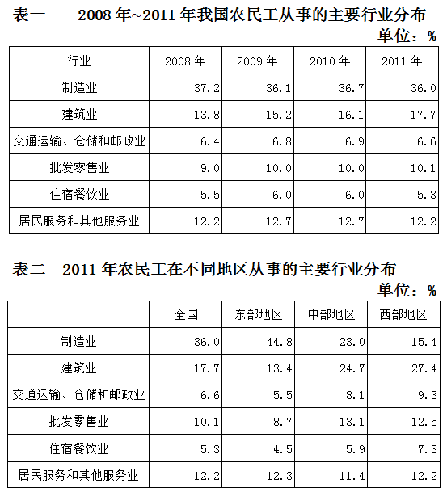

### 第 101 题

在表1中所列主要行业中，农民工中的比重逐年增加的是：

A. 制造业

B. 建筑业

C. 居民服务和其他服务业

D. 交通运输、仓储和邮政业

第 101 题 · 答案与解析

**参考答案（粉笔题库参考内容）**

B

**解析**

定位表1：建筑业连续四年的比重为13.8%、15.2%、16.1%、17.7%，符合逐年增加的要求。

故正确答案为B。

### 第 102 题

在表2所列主要行业中，2011年东部地区在该行业中从业的农民工数量占该地区农民工总数的比重高于全国总体水平的行业个数是：

A. 0个

B. 1个

C. 2个

D. 3个

第 102 题 · 答案与解析

**参考答案（粉笔题库参考内容）**

C

**解析**

定位表2：可知东部地区“制造业”的比重为44.8%，高于全国总体水平36%；“居民服务和其他服务业”的比重为12.3%，高于全国总体水平12.2%。

故正确答案为C。

### 第 103 题

表1中六大行业的从业农民工占全国农民工总数的比重低于上年的年份是：

A. 2009年

B. 2010年

C. 2011年

D. 2010年和2011年

第 103 题 · 答案与解析

**参考答案（粉笔题库参考内容）**

C

**解析**

定位表1：

2008年六大行业从业农民工所占比重=37.2%+13.8%+6.4%+9%+5.5%+12.2%=84.1%；

2009年六大行业从业农民工所占比重=36.1%+15.2%+6.8%+10%+6%+12.7%=86.8%；

2010年六大行业从业农民工所占比重=36.7%+16.1%+6.9%+10%+6%+12.7%=88.4%；

2011年六大行业从业农民工所占比重=36%+17.7%+6.6%+10.1%+5.3%+12.2%=87.9%。

观察可知，只有2011年比重（87.9%）低于2010年比重（88.4%），即只有2011年满足条件。

故正确答案为C。

### 第 104 题

表1中2011年从事该行业的农民工占所有农民工比重与上年相比变化最小的行业，其在东部地区的从业农民工占该地区所有农民工的比重与西部地区相差几个百分点？

A. 3.8

B. 4.4

C. 11.3

D. 14.0

第 104 题 · 答案与解析

**参考答案（粉笔题库参考内容）**

A

**解析**

根据表1最右边两列简单计算可知，2011年比重与2010年相比变化最小的行业是批发零售业（仅变化0.1个百分点）。

根据表2，批发零售业东西部比重差距为12.5%–8.7%=3.8%，即3.8个百分点。

故正确答案为A。

### 第 105 题

下列关于全国农民工在不同行业从业人数占农民工总数比重的描述与资料相符的是：

A. 批发零售业和住宿餐饮业从业农民工数占农民工总数比重在2008-2011年间的变化趋势相同

B. 2009-2011年，制造业和建筑业从业农民工数之和占农民工总数的比重均比上年水平有所上升

C. 在六大行业中，2011年中部地区每个行业从业农民工数占农民工总数比重均居三大区域中第二名

D. 与2009年相比，六大行业中有超过一半的行业在2010年的从业农民工数占农民工总数比重没有变化

第 105 题 · 答案与解析

**参考答案（粉笔题库参考内容）**

B

**解析**

A项：定位表1，在2010-2011年间，批发零售业农民工比重为上升的，但是住宿餐饮业为下降的，错误；

B项：定位表1，制造业和建筑业在2008-2011年的比重之和，分别为37.2%+13.8%=51%、36.1%+15.2%=51.3%、36.7%+16.1%=52.8%、36%+17.7%=53.7%，比重之和均比上年有所上升，正确；

C项：定位表2，批发零售业中部地区的比重是三个区域最大的，错误；

D项：定位表1，可知与2009年相比，2010年有三个行业比重没有变化，刚好一半，错误。

故正确答案为B。

## 材料 2

2011年甲省高新技术产业实现工业总产值6622.2亿元，同比增长37.4%，是2006年的4.9倍。高新技术产业总产值占全部规模以上工业总产值的比重达到21.3%，较上年提高0.4个百分点，比2006年提高4.3个百分点。2011年末全省拥有规模以上高新技术企业1325户，比2006年增加360户。从业人员75.2万人，同比增长23.1%，是2006年的2.3倍。

        2011年，高新技术产业实现出口交货值1180.3亿元，同比增长98.3%，是2006年的8.5倍，同比增速高出规模以上工业19.2个百分点；高新技术产业出口交货值占规模以上工业的比重达到79.5%，较上年提高8.2个百分点。

        2011年，甲省高新技术产业六大领域实现工业总产值4238.8亿元，是2007年的2.8倍。其中，先进制造领域实现工业总产值1306.7亿元，是2007年的2.2倍；新材料领域实现工业总产值1097.8亿元，是2007年的4.0倍；生物工程领域实现工业总产值822.9亿元，是2007年的4.4倍；电子信息领域实现工业总产值762.7亿元，是2007年的2.0倍；航空航天领域实现工业总产值127.7亿元，是2007年的2.7倍；核技术和新能源领域实现工业总产值121.1亿元，是2007年的2.2倍。

### 第 106 题

2011年甲省高新技术产业人均创造产值约为多少万元？

A. 40

B. 57

C. 88

D. 100

第 106 题 · 答案与解析

**参考答案（粉笔题库参考内容）**

C

**解析**

根据题干“2011年……人均……”结合材料所给时间为2011年，可以判定本题为现期平均数问题。定位文字材料第一段，“2011年甲省高新技术产业实现工业总产值6622.2亿元……从业人员75.2万人”。2011年甲省高新技术产业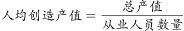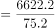，直除首位商8，只有 C 项符合。

故正确答案为 C。

### 第 107 题

2011年甲省规模以上工业总产值约是2006年的多少倍？

A. 2.1

B. 3.9

C. 5.0

D. 6.2

第 107 题 · 答案与解析

**参考答案（粉笔题库参考内容）**

B

**解析**

根据题干“2011年……约是……多少倍”结合材料所给时间为2011年，可以判定本题为现期倍数问题。定位文字材料第一段，“2011年甲省高新技术产业实现工业总产值……是2006年的4.9倍。高新技术产业总产值占全部规模以上工业总产值的比重达到21.3%……比2006年提高4.3个百分点”。故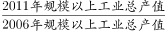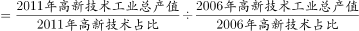，后面百分数的除式不大于1，也不小于0.5，只有B项满足。

故正确答案为 B。

### 第 108 题

2011年，高新技术产业六大领域中产值最高的领域，其工业总产值占高新技术产业工业总产值的比重约为：

A. 8%

B. 14%

C. 20%

D. 31%

第 108 题 · 答案与解析

**参考答案（粉笔题库参考内容）**

C

**解析**

根据题干“2011年……占……比重约为”结合材料所给时间为2011年，可以判定本题为现期比重问题。定位文字材料第三段，比较可知六大领域中产值最高的是先进制造领域，实现工业总产值1306.7亿元。定位文字材料第一段，高新技术产业工业总产值为 6622.2 亿元。故先进制造领域占高新技术产业工业总产值的比重为。

故正确答案为 C。

### 第 109 题

下面关于2007年高新技术产业六大领域总产值占比的图示，描述最为准确的是：

A. 

B. 

C. 

D. 

第 109 题 · 答案与解析

**参考答案（粉笔题库参考内容）**

A

**解析**

根据题干“2007年……占比”结合材料所给时间为2011年，可以判定本题为基期比重问题。观察选项，可发现先进制造领域的比重各不相同且差距较大，应优先计算。定位文字材料第三段“2011年，甲省高新技术产业六大领域实现工业总产值4238.8亿元，是2007年的2.8 倍。其中，先进制造领域实现工业总产值1306.7亿元，是2007年的2.2倍”。2007年先进制造领域占高新技术产业六大领域总产值占比，对应A图。

故正确答案为A。

### 第 110 题

能够从上述资料中推出的是：

A. 2011年规模以上工业出口交货值超过1600亿元

B. 2011年规模以上高新技术企业户均产值超过5亿元

C. 2007和2011年，高新技术产业六大领域中产值最高的均是先进制造领域

D. 2007-2011年间，高新技术产业六大领域中增速最快的领域是新材料领域

第 110 题 · 答案与解析

**参考答案（粉笔题库参考内容）**

C

**解析**

A 项：定位文字材料第二段，可知2011年高新技术产业实现出口交货值1180.3亿元，出口交货值占规模以上工业的比重达到79.5%。则2011年规模以上工业出口交货值为 亿元，错误；

B项：定位文字材料第一段， 可知2011年甲省高新技术产业实现工业总产值6622.2亿元，2011年末全省拥有规模以上高新技术企业1325户。假设每户超过5亿元，则1325户企业总产值为 5×1325=6625＞6622.2亿元，错误；

C项：定位文字材料第三段，可知2011年产值最大的是先进制造领域。在现期值中，只有新材料领域与先进制造领域比较接近，但是先进制造领域实现工业总产值是2007年的2.2倍，而新材料领域为4.0倍，比较可知2007年新材料领域的产值小于先进制造领域的产值。同时，因为其他领域数量差距太大，所以可以猜测2007年也不会大于先进制造领域，正确；

D项：定位文字材料第第三段，可知新材料领域实现工业总产值是2007年的4.0倍，而生物工程领域是4.4倍，故生物工程领域增速快于新材料领域，错误。

故正确答案为 C。

## 材料 3

2012年，全国固定资产投资（不含农户）364835亿元，同比增长20.6%。

### 第 111 题

2012年全国农户固定资产投资额为多少亿元？

A. 9539

B. 9603

C. 9685

D. 9841

第 111 题 · 答案与解析

**参考答案（粉笔题库参考内容）**

D

**解析**

方法一：定位文字材料第一段和柱状图：全国固定资产投资额（不含农户）为364835亿元，含农户固定资产投资额为374676亿元。则农户固定资产投资额为374676–364835=9841亿元。

方法二：农户固定资产投资额为374676–364835，根据尾数法，尾数明显为1，只有D项满足。

故正确答案为D。

### 第 112 题

2009-2012年，全国固定资产投资额（含农户）同比增速超过20%的年份有几个？

A. 1

B. 2

C. 3

D. 4

第 112 题 · 答案与解析

**参考答案（粉笔题库参考内容）**

C

**解析**

根据题干“······增速超过20%的年份”，判定本题为一般增长率问题。定位柱状图：2008年、2009年、2010年、2011年、2012年全国固定资产投资额（含农户）分别为172828亿元、224599亿元、278122亿元、311485亿元、374676亿元。采用逆向运算，2009年增速要超过20%，则投资额应超过，2009年投资额=224599亿元﹥207000 亿元，所以2009年增长率超过20%。同理可推出2010年和2012年超过20%，所以一共3年。

故正确答案选C。

### 第 113 题

表中2012年1-12月，工业固定资产投资约比上一年度增加多少万亿元？

A. 2.6

B. 2.7

C. 2.9

D. 3.1

第 113 题 · 答案与解析

**参考答案（粉笔题库参考内容）**

A

**解析**

根据题干“2012年1-12月，···比上一年增加多少万亿元”，判定本题为增长量计算问题。定位表格材料：2012年1-12月工业投资金额为154636亿元，同比增速20%。代入增长量计算公式：，列式可得亿元，约等于2.6万亿元。

故正确答案为A。

### 第 114 题

以下不同产业或行业按照2012年月固定资产投资额同比增速从高到低排列顺序正确的是：

A. 第一产业、第二产业、第三产业

B. 第一产业、第三产业、第二产业

C. 采矿业、制造业、电力、热力、燃气及水的生产和供应业

D. 制造业、采矿业、电力、热力、燃气及水的生产和供应业

第 114 题 · 答案与解析

**参考答案（粉笔题库参考内容）**

A

**解析**

定位表格材料：根据2012年1-12月增速，以及与1-11月相比增减的百分点，可算出2012年1-11月的增速，第一产业固定资产投资增速32.2%–1.7%=30.5%，第二产业20.2%+0.9%=21.1%，第三产业20.6%-0.2%=20.4%，按照从高到低排序则为：第一产业、第二产业、第三产业。

故正确答案为A。

### 第 115 题

关于2012年全国固定资产投资状况，能够从上述资料中推出的是：

A. 第一产业同比增长超过3000亿元

B. 总投资额同比增量为4年以来最高

C. 制造业投资额占第二产业的八成以上

D. 第二产业投资额同比增量高于第三产业

第 115 题 · 答案与解析

**参考答案（粉笔题库参考内容）**

B

**解析**

A项：定位表格材料：2012年第一产业投资额为9004亿元，同比增速为32.2%，故，没有超过3000亿元，错误；

B项：定位柱状图：2008年、2009年、2010年、2011年、2012年全国固定资产投资额（含农户）分别为172828亿元、224599亿元、278122亿元、311485亿元、374676亿元。，，，，根据计算结果2012年同比增量最高，正确；

C项：定位表格材料：第二产业投资额为158672亿元，制造业投资额为124971亿元。故，故没有占八成以上，错误；

D项：定位表格材料：第二产业投资额为158672亿元，同比增速为20.2%；第三产业投资额为197159亿元，同比增速为20.6%.；。故第二产业同比增量低于第三产业同比增量，错误。

故正确答案为B。

## 材料 4

2010年，我国投入研究与试验发展（以下简称R&D）经费7062.6亿元，比去年增长21.7%；R&D经费投入强度（与国内生产总值之比）为1.76%，比上年的1.70%有所提高。按R&D人员（全时工作量）计算的人均经费为27.7万元，比上年增加2.3万元。

        分产业部门看，R&D经费投入强度（与主营业务收入之比）最高的行业是专用设备制造业，为2.04%；其他投入强度在1.5%及以上的还有4个行业，分别是医药制造业（1.82%）、通用设备制造业（1.59%）、电器机械及器材制造业（1.59%）和仪器仪表及文化、办公用机械制造业（1.50%）。

        2011年，我国投入R&D经费8687亿元；R&D经费投入强度为1.84%。按R&D人员（全时工作量）计算的人均经费支出为30.1万元。

        分产业部门看，R&D经费投入超过200亿元的行业有8个，这8个行业的研发费用占全部规模以上工业企业的比重达72%；R&D经费投入强度超过规模以上工业平均水平（0.71%）的有11个行业。

### 第 116 题

2009年我国投入R&D经费约为多少亿元？

A. 5580

B. 5800

C. 6350

D. 7063

第 116 题 · 答案与解析

**参考答案（粉笔题库参考内容）**

B

**解析**

根据题干“2009年·······为多少亿元”，结合材料数据2010年和2011年，判定本题为基期计算问题。定位文字材料第一段：“2010年，我国投入研究与试验发展（以下简称R&D）经费7062.6亿元，比去年增长21.7%。”2009年我国投入R&D经费，与B项最接近。

故正确答案为B。

### 第 117 题

从活动类型看，2011年研究经费比上年增加额最多的和增长率最高的活动类型分别是：

A. 试验发展 、试验发展

B. 应用研究 、试验发展

C. 应用研究、 基础研究

D. 试验发展 、基础研究

第 117 题 · 答案与解析

**参考答案（粉笔题库参考内容）**

D

**解析**

根据题干“······比上年增加额最多和增长率最高······”，判定本题为一般增长率和增长量比较问题。定位表格材料:基础研究2010年和2011年经费投入额分别为324.5亿元和411.8亿元；应用研究2010年和2011年经费投入额分别为893.8亿元和1028.4亿元；试验发展2010年和2011年经费投入额分别为5844.3亿元和7246.8亿元。基础研究增长411.8-324.5=87.3亿元，应用研究增长1028.4–893.8=134.6亿元，试验发展增长7246.8–5844.3=1402.5亿元，所以增长量最大的是试验发展，排除B、C两项。计算增长率，试验发展增长率为，而基础研究增长率为，则基础研究增长率较大。

故正确答案为D。

### 第 118 题

2010及2011两年间，企业R&D经费投入金额约是高等院校的多少倍？

A. 7

B. 8

C. 9

D. 10

第 118 题 · 答案与解析

**参考答案（粉笔题库参考内容）**

C

**解析**

根据题干“2010及2011两年间，······是······的多少倍”，结合材料数据2010年和2011年，判定本题为现期倍数问题。定位表格材料：2010年和2011年企业R&D经费投入额分别为5185.5亿元和6577.3亿元；2010年和2011年高等院校R&D经费投入额分别为597.3亿元和688.9亿元。2010及2011年间企业R&D经费投入金额为5185.5+6577.3=11762.8亿元，高等院校为597.3+688.9=1286.2亿元，故企业是高等院校的。

故正确答案为C。

### 第 119 题

2011年R&D经费投入超过200亿元的行业比2010年R&D经费投入强度不低于1.5%的行业多几个？

A. 1

B. 2

C. 3

D. 4

第 119 题 · 答案与解析

**参考答案（粉笔题库参考内容）**

C

**解析**

定位文字材料第二段和第四段：“R&D经费投入超过200亿元的行业有8个；R&D经费投入强度（与主营业务收入之比）最高的行业是专用设备制造业，为2.04%；其他投入强度在1.5%及以上的还有4个行业。”故 “2011年R&D经费投入超过200亿元的行业”有8个；“2010年R&D经费投入强度不低于1.5%的行业”有4+1=5个，二者相差8–5=3个。

故正确答案为C。

### 第 120 题

以下需要补充其他数据，而无法直接从资料推出的是：

A. 2010年我国国内生产总值同比增速

B. 按全时工作量计算的2009年R&D人员数

C. 2010年研究机构R&D经费投入额同比增速

D. 2010年通用设备制造业R&D经费投入强度在各行业中排名

第 120 题 · 答案与解析

**参考答案（粉笔题库参考内容）**

C

**解析**

A项：定位文字材料第一段：“2010年，我国投入研究与试验发展（以下简称R&D）经费7062.6亿元，比去年增长21.7%；R&D经费投入强度（与国内生产总值之比）为1.76%，比上年的1.70%有所提高。”可求出2010年国内生产总值为 亿元，2009年国内生产总值为亿元，故可求出2010年国内生产总值同比增速，正确；

B项：定位文字材料第一段：“2010年，我国投入研究与试验发展（以下简称R&D）经费7062.6亿元，比去年增长21.7%；按R&D人员（全时工作量）计算的人均经费为27.7万元，比上年增加2.3万元。”可求出2009年R&D经费，以及2009年R&D人员全时工作量的人均经费，即可求出2009年按全时工作量计算的R&D人员数，正确；

C项：定位表格材料：材料中只有研究机构2010年和2011年投入经费数据，没有2009年的，所以无法计算2010年的同比增速，错误；

D项：定位文字材料第二段：“R&D经费投入强度（与主营业务收入之比）最高的行业是专用设备制造业，为2.04%；其他投入强度在1.5%及以上的还有4个行业，分别是医药制造业（1.82%）、通用设备制造业（1.59%）、电器机械及器材制造业（1.59%）和仪器仪表及文化、办公用机械制造业（1.50%）。”通用设备制造业与电器机械及器材制造业并列排名第三，正确。

本题为选非题，故正确答案为C。

