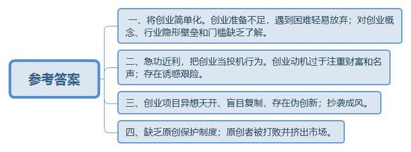
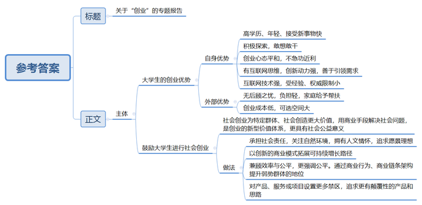
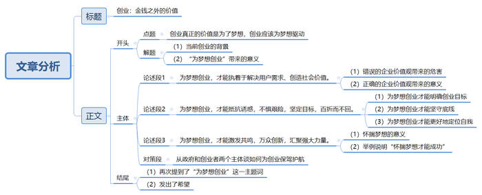

# 2016年公务员多省联考《申论》题（山西卷）

> 候选采集稿。参考答案及解析来自粉笔页面，不代表官方答案或真实高分答卷；来源使用许可与原卷对应关系仍需人工核实。

## 给定材料

### 材料 material-dc52802316c766c6

在某大学生创业大赛现场，5名女孩准备筹集40万元资金到武汉近郊去承包50亩地种植有机蔬菜。台上陈述的女孩充满激情和自信，台下观众也不时报以阵阵掌声。当评委问到：“你们种过蔬菜吗？”“你们的创业资金从哪里来？”“农民凭什么把土地转包给你们？”“你们种出来的有机蔬菜准备卖给谁？”等问题时，她们的回答却难以令人满意。如今，“创业”已经成为青年人口中的高频词语。对大学生而言，创业正在变得“简单”，曾经的理想似乎也触手可及。

机械专业硕士小杨，进入杭州一家民营企业从事技术工作不满半年。因没有期待中的高薪，没有理想中的激情，他开始琢磨创业。此后，他每天都在与人交谈，项目、资金、人脉、经验等问题弄得他头疼，深感创业之艰的他最终放弃了创业梦。

某投资基金首席合伙人阎先生拥有20多年投资经历，曾位列《福布斯》中国年度最佳创业投资人榜首。他参与投资的企业包括完美世界、环球雅思、凡客、分众传媒、百度、阿里巴巴、巨人网络等著名企业。在阎先生看来，当创业成了一种“时尚”和“运动”时，多数人都急功近利地把创业当成了投机行为。他说，“从时下来看，创业的动机大多是源自对财富和名声的渴望。”

某著名网站策略营销总监范女士认为，赚钱是创业的应有之意，但更多成功的创业者却是从想要赚钱开始，“继而”解决用户需求，是在解决用户需求、创造社会价值这条道路上不断自我追问、探寻并最终走向成功之地的；如果仅仅停留在“为了赚钱”上，是赚不到钱的。星巴克CEO舒尔茨曾说：“为钱创业是肤浅的，应为梦想所驱动。在创业路上有太多诱惑，也有太多艰险，只有怀揣理想的人才能够抵制诱惑，才能够不惧艰险，朝着自己的目标前行，百折而不回。”诺贝尔经济学奖得主菲尔普斯在《大繁荣》中指出：大多数创新并非是亨利•福特类型的孤独的梦想家带来的，而是由千百万普通人共同推动的，他们有自由的权利去构思、开发和推广新产品与新工艺，或对现状进行改进。正是这种大众参与的创新带来了普通民众的繁荣兴盛——物质条件的改善加上广义的“美好生活”。大众创新带来国家繁荣。

某公司创始人卢先生在接受记者采访时说，目前创业氛围很好，但创业却也成为一种时尚，仿佛不去创业就落伍了。创业项目的选择部分属于异想天开型的，部分属于复制型的。而现实需要创新型、技术型的项目，那些通过移动互联网，把原有的商业模式去中间化，搞流量，然后再找商业模式，这样的创新都是伪创新。仅怀着一腔热血，就幻想着自己只要去创业就能成为下一个马云，而对创业的概念，对行业隐形的壁垒和门槛却知之甚少，这是许多大学生创业伊始的真实写照。在国内的互联网创业环境中，有一个非常不好的特性就是抄袭成风。很多创业者经常因为有一个好的创意，但是却因为没有好的原创保护制度来保护，导致被其他一些公司抄袭过去，这些公司凭借着更雄厚的资本实力，迅速把原创者打败并挤出市场。

领英中国区总裁在日前的一次公开演讲中，用自身经验阐述了关于创业的两个公理：第一，创业成功是一个小概率的事件，每一个成功故事背后更多是失败；第二，创业没有失败者。即使是创业项目失败，作为创业者而言，过程中积累的经验将促进个人成长，即可定义为成功者。他认为，创业是没有失败者的历程。

ZUK联合创始人陈先生同样表达了对年轻人创业的观点。陈先生说：“创业是一件很复杂的事情，其实做好每一件事情就是创业。”

### 材料 material-273feb1149d68a42

深圳的创业者乔峤想要做一款智能耳机。他发现，60%的人都会在跑步过程中听歌，并用手机APP记录运动数据。如果有产品能同时解决跑步人群运动数据记录和听歌的需求，又能通过音乐来实现运动激励，会有很好的市场前景。乔峤对记者说，他想针对每个人的身体特征，设计和提供有效的音乐服务产品，做到每一个硬件设备都是针对个人定制的。

可是，光有好点子还不行。初始创业的乔峤，面临既缺资金、又缺人才的尴尬，他尝试着用股权众筹的方式来实现自己的创业梦想。在众筹网上，他发布了自己的股权众筹商业计划书，以出让公司10%股份的方式，融资187万元，最低投资额1万元。最终，吸引了16名投资者参与。乔峤告诉记者，这些投资者为他引入了互联网、音乐、体育领域的强大资源，其中，几个最志同道合的投资人干脆直接加入了创业团队。

### 材料 material-2489d931f822c946

近年来，创业一词已经成为大众关注的热点。在众多创业团队里，90后群体以其高学历、年轻、接受新事物快而成为一股不可忽视的重要力量。前不久，某网站邀请了几位90后创业者，让他们分享自己的创业心得。1992年出生的小尹已经开了三家公司。为了弄明白“为什么KTV的歌单十年不变”这个问题，小尹跑遍了N市所有的KTV。他发现，KTV的点歌系统更新周期较长，而且每一次更新，硬件和软件都要付钱，点歌系统的硬件公司缺少互联网思维，创新动力不足。也有人尝试做智能点歌，但所做的系统，小尹说“不忍直视”。在小尹看来，社交、娱乐才是这个时代年轻人的刚需。KTV不再只是一个唱歌的场所，而是一个聚集了年轻人社交、娱乐、聚会等多种需求的地方。凭着这个想法，他创立了KTV团购APP“一起唱”，把整个N市的KTV硬件系统作了更新。现在，用“一起唱”的用户，只要提前列出歌单，并同步到APP，进入包房后摇一摇手机，歌单便自动导入了点歌盒子。除此之外，用这款软件还可约别人来唱歌，还可以对KTV现场旋律进行混音，然后传到云端，分享到社交网站，甚至可以在包房里和朋友一起看世界杯。小尹说，从物质转到服务、娱乐，是他们这一代人创业和上一代的不同，这类创业不需要太高成本，往往一个想法、一份风险投资就可以做起来。90后正在用一种更新、更年轻的方式去与这个世界相处，创业的可选空间变大了，且较少受到家庭背景、所支付成本和教育程度的限制。

这一观点得到了很多人的认同。与90后相比，80后们从父母那里得到的传承不多，且多有负担，除了养活自己，通常还需考虑如何让父母过得更好。而很多90后的父母有很强的经济能力和社会人脉，不但不需被养，还能帮到子女。90后没有后顾之忧，中国第一次出现了“可以干自己想干的事情”的一代人，这代人喷薄而出的创新力，会帮助中国进入一个极具创新力的年代。

也有分析人士认为，很多“90后”在创业心态上有了改变，他们不像做企业，更像做项目，对于成功的渴望不是很强烈，有时甚至只把这当作一种体验。

某互联网金融公司创始人、CEO小孙也觉得，在传统社会里，行业与社会规则已经形成，年轻人往往要学习社会中的既成经验，才能进入正轨。在这种系统里，年轻往往成为一种劣势。而在现代社会，互联网已经渗透到社会生活的各个部分，与互联网同生共长的年轻人成为互联网原住民，他们可以直接从互联网获取经验，寻找机遇；而对于年长者，年龄反而成了迁移转型的一种包袱。所以在传统部落中，年长者往往是部落中最有权威的人；而在互联网社会中，则会涌现扎克伯格等一系列的创新者。现代社会不是经验的时代，而是技术与创新的时代。

## 题目

### 第 1 题

**给定资料**2**提到“创业成功是一个小概率的事件”。请你根据该给定资料，概括创业者创业中存在的问题。（****15分）**

关联材料：material-dc52802316c766c6

作答要求：

要求：

（1）紧扣材料，概括准确；

（2）语言简洁，条理清楚；

（3）不超过150字。

### 第 2 题

**根据给定资料**3**～**5**，分析众筹的优势。（20分）**

关联材料：material-273feb1149d68a42

作答要求：

要求：

（1）分析透彻，观点明确；

（2）语言简洁，条理清楚；

（3）不超过200字。

### 第 3 题

**假如你是某大学就业指导中心的工作人员，受邀为即将毕业的大学生做一次关于“创业”的专题报告，请你结合给定资料**1**、**6**，为其草拟一份讲话稿。（25分****）**

关联材料：material-2489d931f822c946

作答要求：

要求：

（1）写出主要内容即可，不需要成文；

（2）观点明确，建议可行；

（3）语言简洁，有逻辑性；

（4）不超过350字。

### 第 4 题

**结合当前政府推动“大众创业，万众创新”的社会形势，参考给定资料，以“创业：金钱之外的价值”为题目，自选角度，写一篇议论文。（40分）**

关联材料：material-2489d931f822c946

作答要求：

要求：

（1）观点明确，认识深刻；

（2）内容充实，结构完整：

（3）逻辑清晰，语言流畅；

（4）总字数1000～1200字。

## 答案与解析

第 1 题

**参考答案（粉笔题库参考内容）**

一、将创业简单化。创业准备不足，遇到困难轻易放弃；对创业概念、行业隐形壁垒和门槛缺乏了解。二、急功近利，把创业当投机行为。创业动机过于注重财富和名声；存在诱惑艰险。三、创业项目异想天开、盲目复制，存在伪创新；抄袭成风。四、缺乏原创保护制度；原创者被打败并挤出市场。

**解析**

**参考答案说明：**本参考答案从“将创业简单化”“急功近利”“抄袭创业项目”“缺乏原创保护制度”等不同的方面进行了分条撰写。各条要点之间在内容上是并列关系，没有交叉。

**考点**：考点问题类

**来源**：来源2016年公务员多省联考《申论》题（山西卷）

粉笔申论页面对本题只提供「解析视频」入口，该入口是会员推广位，页面无视频地址与文字解析。

第 2 题

**参考答案（粉笔题库参考内容）**

1.集聚资源高效。融资门槛低，能引入资金、资源和人才。

2.降低创业难度。参与者集投资者、消费者、传播者于一身，将外部交易变成内部合作。

3.裂变效应明显。股东来自不同领域，相互信任，合作催生新项目。

4.促进主动创新。减轻生存压力，释放创业活力，促进创新。

5.决策运营专业。股东数量多，运营难倒逼实际经营决策由专业团队操作。

6.股权流转灵活。有效解决股东流动问题。

7.利益分配公平。贡献评价直观，确保权益分配有据可依。

**解析**

**参考答案说明：**本参考答案从“集聚资源高效”“降低创业难度”“裂变效应明显”“促进主动创新”“决策运营专业”“股权流转灵活”“利益分配公平”等不同的话题进行了分条撰写。各条答案要点之间在内容上相互并列，没有交叉。

**考点**：考点特点类

**来源**：来源2016年公务员多省联考《申论》题（山西卷）

第 3 题

**参考答案（粉笔题库参考内容）**

关于“创业”的专题报告

一、大学生的创业优势：1.自身优势：（1）高学历、年轻、接受新事物快；（2）积极探索，敢想敢干；（3）创业心态平和，不急功近利；（4）有互联网思维，创新动力强，善于引领需求；（5）互联网技术强，受经验、权威限制小。2.外部优势：（1）无后顾之忧，负担轻，家庭给予帮扶；（2）创业成本低，可选空间大。

二、鼓励大学生进行社会创业：1.社会创业为特定群体、社会创造更大价值，用商业手段解决社会问题，是创业的新型价值体系，更具有社会公益意义。2.做法：（1）承担社会责任，关注自然环境，拥有人文情怀，追求愿景理想；（2）以创新的商业模式拓展可持续增长路径；（3）兼顾效率与公平，更强调公平。通过商业行为、商业链条架构提升弱势群体的地位；（4）对产品、服务或项目设置更多禁区，追求更有颠覆性的产品和思路。

**解析**

**参考答案说明：**（1）正文部分，一方面从内容来看，围绕着“创业”这一主题，本参考答案从“大学生的创业优势”“鼓励大学生进行社会创业”两个方面给出了具体内容。另一方面，形式上，本参考答案做到了分段、分条撰写，整体上条理较为清晰。（2）本参考答案能够结合题目要求“语言简洁”，在语言表达上做到了言简意赅。

**考点**：考点总结类

**来源**：来源2016年公务员多省联考《申论》题（山西卷）

第 4 题

**参考答案（粉笔题库参考内容）**

**创业：金钱之外的价值**

当前时代是大众创业，万众创新的时代。**然而，很多创业者仅仅是为了金钱而创业，这必然是肤浅的，没有看到创业真正的价值是为了梦想，创业应该为梦想驱动！**只有为梦想创业，才能执着于解决用户需求、创造社会价值；只有为梦想创业，才能抵制诱惑，不惧艰险，坚定目标，百折而不回；只有为梦想创业，才能激发共鸣，万众创新，促进国家繁荣昌盛。

如果创业仅仅为了财富和名声，只会让创业者盲目跟风，急功近利地把创业当成投机行为，在追逐金钱的道路上越走越远，最终迷失自我。更可怕的是，肤浅地理解创业，不仅让创业不求实际，还让创业者不能脚踏实地，实事求是。换句话说，缺少坚韧不拔的毅力和决心，只会让为钱创业的人离成功越来越远。**因此，应该为梦想而创业，放大格局才能走得更长远。**

**为梦想创业，才能执着于解决用户需求、创造社会价值。**价值观是企业基业长青的基石，为社会提供商品或服务是企业生存的根本途径。如果企业的价值观念里只有钱，仅仅是为了钱而服务社会，那么必然不能关照用户的需求，也就没有办法抓住市场，那么等待它的只有死亡。相反，一个企业能够明确使命，坚守价值和理想，那么必然会在为社会提供优质商品和服务上下功夫，做功课。这样的企业才能够得客户心，得社会赞，才能站得住，走得远。

**为梦想创业，才能抵制诱惑，不惧艰险，坚定目标，百折而不回。**只有为了梦想，创业者才能经得起诱惑，深刻认识复杂的环境，明确创业梦想，而非头脑发昏就梦想创业。也只有为了梦想，才能让创业者清醒地洞察局势，有底线、有边界。也只有为了梦想，创业者才能更好地定位自我，在宏大的时代中，找准自己的位置，既能脚踩大地，避免盲目跟风，又能仰望星空，敢于突破现实的羁绊，为创业插上创新的翅膀，让创业更自由的翱翔。

**为梦想创业，才能激发共鸣，万众创新，汇聚强大力量。**诺奖得主菲尔普斯在《大繁荣》中指出：大多数创新并非是亨利·福特类型的孤独的梦想家带来的，而是由千百万普通人共同推动的。只有怀揣梦想的企业家才能感染别人，才能激发员工甚至客户的创造力。创业教父马云就是用自己的梦想激发了千万人的梦想，从一个人梦想足不出户就能购物，到一群人梦想足不出户就能精挑细选找尖货，再到全球人都梦想足不出户购遍世界。马云用自己的梦想点亮了千千万万人的梦想，这种强大的力量造就了阿里巴巴的成功，也创造了马云的个人传奇。

**然而，为梦创业也不是一帆风顺的。一方面需要创业者正确认知创业，实事求是，要脚踏实地，从点滴做起。另一方面也需要国家完善原创保护制度，为梦想保驾护航。**所谓万层高楼平地起，只有从现实的土壤里长出来的梦想，才能有良好的根基。创业不是空中楼阁，更不是海市蜃楼，而是一件件、一桩桩看得见，可以做的小事。而在这个过程中也有很多人是盗梦者，加之缺乏好的原创保护制度来保护，导致梦想折翼。所以各级政府应该出台相应的政策和法规来保护原创制度，提高复制和抄袭成本，让为梦创业的企业在公平的环境中发展壮大。

欲穷千里目，更上一层楼。仅仅为追求功名利禄，追求物质享受和财富积累而创业是肤浅的。一个优秀的企业家，应该出于更高一层的梦想和驱动创业。执着于自己的梦想和理念，正确认识自己，认识世界，在自我与世界之间找到平衡点，从而创造出颠覆性的产品和思路，为社会、国家创造更大的价值，才是高级的创业。

**解析**

**文章分析**

**创业：金钱之外的价值**

【**标题的优点：**严格按照题目的要求，以“创业：金钱之外的价值”为标题。】

**（****1）**当前时代是大众创业，万众创新的时代。**然而，很多创业者仅仅是为了金钱而创业，这必然是肤浅的，没有看到创业真正的价值是为了梦想，创业应该为梦想驱动！（****2）**只有为梦想创业，才能执着于解决用户需求、创造社会价值；只有为梦想创业，才能抵制诱惑，不惧艰险，坚定目标，百折而不回；只有为梦想创业，才能激发共鸣，万众创新，促进国家繁荣昌盛。

【**开头的优点：**★内容方面：范文的开头是紧扣题目给定的“创业：金钱之外的价值”这一标题展开的。首先，开头开门见山的点出主题，指出了创业在金钱之外的价值是为梦想，做到了主题明确。其次，对“创业：金钱之外的价值”进行了分析阐述，指出了（1）“创业”的背景。（2）“为梦想创业”带来的意义。★文字表达方面：使用了排比的修辞手法，使文字表达更加形象、有力。】

如果创业仅仅为了财富和名声，只会让创业者盲目跟风，急功近利地把创业当成投机行为，在追逐金钱的道路上越走越远，最终迷失自我。更可怕的是，肤浅地理解创业，不仅让创业不求实际，还让创业者不能脚踏实地，实事求是。换句话说，缺少坚韧不拔的毅力和决心，只会让为钱创业的人离成功越来越远。**因此，应该为梦想而创业，放大格局才能走得更长远。**

【**过渡段的优点**：范文过渡段分析了“创业：金钱之外的价值”的问题方面等的内容，此外，还要注意过渡段末尾的“因此，应该为梦想而创业，放大格局才能走得更长远”是用来再次点明主题，引起下文的过渡句。】

**为梦想创业，才能执着于解决用户需求、创造社会价值。**价值观是企业基业长青的基石，为社会提供商品或服务是企业生存的根本途径。（1）如果企业的价值观念里只有钱，仅仅是为了钱而服务社会，那么必然不能关照用户的需求，也就没有办法抓住市场，那么等待它的只有死亡。（2）相反，一个企业能够明确使命，坚守价值和理想，那么必然会在为社会提供优质商品和服务上下功夫，做功课。这样的企业才能够得客户心，得社会赞，才能站得住，走得远。

【**论述段****1的优点：**★观点句：范文的观点句是紧扣“创业：金钱之外的价值”这一文章主题提出的。形式上，它在段首处直接写出，位置突出，容易发现。内容上，关键词突出，内容要点明确，可以明显看出它是从“创造社会价值”方面入手，指出了“为梦想创业”。★论述内容：（1）介绍了“错误的企业价值观带来的危害”；（2）介绍了“正确的企业价值观带来的意义”。注意：以上几个方面的内容都是紧扣“为梦想创业，才能执着于解决用户需求、创造社会价值”这个观点句进行分析论述的，论述的针对性强，内容层次丰富。★论述方法：主要采取了讲道理的论证方式，在论述的时候做到了层次多样，内容丰富。】

**为梦想创业，才能抵制诱惑，不惧艰险，坚定目标，百折而不回。**（1）只有为了梦想，创业者才能经得起诱惑，深刻认识复杂的环境，明确创业梦想，而非头脑发昏就梦想创业。（2）也只有为了梦想，才能让创业者清醒地洞察局势，有底线、有边界。（3）也只有为了梦想，创业者才能更好地定位自我，在宏大的时代中，找准自己的位置，既能脚踩大地，避免盲目跟风，又能仰望星空，敢于突破现实的羁绊，为创业插上创新的翅膀，让创业更自由的翱翔。

【**论述段****2的优点：**★观点句：范文的观点句是紧扣“创业：金钱之外的价值”这一文章主题提出的。形式上，它在段首处直接写出，位置突出，容易发现。内容上，关键词突出，内容要点明确，可以明显看出它是从“坚定目标”方面入手，指出了“为梦想创业”。★论述内容：（1）介绍了“为梦想创业才能明确创业目标”；（2）介绍了“为梦想创业才能坚守底线”；（3）介绍了“为梦想创业才能更好地定位自我”。注意：以上几个方面的内容都是紧扣“为梦想创业，才能抵制诱惑，不惧艰险，坚定目标，百折而不回”这个观点句进行分析论述的，论述的针对性强，内容层次丰富。★论述方法：采取了讲道理的论证方式，在论述的时候做到了层次多样，内容丰富。】

**为梦想创业，才能激发共鸣，万众创新，汇聚强大力量。**（1）诺奖得主菲尔普斯在《大繁荣》中指出：大多数创新并非是亨利·福特类型的孤独的梦想家带来的，而是由千百万普通人共同推动的。只有怀揣梦想的企业家才能感染别人**，**才能激发员工甚至客户的创造力。（2）创业教父马云就是用自己的梦想激发了千万人的梦想，从一个人梦想足不出户就能购物，到一群人梦想足不出户就能精挑细选找尖货，再到全球人都梦想足不出户购遍世界。马云用自己的梦想点亮了千千万万人的梦想，这种强大的力量造就了阿里巴巴的成功，也创造了马云的个人传奇。

【**论述段****3的优点：**★观点句：范文的观点句是紧扣“创业：金钱之外的价值”这一文章主题提出的。形式上，它在段首处直接写出，位置突出，容易发现。内容上，关键词突出，内容要点明确，可以明显看出它是从“促进万众创新”方面入手，指出了“为梦想创业”。★论述内容：（1）介绍了“怀揣梦想的意义”；（2）举例说明“怀揣梦想才能成功”。注意：以上几个方面的内容都是紧扣“为梦想创业，才能激发共鸣，万众创新，汇聚强大力量”这个观点句进行分析论述的，论述的针对性强，内容层次丰富。★论述方法：采取了讲道理和举例子相结合，做到了丰富多样。】

**然而，为梦创业也不是一帆风顺的。一方面需要创业者正确认知创业，实事求是，要脚踏实地，从点滴做起。另一方面也需要国家完善原创保护制度，为梦想保驾护航。**所谓万层高楼平地起，只有从现实的土壤里长出来的梦想，才能有良好的根基。创业不是空中楼阁，更不是海市蜃楼，而是一件件、一桩桩看得见，可以做的小事。而在这个过程中也有很多人是盗梦者，加之缺乏好的原创保护制度来保护，导致梦想折翼。所以各级政府应该出台相应的政策和法规来保护原创制度，提高复制和抄袭成本，让为梦创业的企业在公平的环境中发展壮大。

【**对策段的优点：**从政府和创业者两个主体谈如何为创业保驾护航，使文章结构更加完整。】

（1）欲穷千里目，更上一层楼。仅仅为追求功名利禄，追求物质享受和财富积累而创业是肤浅的。一个优秀的企业家，应该出于更高一层的梦想和驱动创业。（2）执着于自己的梦想和理念，正确认识自己，认识世界，在自我与世界之间找到平衡点，从而创造出颠覆性的产品和思路，为社会、国家创造更大的价值，才是高级的创业。

【**结尾的优点**：范文的结尾回扣了“创业：金钱之外的价值”这一主题。（1）再次提到了“为梦想创业”这一主题词。（2）发出了希望。】

**考点**：考点文章写作题

**来源**：来源2016年公务员多省联考《申论》题（山西卷）

