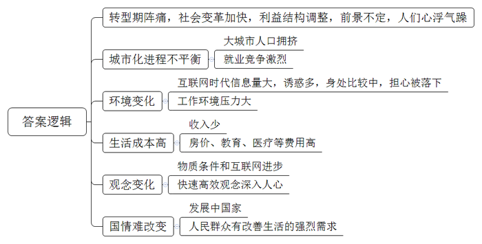
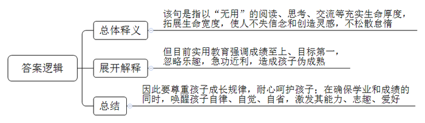
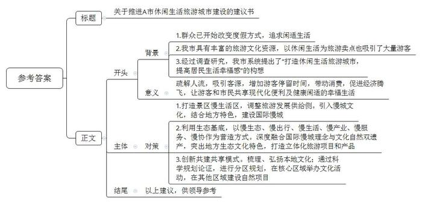

# 2017年公务员多省联考《申论》题（山西卷）

<!-- gwy:overview:start -->
> **山西 · 2017 · 申论 · 统考** ｜ 4 题 · 图片 4 处 · 答案随题折叠

导航：[题目](#题目) · [材料 1](#材料-1)
<!-- gwy:overview:end -->

> 候选采集稿。参考答案及解析来自粉笔页面，不代表官方答案或真实高分答卷；来源使用许可与原卷对应关系仍需人工核实。

## 给定材料

### 材料 1

随着现代化转型日益加快，中国逐渐变成了世界上生活节奏最紧张的国家之一。现在，越来越多的人开始重视从紧张的节奏中解脱出来，享受闲适。有学者表示，这种心理的变化轨迹正是社会进步的表现，体现了后工业时代的幸福导向型生活。随着这种观念的流行和它所催生的产业经济，未来人们会有更加丰富多彩的选择。

某地以城市主干道为中心的部分城区被辟为了供市民体验的休闲生活街区。然而，街区内外可谓冰火两重天。一方面，街区内骑自行车的人、步行的人、摆地摊的人，悠然自得；另一方面，在范围更广的周边路段，平常就不顺畅，再加上很多出行的私家车分流至此，拥堵状况可想而知。本来周末出门，很多时候就是不得已的，有的是要加班，有的是趁周末去超市采购或带孩子短途旅游……开车出来就是为了图个快、图个方便。现在速度确实降下来了，但人们的心里恐怕只有更多的焦躁，还何谈享受生活呢？这种矛盾值得人们深思。

事实上，要想让人们在某一种生活状态中得到享受，那首先得是人们的自主选择，而只有依靠整体性的社会发展，人们才有充分的选择权。法国于1998年首倡“无车日”，那时法国人均GDP就已经达到24000美元，每周工作时间更是少到让人艳羡的35小时。反观中国目前的情况，2014年人均GDP刚超过7000美元，相当多的劳动者为了体面的生活，连法定的带薪休假甚至双休都放弃了，此时就谈休闲生活，未免过于奢侈了。

倡导休闲生活，要以现实为基础，关键是要与公众的生活需要大致平衡，并且把这种选择权交给公众。倡导要发挥作用，靠的是公众的自觉响应。如果不顾现实情况，违背人们的自主意愿，倡导活动不仅无法落地生根，甚至会因为给公众“添堵”而招致反感。职能部门工作要做得更加精细，考虑要更全面，让公众真正感受到好处、享受到便利，所倡导的休闲生活就会成为人们自然而然的选择。

### 材料 2

当下社会，一切都和速度直接挂钩：飞机当天往返，火车夕发朝至，教育要趁早，就业要抢先，毕业就买房，爱情变速配。新世纪以来社会变革加快，利益结构调整，人们的经济地位被重新洗牌，对未来前景的不确定，使很多人心浮气躁，这与转型期带来的阵痛密切相关。

以往，只要是名牌大学毕业，就不愁找不到称心的工作；现在，城市化进程的不平衡性导致大城市人口拥挤，选择“好”职业的难度加大，即使是名校硕士、博士，找到的工作也不一定合意。为了在竞争激烈的就业市场占得先机，大学生纷纷成为“考证族”。王某是一名法律系在读研究生，刚刚通过国家司法考试，拿到了法律职业资格证。研究生还没毕业，为什么现在就急着参加司法考试？王某说，有了证，马上就能在律师事务所实习，就业时就能抢先一步。

在互联网时代，每天遇到海量信息，面对各种诱惑，身处不断的比较中，很多人担心被时代落下、害怕被别人超越。赵某是某IT公司软件工程师，最近刚跳槽到另一家规模更大的公司。大学毕业不到5年，他已经换了3份工作。“房价涨，收入低，晋级慢，在网上看到别的公司待遇更好，就想通过不断跳槽寻找新机会。”赵某说。

大城市居住不易，单是房价就已经透支了很多人大半辈子的财富，再加上高昂的教育费、医疗费等，一个人不拼命工作还真不行。某微博用户晒出一张图片：“山东某知名IT公司要求员工申请自愿放弃年休假，实行6×12小时工作制：每天工作12个小时、每周工作6天，春节、国庆等长假期间也要随叫随到。”面对如此苛刻的要求，却有不少人积极响应。一位响应者说，“对我们年轻人而言，大学毕业后能前行多远，不仅仅是个人能力的问题，如果没有父辈的外部支援，自己又不使劲上位，很难在大城市站稳脚跟。”

美国发明家富兰克林说过：“时间就是生命，时间就是金钱。”这句话作为大工业时代的座右铭，影响了整个世界。快速、高效的观念深入人心，成为人们自觉不自觉的选择。现代社会物质条件的进步也加剧了人们的这种心理。电话不普及的时候，人们已经习惯了几天才收到一封信，但在手机随处可见的今天，几分钟内对方没有回短信，人们就会嫌慢；在自行车与有轨电车还是主要出行工具的时候，等半个小时的公交车不足为奇，但现在，出行越来越便捷，却连打的都还忍不住叮嘱司机开快点。互联网的出现更大大改变了人们的生活方式，速度更快，变化更多，时间的价值更宝贵。很多人习惯了24小时开机，习惯了半夜被人从梦中叫醒谈工作，习惯了长期频繁加班。这种生活给现代人带来物质回报的同时，也导致了精神的疲惫和身体的损害。某网站的调查显示，我国已成为全球工作时间最长的国家之一，人均劳动时间超过日本和韩国。一些白领虽然报酬较高，但白天夜里都要紧张工作，生活很不规律。

某互联网公司的一位员工说：“连夜加班，刚开始你也许无法适应，但是时间久了你会觉得，如果周围人都在加班，你早走了就显得很特别。虽然没有强制加班的规定，但公司里许多人都在‘抛妻弃子’、挑灯奋斗。因为你不加班，就比不过加班的人。”有人估算，我国每年因过劳去世的人多达60万，其中媒体人、科技工作者、互联网企业员工中死于过度疲劳的比例最高。

不停加班，带来了一系列健康问题，频繁跳槽、朝三暮四对心理的影响也不容小觑。比如，盲目跳槽的人在辞职过程中的无奈，重新选择时的焦虑，以及应聘新企业来回的奔波，都会极大地影响个人情绪。尤其是跨地区跳槽，从一个熟悉的环境到一个陌生的环境，前景的不确定性会给人带来更大的心理压力。

我们还是发展中国家，很多方面不能跟发达国家比，确实需要加快发展、早日富强，而且在中国推进市场化的进程中，人民群众有改善生活的强烈需求，这是中国社会保持较快发展的内在动力，处于这样的历史阶段，想要控制发展速度并不容易。因此，根本的解决之道不在于刻意放缓发展节奏，而在于防范快速发展过程中容易出现的失衡。政府要建立健全社会保障体系，创造更畅通更多元的发展通道，减轻人们的工作和生活压力。同时，个人也要积极调整心态，特别是年轻人初涉职场，要学会找到适合自己的节奏和平衡点，留出空间去调整身心状态，审视事业的计划和目标，体会人生的意义。

### 材料 3

随着经济社会发展，越来越多的人在度假方式上，开始追求一种闲适的节奏：或是在家陪陪家人、或在田园放松心灵、或做点无用的事……而这种观念也正是社会更加成熟自信、文明进步的一种表现。

在黄金周假期前两天，传来了“高速免费”“景点降价”的消息。A市市民汪先生因担心人满为患，临时取消了长途出游的安排。当换种度假方式时，他很快便开始享受这种新的节奏了。汪先生携妻儿开车来到郊区的一个水库，在青山绿水间垂钓，中午就地野餐，傍晚则将一天的收获带回家做成美味鱼汤。汪先生告诉记者说：“尽管只钓到七八条小鱼，但一家人在一起的亲近感让我觉得幸福不过如此，这种生活正是我向往的。”28岁的胡女士则在黄金周期间选择宅在家里做家务、看书、喝茶……她说：“刚工作时遇到假期不是在各家亲戚间奔波，就是在人山人海的景点抢镜头，不然就觉得虚度了。现在我宁愿做什么事都无需紧赶慢赶，享受悠闲的生活。最好的景致就在自己心里。”

A市位于我国西部地区，具有丰富的旅游文化资源，是一座以旅游立市的小型城市。近年来，该市以休闲生活为旅游新卖点，提出“在这里正大光明地浪费光阴”“没有任何一件事情是必须做的，只需随心住下，随性闲游！”等旅游消费主张来吸引游客，受到游客们的青睐。

2016年，A市新市长上任后，经过调查研究，系统提出了“打造休闲生活旅游城市，提高居民生活幸福感”的构想，重点围绕本地旅游资源，加强规划建设，将现代化理念与传统生活方式相结合，进一步打造“四季如春、休闲养生”的旅游生活城市，使游客和本地市民在这里不仅可以享受现代化带来的各种便利，更可以过上一种健康闲适的幸福生活。这一构想的提出得到了市民的支持。

### 材料 4

近年来，泰山景区注重泰山主体文化的重现，以文化体验为主的观光游发展迅猛，游客总量逐年攀升。在游客量保持较高水平的同时，如何解决好均衡游客分布、延展产业链条、让游客留下来的问题，实现从景点旅游向全域旅游的转型，成为泰山景区发展的一项重点。

为了营造最具中国特色的国际慢城，打造闲适从容的理想栖居，泰山景区规划建设泰山慢谷，打造景区东西两翼“慢生活”区，调整泰山景区旅游发展供给侧，希望通过引入慢城文化探秘泰山亲切、闲适的另一面，以平安长寿、健康养生、闲适宜居、泰山文化为四大特色，建成国际慢城。未来，泰山慢谷的建设将有效疏解泰山人流，吸引更多客源，增加游客停留时间，从而带动消费、促进经济腾飞。

泰山景区无论是区位条件，还是自然资源、文化资源，都有利于建设国际慢城。根据初步规划，泰山慢谷面积为62.37平方公里，包括大津口乡下辖的9个行政村和天烛峰、玉泉寺两个景区，区位条件得天独厚。天烛峰和玉泉寺两个景区的开发已经成熟，能迅速融入泰山慢谷的建设中。大津口乡位于泰山东部，交通便利，乡政府驻地距高铁泰山站12公里。乡里有两条主要道路，连接全乡大部分村落。乡内河流大多为自然河流，村落建筑基本都沿河流分布。大津口乡共计1.5万余人，民风淳朴，居民仍然保持有机餐饮的习惯，人口规模和生活方式都适合建设慢城。大津口乡还是山东省“乡村记忆工程”试点乡镇，拥有独特的自然环境和优越的宜居环境，以及丰富的非物质文化遗产和丰厚的人文历史。

泰山慢谷的总体定位是以壮美山川、深谷秀水、古树茶园、石筑原乡为生态基底，以慢生态、慢出行、慢生活、慢产业、慢服务、慢协作为营造方式，将国际慢城理念与泰山文化自然双遗产深度融合，突出泰山独有的生态特色、文化特色，打造集养生、休闲、度假、体验等中高端旅游产品于一体的国际慢城。

泰山慢谷力推自身独有的特色，包括全时旅游、标志产品等。结合四季特色，推出四季慢运动、四季慢生活，春赏花采茶、夏耕读研学、秋登高采摘、冬养生滑雪，同时开发系列标志土特产、吉祥物、工艺品等。

泰山慢谷的建设摒弃了将慢城建设等同于旅游开发、旧村改造的传统模式，创新提出了“景区、园区、社区、乡村”共建共享的模式。泰山慢谷将泰山的历史文化、民间传说进行梳理，通过智慧解说系统、旅游项目、体验项目等弘扬泰山文化。根据区域内不同的自然和文化优势，泰山慢谷进行分区规划。核心区域在慢谷小镇周围，这里将举办泰山论坛、文艺表演、美术展览等。此外在不同的区域分别建设花乡慢谷、禅修慢谷、养生乐园、耕读农园、记忆家园、慢活彩色森林等。

泰山慢谷通过科学的规划和论证，将建有一路、两心、两环、四区、四带。其中“一路”指的是生态旅游之路；“两心”指的是作为文化休闲旅游核心的慢谷小镇，作为原住民公共服务中心的慢村集镇；“两环”指的是由山地河谷风情环、乡村田园情环；“四区”指的是南部文化旅游服务区、中部运动休闲体验区、东部养生研学体验区、北部原乡风情体验区；“四带”则为汉御道七彩田园风情带、天烛峰古松石坞风情带、周御道幽谷瀑布风情带、玉泉寺古木禅意风情带。

### 材料 5

中国车市在经历了迅猛扩张，成为世界最大单体市场的同时，也渐渐放慢了自己向前的步伐，如同中国经济一样，步入新常态阶段。D公司十二年前的白手起家，如今已经赫然位居行业第一集团，所创造的速度奇迹在业界声名显赫。从最初的单一车型开始，到如今已经成功完成了主流市场区间的全产品布局；从最早只有一个工厂，到现在的四地八厂；从初始的单一合资品牌，到现在坐拥主流合资两大品牌；从零起步到600万保有客户，这一切只用了12年的时间，D公司就快速地完成了从“小字辈”到“大体系”的转变。

然而，在中国车市进入“新常态”已然不可逆转的今天，D公司过去单纯的快速发展模式已经不适用了，对此，该公司周总表示：“车市的新常态只是意味着车市进入到一个新的发展阶段，速度下了一个台阶，并不意味着车市发展的黄金时代已经结束。在新常态下，快是一种质量，慢是一种智慧。未来我们要从‘要素驱动’转化为‘创新驱动’，对企业体系进行全面的优化升级，努力实现‘快’与‘慢’的平衡，以更稳健、更具核心竞争力的姿态，去应对车市新常态。”

随着互联网、信息技术的发展，消费观念的成熟，中国车市进入了以用户为中心的精细化、个性化时代，D公司顺应时代变化，通过基于大数据分析的营销管理和创新，继续保持迅捷的市场反应速度、高效的体系反应能力、迅速的消费响应能力。公司专门成立了数据营销部门，打造国内首个汽车品牌自建的线下线上一体化开放平台，通过互联网手段持续跟踪、收集、分析消费者的需求变化趋势，根据所得结论及时制定和推进符合用户兴趣点的营销计划；同时，产品年轻化的节奏也依然保持着“快”的本色，不断推出符合年轻人口味的高颜值产品。

与此同时，为了实现企业高效的执行力，D公司在其内部进一步提升企业的全价值链体系竞争力，着力打造高效务实具有凝聚力的经营团队，整合企业及合作伙伴资源，增强每个工作环节的协同效应，让所有部门为同一目标共同发力，实现体系竞争力的最大化。

如果说D公司过去的发展模式是“要素驱动”，那么如今全新体系竞争力的打造，就是以“创新驱动”为核心，推动品牌建设、产品营销、人才体系等每一个层面的发展。D公司坚持品牌向上战略，升级创新自主品牌，不断引进最新技术的国外品牌，以更具时代感的品牌印象去赢取更多年轻用户的心。公司旗下的某品牌早已启动了以纯电动汽车为方向的新能源汽车发展战略，未来将以“用户体验”为核心，通过一系列的营销手段，逐步将先机转化为市场优势，全面推进该品牌的市场普及，形成新的市场增长点。人才体系的全面升级是确保体系竞争力向卓越跨越的最基本保障。对此，D公司启动了被称为“企业大学”的人才培养计划，针对不同发展阶段、不同类型的员工精心设计培训项目，努力打造核心关键人才团队，通过一揽子人才提升战略去挖掘年轻人才，充分发挥优秀年轻员工的创新活力，让新思想、新创意成为D公司下一阶段发展的核心驱动力。

### 材料 6

以下材料是某学校暑假致家长的一封信。

尊敬的家长：

您好！

您的孩子考试结束，顺利离校返家，假期生活已然开启。学业成绩将由班主任随后发放，敬请查收。

如果我们用庄子“无用方为大用”的观点来谈孩子的教育和成长，或许会被当下的社会斥为无稽之谈，因为实用主义哲学早已深入人心。成绩至上、目标第一的教育论或已洗去了许多人头脑中培养孩子的乐趣，一些父母总是在盼望孩子快点长大，快一点达成父母心中的期盼。

法国哲学家卢梭说：“大自然希望儿童在成人以前就要像儿童的样子。如果我们打乱了这个秩序，就会造成一些早熟的果实，既不丰满也不甜美，而且很快就会腐烂；我们将造就一些年纪轻轻的博士和老态龙钟的儿童。”当我们环视周围，不是可以看到很多实用教育导致的伪成熟的孩子么？学习成为他们生活的唯一，童年的乐趣、少年的轻狂、青春的热情统统因为无用而被压抑。为了成绩、名次，为了全能的素质而拼尽全力。待到毕业时他们不知道自己需要什么，不知道生活的乐趣所在，他们只会在压抑的中学之后挎着行囊朝着高校走去，却不是朝着志趣前行。孩子们在匆促的跋涉中疲于奔命，却无暇慢下来欣赏周边的风景，认真地发现自我。

我们学校从不否定学业和成绩的作用，我们学校还强调的是不断唤醒孩子的自律、自觉、自省，激发他们潜藏的能力、志趣、爱好，以“无用”的阅读、思考、交流来充实他们生命的厚度，拓展他们生命的宽度。当他们走出校门后，不会因为生活的艰辛而失去创造的灵感，不会因为大学的自由而变得松散怠惰，也不会因为五光十色的诱惑而失去心中的信念。

父母养育孩子，不正是在等待、守护一朵花的盛开么？不管他们是迎春而笑、凌寒而开或是含苞待放，他们都是独一无二的孩子，我们要做的就是慢慢地呵护、静静地等待。我们是否该像审视自己的生活一样去审视对孩子的教育呢？我们是否会在深沉的思索中看到生活中的无用种种，却是孩子以后人生中宝贵的点点滴滴呢？

祝您的孩子在静好的岁月中，自在生长！

## 题目

### 第 1 题

**根据“给定资料**2**”，概括当前社会上求快风气形成的主要原因。（20分）**

关联材料：材料 2

作答要求：

要求：全面、准确、简明，有条理，不超过200字。

第 1 题 · 答案与解析

**参考答案（粉笔题库参考内容）**

转型期阵痛，社会变革加快，利益结构调整，前景不定，人们心浮气躁。

1.城市化进程不平衡。大城市人口拥挤，就业竞争激烈。

2.环境变化。互联网时代信息量大、诱惑多，身处比较中，担心被落下；工作环境压力大。

3.生活成本高。收入少，房价、教育、医疗等费用高。

4.观念变化。物质条件和互联网进步，快速高效观念深入人心。

5.国情难改变。发展中国家，人民群众有改善生活的强烈需求。

**解析**

**参考答案说明：**本参考答案宏观上先从“总体原因”和“具体原因”两个方面进行分段。在具体原因方面，又从“城市化进程不平衡”“环境变化”“生活成本高”“观念变化”“国情难改变”等五个方面进行了分条撰写。各条要点之间在内容上相互并列，没有交叉。

**考点**：原因类

**来源**：2017年公务员多省联考《申论》题（山西卷）

### 第 2 题

**根据“给定资料**6**”，围绕孩子的教育和成长问题，谈谈你对庄子“无用方为大用”观点的理解。（15分）**

关联材料：材料 6

作答要求：

要求：分析透彻，语言简明，条理清楚，不超过150字。

第 2 题 · 答案与解析

**参考答案（粉笔题库参考内容）**

该句是指以“无用”的阅读、思考、交流等充实生命厚度，拓展生命宽度，使人不失信念和创造灵感，不松散怠惰。但目前实用教育强调成绩至上、目标第一，忽略乐趣，急功近利，造成孩子伪成熟。因此要尊重孩子成长规律，耐心呵护孩子；在确保学业和成绩的同时，唤醒孩子自律、自觉、自省，激发其能力、志趣、爱好。

**解析**

**参考答案说明：**思路方面，本参考答案按照词句解释题“总体释义+展开解释+总结”的一般答题思路展开。内容方面，本参考答案先对“无用方为大用”的含义进行了解释，再展开解释教育存在的问题及对孩子的危害，最后进行总结如何培养孩子。词句表达方面，本答案加上了“该句是指”“但”“因此”等连接词承接上下文。

**考点**：词句解释类

**来源**：2017年公务员多省联考《申论》题（山西卷）

### 第 3 题

**假设你是“给定资料**3**”中A市市政府的工作人员，请参考“给定资料**4**”泰山慢谷项目建设的经验，草拟一份关于推进A市休闲生活旅游城市建设的建议书，供市领导参考。（25分）**

关联材料：材料 3、材料 4

作答要求：

要求：

（1）列出建议书的提纲即可；

（2）紧扣主题，条理清楚；

（3）建议具体可行；

（4）不超过400字。

第 3 题 · 答案与解析

**参考答案（粉笔题库参考内容）**

关于推进A市休闲生活旅游城市建设的建议书

一、背景：1.群众已开始改变度假方式，追求闲适生活。2.我市具有丰富的旅游文化资源，以休闲生活为旅游卖点也吸引了大量游客。3.经过调查研究，我市系统提出了“打造休闲生活旅游城市，提高居民生活幸福感”的构想。

二、意义：疏解人流，吸引客源，增加游客停留时间，带动消费，促进经济腾飞，让游客和市民共享现代化便利及健康闲适的幸福生活。

三、对策：1.打造景区慢生活区，调整旅游发展供给侧。引入慢城文化，结合地方特色，建设国际慢城。2.利用生态基底，以慢生态、慢出行、慢生活、慢产业、慢服务、慢协作为营造方式。深度融合国际慢城理念与文化自然双遗产，突出地方生态文化特色，打造立体化旅游项目和产品。3.创新共建共享模式。梳理、弘扬本地文化；通过科学规划论证，进行分区规划，在核心区域举办文化活动，在其他区域建设自然项目。

以上建议，供领导参考。

**解析**

**参考答案说明：**本题主要写到了标题和正文两部分。其中正文分别按照开头（主要写到了A市休闲生活旅游城市建设的背景）、主体（主要写到了“A市休闲生活旅游城市建设的目的和意义”以及“休闲生活旅游城市建设的对策”）、结尾（常规结束语，也可省略）的结构展开。

**考点**：方案类

**来源**：2017年公务员多省联考《申论》题（山西卷）

### 第 4 题

**参考给定资料，以“平衡”为主标题，自拟副标题，联系实际，自选角度，写一篇文章。（40分）**

关联材料：材料 1、材料 2、材料 3、材料 4、材料 5、材料 6

作答要求：

要求：

（1）立意明确，认识深刻；

（2）内容充实，结构完整；

（3）思路清晰，语言流畅；

（4）总字数1000-1200字。

第 4 题 · 答案与解析

**参考答案（粉笔题库参考内容）**

**平衡**

**——幸福生活需处理好“快”与“慢”的关系**

老话虽说“速度造就成功”，但老话又说“过犹不及”。环视周遭，有多少人因追求工作的快速高效而长期加班最终患上重疾，又有多少企业发展之初就因盲目扩张而最终倒闭，甚至有些父母为了咿呀学语的孩子将来有出息而追求超前教育……一幕幕因“快”导致的悲剧令人扼腕。我们亟需重新审视我们的生活，找到“快”与“慢”的平衡点，让悲剧不再重演，让生活更加幸福。

**我们要平衡工作与生活，让身心协调，在快节奏中享受慢的生活。**随着社会变革的加快，生活成本提高，很多人不得不开启了24小时在岗的超人化工作模式。可随之而来的，人们的健康被严重透支，甚至因过劳而死亡。其实，人生不仅有工作中的金戈铁马，独当一面，还有生活中的兴趣、闲暇、情感。我们要找到快工作与慢生活的平衡点，既要在工作中讲究方法，告别瞎忙，提高效率；又要学会健康休闲，调整身心状态，享受休闲的生活，体味人生的意义。

在“快”的皮鞭的驱使下，不仅造成了生活和工作的失衡，同样也给企业的发展带来重创，也让我们的教育失去原本的色彩。

**企业发展需平衡速度与质量，自身和时代，让企业稳定发展，长远发展**。速度是发展的第一要义，但不是事事讲速度。对于企业而言，战略上应该慢下来，思虑周详，战略才能决胜；行动应该高效，执行力强才能从“小字辈”做成“老字号”。但令人遗憾的是，有很多企业为了更大的市场，更丰厚的利润，罔顾自身条件，急功近利，盲目扩张。这无异于一叶障目，一味地追求经济效益，必将忽视标准化生产，导致产品与社会脱节、质量下降，品牌贬值。长此以往，企业的发展之路必将荆棘丛生。因此，企业在保持高速发展的同时，又要结合自身发展状况，主动降速，以退为进。要敢于驱动创新，优化人才体系，提升企业竞争能力，使企业发展能够长久可持续。

**教育要在孩子天性和教育内容间做平衡，尊重教育规律，用无用成就大用。**关于教育的理论已经数不胜数，但几乎所有教育学家都反对在教育上揠苗助长。然而，可悲的是很少有家长在教育上不是功利派。四年级学完小学课程，初一复习备战中考，高一就学完了所有高中的课程。只有第一名才会有出息，看似一心为了孩子好，实质上却是忽视了孩子的理解能力，罔顾孩子自然的生长规律。长此以往，不仅会降低孩子的听课效率，破坏学习兴趣，更会造成孩子的伪成熟，甚至会酿成更大的悲剧。由此可见，成长永远都不是急于求成的事情，应该有科学规划，让教育的内容与成长阶段相契合。用一本书、一场旅行、一次思想的碰撞，来挖掘孩子的潜能，激发他们的天性，来增加他们生命的厚度，发现真正的自己。

“拳头缩回去，是为了更有力地打出去。”平衡就像中国的太极拳，不是不发展，而是更好地发展，更科学地发展，更持续地发展。“快”不是不顾一切，要注重质量，“慢”也不是懒惰，要有智慧。让我们把握好快与慢的平衡，不急不缓、不浮不躁、循序渐进、稳稳当当地前进吧！

**文章分析**

**平衡**

**——幸福生活需处理好“快”与“慢”的关系**

【**标题的优点：**内容上，主标题突出了“平衡”这一主题，副标题明确了平衡的具体内容是“快”与“慢”的关系。形式上，采用了主副搭配的结构，使文章主题、角度都很清晰。】

老话虽说“速度造就成功”，但老话又说“过犹不及”。（1）环视周遭，有多少人因追求<u>工作的快速高效而长期加班最终患上重疾</u>，又有多少<u>企业发展之初就因盲目扩张而最终倒闭</u>，甚至有些父母为了咿呀学语的<u>孩子将来有出息而追求超前教育</u>……一幕幕因“快”导致的悲剧令人扼腕。（2）我们亟需<u>重新审视我们的生活</u>，<u>找到</u><u>“快</u><u>”</u><u>与</u><u>“</u><u>慢”</u><u>的平衡点</u>，让悲剧不再重演，让生活更加幸福。

【**开头的优点：**★内容方面：范文的开头是紧扣题目给定的“平衡”这一主题展开的。开头分析阐述了（1）工作生活、企业发展、教育等方面求快的现状、危害；（2）平衡快与慢。★文字表达方面：使用了“但……”“有……又有……甚至……”等关联词，使语言表达有逻辑性。】

**我们要**<u><b>平衡工作与生活</b></u>**，**<u><b>让身心协调</b></u>**，**<u><b>在快节奏中享受慢的生活</b></u>**。**（1）随着社会变革的加快，生活成本提高，很多人不得不开启了24小时在岗的<u>超人化工作模式</u>。可随之而来的，人们的<u>健康被严重透支</u>，甚至<u>因过劳而死亡</u>。其实，人生不仅有工作中的金戈铁马，独当一面，还有生活中的兴趣、闲暇、情感。（2）我们要找到快工作与慢生活的平衡点，既要在工作中<u>讲究方法</u>，告别瞎忙，<u>提高效率</u>；又要学会<u>健康休闲</u>，<u>调整身心状态</u>，<u>享受休闲的生活</u>，体味人生的意义。

【**论述段****1的优点：**★观点句：范文的观点句是紧扣“平衡”这一文章主题提出的。形式上，它在段首处直接写出，位置突出，容易发现。内容上，关键词突出，内容要点明确，可以明显看出它是从“平衡工作生活的快与慢”入手，指出了“要享受慢生活”。★论述内容：（1）快节奏的工作、生活的状况及其危害；（2）平衡工作与生活的做法。注意：以上几个方面的内容都是紧扣“我们要平衡工作与生活，让身心协调，在快节奏中享受慢的生活”这个观点句进行分析论述的，论述的针对性强，内容层次丰富。在论述方法和论据的选取上做到了讲道理、举例子相结合，做到了丰富多样。】

在“快”的皮鞭的驱使下，不仅造成了生活和工作的失衡，同样也给企业的发展带来重创，也让我们的教育失去原本的色彩。

【**过渡段的优点：**范文过渡段分析了“‘快’给生活、工作、企业发展、教育”带来的危害，承接了论述段1，引出了论述段2、3。】

<u><b>企业发展需平衡速度与质量</b></u>**，自身和时代，让企业稳定发展，长远发展。**（1）<u>速度是发展的第一要义</u>，但不是事事讲速度。对于企业而言，战略上应该慢下来，思虑周详，战略才能决胜；行动应该高效，执行力强才能从“小字辈”做成“老字号”。（2）但令人遗憾的是，有很多企业为了更大的市场，更丰厚的利润，罔顾自身条件，<u>急功近利</u>，<u>盲目扩张</u>。这无异于一叶障目，一味地追求经济效益，必将<u>忽视标准化生产</u>，<u>导致产品与社会脱节</u>、<u>质量下降</u>，<u>品牌贬值</u>。长此以往，企业的发展之路必将荆棘丛生。（3）因此，企业在保持高速发展的同时，又<u>要结合自身发展状况</u>，<u>主动降速</u>，<u>以退为进</u>。要敢于<u>驱动创新</u>，<u>优化人才体系</u>，<u>提升企业竞争能力</u>，使企业发展能够长久可持续。

【**论述段****2的优点：**★观点句：范文的观点句是紧扣“平衡”这一文章主题提出的。形式上，它在段首处直接写出，位置突出，容易发现。内容上，关键词突出，内容要点明确，可以明显看出它是从“平衡企业发展的快与慢”入手，指出了“企业要平衡速度与质量”。★论述内容：（1）速度对企业发展的重要性；（2）过分追求速度的危害；（3）企业的正确发展之路。注意：以上几个方面的内容都是紧扣“企业发展需平衡速度与质量，自身和时代，让企业稳定发展，长远发展”这个观点句进行分析论述的，论述的针对性强，内容层次丰富。在论述方法和论据的选取上做到了讲道理、举例子相结合，做到了丰富多样。】

<u><b>教育要在孩子天性和教育内容间做平衡</b></u>**，**<u><b>尊重教育规律</b></u>**，用无用成就大用****。**关于教育的理论已经数不胜数，但几乎所有教育学家都反对在教育上揠苗助长。（1）然而，可悲的是很少有<u>家长</u><u>在</u><u>教育上不是功利派</u>。四年级学完小学课程，初一复习备战中考，高一就学完了所有高中的课程。只有第一名才会有出息，看似一心为了孩子好，实质上却是<u>忽视了孩子的理解能力</u>，<u>罔顾</u><u>孩子自然的生长规律</u>。长此以往，不仅会<u>降低孩子的听课效率</u>，<u>破坏学习兴趣</u>，更会<u>造成孩子的伪成熟</u>，甚至<u>会酿成更大的悲剧</u>。（2）由此可见，成长永远都不是急于求成的事情，应该<u>有科学规划</u>，<u>让教育的内容与成长阶段相契合</u>。用一本书、一场旅行、一次思想的碰撞，<u>来挖掘孩子的潜能</u>，<u>激发他们的天性</u>，来增加他们生命的厚度，发现真正的自己。

【**论述段****3的优点：**★观点句：范文的观点句是紧扣“平衡”这一文章主题提出的。形式上，它在段首处直接写出，位置突出，容易发现。内容上，关键词突出，内容要点明确，可以明显看出它是从“平衡教育的快与慢”入手，指出了“教育要兼顾孩子的天性和教育内容”。★论述内容：（1）教育追求速度的现状及危害；（2）正确的教育方法。注意：以上几个方面的内容都是紧扣“教育要在孩子天性和教育内容间做平衡，尊重教育规律，用无用成就大用”这个观点句进行分析论述的，论述的针对性强，内容层次丰富。在论述方法和论据的选取上做到了讲道理、举例子相结合，做到了丰富多样。】

【**论述段之间的关系**：★内容的内在逻辑：范文的论述段之间是依照“并列”的逻辑展开的。论述段1先写了“工作生活中要平衡快与慢”，论述段2再写了“企业发展要平衡快与慢”，论述段3写了“教育要平衡快与慢”。★段与段的外在衔接：段3的“在‘快’的皮鞭的驱使下，不仅……同样……也让……”起到了承接论述段1，引出了论述段2、3的作用。】

“拳头缩回去，是为了更有力地打出去。”平衡就像中国的太极拳，不是不发展，而是更好地发展，更科学地发展，更持续地发展。“快”不是不顾一切，要注重质量，“慢”也不是懒惰，要有智慧。<u>让我们把握好快与慢的平衡</u>，<u>不急不缓</u>、<u>不浮不躁</u>、<u>循序渐进</u>、<u>稳稳当当地前进吧</u>！

【**结尾的优点**：范文的结尾回扣了“平衡”这一主题，发出了号召希望。】

**解析状态：unknown（来源未提供）**

**考点**：文章写作题

**来源**：2017年公务员多省联考《申论》题（山西卷）

