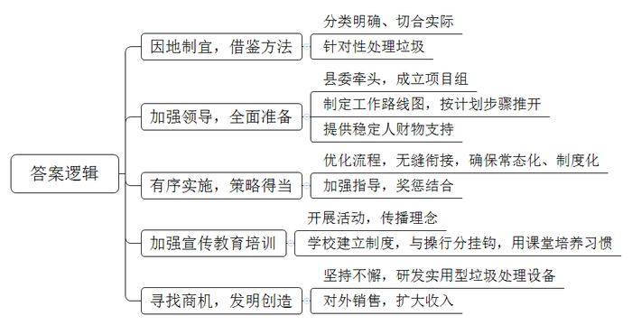
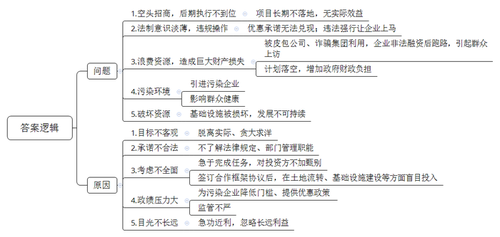
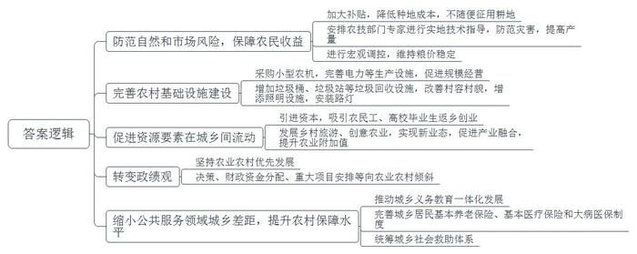
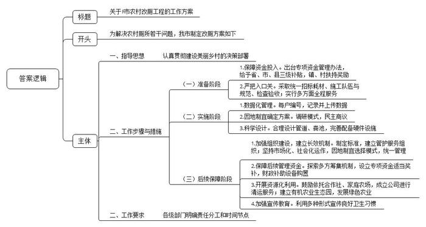

# 2018年公务员多省联考《申论》题（山西乡镇卷）

<!-- gwy:overview:start -->
> **山西 · 2018 · 申论 · 乡镇卷** ｜ 4 题 · 图片 4 处 · 答案随题折叠

导航：[题目](#题目)
<!-- gwy:overview:end -->

> 候选采集稿。参考答案及解析来自粉笔页面，不代表官方答案或真实高分答卷；来源使用许可与原卷对应关系仍需人工核实。

## 给定材料

### 材料 material-2a39efec14d2a8ec

茉莉花香扑鼻而来，村屯道路干净整洁，一派山水田园风光——这是H县石井村的新景象。“这风光来之不易呀。”村支书老李感叹。村头屯尾越来越多的垃圾，曾让他头疼不已。“乡亲们腰包鼓起来了，消费向城里看齐，垃圾也与城里‘接轨’，农药瓶、农膜、塑料袋等‘难消化’的垃圾越来越多。”依山傍水的清秀小村，被垃圾搞得邋里邋遢，一度被县里通报批评。

2017年省里启动美丽乡村建设活动，以此为契机，H县垃圾分类开始从城区走向农村。县城里垃圾分类的经验，被石井村改进成“乡村版”分类法：厨余类垃圾，给沼气池“喂饭”；可燃烧类，由村里统一集中焚烧；可回收类，由保洁员拣出卖废品；危险垃圾如电池、旧灯管等有毒有害类，则集中送垃圾处理中心处理。

乡村垃圾分类，H县打的是有准备之仗。县委牵头成立“高规格”项目实施小组，谋篇布局，制定出工作路线图，有计划、有步骤地推开，不管县委县政府领导班子如何变，对垃圾分类工作的人、财、物支持始终如一。

随后的实施当中，居民分类投放、环卫分类收集、车辆分类运输、终端分类处理，环环相扣、无缝衔接，确保了常态化、制度化。工作中讲求策略，既有“大棒”，也有“胡萝卜”。分不好的，居委会大妈、村干部、分类督查员轮番上阵教；屡教不分的，拒收垃圾；乱丢乱倒的，电视曝光，依规重罚。分得好的，每月会得到洗衣粉、肥皂、牙膏等小奖励。

包括群众环保意识启蒙在内的宣传教育培训及时跟进，通过座谈、宣讲等形式，为“垃圾分类——举手之劳，保护环境”理念造势。“H县所有学校都有垃圾分类制度，并将其与学生的操行分挂钩。同时，还鼓励各学科老师在课堂‘借题发挥’，引导孩子养成垃圾分类的好习惯。”县教育局李副局长说，“全县中小学生8万人，把他们引导好，影响带动的至少是8万个家庭。

从老人到小孩，如今都能遵守分类“规矩”。一开始，收完垃圾要花三四个小时；现在可以直接拉走，一两个小时就能完成。

垃圾分类，也让村里正在读环境保护专业的大学生小张有了用武之地。“农村垃圾越来越多，总要有个去处。”认准这个理，屡败屡战，历经几十次试验，成功研发出实用型生态垃圾焚烧炉，获得国家发明专利及环保专家的肯定。“配上除尘设备，每台价格从10多万到20多万不等。除了我们村在用，还向外卖出了10多台。”小张自豪地介绍。

从无到有、从街道到乡村，垃圾分类已成为H县一张新名片，国内不少城市前来考察取经。环保组织专家考评组实地考察后，也称赞H县为“中国小城市村居垃圾回收利用和环境保护的典范”。

### 材料 material-48c2159c2a883c90

以下是Y县政府门户网站“群众来信”专栏刊登的有关该县招商引资工作的三封来信：

A镇张某：乡村振兴，需要吸引外来的人才、资本、技术“加盟”，为农村发展注入强劲动力。但有的招商引资脱离实际、贪大求洋，导致项目长期落不了地，产生不了实际效益，成为“空头招商”。

我们镇遇上稍有投资意向的企业，便承诺免税、贷款，包办工商、环保、用地等各种手续。可是，真正签订了投资协议，许多手续牵涉到法律规定、部门管理职能等问题，承诺最终要么成了空头支票，要么只能违法强行让企业上马。

为了完成招商引资任务，对投资方不加甄别，往往被皮包公司、诈骗集团利用。前不久，就出现引进的企业非法融资后跑路，引起群众上访事件，损失巨大。

3年前，我们镇与华南的一家投资公司洽谈，合作开发一个乡村旅游项目。签订合作框架协议后，投资方承诺将在3年内投资数千万元。镇政府很重视，抓紧做好土地流转、基础设施建设等工作。可是接下来的几年，投资方却毫无动静，没有投资一分钱，这个项目成了“半拉子工程”。前期投入的数百万元，只能全部由镇里承担。

B乡武某：近几年，沿海发达地区在环境整治过程中，淘汰了一批污染严重的企业。对这些企业，内地一些地方像捡到宝一样，在政绩压力下纷纷伸出橄榄枝。在种种低门槛、优惠政策的引诱下，一个个被沿海地区淘汰的污染企业又在经济不发达的农村冒了出来。

我们乡有一家从某沿海城市招商引资进来的水暖器材厂。人还未到厂子大门口，就闻到一股刺鼻的味道。走进车间一看，这个招商引资进来的水暖器材厂，就是一家牺牲当地老百姓健康的落后项目。

这家水暖器材厂，其实就是把招商地加工好的水龙头、淋浴器等半成品，运到这里进行镀锌，整个车间都弥漫着“大雾”。由于该厂采取的是“计件工资”制度，老百姓又缺乏健康知识，为了图省事、多挣钱，不要说戴防毒面具，有的甚至连口罩都不戴。

这些情况被反映到上级相关部门后，乡里才不得不关闭了这家害民的水暖器材厂。

C镇应某：我们镇有两个偏远山区村同时搞招商引资。一个村招来了石英矿开发项目，业主财大气粗，不到两个月村子里就车来车往，后山上炮声隆隆，好多群众当上矿产工人，一时间挣了些钱。另一个村，一位退伍军人兴办养羊场，一开始经营不是很顺利，第一年投资买了500只羊，当年并没有给当地带来立竿见影的致富效应。

然而3年过后，光景却大不相同。石英矿采完了，业主撤走了，留下满目疮痍的后山和被重型车辆压坏的水泥路，让村里收拾“烂摊子”。而养羊场在退伍军人精心打理和镇村帮助下，规模发展到了4000多只。不仅在村里聘用了20多个村民当“羊倌”，而且帮群众在坡地种上苜蓿。每年按市场价收购苜蓿作青贮饲料，还探索出了入股分红、托养代管、借种收草等多种经营模式，引导该村及周边群众参与到养羊产业中来，带动了乡亲们增收致富。

### 材料 material-92dc528ab265d3f0

党的十九大提出，实施乡村振兴战略，必须始终把解决好“三农”问题作为全党工作重中之重，加快推进农业农村现代化。乡村振兴是一个系统性问题，如何实现乡村振兴？S镇政府组织有关人员召开了一次座谈会，以下是会议发言摘录：

农民A：现在种地，不换个种法不行。对普通农户来说，每亩地的毛收入也就1500元上下，但种子、人工、机械等各项成本就超过1300元。种粮大户收益靠规模，但风险也更高。今年我们市遭遇了自然灾害，对稻米产量影响不小。另外，现在我们市稻米价格每斤1.6元上下，与去年相比，还是降了1角多。农民种粮，要面对自然和市场双重风险，真希望党和政府能给我们撑起更强的保护伞。

农民B：这些年日子好过，得益于党的政策好。拿农机来说，国家给补贴，我们合作社里有51台“大铁牛”，今年秋收，接了周边区县不少收割的活儿。再说科技，我们种有机水稻，每个生产流程都要技术，没有农技部门专家常年在田间指导，肯定干不成。这几年种地规模越来越大，对硬件条件的要求也越来越高。地多了得用大型农机，但我们这里丘陵多，还有不少泥土路，大农机根本进不去。我们发展生态农业，要安装杀虫灯，山里不通电。

农民C：这些年，村里道路越来越宽，房子越盖越好，娱乐活动越来越多。但也不能说完全没有愁事儿，有的村里还没垃圾桶、垃圾站，满地垃圾影响村容村貌。有些偏远的地方，没有路灯，晚上村民不敢出门。现在，不少村里的年轻人都外出打工，以后谁来种地，留在村里的老人娃娃谁来管。

村干部A：作为基层干部，我经常与农民打交道，深知一亩三分地对农民的重要性。农业农村农民问题是“饭碗”问题，是发展问题，更是民生问题。尽管今年我们镇遭受了自然灾害，但在全镇干部群众努力下，小麦总产量还是达到34.73万吨，略高于去年水平。所以，政府不应该随便征用耕地。

村干部B：上面千条线，下面一根针，基层干部就是穿针引线的人，要把党对“三农”的重视切实传递到田间地头。虽说粮食连年丰收，农民生活越来越好，但“三农”问题历史欠账多。就我们镇而言，农业基础设施的短板还要补，农业规模化经营水平不高。

专家A：补齐“三农”发展短板，增强农业农村活力，关键要促进资源要素在城乡间流动。我们镇可以积极引进资本，吸引农民工、高校毕业生返乡创业。大力发展乡村旅游、创意农业，实现“科技＋”“教育＋”“健康＋”等新业态，促进一二三产业融合，提升农业的附加值。

专家B：总体来说，当前农业结构调整有序推进，农业绿色发展大步迈进，农村改革稳步推进，农业农村发展取得了历史性成就。这得益于新世纪以来，中央先后提出了多予少取放活、统筹城乡发展、城乡发展一体化等重大方针，先后采取了取消农业税、实行农业直接补贴、加强农村基础设施建设、建立农村社会保障体系等重大举措。

专家C：实现农业农村优先发展，必须要把“重中之重”落到实处。抓“三农”对做大地方GDP、增加地方财政收入难有明显贡献，导致一些地方不愿意把精力放在“三农”工作上，不愿意把稀缺资源投向农业农村。比如，我们在基层调研时经常发现，尽管农产品储藏、加工项目有利于带动当地农业发展和农民增收，但由于产生的固定资产投资、地区生产总值、税收有限，一些地方不愿意为这类项目安排新增建设用地指标，一些产业园区不愿意引进这类项目。改变这种状况，关键在于转变政绩观。衡量一个地方工作的好坏，要看工业，更要看农业；要看城市，更要看农村；要看经济总量，更要看民生改善。要坚持农业农村优先发展，在领导决策拍板、财政资金分配、重大项目安排时真正做到向农业农村倾斜。

专家D：实现农业农村现代化，也不能平均发力，而应抓重点、补短板、强弱项。经过多年努力，农村公共服务体系实现了从“无”到“有”的历史性转变。目前主要问题在于公共服务领域的城乡差距仍然太大，农村公共服务的保障水平太低。应把从“有”到“好”作为主攻方向，继续推动城乡义务教育一体化发展，完善城乡居民基本养老保险制度，完善统一的城乡居民基本医疗保险制度和大病保险制度，统筹城乡社会救助体系。随着大量农村人口转移进城，部分地方出现了“空心屋”“空心村”，这是现代化进程中的必然现象，也是正常现象。我们要做的，是为乡村聚人气、添活力。

### 材料 material-45f85fc54ffe5f7b

在Z市农村，一般管厕所叫“栏”或“圈”，数尺见方，放块木板或者水泥板就成了方便之处。农民家里养猪，厕所还与猪圈相连，污物直接排入猪圈，也就是连茅圈。夏天如厕，周围全是蝇蚊，咬得浑身是包；冬天如厕，寒风刺骨，让人瑟瑟发抖。“上个厕所浑身味儿，晚上还得带手电。”北坪村党支部石书记抱怨。

这些年，村里为民好事一件一件地干，石书记却年年都有一样的愁：这个位于仙台镇的小山村，有125户人家，村民们大部分以务农为生，“庄稼一枝花，全靠肥当家。这大粪可是庄稼人的宝。”不过，石书记也说，村里多是连茅圈，攒土肥，不仅味儿大，还占地方。“连茅圈都是以前村民自己盖的，根本没有防渗措施，还有可能污染地下水哩。”

“农村土茅房、旱厕和连茅圈，污染空气、地下水，还成为蚊蝇滋生地、病菌传播源。据统计，80%以上的传染病是由厕所污染和饮水不卫生引起的。”Z市农工办调研科汪科长说。

从2014年10月开始，Z市启动农村厕所改造，将其列为建设美丽乡村的重要内容。可是厕所虽小，改造却是大工程，虽然只有几平方米，却牵扯到方方面面。

钱从哪里来，每家每户出多少？这是农民群众非常关心的问题。Z市专门出台农村改厕专项资金管理办法，村民改建一个旱厕可享受省、市、县三级补贴，各镇、村根据财力状况也制定了相应的扶持奖励政策。“改造一间水冲厕所，基本不用农民群众自己花钱。”汪科长说。

“趁着政府包改厕，俺也给厕所来个升级换代。”村民小钱翻新房子时买了瓷砖，贴了地面和内墙，还在厕所装配了淋浴设施，放上了洗衣机，加装了暖气片。“既干净又整洁，跟城里的一个样。”

在改好的厕所外面，都竖着一根白管。“化粪池发酵产生沼气，加根管让它排出，防止爆炸着火等意外发生。”汪科长说。

为保证改造效果，Z市严把改厕入口关，采取“统一招标耗材、统一施工队伍、统一施工规范、统一检查验收”的方式，从物料准备、厕所改造、便器安装等方面实行全程服务。改厕后，每家每户都有编号，这些农户和对应的编号都会记录在册并上网，为以后清淘、修理打下“大数据”基础。

“改厕要因地制宜，我们几乎把全国的改厕模式、厕具都拿来研究了一遍，最后选择了几种符合Z市农村实际的。”汪科长坦言，具体到每个村的情况还不一样，村里就召集村民开大会，商量村里具体采用哪种方式。

在双林镇辛庄村，每五户就有一个小型生物一体化处理设备。“粪便污水经过化粪池沉淀过滤，通过管道流入这个设备。”村民委员会李主任说，经过处理后，排放出来的水可以作为绿化用水，“村集体收入比较多，我们就改得更彻底、更环保一些。”

“在我们农村，厕所大部分都在室外，冬天易结冰，便盆到化粪池的管道就得由弯取直，防止结冰。”汪科长说，但是取直后容易反味，所以就在管道中间加了一个皮阀，冲水的时候随水流冲击力方向打开，水流完就自动关闭。

化粪池总有满的时候，大约多久淘一次呢？“配置1.5立方米大小的三格化粪池，差不多一年到一年半淘一次。”西江镇负责改厕的任副镇长说。三格化粪池，三格由连通管相连，第一格起到截留粪渣、沉淀虫卵和使粪液分层的作用，第二格继续发酵，经第三格贮存发酵后，病菌和寄生虫卵基本被杀灭。

在任副镇长看来，农村改厕向洁净乡村建设迈出一大步，但更重要的是像淘粪这一系列的后续管护该怎样运营。

为了建立农村无害化卫生厕所后续管护长效机制，Z市以“十有”为标准，全面建立“有场所、有牌子、有车辆、有人员、有电话、有制度、有经费、有配件专柜、有活动记录、有粪液利用”的改厕管护服务组织，并坚持市场化、社会化运作，因地制宜选择管护模式，对改造后的厕所进行统一管理，定期统一收集、统一运输、统一无害化处理和资源化利用。

在后续管理资金保障方面，Z市按照政府补助引导、集体和社会资助、群众自筹相结合的原则，探索多方筹集机制。对长效管护运作较好的地方，安排专项资金给予适当奖补。对改厕后续管护组织购置设备，各级财政给予适当补助。市级财政还出资在49个乡镇建立农厕管护服务组织。各区县都建立了适合当地发展实际的管护组织。

为防止粪液粪渣随意倾倒造成二次环境污染，更好地开展资源化利用，Z市鼓励依托合作社或家庭农场注册成立清运公司进行改厕管护清运服务。“我们村子也成立了清运公司。”石书记说，“村里正在发展好几百亩的有机农业生态园，这粪液粪渣正好当有机肥使。”

“改厕后，整个村子不见粪水，蚊蝇少了，各家各户也干净了不少。”汪科长说。不过，这多年来形成的如厕习惯也不是一时半会儿能改掉的。一些旱厕虽改成水冲式厕所，但还有农民群众如厕后没有冲水习惯，有的如厕后厕纸随手扔，有的不能定期洗刷等。为此，Z市利用广播、电视、报刊、标语等多种形式，促进用上干净厕所的农民养成讲卫生的好习惯。

截至2017年10月底，Z市2500个应改村的37万农户，全部完成改厕任务并顺利通过省级验收，比上级的要求提前一年半实现农村无害化卫生厕所全覆盖。

## 题目

### 第 1 题

**根据给定资料**1**，总结H县乡村垃圾分类工作的成功经验。（20分）**

关联材料：材料 material-2a39efec14d2a8ec、材料 material-48c2159c2a883c90、材料 material-92dc528ab265d3f0、材料 material-45f85fc54ffe5f7b

作答要求：

要求：内容全面，准确简明，条理清晰，不超过200字。

第 1 题 · 答案与解析

**参考答案（粉笔题库参考内容）**

1.因地制宜，借鉴方法。分类明确、切合实际；针对性处理垃圾。

2.加强领导，全面准备。县委牵头，成立项目组；制定工作路线图，按计划步骤推开；提供稳定人财物支持。

3.有序实施，策略得当。优化流程，无缝衔接，确保常态化、制度化；加强指导，奖惩结合。

4.加强宣传教育培训。开展活动，传播理念；学校建立制度，与操行分挂钩，用课堂培养习惯。

5.寻找商机，发明创造。坚持不懈，研发实用型垃圾处理设备；对外销售，扩大收入。

**解析**

**参考答案说明：**本参考答案从“因地制宜，借鉴方法”“加强领导，全面准备”“有序实施，策略得当”“加强宣传教育培训”“寻找商机，发明创造”等五个方面展开，各条答案要点之间在内容上相互并列，没有交叉。

**考点**：考点经验启示类

**来源**：来源2018年公务员多省联考《申论》题（山西乡镇卷）

粉笔申论页面对本题只提供「解析视频」入口，该入口是会员推广位，页面无视频地址与文字解析。

### 第 2 题

**根据给定资料**2**，请你指出Y县在乡镇招商引资工作中存在的问题并分析其原因。（2****5****分）**

关联材料：材料 material-2a39efec14d2a8ec、材料 material-48c2159c2a883c90、材料 material-92dc528ab265d3f0、材料 material-45f85fc54ffe5f7b

作答要求：

要求：全面准确，语言简明，条理清晰，分析透彻，不超过350字。

第 2 题 · 答案与解析

**参考答案（粉笔题库参考内容）**

一、问题：1.空头招商，后期执行不到位。项目长期不落地，无实际效益。2.法制意识淡薄，违规操作。优惠承诺无法兑现；违法强行让企业上马。3.浪费资源，造成巨大财产损失。被皮包公司、诈骗集团利用，企业非法融资后跑路，引起群众上访；计划落空，增加政府财政负担。4.污染环境。引进污染企业；影响群众健康。5.破坏资源。基础设施被损坏，发展不可持续。

二、原因：1.目标不客观。脱离实际、贪大求洋。2.承诺不合法。不了解法律规定、部门管理职能。3.考虑不全面。急于完成任务，对投资方不加甄别；签订合作框架协议后，在土地流转、基础设施建设等方面盲目投入。4.政绩压力大。为污染企业降低门槛、提供优惠政策；监管不严。5.目光不长远。急功近利，忽略长远利益。

**解析**

**参考答案说明：**本参考答案宏观上分成了“问题”和“原因”两个要素。其中，在“问题”要素内部，从“空头招商，后期执行不到位”“法制意识淡薄，违规操作”“浪费资源，造成巨大财产损失”“污染环境”“破坏资源”等5个方面进行了分条撰写。在“原因”要素内部，又从“目标不客观”“承诺不合法”“考虑不全面”“政绩压力大”“目光不长远”等5个方面进行了分条撰写。各条要点在内容上是并列的，没有交叉关系。

**考点**：考点多要素组合类

**来源**：来源2018年公务员多省联考《申论》题（山西乡镇卷）

粉笔申论页面对本题只提供「解析视频」入口，该入口是会员推广位，页面无视频地址与文字解析。

### 第 3 题

**根据给定资料**3**，假设你是S镇政府负责人，就座谈会上农民、村干部反映的问题提出对策。（25分）**

关联材料：材料 material-2a39efec14d2a8ec、材料 material-48c2159c2a883c90、材料 material-92dc528ab265d3f0、材料 material-45f85fc54ffe5f7b

作答要求：

要求：条理清晰，切实可行，针对性强，不超过400字。

第 3 题 · 答案与解析

**参考答案（粉笔题库参考内容）**

1.防范自然和市场风险，保障农民收益。加大补贴，降低种地成本，不随便征用耕地；安排农技部门专家进行实地技术指导，防范灾害，提高产量；进行宏观调控，维持粮价稳定。

2.完善农村基础设施建设。采购小型农机，完善电力等生产设施，促进规模经营；增加垃圾桶、垃圾站等垃圾回收设施，改善村容村貌，增添照明设施，安装路灯。

3.促进资源要素在城乡间流动。引进资本，吸引农民工、高校毕业生返乡创业；发展乡村旅游、创意农业，实现新业态，促进产业融合，提升农业附加值。

4.转变政绩观。坚持农业农村优先发展；决策、财政资金分配、重大项目安排等向农业农村倾斜。

5.缩小公共服务领域城乡差距，提升农村保障水平。推动城乡义务教育一体化发展；完善城乡居民基本养老保险、基本医疗保险和大病医保制度；统筹城乡社会救助体系。

**解析**

**参考答案****说明**：本参考答案从“防范自然和市场风险，保障农民收益”“完善农村基础设施建设”“促进资源要素在城乡间流动”“转变政绩观”“缩小公共服务领域城乡差距，提升农村保障水平”五个方面进行了分条撰写，各条要点在内容上是并列没有交叉的。

**考点**：考点提出对策类

**来源**：来源2018年公务员多省联考《申论》题（山西乡镇卷）

粉笔申论页面对本题只提供「解析视频」入口，该入口是会员推广位，页面无视频地址与文字解析。

### 第 4 题

**给定资料**4**叙述了Z市农村改厕的情况。相邻的F市也将启动农村改厕工程，假设你是F市政府工作人员，请借鉴Z市做法，草拟本市农村改厕工程的工作方案。（30分）**

关联材料：材料 material-2a39efec14d2a8ec、材料 material-48c2159c2a883c90、材料 material-92dc528ab265d3f0、材料 material-45f85fc54ffe5f7b

作答要求：

要求：内容翔实，条理清晰，结构完整，可操作性强，不超过500字。

第 4 题 · 答案与解析

**参考答案（粉笔题库参考内容）**

关于F市农村改厕工程的工作方案

为解决农村厕所若干问题，我市制定改厕方案如下：

一、指导思想：认真贯彻建设美丽乡村的决策部署。

二、工作步骤与措施

（一）准备阶段：1.保障资金投入。出台专项资金管理办法，给予省、市、县三级补贴，镇、村扶持奖励。2.严把入口关。采取统一招标耗材、施工队伍与规范、检查验收；实行多方面全程服务。

（二）实施阶段：1.数据化管理。每户编号，记录并上传数据。2.因地制宜确定方案。调研模式，民主商议。3.科学设计。合理设计管道、粪池，完善配备硬件设施。

（三）后续保障阶段：1.加强组织建设，建立长效机制。制定标准，建立管护服务组织；坚持市场化、社会化运作，因地制宜选择模式，统一管理。2.保障后续管理资金。探索多方筹集机制，设立专项资金适当奖补，财政补助设备购置。3.开展资源化利用。鼓励依托合作社、家庭农场，成立公司进行清运服务；建立有机农业生态园，发展绿色农业。4.加强宣传教育。利用多种形式宣传良好卫生习惯。

三、工作要求：各级部门明确责任分工和时间节点。

**解析**

**参考答案说明：**（1）格式方面，本参考答案写到了“标题”。（2）正文部分，一方面从内容来看，围绕着“F市农村改厕”这一主题，开头先写到了“改厕的背景”；主体部分从“指导思想”“工作步骤与措施”“工作要求”三个方面展开。另一方面，形式上，本参考答案做到了分段、分条撰写，整体上条理较为清晰。

**考点**：考点方案类

**来源**：来源2018年公务员多省联考《申论》题（山西乡镇卷）

