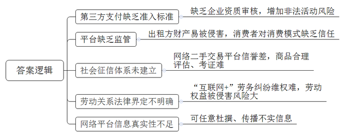
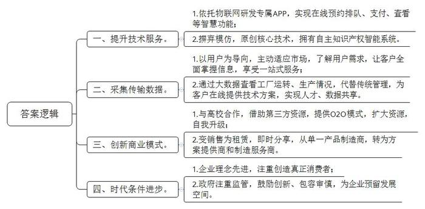
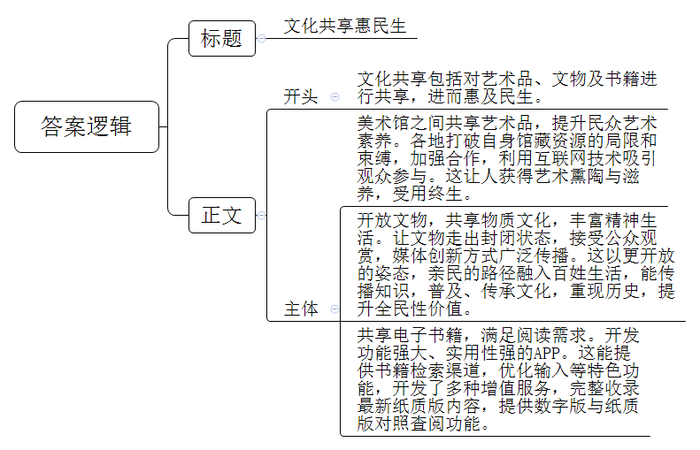

# 2018年公务员多省联考《申论》题（山西县级卷）

<!-- gwy:overview:start -->
> **山西 · 2018 · 申论 · 县级卷** ｜ 4 题 · 图片 4 处 · 答案随题折叠

导航：[题目](#题目) · [材料 1](#材料-1)
<!-- gwy:overview:end -->

> 候选采集稿。参考答案及解析来自粉笔页面，不代表官方答案或真实高分答卷；来源使用许可与原卷对应关系仍需人工核实。

## 给定材料

### 材料 1

中国消费者是全球最倾心于移动支付系统的。调查显示，2016年，中国移动支付的金额是美国的50倍以上。预计未来五年，中国市场以互联网为依托的新经济年均增长速度将在40%左右，到2020年，其规模占GDP的比重将达到10%以上。美国媒体称，互联网时代协同消费模式在中国比在其他任何地方看起来都拥有更加光明的未来。在这种新经济模式中，网络平台公司通过互联网重新整合社会闲散资源和富余劳动力，然后再按需精准配置，实现物尽其用。

不过，应更方便、更优惠的互联网协同消费经济有时会让人陷入麻烦。市民谢女士在一台ATM机旁看到了“使用手机扫描二维码，免费赢取百万大奖”的一条广告，下面还附有一张二维码。谢女士顺手扫描了一下，并按照提示下载了一款APP。但让她万万没有想到的是，没过几天，与手机绑定的信用卡就被盗刷了。事实上，第三方支付的兴起，尤其是网络支付，给用户带来极大便利的同时，增加了洗钱、套现、赌博、欺诈等非法活动的风险。一位业内人士说，只有在企业资质上设闸，才能有效杜绝这些不良现象。是否给第三方支付企业一个名分，给一个什么样的名分，成为了争论的焦点。幸运的是，争论归争论，有关部门没有一禁了之。

美国某租赁房屋公司曾发生一起恶性事故。一名房东发现她的公寓被从该公司网站上招来的房客洗劫一空。她在给该公司的信上写道：“他们在我的柜子上凿了个洞，劫走了里面的护照、现金、信用卡和我奶奶的珠宝首饰，不仅如此，他们又搜走了我的照相机、老式电脑和装有我所有相片、日志等备份的外接硬盘。他们掠走了我的一切。”这大概是所有人对互联网时代协同消费经济模式的顾虑了。某调查公司针对美国用户对这一经济模式的调研数据显示，参与其中的人群中，57%的人表示，“对这种消费模式感兴趣，但是仍有顾虑”，而在熟悉这种经济模式的人群中，69%的人认为，“除非信任的人推荐，否则将不会相信”。

本应更方便、更优惠的互联网协同消费经济，有时还会让人陷入更大的麻烦。随着家庭用品加速升级换代，如何让闲置物品流转起来，使旧物出售和消费变成“动动手指就能办成的事”，成为商家瞄准的一片蓝海。不过，由于买卖无需“打照面”，交钱与交货环节分离等原因，网络二手交易平台的信誉难尽人意，“省时省力不省心”，是不少人的共同印象。与一般商品不同，非标准化是二手商品的最大特点，其损耗程度、保养情况等很难得到最合理的评估、考证。如何让踏实放心取代买卖双方的彼此猜忌，除了考验平台的服务智慧、相关部门的治理决心，还有赖于社会征信体系的建立。

由于制度建设的相对滞后，如何解决经济活动过程中产生的纠纷，也让人颇费思量。租车、私厨、保洁……“互联网+”催生了很多以APP为平台的服务业务，通过APP和客户建立联系并提供服务，是否就算是和APP的运营公司建立了劳动关系？邓先生、孙先生等7名厨师，通过某公司APP平台成为上门掌勺的“私厨”。日前，他们向法院起诉要求确认自己和该公司存在劳动关系，要求支付双倍工资、休息加班费等酬劳。该公司认为，根据双方签订的商务合作协议，孙先生等通过其旗下的APP平台，依照客户需求接单提供服务，是否接单和工作时间的选定均由孙先生等人自行掌握，他们不接受公司管理，因此双方不存在劳动关系。有法律界人士认为，“互联网+”劳务是近年来兴起的劳务形式，网络服务平台运营方与加入平台的劳动者之间是否构成劳动关系是一个尚有争议的法律问题。这就造成劳动权益被侵害的风险加大。

某些网站只需付费即可杜撰、发布不实词条，让人对这场新经济的盛宴又多添了几分忧虑。有网友打趣，互联网平台在实现“与世界分享你的知识、经验和见解”的同时，也在分享着以假乱真的故事。一方面，这一创新模式让人们遨游于知识的汪洋；另一方面，利益架构起来的知识岛屿往往会误导人们求知的航向。

### 材料 2

近日，国内知名洗衣机品牌H的校园洗衣房正式入驻R市大学城。18台物联网自助洗衣设备开始投入使用，为大学生提供自助洗衣服务。互联网的风起云涌，不仅从根本上颠覆了许多传统行业，同时也创造了新的行业和机遇。与过去的自助投币式洗衣机不同，大学生只要扫描下载该品牌洗衣APP，就可以随时随地实现在线预约排队、在线支付及在线状态查看等智慧功能。

由于有着对中国当代大学生的长期观察和了解，该品牌依托物联网打造出这一创新模式。供求双方通过互联网发布自己可供分享或需求的物品，不仅能为特定的供给者或需求者提供可选择的交易对象，还有助于掌握交易对象更多的信息。当这种自助洗衣设备一入驻R市大学城，就受到了大学生们的喜爱。课间查看空余机位，一键下单，然后手机支付，该品牌洗衣逐渐成为大学生校园生活中的一部分。该校一名学生告诉记者：“自从学校有了这种自助洗衣设备，之前排队洗衣的时间可以用在逛书店和学习上了。现在我们宿舍的六个室友，每人都装了洗衣APP，给我们带来了很多便利。”

其实，这样的场景每天都在全国二百多个城市六百多所高校上演。有数据统计，该品牌洗衣APP注册用户数达541万，且日增新用户7000余人。事实上，从上世纪90年代起，该品牌洗衣机就以更好服务用户为导向，主动适应市场，在学校中设立投币式自助洗衣设备，让学校成为其洗衣服务的“重要阵地”。如今，在行业还停留在探索如何刷卡投币解决大学生洗衣排队难题时，该品牌又开始以物联网的理念运作自助洗衣。在校学生足不出户便可享受到智能预约洗衣、手机下单在线支付、完成提醒功能等一站式贴心服务，彻底解决了大学生的“洗衣难”问题。此外，通过与全国六百多所高校合作，借助第三方资源入驻，该品牌洗衣APP还为大学生提供O2O模式下的校园社交、学生生活、投资机构和商家对接等全方位服务，在资源扩大的同时实现自我升级。

### 材料 3

S机床厂是另一家有历史的国产品牌。该公司董事长在接受采访中表示，他在机床行业工作近30年。通过这些年的冷静思考，总结了四句话：“第一，我们的员工不满意。任何员工都希望工资越来越高，我们拿什么来给他们发工资？第二，我们的用户不满意。很多装备都是进口的，而且一些顶尖的机床，国外根本就不卖给我们。第三，我们的领导不满意，说你们什么时候才能赶超日、美、德呢？第四，我自己也不满意。回顾过去，基本啥也没干。”这些“不满意”促使他决定开启一场“冒险”。新经济时代中的理念是创造真正的消费者，而不仅仅是通过补贴来吸引消费者。同时，面对新经济的商业模式、经营方式等与传统产业的不同，政府把更多精力转向监管，本着鼓励创新、包容审慎的原则，积极鼓励相关企业采取科学的商业模式，为经济发展和转型留出了空间。

2007年，S机床厂彻底摒弃模仿和跟随的道路，该厂科技部的一帮年轻人从源代码开始写起，用了6年时间，原创了多项数控核心技术，诞生了拥有自主知识产权的“智能5代系统”。该系统具有一个很重要的特性：在运行的过程中可以实时采集和传输数据。有了这些数据，客户在手机上就能通过S机床厂的大数据系统实时查看自己工厂的运转情况、机台的生产情况，从而替代了传统的管理；由于掌握了这些最真实的数据，S机床厂又能通过互联网，为客户在线提供技术解决方案，实现人才共享。数据的“共享”，还为S机床厂开启了一条与众不同的商业模式——不再是传统的机床买卖、加价销售、赚取利润，而是以“零首付”租赁给客户，按小时或者按加工量收费，并依据机床运转传输回来的数据进行结算。通过赢取用户对企业和产品的信任，让机床的销售由单纯买卖，走向了即时分享。S机床厂已经从过去单纯的产品制造商，转身成为系统解决方案提供商和工业制造服务商。

### 材料 4

2012年开始，文化部年年组织推出“全国美术馆馆藏精品展出季”活动。除以国家重点美术馆为代表的一些大型综合类美术馆每年都推出重磅展览之外，还有一些地市级甚至县级的基层美术馆也积极参与其中。参与的美术馆多了，藏在深闺的作品露脸频繁了，公共教育与推广的手段也丰富了。各美术馆打破自身馆藏资源局限和束缚，加强合作，惠民措施层出不穷。像D省美术馆的“水印年华——省美术馆馆藏版画作品精选”巡展至西部多个省，某著名画家私人艺术馆的“艺术回顾展”巡展至公立美术馆，都吸引了大量观众；C省美术馆将展出的所有馆藏精品用微信平台展现，方便观众查阅、分享和收藏，吸引了3500余名观众参与。5年多来，“全国美术馆馆藏精品展出季”共推出展览150余个，展出藏品近18000件（套），观众总量约800万人次。观众A女士带着孩子看完之后，很是感慨：“孩子们也好，成人也好，若有幸接受众多传承有序、具有极高历史和文化价值的艺术精品的熏陶，获得滋养，一定是受用终生。”

“观众想细看养心殿的文物，不用再趴窗户了。”据媒体报道，从2016年9月28日到次年2月，深藏于故宫博物院养心殿的268件文物“移驾”首都博物馆，接受公众的检阅，这也是养心殿文物首次“出宫”。大批珍贵文物走出故宫，不仅仅是博物馆系统内部的一次完美合作，而且有着更为深广的意义，即文物不再一味地深“藏”不露，矜持内敛。2018年，中央电视台推出大型纪录片《国家宝藏》，首次通过明星演绎文物历史的形式，向观众介绍与讲述了六大博物馆镇馆之宝的专业文物知识，重现了历史。同时，也以越来越开放的姿态，越来越亲民的路径，使文物精品融入老百姓的生活，实现文化传承。如今飞入寻常百姓家的王谢堂前燕，可谓比比皆是。无论是展示时间，还是展览手段，均创下了纪录。如“追剧”一样，公众也在密切关注着海昏侯墓的考古挖掘。正如一位学者所言，一个一流的博物馆并不在于藏品有多么丰富，而在于人们要有机会看到这个馆里大量珍贵的藏品，并将博物馆文化融入自己的生活中去。文物就应该走出封闭状态，接受公众的观赏，让民众共享。这样的努力，既是一种文化普及，也是一次全民性的价值提升。

商务印书馆的《新华字典》APP日前正式上线。据了解，这款APP提供了单字、词语、汉语拼音、部首、笔画数、四角号码等检索渠道，并且支持手写、摄像头取字和语音输入等功能，全面满足了用户查字、输字需求。它还具有两大特色功能：一是提供了动态和静态两种标准笔顺，并支持屏幕跟写，用户可识别、掌握3500个基础汉字的笔画；二是由专业播音员对1万余个汉字进行播读，用户也可以点击“朗读”键测试自己普通话的准确性。此外，该APP还开发了生字本、知识问答、汉字游戏等增值服务，并完整收录《新华字典》最新纸质版全部内容，提供数字版与纸质版对照查阅功能。

### 材料 5

老张是一位瓜农，年收成一万多斤瓜。每到丰收的日子，他总是喜忧参半。2016年夏天一个早晨，他开着四轮拖拉机赶往城里叫卖。老张本想去政府指定的X小区里卖，可没想到刚走到城里，遇到一女子要买瓜，于是就停下车卖了一个，结果电子台秤就被巡逻的执法人员收走了。老张沮丧地来到X街道办服务大厅，交了罚款，拿回被收缴的电子台秤。事后，老张说，他也知道自己错了，不该在路边卖瓜影响城市环境，但罚款太高，一天辛苦都白费了。更糟糕的是，为了拿回电子台秤，他奔忙了一上午，西瓜都蔫了。

2017年10月起，老张就不必为此担忧、沮丧了。国务院新颁布的《无证无照经营查处办法》规定，在县级以上地方人民政府指定的场所和时间，销售农副产品、日常生活用品，或者个人利用自己的技能从事依法无须取得许可的便民劳务活动不属于无证无照经营，同时取消了“没收工具”等规定，降低了罚款数额。

<u>何时做加法，何时做减法，是一门公共管理的艺术，需要智慧，需要眼光，需要技巧，更需要视野。</u>加法和减法，不一样的切入角度，体现不一样的心态和思维逻辑，直接决定了最终的成败。自从党的十八大以来，国务院各部门取消或下放行政审批事项六百多项；取消中央指定地方实施行政审批事项近三百项。“简政放权、放管结合、优化服务”改革得到了有效落实。同时，新经济模式下一系列商业活动完全有别于过往的经济行为，其势必会对现行制度和秩序造成冲击。如何建立新的监管规则体系，在新的规则出台之前，如何运用相关的法理，借鉴现行的法律法规，以引导市场建立内部自律监督机制，维护市场的正常秩序，加强政府的监督与引导显得尤为重要。

## 题目

### 第 1 题

**根据给定资料1，概括当前互联网协同消费经济运行过程中存在的问题。（15分）**

关联材料：材料 1

作答要求：

要求：全面准确，条理清晰，不超过200字。

第 1 题 · 答案与解析

**参考答案（粉笔题库参考内容）**

一、第三方支付缺乏准入标准。缺乏企业资质审核，增加非法活动风险。

二、平台缺乏监管。出租方财产易被侵害，消费者对消费模式缺乏信任。

三、社会征信体系未建立。网络二手交易平台信誉差，商品合理评估、考证难。

四、劳动关系法律界定不明确。“互联网+”劳务纠纷维权难，劳动权益被侵害风险大。

五、网络平台信息真实性不足。可任意杜撰、传播不实信息。

**解析**

**参考答案说明：**本参考答案从“第三方支付”“平台监管”“社会征信体系”“互联网劳务关系”“网络平台信息”这五个方面展开，各条答案要点之间在内容上相互并列，没有交叉。

**考点**：问题类

**来源**：2018年公务员多省联考《申论》题（山西县级卷）

### 第 2 题

**根据给定资料2\-3，分析H企业与S企业发展成功的原因。（20分）**

关联材料：材料 2、材料 3

作答要求：

要求：紧扣资料，分析透彻，表达准确，不超过300字。

第 2 题 · 答案与解析

**参考答案（粉笔题库参考内容）**

一、提升技术服务。1.依托物联网研发专属APP，实现在线预约排队、支付、查看等智慧功能；2.摒弃模仿，原创核心技术，拥有自主知识产权智能系统。

二、采集传输数据。1.以用户为导向，主动适应市场，了解用户需求，让客户全面掌握信息，享受一站式服务；2.通过大数据查看工厂运转、生产情况，代替传统管理，为客户在线提供技术方案，实现人才、数据共享。

三、创新商业模式。1.与高校合作，借助第三方资源，提供O2O模式，扩大资源，自我升级；2.变销售为租赁，即时分享，从单一产品制造商，转为方案提供商和制造服务商。

四、时代条件进步。1.企业理念先进，注重创造真正消费者；2.政府注重监管，鼓励创新、包容审慎，为企业预留发展空间。

**解析**

**参考答案说明：**本答案从“提升技术服务”“采集传输数据”“创新商业模式”“时代条件进步”等不同方面进行了分条撰写。各条要点之间在内容上相互并列，没有交叉。

**考点**：原因类

**来源**：2018年公务员多省联考《申论》题（山西县级卷）

### 第 3 题

**假设你是某文化报的记者，请根据给定资料4，以“文化共享惠民生”为题目，写一篇短评。（25分）**

关联材料：材料 4

作答要求：

要求：

（1）紧扣主题，内容具体；

（2）逻辑清晰，语言流畅；

（3）不超过400字。

第 3 题 · 答案与解析

**参考答案（粉笔题库参考内容）**

文化共享惠民生

文化共享包括对艺术品、文物及书籍进行共享，进而惠及民生。

美术馆之间共享艺术品，提升民众艺术素养。各地打破自身馆藏资源的局限和束缚，加强合作，利用互联网技术吸引观众参与。这让人获得艺术熏陶与滋养，受用终生。

开放文物，共享物质文化，丰富精神生活。让文物走出封闭状态，接受公众观赏，媒体创新方式广泛传播。这以更开放的姿态，亲民的路径融入百姓生活，能传播知识，普及、传承文化，重现历史，提升全民性价值。

共享电子书籍，满足阅读需求。开发功能强大、实用性强的APP。这能提供书籍检索渠道，优化输入等特色功能，开发了多种增值服务，完整收录最新纸质版内容，提供数字版与纸质版对照查阅功能。

**解析**

**参考答案说明：**（1）格式方面，本参考答案写到了“标题”。（2）正文部分，一方面从内容来看，围绕着“文化共享”这一主题，本参考答案的开头先概括了“文化共享”的范围，并阐明了观点；主体部分从“艺术品”“文物”“书籍”等几个方面指出了“文化共享”的对策及意义。另一方面，形式上，本参考答案做到了分段、分条撰写，整体上条理较为清晰。（3）本参考答案能够结合题目中的“语言流畅”这一要求，在语言表达上做到了简洁、流畅。

**考点**：评论类

**来源**：2018年公务员多省联考《申论》题（山西县级卷）

### 第 4 题

**根据你对给定资料5中划线部分“何时做加法，何时做减法，是一门公共管理的艺术，需要智慧，需要眼光，需要技巧，更需要视野”的理解，结合给定资料，自拟题目，写一篇议论文。（40分）**

关联材料：材料 1、材料 2、材料 3、材料 4、材料 5

作答要求：

要求：

（1）自选角度，见解深刻；

（2）内容全面，结构完整；

（3）思路清晰，语言流畅；

（4）总字数1000字左右。

第 4 题 · 答案与解析

**参考答案（粉笔题库参考内容）**

**做好公共管理加减法**

公共管理是一门艺术，体现行政部门的眼光与智慧，责任与担当。提升公共管理能力，对于转变政府职能、创新管理方式、促进经济发展等都意义重大。因此，党的十八大以来，面对复杂多变的社会事物，我国政府怀抱开放的心态和辩证的思维逻辑，致力于平衡公共管理中的“加法”与“减法”，全面推进“简政放权、放管结合、优化服务”改革，翻开了社会公共管理的新篇章。

**政府要做好公共管理的“减法”，就要落实简政放权，缩减行政审批事项，减少对经营行为的不合理约束。**过去，政府审批事项过多，种种限制也多有不合理之处，影响了市场主体的积极性。比如农民销售自家的农产品，可能会因没有经营执照而被没收工具，甚至缴纳高额罚款。这就需要落实中央“简政放权”的方针，把政府不该管的事交给市场。但是，简政放权的目标还没有完全实现，今后还要继续推进“负面清单”的制定和公开工作，并将其写入法律制度，尤其要注意进一步减少对于微观事务的管理，从而减少对市场主体一些不必要、不合理的约束。这也是清权、减权的过程。清单越合理、越清晰，改革效果就越大。

当然，“简政放权”并不意味着政府责任的减少。政府还要做好公共管理的“加法”，应对新时代、新事物。

**政府要做好公共管理的“加法”，就要对新型经济模式加强监管，鼓励企业创新。**当前，如互联网产业等新事物、新模式、新产业等层出不穷，它们不但是我国经济的希望所在，也为群众的生活带来了诸多便利。但这些新经济在发展模式、机制和特点等方面与传统经济有很大不同，政府过去的经验不一定能适用。套用老办法，可能将很多新事物扼杀，既制约创新活力，也对创新创业者不公平，甚至可能会引发新风险。所以，政府必须要通过审慎全面的监管，去芜存菁，推动新经济健康发展。同时，政府还应本着鼓励创新、包容审慎的原则，鼓励企业利用新技术、创造新模式。共享单车、共享汽车等企业，就正是在政府的监管和鼓励下一步一步发展壮大，有了今天的规模。

**政府要做好公共管理的“加法”，还要优化公共服务，创新服务方式，实现公共服务普惠化。**无论是政府推动简政放权，还是完善监管体系，其最终的落脚点都是为了优化公共服务，最终实现服务群众。但随着社会发展，人民群众对公共服务也提出了更多样化、更高质量的要求，这就需要政府充分利用现代技术，让服务方式更加现代化、多元化。比如现在几乎所有社会企业，都开通了移动支付功能，便利消费者，但很多国营企业或景点仍未能开通，这就是政府应该努力的方向。另外，像文化、医疗、养老等公共服务，关系到千家万户，政府还应该进一步普及公共服务，让更多群众能享受到政府福利，提升生活幸福感。

在新时代，只要掌握好公共管理的艺术，做好公共管理的加减法，我们的社会就必然会在这种平衡中稳步发展，群众的生活质量也必然会节节攀升。

**文章分析**

**做好公共管理加减法**

【**标题的优点：**首先，范文的标题“做好公共管理加减法”突出了“公共管理的加减法”这一主题。其次，形式上，文字简洁明快。】

（1）<u>公共管理是一门艺术</u>，<u>体现行政部门的眼光与智慧</u>，<u>责任与担当</u>。（2）<u>提升公共管理能力</u>，<u>对于转变政府职能、创新管理方式、促进经济发展等都意义重大</u>。因此，（3）党的十八大以来，<u>面对复杂多变的社会事物</u>，<u>我国政府怀抱开放的心态和辩证的思维逻辑</u>，<u>致力于平衡公共管理中的“加法”与“减法”</u>，<u>全面推进“简政放权、放管结合、优化服务”改革</u>，翻开了社会公共管理的新篇章。

【**开头的优点：**★内容方面。范文的开头是紧扣题目给定的“何时做加法，何时做减法，是一门公共管理的艺术，需要智慧，需要眼光，需要技巧，更需要视野”这句话展开的。首先，**开头点出主题，做到了主题明确。其次，对“**公共管理的加减法**”这一主题进行了分析阐述：（1）先指出了“公共管理”的含义。（2）接着指出了“提高公共管理能力”的意义。（3）最后指出了“做好公共管理加减法”的对策。**★文字表达方面：使用了“因此”“从而”等关联词，使语言表达有逻辑性；长短句配合使用，使语言表达有节奏感。】

**政府要做好公共管理的“减法”，就要落实简政放权，缩减行政审批事项，减少对经营行为的不合理约束。**（1）过去，政府<u>审批事项过多</u>，种种<u>限制也多有不合理之处</u>，<u>影响了市场主体的积极性</u>。比如农民销售自家的农产品，可能会因没有经营执照而被没收工具，甚至缴纳高额罚款。这就需要落实中央“简政放权”的方针，把政府不该管的事交给市场。但是，（2）简政放权的目标还没有完全实现，今后还要<u>继续推进“负面清单”的制定和公开工作</u>，并将其<u>写入法律制度</u>，尤其要注意进一步<u>减少对于微观事务的管理</u>，从而<u>减少对市场主体一些不必要、不合理的约束</u>。这也是<u>清权、减权的过程</u>。（3）清单越合理、越清晰，<u>改革效果</u>就越大。

【**论述段1的优点：**★观点句：范文的观点句是紧扣“公共管理的加减法”这一文章主题提出的。形式上，它在段首处直接写出，位置突出，容易发现。内容上，关键词突出，内容要点明确，可以明显看出它是从“简政放权”入手，指出了“政府公共管理中的‘减法’”。★论述内容：（1）先介绍了“过去政府行政管理存在的问题”；（2）接着介绍了“贯彻落实简政放权的具体措施”；（3）最后介绍了“简政放权的意义”。注意：以上三个方面的内容都是紧扣“政府要做好公共管理的‘减法’，就要落实简政放权，缩减行政审批事项，减少对经营行为的不合理约束”这个观点句进行分析论述的，论述的针对性强，内容层次丰富。在论述方法和论据的选取上做到了讲道理、举例子相结合，做到了丰富多样。】

当然，“简政放权”并不意味着政府责任的减少。政府还要做好公共管理的“加法”，应对新时代、新事物。

【**过渡段的优点：**范文过渡段分析了“公共管理的加减法”不仅要“减”，还要“加”。此外，还要注意过渡段末尾的“政府还要做好公共管理的‘加法’，应对新时代、新事物”是用来引起下文的过渡句。】

**政府要做好公共管理的“加法”，就要对新型经济模式加强监管，鼓励企业创新。**（1）当前，如<u>互联网产业等新事物、新模式、新产业等层出不穷</u>，它们不但是<u>我国经济的希望所在</u>，也<u>为群众的生活带来了诸多便利</u>。（2）但这些新经济在发展模式、机制和特点等方面与传统经济有很大不同，政府过去的经验不一定能适用。<u>套用老办法</u>，可能将很多<u>新事物扼杀</u>，既<u>制约创新活力</u>，也<u>对创新创业者不公平</u>，甚至可能会<u>引发新风险</u>。所以，（3）政府必须要通过<u>审慎全面的监管</u>，<u>去芜存菁</u>，推动<u>新经济健康发展</u>。同时，政府还应本着鼓励创新、包容审慎的原则，<u>鼓励企业利用新技术、创造新模式</u>。共享单车、共享汽车等企业，就正是在政府的监管和鼓励下一步一步发展壮大，有了今天的规模。

【**论述段2的优点：**★观点句：范文的观点句是紧扣“公共管理的加减法”这一文章主题提出的。形式上，它在段首处直接写出，位置突出，容易发现。内容上，关键词突出，内容要点明确，可以明显看出它是从“政府加强监管，鼓励企业创新”入手，指出了“政府公共管理中的‘加法’”。★论述内容：（1）先介绍了“我国新经济取得的成绩”；（2）接着介绍了“老方法不适用于新经济”；（3）最后从“加强监管、鼓励创新”两个方面介绍了政府应采取的措施。注意：以上三个方面的内容都是紧扣“政府要做好公共管理的‘加法’，就要对新型经济模式加强监管，鼓励企业创新”这个观点句进行分析论述的，论述的针对性强，内容层次丰富。在论述方法和论据的选取上做到了讲道理、举例子相结合，做到了丰富多样。】

**政府要做好公共管理的“加法”，还要优化公共服务，创新服务方式，实现公共服务普惠化。**（1）无论是政府推动简政放权，还是完善监管体系，其<u>最终的落脚点都是为了优化公共服务</u>，最终<u>实现服务群众</u>。（2）但随着社会发展，<u>人民群众对公共服务也提出了更多样化、更高质量的要求</u>，这就需要<u>政府充分利用现代技术</u>，让<u>服务方式更加现代化、多元化</u>。比如现在几乎所有社会企业，都开通了移动支付功能，便利消费者，但很多国营企业或景点仍未能开通，这就是政府应该努力的方向。另外，（3）像<u>文化、医疗、养老等公共服务</u>，关系到千家万户，政府还<u>应该进一步普及公共服务</u>，<u>让更多群众能享受到政府福利</u>，<u>提升生活幸福感</u>。

【**论述段3的优点：**★观点句：范文的观点句是紧扣“公共管理的加减法”这一文章主题提出的。形式上，它在段首处直接写出，位置突出，容易发现。内容上，关键词突出，内容要点明确，可以明显看出它是从“优化公共服务”入手，指出了“政府公共管理中的‘加法’”。★论述内容：（1）先介绍了“政府工作的落脚点是服务群众”；（2）接着介绍了“让公共服务现代化、多元化”；（3）最后介绍了“让公共服务普惠化”。注意：以上三个方面的内容都是紧扣“政府要做好公共管理的‘加法’，还要优化公共服务，创新服务方式，实现公共服务普惠化”这个观点句进行分析论述的，论述的针对性强，内容层次丰富。在论述方法和论据的选取上做到了讲道理、举例子相结合，做到了丰富多样。】

【**论述段之间的关系**：★内容的内在逻辑：范文的论述段之间有两层逻辑。第一层，整体上是从“减法”到“加法”的逻辑展开的。第二层，其中观点2和观点3又是从“加法”出发，论述段2先写了“政府要做好加法，加强监管职能”，论述段3再写了“政府也应当做好服务的加法，让公共服务实现普惠化”。★段与段的外在衔接：论述段1、论述段2之间的过渡段“当然，‘简政放权’并不意味着政府责任的减少。政府还要做好公共管理的‘加法’，应对新时代、新事物”起到了承接论述段1、引出了论述段2、3的作用。】

在新时代，只要掌握好公共管理的艺术，（1）<u>做好公共管理的加减法</u>，我们的（2）<u>社会就必然会在这种平衡中稳步发展</u>，<u>群众的生活质量也必然会节节攀升</u>。

【**结尾的优点**：范文的结尾回扣了“公共管理的加减法”这一主题。（1）再次提到了“公共管理的加减法”；（2）发出了展望，阐述了深远意义。】

**解析状态：unknown（来源未提供）**

**考点**：文章写作题

**来源**：2018年公务员多省联考《申论》题（山西县级卷）

