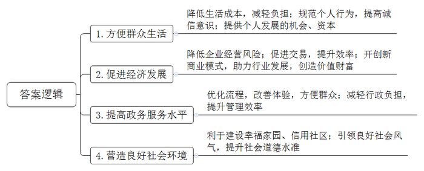
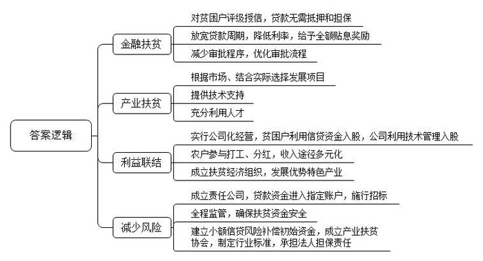
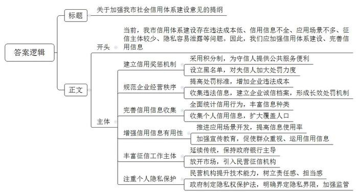
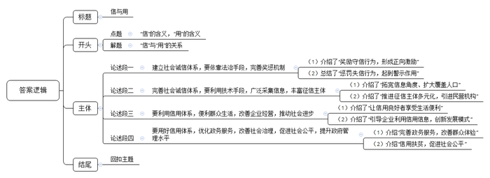

# 2019年公务员多省联考《申论》题（山西县级卷）

<!-- gwy:overview:start -->
> **山西 · 2019 · 申论 · 县级卷** ｜ 4 题 · 图片 4 处 · 答案随题折叠

导航：[题目](#题目) · [材料 1](#材料-1)
<!-- gwy:overview:end -->

> 候选采集稿。参考答案及解析来自粉笔页面，不代表官方答案或真实高分答卷；来源使用许可与原卷对应关系仍需人工核实。

## 给定材料

### 材料 1

2018年，小张到A市工作，在租房时，她惊喜地被中介告知，由于她的信用记录良好，所以不用缴纳两倍于月租的租房押金。小李到A市妇女儿童医疗中心就诊时发现，因为自己的信用度足够好，在医疗中心就可以“先诊疗后付费”，而无需一次次在诊室、检查室和交费处之间奔波，大大节省了自己的时间和精力。而同在A市的胡先生，却遇上了一件让他颜面尽失的事，原本在假期准备租辆越野车和朋友外出自驾游玩，没想到却被租车公司拒绝。原来，胡先生由于欠款许久未还，已经被列入了“老赖”的名单，导致自己的信用数据不佳，被禁止租车。信用骑车、信用住店、公交车扫码乘车……这一幕一幕，都是真真切切正在我们身边发生的场景，告诉我们中国正在迈进信用社会。

为加大信用教育的力度，拓宽常识教育的广度，团中央等多部门联合发起“金融安全专家校园行”活动。互联网金融服务公司L集团的运营官王先生受Z大学之邀，作为活动嘉宾来到学校，为现场近300名学生介绍信用安全的重要性及如何管理和保护个人信用。在演讲中，王先生通过具体的事例为大家上了生动的一课：小吴在上大学期间使用信用卡买了一款高档手机，因为种种原因，在逾期数月后才还上欠款，当时她并没有在意。几年后，在她贷款买房时发现，因为自己的信用记录有过“污点”，不仅缩减了贷款数额，利率也相对高了很多。为此，小吴懊悔不已。王先生说，小吴绝不是个案，在很多学生眼中，对个人的信用记录毫不在意。兼职刷单、用信用卡违规套现的现象屡见不鲜，包括发生在校园的大部分金融欺诈行为也与之有关。信用是一个人的终身档案和隐形简历，年轻人要学会保护个人信用，小心各类信用诈骗；同时也要学会管理个人信用，越早建立个人信用，随着时间推移，其信用分值会越来越高。

对于废旧手机回收利用创业者周先生而言，信用就为他解决了“先收手机还是先付款”的难题。“先收手机，用户不放心。先付款，我们也怕损失。”周先生说，引入信用评分后，对高分用户优先付款，不仅订单量上浮一倍，也没有出现违约情况。与周先生一样，目前，多家共享单车企业已实现信用免押金，大大方便了新用户开通使用。一些共享汽车、共享租衣企业也在研究信用梯度收费模式，最大限度吸引用户。用户对信用的珍视也令人惊喜。以租车为例，引入信用评分后，行业租金欠款率下降了52％，违章罚款欠款率下降了27％。

在S市，26万老人领取养老金不用亲自跑腿去现场，只需要在手机上进行一次信用认证。购房者提取公积金时也不需要准备大量证明材料，柜台的人脸识别系统扫描后，他的相关信用信息迅速呈现。……总之，有着高信用值的市民在通过实名认证之后，越来越多的政务服务都可以通过互联网进行办理，“刷脸”即可，而无需到窗口排队，方便了自己的同时，也减轻了政府的“负担”。

“不乱扔杂物、不乱搭乱建、不违规饲养宠物，倡导邻里文明停车、和睦共处，积极配合社区的各项工作，共筑美丽幸福家园，争做诚信居民，为‘信用社区’贡献力量！”在C市先锋街道办举行的“争做诚信居民，共建信用社区”千人誓师大会上，各社区居民代表一起郑重宣誓。“我们街道的光明社区2015年就率先开展了征信体系建设工作，4000名常住居民每人都有‘诚信身份证’！”街道办事处负责人介绍，光明社区是C市首个建立征信管理体系的社区。居民在好人好事、保护社区环境等方面有所作为的，信用分数每次加5分。相反，有随意倾倒杂物或者造谣生事等行为的，信用分数每次扣5分。行为更加恶劣的，还要提报市级征信平台。

某研究员说，信用既是商业社会的内在原则，也创造价值和财富。特别是在网络高度发达的今天，资源的分布不再局限于有形市场，而是分布在网络上。资金资源也不再集中在类似于银行这种金融机构身上，而是通过互联网分散分布。一个人只要拥有足够的信用水平，在网络上就能够筹集到资金。所以对于很多人来说，信用就意味着机会，意味着资本。

### 材料 2

G市M县永兴村的老谭一家属于因学致贫。他两个儿子正读大学，一个月生活费和其他开销就要4000多元。过去，夫妇俩靠在建筑工地打工，生活捉襟见肘。“没钱不能干事，也不敢干事。”老谭实话实说，过去印象中，贷款只是一些老板的事。2016年，他想贷两万元做生意，银行工作人员解释了一堆贷款政策，老谭依然是一头雾水，只能悻悻作罢。变化说来就来，“2018年年初，村里传来消息，贫困户不用抵押也能贷款，还有公司来推广黑木耳种植技术，我就想着试一试。”老谭回忆说，没过几天，他就拿到了贷款，甩开膀子干了起来。不到一年时间，4亩木耳，收入近14万元，从打零工的农民工变身为黑木耳种植大户，他感觉致富步伐越来越快了。

为了有效开展精准扶贫，M县探索创新扶贫小额信贷：贫困户经过评级授信，无需抵押和担保，即可从县农商银行拿到1万至5万元的贷款。“我们为贫困户‘量身定制’贷款。诚信评价、家庭劳动力和人均收入，作为评级授信的三项指标，分值分别是70分、20分、10分。”M县农商银行行长介绍，整个授信工作自下而上，主要由熟悉情况的村民代表等组成授信小组，采取投票的方式对贫困户进行量化计分、评级。信用级别越高，贷款额度越大。“贷款周期没有硬性限制，利率也降低了一半，而且根据银行的还息凭证，扶贫部门还给予3年全额贴息奖励。”这和过去形成鲜明的对照。以前贷款的前置审批程序中，光财政证明就有18项之多。另外贷款利息高，一年贷一万元，需要还1000多元利息，贫困户很难承受。据统计，自推行扶贫小额信贷以来，该县已对2.43万户贫困户完成评级授信，有效授信率达92.35%，共发放小额信用贷款1.26亿元。

贷款的问题解决了，如何杜绝陷入“给一头羊，吃一头羊”的怪圈呢？M县扶贫部门调研发现，尽管政府提供了信用贷款，但有的贫困户还是不敢贷，担心钱打了水漂，还不了钱；另外，有人觉得拿到贷款之后，不知道干什么，所以宁愿不要。M县县委书记说：“山里的百姓淳朴，如果不知道做什么可以挣钱，就是答应给他们贷款，他们心里也打鼓。因此，精准扶贫要‘扶上马再送一程’，在解决‘资金跟着穷人走’之后，根据市场供需与自身情况选择扶贫产业，以‘能人’带动大多数贫困户一起发展，‘能人’跟着项目走，项目跟着市场走。”

M县山岗村贫困村民小夏正在当地一家农业发展有限公司的蛋鸡基地紧张地忙碌，他既在基地打工，又是公司的股东。公司董事长介绍说，当地23户贫困户将小额信贷资金75万元委托给公司发展蛋鸡养殖产业，占65%的股份，公司负责蛋鸡产业的技术服务和经营管理，折合35%的股份。2018年年底，23户农户实现分红14万元，户均增收6000元；小夏拿到分红1800元，同时他和妻子、岳父三人打工，一年收入将近12万元。小夏笑着说，今年计划继续贷5万元入股，“公司有技术、会管理、有市场，我们脱贫有底气。”近年来M县的家禽养殖、木耳种植等产业，催生了一批扶贫经济组织，在精准脱贫实践中成效显著。“立足优势特色产业，在贫困户和农业企业、家庭农场、合作社等扶贫经济组织之间建立紧密的利益联结机制，这样才能保证扶贫效益精准到户。”M县县委书记介绍。

以前银行不愿贷款给贫困户，主要是担心坏账的风险。M县农商银行行长反复说：“风险，还是风险！1.26个亿，没有抵押和担保，你说不担心是假的。”为化解金融部门的后顾之忧，M县专门建立了贫困农户小额信贷风险补偿初始资金，如今规模已达1000万元。

怎样有效避免企业以扶贫的名义套取扶贫资金？贫困户的权利如何保障？M县已成立扶贫开发责任公司，贫困户贷款直接打到公司指定账户，企业入股资金也要打到该账户，然后才能施行招标。这样实现全程监管，确保扶贫资金安全。“成立产业扶贫协会，也是可以尝试的方式。”M县县委书记说，通过协会制定产业扶贫的行业标准，可以规范扶贫行为，政府只需出台政策，做好相关服务，建立风险基金，行业协会则承担法人的担保责任。

如今在M县，越来越多的贫困户凭信用贷款找到致富门路。为此，G市专门召开了精准扶贫工作经验交流会。会上，M县县委领导和村民代表不仅详细介绍了成功的经验，也提出了相应的建议，特别是希望国家能够进一步完善农险政策的顶层设计，完善“政府补贴一部分保费以扩大参保面、农户自担一部分风险以提高防灾积极性、保险公司让出一部分利润来确保微利可持续经营”的农业保险模式，以此来进一步推动精准扶贫工作的开展。

### 材料 3

党的十八大以来，国家社会信用体系建设的步伐明显加快。信用正成为个人和社会的一笔宝贵财富，“无形”的信用给守信者带来“有形”的实惠。信用积分高的市民，可在24小时自助图书馆免押金借书，还可享受部分公交线路票价八折优惠、部分医院就医优先等。相应的，在动车上吸烟、在飞机上寻衅滋事、逾期不履行行政罚没款缴纳义务……这些长期以来为人们深恶痛绝的行为，将面临严厉处罚。近日，123名限制乘坐火车严重失信人和381名限制乘坐民用航空器严重失信人新增入“信用中国网站”最新公示的名单上。同时，在法院执行领域，254万失信被执行人慑于信用惩戒，主动履行义务；在税收征管领域，各级税务机关累计公布税收违法“黑名单”案件9341件，共有1170户“黑名单”当事人因主动缴清税款、滞纳金和罚款后，从“黑名单”中撤出；在电子商务领域，发布电子商务领域失信“黑名单”，共计987家企业，并通过全国信用信息共享平台推送至地方开展专项治理工作。“干得漂亮！”网友的评论，代表了广大群众的心声。

但是我们也要看到社会信用体系建设依然任重道远，与社会期望还存在一定差距。余先生近日就遇到了一件“烦心事”。前一段时间，他报名参加了一家旅行社组织的环城周边三日游。“仅仅在一家景区就进了七八个购物店，导游一直向我们推荐玉石和银器，我们进店不买东西导游就不肯带队离开，有一个购物店我们足足待了2个小时。行程安排上的景点多数只停留一刻钟，拍拍照就草草结束了，标榜的‘豪华游’最终变成了购物游。”此类现象缘何屡禁不止？在N市经营旅行社的罗经理认为，旅行社经营秩序混乱的问题，早已引起有关部门重视，旅游部门也整顿过很多次。但是，因为违法成本低，这些旅行社往往抱着“逮着了认罚、没逮着我狠”的态度，我行我素，大不了换身行头重新登场。

在不少地方，类似机动车交通违章、社区违建、路边非法占道经营等行为，并没有纳入信用体系；而对于一些企业来说，招聘财务、中高级管理岗位等职位时，也常常因为难以获得有效个人信用信息，不得不耗费大量精力调查应聘者的职业素养。

根据一家咨询公司数据，我国信用体系覆盖人口大约三到四亿，覆盖度约为35%。“民间征信系统虽然吸收了更全面的互联网信用信息，但多集中在购物消费、金融信贷方面，角度比较单一，难以真正反映一个人的信用状况，与规模巨大的市场需求相比仍然杯水车薪。”一家信用机构的负责人说，目前我国信用应用场景仅仅开发了1%，还有很多人对信用信息不够重视，不知道运用信用信息。

建立社会信用体系离不开对信用信息的征集，过去我国的征信工作主要由政府和银行主导，但随着时代的发展，这已越来越不能满足社会的需要，放开市场引进民营征信机构势在必行。民营机构做个人征信是否会泄露个人信息，成为公众最为关注的焦点。一家网站的专题调查显示，3000多名投票网友里六成不看好民营征信发展前景，绝大部分都是出于对个人信息保护的担忧。“个人信息泄露了谁来负责？”这是网友问得最多的问题。信用体系建设，既要获取更多数据勾勒人格特征，也要注重保护每个人的隐私。对个人隐私的保护，不仅考验民营征信机构的技术能力，也考验其责任感和担当感。有专家说，“即便用户授权，也只采集合法、相关、必要的信息。”我国现在尚无专门的隐私权保护法，对于哪些数据涉及隐私权需要保护，缺乏明确的法律界定。“作为新生事物，对民营征信机构不宜求全责备，但相关立法和监管工作要加紧跟上。”

### 材料 4

党的十八大以来，党和国家高度重视诚信建设。习近平总书记在多个不同场合围绕诚信主题发表了一系列重要论述，从战略高度为新时代中国的诚信建设提供了基本遵循。他从历史维度、价值维度、实践维度对诚信问题进行了深刻阐述，进一步指出中华文化关于诚信的思想和理念，不论过去还是现在，都有其鲜明的民族特色，都有其永不褪色的时代价值。他强调，要运用法治手段解决道德领域突出问题。对突出的诚信缺失问题，既要抓紧建立覆盖全社会的征信系统，又要完善守法诚信褒奖机制和违法失信惩戒机制，使人不敢失信、不能失信。对见利忘义、制假售假的违法行为，要加大执法力度，让败德违法者受到惩治、付出代价。

为全面推进诚信建设，党和国家作出了一系列重要部署。中共中央办公厅印发的《关于培育和践行社会主义核心价值观的意见》强调：“以诚信建设为重点，加强社会公德、职业道德、家庭美德、个人品德教育，形成修身律己、崇德向善、礼让宽容的道德风尚”。中央文明委发布《关于推进诚信建设制度化的意见》，明确规定通过曝光失信当事人、限制严重失信者高消费行为等手段打击失信行为。这是我国第一份强调从制度层面推进国家诚信建设的中央文件。国务院先后发布《关于建立完善守信联合激励和失信联合惩戒制度加快推进社会诚信建设的指导意见》《关于加快推进失信被执行人信用监督、警示和惩戒机制建设的意见》，建立起社会诚信奖惩制度，并进一步完善了失信惩戒制度。诚信建设从注重教育走向教育与制度建设并重。

## 题目

### 第 1 题

**请根据给定资料2，概括个人信用建设的积极作用。（15分）**

关联材料：材料 1

作答要求：

要求：全面准确，条理清晰，不超过200字。

第 1 题 · 答案与解析

**参考答案（粉笔题库参考内容）**

1.方便群众生活。降低生活成本，减轻负担；规范个人行为，提高诚信意识；提供个人发展的机会、资本；2.促进经济发展。降低企业经营风险；促进交易，提升效率；开创新商业模式，助力行业发展，创造价值财富；3.提高政务服务水平。优化流程，改善体验，方便群众；减轻行政负担，提升管理效率；4.营造良好社会环境。利于建设幸福家园、信用社区；引领良好社会风气，提升社会道德水准。

**解析**

**参考答案说明**：本参考答案从“方便群众生活”“促进经济发展”“提高政务服务水平”“营造良好社会环境”四个方面展开，各条答案要点之间在内容上相互并列，没有交叉。

**考点**：影响类

**来源**：2019年公务员多省联考《申论》题（山西县级卷）

粉笔申论页面对本题只提供「解析视频」入口，该入口是会员推广位，页面无视频地址与文字解析。

### 第 2 题

**请根据给定资料3，分析M县的成功做法对G市其他县深入开展精准扶贫工作有哪些启示。（20分）**

关联材料：材料 2

作答要求：

要求：紧扣资料，分析透彻，表达准确，不超过300字。

第 2 题 · 答案与解析

**参考答案（粉笔题库参考内容）**

一、金融扶贫。对贫困户评级授信，贷款无需抵押和担保；放宽贷款周期，降低利率，给予全额贴息奖励；减少审批程序，优化审批流程。

二、产业扶贫。根据市场、结合实际选择发展项目；提供技术支持；充分利用人才。

三、利益联结。实行公司化经营，贫困户利用信贷资金入股，公司利用技术管理入股；农户参与打工、分红，收入途径多元化；成立扶贫经济组织，发展优势特色产业。

四、减少风险。成立责任公司，贷款资金进入指定账户，施行招标；全程监管，确保扶贫资金安全；建立小额信贷风险补偿初始资金，成立产业扶贫协会，制定行业标准，承担法人担保责任。

**解析**

**参考答案说明**：本参考答案从“金融扶贫”“产业扶贫”“利益联结”“减少风险”等四方面展开，各条答案要点之间在内容上相互并列，没有交叉。

**考点**：经验启示类

**来源**：2019年公务员多省联考《申论》题（山西县级卷）

粉笔申论页面对本题只提供「解析视频」入口，该入口是会员推广位，页面无视频地址与文字解析。

### 第 3 题

**假定你是某市市政府的工作人员，请根据给定资料4，草拟一份该市加强当前社会信用体系建设意见的提纲，供领导参考。（20分）**

关联材料：材料 3

作答要求：

要求：紧扣资料，针对性强，建议可行，不超过400字。

第 3 题 · 答案与解析

**参考答案（粉笔题库参考内容）**

**参考答案一**：

关于加强我市社会信用体系建设意见的提纲

当前，我市信用体系建设存在违法成本低、信用信息不全、应用场景不多、征信主体较少、隐私容易泄露等问题。因此，我们应加强信用体系建设、完善信用信息。

一、建立信用奖惩机制。采用积分制，为守信人提供公共服务便利；设立黑名单，对失信人加大处罚力度。

二、规范企业经营秩序。提高处罚标准，增加企业违法成本；收集违法信息，建立企业诚信档案，形成长效处罚机制。

三、完善信用信息收集。全面统计信用行为，丰富信息种类；收集个人信用信息，扩大覆盖人口。

四、增强信用信息有用性。推进应用场景开发，提高信息使用率；加强宣传教育，促使群众重视、运用信用信息。

五、丰富征信工作主体。延续传统，保持政府银行主导；放开市场，引入民营征信机构。

六、注重个人隐私保护。民营机构提升技术能力，树立责任感、担当感；政府制定隐私权保护法，明确界定隐私界限，加强监管。

**解析**

**参考答案说明:**（1）本题虽然不要求考虑格式，但为了保险起见，建议加上标题。（2）正文部分，一方面从内容来看，围绕着社会信用体系建设这一主题，本参考答案的开头先写到了“我市社会信用体系建设存在的问题”；主体部分从“建立信用奖惩机制”“规范企业经营秩序”“完善信用信息收集”“增强信用信息有用性”“丰富征信工作主体”“注重个人隐私保护”等几个方面给出了具体的对策。另一方面，形式上，本参考答案做到了分段、分条撰写，整体上条理较为清晰。

**参考答案二**：

关于加强我市社会信用体系建设意见的提纲

背景问题：当前，我市信用体系建设存在一系列问题，如企业经营秩序混乱、信用信息不全、应用场景不多等。为了解决这些问题，提出建议如下。

意见建议：一、建立信用奖惩机制。实行积分制，为高积分者提供公共服务便利；在各领域设黑名单，对失信人进行惩戒。二、规范企业经营秩序。提高处罚标准，增加企业违法成本；建立企业诚信档案，形成长效处罚机制。三、全面收集信用信息。将更多失信行为逐步纳入信用体系；丰富有效个人信息内容；持续扩大覆盖人口范围；放开市场，引入民营征信机构征集信息。四、推动信用信息应用。推进应用场景开发，提高信息使用率；加强宣传教育，引导群众重视、使用信用信息。五、保护个人信息隐私。民营机构提升技术能力，树立责任感、担当感；政府制定隐私权保护法，明确界定隐私界限，加强监管。

**考点**：方案类

**来源**：2019年公务员多省联考《申论》题（山西县级卷）

粉笔申论页面对本题只提供「解析视频」入口，该入口是会员推广位，页面无视频地址与文字解析。

### 第 4 题

**参考但不拘泥于给定资料，以“信与用”为题目，联系实际，写一篇议论文。（45分）**

关联材料：材料 4

作答要求：

要求：

（1）自选角度，立意深刻；

（2）内容全面，结构完整；

（3）思路清晰，语言流畅；

（4）总字数1000—1200字。

第 4 题 · 答案与解析

**参考答案（粉笔题库参考内容）**

信与用

信用，一般指“诚信”。但若对“信用”做更深入的解读，则有“信”与“用”两层意思。“信”即诚信，是一种道德品质，也是一种制度和规则；“用”是一种方法，也是一种证明信的凭证。“信”与“用”相互促进、辩证统一，二者能形成良性循环，实现道德价值与实用价值的高度统一。因此，我们要建立社会诚信体系，并利用其推动社会进步、优化政府管理。

**建立社会诚信体系，要依靠法治手段，完善奖惩机制。**以往，教育是诚信建设的主要手段，但却已无法适应社会发展，而现代社会的奖惩机制就是最好补充。褒奖机制，奖励的是守信行为，形成正向激励。如给守信者提供医疗、教育、消费等领域的“免押金”支持，让群众看到诚信福利。惩戒机制，则要惩罚失信行为。被网友称为“教科书式老赖”的黄淑芬，就因其对法院判决有执行能力而拒不执行，所以被列入了全国法院失信被执行人名单。所以，法治是诚信体系建设的重要保障。

**完善社会诚信体系，要利用技术手段，广泛采集信息，丰富征信主体。**依靠法治建设诚信体系，需用大量信用数据。但诸如交通违章、社区违建、非法经营等行为却并未纳入信用体系，加之信息人口覆盖度不高，这使我们的诚信体系建设始终处于“初级阶段”。因此，拓宽信息角度、扩大覆盖人口便显得尤为重要。同时，我们还要推进征信主体多元化，引进民营机构，共同征信。只有各方运用现代技术，丰富信息内容，推进信息共享，才能让征信系统日趋完善。

征信系统的建立，能让社会更有“诚信”，我们也要充分“利用”这些信，因为只有“用”，才能更好地促进信、保护信，让信的基础更坚实、更可持续。

**要利用信用体系，便利群众生活，改善企业经营，推动社会进步。**支付宝中的“芝麻信用”，能让信用良好者享受到信用购、信用租、信用住等便利服务，这正是利用了信用积分来改变消费模式，让群众享受到便利。另外，企业也可以引入信用评分，与客户建立互信关系，降低交易风险，提高交易效率；甚至还可以结合信用梯度，创新收费方式，形成新兴商业模式。这些都会大大降低社会运行成本，促进社会发展，让人们更坚信“信”的作用。

**要用好信用体系，优化政务服务，改善社会治理，促进社会公平，提升政府管理水平。**战国时期，商鞅立木建信，从而推动商鞅变法，便已向我们展现了何为用“信”治国。而今，信用在政务服务中应用更加广泛。多地均已利用信用信息，实现了联网办理养老金、公积金领取服务。此外，一些贫困山村也用“信贷+扶贫”的模式帮助群众顺利贷款、成功脱贫。这正是用信用体系在缩小贫富差距、改善社会治理、促进社会公平。未来，我们更要充分利用征信系统，全面提升政府管理水平，让人们更深刻地体会“信”的价值。

孔子曰：“人而无信，不知其可也。”诚信的重要性早已不需赘述。而当代社会的“信”与“用”，更是不可分割的整体。我们只有让“信”为我所“用”，才能让我们朝着更规矩、更便利、更公平的社会不断前进。

**解析**

**文章分析**

信与用

【**标题的优点：**首先，范文的标题“信与用”突出文章主题，符合题目命题要求。】

信用，一般指“诚信”。但若对“信用”做更深入的解读，则有“信”与“用”两层意思。（1）“信”即诚信，是一种道德品质，也是一种制度和规则；“用”是一种方法，也是一种证明信的凭证。（2）“信”与“用”相互促进、辩证统一，二者能形成良性循环，实现道德价值与实用价值的高度统一。因此，我们要建立社会诚信体系，并利用其推动社会进步、优化政府管理。

【**开头的优点：**★内容方面。范文的开头是紧扣题目给定的“信与用”这一主题展开的。首先，开头即点出主题，做到了主题明确。其次，对“信与用”这一主题进行了分析阐述，指出了（1）“信与用”的含义，（2）“信与用”的关系。注意以上两个方面的阐述在逻辑上有先后顺序：先写“含义”，再写“关系”。★文字表达方面：长短句配合使用，使语言表达有节奏感。】

**建立社会诚信体系，要依靠法治手段，完善奖惩机制。**以往，教育是诚信建设的主要手段，但却已无法适应社会发展，（1）而现代社会的奖惩机制就是最好补充。褒奖机制，奖励的是守信行为，形成正向激励。如给守信者提供医疗、教育、消费等领域的“免押金”支持，让群众看到诚信福利。（2）惩戒机制，则要惩罚失信行为。被网友称为“教科书式老赖”的黄淑芬，就因其对法院判决有执行能力而拒不执行，所以被列入了全国法院失信被执行人名单。所以，法治是诚信体系建设的重要保障。

【**论述段1的优点**：★观点句：范文的观点句是紧扣“信与用”这一文章主题提出的。形式上，它在段首处直接写出，位置突出，容易发现。内容上，内容要点明确，可以明显看出它是从“法治”入手，指出了如何“建立社会诚信体系”。★论述内容：（1）介绍了“奖励守信行为，形成正向激励”；（2）总结了“惩罚失信行为，起到警示作用”。注意：以上两个方面的内容都是紧扣“建立社会诚信体系，要依靠法治手段，完善奖惩机制”这个观点句进行分析论述的，论述的针对性强，内容层次丰富。论述方法上采用了讲道理、举例子相结合，做到了丰富多样。】

**完善社会诚信体系，要利用技术手段，广泛采集信息，丰富征信主体。**依靠法治建设诚信体系，需用大量信用数据。但诸如交通违章、社区违建、非法经营等行为却并未纳入信用体系，加之信息人口覆盖度不高，这使我们的诚信体系建设始终处于“初级阶段”。（1）因此，拓宽信息角度、扩大覆盖人口便显得尤为重要。同时，（2）我们还要推进征信主体多元化，引进民营机构，共同征信。只有各方运用现代技术，丰富信息内容，推进信息共享，才能让征信系统日趋完善。

【**论述段2的优点**：★观点句：范文的观点句是紧扣“信与用”这一文章主题提出的。形式上，它在段首处直接写出，位置突出，容易发现。内容上，内容要点明确，可以明显看出它是从“技术”入手，指出了如何“完善社会诚信体系”。★论述内容：（1）介绍了“拓宽信息角度、扩大覆盖人口”；（2）介绍了“推进征信主体多元化，引进民营机构”。注意：以上两个方面的内容都是紧扣“完善社会诚信体系，要利用技术手段，广泛采集信息，丰富征信主体”这个观点句进行分析论述的，论述的针对性强，内容层次丰富。论述方法上采用了讲道理、举例子相结合，做到了丰富多样。】

征信系统的建立，能让社会更有“诚信”，我们也要充分“利用”这些信，因为只有“用”，才能更好地促进信、保护信，让信的基础更坚实、更可持续。

【**过渡段：**阐述“只有‘用’才能更好地促进信、保护信，让‘信’的基础更坚实、更可持续”，同时起到引出下文中“用”的作用。】

**要利用信用体系，便利群众生活，改善企业经营，推动社会进步。**（1）支付宝中的“芝麻信用”，能让信用良好者享受到信用购、信用租、信用住等便利服务，这正是利用了信用积分来改变消费模式，让群众享受到便利。（2）另外，企业也可以引入信用评分，与客户建立互信关系，降低交易风险，提高交易效率；甚至还可以结合信用梯度，创新收费方式，形成新兴商业模式。这些都会大大降低社会运行成本，促进社会发展，让人们更坚信“信”的作用。

【**论述段3的优点**：★观点句：范文的观点句是紧扣“信与用”这一文章主题提出的。形式上，它在段首处直接写出，位置突出，容易发现。内容上，内容要点明确，可以明显看出它是从“群众、企业”入手，指出了如何“利用信用体系”。★论述内容：（1）介绍了“让信用良好者享受生活便利”；（2）介绍了“引导企业利用信用信息，创新发展模式”。注意：以上两个方面的内容都是紧扣“要利用信用体系，便利群众生活，改善企业经营，推动社会进步”这个观点句进行分析论述的，论述的针对性强，内容层次丰富。在论述方法上采用了讲道理、举例子相结合，做到了丰富多样。】

**要用好信用体系，优化政务服务，改善社会治理，促进社会公平，提升政府管理水平。**战国时期，商鞅立木建信，从而推动商鞅变法，便已向我们展现了何为用“信”治国。而今，（1）信用在政务服务中应用更加广泛。多地均已利用信用信息，实现了联网办理养老金、公积金领取服务。此外，一些贫困山村也用“信贷+扶贫”的模式帮助群众顺利贷款、成功脱贫。（2）这正是用信用体系在缩小贫富差距、改善社会治理、促进社会公平。未来，我们更要充分利用征信系统，全面提升政府管理水平，让人们更深刻地体会“信”的价值。

【**论述段4的优点**：★观点句：范文的观点句是紧扣“信与用”这一文章主题提出的。形式上，它在段首处直接写出，位置突出，容易发现。内容上，内容要点明确，可以明显看出它是从“政府”入手，指出了如何“用好信用体系”。★论述内容：（1）介绍“完善政务服务，改善群众体验”；（2）介绍“信用扶贫，促进社会公平”。注意：以上两个方面的内容都是紧扣“要用好信用体系，优化政务服务，改善社会治理，促进社会公平，提升政府管理水平”这个观点句进行分析论述的，论述的针对性强，内容层次丰富。在论述方法上采用了讲道理、举例子相结合，做到了丰富多样。】

【**论述段之间的关系**：★内容的内在逻辑：范文的论述段之间是依照并列逻辑展开的。论述段1、2先写了“信”，论述段3、4再写了“用”。★段与段的外在衔接：过渡段起到了承接论述段1、2，引出论述段3、4的作用。】

孔子曰：“人而无信，不知其可也。”诚信的重要性早已不需赘述。而当代社会的“信”与“用”，更是不可分割的整体。我们只有让“信”为我所“用”，才能让我们朝着更规矩、更便利、更公平的社会不断前进。

【**结尾的优点：**范文的结尾回扣了“信与用”这一主题。（1）再次总结了“信与用”；（2）发出了号召希望。】

**考点**：文章写作题

**来源**：2019年公务员多省联考《申论》题（山西县级卷）

粉笔申论页面对本题只提供「解析视频」入口，该入口是会员推广位，页面无视频地址与文字解析。

