# 2019年420联考《行测》题（山西县级+乡镇）（网友回忆版）

<!-- gwy:overview:start -->
> **山西 · 2019 · 行测 · 县级+乡镇** ｜ 120 题 · 图片 104 处 · 答案随题折叠

| 题型模块 | 题量 | 题号 |
| --- | ---: | ---: |
| 常识判断 | 20 | 1–20 |
| 言语理解与表达 | 40 | 21–60 |
| 数量关系 | 10 | 61–70 |
| 判断推理 | 35 | 71–105 |
| 资料分析 | 15 | 106–120 |
| **合计** | **120** | |

导航：[题型与作答说明](#题型与作答说明) · [题目](#题目) · [材料 1](#材料-1)
<!-- gwy:overview:end -->

> 候选采集稿。参考答案及解析来自粉笔页面，不代表官方答案或真实高分答卷；来源使用许可与原卷对应关系仍需人工核实。

## 题型与作答说明

常识判断

（20题）

根据题目要求，在四个选项中选出一个最恰当的答案。

言语理解与表达

（40题）

本部分包括表达与理解两方面的内容。请根据题目要求，在四个选项中选出一个最恰当的答案。

数量关系

（10题）

在这部分试题中，每道题呈现一段表述数字关系的文字，要求你迅速、准确地计算出答案。

判断推理

（35题）

本部分包括图形推理、定义判断、类比推理与逻辑判断四种类型的试题，在四个选项中选出一个最恰当的答案。

资料分析

（15题）

所给出的图、表、文字或综合性资料均有若干个问题要你回答。你应根据资料提供的信息进行分析、比较、计算和判断处理。

## 题目

### 第 1 题

习近平总书记在中央政治局第十三次集体学习时强调，要精准有效处置重点领域风险，深化金融改革开放，增强金融服务           能力，坚决打好防范化解包括金融风险在内的重大风险攻坚战，推动我国金融业健康发展。

A. 实体经济

B. 私营经济

C. 中小企业

D. 国有企业

第 1 题 · 答案与解析

**参考答案（粉笔题库参考内容）**

A

**解析**

本题考查政治常识。

2019年2月22日，中共中央政治局就完善金融服务、防范金融风险举行第十三次集体学习。习近平总书记在主持学习时强调：“要深化对国际国内金融形势的认识，正确把握金融本质，深化金融供给侧结构性改革，平衡好稳增长和防风险的关系，精准有效处置重点领域风险，深化金融改革开放，增强金融服务**实体经济**能力，坚决打好防范化解包括金融风险在内的重大风险攻坚战，推动我国金融业健康发展。”

故正确答案为A。

### 第 2 题

下列属于改革开放40年来我国经济建设所取得伟大成就的是：

①建立了最完整的现代工业体系

②成为了世界商品消费第一大国

③主要农产品的产量跃居世界前列

④外汇储备连续多年位居世界第一

A. ①②④

B. ①③④

C. ②③④

D. ①②③④

第 2 题 · 答案与解析

**参考答案（粉笔题库参考内容）**

B

**解析**

本题考查政治常识。

2018年12月18日，习近平总书记在庆祝改革开放40周年大会上的讲话中指出：“我国主要农产品产量跃居世界前列，建立了全世界最完整的现代工业体系，科技创新和重大工程捷报频传。我国基础设施建设成就显著，信息畅通，公路成网，铁路密布，高坝矗立，西气东输，南水北调，高铁飞驰，巨轮远航，飞机翱翔，天堑变通途。现在，我国是世界第二大经济体、制造业第一大国、货物贸易第一大国、商品消费第二大国、外资流入第二大国（2020年我国成为外资流入第一大国），我国外汇储备连续多年位居世界第一，中国人民在富起来、强起来的征程上迈出了决定性的步伐！”所以，①③④表述正确，②错误。

故正确答案为B。

### 第 3 题

关于生态文明建设，下列说法正确的是:

A. 蓝天保卫战是全面建成小康社会的三大攻坚战之一

B. 加快构建生态文明体系是解决污染问题的根本之策

C. 生态环境安全是经济社会持续健康发展的重要保障

D. 地方政府主要领导是本行政区域生态环境保护第一责任人

第 3 题 · 答案与解析

**参考答案（粉笔题库参考内容）**

C

**解析**

本题考查政治常识。

A项错误，2017年10月18日，习近平总书记在十九大报告中指出：“要坚决打好**防范化解重大风险、精准脱贫、污染防治的攻坚战**，使全面建成小康社会得到人民认可、经得起历史检验。”蓝天保卫战并不是三大攻坚战之一。

B项错误，2018年5月18日至19日，习近平总书记在全国生态环境保护大会上强调：“要全面推动绿色发展**。绿色发展是构建高质量现代化经济体系的必然要求，是解决污染问题的根本之策。**”

C项正确，2018年5月18日至19日，习近平总书记在全国生态环境保护大会上强调：“要有效防范生态环境风险。**生态环境安全是国家安全的重要组成部分，是经济社会持续健康发展的重要保障。**”

D项错误，2018年5月18日至19日，习近平总书记在全国生态环境保护大会上强调：“各地区各部门要增强‘四个意识’，坚决维护党中央权威和集中统一领导，坚决担负起生态文明建设的政治责任。**地方各级党委和政府主要领导是本行政区域生态环境保护第一责任人，**各相关部门要履行好生态环境保护职责，使各部门守土有责、守土尽责，分工协作、共同发力。”

故正确答案为C。

### 第 4 题

关于全面依法治国，下列说法**不准确**的是：

A. 到本世纪中叶，基本建成法治国家、法治政府、法治社会

B. 全面依法治国在“四个全面”中具有基础性、保障性作用

C. 党的领导是社会主义法治最根本的保证

D. 中国特色社会主义法治体系是中国特色社会主义制度的法律表现形式

第 4 题 · 答案与解析

**参考答案（粉笔题库参考内容）**

A

**解析**

本题考查政治常识。

A项错误，党的十九大报告指出：“综合分析国际国内形势和我国发展条件，从2020年到本世纪中叶可以分两个阶段来安排。第一个阶段，**从2020****年到2035****年**，在全面建成小康社会的基础上，再奋斗十五年，基本实现社会主义现代化。到那时，我国经济实力、科技实力将大幅跃升，跻身创新型国家前列；**人民平等参与、平等发展权利得到充分保障，****法治国家、法治政府、法治社会****基本建成**，各方面制度更加完善，国家治理体系和治理能力现代化基本实现······”因此，到2035年，基本建成法治国家、法治政府、法治社会。

B项正确，2018年8月24日中央全面依法治国委员会第一次会议顺利召开，习近平总书记作出重要讲话。他强调：“**全面依法治国具有基础性、保障性作用**，在统筹推进伟大斗争、伟大工程、伟大事业、伟大梦想，全面建设社会主义现代化国家的新征程上，要加强党对全面依法治国的集中统一领导，坚持以全面依法治国新理念新思想新战略为指导，坚定不移走中国特色社会主义法治道路，更好发挥法治固根本、稳预期、利长远的保障作用。”

C项正确，党的十八届四中全会通过的《中共中央关于全面推进依法治国若干重大问题的决定》指出：“党的领导是中国特色社会主义最本质的特征，是社会主义法治最根本的保证。”

D项正确，建设中国特色社会主义法治体系、建设社会主义法治国家是坚持和发展中国特色社会主义的内在要求。习近平总书记强调：“我们要建设的中国特色社会主义法治体系，本质上是中国特色社会主义制度的法律表现形式”。

本题为选非题，故正确答案为A。

### 第 5 题

2018年我国科技界取得了一系列重大成果，这些成果中**不包括**：

A. 第二艘航母出海试航

B. 嫦娥四号探测器发射成功

C. 造岛神器“天鲲号”下水

D. 国产大型水陆两栖飞机水上首飞

第 5 题 · 答案与解析

**参考答案（粉笔题库参考内容）**

C

**解析**

本题考查政治常识。

A项正确，2018年5月13日，我国第二艘航母从大连造船厂码头启航，赴相关海域执行海上试验任务，主要检测验证动力系统等设备的可靠性和稳定性。

B项正确，2018年12月8日2时23分，我国在西昌卫星发射中心用长征三号乙运载火箭成功发射嫦娥四号探测器，开启了月球探测的新旅程。嫦娥四号探测器后续将经历地月转移、近月制动、环月飞行，最终实现人类首次月球背面软着陆，开展月球背面就位探测及巡视探测，并通过已在使命轨道运行的“鹊桥”中继星，实现月球背面与地球之间的中继通信。

C项错误，2017年11月3日，由我国自主设计研发的新一代国之重器——“天鲲号”自航绞吸挖泥船成功下水。从被称为“造岛神器”的“天鲸号”，到目前亚洲最大最先进的“天鲲号”，中国自航绞吸挖泥船的自主研制实力再一次让世人惊叹。

D项正确，2018年10月20日，中国自主研制的大型水陆两栖飞机——“鲲龙”AG600在湖北荆门漳河机场成功实现水上首飞。至此，中国大飞机终于迈出“上天入海”完整步伐，建设航空强国轮廓愈发明晰。

本题为选非题，故正确答案为C。

### 第 6 题

下列关于全国经济普查的说法**错误**的是：

A. 根据《全国经济普查条例》的规定，经济普查每5年进行一次

B. 目的是全面调查我国第一、第二、第三产业的发展规模、布局和效益

C. 普查取得的单位和个人资料，不作为对普查对象实施处罚的依据

D. 2019年1月1日，第四次全国经济普查现场登记工作正式启动

第 6 题 · 答案与解析

**参考答案（粉笔题库参考内容）**

B

**解析**

本题考查法律常识。

A项正确，《全国经济普查条例》第七条规定：“经济普查每5年进行一次，标准时点为普查年份的12月31日。”

B项错误，《全国经济普查条例》第二条规定：“经济普查的目的，是为了**全面掌握我国第二产业、第三产业的发展规模、结构和效益等情况**，建立健全基本单位名录库及其数据库系统，为研究制定国民经济和社会发展规划，提高决策和管理水平奠定基础。”

C项正确，《全国经济普查条例》第三十三条规定：“经济普查取得的单位和个人资料，严格限定用于经济普查的目的，不作为任何单位对经济普查对象实施处罚的依据。”

D项正确，2019年1月1日零时，第四次全国经济普查现场登记工作正式启动。按照部署，第四次全国经济普查标准时点为2018年12月31日，普查时期资料为2018年年度资料。

本题为选非题，故正确答案为B。

### 第 7 题

荷花虽生长于池塘的污泥中，但荷叶却出污泥而不染，其主要原因是：

A. 荷叶含有大量的叶绿素，能与太阳光发生光合作用，产生自清洁

B. 荷叶表面光滑，具有非常强的光洁度，污泥很难在它的表面吸附

C. 荷叶含有疏水的纳米级蜡质，雨露落在上面会形成水珠清洁叶面

D. 荷花枝干细长，水珠落在荷叶上，容易造成荷叶晃动，甩出污泥

第 7 题 · 答案与解析

**参考答案（粉笔题库参考内容）**

C

**解析**

本题考查科技常识。

荷叶之所以能出污泥而不染是由荷叶叶面上存在着复杂的多重纳米和微米级的超微结构决定的：在超高分辨率显微镜下可以清晰看到，荷叶表面上有许多微小的乳突，它上面长满茸毛，乳突间的凹陷部分充满空气，这样就在紧贴叶面处形成一层极薄的只有纳米量级厚的空气层。这使得在尺寸上远大于这种结构的灰尘、雨水等降落在叶面上后，隔着一层极薄的空气，从而雨水会自动聚集成球形水珠，而水珠的滚动会把落在叶面上的尘土污泥吸附掉滚出叶面，使叶面始终保持干净，这就是著名的“荷叶自洁效应”。

故正确答案为C。

### 第 8 题

下列气体既会造成酸雨，又可用作防腐剂的是：

A. 二氧化碳

B. 二氧化氮

C. 二氧化硫

D. 氮气

第 8 题 · 答案与解析

**参考答案（粉笔题库参考内容）**

C

**解析**

本题考查科技常识。

酸雨通常指pH值小于5.6的酸性降水。酸雨中含有多种无机酸和有机酸，绝大部分是硫酸和硝酸，由人为排放的大气污染物二氧化硫和氮氧化物转化而成。

A项错误，二氧化碳溶于水后虽然会使雨水呈弱酸性，但不会导致酸雨。

B项错误，二氧化氮会与大气中水反应生成硝酸，形成硝酸型酸雨；二氧化氮有剧毒，不可以作防腐剂。

C项正确，二氧化硫与大气中的水反应生成亚硫酸，亚硫酸又与大气中的氧气反应，生成硫酸，形成硫酸型酸雨；二氧化硫有还原性，易被氧化，因此常用作葡萄酒的防腐剂。

D项错误，氮气化学性质不活泼，常温下很难跟其他物质发生反应，所以常被用作薯片等食品的防腐剂；氮气难溶于水，不会造成酸雨。

故正确答案为C。

### 第 9 题

下列说法**错误**的是：

A. 雷雨可使土壤的氮肥增加

B. 18K黄金制品的含金量为70%

C. 聚四氟乙烯可用于制作不粘锅的涂层

D. 在金属表面喷漆可以防止金属被氧化腐蚀

第 9 题 · 答案与解析

**参考答案（粉笔题库参考内容）**

B

**解析**

本题考查科技常识。

A项正确，雷雨天气过程中的闪电温度极高，一般在三万度以上，并造成高电压。在高温高电压条件下，空气分子会发生电离，等它们重新结合时，其中的氮和氧就会化合为亚硝酸盐和硝酸盐分子，并溶解在雨水中降落地面，成为天然氮肥。

B项错误，K金是指黄金和其它金属混合在一起的合金。根据在首饰中的黄金含量可分为不同的K金，其中24K是指纯金，18K黄金制品的含黄金量就是18/24=75%，因此选项中的70%表述错误。

C项正确，聚四氟乙烯俗称“塑料王”，是由四氟乙烯经聚合而成的高分子化合物，具有优良的化学稳定性、耐腐蚀性、密封性、高润滑不粘性，可用于制作不粘锅的涂层。

D项正确，金属被氧化腐蚀是指各类材料在环境作用下发生损坏、性能下降或状态的劣化。良好的喷漆涂装保护层能够成为抑制腐蚀介质侵入的屏障，使得金属保持连续完整，因此在金属表面喷漆是一种很重要的金属防腐蚀手段。

本题为选非题，故正确答案为B。

### 第 10 题

下列我国古代国家行政机构**不具有**行政监察职能的是：

A. 御史台

B. 太常寺

C. 六科给事中

D. 都察院

第 10 题 · 答案与解析

**参考答案（粉笔题库参考内容）**

B

**解析**

本题考查人文常识。

A项正确，御史台，古代官署名。御史台的职责是纠察弹劾百官过失，是封建国家专司弹劾的监察机关。

B项错误，太常寺，封建社会中掌管礼乐的最高行政机关，秦时称奉常。汉景帝六年改称太常。汉以后改称太常寺、太常礼乐官等。

C项正确，明代地方分区监察和中央按系统监察相结合，专设六科给事中，稽察六部百司之事，旨在加强皇帝对六部的控制。

D项正确，都察院，官署名。明清全国最高监察机构。掌纠劾百司，辩明冤枉，提督各道，为天子耳目风纪之司。

本题为选非题，故正确答案为B。

### 第 11 题

佛朗西斯·克里克提出的中心法则指明了遗传信息的流向，在科学发展中得到不断补充完善。根据该法则，下列哪一种遗传信息传递流程**不可能**发生：

A. DNA通过转录把遗传信息传递给RNA

B. RNA通过翻译把遗传信息传递给蛋白质

C. RNA通过逆转录把遗传信息传递给DNA

D. 蛋白质通过逆翻译把遗传信息传递给RNA

第 11 题 · 答案与解析

**参考答案（粉笔题库参考内容）**

D

**解析**

本题考查科技常识。

A、B、C项正确，中心法则指出，遗传信息的转移可以分为两类：第一类，包括DNA的复制、RNA的转录和蛋白质的翻译，即①DNA→DNA(复制)；②DNA→RNA(转录)；③RNA→蛋白质(翻译)。这三种遗传信息的转移方向普遍地存在于所有生物细胞中。第二类，是特殊情况下的遗传信息转移，包括RNA的复制，RNA反向转录为DNA和从DNA直接翻译为蛋白质，即①RNA→RNA(复制)；②RNA→DNA(逆转录)；③DNA→蛋白质。RNA复制只在RNA病毒中存在。

D项错误，中心法则旨在详细说明连串信息的逐个传送，它指出遗传信息不能由蛋白质转移到蛋白质或核酸之中。

本题为选非题，故正确答案为D。

### 第 12 题

下列关于血糖的说法**错误**的是：

A. 正常人进食后血糖浓度会升高

B. 正常人空腹超过12小时会引起低血糖

C. 南瓜能抑制葡萄糖吸收，具有降血糖作用

D. 胰岛素是人体产生的唯一能够降低血糖的激素

第 12 题 · 答案与解析

**参考答案（粉笔题库参考内容）**

C

**解析**

本题考查科技常识。

A项正确，食物中存在大量的淀粉等糖类。人在进食后，糖类被人体消化吸收，因此会使血糖含量升高。

B项正确，低血糖的常见原因包括进食过少、运动过度、药物使用不当、大量饮酒等。正常人空腹（禁食）时间过长，由于没有食入足够的糖，可能会引起低血糖。

C项错误，南瓜中含有丰富的营养物质，其中包含了蛋白质、多糖、果胶、纤维素、维生素以及微量元素等成分，在这些众多的营养物质中，蛋白质和多糖都可以提升自身免疫功能。部分多糖会被分解成单糖，可能导致人体血糖升高。

D项正确，胰岛素是体内唯一能够降低血糖浓度的激素，它不仅能够促使葡萄糖分解，还能抑制非糖物质转化为葡萄糖。

本题为选非题，故正确答案为C。

### 第 13 题

下列我国空间站发展的重要标志性事件按完成步骤排列正确的是：

①“天宫二号”空间实验室成功发射

②“神舟十一号”成功发射，完成与“天宫二号”对接

③陆续发射科学实验舱和空间站核心舱，组建中国空间站

④“天舟一号”货运飞船成功发射，完成与“天宫二号”对接

A. ①②③④

B. ④①②③

C. ①③④②

D. ①②④③

第 13 题 · 答案与解析

**参考答案（粉笔题库参考内容）**

D

**解析**

本题考查科技常识。

①2016年9月15日22时04分，“天宫二号”空间实验室由长征二号FT2火箭发射升空。

②2016年10月19日3时31分，“神舟十一号”载人飞船与“天宫二号”空间实验室成功实现自动交会对接。

③建设具有国际先进水平的空间站，解决有较大规模的、长期有人照料的空间应用问题，是我国载人航天工程“三步走”发展战略中第三步的任务目标。按计划，空间站将于2022年前后建成，是我国长期在轨稳定运行的国家太空实验室，将全面提升我国载人航天综合应用效益水平。

④2017年4月20日19时11分，中国首架货运飞船——“天舟一号”成功发射升空，并在4月22日完成与“天宫二号”的首次对接。

由此可知，按照完成步骤的时间应该是①②④③。

故正确答案为D。

### 第 14 题

俗话说“不要将你的鸡蛋全都放在一只篮子里”。下列选项与该俗语蕴含的道理相吻合的是：

A. 天有不测风云

B. 鱼与熊掌不可兼得

C. 不入虎穴，焉得虎子

D. 舍不得孩子，套不住狼

第 14 题 · 答案与解析

**参考答案（粉笔题库参考内容）**

A

**解析**

本题考查经济常识。

如果把所有鸡蛋都放在同一个篮子里，篮子翻了，所有的鸡蛋都会碎掉；如果不把所有的鸡蛋放在一个篮子里，篮子翻了，还会有其他鸡蛋剩下。即不要把所有的资本都投入到一件事情上，应该做多手准备，规避风险。

A项正确，天有不测风云比喻灾祸是无法预料的，即风险是随时存在的，我们应该懂得随时规避和防范风险。与题意相符合。

B项错误，鱼与熊掌不可兼得，意思是鱼和熊掌不能同时获得。强调的是我们在做选择的时候，应该如何取舍，在经济上对应的是机会成本。与风险无关。

C项错误，不入虎穴，焉得虎子比喻不经历艰险，就不能取得成功，也指需通过实践取得真知。与风险无关。

D项错误，舍不得孩子，套不住狼比喻要达到某一目的必须付出相应的代价。与风险无关。

故正确答案为A。

### 第 15 题

首次把《大学》《中庸》《论语》和《孟子》编在一起的学者是：

A. 朱熹

B. 程颐、程颢

C. 董仲舒

D. 颜之推

第 15 题 · 答案与解析

**参考答案（粉笔题库参考内容）**

A

**解析**

本题考查人文常识。

A项正确，南宋理学家朱熹首次将《大学》、《中庸》、《论语》、《孟子》汇集在一起，并为其作章句集注，成《四书章句集注》一书，对后世产生了深远的影响。

B项错误，程颢、程颐兄弟，河南洛阳人，北宋著名理学家、教育家，“洛学”代表人物，世称“二程”，其理学思想对后世影响深远，南宋理学“集大成者”朱熹正是继承和发展了他们的学说。“二程”的理学思想主要见于《遗书》《文集》和《经说》等，现均收入《二程集》。

C项错误，董仲舒，汉代思想家、哲学家、政治家、教育家。他在著名的《举贤良对策》中系统地提出了“天人感应”、“大一统”学说和“罢黜百家，表彰六经”的主张。董仲舒的儒家思想大大维护了汉武帝的集权统治，为当时社会政治和经济的稳定做出了贡献。

D项错误，颜之推，字介，汉族，琅琊临沂（今山东临沂）人。中国古代文学家、教育家，生活年代在南北朝至隋朝期间。颜之推著有《颜氏家训》，在家庭教育发展史上有重要的影响。

故正确答案为A。

### 第 16 题

下列关于粉尘爆炸的说法**错误**的是：

A. 颗粒越小越易燃烧，爆炸也越剧烈

B. 越易氧化的物质，其粉尘越易爆炸

C. 越易带电的物质，其粉尘越易爆炸

D. 含卤素和钾、钠的粉尘，爆炸趋势增强

第 16 题 · 答案与解析

**参考答案（粉笔题库参考内容）**

D

**解析**

本题考查科技常识。

呈细粉状的固体物质被称为粉尘，能燃烧和爆炸的粉尘叫做可燃粉尘。工厂内一些金属粉尘，如镁粉、铝粉，生活中常见的淀粉、木粉等都是可燃粉尘。粉尘在爆炸极限范围内，遇到热源（明火或高温），火焰瞬间传播于整个混合粉尘空间，化学反应速度极快，同时释放大量的热，形成高温高压。由于这一过程中不断有升高的压力会产生冲击波，因此，爆炸会造成很大的破坏力。

A项正确，粉尘的表面能够吸附空气中的氧，颗粒越细小，粉尘总的表面积就越大，从而表面吸附的氧就越多，越容易发生爆炸。

B、C项正确，粉尘爆炸的难易程度与粉尘的物理化学性质和环境条件等有关。一般认为氧化速度快的物质容易爆炸，如镁粉、铝粉等。容易带电的粉尘也很容易引起爆炸，如合成树脂粉末、纤维类粉尘等。

D项错误，根据实践分析，一般含有卤素和钾、钠的粉尘，爆炸趋势减弱。

本题为选非题，故正确答案为D。

### 第 17 题

下列关于仿生生物学的应用对应关系**不正确**的是：

A. 发光纤维——萤火虫

B. 子弹头列车——翠鸟

C. 维克罗尼龙搭扣——苍耳

D. 全天然空调系统建筑——非洲白蚁巢穴

第 17 题 · 答案与解析

**参考答案（粉笔题库参考内容）**

A

**解析**

本题考查科技常识。

A项错误，发光纤维是指受到光和放射线的照射时能发出可见光的纤维。常见的发光纤维如：以发光玻璃作芯材的纤维、以发光塑料作芯材的纤维。而萤火虫有专门的发光细胞，在发光细胞中有两类化学物质，一类被称作荧光素，另一类被称为荧光素酶。荧光素能在荧光素酶的催化下消耗ATP（腺苷三磷酸），并与氧气发生反应，反应中产生激发态的氧化荧光素，当氧化荧光素从激发态回到基态时释放出光子。反应中释放的能量几乎全部以光的形式释放，只有极少部分以热的形式释放，萤火虫是通过这样的作用来发光的。由此可见，发光纤维并不是在仿生萤火虫。

B项正确，翠鸟拥有长而平的喙，使其可以从空气迅速潜入水中，同时并不会产生过多的扰动。日本工程师中津英治仿照翠鸟喙设计出了新干线子弹头列车的车头，使其更长更平，降低了火车的噪音。

C项正确，苍耳是一种植物，它的总苞具有钩状的硬刺，可以贴附于动物的身体上。尼龙搭扣的设计正是从苍耳获得的灵感，尼龙搭扣的两边都是尼龙做的，一边是一排排的小勾，另一边是密密麻麻的小线圈，两边贴在一起的时候，小勾就勾住小线圈，使其能贴在一起。

D项正确，非洲白蚁会建造巨大的巢穴系统，他们经常开启和关闭自己塔楼巢穴中的气口，使得巢穴内外的空气得以对流——冷空气从底部的气口流入塔楼，与此同时热空气从顶部的烟囱流出。从而使得巢穴中始终维持一个恒定的温度。在设计津巴布韦首都哈拉雷的约堡东门购物中心和办公大楼时，建筑大师麦克·皮尔斯研究了非洲白蚁巢穴的结构，设计出了全天然空调系统，使得购物中心常年维持适宜的温度。

本题为选非题，故正确答案为A。

### 第 18 题

下列历史事件与人物搭配正确的是：

A. 锦帆未落干戈起——隋炀帝

B. 烽火四起戏诸侯——周宣王

C. 一骑红尘妃子笑——唐睿宗

D. 车同轨，书同文——周武王

第 18 题 · 答案与解析

**参考答案（粉笔题库参考内容）**

A

**解析**

本题考查人文常识。

A项正确，“锦帆未落干戈起”出自唐代胡曾的《咏史诗·汴水》，这首诗反映了：隋炀帝开凿京杭大运河，耗费了大量人力物力财力，惹得民不聊生，起义军掀起推翻隋朝统治的浪潮。

B项错误，“烽火四起戏诸侯”，指西周时周幽王，为褒姒一笑，点燃了烽火台，戏弄了诸侯。褒姒看了果然哈哈大笑。幽王很高兴，因而又多次点燃烽火。后来诸侯们都不相信了，也就渐渐不来了。对应的人物为周幽王，而非周宣王。

C项错误，“一骑红尘妃子笑”出自唐代杜牧的《过华清宫绝句三首》，讲的是杨贵妃喜欢荔枝，皇帝唐玄宗找人快马相运，意思是速度很快，只能看到滚滚烟尘却没有看到烈马掠过。对应的人物为唐玄宗和杨贵妃，而非唐睿宗。

D项错误，车同轨，书同文是一个汉语成语，是谓车轨相同，文字相同。形容天下统一。《史记·秦始皇本纪》：“一法度衡石丈尺。车同轨。书同文字。”对应的是秦始皇，而非周武王。

故正确答案为A。

### 第 19 题

下列哪一选项所描写的城市**不是**当前的省会城市？

A. 豫章故郡，洪都新府。星分翼轸，地接衡庐。襟三江而带五湖，控蛮荆而引瓯越

B. 东南形胜，三吴都会，钱塘自古繁华。烟柳画桥，风帘翠幕，参差十万人家

C. 因念都城放夜。望千门如昼，嬉笑游冶。钿车罗帕。相逢处，自有暗尘随马

D. 自古帝王州，郁郁葱葱佳气浮。四百年来成一梦，堪愁，晋代衣冠成古丘

第 19 题 · 答案与解析

**参考答案（粉笔题库参考内容）**

C

**解析**

本题考查人文常识。

A项正确，“豫章故郡，洪都新府。星分翼轸，地接衡庐。襟三江而带五湖，控蛮荆而引瓯越。”出自唐代王勃的《滕王阁序》。滕王阁位于江西省南昌市赣江与抚河故道交汇处。南昌市是江西省的省会城市。

B项正确，“东南形胜，三吴都会，钱塘自古繁华，烟柳画桥，风帘翠幕，参差十万人家。”出自北宋柳永的《望海潮·东南形胜》，作品主要描写杭州的富庶与美丽。杭州市是浙江省的省会城市。

C项错误，“因念都城放夜。望千门如昼，嬉笑游冶。钿车罗帕。相逢处，自有暗尘随马。”出自北宋周邦彦的《解语花·上元》。词中“都城”是指汴京，今河南开封市。现在，河南省的省会城市是郑州市。

D项正确，“自古帝王州，郁郁葱葱佳气浮。四百年来成一梦，堪愁。晋代衣冠成古丘。”出自北宋王安石的《南乡子·自古帝王州》，词中的“帝王州”是指金陵，今江苏省南京市。南京市是江苏省的省会。

本题为选非题，故正确答案为C。

### 第 20 题

下列送别诗句中**不属于**描写目送友人场景的是:

A. 孤帆远影碧空尽，唯见长江天际流

B. 山回路转不见君，雪上空留马行处

C. 日暮酒醒人已远，满天风雨下西楼

D. 青枫江上秋帆远，白帝城边古木疏

第 20 题 · 答案与解析

**参考答案（粉笔题库参考内容）**

C

**解析**

本题考查人文常识。

A项正确，“孤帆远影碧空尽，唯见长江天际流”出自唐代诗人李白的《送孟浩然之广陵》。这是首送别诗，不仅写出了友人所乘船孑然远逝的情景，而且写出诗人凭栏目送的情景，此刻，诗人伫立在黄鹤楼上，久久地注视着那渐行渐远，最终消失在茫茫水天相接之处的一片孤帆，他的心早已随船而去了。寄寓了诗人的惜别之情。

B项正确，“山回路转不见君，雪上空留马行处。”出自盛唐岑参的《白雪歌送武判官归京》。岑参在这首诗中，以诗人的敏锐观察力和浪漫奔放的笔调，描绘了祖国西北边塞的壮丽景色，以及边塞军营送别归京使臣的热烈场面，表现了诗人和边防将士的爱国热情，以及他们对战友的真挚感情。“山回路转不见君，雪上空留马行处”，用很平淡质朴的语言表现了将士们对战友的真挚感情，字字传神，含蓄隽永。这一部分虽然描写对友人依依惜别的深情，但也表现了边塞将士的豪迈精神。

C项错误，“日暮酒醒人已远，满天风雨下西楼。”出自唐代许浑的《谢亭送别》。这是一首送别诗。一觉醒来，已是薄暮时分。天色变了，下起了雨，四望一片迷蒙。眼前的江面，两岸的青山红叶都已经笼罩在蒙蒙雨雾和沉沉暮色之中。而朋友的船，此刻更不知道随着急流驶到云山雾嶂之外的什么地方去了。不仅写出身留谢亭而友人早已远去，而且写出暮色苍茫风雨凄迷的孤寂落寞的离愁情。

D项正确，“青枫江上秋帆远，白帝城边古木疏。”出自唐代高适的《送李少府贬峡中王少府贬长沙》。这是一首送别诗，同时也是一首边塞诗，同时送别两人，且两人均为遭贬而迁。“青枫江”指浏水，在长沙与湘江汇合。写王少府到了长沙，在秋高气爽的季节，望着那明净高远、略无纤尘的蓝天，自然会洗尽烦恼。想象李少府到了峡中，可以去古木参天、枝叶扶疏的白帝城凭吊古迹，以求慰藉。这一句是对离别的二人共同讲的，体现了目送的场景。

本题为选非题，故正确答案为C。

### 第 21 题

云南在西、巴蜀在北，贵州有着说不尽的历史。这片西南中国的广袤土地，呈现了华夏山河的            、见证了中国革命的风云际会、记录了多民族文化的交流激荡。现在，贵州正在以绿色发展谋求生态红利，率先推进了中国生态文明建设的地方探索。

填入划横线部分最恰当的一项是：

A. 海晏河清

B. 渊渟岳峙

C. 钟灵毓秀

D. 瑕瑜互见

第 21 题 · 答案与解析

**参考答案（粉笔题库参考内容）**

C

**解析**

横线处所填的词语搭配对象为“华夏山河”，与后文两个并列结构共同说明在西南这片土地上有着说不尽的历史。C项“钟灵毓秀”指美好的山川孕育出优秀的人才，搭配“华夏山河”恰当，与文段语境相符，当选。

A项“海晏河清”比喻太平盛世、天下太平，与“华夏山河”搭配不当，与语境不符，排除；B项“渊渟岳峙”比喻人品德如渊水深沉，如高山耸立，不用于形容“华夏山河”，排除；D项 “瑕瑜互见”比喻优点、缺点都有，文段不强调“华夏山河”的缺点，与文意不符，排除。

故正确答案为C。

【文段出处】《让绿色成为发展的鲜明底色》

### 第 22 题

科学家将松力纤维蛋白原和可吸收材料共混后，采用静电纺技术制成具有超亲水性、类似细胞外基质的复合生物支架材料。由该材料制成的人工韧带具有良好的组织          和合适的机械强度，植入肌体后，可在逐层降解的同时进行组织再生，诱导肌体自身组织长入韧带中，逐步演变成自身韧带组织，实现腱骨融合，达到永久愈合的目的。

填入画横线部分最恰当的一项是：

A. 相容性

B. 自愈性

C. 亲和性

D. 再生性

第 22 题 · 答案与解析

**参考答案（粉笔题库参考内容）**

A

**解析**

横线处所填词语搭配“人工韧带”，形容该材料制成的人工韧带所具有的属性。根据后文“长入韧带中”、“演变成自身韧带组织”、“实现腱骨融合，达到永久愈合的目的”可知，它可以与肌体实现融合，对应A项“相容性”。

B项“自愈性”指自我恢复的能力，文段未体现人工韧带能够自我恢复，与文意不符，排除；

C项“亲和性”在组织学上被视为表示组织对某种染料结合力强的一种术语，另外，在胚胎学上，表示细胞或组织相互连接的意思，“亲和性”只能体现出结合性强，容易接近，故“亲和性”程度太轻，与后文实现机体融合的语义不符，排除；

D项“再生性”指重新恢复生长的能力，与“人工韧带”搭配不当，且根据后文“可在逐层降解的同时进行组织再生，诱导肌体自身组织长入韧带中”可知，文段想体现的是让身体组织再生，而非让人工韧带再生，故该项与文意不符，排除。

故正确答案为A。

【文段出处】《探索让人体组织器官“起死回生”》

### 第 23 题

科学已经成为当下社会的主流命题，无论从事什么工作都无法忽视它、绕过它。因此从某种程度来说，科学与艺术，或者说理性与感性的边界正在        。艺术展上艺术家们摆弄起了宇宙爆炸、量子世界，而不少科学家也乐于把科学仪器下观察到的景象捕捉下来，展示到人们面前，其精美程度丝毫不亚于艺术家的加工描摹。

填入划横线部分最恰当的一项是：

A. 消遁

B. 消失

C. 消除

D. 消弭

第 23 题 · 答案与解析

**参考答案（粉笔题库参考内容）**

D

**解析**

本题可根据完整语句提示做题。

根据首句“科学已经成为当下社会的主流命题，无论从事什么工作都无法忽视它、绕过它”可知，所有工作（包括艺术）与科学之间是没有界限的，换言之，边界不应该存在。

又根据后文的“艺术展上艺术家们摆弄起了宇宙爆炸、量子世界，而不少科学家也乐于把科学仪器下观察到的景象捕捉下来，展示到人们面前，其精美程度丝毫不亚于艺术家的加工描摹。”可知，科学与艺术的边界正在慢慢模糊。

分析横线处可知，“理性”对应“科学”，“感性”对应“艺术”，“科学”与“艺术”间无界限，即“感性”与“理性”间不应有界限。故横线处应表达“理性与感性的边界”这一不应该存在的事物慢慢消失了。

D项“消弭”意为清除，多与风险、隐患等不好的事物搭配，而在本题中，作者认为，“边界”是不应该存在的事物，即不好的事物（提示：勿根据常识判断，结合上下文判断作者对“边界”的倾向），搭配得当，符合文意，当选。

A项“消遁”指消失逃跑，与文意不符，排除；

C项“消除”指使不存在，多与误会、疑虑等搭配，与“边界”搭配不当，排除；

B项“消失”置于文段虽然语义合适，但是相比之下，不能体现出“边界”的不应存在，感情倾向不如D项恰当。

故正确答案为D。

【文段出处】《“当李白遇见火星”会发生什么》

【原文摘录】欧阳自远认为，科学已经成为当下社会的主流命题，无论从事什么工作都无法忽视它、绕过它。因此从某种程度来说，科学与艺术，或者说理性与感性的边界正在消弭。君不见许多艺术展上，艺术家们摆弄起了宇宙爆炸、量子世界，而不少科学家也乐于把科学仪器下观察到的景象捕捉下来，展示到人们面前，其精美程度丝毫不亚于艺术家的加工描摹。

### 第 24 题

关于科学革命的讨论        于十七世纪。不过，其时革命尚在            地展开，相关讨论的焦点集中在科学的本性，而未有所谓“科学革命史”的理解。到十九世纪，现代科学的基本模式逐渐定型，一些学者便回到现代科学的源头做起了编史和整理工作。

依次填入划横线部分最恰当的一项是：

A. 滥觞 如火如荼

B. 溯源 轰轰烈烈

C. 起源 风起云涌

D. 发端 方兴未艾

第 24 题 · 答案与解析

**参考答案（粉笔题库参考内容）**

A

**解析**

第一空，A项“滥觞”、C项“起源”、D项“发端”均有表达事物起源和开端的含义，均符合文意，保留；B项“溯源”后一般不加宾语，常表述为“对······进行溯源”，排除。

第二空，搭配“革命”，表达革命如何展开，A项“如火如荼”形容旺盛、热烈或激烈，可以体现革命开展很热烈，符合文意，当选；C项“风起云涌”形容事物迅速发展，声势浩大，可以说“改革风起云涌”，“风起云涌地展开”用法不当，排除；D项“方兴未艾”指事物正在兴起、发展，一时不会终止，若填入横线处，则与“展开”语义上重复，二者搭配不当，可表述为“科学革命方兴未艾”，排除。

故正确答案为A。

【文段出处】《科学史绝非科学的注脚：科学革命的人文理解》

### 第 25 题

纪录片《苏东坡》以苏东坡贬谪黄州四年的生活为横切面，        其一生的心路历程，从文学、艺术、美食、情感等维度进行透视，多角度地        其生命感悟、精神嬗变和艺术升华的过程，以及对中国传统文化产生的深远影响。同时，辅之以当今最新的研究成果，再现了一个最丰富、最接近本真的苏东坡形象。

依次填入划横线部分最恰当的一项是：

A. 关照 阐释

B. 记载 解说

C. 记录 阐述

D. 观照 解读

第 25 题 · 答案与解析

**参考答案（粉笔题库参考内容）**

D

**解析**

第一空，横线处所填词语用以修饰“纪录片”，强调其展现了苏东坡的心路历程，C项“记录”指把所见所闻通过一定的手段保留下来，D项“观照”指观察审视，均符合文意，保留；A项“关照”指关心照顾，与“纪录片”搭配不当，排除；B项“记载”多指用文字叙述，纪录片是影像、声音、文字的集合体，不是简单的文字描绘，排除。

第二空，由前文可知，强调纪录片从多个维度透视，对苏东坡的生命感悟进行多角度的分析，使我们更加深入地了解苏东坡，D项“解读”指分析研究，可以体现出纪录片的作用，符合文意，当选；C项“阐述”指述说、论述，通过前文可知，纪录片并非简单地述说苏东坡的生命感悟，而是对其进行多角度的分析，故不符合文意，排除。

故正确答案为D。

【文段出处】《大型人文历史纪录片<苏东坡>台前幕后的故事》

### 第 26 题

一个艺术家真正的贡献是艺术语言的创新，如果说审美理想的构建是绘画法度和秩序建立的基石，那么绘画秩序的建立则是绘画风格成熟的      。风格的形成在于画面所搭建的整体构成必须有      的秩序和法则。

依次填入划横线部分最恰当的一项是：

A. 途径 和谐

B. 标志 内在

C. 方向 全新

D. 目标 稳定

第 26 题 · 答案与解析

**参考答案（粉笔题库参考内容）**

B

**解析**

第一空，根据“如果说审美理想的构建是绘画秩序建立的基石”，说明审美理想对绘画法度和秩序的建立很重要，则根据“那么绘画秩序的建立则是绘画风格成熟的”，即绘画秩序的建立则是绘画风格成熟的重要体现、表现，故横线处要表达重要体现之意，B项“标志”，符合题意，保留。A项，“途径”，我们通常说做一件事情的具体解决办法，填入文段应表达为“建立绘画秩序则是绘画风格成熟的途径”，故用法不对，排除。C、D两项，文段强调“绘画风格成熟”是目标是追求的方向，而非“绘画秩序的建立”是目标是追求的方向，所以“方向”和“目标”填入文段则与文段意思相悖，排除C、D两项。

第二空，代入验证，B项，“必须有内在的秩序和法则”，搭配恰当，且“内在的秩序和法则”与前文“画面所搭建的整体构成”可以构成对应，当选。

故正确答案为B。

【文段出处】《寻求工笔新语境》

### 第 27 题

极光多姿多彩，变化万千，任何彩笔都很难绘出那在严寒的两极空气中嬉戏无常、变幻莫测的炫目之光。在自然界中还没有哪种现象能与之        。极光有时出现时间极短，犹如节日的焰火，在空中闪现一下就消失得无影无踪；有时却可以在苍穹之中        几个小时；有时像一条彩带，有时像一团火焰，有时像一张五光十色的巨大银幕，仿佛上映一场球幕电影，给人视觉上极美的享受。

依次填入划横线部分最恰当的一项是：

A. 匹敌 延宕

B. 相较 迤逦

C. 媲美 辉映

D. 抗衡 映照

第 27 题 · 答案与解析

**参考答案（粉笔题库参考内容）**

C

**解析**

第一空，表达没有哪种现象能比得上极光，A项“匹敌”，指双方地位平等、力量相当，B项“相较”指相比较，C项“媲美”美好的程度可以相比，类似比美之意，A、B、C三项均符合语境，保留；D项“抗衡”指彼此对抗，对立，与文意不符，排除。

第二空，文段搭配极光，C项“辉映”光辉映照、照耀，搭配恰当，当选；A项“延宕”指拖延，偏消极，与文段的感情色彩不符，排除；B项“迤逦”指曲折连绵，通常搭配为“山水迤逦”、“风景迤逦”，与“极光”搭配不当，排除。

故正确答案为C。

【文段出处】新华网《极光：最奇妙的天象之谜》

### 第 28 题

形成有文化特色、有地域特色、可识别的小城镇发展模式，是一个长期的渐进过程。我们应尊重当地实际，            、远近结合、量力而行，不能盲目            。在模式选择上，可以借鉴国内外小城镇建设的经验，但更重要的是结合自身实际、体现自身特色。

依次填入划横线部分最恰当的一项是：

A. 循规蹈矩 分庭抗礼

B. 按部就班 投闲置散

C. 循序渐进 贪大求快

D. 按图索骥 急于求成

第 28 题 · 答案与解析

**参考答案（粉笔题库参考内容）**

C

**解析**

第一空，根据文段首句完整语句“是一个长期的渐进过程”的提示，可知接下来整个文段也应围绕“长期”“渐进”展开。B项“按部就班”指按照一定的顺序、步骤进行，C项“循序渐进”即按照一定顺序逐渐深入或提高，置于此处均符合文意，保留。A项“循规蹈矩”比喻按规矩行事，或拘泥保守，不敢变通，侧重遵守规矩不逾越，D项“按图索骥”比喻按照线索去寻找事物，侧重于拘泥成法办事，均无法与“长期”“渐进”对应，与文意不符，排除。

第二空，根据“不能盲目”可知，横线处要体现“短期”“快速”之意，C项“贪大求快”对应恰当，当选。B项“投闲置散”指担当不重要的工作或不担任工作，不予重用，与“短期”“快速”无关，排除。

故正确答案为C。

【文段出处】人民网《小城镇建设须注重文化要素》

### 第 29 题

城市的文化形象是人们对一个城市的文化      的整体认知与印象，主要来源于城市的发展哲学、城市精神等构成的理念识别系统，城市各主体的行为方式所构成的行为识别系统以及公共文化空间、文化景观等构成的视觉识别系统。在新一轮的城市竞争中，城市的文化形象对城市的经济社会发展将起到      的作用。

依次填入划横线部分最恰当的一项是：

A. 观感 撼天震地

B. 气质 举足轻重

C. 禀赋 振聋发聩

D. 特征 醍醐灌顶

第 29 题 · 答案与解析

**参考答案（粉笔题库参考内容）**

B

**解析**

本题可从第二空入手，横线处要体现出的是城市的文化形象对城市经济社会发展的作用很重要，B项“举足轻重”比喻所处地位重要，一举一动都关系着全局，符合语境，保留；A项“撼天震地”意为连天地都摇动了，形容力量强，声势大，C项“振聋发聩”比喻用语言文字唤醒糊涂麻木的人，使他们清醒过来，D项“醍醐灌顶”比喻给人灌输智慧，使人得到启发或感悟，均无“作用重要”之意，不符合语境，排除。

第一空，代入验证，B项“气质”用于此处，运用拟人化手法与“城市的文化”搭配得当，意指城市的文化内涵精神等，当选。

故正确答案为B。

【文段出处】长江日报《以城市文化形象助力城市发展》

### 第 30 题

有人曾        “人工智能是个筐，什么都能往里装”，虽然        ，但也说明了现状。通常，当解决问题需要推理、决策、理解、学习这类最基本的技能时，我们才认为它跟人工智能相关。常见的人工智能技术应用有指纹识别、人脸识别、机器翻译等。很多通过机械的计算和机械的记忆实现的东西，一般不把它看成人工智能的本质应用。

依次填入划横线部分最恰当的一项是：

A. 嘲笑 苛刻

B. 调侃 尖酸

C. 揶揄 刻薄

D. 嘲弄 刻毒

第 30 题 · 答案与解析

**参考答案（粉笔题库参考内容）**

C

**解析**

本题可从第二空入手，横线处形容“人工智能是个筐，什么都能往里装”这句话。B项“尖酸”指用刻薄的话讥刺人，C项“刻薄”指（待人、说话）冷酷无情；过分苛求，均可形容前文“人工智能是个筐，什么都能往里装”这句话，符合文意，保留。A项“苛刻”，一般是指要求苛刻，不是说这句话对人工智能要求挑剔苛刻，排除；D项“刻毒”，毒是恶毒的意思，程度太重，排除。

第一空，同样形容“人工智能是个筐，什么都能往里装”，两空感情色彩、程度要一致，C项“揶揄”“刻薄”符合要求，当选。B项“调侃”程度比“揶揄”轻，排除。

故正确答案为C。

【文段出处】《人工智能：边原创冲刺边伦理“刹车”》

### 第 31 题

说起乡愁，那是一种            的情怀，住在心中的故乡常常鲜活在那里。故乡是安放你的灵魂、温暖你的寂冷的地方，是接纳你的疲惫、抚慰你的忧伤的地方。翻开一页页被繁忙弄乱的过往，记忆中的余香总        于儿时的故乡。

依次填入划横线部分最恰当的一项是：

A. 与生俱来 氤氲

B. 难以割舍 回荡

C. 刻骨铭心 徘徊

D. 永生难忘 徜徉

第 31 题 · 答案与解析

**参考答案（粉笔题库参考内容）**

A

**解析**

第一空，搭配“情怀”，D项“永生难忘”指一辈子也难以忘记，一般搭配“经历”、“事情”，与“情怀”搭配不当，排除。A项“与生俱来”指不依靠后天培养和教育，从一出生就拥有的特性或行为，B项“难以割舍”形容人对事或人的感情深，难以放弃或分开，C项“刻骨铭心”形容记忆深刻，均与“情怀”搭配恰当，保留。

第二空，搭配“余香”，A项“氤氲”形容烟或云气浓郁，与“余香”搭配恰当，当选。B项“回荡”指回响在耳边，发出回声，多指声音，与“余香”搭配不当，排除；C项“徘徊”指在一个地方来回地走，比喻犹豫不决，与“余香”搭配不当，排除。

故正确答案为A。

【文段出处】《乡愁文丛》

### 第 32 题

古人根据经验编制了许多脍炙人口的农谚，比如“清明前后，种瓜点豆”。不仅是农谚，与二十四节气相关的诗词歌赋也是            ，比如“蒹葭苍苍，白露为霜”，再比如“清明时节雨纷纷，路上行人欲断魂”。这些诗词歌赋            ，将二十四节气与天气现象巧妙地结合在一起，具有很好的传播性。

依次填入划横线部分最恰当的一项是：

A. 俯拾皆是 沉思翰藻

B. 不胜枚举 形神兼备

C. 不计其数 文采斐然

D. 举不胜举 缀玉联珠

第 32 题 · 答案与解析

**参考答案（粉笔题库参考内容）**

B

**解析**

第一空，横线前“也”表示“诗词歌赋”与前面“农谚”并列，前面通过“比如”说明农谚的例子非常多，结合后文“比如······，再比如······”可知，横线处也要体现出诗词歌赋的例子非常多，B项“不胜枚举”、D项“举不胜举”都是强调可以举的例子数量特别多，符合文意，保留；A项“俯拾皆是”意思是只要低下头来捡取，到处都是，形容多而易得，C项“不计其数”指无法计算数目，形容极多，虽然都能体现多的含义，但与“例子”的对应不如B、D两项准确，排除。

第二空，横线前出现指代词“这些”，横线处要体现出诗词歌赋的特性，通过“将二十四节气与天气现象巧妙地结合在一起”可知，这些诗词与节气结合的非常好，不仅是诗歌，也有节气的内容包含在里面，B项“形神兼备”强调外在物象与内在神韵都具备，符合文意，当选。D项“缀玉联珠”形容诗文十分优美，仅能形容诗文的好，但体现不出包含节气的内容，没有B项对应准确，排除。

故正确答案为B。

【文段出处】《气象科普（176）：时间里的中国智慧—二十四节气》

### 第 33 题

除了口误，笔误同样泄露了潜意识的秘密。短信聊天说到我爸身体不舒服却不去医院检查这一事实时，我想说“我爸就是太固执了”，但我键入的文字竟是“我爸就是太过分了”。那一刻，我突然呆住了。一词之别，却暴露出我内心深处的真实情绪。“固执”只是一种较为客观的        ，而“过分”却是饱含着情绪的        。

依次填入画横线部分最恰当的一项是：

A. 判断 认识

B. 体现 流露

C. 显示 暗示

D. 描述 表达

第 33 题 · 答案与解析

**参考答案（粉笔题库参考内容）**

D

**解析**

本题可从第二空入手，根据文段信息“笔误同样泄露了潜意识的秘密”、“暴露出我内心深处的真实情绪”可知，“过分”应是内心深处对于父亲的一种情绪表达，B、D两项保留。A项“认识”指人的头脑对客观世界的反映，文段“过分”不是一种认识，而是情绪的表达，与文意不符，排除； C项“暗示”指用含蓄的言语或示意的举动使人领会，文段没有含蓄示意的意思，排除。

第一空，根据“我想说‘我爸就是太固执了’”可知，横线前的“固执”是作者对自己父亲的一种评价，D项“描述”指描写叙述，符合文意，当选。B项“体现”指某一事物具体地表现出的某种现象、性质或精神，是一种客观事实的表现，而文段是作者对父亲的评价，非事实的表现，排除。

故正确答案为D。

【文段出处】《潜意识如何泄露我们的秘密？》

### 第 34 题

美好的事物人人向往，若是缺少发现的眼睛，它也容易被      。某次儿童画展，一位小朋友的作品上有一个洞，评委们好奇地问，这是不是一幅破损的作品。小朋友说，这是进入世外桃源的入口。孩子的答案，耐人寻味。如何      发现美的眼睛，是一个需要全社会去回答的课题。

依次填入划横线部分最恰当的一项是：

A. 蒙蔽 擦拭

B. 遮蔽 擦亮

C. 掩饰 拂拭

D. 遮掩 烛照

第 34 题 · 答案与解析

**参考答案（粉笔题库参考内容）**

B

**解析**

第一空，根据“缺少发现的眼睛”可知，所填词语应体现出美好事物就难以被发现之意。B项“遮蔽”指遮挡，挡住使看不到， D项“遮掩”亦有遮挡之意，均可以体现出难以发现之意，保留；A项“蒙蔽”指隐瞒真相，使人上当，通常与人搭配使用，与“美好事物”搭配不当，排除；C项“掩饰”设法遮盖、掩盖(真实情况)，不想让他人发现，文段没有设法掩盖之意，与文段语境不符，排除。

第二空，搭配“眼睛”，B项“擦亮”与“眼睛”为常见搭配，当选；D项“烛照”指照耀，照亮，与“眼睛”搭配不当，排除。

故正确答案为B。

【文段出处】《美是有力量的 美育是一种刚需》

### 第 35 题

打开书本，一股久违了的墨香扑面而来；摩挲纸张，淡淡的凹凸感非常舒服。味觉、视觉、触觉顿时都活泛起来，连脑细胞也显得格外活跃。读累了，就闭眼歇一歇，顺便回味刚读过的情节，思考作者的            ；看到精彩的描写和精辟的议论，就反复重读、吟咏再三，读到妙处更是            。

依次填入划横线部分最恰当的一项是：

A. 春秋笔法 弹冠相庆

B. 言外之意 低头折节

C. 弦外之音 额手称庆

D. 微言大义 击节赞叹

第 35 题 · 答案与解析

**参考答案（粉笔题库参考内容）**

D

**解析**

本题可从第二空入手，横线处搭配“妙处”且横线前“更”表示递进，程度前轻后重，横线处要体现出读到精妙的地方，不仅要反复去读，还可能由衷赞叹。D项“击节赞叹”，形容对别人的诗文或艺术等的赞赏，符合文意，保留。

A项“弹冠相庆”，指官场中一人当了官或升了官，同伙就互相庆贺将有官可做，含贬义，与文段感情色彩不符，排除；

B项“低头折节”，指丧失气节，屈服于他人，与文意不符，排除；

C项“额手称庆”，指两手在胸前相握，举到额头，表示庆幸、庆贺，文段并无“庆幸”之意，排除。

第一空，代入验证，“思考作者的微言大义”，指思考作者在文字中所体现出来的深刻道理，符合文意，当选。

故正确答案为D。

【文段出处】《我们需要更纯粹的阅读》

### 第 36 题

一个城市的建设发展，如果说建筑是她的脊梁，环境是她的容貌，那市民的文明素质就是她的        。而文化作为承载文明的基石，特别是当跨越时空的优秀传统文化理念、价值标准、审美风范被重新        ，转化为现代人们的精神追求和行为养成时，那她        的不仅是一个城市的文明，也增强了作为一名中国人立足世界的文化底气和骨气。

依次填入划横线部分最恰当的一项是：

A. 佩饰 演绎 赋予

B. 神采 弘扬 荡涤

C. 灵魂 唤起 涵育

D. 冠冕 阐释 秉承

第 36 题 · 答案与解析

**参考答案（粉笔题库参考内容）**

C

**解析**

第一空，横线前文采用比喻的修辞手法，将城市比作人，建筑和环境分别比作脊梁与容貌，建筑和环境是一个城市外在的表现，而文明素质是一个城市内在的精神，B项“神采”、C项“灵魂”用在此处均可。A“佩饰”、D项“冠冕”是外在的饰品，不符合文意，排除。

第二空，搭配“优秀传统文化理念、价值标准、审美风范”，“弘扬”与“唤起”均可，保留。

第三空，搭配“文明”，涵育意为涵养化育，与“文明”搭配恰当，锁定C项。B项“荡涤”意为冲洗、清除，常搭配污泥、旧思想等，与“文明”搭配不当，排除。

故正确答案为C。

【文段出处】《“文化”是一座城市最好的名片》

### 第 37 题

圈椅是明代家具中最为经典的制作。明代圈椅，造型古朴典雅，线条简洁流畅，制作技艺达到了\_\_\_\_的境地。“天圆地方”是中国文化中\_\_\_\_的宇宙观，不但建筑受其影响，也\_\_\_\_到了家具的设计之中。

依次填入划横线部分最恰当的一项是：

A. 别有匠心 普遍 融合

B. 巧夺天工 特殊 融会

C. 炉火纯青 典型 融入

D. 入室升堂 独特 融化

第 37 题 · 答案与解析

**参考答案（粉笔题库参考内容）**

C

**解析**

第一空，根据空前的“最为经典”“古朴典雅”“简洁流畅”，可知此空用来形容制作技艺的水平很高，A项“别有匠心”，意为具有与众不同的巧妙的构思，侧重的是不同，排除；B项“巧夺天工”形容技巧的高超，C项“炉火纯青”比喻学问、技术或办事达到了纯熟完美的地步，D项“入室升堂”比喻人的学识技艺等方面有高深的造诣，B、C、D三项均能体现水平之高，保留。

第二空，B项“特殊”，C项“典型”，D项“独特”搭配“宇宙观”均可，保留。

第三空，横线前后分别对应“宇宙观”、“到了···之中”，意味着这种宇宙观进入到家具设计理念里面，B项“融会”，融会贯通，侧重点是领会、理解，体现不出宇宙观进入到设计理念之中的意思，排除；D项“融化”，通常指冰或者是雪由于温度或者是太阳光的照射使它化成水，不符合文段意思，且搭配、对应均不恰当，排除；而C项“融入”，融合、混入，可以体现出宇宙观进入到设计理念之中的意思，当选。

故正确答案为C。

【文段出处】《圈椅是明代家具中最为经典的制作》

### 第 38 题

蚕蛾往往能巧妙避开捕食者，它们利用旋转的后翅来      蝙蝠的声呐系统，从而      捕食者对捕食目标的定位。但人们对蚕蛾的进化史以及它们后翅多样性形成的原因            。科学家对数百个基因组数据库的后翅形状进化过程进行了研究，发现了不同翅型的进化特征。

依次填入划横线部分最恰当的一项是：

A. 躲避 引导 一知半解

B. 折射 诱导 茫然不解

C. 规避 引诱 不求甚解

D. 反射 误导 知之甚少

第 38 题 · 答案与解析

**参考答案（粉笔题库参考内容）**

D

**解析**

本题从第二空入手，根据“蚕蛾······避开捕食者”可知，横线处表达它们能够不被捕食者抓住，D项“误导”符合文意，保留；A项“引导”、B项“诱导”、C项“引诱”填入文段都是指让捕食者抓住，与文意相悖，排除。

第一空代入验证，蚕蛾利用后翅“反射”声纳系统，搭配恰当，符合文意。

第三空代入验证，“知之甚少”指对某方面知道得很少，与后文“科学家对数百个基因数据库”对应恰当，当选。

故正确答案为D。

【文段出处】《后翅形状成蚕蛾 巧避捕食者“武器”》

### 第 39 题

习近平主席在上海合作组织成员国元首理事会第十八次会议上的重要讲话，深刻分析了我们今天所共同面对的风险挑战：当今世界霸权主义和强权政治        存在；各种传统和非传统安全威胁不断        ；单边主义、贸易保护主义、逆全球化思潮不断有新的表现；文明冲突、文明优越等论调不时            。

依次填入划横线部分最恰当的一项是：

A. 依旧 显现 拨云见日

B. 仍然 出现 激浊扬清

C. 依然 涌现 沉渣泛起

D. 仍旧 浮现 振臂高呼

第 39 题 · 答案与解析

**参考答案（粉笔题库参考内容）**

C

**解析**

本题可从第三空入手，根据前文“深刻分析了我们今天所共同面对的风险挑战”可知，后文主要是针对“风险挑战”的论述。根据“文明冲突、文明优越等论调”可知，横线处表达不好的论调出现，需体现消极的语义。C项“沉渣泛起”比喻已经绝迹了的腐朽、陈旧事物又重新出现，符合文意，当选；A项“拨云见日”比喻冲破黑暗见到光明，也比喻疑团消除，心里顿时明白，与“论调”搭配不当，排除；B项“激浊扬清”比喻清除坏的，发扬好的；D项“振臂高呼”指举起手欢呼，形容非常高兴。B、D两项均体现积极的感情色彩，与文意不符，排除。

第一空，代入验证，横线处表达世界霸权主义和强权政治存在的情况持续不变，C项“依然”指照往常、依旧，符合文意。

第二空，代入验证，横线处体现传统和非传统安全威胁不断出现之意，C项“涌现”指在同一时期大量、突然地出现，符合文意。

故正确答案为C。

【文段出处】《为携手建设人类命运共同体作出更大贡献》

### 第 40 题

关于卫生健康创新发展的高峰论坛围绕“创新驱动，健康中国”主题，\_\_\_\_国际和国内远程医学、“互联网＋医学”等新技术和新产业，探讨“互联网+健康医疗”服务新模式、\_\_\_\_发展新业态，\_\_\_\_人工智能、大数据等在医疗健康领域的创新之路，为努力提升我国整体医疗水平作出贡献。

依次填入划横线部分最恰当的一项是：

A. 着笔 培养 探究

B. 针对 养育 探查

C. 对标 营造 探险

D. 着眼 培育 探寻

第 40 题 · 答案与解析

**参考答案（粉笔题库参考内容）**

D

**解析**

本题可从第三空入手，第三空搭配“创新之路”，A项“探究”表示深入探索并研究，通常搭配问题，奥秘等，C项“探险”指去没有人去过或环境恶劣的地方去考察，均不能搭配“创新之路”，排除A、C两项；B项“探查”指试图发现某种隐蔽的事物或情况，D项“探寻”指找寻追求，均可搭配“创新之路”，保留。

再看第二空，第二空搭配“新业态”，B项“养育”，通常搭配养育子女，不可与“新业态”搭配，排除；D项“培育”搭配合理，保留。

第一空代入验证，搭配合理，当选。

故正确答案为D。

【文段出处】人民网《远程医疗健康服务大会举行》

### 第 41 题

20世纪以来，人类对弦的认识，发生了质的变革。弦就是振动，振动就会产生波，说明波构成了丰富多彩的大千世界，这为重新认识“美”提供了思想基础和技术方法。研究表明，自然美与物质的波长（或者频率）存在着深刻的内在联系，物体固有的频率与人自身的频率存在耦合关系，“美”是由不同类型波谱的频率与人的相互作用而产生的。

根据这段文字，下列说法**不正确**的是：

A. 对同一个人的美丑认识不同，因审美主体的频率不同所致

B. 阳光、鲜花一定时间内大致不变，因为振动频率没有变化

C. 距离产生美，是因为审美主客体在一定频率范围内共振

D. 见义勇为行为得到社会认可，因为审美主体振动频率一致

第 41 题 · 答案与解析

**参考答案（粉笔题库参考内容）**

D

**解析**

文段开篇介绍了认识美的思想和方法，即通过物体的振动波，接着论述了审美中，物质自身的振动和人自身的频率之间存在相互作用的关系，即当审美客体与审美主体之间耦合的频率相同时，就会产生共振，进而使人觉得“美”。

A项，根据“‘美’是由不同类型波谱的频率与人的相互作用而产生的”可知，对同样一个审美客体，每个审美主体的美感不同，有的说漂亮，有的说丑，这是由于审美主体的频率不同所致，该项表述正确，排除；

B项，根据“弦就是振动，振动就会产生波，说明波构成了丰富多彩的大千世界”可知，大千世界是由波构成的，即波构成了万物，万物的变化也就意味着波的变化，波的变化也就意味着振动频率的变化，故万物一定时间内不变就是因为其振动频率没有变化，该项表述正确，排除；

C项，根据“物体固有的频率与人自身的频率存在耦合关系”可知，物体在一定的频率范围内，能够和人自身的频率产生共振，产生美感，“距离产生美”就是这个道理。该项表述正确，排除；

D项，文段论述的是审美与主客体之间的振动频率有关，即审美主体与审美客体耦合频率一致，该项中，“见义勇为”得到社会认可，是由于审美主体（不同的人们）的振动频率一致，且审美主体（不同的人们）与审美客体（见义勇为的行为）频率一致，而D项仅仅论述了原因中的主体间振动频率一致，故表述错误，当选。

本题为选非题，故正确答案为D。

【文段出处】《自然美的波谱学原理》

### 第 42 题

在智能化无人超市，客人从进门到出门，一举一动都会被数字化，并且被捕捉记录。这些信息回流到云端后，通过算法模型，可以得到许多非常有价值的信息：比如男性顾客和女性顾客各自进店最集中的时间段是什么，哪些商品被拿起又放回去的频次最高等。甚至还能做出预测，比如，传感器感应到进店的女客人很多是穿高跟鞋的，敏锐的老板便会在女鞋区多放些半跟鞋垫和脚踝磨损修复霜。可见，数字化最终目的是实现商品供应链的优化以及店内货架与商品摆放的人性化。

这段文字主要介绍：

A. 智能无人零售让超市变得更加聪明、更加善解人意

B. 智能无人零售给线下实体商店的发展前景增添亮色

C. 智能无人零售能够对用户购买行为进行记录与描画

D. 智能无人零售给消费者所带来的更良好的购物体验

第 42 题 · 答案与解析

**参考答案（粉笔题库参考内容）**

C

**解析**

本段语料介绍了智能化无人超市对客人的大数据统计，可以据此收集到很多有价值的信息，对用户的购买行为进行记录与描画，因此C选项正确。

A、B、D选项都是由C选项推测、演绎出的，而非这段文字主要介绍的内容，所以排除。

故正确答案为C。

【文段出处】《智能零售来了 消费体验变了》

### 第 43 题

通过对海豚间通信联系的深入研究，科学家发现，齐普夫定律和信息论中的熵值概念可以很好地为分析外星信号服务。在接收到地外任何可疑信号后，应该首先用齐普夫定律分析是否存在一定斜率直线特征，如果有某种特征，则证明其并非毫无意义的噪声。然后进行熵值分析，这样可以不必破译信号便知晓其通信的复杂程度。假设截获到的某一可疑信号，不仅在齐普夫坐标系中具有斜率为-1的直线特征，而且拥有高阶熵值，那么这个信号极有可能就是我们寻找多时的地外文明。

对这段文字概括最恰当的一项是：

A. 研究发现海豚间通信联系与外星信号极为相似

B. 如何运用齐普夫定律和熵值概念分析外星信号

C. 如何判断可疑地外信号是否来自于外星文明

D. 如何通过地外信号判断外星文明的智慧程度

第 43 题 · 答案与解析

**参考答案（粉笔题库参考内容）**

B

**解析**

文段开篇引出科学家的研究发现，即齐普夫定律和熵值概念可以分析外星信号服务。后文论述的“接收到可疑信号后，首先用齐普夫定律分析······然后进行熵值分析······”，进行具体详细分析，即齐普夫定律和熵值概念是如何进行分析的。因此文段为总分结构，对应B项正确。

A项，“极为相似”无中生有，文段未提及，排除；

C项，“如何判断”表述不明确，文段明确说是用齐普夫定律和熵值概念，且“是否来自外星文明”只是具体分析中的内容，非重点，排除；

D项，“智慧程度”无中生有，文段未提及，排除。

故正确答案为B。

【文段出处】《天文学家发现11光年外“奇特信号”：会是外星人吗》

### 第 44 题

完美主义者习惯于把各项标准都定得过高而不切实际，受到挫折打击后，变得逃避、拖延、自责而失去行动力。完美主义不仅拖后腿，还可能带来许多心理疾病。由于缺乏一种深刻且始终如一的自尊来源，接受失败的打击对于完美主义者来说尤其困难，而且可能导致一部分人长期抑郁和退缩。完美主义也与社交焦虑和社交恐怖显著相关，因为他们很担心自己是否能给别人留下好印象，容易出现羞怯、自卑、回避行为。完美主义也容易导致强迫症，因为完美主义者对每件事都要求完美无瑕。减少“全或无”的心理倾向，内心会更自在、从容，也更利于进步。

这段文字意在说明：

A. 标准过高而且不切实际会损害自尊

B. 羞怯自卑容易使人长期抑郁和退缩

C. 社交焦虑和社交恐怖会导致强迫症

D. 为了心理健康应避免完美主义倾向

第 44 题 · 答案与解析

**参考答案（粉笔题库参考内容）**

D

**解析**

文段首先指出完美主义者在受到挫折打击后，变得逃避、拖延、自责而失去行动力，接着指出完美主义者不仅会拖后腿，还会带来很多心理疾病，后文通过“抑郁”、“社交焦虑”、“社交恐怖”、“强迫症”进行举例说明，尾句给出对策，即减少“全或无”这种完美主义的心理倾向会使人的内心更健康，故文段重在强调应避免完美主义倾向，对应D项。

A项“会损害自尊”，B项“使人长期抑郁和退缩”，C项“会导致强迫症”均为问题的表述，而文段重在强调解决问题的对策，故排除A、B、C三项。

故正确答案为D。

【文段出处】《完美主义拖后腿》

### 第 45 题

从人口的空间布局看，城镇化是农村人口向城镇转移，是农民向市民的转变。农民向市民的转变过程，是人的素质的现代化过程。而人的素质的现代化离不开接受现代化的教育。人的教育的现代化是城镇化的基础和支撑。城镇化还意味着人们的就业和生产从农业领域向工业和服务业的转移。人的生产方式的现代化，是城镇化的本质特征，更是人的现代化的本质体现。而支撑人的生产方式现代化的基础则是现代职业教育的普及。

这段文字意在强调：

A. 城镇化是人的生产方式的现代化

B. 城镇化是人的素质教育的现代化

C. 城镇化时代的农民需要职业教育

D. 城镇化是进城农民身份的市民化

第 45 题 · 答案与解析

**参考答案（粉笔题库参考内容）**

B

**解析**

文段开篇从人口空间布局的角度解释了城镇化，即农民向市民的转变，接着指出这一转变是人的素质的现代化过程，而素质现代化离不开接受现代化的教育，故文段前半部分强调人的教育的现代化对城镇化很重要。后文指出城镇化还意味着生产方式的现代化，生产方式现代化的基础是现代职业教育的普及，故文段后半部分依然在强调现代教育对于城镇化很重要。故文段重在强调现代化的教育对于城镇化很重要，对应B项。

A项“生产方式”，D项“进城农民身份的市民化”偏离文段核心话题，文段重在强调“现代教育”，排除A、D两项；C项“农民”概念缩小，文段强调“人”，且“职业教育”并非文段重点，文段强调“现代教育”，排除。

故正确答案为B。

【文段出处】《光明日报：建立城镇义务教育资源配置长效机制》

### 第 46 题

大数据是科学决策的重要工具，是高精度对未来进行预测的手段。数据是记录人类行为的工具。靠大数据技术对未来做一个预测和参考是人类发展的成果。但是，人际的沟通和交流不该因为大数据技术而遭弃，而过于依赖大数据的预测和推理，放弃人际沟通过程，必然产生人际沟通的弱化，进而影响到人的自由意志。

这段文字旨在强调：

A. 大数据是科学决策的重要工具

B. 大数据将发挥越来越重要的作用

C. 大数据不应弱化人际沟通

D. 大数据影响人的自由意志

第 46 题 · 答案与解析

**参考答案（粉笔题库参考内容）**

C

**解析**

文段开篇先引出了大数据的概念，并指出大数据带来了好处，后文通过转折关联词“但是”重点强调“人际的沟通和交流不该因为大数据技术而遭弃”，并通过“产生人际沟通的弱化”，“影响到人的自由意志”论证大数据弱化人际沟通后带来的危害，故文段主旨是在强调大数据不应该弱化人际沟通，对应C项。

A项，“大数据是科学决策的重要工具”为转折之前的内容，非重点，排除；

B项，“发挥越来越重要的作用”无中生有，且文段转折后强调的是大数据的危害，感情色彩相悖，排除；

D项，“大数据影响人的自由意志”仅对应尾句中大数据弱化人际沟通的危害的其中一个方面，且文段重在强调大数据不应该弱化人际沟通，非重点，排除。

故正确答案为C。

【文段出处】《大数据带来的是天堂还是地狱》

### 第 47 题

一部人类史，就是人与自然、科学与社会的互动史。在漫长的文明进程中，科学曾仅仅是“闲人”的志趣，科学普及无从谈起，人们在“非科学”的禁锢中艰难摸索。随着近现代科学兴起，人类对自然认识不断加深，科学与社会联系日趋紧密，科学普及在人与自然、科学与社会的结合点上顽强生长，科学在人类现代化道路上散发出璀璨的光芒。

上述文字主要阐述了：

A. 人与自然、科学与社会的互动极大促进了科学普及

B. 在人类文明进程中，科学普及前进的道路异常艰辛

C. 科学普及应紧密联系社会并且找准结合点和切入点

D. 随着近现代科学兴起，科学普及前景更加灿烂辉煌

第 47 题 · 答案与解析

**参考答案（粉笔题库参考内容）**

A

**解析**

文段首句通过下定义引出“人与自然、科学与社会的互动”的话题，接下来阐述过去“科学普及”所面临的问题，即很少有人谈论。尾句指出在近代科学兴起的背景下，人与自然、科学与社会的联系更紧密，互动更强，根据“科学普及在人与自然、科学与社会的结合点上顽强生长”“散发出璀璨的光芒”可知，文段旨在强调“人与自然、科学与社会的互动”推动了“科学普及”的发展，对应A项。

B项，“道路艰辛”对应文段前文“科学普及无从谈起”，是在介绍以前的情况，非重点，排除；

C项，仅仅提到“联系社会”表述片面，文段中是“人与自然、科学与社会的互动”，并且“切入点”无中生有，文段未提及，排除；

D项，“随着近代科学兴起”为背景的内容，非重点，排除。

故正确答案为A。

【文段出处】《让科普这只“翅膀”硬起来——一论加强科学普及》

### 第 48 题

在原始社会，人们唱歌、跳舞，但是不写诗，因为那时候没有文字。同理，史前时代的人也演剧，而且有文字之后多数中国戏剧演员并不识字，戏剧演出主要是以口传心授的方式传承与传播的。然而长时间以来，人们陷入了文字与文献崇拜的陷阱不能自拔，乃至文献考据一直成为文学史、戏剧史研究中最受推崇、最有效接近历史真实的研究方法。如果戏剧史研究领域有“新材料”的话，那一定不仅仅是文献。

这段文字主要强调了：

A. 戏剧史研究要更新理念并创新研究方法

B. 戏剧史研究要对接传统研究并突破局限

C. 戏剧史研究既要重文献又要重考证考据

D. 戏剧史研究应扩大研究领域和研究方法

第 48 题 · 答案与解析

**参考答案（粉笔题库参考内容）**

A

**解析**

文段开篇先介绍了在原始社会是没有文字的，戏曲传播方式主要是口传心授。接着通过转折词“然而”指出现在对于戏剧史的研究过于局限于文献考据这样的研究方法，文段最后进行补充说明，“如果戏剧史研究领域有‘新材料’的话，那一定不仅仅是文献”，加强论述转折之后的观点，即仅局限于文献考据的研究方法是不正确的，故文段重点是围绕“戏剧史研究”和“研究方法”展开论述，旨在强调目前对于戏剧史研究的研究方法太过单一，我们应该更新现在的研究方法，对应A项。

B项，文段中提到“人们陷入了文字与文献崇拜的陷阱不能自拔”，可知作者对于传统的研究方法是不赞同的。因此，“对接传统研究”表述错误，排除；

C项，“重考证考据”无中生有，文段没有提及，排除；

D项，“扩大研究领域”表述错误，文段重点强调的是应该扩大研究的方法，排除。

故正确答案为A。

【文段出处】《百年中国戏剧史》

### 第 49 题

互联网深切地变革了媒体的内容生产方式，媒体环境呈现“移动化、社交化、视觉化”三大趋势，在这些趋势影响下所诞生的网络媒体是粉丝经济的基础。传播媒介更为迅速便捷，与粉丝的心理距离更为接近，粉丝的组织化程度大幅提高，这些都使得粉丝能更为顺利地介入偶像生活，甚至可以改变偶像的生活状态和演艺生涯。在电视剧等文化行业中，粉丝流量经济已是行业主推力：大剧单集售价从240-500万涨至400-1000万，增长的部分由粉丝来买单，艺人片酬和著作版权费从而暴涨。

这段文字意在说明：

A. 粉丝经济基于网络媒体而诞生

B. 传播媒介便捷促进粉丝组织化

C. 偶像的演艺生涯深受粉丝影响

D. 粉丝经济推动文化产业的发展

第 49 题 · 答案与解析

**参考答案（粉笔题库参考内容）**

D

**解析**

开篇介绍互联网变革了媒体的内容生产方式，并指出网络媒体是粉丝经济的基础，即开篇引出粉丝经济的话题，然后通过“媒介更为便捷”“粉丝组织化程度提高”等来介绍粉丝经济的具体表现，最后指出粉丝经济是文化产业的主推力，并通过一系列数据来解释说明，故文段是分总结构，先引出粉丝经济的话题，并介绍粉丝经济的体现，最后重在强调粉丝经济对文化产业的推动作用，应选D项。A项“粉丝经济基于网络媒体而诞生”是背景介绍的内容，非重点，文段重在强调粉丝经济对于文化产业的作用，排除; B项“传播媒介、粉丝组织化”属于粉丝经济的表现，非重点，且“促进”无中生有，排除; C项“偶像的演艺生涯”属于解释说明的内容，非重点，排除。

故正确答案为D。

【文段出处】《价值观与亚文化：当我们讨论青年时我们在讨论什么？》

### 第 50 题

近年来，保健品市场兴起了一场“鱼油热”。鱼油即不饱和脂肪酸，适当地食用不饱和脂肪酸可以预防动脉硬化的发生，减轻动脉硬化的症状。一方面，鱼油可以调节血脂，能降低总胆固醇及“坏胆固醇”——低密度脂蛋白胆固醇。另一方面，鱼油可以改善记忆、保护视网膜。有说法称大剂量摄入鱼油能够帮助高血压患者有效降低血压，但有研究者总结31项国外研究发现，每天摄入大剂量鱼油虽能轻度降低血压，但如果剂量过大，则会刺激人体的胃肠道。此外，鱼油摄入量超标，还会转化为人体的脂肪储存，使人发胖，从而对身体产生负面影响。

从这段文字可以推出：

A. 每天大量摄入鱼油不能降低血压

B. 充足食用鱼油可以治疗动脉硬化

C. 摄入鱼油适当才有助于身体健康

D. 摄入不饱和脂肪酸不会使人发胖

第 50 题 · 答案与解析

**参考答案（粉笔题库参考内容）**

C

**解析**

A项，根据“有说法称大剂量摄入鱼油能够帮助高血压患者有效降低血压，但有研究者总结31项国外研究发现，每天摄入大剂量鱼油虽能轻度降低血压，但如果剂量过大，则会刺激人体的胃肠道”可知，每天大量摄入鱼油可以降低血压，选项表述错误，排除；

B项，根据“适当地食用不饱和脂肪酸可以预防动脉硬化的发生，减轻动脉硬化的症状”可知，“充足食用鱼油可以治疗动脉硬化”偷换概念，将“适当”偷换为“充足”，排除；

C项，根据“鱼油即不饱和脂肪酸，适当地食用不饱和脂肪酸可以预防动脉硬化的发生，减轻动脉硬化的症状”及“但如果剂量过大，则会刺激人体的胃肠道。此外，鱼油摄入量超标，还会转化为人体的脂肪储存，使人发胖，从而对身体产生负面影响”可知，选项表述正确，当选；

D项，根据“此外，鱼油摄入量超标，还会转化为人体的脂肪储存，使人发胖，从而对身体产生负面影响”可知，摄入量超标时会使人发胖，选项偷换概念，排除。

故正确答案为C。

【文段出处】《国内外保健品市场兴起“鱼油热” 它真的如此神奇吗？》

### 第 51 题

传统家训家规是我国古代以家庭为范围的道德教育形式，也是中华道德文化传承的一种方式。我国历史上流传下来的家训家规，始作者多是文化名人或著名官宦，社会影响较为广泛。这些家训家规的功能远远超出对本家族的教育作用，而成为社会教育的一种独特形式，为社会提供了家庭教育范本和楷模。尤其是这些家训家规对其家族的繁衍发展起到了重要保障作用，容易引起后世更多人的关注和效法，从而使得这些家族内的训规成为道德教育的普遍教材。

这段文字意在说明：

A. 传统家训家规的社会功能

B. 传统家训家规的历史渊源

C. 传统家训家规的历史影响

D. 传统家训家规的教育作用

第 51 题 · 答案与解析

**参考答案（粉笔题库参考内容）**

A

**解析**

文段首先提出传统家训家规这一话题，接着指出家训家规社会影响广泛，后文进一步解释说明了传统家训家规对于社会的功能，故文段重点强调传统家训家规对整个社会的意义和作用，对应A项。

B项“历史渊源”指与历史的联系，C项“历史影响”指过去产生的影响，均非文段重点，文段重在强调传统家训家规对社会的作用，排除；D项“教育作用”，并未指出是对社会的作用，故偏离文段中心，排除。

故正确答案为A。

【文段出处】《人民日报人民要论：从传统家训家规中汲取优良家风滋养》

### 第 52 题

科学家在100亿光年外的星系里发现一颗超亮超新星，其爆发于宇宙大爆炸后约35亿年，正值天文学家所称的“宇宙正午”时期。普通超新星是大质量恒星死亡时发生剧烈爆炸产生的。超亮超新星的亮度比普通超新星高10到100倍，目前还不太清楚其形成机制。以往发现的超亮超新星所在星系质量都较小，使科学家认为小星系缺乏重元素的环境有利于产生超亮超新星。此次发现的超亮超新星所在星系是普通的大质量星系，使人重新思考超亮超新星的形成问题。这意味着银河系也可能曾拥有产生超亮超新星的条件。

下列说法与原文相符的是：

A. 超亮超新星产生于恒星形成最剧烈的“宇宙正午”时期

B. 小星系缺乏重元素的环境事实上不利于产生超亮超新星

C. 普通的大质量星系可能曾经拥有产生超亮超新星的条件

D. 大质量恒星死亡时发生剧烈爆炸并不能产生超亮超新星

第 52 题 · 答案与解析

**参考答案（粉笔题库参考内容）**

C

**解析**

C项，根据“此次发现的超亮超新星所在星系是普通的大质量星系，使人重新思考超亮超新星的形成问题”可知，普通大质量星系可能可以产生超亮超新星，符合文意，当选。

A项，“恒星形成最剧烈”文段没有提及，且文段只是说一颗超亮超新星爆发于“宇宙正午时期”，选项表述无中生有，排除；

B项，根据“小星系缺乏重元素的环境有利于产生超亮超新星”，选项说“不利于”，与文意相悖，排除；

D项，根据“普通超新星是大质量恒星死亡时发生剧烈爆炸产生的”可知，文段没有说过“大质量恒星死亡时发生剧烈爆炸”和“超亮超新星”的关系，无中生有，排除。

故正确答案为C。

【文段出处】《科学家解析“宇宙正午”的超亮超新星》

### 第 53 题

《白鹿原》以白、鹿两个家族三代人的人生历程为线，从时代变迁的角度呈现了乡土社会生活形态的历史发展轨迹，反映了中国传统宗法文化的坚守与变迁、撕裂与挣扎，也抒写出了诸多个体生命在特定时空和社会关系中的挣扎和痛苦，进而礼赞了我们民族文化传统和道德伦理中永远不灭的善良和温情。而且，作品对此深刻主题的呈现，是艺术的、饱满的、可感的。它以不愠不火、不疾不徐的生活流，融入时代、地域、风情、民俗等多种元素，丰富立体地展现了白鹿原上的本色生活，升腾起人世间的烟火气。

根据上述文字，下列说法正确的是：

A. 《白鹿原》演绎出了乡土生活的真实与厚重

B. 《白鹿原》演绎出了个体生命的挣扎和痛苦

C. 《白鹿原》演绎出了传统文化的斑驳与永恒

D. 《白鹿原》演绎出了时代历史的躁动和变迁

第 53 题 · 答案与解析

**参考答案（粉笔题库参考内容）**

A

**解析**

文段向我们介绍了《白鹿原》这部作品呈现了乡土生活形态的发展轨迹，反映了一部分中国传统文化，同时抒写出了个体生命的状态，又礼赞了传统文化，丰富立体地展现了白鹿原的本色生活，故文段围绕《白鹿原》这部作品强调它既包含了很多内容，具有丰富内涵，又还原本色，立体真实。对比择优，优选概括文段主旨的选项，对应A项。

B项，“个体生命的挣扎和痛苦”对应文段“也抒写出了诸多个体生命在特定时空和社会关系中的挣扎和痛苦”，与B项相比较，A项概括更加全面，对比择优，故B项表述片面，排除；

C项，根据“反映了中国传统宗法文化的坚守与变迁、撕裂与挣扎”可知“传统文化”概念范围扩大，且“永恒”为永远存在，文段并未提及，故表述无中生有，排除；

D项，“躁动和变迁”，“躁动”即急躁不安，根据“从时代变迁的角度呈现了乡土社会生活形态的历史发展轨迹”可知，“躁动”表述无中生有，排除。

故正确答案为A。

【文段出处】《<白鹿原>演出时代和人物的质感》

### 第 54 题

①然而，监管执法的覆盖面毕竟有限，执法成本也相对较高

②但这毕竟只是消极的自我保护，被侵犯的合法权益没有得到弥补，违法违规者也没有受到应有惩戒

③过去，用脚投票是很多“小散”的无奈选择，“惹不起总还躲得起”

④要从根本上保障小投资者的利益，固然要有强有力的外部保护，而增强其自我保护能力也同样重要

⑤随着监管力度加强，很多损害中小投资者利益的违法行为受到严厉处罚

⑥在A股市场，由于个人投资者数量庞大，如何有效保护“股微言轻”的小股东，就显得尤其重要

将以上6个句子重新排列，语序正确的是：

A. ③②⑤①④⑥

B. ③⑤②①⑥④

C. ⑥③⑤②④①

D. ⑥③②⑤①④

第 54 题 · 答案与解析

**参考答案（粉笔题库参考内容）**

D

**解析**

首先对比选项判断首句，③句论述的话题是“过去，用脚投票是很多‘小散’的无奈选择”，⑥句重在强调保护小股东的重要性，没有明显的首句标志，无法直接确定首句。

进一步观察可知，①句通过转折关联词“然而”，强调“监管执法覆盖面有限，执法成本相对较高”，⑤强调的是“监管力度的加强使违法行为受到严厉处罚”，故⑤①两句构成关联词捆绑，排除B、C两项；

根据选项特征可知，需判断④、⑥两句谁更适合作为尾句，⑥句论述保护小股东的重要性，④句指出保护小投资者的具体办法，是对策的表述，因此④比⑥更适合作为尾句，对应D项。

故正确答案为D。

【文段出处】人民日报《小股东不能只“用脚投票”》

### 第 55 题

敦煌研究院将与外部机构进一步合作，开展敦煌壁画的保护和修复，为这个文化宝藏的永续保存探讨更多可能性。保护和修复也为了更好地传播，依托数字化，“数字敦煌”资源库在2016年上线。资源库第一期的30个经典石窟，跨越北魏、西魏、北周、隋、唐等多个时期，其中绝大多数石窟都是未对游客开放的，全球网友只需轻点鼠标，就可以免费360度漫游洞窟，足不出户便能近距离感受千年的文化。千年敦煌石窟，正借助科技的手段，                    ，焕发出新的生命与活力。

填入划横线部分最恰当的一项是：

A. 力求重建用户沉浸式体验

B. 以虚拟世界代替现实场景

C. 突破时间、空间上的限制

D. 促进与传统文化深度融合

第 55 题 · 答案与解析

**参考答案（粉笔题库参考内容）**

C

**解析**

横线在文段末尾，起总结概括的作用。横线所在句子意在表明敦煌石窟正在借助科技的手段解决某些问题，使石窟重新焕发活力。文段开篇介绍敦煌研究院与外部机构合作探讨敦煌文化的永续保存，接着介绍依托数字化，全球网友只需轻点鼠标便可以漫游石窟文化，无需远行便可感受千年前的文化。由此可知，科技手段解决的是时间和空间上的限制，对应C项。

A项“重建用户沉浸式体验”、B项“虚拟世界代替现实场景”、D项“与传统文化深度融合”均无中生有，排除。

故正确答案为C。

【文段出处】光明网《不再高冷：科技让博物馆有张现代的脸》

### 第 56 题

当前，我国科技事业实现了历史性、整体性、格局性重大变化，重大创新成果竞相涌现，一些前沿方向开始进入并行、领跑阶段。但也应看到，我国科技领域仍然存在一些亟待解决的问题，关键核心技术受制于人的局面没有得到根本性改变。现在，我们迎来了世界新一轮科技革命和产业变革同我国转变发展方式的历史性交汇期，科技创新角逐空前激烈，只有努力实现关键核心技术自主可控，才能抓住千载难逢的历史机遇，有力支撑世界科技强国建设，真正发挥创新引领发展的第一动力作用。

最适合做这段文字标题的是：

A. 努力拼搏，获取关键核心技术

B. 把关键核心技术掌握在自己手中

C. 重视激励原始创新和核心技术研发

D. 发挥创新引领作用，掌握关键核心技术

第 56 题 · 答案与解析

**参考答案（粉笔题库参考内容）**

B

**解析**

文段首句为背景引入，介绍了我国科技事业的发展状况。接下来通过转折词“但”引出了科技领域存在的问题。尾句通过必要条件“只有······才”给出对策，意在强调“努力实现关键核心技术自主可控”的重要性。本题为对策类文段，故解决问题的对策是重点，对应B项。

A项，“获取”表述片面，文段强调的不仅是“取得”，更重要的是要做到“自主可控”，排除；

C项，“激励原始创新”无中生有，排除；

D项，文段只强调需要“实现关键技术自主可控”，“创新引领作用”属于对策带来的作用或有利影响，而非对策本身，非重点，排除。

故正确答案为B。

【文段出处】《把关键核心技术掌握在自己手中》

### 第 57 题

为了帮助贫困地区脱贫，长期以来，社会各界以多种形式开展帮扶，扶贫思路更加清晰，扶贫手段更加多样，文化扶贫、旅游扶贫、电商扶贫等新方式效果显著，脱贫攻坚实现换挡提速。但一些尚未脱贫的地区，因为自然条件恶劣，发展脱贫产业难度较大。要啃下扶贫的“硬骨头”，还需打好科技牌。

最适合做这段文字标题的是：

A. 打好脱贫攻坚科技牌

B. 啃下扶贫的“硬骨头”

C. 选好脱贫攻坚新方式

D. 脱贫攻坚实现换挡提速

第 57 题 · 答案与解析

**参考答案（粉笔题库参考内容）**

A

**解析**

文段开篇指出“社会各界以多种形式开展帮扶，脱贫效果显著，脱贫攻坚实现换挡提速”，即脱贫攻坚取得成效，然后文段通过转折词“但”强调在一些尚未脱贫的地区，难度较大，即存在问题，随后出现了对策标志词“要”，引出对策。故整个文段重点是对策，强调扶贫要通过科技牌，对应A项。

B项，没有提及文段重点强调的“科技”这样一种扶贫的对策，偏离文段重点，排除；

C项，“新方式”表述不明确，排除；

D项，“脱贫攻坚实现换挡提速”是转折之前的内容，转折之前内容非重点，排除。

故正确答案为A。

【文段出处】《人民日报纵横：打好脱贫攻坚科技牌》

### 第 58 题

工匠精神，匠心为本。有没有工匠精神，关键是看有没有一颗安于默默无闻、执着于追求卓越的匠心。树匠心，就要坚守初心、执着专注，秉持赤子之心，摒弃浮躁喧嚣，在本职岗位上坐得住、做得好。怎样才能坐得住、做得好?关键是要做到专心专注、追求至精至善，将产品的每个细节都尽可能做到极致。

这段文字意在强调：

A. 育匠人是传承工匠精神的基础

B. 树匠心是弘扬工匠精神的根本

C. 树匠心要坚守初心、执着专注

D. 树匠心需要良好的社会文化环境

第 58 题 · 答案与解析

**参考答案（粉笔题库参考内容）**

C

**解析**

文段首先引入“匠心”这一话题，并指出“匠心”对工匠精神来说是十分重要的。接着给出“树匠心”的对策，即“要坚守初心、执着专注······在本职岗位上坐得住、做得好”。文段尾句对“怎样才能坐得住、做得好”进行补充说明，依然强调“专心专注、追求至精至善”。故文段重点在于“树匠心”的对策，强调“树匠心”要坚守初心、专心专注，对应C项。A项“育匠人”在文段中并未提及，无中生有，排除；B项对应首句，仅是引出话题部分，非重点，排除；D项“良好的社会文化环境”，无中生有，文段并未提及，排除。

故正确答案为C。

【文段出处】《人民日报新知新觉：大力弘扬工匠精神》

### 第 59 题

在今天的社会文化实践中，我们更要关注当下的传统文化热是否真正触及了传统文化的人文精神实质，是否真正提升了人们的精神境界。一般而言，文化的形式要自觉为文化的内容服务，如果忽略了文化的内容，尤其是忽略了对贯穿其中的人文精神的追求，就必然会走入歧途，背离我们弘扬传统文化的初衷。文化是活的，不能做简单的固化处理，更不能只注重形式而忽略对其内涵的传承。鉴于此，我们必须                    。

填入划横线部分最恰当的一项是：

A. 改变过于强调传统文化的符号性的做法

B. 注意纠正传统文化弘扬中的形式化倾向

C. 以实用心态凸显传统文化的工具性价值

D. 借助现代电子技术手段来弘扬传统文化

第 59 题 · 答案与解析

**参考答案（粉笔题库参考内容）**

B

**解析**

横线出现在文段结尾，又根据“鉴于此，我们必须······”说明横线处需要根据上文给对策。分析上文，文段开篇提出问题，即“在今天的社会文化实践中······是否真正提升了人们的精神境界”，后文指出“如果忽略了文化的内容，就会走入歧途，背离初衷”，说明不能只重视形式，一定要重视文化的内容，结尾又通过“文化是活的，更不能只注重形式而忽略对其内涵的传承”再次强调传统文化不能只注重形式而忽略内容。所以，基于上文的对策应该是传统文化弘扬不能只重视形式而忽略内容，对应B项。

A项，“符号性”文段没有提到，无中生有，排除；

C项，文段没有提到“实用心态”，也没有提到“传统文化工具性”，无中生有，排除；

D项，文段中没有提到“电子技术手段”，属于无中生有，排除。

故正确答案为B。

【文段出处】《弘扬传统文化应注重人文精神的承传》

### 第 60 题

①凡是具有人文精神的作品，便是很好的教科书

②能培育人的认知能力和审美能力，提高人的精神素养，净化人的灵魂，给人以力量、智慧和愉悦

③早在先秦时代就有《诗经》的四言体和《楚辞》的骚体，尔后不断发展出各种体裁，到五四时期出现自由诗

④我国有“诗国”的美称，诗歌起源之早，数量之多，内容之丰富，艺术之精湛，对社会生活影响之大，在世界文化史上都是罕见的

⑤无论是山水诗、田园诗、边塞诗，还是言志诗、爱情诗、哲理诗

⑥诗歌是我国文化艺术的瑰宝

将以上6个句子重新排列，语序正确的是：

A. ⑥①⑤②④③

B. ④③⑥⑤①②

C. ④③⑤②⑥①

D. ⑥③④①⑤②

第 60 题 · 答案与解析

**参考答案（粉笔题库参考内容）**

B

**解析**

从选项入手，判断首句。分析④⑥两句，④句在论述我国诗歌的情况，⑥句指出诗歌在我国的地位。不好确定首句。观察可知，⑤句提到“无论”，即可以通过关联词捆绑解题。结合选项观察，⑤句后接①句或者②句，①句出现“凡是······便是”相当于“都”，因此⑤①可以捆绑。锁定答案为B。

将B项代入验证，逻辑通顺。

故正确答案为B。

【文段出处】《充满人文精神的“诗经”》

### 第 61 题

小林在距家1.5公里的工厂上班。一天，小林出发10分钟后，父亲老林发现小林的手机没带，立即追出去，并在距离工厂500米的地方追上了他。如果老林追赶的速度比小林快6公里/小时，那么，下列关于小林速度x，求值所列方程正确的是：

A. 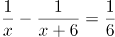

B. 

C. 

D. 

第 61 题 · 答案与解析

**参考答案（粉笔题库参考内容）**

A

**解析**

根据题意，老林从家到追上小林，老林和小林行驶的路程均为1.5-0.5=1 公里，老林比小林少用10 分钟，即1/6 小时。小林速度为x，老林速度为x+6，则。

故正确答案为A。

### 第 62 题

汽车的经济时速是指汽车最省油的行驶速度。据某汽车公司测算，该公司一款新型汽车以每小时70～110公里的速度行驶时，其每公里耗油量公式为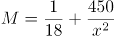（x为汽车速度，M为耗油量）。那么该款汽车在70～110公里/小时速度区间的经济时速为：

A. 80公里/小时

B. 90公里/小时

C. 100公里/小时

D. 105公里/小时

第 62 题 · 答案与解析

**参考答案（粉笔题库参考内容）**

D

**解析**

根据每公里耗油公式：，当x越大时，M越小，即速度越大，耗油越小。则在速度区间70～110公里/小时中经济时速应取最大值，则选择选项中最大值105公里/小时。

故正确答案为D。

备注1：在70～110公里/小时速度区间中，根据每公里耗油公式，速度越大，耗油越少，则经济时速应取最大值110公里/小时，但结合选项只能选择最大值105公里/小时。

备注2：本题所给条件为“每公里耗油量公式”，则经济速度应为——当每公里耗油量最少时，汽车行驶的速度；有同学设行驶速度为x，则单位时间（令t=1）行驶路程S=x，则单位时间耗油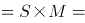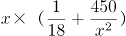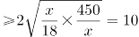，当且仅当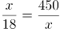时等号成立，解得x=90。但是此解为“使单位时间耗油最少的速度”与题干所给条件“每公里耗油”以及所求“每公里耗油最少”不符。

### 第 63 题

某次田径运动会中，选手参加各单项比赛计入所在团体总分的规则为：一等奖得9分，二等奖得5分，三等奖得2分。甲队共有10位选手参赛，均获奖。现知甲队最后总分为61分，问该队最多有几位选手获得一等奖？

A. 3

B. 4

C. 5

D. 6

第 63 题 · 答案与解析

**参考答案（粉笔题库参考内容）**

C

**解析**

设获得一等奖、二等奖、三等奖的人数分别为x、y、z，根据题意得：x+y+z=10，9x+5y+2z=61，整理两式，消去z得：7x+3y=41。

问获得一等奖人数最多，考虑从大到小代入：

代入D项，若x=6，代入7x+3y=41，y为负且不是整数，排除；

代入C项，若x=5，代入7x+3y=41，解得y=2，z=3，符合题意。

故正确答案为C。

### 第 64 题

幼儿园老师设计了一个摸彩球游戏，在一个不透明的盒子里混放着红、黄两种颜色的小球，它们除了颜色不同，形状、大小均一致。已知随机摸取一个小球，摸到红球的概率为三分之一。如果从中先取出3红7黄共10个小球，再随机摸取一个小球，此时摸到红球的概率变为五分之二，那么原来盒中共有红球多少个？

A. 5

B. 10

C. 15

D. 20

第 64 题 · 答案与解析

**参考答案（粉笔题库参考内容）**

A

**解析**

假设原来盒子中共有x个红球，因随机摸取一个小球，摸到红球的概率为1/3，则原来盒子中共有3x个小球。取出3红7黄共10个小球后，红球剩下(x-3)个，小球总个数为(3x-10)，此时随机摸取一个小球，摸到红球的概率为2/5，则，解得x=5。

故正确答案为A。

### 第 65 题

甲、乙两个工程队共同参与一项建设工程。原计划由甲队单独施工30天完成该项工程三分之一后，乙队加入，两队同时再施工15天完成该项工程。由于甲队临时有别的业务，其参加施工的时间不能超过36天，那么为全部完成该项工程，乙队至少要施工多少天？

A. 18

B. 20

C. 24

D. 30

第 65 题 · 答案与解析

**参考答案（粉笔题库参考内容）**

A

**解析**

根据题意可得，甲队单独完成这项工程需要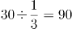天，则90甲=30甲+15×(甲+乙)，得3甲=乙，则甲、乙效率之比为1:3，赋值甲的效率为1，乙的效率为3，工程总量为90×1=90。根据问题，乙队施工天数尽可能少，则甲队施工天数应尽可能多，其最多可为36天，则乙队施工天数至少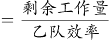=18天。

故正确答案为A。

### 第 66 题

一工厂生产的某规格齿轮的齿数是一个三位数的质数（除了1和它本身之外，不能被其他整数整除的正整数），其个、十、百位数字各不相同且均为质数。若将该齿数的百位数字与个位数字对调，所得新的三位数比该齿数大495，则该齿数的十位数字为：

A. 7

B. 5

C. 3

D. 2

第 66 题 · 答案与解析

**参考答案（粉笔题库参考内容）**

B

**解析**

三位数数字各不相同且均为质数，可知三位数字应在2、3、5、7中选择。调换位置后所得新数字比原数字大495，根据尾数判断则原数字的个位（调换后的百位）应为7，原数字的百位（调换后的个位）应为2，则十位数字只能是3或5。如果是3，则原数字为237=3×79，不是质数，不符合题意，因此原十位数字只能为5。

故正确答案为B。

### 第 67 题

因装修需要，拟在边长为2m的正方形浴室正中央处安装圆形淋浴喷头，喷头直径为10cm，出水喷射角度与垂直方向的最大夹角为30°。假设不考虑重力影响，要使喷头喷射到的面积能完全覆盖浴室，而且考虑施工实际，只有下列四个选项可选，则在满足设计要求的情况下，喷头底面距离地面可供选择的最低高度是多少？（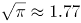）

A. 185cm

B. 190cm

C. 195cm

D. 200cm

第 67 题 · 答案与解析

**参考答案（粉笔题库参考内容）**

B

**解析**

根据题干要求“要使喷头喷射到的面积能完全覆盖浴室”，即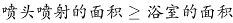。设喷头底面距离地面高度为hcm，由“出水喷射角度与垂直方向的最大夹角为30°”，可知喷头外延能够喷射的最远距离l为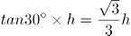cm。由“喷头直径为10cm”可知喷头半径r为5cm，喷头喷射的总半径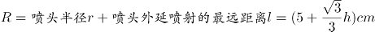。则喷头喷射的面积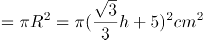，正方形浴室的面积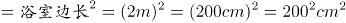。由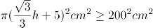，解得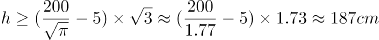。结合题干要求“考虑施工实际，只有下列四个选项可选”，则要选择略大于187的选项，B项符合。

故正确答案为B。

备注：这道题目本质上是一道错题，命题人在命题过程中只考虑了面积大小关系，但从实际情况来看，圆形喷头喷出的水会打在墙壁上，但房间的四角喷射不到。而此题如果以喷射半径覆盖房间，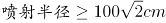，进行计算，喷头高度的结果≈236cm，没有答案。

### 第 68 题

甲、乙两部参加军事演习。甲部从大本营以60千米/小时的速度往西行进，乙部晚半小时由大本营往东行进，速度比甲部慢。两部同时接到军令紧急集合，集合地位于大本营正北某处。此时两部所在位置与集合地恰好构成有一角为30度的直角三角形。若两部同时调整方向往集合地行军，且保持速度不变，则可同时到达集合地。问集合地与大本营的距离约为多少千米？

A. 38

B. 41

C. 44

D. 48

第 68 题 · 答案与解析

**参考答案（粉笔题库参考内容）**

B

**解析**

根据题意可得右图，

因甲部速度大于乙部且早出发半小时，故OA>OB，则∠ACB=90°，∠CAO=30°。两部同时调整方向可同时到达集合地C，则甲部、乙部速度之比为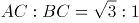，则乙部速度为千米/小时。

设乙部从B点到C点行驶时间为t，则，AC=60t，在直角三角形OCB中，∠OCB=30°，则，同理可得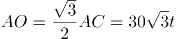。因甲部比乙部早出发半小时即0.5小时，则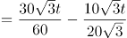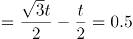，解得小时。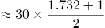≈40.98，即约为41千米。

故正确答案为B。

### 第 69 题

如右图所示，一条河流的两岸分别有A、B两处景点，河面宽80米，A与B的直线距离是100米。现需铺设一条观光栈道连接A与B。已知陆地栈道的铺设费用是0.1万元/米，河面栈道的铺设费用是0.125万元/米，则最少需要铺设费用：

A. 12.5万元

B. 12万元

C. 11.5万元

D. 11万元

第 69 题 · 答案与解析

**参考答案（粉笔题库参考内容）**

A

**解析**

如图所示若沿AB建造观光栈道，则需建造河面栈道AB段100m，共需要铺设费用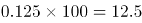万元；若沿AO→OB铺设栈道，则需建造河面栈道AO段80m和陆地栈道OB段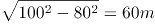，共需要铺设费用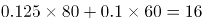万元。通过所给条件对比分析，最少铺设费用为12.5万元（沿AB段建造）。

故正确答案为A。

备注：如若讨论陆地与河面栈道的转折点：在OB段上取任意点C，设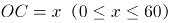。沿AC→CB铺设栈道，则需建造河面栈道AC段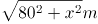和陆地栈道CB段(60-x)m，共需要铺设费用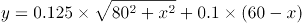万元。取特值分析x和y的增减关系，取值如表：

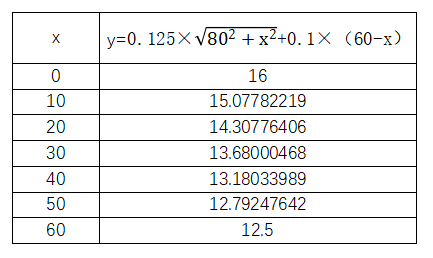

由特值分析可知，x取值越大，费用y越小。故x=60时（即C点与B点重合）， y可取得最小值12.5。

### 第 70 题

小王在商店消费了90元，口袋里只有1张50元、4张20元、8张10元的钞票，他共有几种付款方式，可以使店家不用找零钱?

A. 5

B. 6

C. 7

D. 8

第 70 题 · 答案与解析

**参考答案（粉笔题库参考内容）**

C

**解析**

根据题干条件分析，付款方式可包含使用50元与不使用50元两种情况。对情况进行枚举可得：

可得共有7种付款方式，可以使店家不用找零钱。

故正确答案为C。

### 第 71 题

从所给的四个选项中，选择最合适的一个填入问号处，使之呈现一定的规律性：

A. A

B. B

C. C

D. D

第 71 题 · 答案与解析

**参考答案（粉笔题库参考内容）**

D

**解析**

解析一：元素组成不同，属性无明显规律，考虑数量规律。题干均为立体图形，且封闭区域较多，可数立体图形的外表面的面数量，即立体图形的外表面是由几个面构成的，观察发现分别由2、3、4、5、6个面构成，因此“？”处应该选择一个外表面为7的立体图形。A选项8个面，B选项6个面，C选项3个面，D选项7个面。D项当选。

故正确答案为D。

解析二：元素组成不同，属性无明显规律，考虑数量规律。观察发现题干立体图形均有下底面，图一和图二下底面形状相同，图三和图四下底面形状相同，因此“？”处应该选择一个与图五下底面形状相同的图形。B项当选。

故正确答案为B。

因为解析一中数立体图形的外表面的面数量呈现严谨的等差规律，故粉笔对于此题更倾向根据外表面的面数量，选择 D项。

### 第 72 题

正方体切掉一块后剩余部分如下图左侧所示，右侧哪一项是其切去部分的形状？

A. A

B. B

C. C

D. D

第 72 题 · 答案与解析

**参考答案（粉笔题库参考内容）**

B

**解析**

此题为立体图形拼合问题，解题原则为凹凸一致。根据题目要求，可知正确选项和左侧图形拼合后应为正方体。观察题干左侧图形，发现外侧斜坡和其内侧上方凸出的小矩形在同一侧，而A、C两项外侧斜坡和凹进去的小矩形不在同一侧，排除；比较B、D两项，仅在中间位置不同，题干左侧图形中间位置存在斜坡，根据凹凸一致的原则，选项也应存在斜坡，只有B项符合。

故正确答案为B。

### 第 73 题

把下面的图形分为两类，使每一类图形都有各自的共同特征或规律，分类正确的一项是：

A. ①③⑥，②④⑤

B. ①③⑤，②④⑥

C. ①④⑥，②③⑤

D. ①②④，③⑤⑥

第 73 题 · 答案与解析

**参考答案（粉笔题库参考内容）**

C

**解析**

元素组成不同，优先考虑属性规律。对称、曲直均无明显规律，考虑开闭性。图①④⑥均为半开半封闭图形；图②③⑤均为全封闭图形。因此①④⑥一组，②③⑤一组。

故正确答案为C。

### 第 74 题

把下面的图形分为两类，使每一类图形都有各自的共同特征或规律，分类正确的一项是：

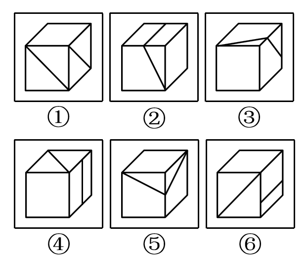

A. ①③⑤，②④⑥

B. ①④⑥，②③⑤

C. ①④⑤，②③⑥

D. ①②⑥，③④⑤

第 74 题 · 答案与解析

**参考答案（粉笔题库参考内容）**

B

**解析**

解析一：

本题为分组分类题目。题干均是里面有两条直线的立体图形，可以考虑两条直线之间的关系。观察发现，图①④⑥中两条直线不相交，图②③⑤中两条直线相交，故①④⑥一组，②③⑤一组，只有B项符合。

故正确答案为B。

解析二：

本题为分组分类题目。题干均是里面有两条直线的立体图形，可以考虑两条直线之间的关系。观察发现，图①③⑤中两条直线不垂直，图②④⑥中两条直线垂直，故①③⑤一组，②④⑥一组，只有A项符合。

故正确答案为A。

粉笔说明：方法一的分类更直观，而方法二的知识点在以前有所考查，故本题属于命题不严谨。

### 第 75 题

从所给四个选项中，选择最合适的一个填入问号处，使之呈现一定的规律性：

A. A

B. B

C. C

D. D

第 75 题 · 答案与解析

**参考答案（粉笔题库参考内容）**

C

**解析**

元素组成不同，且无明显属性规律，考虑数量规律。图四、图五封闭面明显，考虑面数量。面数量依次为2、3、4、5、6，则问号处图形面数量为7，只有C符合要求。

故正确答案为C。

### 第 76 题

组织认同是指组织成员在行为或观念等诸方面与其所加入的组织具有一致性，觉得自己在组织中既有理性的契约和责任感，也有非理性的归属和依赖感，以及在这种心理基础上表现出的对组织活动尽心尽力的行为结果。

根据上述定义，下列选项**不属于**组织认同的是：

A. “我们要以共产党员的标准严格要求自己”

B. “公司面临困难的时候，我们要不离不弃”

C. “我要每时每刻自觉维护公司的良好形象”

D. “今日我以母校为傲，明日母校以我为荣”

第 76 题 · 答案与解析

**参考答案（粉笔题库参考内容）**

D

**解析**

第一步：找出定义关键词。

“组织成员与其所加入的组织具有一致性”、“既有理性的契约和责任感”、“也有非理性的归属和依赖感”、“对组织活动尽心尽力”。

第二步：逐一分析选项。

A项：用共产党员的标准要求自己，体现了党员的行为和观念与党组织的一致性，但说出此话的主体不一定是党员，非党员也可以表达这样的决心，该项主体不明确，可能符合“组织成员与其所加入的组织具有一致性”，保留；

B项：对公司不离不弃，体现了员工对公司的责任感和归属感，符合“既有理性的契约和责任感”、“也有非理性的归属和依赖感”，且面对困难也一直坚守，符合“对组织活动尽心尽力”，符合定义，排除；

C项：自觉维护公司的良好形象，符合“既有理性的契约和责任感”、“也有非理性的归属和依赖感”，符合定义，排除；

D项：学生和母校互相为各自取得的成绩骄傲，母校的定义是曾经在那里毕业或学习过的学校，即此刻已经不是该校的学生了，我们才会称之为“母校”，不符合“组织成员与其所加入的组织具有一致性”；另外学校和学生是教书育人的关系，一般也不会说二者有契约关系，不符合“既有理性的契约和责任感”，跟A项相比，A项可能符合，D项是更不符合的，当选。

本题为选非题，故正确答案为D。

### 第 77 题

意志的活动过程会体现以下两大定律。其中，意志强度边际效应定律是指意志的强度随着自身行为的活动规模的增长而下降；意志强度时间衰减定律是指意志的强度随着自身行为的持续时间的增长而呈现负指数下降。

根据上述定义，下列选项最能体现意志强度时间衰减定律的是：

A. 锲而舍之，朽木不折

B. 为山九仞，功亏一篑

C. 穷且益坚，不坠青云之志

D. 一鼓作气，再而衰，三而竭

第 77 题 · 答案与解析

**参考答案（粉笔题库参考内容）**

D

**解析**

第一步：找出定义关键词。

意志强度边际效应定律：“意志强度”、“随自身行为的活动规模增长而下降”；

意志强度时间衰减定律：“意志强度”、“随自身行为的持续时间增长而呈现负指数下降”。

第二步：逐一分析选项。

A项：“锲而舍之，朽木不折”意思是说如果不坚持做一件事，就算是腐朽的木头也无法折断，说明人们不坚持做一件事的后果，不符合“随自身行为的持续时间增长”，不符合定义，排除；

B项：“为山九仞，功亏一篑”意思是说堆九仞高的山，只缺一筐土导致不能完成，是用来比喻做事情只差最后一点没能完成，说明没有一直坚持下去，不符合“随自身行为的持续时间增长”，不符合定义，排除；

C项：“穷且益坚，不坠青云之志”意思是说一个人处境越是艰难，就越是坚忍不拔，越是不丢失高远之志，没有体现与时间增长的关系，不符合“随着自身行为的持续时间的增长而呈现负指数下降”，不符合定义，排除；

D项：“一鼓作气，再而衰，三而竭”意思是说，第一次击鼓士气会大大的增加，第二次击鼓士气就会减弱了，第三次击鼓就没有士气了，说明士气随着时间的增加而减弱，符合“随时间增长而呈现负指数下降”，符合定义，当选。

故正确答案为D。

### 第 78 题

元素指自然界中一百多种基本的金属和非金属物质，它们由一种原子组成，其原子中的每一个核子具有同样数量的质子，用一般的化学方法不能使之分解，并且能构成一切物质。原子是化学反应不可再分的基本微粒，原子在化学反应中不可分割，但在物理状态中可以分割，由原子核和绕核运动的电子组成。分子由原子构成，是构成物质的一种基本粒子的名称，是单独存在、保持化学性质最小的粒子。

根据上述定义，下列选项正确的是：

A. 原子是构成物质的最小粒子

B. 空气由各种细小的原子构成

C. 具有不同数量质子的原子不是同一类元素

D. 一氧化碳分子（CO）由一个氧元素和一个碳元素构成

第 78 题 · 答案与解析

**参考答案（粉笔题库参考内容）**

C

**解析**

第一步：找出定义关键词。

“元素是指自然界中一百多种基本的金属和非金属物质”、“元素由一种原子组成，其原子中的每一个核子具有相同数量的质子”、“原子用一般的化学方法不能使之分解，并且能构成一切物质”、“原子是化学反应不可再分的基本微粒，原子在化学反应中不可分割，但在物理状态中可以分割，由原子核和绕核运动的电子组成”、“分子由原子构成，是构成物质的一种基本粒子的名称，是单独存在、保持化学性质最小的粒子”。

第二步：逐一分析选项。

A项：原子是构成物质的最小粒子，不符合“在物理状态中可以分割”，不符合定义，排除；

B项：空气是一种混合物，不可能是由细小的原子构成，不符合定义，排除；

C项：具有不同数量质子的原子不是同一类元素，符合“元素由一种原子组成，其原子中的每一个核子具有相同数量的质子”，符合定义，当选；

D项：选项不符合“分子由原子构成，是构成物质的一种基本粒子的名称，是单独存在、保持化学性质最小的粒子”，一氧化碳分子（CO）应该是由一个氧原子和一个碳原子构成，不符合定义，排除。

故正确答案为C。

### 第 79 题

类脑计算技术总体分为三个层次：结构层次模仿脑、器件层次逼近脑、智能层次超越脑。其中，结构层次模仿脑是指将大脑作为一个物质和生理对象进行解析，获得基本单元(各类神经元和神经突触等)的功能及其连接关系（网络结构）；器件层次逼近脑是指研制能够模拟神经元和神经突触功能的器件，从而在有限的物理空间和功耗条件下构造出人脑规模的神经网络系统；智能层次超越脑是指通过对类脑计算机进行信息刺激、训练和学习，使其产生与人脑类似的智能。

根据上述定义，下列属于智能层次超越脑的是：

A. 调整神经网络的突触连接关系及连接频率和强度

B. 绘制精确的人类大脑动态图谱以解析探测大脑

C. 开发功能、密度与人类大脑皮层相当的电子装备

D. 捕捉细微的单个神经元放电的非线性动力学过程

第 79 题 · 答案与解析

**参考答案（粉笔题库参考内容）**

A

**解析**

第一步：找出定义关键词。

结构层次模仿脑：“将大脑作为物质和生理对象进行解析”、“获得基本单元的功能及其连接关系”；

器件层次逼近脑：“研制能够模拟神经元和神经突触功能的器件”、“构造出人脑规模的神经网络系统”；

智能层次超越脑：“对类脑计算机进行信息刺激、训练和学习”、“产生与人脑类似的智能”。

第二步：逐一分析选项。

A项：调整神经网络的突触连接关系及连接频率和强度，符合“对类脑计算机进行信息刺激、训练和学习” ，符合“智能层次超越脑”定义，当选；

B项：绘制精确的人类大脑动态图谱，符合“将大脑作为物质和生理对象进行解析”，符合“结构层次模仿脑”定义，不符合“智能层次超越脑”定义，排除；

C项：开发功能、密度与人类大脑皮层相当的电子装备，符合“研制能够模拟神经元和神经突触功能的器件”，符合“器件层次逼近脑”定义，不符合“智能层次超越脑”定义，排除；

D项：捕捉细微的单个神经元放电的非线性动力学过程，符合“获得基本单元的功能及其连接关系”，符合“结构层次模仿脑”定义，不符合“智能层次超越脑”定义，排除。

故正确答案为A。

注：本题目来自于《类脑计算机的现在与未来》，各选项对应于该文章中的句子如下所示：

A项：所谓“智能层次超越脑”，属于类脑计算机应用软件层次的问题，是指通过对类脑计算机进行信息刺激、训练和学习，使其产生与人脑类似的智能甚至涌现出自主意识，实现智能培育和进化。刺激源可以是虚拟环境，也可以是来自现实环境的各种信息（例如互联网大数据）和信号（例如遍布全球的摄像头和各种物联网传感器），还可以是机器人“身体”在自然环境中探索和互动。在这个过程中，**类脑计算机能够调整神经网络的突触连接关系及连接强度，实现学习、记忆、识别、会话、推理以及更高级的智能；**

B项：所谓“结构层次模仿脑”，**是将大脑作为一个物质和生理对象进行解析，**获得基本单元（各类神经元和神经突触等）的功能及其连接关系（网络结构）；

C项：所谓“器件层次逼近人脑”，是指研制能够模拟神经元和神经突触功能的微纳光电器件，从而在有限的物理空间和功耗条件下构造出人脑规模的神经网络系统。这方面的代表性项目是美国国防部先进研究项目局（DARPA）2008年启动的“神经形态自适应可塑性可扩展电子系统”（即突触），**其目标是研制出器件功能、规模与密度均与人类大脑皮层相当的电子装置；**

D项：所谓“结构层次模仿脑”，是将大脑作为一个物质和生理对象进行解析，获得基本单元（各类神经元和神经突触等）的功能及其连接关系（网络结构）。这一阶段，主要通过神经科学实验采用先进的分析探测技术完成。1952年，英国科学家霍奇金和赫胥黎提出了以两人命名的HH方程，**精确刻画了单个神经元放电的非线性动力学过程，这是神经元信息处理的标准数学模型。**

### 第 80 题

消费滞后是指个人消费滞后于国家经济发展和个人家庭收入所应达到的平均消费水平。消费超前是指当下的收入水平不足以购买现在所需的产品或服务，以贷款、分期付款、预支等形式进行消费。

根据上述定义，下列属于消费超前的是：

A. 职员小王以信用卡支付的形式在网上订购了火车票

B. 大学生小李通过某借贷平台购买了某知名品牌电脑

C. 退休工人老张名下有商品房和汽车，但坚持只用老式的直板手机

D. 青年教师小刘有十万元定期存款未到期，向同事借了八万元买车

第 80 题 · 答案与解析

**参考答案（粉笔题库参考内容）**

B

**解析**

第一步：找出定义关键词。

消费滞后：“指个人消费滞后于国家经济发展和个人家庭收入所应达到的平均消费水平”；

消费超前：“指当下的收入水平不足以购买现在所需的产品或服务”、“以贷款、分期付款、预支等形式进行消费”。

第二步：逐一分析选项。

A项：小王为职员说明小王已经工作，购买火车票应该是消费水平范围内，不符合“当下的收入水平不足以购买现在所需的产品或服务”，不符合定义，排除；

B项：小李是一名大学生，尚未参加工作，购买电脑符合“当下的收入水平不足以购买现在所需的产品或服务”，且通过“某借贷平台购买”属于“贷款”的支付方式，符合定义，当选；

C项：老张有房有车，却使用老式的直板手机，符合“个人消费滞后于国家经济发展和个人家庭收入所应达到的平均消费水平”，属于消费滞后，不属于消费超前，不符合定义，排除；

D项：小刘有十万元的存款，而车只有八万元，也就是当下的收入足以购买现在所需的产品，不符合“当下的收入水平不足以购买现在所需的产品或服务”，且向同事借钱不符合“以贷款、分期付款、预支等形式进行消费”，不符合定义，排除。

故正确答案为B。

### 第 81 题

似动是指在一定的时间和空间条件下，人们在静止的物体间看到了运动，或者在没有连续位移的地方，看到了连续位移。

根据上述定义，下列选项**不属于**似动现象的是：

A. 两岸青山相对出

B. 坐地日行八万里

C. 郡邑浮前浦，波澜动远空

D. 明月却多情，随人处处行

第 81 题 · 答案与解析

**参考答案（粉笔题库参考内容）**

B

**解析**

第一步：找出定义关键词。

“在一定的时间和空间条件下”、“人们在静止的物体间看到了运动”、“或者在没有连续位移的地方，看到了连续位移”。

第二步：逐一分析选项。

A项：“两岸青山相对出”意思是两岸的青山相继出迎，一座座扑进眼帘。青山本是静止的物体，但是作者却看到了它的运动，符合“人们在静止的物体间看到了运动”，符合定义，排除；

B项：“坐地日行八万里”意思是人们住在地球上，因地球自转，于不知不觉中，一日已行了八万里路。依据科学理论，当我们处于赤道附近的时候，即使每天原地不动，也会运动八万华里，即人没有动，而且也看不见运动。所以不符合“在静止的物体间看到了运动”、“或在没有连续位移的地方，看到了连续位移”，不符合定义，当选；

C项：“郡邑浮前浦，波澜动远空”意思是远处的城郭好像在水面上飘动，波翻浪涌，辽远的天空也仿佛为之摇荡。但是事实上，城郭本身不会运动，天空也不会飘荡，符合“人们在静止的物体间看到了运动”，符合定义，排除；

D项：“明月却多情，随人处处行”意思是明月却是那么多情，不管人走到哪里，它都陪伴着你同行。但是我们用肉眼是看不到明月本身在运动的，所以符合“人们在静止的物体间看到了运动”，符合定义，排除。

本题为选非题，故正确答案为B。

### 第 82 题

投射性认同指一个人诱导他人以一种限定的方式来作出反应的行为模式。体现在人际关系中，往往是甲方把内心中“好”或“坏”的客体投射到乙方身上，认为乙方“好”或“坏”，而乙方又接受了这一投射幻想，于是就以甲方所设想的方式来对待甲方。然后甲方又进一步验证了自己的假设，认为乙方就是他所认为的那样的人。

根据上述定义，下列选项属于投射性认同的是：

A. 寒门亦可出贵子

B. 严师方能出高徒

C. 虎父果然无犬子

D. 慈母自古多败儿

第 82 题 · 答案与解析

**参考答案（粉笔题库参考内容）**

C

**解析**

第一步：找出定义关键词。

“甲方把内心中‘好’或‘坏’的客体投射到乙方身上”、“乙方接受这一幻想”、“甲方验证了假设”。

第二步：逐一分析选项。

A项：寒门也可以出贵子，是指出生微贱的年轻人在自身努力和外界条件支持下也可以获得成就，认为寒门可以出贵子，符合“甲方把内心中‘好’或‘坏’的客体投射到乙方身上”，但最终出身寒门的年轻人是否成为了贵子并没有得到验证，不符合“乙方接受这一幻想”、“甲方验证了假设”，不符合定义，排除；

B项：严师方能出高徒，是指严格的师傅或老师能教出本领高超的好徒弟或好学生，认为严师才能出高徒，符合“甲方把内心中‘好’或‘坏’的客体投射到乙方身上”，但该项没有涉及严师的徒弟最后到底是否成为了高徒的验证，不符合“乙方接受这一幻想”、“甲方验证了假设”，不符合定义，排除；

C项：虎父果然无犬子，是指出色的父亲果然不会生出一般的孩子，认为虎父无犬子，符合“甲方把内心中‘好’或‘坏’的客体投射到乙方身上”，且该项中的“果然”体现了虎父的孩子确实不是犬子，体现了进一步验证了自己的假设，符合“乙方接受这一幻想”、“甲方验证了假设”，符合定义，当选；

D项：慈母自古多败儿，是指宠溺孩子的母亲，教出的孩子多是很自私很任性，认为慈母多败儿，符合“甲方把内心中‘好’或‘坏’的客体投射到乙方身上”，但该项没有涉及慈母的儿子最后到底是否是自私任性的人的验证，不符合“乙方接受这一幻想”、“甲方验证了假设”，不符合定义，排除。

故正确答案为C。

### 第 83 题

关怀强迫症即一个人特别需要别人依赖自己，总是爱向别人提供别人不需要的关怀。并且，这种人还强迫别人接受自己的关怀，从而使别人不能独立。当别人依赖自己的时候，他就会感到满足，感到自己有价值。这种症状会压抑人的神经，并同时给身边的亲朋好友甚至一般的同事带来诸多不便。

根据上述定义，下列属于关怀强迫症的是：

A. 张某说：“我一天没见到儿子就会发疯”

B. 李某连哄带骗让感冒的女儿吃下感冒药

C. 刘某从小学到大学期间都住自己家里

D. 王某在女儿就读的大学附近租房陪读

第 83 题 · 答案与解析

**参考答案（粉笔题库参考内容）**

D

**解析**

第一步：找出定义关键词。

“需要别人依赖自己”、“提供别人不需要的关怀”、“强迫别人接受”、“使别人不能独立”。

第二步：逐一分析选项。

A项：张某一天没见到儿子就会发疯，说明是张某依赖儿子，而并非是儿子依赖自己，不符合“需要别人依赖自己”，不符合定义，排除；

B项：李某连哄带骗让感冒的女儿吃下感冒药，没有体现“需要别人依赖自己”，且感冒的女儿需要被人关怀照顾，不符合“提供别人不需要的关怀”，不符合定义，排除；

C项：刘某上学期间住在家里，没有体现到强迫别人，不符合“强迫别人接受”，不符合定义，排除；

D项：王某在女儿就读的大学附近租房陪读，女儿已经读大学了，说明她已经能够独立地生活和学习，符合 “提供别人不需要的关怀”、“强迫别人接受”、“使别人不能独立”，符合定义，当选。

故正确答案为D。

### 第 84 题

投资市场相反理论是指投资市场本身并不创造新的价值，没有增值，甚至可以说是减值。如果一个投资者在投资行动时同多数投资者相同，那么他一定不是获利最大的，因为不可能多数人获利；要获得最大的利益，一定要同多数人的行动不一致。

根据上述定义，下列选项**不符合**投资市场相反理论的是：

A. “已经跌这么多了，该到底了”

B. “在市场投资者爆满的时候，我们再离场”

C. “只要你和多数投资者的意见相左，致富机会永远存在”

D. “人弃我取，别人恐惧我贪婪”

第 84 题 · 答案与解析

**参考答案（粉笔题库参考内容）**

A

**解析**

第一步：找出定义关键词。

“投资市场本身并不创造新的价值，没有增值，甚至可以说是减值”、“要获得最大的利益，一定要同多数人的行动不一致”。

第二步：逐一分析选项。

A项：该项只说了投资产品价值的变化，并没有提及投资者人数是多还是少，以及投资者的策略是否相同，不符合定义，选非题，当选；

B项：该项提到在投资者非常多的时候我们再离场，表明我们与大多数投资者的策略是不相同的，符合 “要获得最大的利益，一定要同多数人的行动不一致”，符合定义，选非题，排除；

C项：该项说明投资者在投资时，选择和多数投资者不同的意见就可以成功，这符合“要获得最大的利益，一定要同多数人的行动不一致”，符合定义，选非题，排除；

D项：该项表明“我”和大多数投资者的投资策略是不同的，大家害怕投资失败选择放弃的时候，而“我”为了追求利润会选择购买，符合“要获得最大的利益，一定要同多数人的行动不一致”，符合定义，选非题，排除。

本题为选非题，故正确答案为A。

### 第 85 题

水文节律指湖泊水情周期性、有节律的变化。广义水文节律包括昼夜、月运、季节和年际节律。正常情况下，由于流域气候和下垫面等因素较稳定，湖泊多年平均水位趋于稳定数值即湖泊正常年平均水位。所以湖泊年际节律以干扰因素驱动的突变性和适应干扰后的阶段稳定性为特点，无渐变趋向；而昼夜节律对生态系统影响微弱。因此，狭义水文节律特指月运节律与季节节律。

根据上述定义，下列涉及狭义水文节律的是：

A. 鄱阳湖受降雨持续减少和来水减少双重影响，水面面积持续萎缩

B. 洪泽湖历史年均水温16.3℃，最高水温在9月，最低水温在1月

C. 洞庭湖去年年降水量1560毫米，其中4~6月降水约占全年一半

D. 巢湖流域年平均气温稳定在之间，有200天以上无霜期

第 85 题 · 答案与解析

**参考答案（粉笔题库参考内容）**

B

**解析**

第一步：找出定义关键词。

水文节律：“湖泊水情周期性、有节律的变化”；

广义水文节律：“昼夜、月运、季节和年际节律”；

狭义水文节律：“月运节律和季节节律”。

（注：水情是指江河湖泊的状况、特征及地理意义，如流量、水位、流速、水温与冰情等）

本题要选的是符合狭义水文节律的选项。

第二步：逐一分析选项。

A项：鄱阳湖水面面积持续萎缩，说明是一直在减小，不存在周期性的变化，不符合定义，排除；

B项：洪泽湖历史年均最高水温在9月，最低水温在1月，月份和季节不同水温也不同，而且是统计了历史上多年的水温，符合“湖泊水情周期性、有节律的变化”，符合“季节节律”，符合狭义水文节律，符合定义，当选（水情指江河湖泊的状况、特征及地理意义，如流量、水位、流速、水温与冰情等，水温是水文测验的基本项目之一）；

C项：只是给出洞庭湖去年一年的降水量，没有体现“周期性、有节律的变化”，不符合定义，排除；

D项：巢湖流域平均气温在15-16摄氏度之间，有200天以上无霜期，是湖泊流经区域的气温变化，而不是湖泊水情的变化，不符合定义，排除。

故正确答案为B。

### 第 86 题

成长：衰亡

A. 坚定：彷徨

B. 美好：苦难

C. 深刻：纯真

D. 复杂：单纯

第 86 题 · 答案与解析

**参考答案（粉笔题库参考内容）**

A

**解析**

第一步：判断题干词语间逻辑关系。

成长和衰亡是反义关系，并且成长是积极的，衰亡是消极的。

第二步：判断选项词语间逻辑关系。

A项：坚定和彷徨是反义关系，并且坚定是积极的，彷徨是消极的，与题干逻辑关系一致，当选；

B项：美好的反义词应该是丑陋，而苦难不一定是丑陋的，很多磨难是对人的一种历练，是对人生有益的，因此美好和苦难不是反义关系，与题干逻辑关系不一致，排除；

C项：深刻和纯真不是反义关系，与题干逻辑关系不一致，排除；

D项：复杂和单纯是反义关系，但是复杂和单纯没有积极和消极之分，与题干逻辑关系不一致，排除。

故正确答案为A。

### 第 87 题

玻璃幕墙：光污染

A. 汽车尾气：酸雨

B. 海上风暴：海啸

C. 火山喷发：地震

D. 空气消毒：臭氧

第 87 题 · 答案与解析

**参考答案（粉笔题库参考内容）**

A

**解析**

第一步：判断题干词语间逻辑关系。

玻璃幕墙可以导致光污染，二者是因果关系，并且玻璃幕墙是人为产物。

第二步：判断选项词语间逻辑关系。

A项：汽车尾气可以导致酸雨，二者为因果关系，并且汽车尾气是人为产物，与题干逻辑关系一致，当选；

B项：海上风暴可以导致海啸，二者为因果关系，但海上风暴为天然现象，与题干逻辑关系不一致，排除；

C项：火山喷发可以导致地震，二者为因果关系，但火山喷发为天然现象，与题干逻辑关系不一致，排除；

D项：空气消毒不会导致臭氧，二者不是因果关系，与题干逻辑关系不一致，排除。

故正确答案为A。

### 第 88 题

孤本：书籍

A. 正方形：长方形

B. 蔬菜：土地

C. 显微镜：实验室

D. 礼物：商品

第 88 题 · 答案与解析

**参考答案（粉笔题库参考内容）**

A

**解析**

第一步：判断题干词语间逻辑关系。

孤本，指某书刊仅有一份在世间流传的版本，亦指仅存的一份未刊手稿或原物已亡佚，仅存的一份拓本。孤本是特殊的书籍。

第二步：判断选项词语间逻辑关系。

A项：正方形是特殊的长方形，与题干逻辑关系一致，当选；

B项：蔬菜和土地，土地是蔬菜生长的场所，与题干逻辑关系不一致，排除；

C项：显微镜和实验室，显微镜是实验室需要用到的工具，与题干逻辑关系不一致，排除；

D项：有的礼物是商品，有的礼物不是商品，有的商品是礼物，有的商品不是礼物，二者为交叉关系，与题干逻辑关系不一致，排除。

故正确答案为A。

### 第 89 题

老字号：新品牌：传承

A. 老传统：新花样：质疑

B. 老配方：新工艺：创新

C. 老问题：新思考：评价

D. 老物件：新东西：区分

第 89 题 · 答案与解析

**参考答案（粉笔题库参考内容）**

B

**解析**

第一步：判断题干词语间逻辑关系。

老字号经过传承可以变为新品牌。

第二步：判断选项词语间逻辑关系。

A项：老传统被质疑不能变为新花样，与题干逻辑关系不一致，排除；

B项：老配方经过创新可以变为新工艺，与题干逻辑关系一致，当选；

C项：老问题被评价不能变为新思考，与题干逻辑关系不一致，排除；

D项：老物件被区分不能变为新东西，与题干逻辑关系不一致，排除。

注：此题有同学可能会纠结D项，认为老字号与新品牌都是品牌，老物件与新东西都是物品。但D项前两个词与区分无关。从题干三个词的关系看体现了新老物体之间的变化，而B项也是体现了新老事物之间的变化，因此粉笔更倾向于B项。

故正确答案为B。

### 第 90 题

效率：公平：市场经济

A. 科学：理性：政治哲学

B. 革命：改良：社会制度

C. 民主：集中：组织原则

D. 美丑：善恶：审美范畴

第 90 题 · 答案与解析

**参考答案（粉笔题库参考内容）**

C

**解析**

第一步：判断题干词语间逻辑关系。

市场经济需要兼顾效率与公平。

第二步：判断选项词语间逻辑关系。

A项：政治哲学不需要兼顾科学与理性，且科学是理性的，与题干逻辑关系不一致，排除；

B项：社会制度不需要兼顾革命与改良，与题干逻辑关系不一致，排除；

C项：组织原则需要兼顾民主与集中，与题干逻辑关系一致，当选；

D项：审美范畴不需要兼顾美丑与善恶，且善恶不属于审美的范畴，与题干逻辑关系不一致，排除。

故正确答案为C。

### 第 91 题

（ ） 对于 幸灾乐祸 相当于 怨天尤人 对于 （ ）

A. 得意忘形；呼天号地

B. 乐极生悲；饮恨吞声

C. 兔死狐悲；乐天知命

D. 睚眦必报；破涕为笑

第 91 题 · 答案与解析

**参考答案（粉笔题库参考内容）**

C

**解析**

逐一代入选项。

A项：得意忘形指因心意得到满足而高兴得失去常态，幸灾乐祸指人缺乏善意，在别人遇到灾祸时感到高兴，二者无关；怨天尤人指遇到挫折或出了问题，一味抱怨天责怪别人，呼天号地形容极为冤屈、怨恨或痛苦，二者无关，前后逻辑关系不一致，排除；

B项：乐极生悲指高兴到极点时，发生使人悲伤的事，与幸灾乐祸无关；饮恨吞声形容忍恨含悲，不敢表露，与怨天尤人无关，前后逻辑关系不一致，排除；

C项：兔死狐悲指对同盟的死亡或不幸而伤心，与幸灾乐祸构成反义关系；乐天知命指认为自己的一切都由命运支配，安于现状，与怨天尤人构成反义关系，前后逻辑关系一致，当选；

D项：睚眦必报指像瞪一下眼睛那样极小的怨仇也要报复，比喻心胸极其狭窄，与幸灾乐祸无关；破涕为笑形容转悲为喜，一下子从哭变为了笑，与怨天尤人无关，前后逻辑关系不一致，排除。

故正确答案为C。

### 第 92 题

巾帼 之于 （ ） 相当于 （ ） 之于 监狱

A. 须眉；囚犯

B. 英雄；犯罪

C. 女子；铁窗

D. 头饰；惩罚

第 92 题 · 答案与解析

**参考答案（粉笔题库参考内容）**

C

**解析**

逐一代入选项。

A项：巾帼原指古代妇女的头巾和发饰，也借指妇女、女子，须眉指代男子，巾帼和须眉是并列关系；囚犯关押于监狱之中，二者是人物和场所的对应关系。前后逻辑关系不一致，排除；

B项：巾帼和英雄是交叉关系；犯罪之后可能会囚禁在监狱里，犯罪和监狱是对应关系。前后逻辑关系不一致，排除；

C项：巾帼原指古代妇女的头巾和发饰，也借指妇女、女子；铁窗是装上铁栅的窗户，比喻象征监狱。前后逻辑关系一致，当选；

D项：巾帼原指古代妇女的头巾和发饰，与头饰属于种属关系；惩罚与监狱无明显逻辑关系。前后逻辑关系不一致，排除。

故正确答案为C。

### 第 93 题

（ ） 对于 聚集之处 相当于 捷径 对于 （ ）

A. 荟萃；取巧之思

B. 渊薮；速成之法

C. 辐辏；入门之路

D. 囹圄；提升之梯

第 93 题 · 答案与解析

**参考答案（粉笔题库参考内容）**

B

**解析**

逐一代入选项。

A项：荟萃比喻优秀的人物或精美的东西会集、聚集，可以形容聚集之处，捷径比喻能较快地达到目的的巧妙手段或办法，与取巧之思无关，前后逻辑关系不一致，排除；

B项：渊薮比喻某种人或事、物聚集的地方，可以比喻聚集之处；捷径指近便的小路，形容便捷的方法，可以比喻速成之法，前后逻辑关系一致，当选；

C项：辐辏形容人或物聚集像车辐集中于车毂一样，可以形容聚集之处，入门之路与捷径无关，前后逻辑关系不一致，排除；

D项：囹圄原指监牢，后引申为束缚、困难，与聚集之处无关，捷径与提升之梯无关，前后逻辑关系不一致，排除。

故正确答案为B。

### 第 94 题

瓮牖绳枢：粗茶淡饭：清寒

A. 叠床架屋：衣锦食肉：奢华

B. 箪食瓢饮：曲肱饮水：简朴

C. 轻车熟路：霜行草宿：轻松

D. 金盆洗手：金屋藏娇：阔绰

第 94 题 · 答案与解析

**参考答案（粉笔题库参考内容）**

B

**解析**

第一步：判断题干词语间逻辑关系。

瓮牖绳枢指以破瓮作窗户，以草绳系户枢，比喻贫穷人家；粗茶淡饭形容饮食简单，生活简朴，二者都可以用来形容清寒。

第二步：判断选项词语间逻辑关系。

A项：叠床架屋比喻办事重复，自找麻烦；衣锦食肉形容生活富足，第一词与奢华无关，与题干逻辑关系不一致，排除；

B项：箪食瓢饮形容读书人安于贫穷的清高生活；曲肱饮水形容清心寡欲、安贫乐道的生活，二者都可以用来形容简朴，与题干逻辑关系一致，当选；

C项：轻车熟路比喻事情又熟悉又容易；霜行草宿指在霜露中行走，草野中息宿，形容奔波劳苦，第二词与轻松无关，与题干逻辑关系不一致，排除；

D项：金盆洗手指放弃以前长期从事的行业或某件事；金屋藏娇指十分宠爱妻子，也指男人纳妾或在外包养女人，二者均与阔绰无关，与题干逻辑关系不一致，排除。

故正确答案为B。

### 第 95 题

（ ） 对于 风险 相当于 精兵简政 对于 （ ）

A. 亡羊补牢：效率

B. 枕戈待旦：业绩

C. 克己奉公：资源

D. 曲突徙薪：成本

第 95 题 · 答案与解析

**参考答案（粉笔题库参考内容）**

D

**解析**

逐一代入选项。

A项：亡羊补牢比喻出了问题以后想办法补救，可以防止继续受损失，能够减少风险，精兵简政比喻精简不必要的东西，可以提高效率，一个体现减少，一个体现增加，前后逻辑关系不一致，排除；

B项：枕戈待旦指时刻警惕，准备作战，连睡觉时也不放松戒备，与风险无关，精兵简政与业绩无关，前后逻辑关系不一致，排除；

C项：克己奉公比喻一个人对自己要求严格，一心为公，与风险无关，精兵简政，其实就是节约资源，前后逻辑关系不一致，排除；

D项：曲突徙薪比喻消除可能导致事故的因素，防患于未然，曲突徙薪的目的是减少风险，精兵简政的目的是减少成本，前后逻辑关系一致，当选。

故正确答案为D。

### 第 96 题

长久以来，心理学家都支持“数学天赋论”：数学能力是人类自打娘胎里出来就有的能力，就连动物也有这种能力。他们认为存在一种天生的数学内核，通过自我慢慢发展，这种数学内核最后会“长”成我们所熟悉的一切数学能力。最近有反对者提出了不同的看法：数学能力没有天赋，只能是文化的产物。

以下哪项如果为真，最能支持反对者的看法？

A. 10~12个月的婴儿已经知道3个黑点和4个黑点是不一样的

B. 数学是大脑的产物，而大脑的生长模式早已由基因“预设”

C. 经过人为训练的大猩猩、海豚和大象等动物能处理数学问题

D. 绝大多数的原始部落的居民只能表示5以下甚至更少的数量

第 96 题 · 答案与解析

**参考答案（粉笔题库参考内容）**

D

**解析**

第一步：找出论点和论据。

论点：数学能力没有天赋，只能是文化的产物。

论据：无。

本题只有论点，没有论据，所以优先考虑补充论据的方式来加强。

第二步：逐一分析选项。

A项：说明婴儿可以区分数量不同的黑点，举例说明数学能力是有天赋的，否定论点，无法加强，排除；

B项：说明数学是大脑的产物，大脑已被基因预设，也就是说数学是有天赋的，否定论点，无法加强，排除；

C项：指出部分动物经过训练能处理数学问题，但是并不知道其是否有数学能力的天赋，不明确选项，无法加强，排除；

D项：说明绝大多数的原始部落的居民只能表示5甚至以下的数字，通过举例子的方式说明数学能力确实是文化的产物，补充论据，可以加强，当选。

故正确答案为D。

### 第 97 题

研究发现，20到39岁的群体更热衷于使用智能手机中的运动类应用。最主要的原因在于该群体大部分都已经参加工作，且亚健康在该群体中较普遍，所以越来越多的白领和年轻人更注重身体健康；同时，年轻人肥胖率占比较高，而年轻人对美的追求远远超过中老年人，所以他们更在乎运动；此外，该年龄段的用户群体也更熟悉智能手机的操作。

以下哪项如果为真，最能**削弱**上述调研发现？

A. 许多年轻人沉迷于智能手机中的游戏

B. 许多年轻人长期加班，睡眠远远不足

C. 年轻人不坚持运动易引发亚健康问题

D. 当代年轻人营养过于丰富，体型偏胖

第 97 题 · 答案与解析

**参考答案（粉笔题库参考内容）**

A

**解析**

第一步：找出论点和论据。

论点：20到39岁的群体更热衷于使用智能手机中的运动类应用。

论据：最主要的原因在于该群体大部分都已经参加工作，且亚健康在该群体中较普遍，所以越来越多的白领和年轻人更注重身体健康；同时，年轻人肥胖率占比较高。而年轻人对美的追求远远超过老年人，所以他们更在乎运动；此外，该年龄段的用户群体也更熟悉智能手机的操作。

本题的论点是20到39岁的群体更喜欢用智能手机中的运动类应用，其中的“更”表明了比较关系，因此削弱论点时要么削弱论点中的中心话题（年轻人不喜欢用手机中的运动类应用），要么直接削弱论点中比较关系（年轻人更喜欢用的不是智能手机中的运动类应用）。

第二步：逐一分析选项。

A项：论点说的是年轻人更喜欢用智能手机运动类应用，而该项说的是有很多年轻人沉迷的是智能手机中的游戏，削弱了论点中所说的运动类应用更受欢迎，削弱论点，当选；

B项：论点讨论的是年轻人更喜欢用智能手机的运动类应用，论据中第二句说的是年轻人大部分因工作处于亚健康状态，因此注重身体健康，本项说的是年轻人因经常加班而睡眠不足，因此本项支持了该论据，无法削弱，排除；

C项：本项说的是不坚持运动易导致亚健康，论据中第二句说的是年轻人大部分因工作处于亚健康状态，因此本项支持了该论据，无法削弱，排除；

D项：论据第二句是通过说明年轻人肥胖率占比高，年轻人更追求美来解释论点原因，本项说现在年轻人确实体型肥胖，加强了该论据，无法削弱，排除。

故正确答案为A。

### 第 98 题

多数家长的投入对子女学业投入具有显著的正向预测作用，家长投入程度随子女学段升高而降低，同时多数家长更注重在家辅导的投入，对子女参与社区及学校活动的投入较欠缺。而家长自主支持或控制的教养风格在家长投入与子女学业投入的关系中起调节作用，且部分通过子女学业心理需要的满足这一中介变量产生作用。

由此可以推出：

A. 多数家长对子女教育投入的减少，意味着子女学段的升高

B. 家长的投入、教养风格必然会对子女的学业投入产生影响

C. 家中学习环境的创设、形成和学校、社区间的联系呈反比关系

D. 子女学业心理需要的满足是影响其学业投入的内驱和首要因素

第 98 题 · 答案与解析

**参考答案（粉笔题库参考内容）**

B

**解析**

日常结论题，根据题干信息逐一分析选项。

A项：题干指出“家长投入程度随子女学段升高而降低”，先有子女学段升高，后有投入降低，而选项说的是家长对教育投入减少，意味着子女学段的升高，存在逻辑顺序错误，不能推出，排除；

B项：题干指出“多数家长的投入对子女学业投入具有显著的正向预测作用”和 “家长自主支持或控制的教养风格在家长投入与子女学业投入的关系中起调节作用”，说明家长的投入、教养风格均会对子女学业的投入产生影响，虽然“必然”这一表述过于绝对，但产生的影响可大可小，哪怕是微乎其微的影响，也可以说“必然有影响”，因此该选项是可以推出的，当选；

C项：题干指出“多数家长更注重在家辅导的投入，对子女参与社区及学校活动的投入较欠缺”，这是单纯对两种投入的多少情况进行描述，并未体现两种投入之间存在反比关系，过度脑补，无法推出，排除；

D项：题干只是说 “子女学业心理需要的满足是中介变量”，无法推出其是内驱和首要因素，无中生有，排除。

故正确答案为B。

注：本题确实非常有争议，大部分同学在A项和B项中纠结，A项的顺序反了，B项说得太绝对，都有不能接受的问题，所以我们通过查询原文和多次教研发现，B项就是整篇论文想重点讨论的核心内容，从以往经验来看，如果出题人在出题时题干大量参考了某篇文章，一般选项就不会违背该论文的主旨来出题，故小粉笔择优把答案给到B项。争议题各说各有理，备考时间有限，该题可不作为备考重点题目。

原文网址：https://www.sohu.com/a/311522939\_186472?sec=wd

### 第 99 题

快速、持续、无法预测的竞争环境要求企业规模小，结构简化，同时要有足够的技术储备和抵抗资金风险的能力。目前解决这一矛盾的途径通常是建立全球范围内的“基于双赢原则”的虚拟企业。虚拟企业是企业间的一种动态联盟，参加虚拟企业的各成员企业有一定的自主权。当出现了市场机会，各加盟企业就组织在一起，共同开发并生产销售新产品，一旦发现该产品无利可图，便自动解散。因此，虚拟企业被认为是21世纪最有竞争力的企业运行模式。

以下哪项如果为真，最能支持上述观点？

A. 当今社会发达的现代信息技术和通讯手段为各企业间的沟通提供了便利

B. 企业想在当前的竞争环境中生存发展扩大优势，需要一种新的运行模式

C. 虚拟企业中的任一加盟企业生产上出现问题都会中断整个生产链的运行

D. 虚拟企业可迅速集中最强设计加工与销售力量，实现对市场的快速反应

第 99 题 · 答案与解析

**参考答案（粉笔题库参考内容）**

D

**解析**

第一步：找出论点和论据。

论点：虚拟企业被认为是21世纪最有竞争力的企业运行模式。

论据：当出现了市场机会，各加盟企业就组织在一起，共同开发并生产销售新产品，一旦发现该产品无利可图，便自动解散。

论点论据都在说虚拟企业的优势，话题一致，优先考虑补充论据，补充能够证明虚拟企业是最有竞争力的企业运营模式的理由进行加强。

第二步：逐一分析选项。

A项：现代发达的信息技术为各企业之间的沟通提供便利，但是提供便利不代表就有竞争力，话题不一致，无法加强，排除；

B项：企业想在竞争环境中生存发展扩大优势，需要新的运行模式，但新的运行模式是否指的是虚拟企业不清楚，无法加强，排除；

C项：虚拟企业中的任一加盟企业生产出现问题都会中断整个生产链的运行，说的是虚拟企业的缺点，但有缺点不代表没有竞争力，虚拟企业是否是最有竞争力的企业运行模式未知，话题不一致，无法加强，排除；

D项：虚拟企业能够快速集中最强的力量做出最快的反应，说明虚拟企业的优势，并且力量最强，速度最快，也可说明虚拟企业是最有竞争力的运营模式，补充论据，可以加强，当选。

故正确答案为D。

### 第 100 题

下列动物如果都只能归属一种门类，并且满足以下条件：

（1）如果动物B不是鸟，那么动物A是哺乳动物

（2）或者动物C是哺乳动物，或者动物A是哺乳动物

（3）如果动物B不是鸟，那么动物D不是鱼

（4）或者动物D是鱼，或者动物E不是昆虫

（5）如果动物E不是昆虫，那么动物B不是鸟

以下哪项如果为真，可以得出“动物C是哺乳动物”的结论？

A. 动物D不是鱼

B. 动物E是昆虫

C. 动物B不是鸟

D. 动物A是哺乳动物

第 100 题 · 答案与解析

**参考答案（粉笔题库参考内容）**

B

**解析**

题干条件只有（2）与动物C有关，（2）条件为：动物C是哺乳动物或动物A是哺乳动物；

根据否一推一，想要得出“动物C是哺乳动物”的结论，必须得到动物A不是哺乳动物；

则根据（1），如果动物B不是鸟，得到动物A是哺乳动物，则无法推出“动物C是哺乳动物”的结论，因此须满足动物B是鸟；

根据（5），如果动物E不是昆虫，则动物B不是鸟，无法推出结论，因此必须满足E是昆虫。

故正确答案为B。

### 第 101 题

在抗生素大规模医用之前，耐药效果对细菌几乎没有意义，突变自身的有害效果更加重要。正常使用抗生素能杀死几乎所有的目标细菌，个别漏网之鱼通常也会被人体免疫系统消灭殆尽。其中一些细菌个体虽然已经带有耐药性的萌芽，但这些萌芽不足以抵御正常剂量抗生素，也会随着个体死去而消失。

由此可以推出：

A. 基因突变是耐药细菌泛滥成灾的根本原因

B. 细菌通过基因突变，来削弱抗生素的作用效果

C. 致病菌产生耐药性之后，抗生素将无法攻击病菌

D. 如果没有抗生素滥用，耐药性不会快速蔓延开来

第 101 题 · 答案与解析

**参考答案（粉笔题库参考内容）**

D

**解析**

日常结论题，根据题干信息逐一分析选项。

A项：题干中没有涉及到耐药细菌泛滥成灾的根本原因，无中生有，排除；

B项：题干只说到“细菌突变自身的有害效果”，没有明确说明是否是基因突变，无中生有，排除；

C项：题干中指出有耐药性的细菌个体不足以抵御正常剂量抗生素，说明抗生素还是会去攻击病菌，并不是选项中表述的无法攻击病菌，排除；

D项：根据第一句可知，抗生素大规模使用之前，耐药性对细菌几乎没有意义，说明如果没有抗生素滥用，耐药性就不会快速蔓延，当选。

故正确答案为D。

### 第 102 题

某国际古生物学研究团队最新报告称，在2.8亿年前生活在南非的正南龟是现代乌龟的祖先，它们是在二叠纪至三叠纪大规模物种灭绝事件中幸存下来的。当时，为了躲避严酷的自然环境，它们努力向地下挖洞，同时为保证前肢的挖掘动作足够有力，身体需要一个稳定的支撑，从而导致了肋骨不断加宽。由此可知，乌龟有壳是适应环境的表现，只不过不是为了保护，而是为了向地下挖洞。

上述结论的成立需要补充以下哪项作为前提？

A. 只有挖洞才能从大规模物种灭绝事件中幸存

B. 现代乌龟继承了正南龟善于挖洞的某些习性

C. 正南龟前肢足够有力因而并不需要龟壳保护

D. 龟壳是由乌龟的肋骨逐渐加宽后进化而来的

第 102 题 · 答案与解析

**参考答案（粉笔题库参考内容）**

D

**解析**

第一步：找出论点和论据。

论点：乌龟有壳是适应环境的表现，只不过不是为了保护，而是为了向地下挖洞。

论据：为了躲避严酷的自然环境，它们努力向地下挖洞，同时为保证前肢的挖掘动作足够有力，身体需要一个稳定的支撑，从而导致了肋骨不断加宽。

问前提，优先考虑搭桥。论点讨论的是乌龟有壳是为了向地下挖洞，论据讨论的是为了适应环境，导致了乌龟的肋骨不断加宽，论点论据讨论的不是一回事，在论点论据之间进行搭桥，可以说明肋骨加宽和有壳之间的关系。

第二步：逐一分析选项。

A项：讨论的是如何在大规模物种灭绝事件中幸存，没有说明龟壳与肋骨加宽之间的关系，无法加强，排除；

B项：讨论的是现代乌龟所继承的习性，没有说明龟壳与肋骨加宽之间的关系，无法加强，排除；

C项：只解释了正南龟的龟壳不是起到保护的作用，但没有说明龟壳与肋骨加宽之间的关系，没有搭桥，排除；

D项：说明龟壳是由肋骨加宽后进化而来的，在论点论据之间搭桥，当选。

故正确答案为D。

### 第 103 题

信天翁属于鹱形目，有着管状的鼻子，嗅觉灵敏，经常为了觅食在外海上长距离飞行。那些漂浮在海上的塑料垃圾看起来并非美味，可信天翁为什么会吃下它们，并为此付出沉重代价呢？研究人员认为原因在于：对于信天翁而言，这些塑料垃圾闻起来“很好吃”。“美食信号”是一种名叫二甲基硫醚（DMS）的化学物质，这种气味物质在海洋浮游植物的作用下产生。

以下哪项如果为真，**无法**支持研究人员的观点？

A. 鹱形目鸟类当中有一部分物种常聚集在海洋浮游植物丰盛的地方

B. 误食塑料垃圾会导致海鸟行动不便、消化道阻塞，健康慢性受损

C. 实验证明在海中浸泡三周后的塑料样品上都检测到了DMS成分

D. 对DMS气味敏感的鹱形目鸟类可以探测到浓度极低的气味分子

第 103 题 · 答案与解析

**参考答案（粉笔题库参考内容）**

B

**解析**

第一步：找出论点和论据。

论点：信天翁吃塑料垃圾，是因为它们闻起来“很好吃”。

论据：“美食信号”是二甲基硫醚（DMS），这种气味物质在海洋浮游植物的作用下产生。

本题为选非题，需将三个能够加强的选项排除。论点说的是塑料垃圾闻起来“好吃”，论据在解释为什么闻起来“好吃”，论点论据说的是一回事，所以可以补充论据来加强。

第二步：逐一分析选项。

A项：讨论的是这类鸟中，有一部分聚集在海洋浮游植物丰盛的地方，而海洋浮游植物会产生“美食信号”，让鸟类闻起来“很好吃”，所以解释了题干的论点，可以加强，排除；

B项：讨论的是误食塑料垃圾会给海鸟带来的不良后果，与题干讨论的为什么垃圾闻起来“好吃”没有关系，不能加强，当选；

C项：说明塑料垃圾经过海水的浸泡会产生DMS，解释了为什么信天翁闻着塑料垃圾会觉得“很好吃”，可以加强，排除；

D项：如果鹱形目鸟类不能探测到浓度极低的气味分子，那就不会去吃那些垃圾，该项是论点成立的必要条件，可以加强，排除。

本题为选非题，故正确答案为B。

### 第 104 题

自制力不仅关乎自我控制，还包括排除不相关刺激的干扰和坚持完成相关任务（即使是自己不喜欢的任务）的能力。自制力是稳定不变的，还是会被消耗的，学界各派的看法不一。心理学家把实验对象分为两组，让他们同场解决难题。一组解题时只能吃萝卜，另一组还可以吃饼干。结果只吃萝卜的这组坚持时间更短，因为他们在抵制饼干的诱惑的同时，消耗了自制力。他们由此得出结论：人们的自制力是有限的，过度使用会导致自制力下降。

上述结论的成立需要补充以下哪项作为前提？

A. 实验对象对解决难题的兴趣不完全相同

B. 饼干和萝卜对实验对象的诱惑力不相同

C. 饼干和萝卜补充人体能量的效果不相同

D. 两组实验对象抗干扰的能力不完全相同

第 104 题 · 答案与解析

**参考答案（粉笔题库参考内容）**

B

**解析**

第一步：找出论点和论据。

论点：人们的自制力是有限的，过度使用会导致自制力下降。

论据：心理学家把实验对象分为两组，让他们同场解决难题。一组解题时只能吃萝卜，另一组还可以吃饼干。结果只吃萝卜的这组坚持时间更短，因为他们在抵制饼干诱惑的同时，消耗了自制力。

论据和论点话题一致，且问题为“前提”，优先考虑必要条件。

第二步：逐一分析选项。

A项：实验对象对于解决问题的兴趣不同，说明实验起点不一致，并不知道过度使用自制力是否会消耗自制力，无法加强，排除；

B项：饼干和萝卜对人们的诱惑力不同，如果相同的话，那么就无法通过对比饼干和萝卜得到抵制饼干的诱惑会消耗自制力，是论证成立的前提，当选；

C项：饼干和萝卜对人体的能量补充的效果，与题干论点无关，为无关选项，无法加强，排除；

D项：实验对象抗干扰能力不同，说明实验起点不一致，并不知道过度使用自制力是否会消耗自制力，无法加强，排除。

故正确答案为B。

### 第 105 题

如今，基于互联网的新型科普方式层出不穷。浅阅读、视频直播以及游戏互动等方式，使得如今获取科学知识的渠道越来越多、门槛也越来越低。研究者认为，尽管“互联网+科普”令科学知识的获取和传播方式发生了很大变化，但这不是对科普传播的一种颠覆，而是显示了公民科学素养的提升。

以下哪项如果为真，最能**质疑**研究者的观点？

A. 新闻应用、微博等资讯类媒体是用户了解科学热点事件的最主要渠道

B. 在许多科学热点事件的传播过程中，公众很难见到权威科学家的身影

C. 数据表明，用户普遍乐于通过图文资讯这样轻松愉悦的形式获取知识

D. 比起明星八卦，在社交媒体转发科普内容更能为转发者本人形象加分

第 105 题 · 答案与解析

**参考答案（粉笔题库参考内容）**

B

**解析**

第一步：找出论点和论据。

论点：“互联网+科普”不是对科普传播的一种颠覆，而是显示了公民科学素养的提升。

论据：无。

本题无论据，只能通过直接否论点进行削弱。可以说 “互联网+科普”是对科普传播的一种颠覆，并没有显示出公民科学素养的提升。

第二步：逐一分析选项。

A项：该项说的是用户获取知识的最主要渠道是哪些，而论点说的是互联网传播科学知识是否会让公民科学素养的提升，与论点话题不一致，无法削弱，排除；

B项：该项说很难见到权威科学家的身影，说明公众接触到的科学知识是并不权威的，即科学素养没有提升，直接否定题干论点，当选；

C项：该项说的是用户喜欢用图文资讯的方式获取知识，而论点说的是互联网传播知识是否会让公民科学素养提升，话题不一致，无法削弱，排除；

D项：该项说的是转发科普内容会使转发者形象加分，说明比起转发明星八卦，公众对于转发科普内容的人评价更高，显示出公众更重视科学，即显示了公众科学素养的提升，属于加强，不能削弱，排除。

故正确答案为B。

注：本题通过查询原文，如下图所示，张谦女士提出了观点“互联网+科普”不是对科普传播的一种颠覆，而是有利于公民科学素养的提升。后面的便开始分析提出这个观点的原因，所以在此题中D项是加强项，而非削弱项。

## 材料 1

根据以下资料，回答下列问题。

2017年全国举办马拉松赛事达1102场，其中，中国田径协会举办的A类赛事223场，B类赛事33场。2017年马拉松赛事的参与人次达到了498万人次，2016年、2015年马拉松赛事的参与人次分别为280万人次、150万人次。

2017年全年马拉松直接从业人口数72万，间接从业人口数200万。年度产业总规模达700亿元，比去年同期增长约20%，中国田径协会设置的发展目标是到2020年，全国马拉松规模赛事超过1900场，其中中国田径协会认证赛事达到350场，各类赛事参赛人数超过1000万人次，马拉松运动产业规模达到1200亿元。

规模赛事数量方面，2017年排名前三的省份为浙江省、江苏省和广东省，分别为152场、149场和103场，而2016年的前三名分别为江苏省37场，北京市33场，广东省25场。

从2017年全年赛事的覆盖区域来看，马拉松赛事地域分布更为广泛，中国境内马拉松及相关赛事已经涵盖了含西藏在内的全国31个省、区、市的234个城市，较上年增加了101个城市。

在赛事类型方面，2017年1102场规模赛事中，全程马拉松参赛人次最高，突破了235万人次，其次为半程马拉松赛事，参赛人次超过134万人次。在中国田径协会认证的A类、B类赛事中，2017年全程马拉松项目完赛26.89万人次，同比增长10.61%；半程马拉松项目完赛45.29万人次，同比减少了0.03万人次。

按照跑者户籍所在地统计，2017年参加中国田径协会认证赛事的跑者中，来自江苏的数量最多，共有76469人参赛，在全国占比10.10%。湖北、广东、山东、福建、浙江等省紧随其后。而在全部参赛选手中，共有3663人次的男选手在全程项目中跑进3小时，772人次女选手跑进3小时20分。

### 第 106 题

2017年我国马拉松赛事场次比2011年增加了：

A. 约47倍

B. 约49倍

C. 约51倍

D. 约53倍

第 106 题 · 答案与解析

**参考答案（粉笔题库参考内容）**

B

**解析**

根据题干“2017年···比2011年增加了”，结合选项，可判定本题为一般增长率问题。定位图1可得：2017年、2011年我国马拉松赛场次分别为1102场、22场。根据增长率，可得2017年的增长率为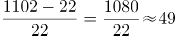倍。

故正确答案为B。

### 第 107 题

在中国田径协会认证的A类、B类赛事中，2016年全程马拉松项目完赛人次比同期半程马拉松项目完赛人次：

A. 多23万

B. 少23万

C. 多21万

D. 少21万

第 107 题 · 答案与解析

**参考答案（粉笔题库参考内容）**

D

**解析**

根据题干“······2016年全程马拉松项目完赛人次比同期半程马拉松项目完赛人次”，并结合选项为“多/少+具体单位”，且材料数据为2017年，可判定本题为基期和差问题。定位文字材料第五段可得：“在中国田径协会认证的A类、B类赛事中，2017年全程马拉松项目完赛26.89万人次，同比增长10.61%；半程马拉松项目完赛人次45.29万人次，同比减少了0.03万人次”，代入基期量公式：现期量/(1+r)，则2016年全程马拉松项目完赛人次为：万人次，2016年半程马拉松项目完赛人次为：45.29+0.03=45.32万人次，故2016年全程马拉松项目完赛人次与同期半程马拉松项目完赛人次差为：24-45.32≈-21，即少21万人次。

故正确答案为D。

### 第 108 题

在2017年马拉松运动年度产业总规模的基础上，从2018年开始，每年需要平均增长多少才能实现中国田径协会设置的2020年马拉松运动产业规模目标？

A. 30%

B. 25%

C. 20%

D. 15%

第 108 题 · 答案与解析

**参考答案（粉笔题库参考内容）**

C

**解析**

根据问题“从2018年开始，每年需要平均增长······才能实现······”结合选项为百分数，可判定本题为年均增长率问题。定位材料第二段“2017年······年度产业总规模达到700亿元······到2020年······产业规模达到1200亿元”。代入公式 ，(n=年份差)，以2017年为基期的基础上，实现2020年的目标，所以年份差为3。。优先代入居中且好算（例如整十的数）的选项，即C选项20%，，和1.71接近。

故正确答案为C。

### 第 109 题

2017年马拉松赛事参与人次的同比增速比2016年：

A. 快约9个百分点

B. 慢约9个百分点

C. 快约7个百分点

D. 慢约7个百分点

第 109 题 · 答案与解析

**参考答案（粉笔题库参考内容）**

B

**解析**

根据题干“2017年···的同比增速比2016年”，可判定本题为一般增长率问题。定位文字材料第一段可得：2017年、2016年、2015年马拉松赛事的参与人次分别为498万人次、280万人次、150万人次。根据增长率，可得2017年的增长率为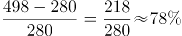，2016年的增长率为，则78%-87%=-9%，即2017年同比增速比2016年慢约9个百分点。

故正确答案为B。

### 第 110 题

能够从上述资料中推出的是：

A. 2017年马拉松运动年度产业规模比2016年多200亿元

B. 2017年参加中国田径协会认证赛事的全国跑者数量少于75万人

C. 2011年至2016年我国马拉松赛事场次之和超过2017年赛事场次的50%

D. 在2016年与2017年马拉松规模赛事数量上，江苏省、北京市都有进入前三名

第 110 题 · 答案与解析

**参考答案（粉笔题库参考内容）**

C

**解析**

A项：定位文字材料第二段可得：“2017年全年马拉松······年度产业总规模达700亿元，比去年同期增长约20%。” 故2017年马拉松运动年度产业规模比2016年多：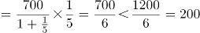亿元，错误；

B项：定位文字材料第六段可得：“2017年参加中国田径协会认证赛事的跑者中，来自江苏的数量最多，共有76469人，在全国占比10.10%”，故2017年参加中国田径协会认证赛事的全国跑者数量为万，错误；

C项：定位图形材料可得：“2011年至2017年我国马拉松赛事场次分别为22、33、39、51、134、328、1102”，故2011年至2016年我国马拉松赛事场次之和：22+33+39+51+134+328=607，2017年赛事场次的50%为1102×50%=551，前者大于后者，正确；

D项：定位文字材料第三段可得：“规模赛事数量方面，2017年排名前三的省份为浙江省、江苏省和广东省······而2016年的前三名分别为江苏省、北京市、广东省”，故在2016年和2017年马拉松规模赛事数量上，北京市没有都进入前三名，错误。

故正确答案为C。

## 材料 2

根据以下资料，回答下列问题。

2014年我国实施“单独两孩”生育政策，出生人口1687万人，比上年增加47万人。2016 年实施“全面两孩”生育政策，出生人口1786万人，比上年增加131万人；出生率与“十二五”时期年平均出生率相比，提高了0.84个千分点。2017 年我国出生人口1723万人，虽然比上年减少63万人，但比“十二五”时期年平均出生人口多出79万人；出生率为12.43‰，比上一年降低0.52个千分点。2017年二孩数量进一步上升至883万人，二孩占全部出生人口的比重达到51.2%，比2016年的占比提高了11个百分点。

2017年出生人口最多的省份是山东，出生人口174.98万人，但是比2016年减少2.08万人。广东和河南出生人口也超过百万，其中广东出生人口151.63万人，同比增加22.18万人；河南出生人口140.13 万人，较上年减少2.48万人。此外，出生人口排名前十的省份依次还有河北、四川、湖南、安徽、广西、江苏、湖北。其中，河北、四川、湖南出生人口超90万人，湖北最少，为74.26万人。

从人口增量来看，2017年广东出生人口增量最大，出生人口较2016年增加22.18万人。安徽、四川、河北出生人口增量超过5万，此外，江苏、湖南、山东、河南出生人口较2016年有所减少。其中，河南减少最多，出生人口减少2.48万人。

### 第 111 题

2016年我国二孩出生人口约为：

A. 883万人

B. 742万人

C. 718万人

D. 693万人

第 111 题 · 答案与解析

**参考答案（粉笔题库参考内容）**

C

**解析**

根据题干“2016年我国二孩出生人口约为”，结合材料时间为2017年，且已知二孩出生人口占全部出生人口的比重，可判定题为基期比重问题。定位文字材料第一段“2016年实施‘全面两孩’生育政策，出生人口1786万人······2017年······二孩占全部出生人口的比重达到51.2%，比2016年的占比提高了11个百分点”，故2016年二孩占全部出生人口的比重为51.2%-11%=40.2%，则2016年我国二孩出生人口为1786×40.2%≈1800×0.4=720万人，C项最接近。

故正确答案为C。

### 第 112 题

“十二五”时期我国年平均出生率为：

A. 11.59‰

B. 12.11‰

C. 12.43‰

D. 12.95‰

第 112 题 · 答案与解析

**参考答案（粉笔题库参考内容）**

B

**解析**

定位文字资料第一段“2016年······出生率与‘十二五’时期年平均出生率相比，提高了0.84个千分点；2017年······出生率为12.43‰，比上一年降低0.52个千分点”，可知“十二五”期间年平均出生率为12.43‰+0.52‰-0.84‰=12.11‰。

故正确答案为B。

### 第 113 题

2015年我国出生人口同比：

A. 增长3.2%

B. 降低3.2%

C. 增长1.9%

D. 降低1.9%

第 113 题 · 答案与解析

**参考答案（粉笔题库参考内容）**

D

**解析**

根据题干“2015年……同比”，结合选项为增长/降低+%，可判定本题为一般增长率问题。定位文字资料第一段“2014年……我国出生人口1687万人，2016年……我国出生人口1786万人，比上年增加131万人”，可知2015年我国人口为1786-131=1655万人。代入公式：，即2015年我国出生人口同比降低1.9%。

故正确答案为D。

### 第 114 题

2016年山东、广东和河南三省出生人口之和占当年全国出生人口的比重约为：

A. 21%

B. 25%

C. 28%

D. 31%

第 114 题 · 答案与解析

**参考答案（粉笔题库参考内容）**

B

**解析**

根据问题“2016年······占······的比重约为······”，且材料时间为2017年，可判定此题为基期比重问题。定位文字材料第一段可得“2016年······出生人口1786万人”；定位第二段可得“2017年出生人口最多的省份是山东，出生人口174.98万人，但是比2016年减少2.08万人······广东出生人口151.63万人，同比增加22.18万人；河南出生人口140.13万人，较上年减少2.48万人”则2016年山东省出生人口为174.98+2.08=177.06万人，广东省出生人口为151.63-22.18=129.45万人，河南省出生人口为140.13+2.48=142.61万人。则2016年，三省出生人口之和占当年全国出生人口的比重为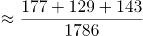。

故正确答案为B。

### 第 115 题

能够从上述资料中推出的是：

A. 2016、2017两年山东出生人口数量均超过当年全国出生人口数量的10%

B. 2016年广东出生人口数量超过2017年湖北出生人口数量的2倍

C. 2017年出生人口增量超过5万的省份只有3个

D. 2017年出生人口比2013年增长超过5%

第 115 题 · 答案与解析

**参考答案（粉笔题库参考内容）**

D

**解析**

A项：定位文字材料第一段“2016年实施‘全面两孩’生育政策，出生人口1786万人······2017年我国出生人口1723万人”，定位文字材料第二段“2017年出生人口最多的省份是山东，出生人口174.98万人，但是比2016年减少2.08万人”。 2017年：174.98万人>1723×10%；2016年：174.98+2.08＜1786×10%，则2016年山东出生人口数量没有超过当年全国出生人口数量的10%，错误；

B项：定位文字材料第二段“2017年出生人口······其中广东出生人口151.63万人，同比增加22.18万人······湖北最少，为74.26万人”，151.63-22.18＜74.26×2，错误；

C项：定位文字材料第三段“2017年广东出生人口增量最大，出生人口较2016年增加22.18万人。安徽、四川、河北出生人口增量超过5万”，可得2017年出生人口增量超过5万的省份至少有4个，错误；

D项：定位文字材料第一段可知：2014年出生人口1687万人，比上年增加47万人。2017年出生人口1723万人。可得2013年出生人口为1687-47=1640万人，代入增长率公式：，故2017年出生人口比2013年增长了，正确。

故正确答案为D。

## 材料 3

2017年我国成年国民图书阅读率为59.1%，比上年增加0.3个百分点；报纸阅读率为37.6%，比上年降低2.1个百分点；期刊阅读率为25.3%，比上年增加1个百分点。

2017年我国成年国民数字化阅读方式(网络在线阅读、手机阅读、电子阅读器阅读、平板电脑阅读等)的接触率为73.0%。其中，网络在线阅读接触率为59.7%，比上年增加4.4个百分点；手机阅读接触率为71.0%，比上年增加4.9个百分点；电子阅读器阅读接触率为14.3%，比上年增加6.5个百分点；平板电脑阅读接触率为12.8%，比上年增加2.2个百分点。

传统纸质媒介中，2017年我国成年国民人均每天阅读纸质图书时长为20.38分钟，人均每天阅读报纸时长为12.00分钟，人均每天阅读期刊时长为6.88分钟。

### 第 116 题

2016年我国成年国民数字化阅读四个方式的接触率按从高到低排列正确的是：

A. 网络在线阅读＞手机阅读＞电子阅读器阅读＞平板电脑阅读

B. 手机阅读＞网络在线阅读＞电子阅读器阅读＞平板电脑阅读

C. 网络在线阅读＞手机阅读＞平板电脑阅读＞电子阅读器阅读

D. 手机阅读＞网络在线阅读＞平板电脑阅读＞电子阅读器阅读

第 116 题 · 答案与解析

**参考答案（粉笔题库参考内容）**

D

**解析**

定位文字材料第二段可得，2017年我国成年国民网络在线阅读接触率为59.7%，比上年增加4.4个百分点，则2016年接触率为59.7%-4.4%=55.3%；手机阅读接触率为71.0%，比上年增加4.9个百分点，则2016年接触率为71.0%-4.9%=66.1%；电子阅读器阅读接触率为14.3%，比上年增加6.5个百分点，则2016年接触率为14.3%-6.5%=7.8%；平板电脑阅读接触率为12.8%，比上年增加2.2个百分点，则2016年接触率为12.8%-2.2%=10.6%。接触率从高到低排列为手机阅读＞网络在线阅读＞平板电脑阅读＞电子阅读器阅读，与D项一致。

故正确答案为D。

### 第 117 题

2017年我国成年国民阅读一本纸质图书平均需要：

A. 20.8小时

B. 22.3小时

C. 24.1小时

D. 26.6小时

第 117 题 · 答案与解析

**参考答案（粉笔题库参考内容）**

D

**解析**

由题干“2017年我国成年国民阅读一本纸质图书平均需要”，可判定本题为现期平均数计算。阅读一本纸质图书平均需要的时间=总时间÷书的数量。定位文字材料第三段可知，2017年我国成年国民每天阅读纸质图书为20.38分钟，则全年阅读纸质图书的总时间为20.38×365；定位表格，2017年成年国民纸质图书人均阅读量为4.66（本）。因此，阅读一本书平均需要分钟，即 ≈26.6小时。

故正确答案为D。

### 第 118 题

下列年份中，我国成年国民人均报纸阅读量同比降速最快的是：

A. 2014年

B. 2015年

C. 2016年

D. 2017年

第 118 题 · 答案与解析

**参考答案（粉笔题库参考内容）**

D

**解析**

由题干“我国成年国民人均报纸阅读量同比降速最快的是···”可知，本题为一般增长率比较大小问题。定位表格第四行，已知2013年-2017年报纸的人均阅读量，由公式可得，2014年：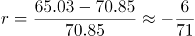；2015年：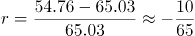；2016年：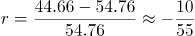；2017年：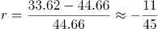；观察数据可知2017年降速分子最大、分母最小，所以2017年人均报纸阅读量同比降速最快。

故正确答案为D。

### 第 119 题

2013年至2017年我国成年国民人均期刊阅读量超过这五年平均水平的年份有：

A. 2个

B. 3个

C. 4个

D. 5个

第 119 题 · 答案与解析

**参考答案（粉笔题库参考内容）**

B

**解析**

由题干“2013年至2017年···超过这五年平均水平的年份有”可知，本题为平均数问题。定位表格第五行，由公式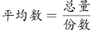可得，这五年人均期刊阅读的平均水平≈4.75，2013年至2017年期刊人均阅读量超过这五年平均水平的有3个年份，分别为2013年、2014年、2015年。

故正确答案为B。

### 第 120 题

能够从上述资料中推出的是：

A. 2013年至2017年我国成年国民人均电子书阅读量逐年上升

B. 2016年我国成年国民图书阅读率低于当年网络在线阅读接触率

C. 2017年我国成年国民人均每天阅读纸质图书时长低于阅读报纸与阅读期刊时长之和

D. 2014年至2017年我国成年国民人均期刊阅读量，增长率最高的年份为2017年

第 120 题 · 答案与解析

**参考答案（粉笔题库参考内容）**

D

**解析**

A项：定位表格材料，2013年至2017年我国成年国民人均电子书阅读量分别为2.48、3.22、3.26、3.21和3.12。可见，2016年与2017年均比上年有所下降，错误；

B项：定位文字材料第一段和第二段可得，2017年我国成年国民图书阅读率为59.1%，比上年增加0.3个百分点，网络在线阅读接触率为59.7%，比上年增加4.4个百分点。则2016年我国成年国民图书阅读率为59.1%-0.3%=58.8%，2016年网络在线阅读接触率为59.7%-4.4%=55.3%，58.8%＞55.3%，错误；

C项：定位文字材料第三段可得，2017年我国成年国民人均每天阅读纸质图书时长为20.38分钟，人均每天阅读报纸时长为12.00分钟，人均每天阅读期刊时长为6.88分钟。则我国成年国民人均每天阅读报纸与阅读期刊时长之和为12.00+6.88=18.88分钟，20.38分钟＞18.88分钟，错误；

D项：定位表格材料，2013年至2017年每年我国成年国民人均期刊阅读量均已知，根据可得，2014年我国成年国民人均期刊阅读量增长率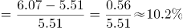，2015年我国成年国民人均期刊阅读量增长率，2016年我国成年国民人均期刊阅读量增长率，2017年我国成年国民人均期刊阅读量增长率，2017年增长率最高，正确。

故正确答案为D。

