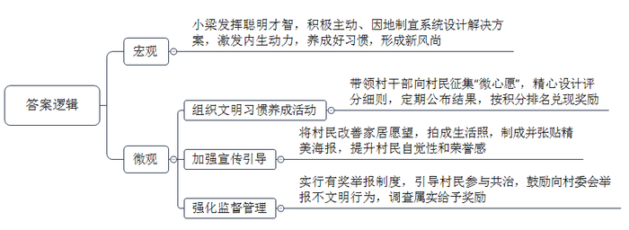
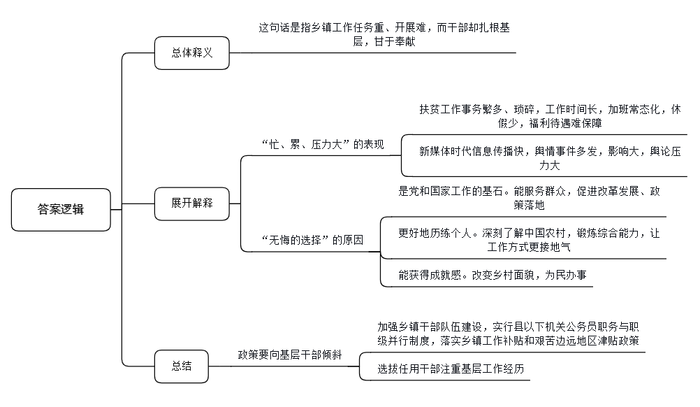
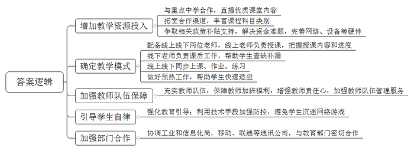
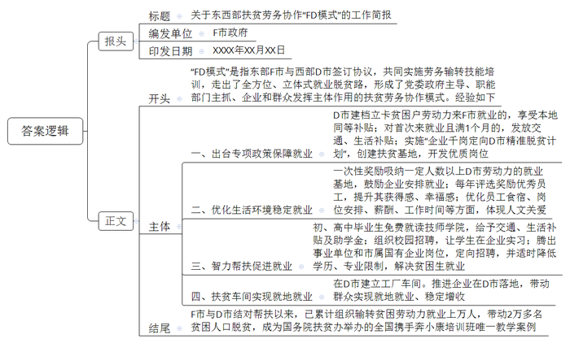

# 2020年0822公务员多省联考《申论》题（山西乡镇卷）

<!-- gwy:overview:start -->
> **山西 · 2020 · 申论 · 乡镇卷** ｜ 4 题 · 图片 4 处 · 答案随题折叠

导航：[题目](#题目) · [材料 1](#材料-1)
<!-- gwy:overview:end -->

> 候选采集稿。参考答案及解析来自粉笔页面，不代表官方答案或真实高分答卷；来源使用许可与原卷对应关系仍需人工核实。

## 给定材料

### 材料 1

杨家村是深度贫困村，经过几年的努力，村里绝大多数贫困户已经圆了脱贫梦。为了稳定增收，杨家村决心借助山清水秀的景致发展乡村旅游。2019年年初，在政府和帮扶单位专项资金支持下，杨家村的美丽乡村项目顺利开工。水泥道路通村入户，古建民居修葺一新，竹木栅栏、青石台阶、小桥流水的景观设计，让这个昔日的深度贫困村华丽转身，好似世外桃源。

村里漂亮了，可是人居环境却是个“老大难”。远远望去村容村貌焕然一新，可是走进老百姓家里一看，庭院乱堆放、杂物遍地是。以前村干部也多次上门做工作，但是群众认为这是自家的事，村干部管不着。关键时刻，省建筑工程集团公司的驻村第一书记小梁发挥聪明才智，为村里“量身设计”了一套解决方案。

8月的一天，一场“积分兑换心愿，勤劳改变习惯”的文明习惯养成活动在杨家村拉开帷幕。小梁和村干部一起向村民征集有关家居环境改善的“微心愿”，并精心设计了十项涵盖个人卫生和居家环境的评分细则，每周公布评分结果，最终按照积分排名兑现前20名的“微心愿”。“我们想通过‘微心愿’来激发村民的内生动力，帮助大家养成好习惯，形成新风尚。”小梁说。

村民们纷纷讲出了自己改善家居的愿望。“要是有台大彩电，忙完一天的农活，就可以陪孙子看动画片了！”村民张大娘说。“要是有台大冰箱，我家就能天天吃到新鲜饭菜了！”村民张伯伯说。他们的这些心愿，配上摄影师为他们拍摄的生活照，被制成精美的海报，张贴在村里醒目的位置。其中一张海报是65岁的唐大妈笑呵呵地在做针线活。“在整洁、干净的屋里做针线活儿，我心里那叫一个美啊！”海报上印着两行大字，这是唐大妈的感言。看着邻里乡亲竟然也能像明星一样登上如此精美的海报，村民们的荣誉感更强烈了。为了督促村民改变卫生习惯，实行有奖举报制度，发现谁家乱倒垃圾可以向村委会举报，调查属实的给举报者奖励一袋面粉。在大家共同努力下，改善家居环境一时间蔚然成风。小梁说，几个月来，从锅碗瓢盆、个人起居，到房前屋后、禽畜养殖，杨家村变化很大。

村民夏姐的丈夫常年在外打工，她自己留在村里种地看孩子。一个人忙里忙外，难免顾不上收拾屋子。“自从参加活动以来，养成了好习惯，房前屋后都干净了，自己住着也舒服。”她说。

从爱美之心人皆有之，到护美之行人人为之，杨家村这个新建成的美丽乡村，处处透着美的气息。小梁也如约为表现优异的家庭兑现了“微心愿”，夏姐领到了心仪的热水器，脸上露出了开心的笑容。

### 材料 2

“真希望自己是‘三头六臂’就好了！”M乡王乡长快人快语。王乡长正在负责完善贫困户档案，要了解家庭人员构成、住房改造前后照片对比、种植养殖种类及数量、扶持项目公示、会议记录、入户追访、满意度调查等内容。一方面，因为建档的需要，要填写大量的表格等资料。另一方面，表格的内容很细致，不到贫困户家中实地调查那是不行的。看似简单的事情其实很繁琐，有时候要来回跑很多趟。

基层工作千头万绪，事务繁多，而且某件事成为舆情热点，不仅会极大增加基层工作量，而且让基层干部倍感压力。经历过几次舆情热点事件，M乡宣传干事小陈已经略有心得：尽快披露事实，优先回应网友质疑……然而，小陈却坦言工作不易：“国家强调依法治国，事情处理起来都有程序，需要时间。但新媒体时代信息传播越来越快，造成舆论影响迅速放大。”一次该地出现旅游纠纷，消息在网上飞快传开，网友一边倒地批评景区，可是通过调查却发现，其实是游客挑衅。“虽然最后真相大白，可还是给我们造成了很大的压力。”小陈说。

基层，是整个社会的“地基”，这个“地基”是社会的主体，也是时代的主流。基层干部，是党和国家工作的“基石”，他们奋战在改革发展的主战场、服务群众的最前沿。目前绝大多数政策落地都在县乡，从脱贫攻坚到民生保障，再到招商引资、产业发展、入户做群众工作，都离不开基层干部。基层干部忙得脚打后脑勺，加班是常态，但干部们几乎都没有加班费。有关科研机构的调查显示，乡镇干部平均每天工作10到11个小时，不少乡镇干部五六年没休过假。

王乡长说：“乡镇工作虽然忙、累、压力大，但也是我们无悔的选择。”

C乡党委李书记至今已在5个乡镇工作过，乡镇的每个岗位几乎都干过。“乡镇是最基层的行政机构，但麻雀虽小，五脏俱全。产业发展、土地问题、安全生产……能最深刻地了解中国农村，最全面地锻炼干部能力。”李书记说。基层工作经历让乡镇干部的综合能力得到迅速提升，工作方式也更接地气，他们也很感谢这样的历练。

2017年，中共中央办公厅发文，强调要加强乡镇干部队伍建设，实行县以下机关公务员职务与职级并行制度，落实乡镇工作补贴和艰苦边远地区津贴政策。“而且现在干部的选拔任用更加注重基层工作经历，相关政策也更多向基层干部倾斜。干部想更长远发展，基层工作其实也是一个重要的经历。”李书记说。

不过，在李书记看来，最重要的还是乡镇工作独特的成就感。“我们很多人都是农村出身，很多亲戚朋友都在农村。改变家乡面貌，帮助农民做点事，这是我们肩负的使命。”C乡地处贫困地区，李书记带领群众克服海拔高、交通条件差、缺工人、缺材料等困难，在三个月内改造了71栋房子，“看着很多贫困户欢欢喜喜搬进新房，我忍不住流下眼泪。想到靠自己的努力能够改造一方水土，有一种梦想正在一点点地实现的感觉，那个时候，你就会觉得所有的付出都值得。”

### 材料 3

L县是国家级贫困县，地方偏远，过去师资力量和办学条件整体比较落后。L县一中虽然是该县的重点中学，但高考成绩并不是很理想。“其实我们的孩子都很想学，也很勤奋，但总体成绩就是不如城市里的孩子。每当在电视、网络上看到城市里优越的教学条件，孩子们都梦想着能接受和城里同龄人一样的教育，进行公平的竞争。”学校副校长吴老师说。

得益于这两年脱贫攻坚进程的加快，L县一中的软硬件条件如今都得到了较大提升。随着国家对教育公平的重视和教育信息化大潮的推动，L县政府经过反复调查研究，在L县一中设立网络直播班，同步直播省城重点中学七中老师的课堂教学。在网络直播课程中，每门课都有线上线下两位老师，线上的是省城七中的老师，负责课堂授课，授课内容和进度也都以省城七中为准；线下的是L县一中的老师，他们负责课后工作，学生没有跟上的课后还需要一起查缺补漏。L县一中的学生跟着省城七中的学生同步上课、同步作业、同步练习。

罗同学是L县一中的高三学生，他对自己刚接触网络直播课程的情形记忆犹新，“刚开始接触直播教学，那边的教学特点就是密度大，知识面覆盖广。所以有些不适应，感觉差距还是比较大。”不过慢慢适应后，罗同学说，隔了一层屏幕并没有太大的距离感，这种教学模式就像是6门学科有了12名指导老师。“他们那边问什么我们就回答什么。一开始觉得有点儿奇怪，慢慢发现已经跟上那个课堂了，当时还是有点兴奋，自信心也上来了。”

网络直播班班主任杨老师观察到，新的教学模式除了带来成绩上的提高，更多的其实是给了学生参照和动力。“他会觉得在追梦的路上自己和省城七中的同学享有均等的机会，剩下的就看自己的奋斗了。”

从最初引入一个班试点，逐渐发展到现在L县一中5个网络直播班250多名孩子上课，越来越多的孩子们参与到了网络课堂中。对网络直播班的教学效果，L县一中滕校长介绍说，当地普通班本科上线率，大概在45％左右，而网络直播班的本科上线率达到60％。虽然这些功劳并不能只归功于网络直播课程，但毫无疑问，网络直播课程在很大程度上带来了积极改变。

对网络直播课程的效果，何同学有另外的感受。她也是L县一中网络直播班的学生，去年毕业考入了一所名牌大学。回忆在网络直播班学习的经历，她说，“要说高考增加多少分，可能不是特别好说。但是从省城七中的师生身上我学到很多东西，打开了我的视野，让我觉得有一个清晰的目标，考一个什么大学，想去什么样的地方。好像是一道光，它照亮了我的梦想，让梦想变得明亮清晰。”

网络直播授课的模式是互联网+教育的产物，在一定程度上打破了地区和学校之间的资源壁垒，使优质教育资源跨时空整合、配置和流转。不过，县教育局王局长说，“技术和模式都有一定的局限性，在L县一中为什么效果好，因为课后针对有些没跟上的学生，本地教师会再进行教学辅导。这些教师非常累，他们上直播班的时间，是上普通班工作量的三倍，很多教师要连续加班上晚自习。这对教师的责任心是一个考验，也对教师队伍的管理服务工作提出了难题。”L县一中滕校长指出，“网络直播授课离不开电脑，大大增加了不自律的学生沉迷于网络游戏的风险，学习成绩出现明显的两极分化。”

对于网络教学模式能否大规模推广惠及更多学子，王局长坦言，目前还存在很多困难。网络教学的资源总量还是有限，主要集中在语文、数学和英语课等主课上，还有很多副课没有实现资源共享，因为省城七中也缺乏相关科目的优秀教师。即便如此，一个班的费用平均一年要七万左右，如果覆盖乡村，还要铺设网络、增添设备，支出就更大了。除了缺钱，铺设网络需要协调工业和信息化局，移动、联通等通讯公司，不是教育局能够独自解决的。不过，“只要能切切实实帮助到孩子们，我们还是要想办法去做。”王局长说。

### 材料 4

2017年2月，东部F市与西部D市两地政府签订《东西部扶贫协作框架协议》，确定共同实施劳务输转技能培训就业协作计划。3年来，F市走出了一条帮助D市群众全方位、立体式的就业脱贫路，探索出FD两地扶贫劳务协作模式，入选了110个“全球减贫案例”。

F市和D市相距2000多公里，为实现“输转一人、就业一人、脱贫一户”的目标，F市多措并举为务工人员提供良好的务工条件。针对D市建档立卡贫困户劳动力普遍年龄偏大、缺乏技能、工资待遇不高等实际情况，F市出台政策规定：D市建档立卡贫困户劳动力来F市就业的，认定为F市就业困难对象，享受F市本地建档贫困户同等的社保补贴、职业培训补贴等政策；首次来F市就业且就业满1个月的，发放交通补贴500元和一次性生活补贴1000元。

借鉴公益性岗位扶贫开发经验，探索实施“企业千岗定向D市精准脱贫计划”，为了鼓励企业安排D市户籍务工人员就业，F市遴选一批企业创建了就业扶贫示范基地，对吸纳一定人数以上D市劳动力的就业基地给予一次性奖励。每年在F市扶贫就业基地企业新开发2000个优质岗位，定向招聘D市建档立卡贫困户劳动力。

F市还开展D市优秀员工评选表彰奖励，每年评选100名D市优秀员工并给予奖励，目前已有200名员工获评，进一步提升了他们的获得感、幸福感。为了让D市员工吃得惯、住得好、留得下，F市在食宿条件、岗位安排、薪酬待遇、工作时间等方面进一步提升优化，体现对他们的特别关爱，真正做到“感情留人、待遇留人、政策留人、环境留人”。

贫困劳动力可以到F市务工，他们的子女如何帮扶？F市坚持渔鱼兼授，实施智力扶贫。针对部分建档立卡户学生初中、高中毕业后辍学在家，缺乏技能等问题，F市发挥技师学院优势，资助D市户籍建档立卡贫困家庭初、高中毕业生到技师学院免费就读，使他们能够学到一技之长，更好地建设和服务家乡，帮助家乡人民早日脱贫。这些学生在F市上学期间，可以免交学费、学杂费和住宿费，每位学生每年还可以享受交通往返补贴2000元、生活补助8000元、国家助学金2000元。对于一些即将毕业的技校学子，F市积极搭建平台，组织多家企业开展校园招聘活动，为他们学习锻炼和就业创造条件。目前已有200多名学生在多家企业顶岗实习。F市每年还腾出一批事业单位和市属国有企业岗位，面向D市建档立卡贫困家庭高校毕业生招聘，并根据实际情况适当降低学历、放宽专业限制，目前已招聘近300名贫困学子来F市工作。“我要扎根F市努力工作，以良好的工作业绩回报当地人民的关爱。”D市贫困学子小黄感动地说。

对于离乡外出有难度的贫困户，F市将工厂车间“搬”到他们家门口，让他们实现就地就业、稳定增收。说起在某服装公司扶贫车间上班，贫困户小何满心欢喜：“原来出去打工，照顾不到家里，现在在家门口打工，每月4000多元工资，老婆也有2000多元，我们俩既赚了钱，也顾了家。”目前在这家服装公司的扶贫车间已安排了140名当地群众就业，其中建档立卡贫困户100人。截至2019年底，F市已推进25家企业在D市落地，建设“扶贫车间”89个，带动1800多名建档立卡贫困户就近就地就业。

F市与D市结对帮扶以来，两地扶贫劳务协作工作取得显著成效，初步形成了党委政府主导、职能部门主抓、企业和群众发挥主体作用的扶贫劳务协作“FD模式”。目前，已累计组织输转D市贫困劳动力就业上万人次，直接带动2万多名D市贫困人口脱贫，组织输转建档立卡贫困劳动力占东部地区帮扶贫困地区总数近一半。

FD扶贫劳务协作模式，成为国务院扶贫办举办的全国携手奔小康培训班唯一教学案例，为推动全国东西部扶贫工作优化升级贡献了“东部智慧”。

## 题目

### 第 1 题

**请根据给定资料**1**，概括小梁改善杨家村人居环境的主要做法。（20分）**

关联材料：材料 1、材料 2、材料 3、材料 4

作答要求：

要求：全面准确，简明扼要，条理清晰，不超过200字。

第 1 题 · 答案与解析

**参考答案（粉笔题库参考内容）**

小梁发挥聪明才智，积极主动、因地制宜系统设计解决方案，激发内生动力，养成好习惯，形成新风尚。

一、组织文明习惯养成活动。带领村干部向村民征集“微心愿”，精心设计评分细则，定期公布结果，按积分排名兑现奖励。

二、加强宣传引导。将村民改善家居愿望，拍成生活照，制成并张贴精美海报，提升村民自觉性和荣誉感。

三、强化监督管理。实行有奖举报制度，引导村民参与共治，鼓励向村委会举报不文明行为，调查属实给予奖励。

**解析**

**参考答案说明：**本参考答案采用“总-分”的逻辑结构。先总说了小梁改善杨家村人居环境的宏观做法，然后再分别从“组织文明习惯养成活动”“加强宣传引导”“强化监督管理”等三个方面，对具体工作内容进行了分条撰写。各条要点之间在内容上是并列关系，没有交叉。并且撰写每条要点时，都提炼出了概括性强的总结词并前置，满足了题目中规定的“条理清晰”这一要求。

**考点**：考点概括措施类

**来源**：来源2020年0822公务员多省联考《申论》题（山西乡镇卷）

粉笔申论页面对本题只提供「解析视频」入口，该入口是会员推广位，页面无视频地址与文字解析。

### 第 2 题

**请根据给定资料**2**，谈谈你对划线句子****“****乡镇工作虽然忙、累、压力大，但也是我们无悔的选择****”****的理解。（****25分）**

关联材料：材料 1、材料 2、材料 3、材料 4

作答要求：

要求：全面准确，条理清晰，分析透彻，不超过350字。

第 2 题 · 答案与解析

**参考答案（粉笔题库参考内容）**

这句话是指乡镇工作任务重、开展难，而干部却扎根基层，甘于奉献。

“忙、累、压力大”表现在：1.扶贫工作事务繁多、琐碎，工作时间长，加班常态化，休假少，福利待遇难保障；2.新媒体时代信息传播快，舆情事件多发，影响大，舆论压力大。

“无悔的选择”指基层工作意义重大：1.是党和国家工作的基石。能服务群众，促进改革发展、政策落地；2.更好地历练个人。深刻了解中国农村，锻炼综合能力，让工作方式更接地气；3.能获得成就感。改变乡村面貌，为民办事。

因此，政策要向基层干部倾斜，加强乡镇干部队伍建设，实行县以下机关公务员职务与职级并行制度，落实乡镇工作补贴和艰苦边远地区津贴政策；选拔任用干部注重基层工作经历。

**解析**

**参考答案说明：**思路方面，本参考答案按照词句解释题“总体释义+展开解释+总结”的一般答题思路展开。内容方面，本参考答案首先解释了“乡镇工作虽然忙、累、压力大，但也是我们无悔的选择”的含义；接着分别给出了“忙、累、压力大”的具体表现和“无悔的选择”体现的重大意义；最后给出了对策作为总结。词句表达方面，本参考答案加上了“因此”等连接词来承接上下文。

**考点**：考点词句解释类

**来源**：来源2020年0822公务员多省联考《申论》题（山西乡镇卷）

粉笔申论页面对本题只提供「解析视频」入口，该入口是会员推广位，页面无视频地址与文字解析。

### 第 3 题

**L县政府准备在全县初高中推广网络直播教学，请你结合L县一中网络直播教学的情况，针对存在的问题，提出推广的主要举措。（25分）**

关联材料：材料 1、材料 2、材料 3、材料 4

作答要求：

要求：紧扣资料，全面准确，条理清晰，具体可行，不超过400字。

第 3 题 · 答案与解析

**参考答案（粉笔题库参考内容）**

一、增加教学资源投入。与重点中学合作，直播优质课堂内容；拓宽合作渠道，丰富课程科目类别；争取相关政策补贴支持，解决资金难题，完善网络、设备等硬件。

二、确定教学模式。配备线上线下两位老师，线上老师负责授课，把握授课内容和进度；线下老师负责课后工作，帮助学生查缺补漏；线上线下同步上课、作业、练习；做好预热工作，帮助学生快速适应。

三、加强教师队伍保障。充实教师队伍，保障教师加班福利，增强教师责任心，加强教师队伍管理服务。

四、引导学生自律。强化教育引导；利用技术手段加强防控，避免学生沉迷网络游戏。

五、加强部门合作。协调工业和信息化局，移动、联通等通讯公司，与教育部门密切合作。

**解析**

**参考答案说明：**本参考答案从“增加教学资源投入”“确定教学模式”“加强教师队伍保障”“引导学生自律”“加强部门合作”等不同的方面进行了分条撰写。各条答案要点之间在内容上相互并列，没有交叉。

**考点**：考点提出对策类

**来源**：来源2020年0822公务员多省联考《申论》题（山西乡镇卷）

粉笔申论页面对本题只提供「解析视频」入口，该入口是会员推广位，页面无视频地址与文字解析。

### 第 4 题

**根据给定资料**4**，请就东西部扶贫劳务协作****“****FD模式****”****的基本做法拟写一份工作简报。****（30分）**

关联材料：材料 1、材料 2、材料 3、材料 4

作答要求：

要求：

（1）紧扣资料，内容完整；

（2）条理清晰，语言准确；

（3）字数在500～600字。

第 4 题 · 答案与解析

**参考答案（粉笔题库参考内容）**

关于东西部扶贫劳务协作“FD模式”的工作简报

F市政府 XXXX年XX月XX日

“FD模式”是指东部F市与西部D市签订协议，共同实施劳务输转技能培训，走出了全方位、立体式就业脱贫路，形成了党委政府主导、职能部门主抓、企业和群众发挥主体作用的扶贫劳务协作模式。经验如下：

一、出台专项政策保障就业。D市建档立卡贫困户劳动力来F市就业的，享受本地同等补贴；对首次来就业且满1个月的，发放交通、生活补贴；实施“企业千岗定向D市精准脱贫计划”，创建扶贫基地，开发优质岗位。

二、优化生活环境稳定就业。一次性奖励吸纳一定人数以上D市劳动力的就业基地，鼓励企业安排就业；每年评选奖励优秀员工，提升其获得感、幸福感；优化员工食宿、岗位安排、薪酬、工作时间等方面，体现人文关爱。

三、智力帮扶促进就业。初、高中毕业生免费就读技师学院，给予交通、生活补贴及助学金；组织校园招聘，让学生在企业实习；腾出事业单位和市属国有企业岗位，定向招聘，并适时降低学历、专业限制，解决贫困生就业。

四、扶贫车间实现就地就业。在D市建立工厂车间。推进企业在D市落地，带动群众实现就地就业、稳定增收。

F市与D市结对帮扶以来，已累计组织输转贫困劳动力就业上万人，带动2万多名贫困人口脱贫，成为国务院扶贫办举办的全国携手奔小康培训班唯一教学案例。

**解析**

**参考答案说明：**（1）本题要求写“工作简报”，一般格式为：报头（包括标题、编发单位、印发日期等）+正文（一般包括开头、主体、结尾）。（2）正文部分，一方面从内容来看，围绕着“东西部扶贫劳务协作‘FD模式’”这一主题，本参考答案的开头先介绍了“FD模式”；主体部分分别从“专项政策保障就业”“优化生活环境稳定就业”“智力帮扶促进就业”“扶贫车间实现就地就业”四个方面写到了“FD模式”的基本做法；结尾对“FD模式”进行了总结。另一方面，形式上，本参考答案做到了分段、分条撰写，整体上条理较为清晰。

参考答案二

关于东西部扶贫劳务协作“FD模式”的工作简报

F市政府 XXXX年XX月XX日

“FD模式”是指东部F市与西部D市签订协议，共同实施劳务输转技能培训，走出了全方位、立体式就业脱贫路，形成了党委政府主导、职能部门主抓、企业和群众发挥主体作用的扶贫劳务协作模式。经验如下：

一、提供良好务工条件。出台扶持政策，规定D市建档立卡贫困户劳动力来F市就业的，享受本地同等补贴，对首次来就业且满1个月的，发放交通、生活补贴；实施“企业千岗定向D市精准脱贫计划”，创建扶贫基地，一次性奖励吸纳D市劳动力达标的就业基地，开发优质岗位；评选并表彰奖励优秀员工，提升其获得感、幸福感；优化员工生活和工作条件，体现人文关爱。

二、智力扶贫，帮扶D市贫困户子女。资助贫困家庭初、高中毕业生免费就读技师学院，给予交通、生活补贴及助学金；搭建平台，组织校园招聘，让技校生在企业实习；腾出事业单位和市属国有企业岗位，定向招聘，放宽学历、专业限制，解决贫困生就业。

三、帮助贫困户就近就地就业。F市推进企业在D市落地，建设扶贫车间，带动群众实现就地就业、稳定增收，使其兼顾家庭和就业。

F市与D市结对帮扶以来，已累计组织输转贫困劳动力就业上万人，带动2万多名贫困人口脱贫，成为国务院扶贫办举办的全国携手奔小康培训班唯一教学案例，也入选了全球减贫案例。

**考点**：考点总结类

**来源**：来源2020年0822公务员多省联考《申论》题（山西乡镇卷）

粉笔申论页面对本题只提供「解析视频」入口，该入口是会员推广位，页面无视频地址与文字解析。

