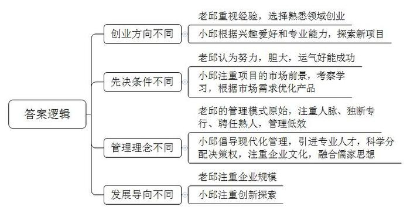
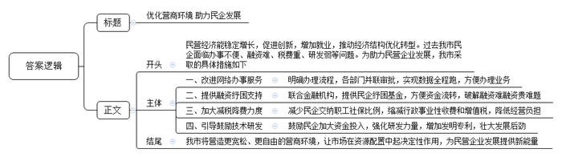
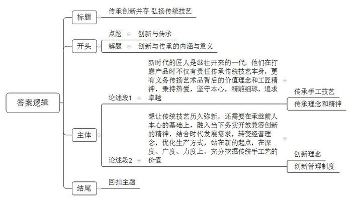

# 2020年0822公务员多省联考《申论》题（山西市县卷）

<!-- gwy:overview:start -->
> **山西 · 2020 · 申论 · 市县卷** ｜ 4 题 · 图片 4 处 · 答案随题折叠

导航：[题目](#题目) · [材料 1](#材料-1)
<!-- gwy:overview:end -->

> 候选采集稿。参考答案及解析来自粉笔页面，不代表官方答案或真实高分答卷；来源使用许可与原卷对应关系仍需人工核实。

## 给定材料

### 材料 1

“风物长宜放眼量。”创新是百年大计。纵观世界经济发展史，技术进步和产业变革是经济增长的重要引擎。历次工业革命均因重大技术变革兴起，逐渐催生了一大批新产业、新业态、新模式，进而大幅提高劳动生产率，推动经济增长步入黄金期。中国经历了40来年的高速发展，积累了雄厚的经济、科研、人才等诸多方面的基础。特别是与第四次工业革命相关的技术，如数字技术、人工智能、量子技术、新能源、5G通信等方面，都走在了世界前头。有研究显示，以人工智能为代表的新技术革命，到2035年有望拉动中国经济年增长率明显提升，推动中国劳动生产率提高27%。当前政府提出的“创新是引领发展的第一动力”，无疑为这场工业革命提供了优良的政治环境。

日前，清华大学陈教授在接受记者采访时说，中国有着创新的历史和文化基因，中国古代的四大发明对世界文明发展进程产生了重要影响。今天，中国在移动支付、无人机、生物医药、分享经济等方面有许多领先世界的科技成果，有着比国外同类产品更好的用户体验。陈教授认为，中国的企业，特别是民营企业，在世界经济舞台上走出了一条从模仿、追随到引领的发展轨迹，而这背后的“秘诀”便是创新。市场需求催生了中国民营企业对生产的创新、商业的创新，比如新零售、机器人、人工智能等等。这种创新不是短期的、偶然的，而是长期的、自发的，是一种迥然不同于欧美国家的创新路径，是深刻在中国经济肌体中独一无二的事实特征。

### 材料 2

小邱个头不高，皮肤白皙，结实强壮，喜欢穿运动装和运动鞋，一点都不像他的父亲老邱，老邱总是穿着皮鞋、西裤。他们相差近30岁，对商业的看法颇有不同。

1970年，老邱从C市建筑公司辞职，成立了自己的工程队，1992年成立了一家建筑公司，2000年组建了集团公司，如今家乡人都称他“建筑大王”。老邱是个老派，在他看来，做企业只要胆大、灵活、肯吃苦，再加上运气，似乎就能做起来。小邱却不大认同。1994年，老邱计划让上海交大毕业的儿子回来接班，小邱对此纠结了很久。最后，小邱只答应了父亲一半的要求，可以回去，但他回去的目的不是守业，而是创业。“当时我父亲已经做到了省内建筑业的第一。但在我看来，这个行业技术门槛比较低，同时与我个人兴趣及所学格格不入。所以我和父亲协商，这个行业他继续做，能不能让我根据自己的兴趣做一个新的行业，父亲答应了。”

这之后的大半年时间，小邱一直在做市场调研，“我一直在思考如何突破现状，每天在报纸中寻找与‘电’或‘自动化’有关的技术，分析什么是有市场前景的产品和项目，最终将目光集中在厨房家电。”1996年，找到创业方向的小邱，在父亲提供的一笔创业基金支持下，自立门户成立了一家家电公司。1999年，小邱前往欧洲参观，发现欧洲普遍使用的洗碗机机型比中国当时的所有产品都漂亮，跟厨房搭配起来很美观。“但我们也发现，国外欧式机虽然很美观，却存在油污处理能力较弱的不足，我突发奇想，做一款欧式外观、内部结构中国化的洗碗机。”小邱通过对传统欧式机进行改进，开发出外观漂亮、洗涤效果更佳的产品。这款洗碗机一经推向市场，第一年销量就达1万多台，随之确立了公司在这一领域的领导地位。在谈到自己的成功时，小邱说：“我认为最根本的原因在于，我们比洋品牌更加了解中国。”

公司成立之初，小邱希望新的公司拥有现代化的管理制度，在“调研市场期间，我以一个旁观者的身份去观察父亲的企业，发现了很多问题。比如，公司员工乡里乡亲的复杂关系，使有些问题处理起来变成了难题；父亲更热衷于参加各种应酬，为自己积攒人脉；在公司，大事小情都是父亲自己拍板，跟随父亲多年的一些老员工被安排在管理岗位，但他们根本不懂管理；公司表面上看起来干的轰轰烈烈，骨子里还是个包工队。”小邱在成立新公司的时候与父亲约法三章：第一，新公司要从村里移到C市的开发区；第二，除了小邱选中的一些人，老员工不能到新公司来；第三，有关新业务的重大决策，要尽可能尊重小邱的想法。

公司成立的前10年，小邱是一个“狂热”的西方管理学徒。他大力推行美式卓越绩效管理、引进跨国集团管理人才。但他发现，西方管理模式与本地员工存在较大的文化隔阂。小邱说：“2010年，家电公司快速增长达到了一个瓶颈，有两年没有太大增长，我们分析原因是管理滞后。我发现西方的管理固然有它先进的一面，但单纯照搬无疑是在步别人的后尘，中国的企业必须探索出自己的模式，才能具备持续不断的先发优势。”从2012年开始，小邱到清华、北大先后学了四年的传统文化课，听着听着，兴趣就越来越浓厚了。如何将中国传统文化精髓与西方的管理体系相结合？这个问题开始萦绕在小邱的脑海。他逐渐将自己的所学所思运用到企业管理中。他将儒家的基本精神“仁、义、礼、智、信”写进了公司的价值观。“最初的导入，还跟管理模式没有关系。慢慢地一边实践一边探索一边总结，如今我们逐渐摸索出一套中国特色、中西合璧的管理模式。”十多年的创业磨砺，让小邱最感欣慰的不是企业越来越大，而是企业文化的塑造。他说：“在企业发展的过程中，经营管理只是企业的骨架，文化才是一个企业的血脉，灵魂。”

### 材料 3

日前，一家电商企业的智能配送机器人率先进行了5G测试运行，这标志着我国在物流领域向实现人工智能化作业又迈进了一步。人工智能在科研、医疗、教育、工业制造等诸多领域，都有愈来愈多的应用。科技进步助力产业与社会发展是令人兴奋的时代变化，但由此带来的就业问题也同样令人忧虑。某调研公司新近发布的报告指出，到2030年，全球将有约两千万的制造业岗位被人工智能所取代。一些国家为避免大量基层劳动力失业，采取行政或立法手段强行迟滞人工智能的发展，这显然既不现实，亦不符合科技与经济发展的规律。但如何满足被人工智能替代的人群的再就业需求，就成了必须回答的问题。

随着大数据、物联网和云计算的广泛运用，与此相关的新兴产业蓬勃发展，对从业人员需求大幅增长。“几乎每个客户都要求我们帮忙培训数字化管理人才。”N科技公司作为一家民营智能移动办公平台供应商，培训正成为它的第一副业。某研究机构发布的《2018年中国人工智能人才白皮书》保守估计，截至2018年10月，仅民营企业人工智能人才缺口至少在100万以上。中国人力资源协会副会长苏博士说：“像数字化管理师、无人机驾驶员这样的新职业在许多民营企业中早就存在，这些新职业能为国家可持续发展贡献力量。2019年4月，无人机驾驶员与数字化管理师、人工智能工程技术员等13个职业已列入国家职业分类大典。”此外，新兴技术溢出效应正在显现，传统第一、第二产业向数字化智能化转变，使得企业对工业机器人系统操作员和系统运维员的需求剧增，成为了现代工业生产一线的新兴职业。

人力资源专家王博士认为：“从经济社会整体来看，人们不必为智能化时代的就业问题过于担忧，因为更多新的职业、新的就业形态将应运而生，同时，就业岗位的增加、就业质量的提升都将为社会创造更多经济效益。”未来在新兴领域，专业的技术人才、创新人才，尤其是数字人才的供给缺口会逐渐增大，但由于人才间的竞争也在加剧，倘若就业者没有做好应对的准备，不去主动适应竞争，便只能在机遇面前望而却步。为了适应就业岗位和就业方式的变化，需要就业者放眼长远，提高自身学习能力，不断适应社会市场需求，拥抱数字经济时代的变化。总之，人类经历的任何一场技术革命，都是机遇与挑战并存的。对未来的就业问题，亦应如是观。

### 材料 4

“有些比较明晰的事项还好，最怕的就是想办个事都不知道该找谁。”F市某民企负责人陈先生告诉记者，以前就算登上网上办事大厅，也有时会找不到办事的入口，最终还是免不了要去窗口现场咨询。如今经过改进的网上办事大厅不仅知道怎么办，而且还很方便。记者看到，陈先生通过企业账号在线提交办理后，系统就推送至相关部门人员进行受理和审核，审核后，系统自动将该业务分发至下一个审核部门后台进行审查。最后，在完成并联审批过程后，系统又将业务重新流转回来进行最后的办结。“以前是人往部门跑、办事门难进，现在是数据全程跑、不用进门就办成。”陈先生说。

“确实缓了一口气。”谈起去年的股权质押危机，F市知名民企B医药公司的董事长王总沉默良久才开口。这家在医药领域颇有影响力的上市公司，2018年一度陷入了困境。“公司股价下跌，股权质押比例不断逼近平仓线，每天都在想撑不过去怎么办，心情可以用绝望来形容。”转机来自一笔18亿元的纾困基金。2018年12月，F市联合数家银行建立了民企纾困基金，以解决该市民营企业融资难融资贵的问题，B公司是其中一家获该基金支持的企业。王总说：“第一期6.5亿元资金到位后，通过部分股份解了质押，股权质押比例有所下降，算是从悬崖边回来了。”

2019年8月10日，在F市另一家著名的民营企业集团办公室，财务部雷主任又一次捧来一大摞账本。两年前，同样在这个办公室，雷主任也给记者捧来十多本账本。那次向记者介绍企业交纳税费情况时，雷主任一脸沉重，这次他的表情轻松多了。他说：“这两年来，减税降费力度很大，企业‘包袱’减轻了不少。”雷主任一边翻着账本给记者看，一边介绍有关科目、项目和数据。企业职工基本养老保险单位交纳的比例由19%降到16%；企业职工基本医疗保险单位交纳的比例从8%降到7.5%。“还有行政事业性收费，”他说，“2016年共交纳154.5万元，2018年已减少到141.6万元。”雷主任告诉记者，让集团受益最大的还是减税。他说：“2016年我们交纳增值税2632万元，2018年减少到2134万元，两者相差将近500万元！2019年4月1日起，企业增值税税率进一步降低，从16%降为13%。预计集团在今年的后9个月里，增值税还可少交300万元。我从事企业财务工作26年，这么大的减税降费力度，几十年来还没有过。”“企业负担明显减轻了，集团在新品研发上加大资金投入，研发力量也加强了。”雷主任说，“2016年年底时，我们拥有的技术发明专利是60多项。到上月底，我们已经拥有100多项了！”他说，民营企业，特别是从事实体经济的民营企业，要做大做强，还要做长，必须要有后劲。这些技术发明专利，就是后劲。

F市胡市长认为，民营经济在经济社会发展中的地位举足轻重，在稳定增长、促进创新、增加就业等方面发挥了重要作用。民营经济税收已经占到F市地方财政收入的75%以上。从某种程度上讲，民营经济发展了，老百姓收入就明显提高，群众生活就更富裕了。许多民企具有很强的创新能力，是经济结构优化升级的新动能。新经济时代的到来，企业需要更宽松、更自由的环境，才能转化为增长的新能量。就此而言，政府应该提供良好的营商环境，放手让市场去决定，谁可以在天空中自由翱翔。

### 材料 5

总面积不过8平方米的店铺，摆满货品之后，两人在店内走动都有些困难。但这家小店在当地却小有名气。69岁的店主老林是资深木雕艺人，更被称为“最后的手工酸枝筷子传人”。这些手工木筷取材自缅甸坤甸木、老挝大红酸枝、泰国乌梅木、印度小叶紫檀和海南黄花梨这五种木材。其中，缅甸坤甸木筷最实惠，乌梅木筷和酸枝木筷最受欢迎，而海南黄花梨木筷因为材料稀缺，必须提前预订，属于收藏品级别。老林家的店铺是他爷爷在1889年创立的，解放后曾一度关门歇业，到1991年又重新开业。到了老林这一代，各行各业飞速发展，市场化程度越来越高，但老林对这门家族生意和手艺有着自己的坚持，多年来一直拒绝大批量生产，执着地以手工制作每一双筷子。老林告诉记者，这些年来，不断有人想和他合作，希望形成规模生产，全部都被他一口回绝。对方取笑他不会赚钱，他却说自己知足常乐，虽无大富大贵，但也丰衣足食，守着家族生意无事无非，认真做好每一个作品。“钱多了就会想要更多，永远没有止境，这样下去最终结果如何？太多这样的例子了。”在老林看来，手工制筷工序复杂，没有捷径可走，每道工序都要求严格，稍有不慎，筷子就会走样。一双好筷，真正检验它的只有漫长的时间。做手艺，做生意，心术都要正，必须沉下心来，慢工出细活，而只要工艺精湛，总会有人来购买。正因如此，林家小店始终有一批熟客，“别人要做大做强，那是他们的事，我偏要做小做精，走个性化、精品化的路线。”

林家生产筷子的小作坊现在共有十多个工人，当中不少是跟随了他20多年的老师傅，每一双筷子经手工打磨，日均产量也难有标准数字，一天下来，大约能制成40多捆筷子。老林说：“本地早就没有人做手工筷子了，放眼全国，也没有人坚持手工制作一双小小的筷子，都是机械化生产。”对于自己制作的筷子，老林相当自豪。他说，普通筷子使用了几个月后就得更换，而他家的筷子真材实料质量过硬，只要避免高温消毒损耗木质，基本上可以用一辈子。去年开始，家族生意已由他唯一的女儿小林接手。面对自家的木筷生意，小林有自己的想法。除了传承父辈制筷技艺，她还有意开发新产品，满足不同消费者的需求。她说：<u>“人在制物的过程中，总是要把自己和自己的手艺融到里头去，在前人的基础上，留一点新的痕迹，这样这门手艺才能历久弥新。”</u>

如今，在国家政策指引下，许多的老手艺又重现生机。它们还能再现昔日的辉煌吗？当今，工业产品已经占据了人类日常生活品的绝大部分，传统手工艺制品已经不大可能再重塑曾经的为普罗大众制造日用品的历史。小林认为：“由于受原材料、制造技艺、生产工艺等各种条件的限制，传统手工艺制品已经与奢侈品无异。就拿我家的筷子来说，投入成本较高、产品独立性较强，并带有一定的艺术价值，这些都具备了开创品牌的条件。”在小林看来，“林家筷子”不只是他们家赚钱谋生的商品，也不只是手艺人技艺的表现，祖辈们开创手工木艺的艰辛历程和执着坚守，与当下务实开放兼容创新的精神是非常契合的。

两代人经营理念的对接，也许还需要一些时日，不过，坚守传统手艺的本心一致。时代变迁自有节奏，哪怕只是手中一双小小的筷子，也要一点点打磨制作，方对得起“工艺”二字。

## 题目

### 第 1 题

**请根据****“给定资料**2**”，归纳邱氏父子创业理念的差异。（15分）**

关联材料：材料 2

作答要求：

要求：准确、简明、全面，不超过200字。

第 1 题 · 答案与解析

**参考答案（粉笔题库参考内容）**

1.创业方向不同：老邱重视经验，选择熟悉领域创业；小邱根据兴趣爱好和专业能力，探索新项目。

2.先决条件不同：老邱认为努力，胆大，运气好能成功；小邱注重项目的市场前景，考察学习，根据市场需求优化产品。

3.管理理念不同：老邱的管理模式原始，注重人脉、独断专行、聘任熟人，管理低效；小邱倡导现代化管理，引进专业人才，科学分配决策权，注重企业文化，融合儒家思想。

4.发展导向不同：老邱注重企业规模；小邱注重创新探索。

**解析**

**参考答案说明：**本参考答案从“创业方向”“先决条件”“管理理念”“发展导向”四方面进行了分条撰写。各条答案要点之间在内容上相互并列的，没有交叉。

**考点**：其他类

**来源**：2020年0822公务员多省联考《申论》题（山西市县卷）

### 第 2 题

**请根据****“给定资料**3**”，分析“人们不必为智能化时代的就业问题过于担忧”的原因。（20分）**

关联材料：材料 3

作答要求：

要求：

（1）表述准确，条理清晰；

（2）不超过300字。

第 2 题 · 答案与解析

**参考答案（粉笔题库参考内容）**

智能化时代，确实会有大量制造业岗位被人工智能取代，导致基层劳动力失业，但是不必过于担忧，原因如下：

1.未来就业岗位增加、就业质量提升，能充分满足人群再就业需求。新兴产业蓬勃发展，新型人才缺口大，需求大幅增长；新兴技术溢出效应显现，传统行业转型升级，向数字化、智能化转变，新兴职业需求剧增。

2.新兴职业纳入政策文件，推动规范化发展。无人机驾驶员等新职业出现，列入国家职业分类大典，走上规范化、职业化道路，推动国家可持续发展。

3.营造竞争环境，倒逼就业者自我提升，把握机遇。就业者会树立长远眼光，主动适应就业岗位和就业方式的变化，提升学习能力，适应市场需求，拥抱数字经济时代变化。

**解析**

**参考答案说明：**本参考答案首先从总体上对智能化时代的就业问题进行了介绍，然后从“未来就业岗位增加、就业质量提升”“新兴职业纳入政策文件，推动规范化发展”“营造竞争环境，倒逼就业者自我提升，把握机遇”这三个方面具体阐述了不必担忧的原因，各条要点之间相互并列，没有交叉。

**考点**：原因类

**来源**：2020年0822公务员多省联考《申论》题（山西市县卷）

### 第 3 题

**根据****“给定资料**4**”，假如省里召开“助力民营企业再出发”座谈会，邀请F市市长介绍有关经验，请为市长写一份发言提纲。（25分）**

关联材料：材料 4

作答要求：

要求：

（1）紧扣资料，内容具体；

（2）语言简明，有逻辑性；

（3）不超过400字。

第 3 题 · 答案与解析

**参考答案（粉笔题库参考内容）**

参考答案一

优化营商环境 助力民企发展

民营经济能稳定增长，促进创新，增加就业，推动经济结构优化转型。过去我市民企面临办事不便、融资难、税费重、研发弱等问题。为助力民营企业发展，我市采取的具体措施如下：

一、改进网络办事服务。明确办理流程，各部门并联审批，实现数据全程跑，方便办理业务。二、提供融资纾困支持。联合金融机构，提供民企纾困基金，方便资金流转，破解融资难融资贵难题。三、加大减税降费力度。减少民企交纳职工社保比例，缩减行政事业性收费和增值税，降低经营负担。四、引导鼓励技术研发。鼓励民企加大资金投入，强化研发力量，增加发明专利，壮大发展后劲。

我市将营造更宽松、更自由的营商环境，让市场在资源配置中起决定性作用，为民营企业发展提供新能量。

**解析**

**参考答案说明：**（1）本题虽然是“提纲”，不必考虑格式，但是为了保险起见，建议加上标题。（2）正文部分，一方面从内容来看，围绕着“助力民营企业再出发”这一主题，本参考答案开头先写了“F市民营企业”发展的背景和过去存在的问题等。主体部分从“网络办事服务”“资金纾困支持”“减税降费”“技术研发”四个方面分别给出了具体的对策。另一方面，形式上，本参考答案做到了分段、分条撰写，条理较为清晰。

参考答案二

优化营商环境 助力民企发展

民营经济对经济社会发展意义重大，能稳定增长，促进创新，增加就业，充实财政收入，提升群众收入水平，更是经济结构优化的动能。我市为促进民营企业发展，采取的措施如下：

一、改进网络办事服务。企业在线提交办理，系统自动推进各项流程，完成各部门并联审批，实现数据全程跑，方便办理业务。二、提供融资纾困支持。联合金融机构，提供民企纾困基金，方便资金流转，破解融资难融资贵问题，缓解经营危机。三、加大减税降费力度。降低职工养老、医疗保险企业缴纳比例，缩减行政事业性收费，持续降低增值税税率，减轻经营负担，科研资金和研发力量增长，发明成果增加，促进企业可持续发展。

我市将营造更宽松、更自由的营商环境，让市场在资源配置中起决定性作用，为民营企业发展提供新能量。

**考点**：总结类

**来源**：2020年0822公务员多省联考《申论》题（山西市县卷）

### 第 4 题

**“给定资料**5**”中画线部分提到“人在制物的过程中，总是要把自己和自己的手艺融到里头去，在前人的基础上，留一点新的痕迹，这样这门手艺才能历久弥新。”请根据你对这句话的理解，参考但不拘泥于给定的资料，围绕“创新与传承”联系实际，自拟题目，写一篇议论文。（40分）**

关联材料：材料 1、材料 2、材料 3、材料 4、材料 5

作答要求：

要求：

（1）自选角度，立意深刻；

（2）内容全面，结构完整；

（3）思路清晰，语言流畅；

（4）总字数1000-1200字。

第 4 题 · 答案与解析

**参考答案（粉笔题库参考内容）**

**传承创新并存 弘扬传统技艺**

传承优秀传统文化，弘扬时代创新精神，是推动中华文明创造性转化和创新性发展，激活其生命力的有效手段。新时代的传承，不仅是精湛工艺的延续，更是匠人精神的发扬，而新时代的创新，除了技术水平的提升，更是经营理念的转变。

**新时代的匠人是继往开来的一代，他们在打磨产品时不仅有责任传承传统技艺本身，更有义务传扬艺术品背后的价值理念和工匠精神，秉持热爱，坚守本心，精雕细琢，追求卓越。**传统技艺的传承，需要严格按照工艺程序，认真细致，将品质作为最基础也最核心的要求。正如玉雕艺人，在对美玉进行雕刻的时候，需要结合璞玉的形状进行造型的构思，辅以精心的雕刻和长久专注的投入，选取真材实料，严格遵循工序流程，使美玉活灵活现，精巧独特。而作为合格的匠人，有义务将传统技艺中的价值理念和工匠精神进行传承，这种精神，是对品质的不懈要求，也是对枯燥工作的持久热爱，更是对传统技艺的内心敬畏。如绵竹木版年画的传承人侯世武，年近四十学习美术，刻苦求学只为年画，稍有空闲便刻苦练习静物写生，对每一副画作都精雕细琢。三十余年来，他始终以饱满的热情来对待自己的作品，并抓紧时间向周围人介绍、普及年画，怀揣对年画技艺的热忱，他多次拜访民间年画艺人，邀请他们回到年画领域，重新作画，为绵竹年画的传承作出了卓越贡献。

意大利设计师埃托·索特萨斯说：“保持传统并不是单纯地去重复传统”，传承是根基，而唯有守正创新才能行稳致远。

**想让传统技艺历久弥新，还需要在承继前人本心的基础上，融入当下务实开放兼容创新的精神，结合时代发展需求，转变经营理念，优化生产方式，站在新的起点，在深度、广度、力度上，充分挖掘传统手工艺的价值。**受传统文化“仁、义、礼、智、信”濡染所延续的商业价值观包含了浓浓的人情味，费孝通先生通过《乡土中国》向我们诠释了以“人情”为根基的传统人际关系在管理中发挥着不可磨灭的作用。海底捞初期发展之所以反复被复制而不得成，就是因为他们的员工都是在乡里乡亲传统文化感召下才发挥了高度的能动性，更加勤勉，更加奉献，更有主人翁意识；同时，融入现代化的管理制度，系统化的管理体系，标准化的运营，再次重塑了传统文化灵魂下的现代管理骨架，更适合在现代经济社会行走。任正非管理华为也是在毛泽东思想的指导下，诞生和执行了华为基本法，引领行业先锋，率先研发5G等创新技术，大量的研发成果使得这个民族品牌站在通讯行业的制高点上。中国有创新的历史和文化基因，有体验创新产品的庞大人口基数，可以反复完善创新的结果并糅合东西方的管理体系。在传统技艺的传承背后，总有新人辈出，为之焕发新的活力和绽放熠熠生辉的东方魅力。

在国家政策的大力扶持下，众多传统技艺重新登上舞台，焕发生机，积极迎接高速市场化带来的巨大挑战，让我们坚守初心，顺势而变，在传承与创新中，实现中华优秀传统文化的蜕变与腾飞！

**文章分析**

**传承创新并存 弘扬传统技艺**

【**标题的优点：**首先，范文的标题“传承创新并存 弘扬传统技艺”突出了“创新与传承”这一主题。其次，它在形式上采用对称式结构，前半句点出对策，后半句点出了目的，使标题更加完整、饱满。】

（1）<u>传承优秀传统文化</u>，<u>弘扬时代创新精神</u>，<u>是推动中华文明创造性转化和创新性发展</u>，<u>激活其生命力的有效手段</u>。（2）<u>新时代的传承</u>，<u>不仅是精湛工艺的延续</u>，<u>更是匠人精神的发扬</u>，而<u>新时代的创新</u>，<u>除了技术水平的提升</u>，<u>更是经营理念的转变</u>。

【**开头的优点：**★内容方面：范文的开头是紧扣题目给定的“创新与传承”这一主展开的。首先，开头第一句话点出主题，做到了主题明确。其次，对“创新与传承”这一主题进行了分析阐述：（1）先指出了“创新与传承”的重要性。（2）再指出“新时代的创新与传承”的内涵。★文字表达方面：使用了“不仅”“更”“而”“除了”等关联词，使语言表达有逻辑性。】

**新时代的匠人是继往开来的一代，他们在打磨产品时不仅有责任传承传统技艺本身，更有义务传扬艺术品背后的价值理念和工匠精神，秉持热爱，坚守本心，精雕细琢，追求卓越。**（1）<u>传统技艺的传承</u>，<u>需要严格按照工艺程序</u>，<u>认真细致</u>，<u>将品质作为最基础也最核心的要求</u>。正如玉雕艺人，在对美玉进行雕刻的时候，需要结合璞玉的形状进行造型的构思，辅以精心的雕刻和长久<u>专注的投入</u>，<u>选取真材实料</u>，<u>严格遵循工序流程</u>，使美玉活灵活现，精巧独特。（2）而<u>作为合格的匠</u><u>人</u>，<u>有义务将传统技艺中的价值理念和工匠精神进行传承</u>，<u>这种精神</u>，<u>是对品质的不懈要求</u>，<u>也是对枯燥工作的持久热爱</u>，<u>更是对传统技艺的内心敬畏</u>。如绵竹木版年画的传承人侯世武，年近四十学习美术，<u>刻苦求学</u>只为年画，稍有空闲便刻苦练习静物写生，对每一副画作都精雕细琢。三十余年来，他始终<u>以饱满的热情</u>来<u>对待自己的作品</u>，并抓紧时间向周围人介绍、普及年画，怀揣对年画技艺的热忱，他多次拜访民间年画艺人，邀请他们回到年画领域，重新作画，为绵竹年画的传承作出了卓越贡献。

【**论述段****1的优点：**★观点句：范文的观点句是紧扣“创新与传承”这一文章主题提出的。形式上，它在段首处直接写出，位置突出，容易发现。内容上，关键词突出，内容要点明确，可以明显看出它是从“传承”入手，指出了“传承的对策”。★论述内容：（1）先介绍了“传承手工技艺”；（2）再介绍了“传承理念和精神”。注意：以上两个方面的内容都是紧扣“新时代的匠人是继往开来的一代，他们在打磨产品时不仅有责任传承传统技艺本身，更有义务传扬艺术品背后的价值理念和工匠精神，秉持热爱，坚守本心，精雕细琢，追求卓越”这个观点句进行分析论述的，论述的针对性强，内容层次丰富。最后，在论述方法和论据的选取上做到了讲道理、举例子相结合，做到了丰富多样。】

意大利设计师埃托·索特萨斯说：“<u>保持传统并不是单纯地去重复传统</u>”，<u>传承是根基</u>，<u>而唯有守正创新才能行稳致远</u>。

【**过渡段的优点：**范文过渡段分析了“创新与传承”的关系，此外，还要注意过渡段末尾的“传承是根基，而唯有守正创新才能行稳致远”是用来引起下文的过渡句。】

**想让传统技艺历久弥新，还需要在承继前人本心的基础上，融入当下务实开放兼容创新的精神，结合时代发展需求，转变经营理念，优化生产方式，站在新的起点，在深度、广度、力度上，充分挖掘传统手工艺的价值。**（1）<u>受传统文化</u><u>“仁、义、礼、智、信”濡染所延续的商业价值观包含了浓浓的人情味</u>，费孝通先生通过《乡土中国》向我们诠释了以“人情”为根基的传统人际关系在管理中发挥着不可磨灭的作用。海底捞初期发展之所以反复被复制而不得成，就是因为他们的员工都是在乡里乡亲<u>传统文化感召下才发挥了高度的能动性</u>，更加勤勉，更加奉献，更有<u>主人翁意识</u>；（2）同时，<u>融入现代化的管理制度</u>，<u>系统化的管理体系</u>，<u>标准化的运营</u>，<u>再次重塑了传统文化灵魂下的现代管理骨架</u>，<u>更适合在现代经济社会行走</u>。任正非管理华为也是在毛泽东思想的指导下，诞生和执行了华为基本法，引领行业先锋，率先研发5G等创新技术，大量的研发成果使得这个民族品牌站在通讯行业的制高点上。<u>中国有创新的历史和文化基因</u>，有体验创新产品的庞大人口基数，可以反复完善创新的结果并糅合东西方的管理体系。<u>在传统技艺的传承背后</u>，<u>总有新人辈出，为之焕发新的活力和绽放熠熠生辉的东方魅力</u>。

【**论述段****2的优点：**★观点句：范文的观点句是紧扣“创新与传承”这一文章主题提出的。形式上，它在段首处直接写出，位置突出，容易发现。内容上，关键词突出，内容要点明确，可以明显看出它是从“创新”入手，指出了“创新的对策”。★论述内容：（1）先介绍了“创新理念”；（2）再介绍了“创新管理制度”。注意：以上两个方面的内容都是紧扣“想让传统技艺历久弥新，还需要在承继前人本心的基础上，融入当下务实开放兼容创新的精神，结合时代发展需求，转变经营理念，优化生产方式，站在新的起点，在深度、广度、力度上，充分挖掘传统手工艺的价值”这个观点句进行分析论述的，论述的针对性强，内容层次丰富。最后，在论述方法和论据的选取上做到了讲道理、举例子相结合，做到了丰富多样。】

【**论述段之间的关系：**★内容的内在逻辑：范文的论述段之间是依照“并列”的逻辑展开的。论述段1先写了“传承”，论述段2再写了“创新”。】

在国家政策的大力扶持下，<u>众多传统技艺重新登上舞台</u>，<u>焕发生机</u>，<u>积极迎接高速市场化带来的巨大挑战</u>，<u>让我们坚守初心</u>，<u>顺势而变</u>，<u>在传承与创新中</u>，<u>实现中华优秀传统文化的蜕变与腾飞</u>！

【**结尾的优点：**范文的结尾回扣了“创新与传承”这一主题。再次强调了“创新与传承”的意义，并发出了号召希望。】

**解析状态：unknown（来源未提供）**

**考点**：文章写作题

**来源**：2020年0822公务员多省联考《申论》题（山西市县卷）

