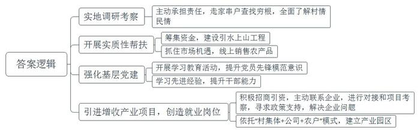
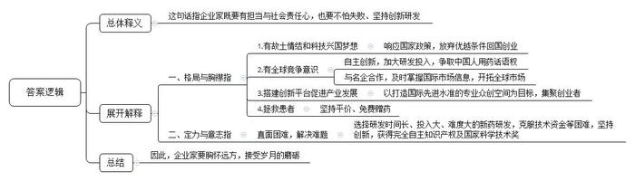
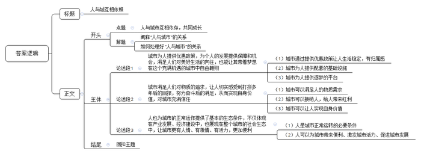

# 2020年0822公务员多省联考《申论》题（山西省级卷）

<!-- gwy:overview:start -->
> **山西 · 2020 · 申论 · 省级卷** ｜ 4 题 · 图片 4 处 · 答案随题折叠

导航：[题目](#题目) · [材料 1](#材料-1)
<!-- gwy:overview:end -->

> 候选采集稿。参考答案及解析来自粉笔页面，不代表官方答案或真实高分答卷；来源使用许可与原卷对应关系仍需人工核实。

## 给定材料

### 材料 1

党的十九大对我国发展提出了更高的奋斗目标，作出了从全面建成小康社会到基本实现现代化、再到全面建成社会主义现代化强国的战略安排，发出了实现中华民族伟大复兴中国梦的最强音。

改革开放40多年，就是一个追梦之旅。改革开放之初，我们党以非凡的胆略、坚定的自信设计了实现社会主义现代化的宏伟蓝图。从站起来、富起来到强起来，这是奋斗的力量，也是梦想的力量。改革开放40多年的历程也告诉我们：伟大事业都始于梦想，基于创新，成于实干。梦想是激发活力的源泉。只要有梦想，就会有力量。只要有梦想，则时光不弃，未来可期。

### 材料 2

几年前，小孙从一所名牌大学硕士研究生毕业，来到A省商务厅工作。有一次，省委、省政府组织“机关干部下基层”社会实践活动，她随着实践小组来到了商务厅的对口扶贫村——岩山。

岩山美丽的风景、淳朴的民风、热情好客的村民令小孙印象深刻。不过，令她同样印象深刻的还有岩山的贫困。岩山共有1345户、4130口人，其中贫困户占60%，人均耕地不足0.8亩，村民收入主要依靠传统农业和外出务工，是典型的国家级贫困村。脱贫是这里的村民一代又一代的梦想。如果能帮助岩山村这样长期贫困的地方摆脱贫困，人生该是多么有价值啊！小孙的心里涌起一个强烈的念头。于是，小孙主动请缨，担任岩山驻村帮扶工作组组长。

从驻村工作开始的第一天起，帮助岩山这个贫困村脱贫致富的沉甸甸的责任，便落在了小孙的肩上。刚入村时，小孙准备先找村民了解情况，但却听到了这样的风凉话：“咋还派个女干部？一个城里女人能干啥？”

为了开好头，获取村民的信任，她和工作组同事，田间地头了解情况，走家串户查找穷根。入村不到两个月，就完成了全村所有贫困户的走访，做到村里的“大事小情、家长里短”都了然于心。

岩山地势高，村里的自来水系统又年久失修，村民们经常处于缺水状态。小孙和工作组商议得先解决这个根本问题。随后，他们筹集资金，在全村开工建设引水上山工程，彻底改变了村里几十年来缺水的落后状况。刚去的那一年，小孙注意到各家都用自家喂养的土猪腌制成腊肉，味道非常鲜美。除自己食用外，每年各家都会有可观的剩余。小孙与工作组同事在那年春节前，瞅准节日期间市场供货量增加的机会，积极利用微信朋友圈、联系微商等方式，全程参与推销，不仅给村民换来了“过年钱”，还使岩山的腊肉小有“名”气。一连串雪中送炭的实质性帮扶拉近了村民和工作组的距离，村民们被小孙这位“女干部”的真情付出深深打动。

“农村富不富，关键在支部。如何发挥基层党组织的战斗堡垒作用是驻村帮扶的首要工作。”小孙深有感触地说。为此，她和工作组同事带着村民党员积极开展学习教育活动，提升党员的先锋模范意识。为了提高村干部、村民代表引领产业发展、带领群众致富的能力，小孙多次组织大家到周边先进地区学习考察，“明显感觉到岩山的民心齐了，村干部的干劲足了、水平高了。”小孙帮助村民脱贫致富的信心更强了。

手工纺织是岩山村村民传统的生产生活方式，如何依托这个优势，增加村民收入成为小孙每天都要琢磨的“大事情”。在得知外省一家大型现代纺织企业老总是A省人，有回乡投资的想法后，小孙和工作组便第一时间与他取得联系，进行对接和项目考察。在充分了解到该纺织项目是非常适合岩山村的好项目后，小孙便积极与企业负责人沟通招商想法。针对企业提出的十几条落实投资的实际问题，小孙带领工作组到市、县、乡各项目主管单位咨询政策、寻求支持。仅仅5个多月的时间，小孙和工作组就协助企业完成了项目选址、各项手续办理、厂房建设、员工培训等一系列重要工作。村干部介绍说，目前，一个依托“村集体+公司+农户”模式形成的纺织产业园区已建立起来。村民不仅可以在家门口就业，而且可以实现既拿薪金又领股金还得租金的长效增收，岩山村的脱贫梦正在逐步实现。

“咱们岩山再也不是那个靠天吃饭的穷地方了，现在不少在外打工的年轻人都回来了。”村民喜滋滋地指着驻村工作组的办公室说，“变化就是孙书记和她的组员到咱村来的那一天开始的。”

“我们的目标是成为北方最大的坯布集散地。”一个更大的梦想在小孙心中一点点描绘。

### 材料 3

2002年，借着国家政策鼓励留学生回国创新创业的东风，留洋十年的丁先生怀着“做创新药”的梦想，背起行囊，与几位合伙人一道回国创业。第二年，BD药业成立。有人说，丁先生的这个抉择很有勇气。回国之前，丁先生已是国外著名大学的医学博士和执业医师，回国创业就意味着放弃了优渥的生活条件、高额的薪水，还要白手起家。然而在丁先生看来，这个选择顺理成章。“像我们这些知识分子，大多数还是有故土情结的，梦想着做出一份自己的事业，也希望用自己的知识为国家医药事业发展出份力。”除了游子的思乡情结，还有一点对丁先生来说非常重要——“国家鼓励海归创新创业，在国内可以做到在国外做不到的事”。他说，在国外，科学家只能做药物研发的其中某一段的研发，很少有几个科学家合作完成一个新药所有的研究，并将其产业化，只有在中国有这种机会。

与很多企业选择做仿制药不同，BD药业一开始就立志做新药，要在全球药业竞争中拥有完全知识产权。尽管BD药业现在已成为一家在全球肿瘤药物领域拥有多项核心自主知识产权的高科技公司，但回想企业初创时，丁先生有很多感慨，当时面临各种技术难题、无休止试药及资金链断裂等“生死劫”，但有志者事竟成，BD药业克服了重重困难，最终成功了。他们研制的抗癌药获得国家颁发的新药证书，成为我国首个具有完全自主知识产权的同类抗癌新药。在2015年度国家科学技术奖励大会上，丁先生捧起了光荣的奖杯，这是国家对BD药业创新能力的巨大肯定。该药还被列入国际权威机构发布的新药研发年度报告，成为第一个获得国际机构认可的中国创制新药。

“拥有自主创新，才能拥有话语权”，丁先生常说，“要真正把中国的医药产业发展起来，得把中国用药的话语权掌握在自己手里。”丁先生表示，自主研发是BD药业的看家本领。“船到中流浪更急，人到半山路更陡，愈进愈难、愈进愈险时不进则退，要非进不可。我们必须不断加强自主研发这一块，持续增加创新研发投入。BD药业跑得这么快，源源不绝的动力就来自‘创新’二字。有自主研发作保证，我们就有底气开拓市场和开展合作。”BD药业把眼光投向全球，通过与国际知名医药企业合作，及时掌握国际市场信息，在全球的抗肿瘤药物市场中奋勇开拓。

如今，BD药业又种下了一颗新的梦想种子——以自家企业为基础，打造一座“医药梦工场”，搭建更大的创新平台，为全国医药产业的快速发展打造新引擎。丁先生说，这是一个为科学家、创业者造梦圆梦的项目，目标是打造一个具有国际先进水准的生物医药专业众创空间。未来，这里也将集聚一批医药领域的创业者。

研制新药去拯救病患，搭建创新平台去服务全行业。丁先生说这些都是出自一个企业家的担当。作为过来人，丁先生还想告诉创业者的是，企业家要有企业家的担当，<u>企业家既要有仰望星空的格局与胸襟，也要有坐住板凳的定力和意志。</u>“就拿我们医药行业来说，与一般的制造业不同的是，医药行业一方面与老百姓的身体健康密切相关，另一方面新产品的研发时间长、投入大、失败的风险高，要成功很难。”经历了风风雨雨，丁先生一直坚持“做老百姓吃得起的好药”，还对符合相关条件的患者进行免费赠药，赠药数量甚至超过了销售数量，这就是一位企业家的社会责任心。胸怀远方，迎接岁月的磨砺，才有了如今的BD药业。

### 材料 4

刚刚过完入党70周年的“生日”，89岁的他安详离世，走得坦坦荡荡。积蓄，全都捐了；最后一笔党费，老伴代交了，有1万元之多……这一生，他是那样简朴，又是那样富足，一生家国情，桃李满天下，留下了闪光的无字丰碑。他曾说，生活过得好，不是追求舒服，而是“无愧我心”。他，就是华南农业大学原校长、中国科学院院士、著名水稻遗传学家卢永根，人们亲切地称他为“布衣院士”。

生命最后的时光，卢永根躺在病床上，有些疲倦。可一说起当年入党时的情形，他眼中立刻发出明亮的光。“一个很小的房子，墙上挂着党旗。”老人的声音有些颤抖：“举右手，面向北方，延安就在北方，延安就是我们心中的太阳。”1930年，卢永根出生于香港的一个中产家庭，家里有电话、出门有汽车。11岁那年，日寇占领了香港，他被父亲送回广东老家避难，谁料想，这里也被铁蹄践踏。亲历了国土的沦丧，目睹了国民党政府的腐败，他苦苦寻求着希望和方向。1949年8月9日，卢永根加入了中国共产党。老伴说，“他把入党那一天看成生日，新生命的开始。所以，每年这一天，我都为他过生日。”

新中国成立前夕，卢永根受党组织派遣，离开香港到广州领导地下学联，迎接广州解放。“我为什么要抛弃安逸的生活回内地呢？是中国共产党指给我有意义的人生之路，只有社会主义祖国才是我安身立命的地方。”卢永根说。作为华南农业大学的校长，卢永根这样定位自己的三重角色：先党员，再校长，后教授。“虽然我现在疾病缠身，无法行走，但是，我的意识是清醒的，我的牵挂是不变的，我的信仰是坚定的！”岁月时光无法磨灭卢永根的初心。住院不久，卢永根和老伴向党组织郑重申请：“我俩大半辈子都没有离开过党。这个时候，也不能没有组织生活。”对此，校党委决定，由农学院党委书记等几名党员参加，每月在病房开一次党员学习会。“我全程收看了党的十九大开幕直播，听完总书记的报告，热血沸腾，备受鼓舞。”

卢永根大学毕业后留校任教，成为“中国稻作科学之父”丁颖教授的助手。“抗战时，丁老师带着水稻种、番薯种，一直逃难到云南，把种质资源保护下来。”卢永根十分敬佩。丁教授去世后，卢永根在极其艰苦的条件下，带领团队完成了恩师未竟的事业，保存了具有特色的野生水稻基因库，首次提出水稻“特异亲和基因”的新观点。近些年，卢永根研究团队共选育出作物新品种33个，在华南地区累计推广面积1000多万亩，新增产值15亿多元。

曾几何时，在美国的姐姐苦劝卢永根一家移民，可怎么也说不动他。卢永根说：“我是炎黄子孙，要为自己的祖国效力。”他在给留学生的信中写道：“外国的实验室再先进，也不过是替人家干活。”在他的劝导下，多名学生学成归国。“生命诚可贵，爱情价更高；若为祖国故，两者皆可抛！”在一次对学生的演讲中，卢永根化用著名诗句深情表白。晚年，又有人问他为什么非要留在国内，他说：“你向党、向人民做过许诺和宣誓，那自己要遵守了！”

走进老人的家，仿佛回到上世纪中叶。铁架子床锈迹斑斑，挂蚊帐用的是竹竿，一头绑着绳子，一头用钉子固定在墙上；台灯是几十年前的款式，收音机坏了一修再修……“这些东西没有用光用烂，还能用，物还没有尽其用。”卢永根说。“床已经很好了，我们刚结婚时，4个条凳架上板子，就是床。”出门，80多岁的老两口背着双肩包、头戴遮阳帽，挤公交、换地铁；吃饭，叮叮当当拎着饭盒，和学生一起在食堂排队打饭，吃得一粒米都不剩。看到有学生剩饭，卢永根总忍不住提醒：“多少株水稻才能出一碗米饭？”

880多万元储蓄，老两口没有留给唯一的女儿，一分不剩，全部捐给华南农业大学成立的“卢永根教育基金”。这些壮举，卢永根说是“还”：“党培养了我，这是做最后的贡献。”老伴也说：“国家给了我们许多，我们用不完了，当然还回去。”不仅“还”钱，他们觉得连生命都是党和国家的，也要“还”回去，双双办理了遗体捐献手续。

“布衣院士”卢永根走了，走得干干净净、清清爽爽。他不留财产、不留遗体、不留墓碑，但是，他却留下了很多很多……

### 材料 5

一身时尚的服装，坐在一辆新买的小汽车中，车中音响里播放着快节奏的流行歌曲，这一切都使得小王和十多年前刚从乡下老家来时判若两人。在S市这座大城市坚持了十多年后，快递员小王觉得自己离这个流光溢彩的大都市越来越近了，这个城市对他来说也不再那么陌生和疏离。他的梦想更进了一步，在这个大城市扎根，不再有外乡人的距离感。

十多年前，中国物流行业呈现出新的面貌，S市的物流行业也呈现出蓬勃发展的势头。就是在此大背景下，小王从乡下老家来到S市当了一名快递员。很长一段时间，晚上空闲的时候，小王会和几个朋友一起骑上电动车到江边兜风。江边高楼大厦林立，五颜六色的灯光闪烁着，江面上游船来来往往，一切都是如此新鲜，令他激动。小王似乎从江上温暖的夜风中感受到了勇气和力量，他梦想着早日融入这个城市，成为这个城市的一员。

从2008年开始，电商对物流业的助推，随后新《邮政法》实施以及经营模式的改革推动了快递业的迅猛发展。行业高速增长带来的红利，加上小王的勤奋努力，他的收入已过万。现在的小王不再穿路边摊上的假货，开始去大型购物商城买800元一双的工装鞋，还买了一辆十几万的小汽车。

2020年初，一场新冠疫情突如其来，小王和他的同伴们成了S市一道美丽的风景线，他们坚守岗位，驰骋在这个城市的大街小巷，为隔离在家的市民们及时送去各种生活物资。小王说，每每给客户送件时听到一句简单的“谢谢”，都会让他体会到这份职业带来的被需要和被尊重的感觉。奔走在这个城市中时，小王也常常感受到这个城市里人情的温馨。市民们称S市的快递小哥像勤劳的小蜜蜂，是最辛勤的劳动者，为大家生活带来了便利。在夏天的时候，很多热心市民、商家在街道上摆放了专门的冰柜，免费提供饮料。每次路过这些蓝色帐篷下的冰柜，小王都觉得特别暖心。

小王很早就办理了S市的市民卡，市民卡不仅兼具医保卡和储蓄卡的功能，还能享受到泊车、乘坐公交车、租赁公共自行车等公共服务的优惠。为了推动外地人融入城市，S市还推出了积分落户政策，只要积满一百分就可以落户。小王越来越感受到了这个城市很多制度传递出的温情。正如S市一部反映百姓日常的纪录片所讲，对于这座城市以及在其中像小王一样工作多年的人而言，<u>人与城市互相依赖着，每一方都使另一方丰满有据</u>。小王很感谢S市这个大城市，让他有了一份稳定且有上升空间的工作。当然，“现在S市也离不开快递业，离不开我们的服务了。”小王说。

## 题目

### 第 1 题

**请根据给定资料**2**，概括小孙为带领村民脱贫致富做了哪些主要工作。（15分）**

关联材料：材料 2

作答要求：

要求：全面准确，简明扼要，条理清晰，不超过200字。

第 1 题 · 答案与解析

**参考答案（粉笔题库参考内容）**

1.实地调研考察。主动承担责任，走家串户查找穷根，全面了解村情民情。

2.开展实质性帮扶。筹集资金，建设引水上山工程；抓住市场机遇，线上销售农产品。

3.强化基层党建。开展学习教育活动，提升党员先锋模范意识；学习先进经验，提升干部能力。

4.引进增收产业项目，创造就业岗位。积极招商引资，主动联系企业，进行对接和项目考察，寻求政策支持，解决企业问题；依托“村集体+公司+农户”模式，建立产业园区。

**参考答案说明：**本参考答案从“实地调研考察”“开展实质性帮扶”“强化基层党建”“引进增收产业项目，创造就业岗位”等不同的角度进行了分条撰写；各条答案要点之间在内容上相互并列，没有交叉。

**解析状态：unknown（来源未提供）**

### 第 2 题

**请根据给定资料**3**，谈谈你对画线句子“企业家既要有仰望星空的格局与胸襟，也要有坐住板凳的定力和意志”的理解。（20分）**

关联材料：材料 3

作答要求：

要求：全面准确，分析透彻，条理清晰，不超过300字。

第 2 题 · 答案与解析

**参考答案（粉笔题库参考内容）**

这句话指企业家既要有担当与社会责任心，也要不怕失败、坚持创新研发。

一、格局与胸襟指：1.有故土情结和科技兴国梦想。响应国家政策，放弃优越条件回国创业。2.有全球竞争意识。自主创新，加大研发投入，争取中国人用药话语权；与名企合作，及时掌握国际市场信息，开拓全球市场。3.搭建创新平台促进产业发展。以打造国际先进水准的专业众创空间为目标，集聚创业者。4.拯救患者。坚持平价、免费赠药。二、定力与意志指：直面困难，解决难题。选择研发时间长、投入大、难度大的新药研发，克服技术资金等困难，坚持创新，获得完全自主知识产权及国家科学技术奖。

因此，企业家要胸怀远方，接受岁月的磨砺。

**参考答案说明：**（1）思路方面，本参考答案按照词句解释题“总体释义+展开解释+总结”的一般答题思路展开。（2）内容方面，本参考答案先解释了画线句的总体含义；“展开解释”部分再分别从“格局与胸襟”“定力与意志”两方面展开，最后在“总结”部分提出了对策。（3）词句表达方面，本参考答案加上了“这句话指”“因此”等逻辑连接词来承接上下文。

**解析状态：unknown（来源未提供）**

### 第 3 题

**某省正开展优秀共产党员先进事迹巡回宣讲活动，假设你是宣讲团的成员，请根据给定资料**4**，撰写一份“布衣院士”卢永根先进事迹的宣讲提纲。（25分）**

关联材料：材料 4

作答要求：

要求：

（1）紧扣材料，内容全面；

（2）语言准确，有逻辑性；

（3）字数不超过400字。

第 3 题 · 答案与解析

**参考答案（粉笔题库参考内容）**

致敬“布衣院士”卢永根

作为本次优秀党员先进事迹巡回宣讲活动的宣讲成员，很荣幸为大家介绍卢永根院士的事迹。卢永根作为大学校长、中科院院士、水稻遗传学家，被称为“布衣院士”。

一、忠诚于党。他信仰坚定，将政治生日作为新生命元年；听从召唤，在危难之际挺身入局；定位角色：先党员、再校长、后教授；学习理论，带病参加党员学习会。

二、创新科研。他不畏艰苦，完成恩师未竟事业，保存特色野生水稻基因库；矢志钻研，提出水稻“特异亲和基因”新观点，培育新品种并大面积推广。

三、报效祖国。他热爱祖国，拒绝亲人的移民建议；挽留人才，劝导留学生回国效力。

四、节俭无私。他生活朴素，坚持物尽其用，挤公交、换地铁，在食堂排队打饭，不浪费粮食；无私奉献，心怀感恩，用全部积蓄成立教育基金，捐献遗体。

卢永根院士的事迹精神永远值得我们学习！

**参考答案说明：**（1）本题虽然不要求写格式，但为了保险起见，建议加上标题。（2）正文部分，一方面从内容来看，围绕着“宣讲活动”，本参考答案的开头先写到了“宣讲背景”“宣讲人身份”；围绕着“卢永根先进事迹”这一主题，主体部分从“忠诚于党”“创新科研”“报效祖国”“节俭无私”这四个层次展开介绍；结尾进行了呼吁号召。另一方面，形式上，本参考答案做到了条理清晰、思路明确。

**解析状态：unknown（来源未提供）**

### 第 4 题

**给定资料**5**中画线部分提到，“人与城市互相依赖着，每一方都使另一方丰满有据。”请根据你对这句话的理解，参考给定资料，联系实际，自拟题目，写一篇议论文。（40分）**

关联材料：材料 1、材料 2、材料 3、材料 4、材料 5

作答要求：

要求：

（1）自选角度，立意明确；

（2）内容全面，结构完整；

（3）思路清晰，语言流畅；

（4）总字数1000-1200字。

第 4 题 · 答案与解析

**参考答案（粉笔题库参考内容）**

**人与城互相依赖**

城市是人赖以生存的聚居所，人是城市不可或缺的一份子，个人与城市是一个命运共同体。城市的建设要“以人为本”，让人在城市中感受勇气和力量；个人的生存要“服务于城”，让城市在人的奋斗中繁荣和昌盛。城因人而兴，人因城而幸，两者互相依存，共同成长。

**城市为人，一方面提供优惠政策，为个人的发展提供保障和机会，满足人们对美好生活的向往，也能让其带着梦想在这个充满机遇的城市中自由翱翔。**流光溢彩、宜居繁华的城市有着“积分入户”“市民卡”等优惠政策，让人感受到稳定、归属；有着林立的高楼大厦、五颜六色的夺目灯光、宽敞明亮的道路等设施，让人穿梭、忙碌、兴奋、激动……一身时尚的服装，一辆崭新的小汽车，一首热情洋溢的歌曲，是快递员小王在城市中打拼十多年的回报，折射出他生活的“城”给予他的满足。这座“城”给“人”宜居的环境、发展的机遇、进步的空间，让才华横溢的你能够站稳、奔跑、起飞，让拥有梦想的你有平台、机会去追逐。

**另一方面满足人们对物质的追求，让人切实感受到打拼多年后的回报，努力奋斗后的满足，从而实现自身价值，对城市充满信任。**城市是一个有着只要勤奋就能月入过万，只要能奔跑就能赢得笑容，只要努力拼搏就有向上发展，实现人生出彩机会的地方。作为生活在城市中的个体，要充分利用城市带给的机会。“送人玫瑰，手留余香”，简单的一声“谢谢”，体现“城”对“人”的接纳；“风驰电掣”的行业发展，是“城”给“人”的红利。同时，在每次需要挺身而出时，生活在城市的每个人，都义无反顾、冲锋陷阵，他们没有退缩，没有逃避，用他们的切身行动回报城市，并在这一过程让自身价值得以实现。

当然，城市对人的回报，在于人对城市的尽心尽力。**人也为城市的正常运作提供了基本的生态条件，不仅体现在产业发展、经济建设中，也展现在整个城市的社会生态中，让城市更有人情、有激情、有活力，更加便利。**一个城市的繁荣离不开精英才俊的聚集，在这个千帆竞发、百舸争流的时代，急需勇立潮头、奋发有为的弄潮儿。俗话说“三百六十行，行行出状元”，一个个吃苦耐劳、任劳任怨、勤劳节俭的人是城市基础建设的基石；一个个爱心满满、乐于奉献、无私付出的人是城市人性化的标志；一个个乐观向上、勇往直前、知难而进的人是城市高速发展的发动机……穿行于大街小巷的快递员、清洁工、小摊贩，轻轻的一个微笑，会给城市提供无限的便利；行走于地铁站、公交站，脸上洋溢着青春、向上的上班族，淡淡的一个“早上好”，会让城市充满温情与生机；工作在高楼大厦，天天进行头脑风暴、脑力碰撞的精英，小小的一个“想法”，可能就会让城市发生天翻地覆的改变。

说到底，人是城中人，城由人组成，城为人提供便利，人为城带来发展。城市的有序发展关系到个人幸福感的满足、梦想的实现，个人的不断进步是城市长足发展的必备。人与城市互相依赖着，每一方都使另一方丰满有据。

**文章分析**

**人与城互相依赖**

【**标题的优点**：首先，范文的标题“人与城互相依赖”突出了“人与城市”这一主题，点出了二者之间的关系。其次，形式上，文字简洁明快。】

（1）<u>城市是人赖以生存的聚居所</u>，<u>人是城市不可或缺的一份子</u>，<u>个人与城市是一个命运共同体</u>。（2）<u>城市的建设要</u>“<u>以人为本</u>”，<u>让人在城市中感受勇气和力量</u>；<u>个人的生存要</u>“<u>服务于城</u>”<u>，让城市在人的奋斗中繁荣和昌盛</u>。城因人而兴，人因城而幸，两者互相依存，共同成长。

【**开头的优点：**★内容方面。范文的开头是紧扣“人与城市”这一主题展开的。首先，开头第一句话点出主题，做到了主题明确。其次，对“人与城市”这一主题进行了分析阐述：（1）阐释了“人与城市”的关系；（2）介绍了如何处理好“人与城市”的关系。★文字表达方面：长短句配合使用，使语言表达有节奏感。】

**城市为人，一方面提供优****惠政策，****为个人的发展提供保障和机会，满足人们对美好生活的向往，也能让其带着梦想在这个充满机遇的城市中自由翱翔。**（1）流光溢彩、宜居繁华的<u>城市</u>有着“积分入户”“市民卡”等<u>优惠政策</u>，让人感受到<u>稳定</u>、<u>归属</u>；（2）有着林立的高楼大厦、五颜六色的夺目灯光、宽敞明亮的道路等<u>设施</u>，让人穿梭、忙碌、兴奋、激动……一身时尚的服装，一辆崭新的小汽车，一首热情洋溢的歌曲，是快递员小王在城市中打拼十多年的回报，折射出他生活的“城”给予他的满足。（3）<u>这座</u><u>“城”给“人”宜居的环境</u>、<u>发展的机遇</u>、<u>进步的空间</u>，<u>让才华横溢的你能够站稳</u>、<u>奔跑</u>、<u>起飞</u>，<u>让拥有梦想的你有平台</u>、<u>机会去追逐</u>。

【**论述段****1的优点：**★观点句：范文的观点句是紧扣“人与城市”这一文章主题提出的。形式上，它在段首处直接写出，位置突出，容易被发现；内容上，关键词突出，内容要点明确，可以明显看出它是从“优惠政策、追逐梦想”等角度入手，指出了“城市为人带来的好处”。★论述内容：（1）城市通过提供优惠政策让人生活稳定，有归属感；（2）城市为人提供配套的基础设施；（3）城市为人提供逐梦的平台。注意：以上三个方面的内容都是紧扣观点句“城市为人，一方面提供优惠政策，为个人的发展提供保障和机会，满足人们对美好生活的向往，也能让其带着梦想在这个充满机遇的城市中自由翱翔”进行分析论述的，针对性强、内容层次丰富。最后，在论述方法和论据的选取上做到了讲道理、举例子相结合，论证比较丰富。】

**另一方面满足人们对物质的追求，让人切实感受到打拼多年后的回报，努力奋斗后的满足，从而实现自身价值，对城市充满信任。**（1）<u>城市是一个有着只要勤奋就能月入过万</u>，<u>只要能奔跑就能赢得笑容</u>，<u>只要努力拼搏就</u><u>有</u><u>向上发展</u>，<u>实现人生出彩机会的地方</u>。作为生活在城市中的个体，要充分利用城市带给的机会。（2）“送人玫瑰，手留余香”，简单的一声“谢谢”，<u>体现</u><u>“城”对“人”的接纳</u>；“风驰电掣”<u>的行</u><u>业发展</u>，<u>是</u><u>“城”给“人”的红利</u>。（3）同时，在每次需要挺身而出时，生活在城市的每个人，都<u>义无反顾</u>、<u>冲锋陷阵</u>，<u>他们没有退缩</u>，<u>没有逃避</u>，<u>用他们的切身行动回报城市</u>，<u>并在这一过程让自身价值得以实现</u>。

【**论述段****2的优点：**★观点句：范文的观点句是紧扣“人与城市”这一文章主题提出的。形式上，它在段首处直接写出，位置突出，容易被发现；内容上，关键词突出，内容要点明确，可以明显看出它是从“满足物质追求、实现自身价值”等角度入手，指出了“城市为人带来的好处”。★论述内容：（1）城市可以满足人的物质需求；（2）城市可以接纳人，给人带来红利；（3）城市可以让人实现自身价值。注意：以上三个方面的内容都是紧扣观点句“满足人们对物质的追求，让人切实感受到打拼多年后的回报，努力奋斗后的满足，从而实现自身价值，对城市充满信任”进行分析论述的，针对性强、内容层次丰富。最后，在论述方法和论据的选取上做到了讲道理、引用名言相结合，论证比较充分。】

当然，城市对人的回报，在于人对城市的尽心尽力。**人也为城市的正常运作提供了基本的生态条件，不仅体现在产业发展、经济建设中，也展现在整个城市的社会生态中，让城市更有人情、有激情、有活力，更加便利。**（1）<u>一个城市的繁荣离不开精英才俊的聚集</u>，在这个千帆竞发、百舸争流的时代，<u>急需勇立潮头</u>、<u>奋发有为的弄潮儿</u>。俗话说“三百六十行，行行出状元”，<u>一个个吃苦耐劳</u>、<u>任劳任怨</u>、<u>勤劳节俭的人是城市基础建设的基石</u>；<u>一个个爱心满满</u>、<u>乐于奉献</u>、<u>无私付出的人是城市人性化的标志</u>；<u>一个</u><u>个</u><u>乐观向上</u>、<u>勇往直前</u>、<u>知难而进的人是城市高速发展的发动机</u>……（2）穿行于大街小巷的快递员、清洁工、小摊贩，轻轻的一个微笑，<u>会给城市提供无限的便利</u>；行走于地铁站、公交站，脸上洋溢着青春、向上的上班族，淡淡的一个“早上好”，<u>会让城市充满温情与生机</u>；工作在高楼大厦，天天进行头脑风暴、脑力碰撞的精英，小小的一个“想法”，<u>可能就会让城市发生天翻地覆的改变</u>。

【**论述段****3的优点：**★观点句：范文的观点句是紧扣“人与城市”这一文章主题提出的。形式上，它在段首处直接写出，位置突出，容易被发现；内容上，关键词突出，内容要点明确，可以明显看出它是从“提供基本生态条件、有人情、更便利”等角度入手，指出了“人为城市发展带来的好处”。★论述内容：（1）人是城市正常运转的必要条件；（2）人可以为城市带来便利、激发城市活力、促进城市发展。注意：以上两个方面的内容都是紧扣观点句“人也为城市的正常运作提供了基本的生态条件，不仅体现在产业发展、经济建设中，也展现在整个城市的社会生态中，让城市更有人情、有激情、有活力，更加便利”进行分析论述的，针对性强、内容层次丰富。最后，在论述方法和论据的选取上做到了讲道理、举例子相结合，论证丰富多样。】

【**论述段之间的关系：**★内容的内在逻辑：范文的论述段之间有两层逻辑。第一层，整体上是按照“城市为人带来的好处”到“人为城市带来的好处”的逻辑展开的。第二层，其中论述段1和论述段2又是从“城市为人带来的好处”出发，先写了“城市为人提供政策保障和逐梦机会”，再写了“城市满足人的物质追求，实现人生价值”。★段与段的外在衔接：论述段2段首处的过渡句“另一方面满足人们对物质的追求”，起到了承接论述段1、引出论述段2的作用；论述段3段首处的过渡句“当然，城市对人的回报，在于人对城市的尽心尽力”，起到了承接论述段1和2、引出论述段3的作用。】

说到底，<u>人是城中人</u>，城由人组成，城为人提供便利，人为城带来发展。城市的有序发展关系到个人幸福感的满足、梦想的实现，个人的不断进步是城市长足发展的必备。<u>人与城市互相依赖着</u>，<u>每一方都使另一方丰满有据</u>。

【**结尾的优点：**范文的结尾回扣了“人与城市”这一主题，并总结了二者之间的关系。】

**解析状态：unknown（来源未提供）**

