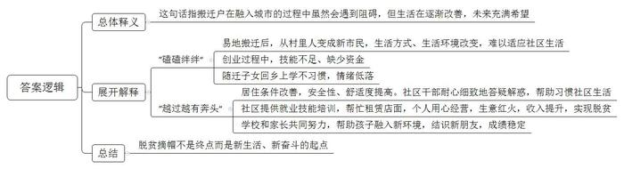
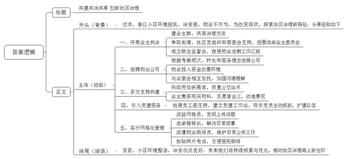
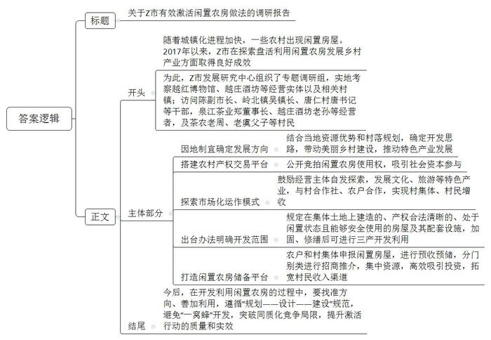

# 2021年公务员多省联考《申论》题（山西乡镇卷）

> 候选采集稿。参考答案及解析来自粉笔页面，不代表官方答案或真实高分答卷；来源使用许可与原卷对应关系仍需人工核实。

## 给定材料

### 材料 material-8f6baf54ea1d3274

新春伊始，《新农村》记者小梁到基层调研，以下是他在两个村庄采访的片段。

“村子真干净”，这是外来人对东各村的第一印象。村道上见不到一张纸片，家家院里院外也清清爽爽。79岁的高大妈笑着把小梁往屋里迎。冬季取暖煤改电以后，高大妈家装了地暖，外面再冷屋里也舒服。高大妈自己收拾得利索，家里拾掇得干净，屋里屋外的花儿都修剪得齐齐整整。她言语间透着喜悦，“儿子孝顺，春节前辞了城里的工作回来，专门照顾我们老两口。”“爸妈上了年纪，身体都不大好，有个头疼脑热，身边没个人照顾那肯定不成。”高大妈的儿子小曾买完菜刚一进门就接过了话头。

东各村是太行山脉的一个小山村。村子不大，一共250多人，但老龄化程度不低，60岁以上的老人就有70多位。平时，村里就是这些老人“守着”。村委会一周放两次公益电影，捧场的也都是这些老人。“村里的大爷大妈都是居家养老，儿女负责赡养。子女外出打工的，只能是老两口互相照顾。村里打算建个‘托老所’，解决老人的日间吃饭、活动和照料问题。”村党支部委员李大姐介绍说，她时常会到高大妈家来看看，帮衬帮衬。听说要建“托老所”，高大妈觉得不错，“老姊妹能时常见上一面，唠唠嗑。”“老爸腿脚不好，出不了门，还得我们在跟前伺候着放心。”小曾说。村里买东西不太方便，买点油盐酱醋、买点菜都得去镇上，单程4公里，走到公交站就得一刻钟，这对老年人是个大挑战。儿子能在身边尽孝，高大妈心里高兴，可也着急。她跟李大姐商量：“咱村里能不能办个产业，让我儿子也能有点收入，不然他光照顾我们了，以后咋办？”

东各村边有条远近闻名的宋代古道，村内还保留着古道上唯一的一座三孔拱桥，来的游客不少。村里已经有10多户拿到了农家乐的经营执照，李大姐说：“要是乡村旅游搞起来，不愁您儿子没事儿干！”

坐落在太湖之滨的水乡小村开弓村，则是另外一种景象。弯弯的小清河穿村而过，如箭在弦，村名由此而来。上世纪30年代，费孝通先生来此调研，写下著名的经济调研报告。岁月变迁，费老留下的精神财富，成了开弓村重要的文化资源和发展动力。

甜茶、昆曲、桥文化……在开弓村文化纪念馆，或图文，或影像，或模型，地方风土人情跃然眼前。陈列厅里，一件件旧物什，散发着浓浓的年代感。“有不少是村民自己捐赠的，像这排老式碗橱，还有那套八仙桌椅，现在已经很难看到了。”被村里人称为“农民教授”的老姚感叹，这里存放的是村民共同的乡村文化记忆。开弓村越来越富，村民的生活越来越好，但老姚喜中有忧，开弓村曾经是“处处倚蚕箔，家家下鱼筌”；如今，农耕文化，蚕桑文化却有淡化之势，“这是我们的根啊！”老姚颇有感慨。

如何传承乡风民俗？“首先要发挥好乡贤的力量。大家都有共识，要有个乡贤议事会。”老姚说。在成立后的乡贤议事会上，大家一致认为，要以有形的形式展现开弓村文化，如熏豆制作工艺，婚嫁习俗，摇三橹船，桑、蚕、丝到蚕丝被的一条龙产业……为什么要以“有形的形式”？老姚说：“让来到开弓村的人，从亲身参与民俗活动中体味到农耕文化和蚕桑文化的韵味。”村民的文化活动要有载体，开弓村发展较早，能用的土地已经不多，怎么解决？经过商议，村里准备把老仓库改造成文化礼堂。“脚手架已经搭起来了，估计5月份就能启用。”老姚说，按照规划，礼堂能容纳100人左右，今后村里的党员活动、小型培训、会议、文艺演出都可以使用。

未来，开弓村的文化回味必定更加悠长。

### 材料 material-9626936d837d4898

“去趟镇上就靠一双脚板子，都是山路，车子进不来呀！”说起自己的老家大娄山脉的双河村，小冯满是感慨。双河村地势陡峭，四面环山，人都住在半山腰上，道路不畅，外面的建材也很难运进来，村民只好就地取材，筑起了木房子。“木房时间长了就容易变形，腐烂的都有。”小冯说。遇到刮风下雨，就神经紧绷，生怕房子漏雨、塌了，觉都睡不安稳。一家守着不足3亩的陡坡地过活，靠天吃饭。成家后，虽然小冯也曾拖家带口地出去闯过，却没有攒下多少积蓄。后来，小冯有了第二个孩子，加之老母亲身体不好，常年吃药，夫妻俩只能辞职回家，没撑几年就成了贫困户。

接到易地扶贫搬迁的消息时，小冯还有点不敢相信：“一家子5口人还能搬出大山，做梦都没想到。”2018年7月，小冯全家从大山深处搬到了县城。挪了穷窝，小冯一家成了新市民。房子面积100平方米，宽敞的卧室、独立的厨房、干净的卫生间……“下雨天终于能睡个安稳觉了。”但没住几天小冯却有点不自在：“地面都铺了亮堂的瓷砖，稍微落点灰或者踩个脚印都看得清清楚楚。”从村里人成为新市民，有很多新的不适应：垃圾得倒进楼下的垃圾桶，要开始交物业费了……让小冯尤其困惑的就是物业费：“住的是自己的房子，为啥每月还得交钱？”不只是他，许多搬迁户刚开始都想不通。“他们毕竟过惯了山里的日子，能理解。”针对居民们的新困惑，社区干部们采取“两步走”：一方面挨家挨户走访了解需求和想法；另一方面一对一讲政策、做工作，不让困惑“发酵”。经过一段时间的沟通和适应，搬迁户们慢慢习惯了社区的生活。小冯有点不好意思，“啥事儿都有个过程嘛，懂了就习惯了。”

进了城，刚安顿好，小冯就开始找工作。转累了的他想找个地方垫垫肚子，周边就几家餐馆，还坐满了人。正要离开时，他突然有了一个想法：“谁都得吃饭，周边餐馆又不多，这是个机会。”但转头，小冯又犯难了：干惯了体力活儿，炒菜的技术不高怎么办？妻子也发愁：店面租金是笔不小的数目，一时半会儿也难凑出来。2018年底，随着最后一批搬迁户入住，社区开始开展不同类型的就业技能培训。一看到有厨师培训班，早有想法的小冯跟妻子立刻报了名。两个多月后，在社区的帮助下，小冯用凑齐的5万元租下了一间门面，期盼许久的小餐馆就这样“上线”了。小馆子环境干净，口味地道，加上两口子手脚勤快又热情，赢得了不少回头客。看到生意一天比一天好，小冯终于能缓口气：“现在一个月能挣七八千块，早就脱贫啦。”

搬出大山，工作也有了着落，还能照顾家里人，小冯觉得很满足，但另一件心事也随之而来。“以前村里没学校，孩子们只能到镇上念书。一大早就得摸着黑出门，沿着山路走两个多小时。”时间长了，大人都受不了，更何况是孩子。后来外出打工，孩子就跟了一路。“因为经常换工作，孩子几乎没有在固定的地方上完一年学。”一说到这儿，小冯满是愧疚。

搬到县城后，小冯家距学校只有十几分钟路程，上学不愁了。原以为在家门口上学是件高兴事儿，但出乎意料的是，开学第一周，小冯明显感觉孩子的情绪不太高。几番询问，他才弄清楚：“之前我们外出打工，孩子常年跟着在外地念书。现在回到家乡的学校上学，反而有些不习惯。”老师也发现了这个问题，还专门来家里了解情况，跟小冯和孩子谈了一次心，临走时，提醒小冯夫妻也要多帮助孩子融入新生活。“还是观念有问题，过去老觉得教育孩子就靠学校，不靠家长。”小冯说，“以后我们对孩子的教育要更上心才行。”如今，孩子慢慢认识了不少新朋友，成绩也稳定了不少。这一切，小冯看在眼里，乐在心里。

脱贫摘帽不是终点，而是新生活、新奋斗的起点。小冯觉得，尽管有些磕磕绊绊，但日子越过越有奔头。

### 材料 material-ff1c86a9bd74949f

年近四十、做小生意的杨华，还不知道自己竟有这般能耐：当上香江小区业主委员会主任，重新选聘了小区物业，让小区面貌焕然一新……

在杨华的手机中还保留着以前的小区照片：臭水沟、废水池、乱石裸露、垃圾成堆。比环境更糟糕的，是小区的治安，一年至少发生20多起偷盗案。“小区居民对之前的物业‘只收钱不做事’怨言很大。”业主魏大哥说。眼瞅着生活家园日益脏乱，业主和物业的矛盾不可调和，爱管闲事、在小区里有些声望的杨华建立了一个业主微信群，时常在群里与大家商讨如何能让小区好起来。大家逐渐达成了共识：成立业主委员会，重新选聘物业公司。前年3月，在街道、社区党组织和居委会的支持下，500多户业主投票选举，小区产生了业主委员会，大家选了杨华当主任。一个月后，业主委员会从6家竞标公司中选聘了W物业公司。

“我们在6家竞标公司中，不是实力最强的。”W物业公司罗经理说，“但是，杨华说他们更愿意娶个实在的小媳妇儿，而不愿意娶一个公主。”“罗经理来我们小区考察次数最多，时间最长，是他‘先投入、后回报’的理念打动了业主委员会。”杨华说。进驻小区以来，W物业先后投入44万元安装监控设备、举办百家宴、改造地下停车场等。“在不损害业主利益的前提下，业主委员会和物业公司相互依托，加强沟通，互相理解，最后受益的还是业主。”杨华认为。罗经理还邀请了20多名热心业主，成立了联合监督会，物业公司每季度须向他们汇报工作。“将群众工作的方法，引入到企业管理中。”一位业主这样评价。

杨华认为，小区的治理需要各方面的大力支持。去年1月，因为公交线路调整，原本附近唯一的公交站点香江小区站被取消，给居民出行造成一定影响。杨华和业主委员会的委员们多次到有关部门反映情况，经过多方努力终于恢复了香江小区站，收获了大多数业主的点赞。去年3月，小区内部的景观改造计划也得以顺利完成，杨华号召业主参与，业主们集资5000多元，引入山泉水，买来金鱼苗，业主志愿者义务出工，将原来人人捂鼻的臭水沟变成了亲子乐园的金鱼池。如今，眼前的小区林木繁盛、道路整洁，景观处流水潺潺、鱼翔浅底。

香江小区的成功实践，既给决策者们以启发，也给他们以信心。“近年来，随着交通改善、城市提质，城市外来人口流入大幅增加，加上一些老旧小区管理问题较多，城市基层社区治理尤其是小区治理，成为摆在我们面前的一项紧迫任务。”市委刘书记说，“怎么办？我们总结了香江小区的经验，提出了‘五进小区’的工作重点，即推进党建进小区、‘微改造’进小区、网格化管理进小区、物业管理进小区、文明创建进小区。”

杨华说：“自从市里推进‘五进小区’后，小区居民真正参与小区管理，感觉到自己是小区的主人，业主委员会工作也更加理直气壮。”在街道党工委的支持下，香江小区建立了党建工作站，杨华兼任了党建工作站站长。“目前已有36名党员主动报到”，杨华说。现在，他工作更忙了，也更有劲头了，因为与他并肩为业主们服务的人越来越多。现在，小区楼栋的每个单元，都有1名网格员、1名楼栋长和1名物业联络员。网格员由社区派驻，随时将在小区发现的各种问题上传街道网格办，最终到达市网格中心；楼栋长由居民选举产生，负责解决家长里短；物业联络员是物业公司员工，负责日常公共部分的维护。他们的照片和电话，都醒目地贴在了每个单元门口。

“不忘初心，方得始终。就算是一只蚂蚁，也有它的力量！”杨华在朋友圈里这样写道。他说，他只是一个爱管闲事的普通老百姓，但在与党委政府同向而行的过程中，感受到了力量。这力量，将支持他继续前行。

### 材料 material-bc9602f8f06e9ea3

近年来，随着城镇化进程加快，一些农村出现不少闲置房屋。2017年以来，Z市不少地方着力探索盘活利用闲置农房发展乡村产业的有效途径和措施，取得良好成效。为此，Z市发展研究中心组织了调研组进行专题调研。

位于东湖镇新泉村的新泉中学，因优化农村学校布局，多年前已不再办学，老教学楼被列入闲置农房，有人提议拆掉建住宅，但村两委最终统一意见：拆掉太可惜，还是应该盘活利用，壮大村集体经济。东湖镇产茶历史悠久，周边茶农集中，老房子联手茶产业，能发挥盘活利用的效益。确定发展方向为茶产业、发展茶文化后，村里通过镇里的农村产权交易平台公开竞拍老楼使用权。

主楼木楼板开始腐烂，副楼已几乎成了危房——这是泉江茶业有限公司郑董事长与老教学楼初次相遇时的情景。“到这荒村陋屋来干什么？”有人不解。但透过蛛网积尘，郑董事长脑中闪出一个念头：竞拍租下来，改造成专题博物馆，让更多的人到这里感受越红工夫茶的历史文化积淀。2017年11月，越红博物馆正式开放，曾经凋敝的老屋重焕生机。博物馆入口处的接待台，是用老房子的木楼梯板搭就；二楼的品茶室，稍加打量就能认出原先教室的格局模样；楼梯拐角墙上，完整保留着当年捐资兴学的石刻铭文。同时，作为青少年茶文化教育基地，博物馆还常举办特色研学活动。经镇村牵线搭桥，博物馆与村里的专业合作社、农户定点合作，与200多户茶农结对，帮助他们实施绿色无公害茶叶种植管理。“每斤40至60元的收购价，比以前高出一截。”茶农老周说。从闲置教学楼到茶文化综合体的蝶变，折射出闲置农房盘活后“包袱变财富”的改革之效。

Z市陈副市长认为，一些闲置的农村住房、厂房、村集体用房破旧不堪，要修缮很费钱，弃之拆之又可惜；而同时，拓宽农民增收渠道，促进农民收入持续增长，需要建立健全农民财产性收入增长机制。如何唤醒“沉睡”的农房资源，既能给农民增加财产性收入，又能为下乡创业人员提供创业场所？前些年，像越红茶叶博物馆这样的自发探索，开始在Z市乡间不断涌现。2018年8月，Z市出台有关办法，明确规定农村范围内在集体土地上建造的、产权合法清晰的、处于闲置状态且能够安全使用的房屋及其配套设施，实施加固、修缮后可进行旅游、休闲等三产开发利用。

一座占地500多平方米、长期闲置的私塾老建筑，曾是唐仁村唐书记的一块心病。它多年无人问津，只好用于村民堆货，成了村容村貌整治中的一处“死角”。改变发生在2019年7月，乡贤老孙通过镇里的农村产权交易平台中标将这座老建筑改造成融生产销售、非遗传承和文化体验于一体的越庄酒坊。“父亲做了一辈子酒，能在这里把传统古法酿造的流程展示出来，特别有意义。”老孙说。白墙黛瓦、青砖铺地、木格花窗，一年过去，越庄酒坊修旧如旧，开门迎客，成为乡村风貌的一抹亮色。“过去做仓库堆货，年租金不过4000多元，如今涨到6万多元，仅越庄酒坊一个项目，就带动村集体经济实现增收。”唐书记感慨，这座老建筑之所以能成功激活，关键是跟镇里的酿酒特色产业发展与美丽乡村建设挂上了钩，“盘活利用要找对路子，因地制宜，才能真正激发活力、持续产生效益。”

截至2020年底，Z市有激活意愿、尚待开发利用的闲置农房近50万平方米，是扎堆搞农家乐、民宿经营，还是避免“一窝蜂”开发、突破同质化竞争的局限，直接关系到激活行动的质量和实效。陈副市长说：“怎么找准方向、善加利用，至关重要。闲置农房利用改造要遵循‘规划——设计——建设’规范，与村落布点规划、村庄建设规划、土地利用规划相匹配。”古径幽幽，卵石铺面，唐仁村里的唐仁老街历史悠久，沿街百余间传统民宅，不少处于闲置状态。这段时间，唐书记和村干部正忙着与外地客商对接，将闲置农房激活同古村落的新规划有机结合起来，“期待盘活出更多越庄酒坊这样有特色的‘点’，串联带动起美丽乡村建设、特色产业发展的‘面’。”

岭北镇胡家村老虞同儿子住在外地，老宅空置多年。去年上半年，一位村干部建议他把闲置房存进“银行”。闲置农房存“银行”？初听这样的新鲜事，老虞很好奇。这个特殊的“银行”就是镇里的闲置农房储备平台，农户和村集体可供利用的闲置农房，都可登记申报。“正式‘激活’前，房子归自己管，等激活利用了再按租赁合同得收益。”村干部介绍。老虞和儿子商量后，将老宅存进“银行”。没多久，一位外县企业家通过平台相中了老虞等5户村民的闲置房，准备承租修缮，用于民宿经营。8月，老虞与承租人签订了租赁合同，拿到了头一年的租金。这是岭北镇率先试点运行闲置农房储备平台的一个例子，通过平台，镇里对可利用的闲置农房预收预储，分门别类进行招商推介。前不久，北周村废旧织布厂通过平台统一对外推介，由社会资本、乡贤和村集体共同入股出资，将老厂房改造成土特产展销中心。中心运行以来，农产品销售额已达100多万元。“通过储备平台的形式运作，资源更集中，吸引投资主体更有效率。”吴镇长说。

## 题目

### 第 1 题

**根据“给定资料**1**”，请概括高大妈的“喜”和“盼”、老姚的“喜”和“盼”。（20分）**

关联材料：material-8f6baf54ea1d3274、material-9626936d837d4898、material-ff1c86a9bd74949f、material-bc9602f8f06e9ea3

作答要求：

要求：全面、准确、有条理，不超过300字。

### 第 2 题

**“给定资料**2**”中划线部分提到，“尽管有些磕磕绊绊，但日子越过越有奔头”，请你根据给定资料，谈谈对这句话的理解。（20分）**

关联材料：material-8f6baf54ea1d3274、material-9626936d837d4898、material-ff1c86a9bd74949f、material-bc9602f8f06e9ea3

作答要求：

要求：全面准确，条理清晰，分析透彻，不超过300字。

### 第 3 题

**杨华受邀参加市里举办的城市基层社区治理工作会议，并准备在会上交流香江小区的经验。请你根据“给定资料**3**”，为他拟写一份发言提纲。（25分）**

关联材料：material-8f6baf54ea1d3274、material-9626936d837d4898、material-ff1c86a9bd74949f、material-bc9602f8f06e9ea3

作答要求：

要求：紧扣资料，要点完整，内容具体，条理清晰，不超过400字。

### 第 4 题

**假设你是调研组成员，请根据“给定资料**4**”，就Z市有效激活闲置农房的做法写一份调研报告。（35分）**

关联材料：material-8f6baf54ea1d3274、material-9626936d837d4898、material-ff1c86a9bd74949f、material-bc9602f8f06e9ea3

作答要求：

要求：

（1）紧扣资料，内容全面；

（2）条理清晰，结构完整；

（3）字数600-700字。

## 答案与解析

第 1 题

**参考答案（粉笔题库参考内容）**

高大妈的喜：1.村容村貌改善。硬件设施完善，生活舒适，居家环境洁净。2.老有所依所养。帮衬留守老人，定期放映公益电影；子女孝顺，返乡照顾父母。盼：1.开办养老机构。建造“托老所”，提供日常服务，满足交流需求。2.发展乡村产业。开发旅游业，提高收入。3.完善基础设施。增设售货点，优化公交站点，方便出行。

老姚的喜：1.文化纪念馆建成。保留风土人情，存放文化记忆。2.经济水平提升。村民富裕，乡村生活水平提高。盼：传承乡风民俗。发挥乡贤作用；复兴桑蚕与农耕文化，让游客体会文化韵味；搭建文化活动载体，将老仓库改造为文化礼堂，开展活动。

**解析**

**参考答案说明**：本参考答案宏观上围绕高大妈的“喜”和“盼”、老姚的“喜”和“盼”展开。在高大妈“喜”的方面，分别从“村容村貌改善”“老有所依所养”两个方面分条撰写；在高大妈“盼”的方面，分别从“开办养老机构”“发展乡村产业”“完善基础设施”三个方面分条撰写。在老姚“喜”的方面，分别从“文化纪念馆建成”“经济水平提升”两个方面分条撰写；在老姚“盼”的方面分别从“传承乡风民俗”这一方面分层撰写。各条要点在内容上是并列且无交叉的。

**考点**：考点其他类

**来源**：来源2021年公务员多省联考《申论》题（山西乡镇卷）

粉笔申论页面对本题只提供「解析视频」入口，该入口是会员推广位，页面无视频地址与文字解析。

第 2 题

**参考答案（粉笔题库参考内容）**

这句话指搬迁户在融入城市的过程中虽然会遇到阻碍，但生活在逐渐改善，未来充满希望。

“磕磕绊绊”指：1.易地搬迁后，从村里人变成新市民，生活方式、生活环境改变，难以适应社区生活；2.创业过程中，技能不足、缺少资金；3.随迁子女回乡上学不习惯，情绪低落。

“越过越有奔头”指：1.居住条件改善，安全性、舒适度提高。社区干部耐心细致地答疑解惑，帮助习惯社区生活；2.社区提供就业技能培训，帮忙租赁店面，个人用心经营，生意红火，收入提升，实现脱贫；3.学校和家长共同努力，帮助孩子融入新环境，结识新朋友，成绩稳定。

可见，脱贫摘帽不是终点而是新生活、新奋斗的起点。

**解析**

**参考答案说明：**思路方面，本参考答案按照词句解释题“总体释义+展开解释+总结”的一般答题思路展开。内容方面，本参考答案首先解释了“尽管有些磕磕绊绊，但日子越过越有奔头”的含义；接着分析了搬迁户遇到的问题、解决措施、意义等；最后，结合资料逻辑进行总结。词句表达方面，本参考答案加上了“可见”等词汇来承接上下文。

**考点**：考点词句解释类

**来源**：来源2021年公务员多省联考《申论》题（山西乡镇卷）

粉笔申论页面对本题只提供「解析视频」入口，该入口是会员推广位，页面无视频地址与文字解析。

第 3 题

**参考答案（粉笔题库参考内容）**

共建共治共享 创新社区治理

背景：过去，香江小区环境脏乱，治安差，物业不作为。为改变现状，探索社区治理新路径，分享经验如下：

经验：一、开展业主共治。建业主群，共商治理方法；争取街道、社区党组织和居委会支持，投票选举业主委员会；成立联合监督会，接受物业定期工作汇报。二、选聘物业公司。根据考察频次、时长和服务理念选择公司；物业投入资金改善环境；与业委会相互依托，加强沟通理解。三、多方支持共建。向政府反映需求，恢复公交站点；业主集资购买物料，志愿者出工，改造景观。四、引入党建服务。街道党工委支持，建立党建工作站，吸引党员主动报到，扩建队伍。五、实行网格化管理。派驻网格员，发现上传问题；选举楼栋长，解决日常琐事；派遣物业联络员，维护日常公共工作；张贴照片电话，方便居民联络。

结语：目前，小区环境整洁，治安状况良好，未来我们将持续探索与优化，推动社区治理再上新台阶。

**解析**

**参考答案说明：**（1）本题虽然不需要考虑外在格式，但为了保险起见，建议加上标题。（2）正文部分，一方面，内容上，围绕着“香江小区基层社区治理”这一主题，开头写到了香江小区在治理之前存在的问题等；主体部分从“开展业主共治”“选聘物业公司”“多方支持共建”“引入党建服务”“实行网格化管理”五个方面介绍了经验；结尾部分进行了简单总结、展望。另一方面，形式上，本参考答案做到了分段、分条撰写，各答案要点内容相互并列，没有交叉，条理清晰。

**考点**：考点总结类

**来源**：来源2021年公务员多省联考《申论》题（山西乡镇卷）

粉笔申论页面对本题只提供「解析视频」入口，该入口是会员推广位，页面无视频地址与文字解析。

第 4 题

**参考答案（粉笔题库参考内容）**

关于Z市有效激活闲置农房做法的调研报告

随着城镇化进程加快，一些农村出现闲置房屋。2017年以来，Z市在探索盘活利用闲置农房发展乡村产业方面取得良好成效。为此，Z市发展研究中心组织了专题调研组，实地考察越红博物馆、越庄酒坊等经营实体以及相关村镇；访问陈副市长、岭北镇吴镇长、唐仁村唐书记等干部，泉江茶业郑董事长、越庄酒坊老孙等经营者，及茶农老周、老虞父子等村民，发现激活闲置农房的有效做法如下：

1.因地制宜确定发展方向。结合当地资源优势和村落规划，确定开发思路，带动美丽乡村建设，推动特色产业发展。

2.搭建农村产权交易平台。公开竞拍闲置农房使用权，吸引社会资本参与。

3.探索市场化运作模式。鼓励经营主体自发探索，发展文化、旅游等特色产业，与村合作社、农户合作，实现村集体、村民增收。

4.出台办法明确开发范围。规定在集体土地上建造的、产权合法清晰的、处于闲置状态且能够安全使用的房屋及其配套设施，加固、修缮后可进行三产开发利用。

5.打造闲置农房储备平台。农户和村集体申报闲置房屋，进行预收预储，分门别类进行招商推介，集中资源，高效吸引投资，拓宽村民收入渠道。

今后，在开发利用闲置农房的过程中，要找准方向、善加利用，遵循“规划——设计——建设”规范，避免“一窝蜂”开发，突破同质化竞争局限，提升激活行动的质量和实效。

**解析**

**参考答案说明**：（1）本题按照调研报告的一般写法，写到了标题和正文。（2）本参考答案的内容方面，围绕着“Z市有效激活闲置农房做法”这一主题，先介绍了调研背景、调研方式及对象；接着又从“因地制宜确定发展方向”“搭建农村产权交易平台”“探索市场化运作模式”“出台办法明确开发范围”“打造闲置农房储备平台”五个方面阐述了Z市激活闲置农房的“做法”；最后给出了发展建议。形式方面，本参考答案做到了分段、分条撰写，整体上条理较为清晰。

**考点**：考点总结类

**来源**：来源2021年公务员多省联考《申论》题（山西乡镇卷）

粉笔申论页面对本题只提供「解析视频」入口，该入口是会员推广位，页面无视频地址与文字解析。

