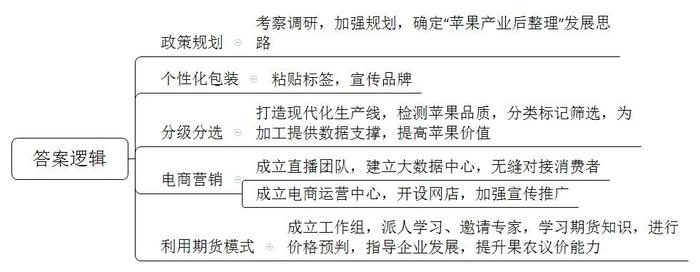
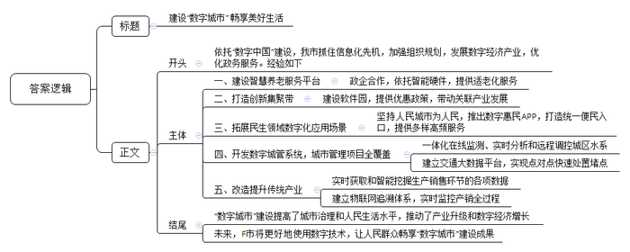

# 2021年公务员多省联考《申论》题（山西县级卷）

<!-- gwy:overview:start -->
> **山西 · 2021 · 申论 · 县级卷** ｜ 4 题 · 图片 4 处 · 答案随题折叠

导航：[题目](#题目) · [材料 1](#材料-1)
<!-- gwy:overview:end -->

> 候选采集稿。参考答案及解析来自粉笔页面，不代表官方答案或真实高分答卷；来源使用许可与原卷对应关系仍需人工核实。

## 给定材料

### 材料 1

“人畏冬山肃，我爱冬日丽”，这正是L县果农内心真实的写照。今年51岁的老李作为当地苹果大户，每到岁末就忙得不可开交。“今天下午要发5000件货，明天还有5000件……”他一边对着记者介绍，一边盘点着贴有鲜明的“L县苹果”“平安接福”等标签的苹果。

在日新鲜果公司车间里，多条现代化选果线依次排开，它可以轻而易举地检测出每颗苹果的大小、糖度、瑕疵等。“这台机器堪称是整条选果线的中枢，如果苹果有瑕疵，它可以准确地标记并筛选出来，同时为后续选果提供数据支撑。”公司刘经理指着生产线上的机器介绍到，分级分选更好地提高了苹果价值，实现了优果优价、以质论价。

在金奇果业科技有限公司的车间，工人们正在紧张有序地进行从接收订单到装箱发货的“一站式”操作。“我们通过成立直播团队、建立大数据中心等措施，实现L县苹果和消费者无缝对接，同时也助推全县苹果电商和微商的快速发展。”公司赵经理说，“目前公司在省城成立了苹果电商运营中心，全网开设店铺40多家，目的就是要利用互联网宣传、推广特性，延伸L县苹果产业链条，让果农在苹果产业链的每个环节上都能获益、增收。”

站在L县大塬上，眺望着50万亩红彤彤的苹果挂满枝头，L县县委曹书记向记者介绍，L县曾经是省内出名的穷县。50年代初，当时的县委张书记为L县引进第一批果树苗，乡亲们并没认识到这是一座“金矿”，而且由于经验不足，树的成活率极低。张书记鼓励大家：“不管前方的路有多苦多难，只要方向正确，我们的日子一定会一天比一天红火。”改革开放后，县委县政府组织乡镇干部到省内外苹果产地考察调研，形成“苹果是L县最具优势的产业”共识。党的十九大以来，县委县政府制定了《苹果产业强县建设规划》，提出以“苹果产业后整理”为抓手，为巩固脱贫攻坚成果、促进乡村振兴奠定厚实的产业基础。“脱贫摘帽不是终点，而是新生活、新奋斗的起点。”曹书记深有感触。

“虽然如今形势喜人，但L县苹果产业也曾出现过危机。”曹书记说，“每年10月至11月，当苹果集中上市时，能否卖上好价钱，既是老百姓心中的忧虑，也是我们干部们心中的挂念。过去，因为市场透明度不高，信息不对称，果农们在与贸易商的博弈中，吃亏是常有的事。”

2017年12月，苹果期货在Z商品交易所上市。“我们发现苹果期货的价格能够及时反映市场变化。”曹书记说，“这为我们帮助果农对价格进行预判，指导企业发展提供了一把金钥匙。”为此，县里成立了专门工作组，一方面派人到Z商品交易所学习，一方面请专家来县里普及苹果期货有关知识。

“从2018年初夏开始，经常见到一些戴眼镜、穿衬衣的文化人来村里打听苹果长得怎么样，听说霜冻把果子冻了，还要问冻了多少。”村民小史说，后来知道这些人大多是做苹果期货的金融业人士。从此，当地不少果农一改过去“听果商报价，自己估摸差不多就卖了”的做法，转而主动和果商议价。2019年，L县苹果总体减产8%，但整体销售价格同比提高30%，果农总收入增加了20%。

“‘产业后整理’对于农业产业发展而言，可以说是一场深刻的变革。”省农科院的王博士说，过去老百姓只会种、不会卖，现在就是要解决这个问题，打通生产端和消费端通道，提高农产品市场化程度。

### 材料 2

仙路控股有限公司是H县的一家食品企业，曾有过很长一段的高光时刻：1992年创办后，业绩一路高歌，旗下仙路鲜汁成为当时整个饮品行业中为数不多的百亿大单品，缔造了“中国零食龙头企业”的神话。如今，仙路公司却面临着“中年危机”。记者调查发现，仙路近年来的增长基本来自于几款多年前的老产品，而非新产品。仙路鲜汁这个单品几乎撑起了仙路的大半个江山，但鲜汁属于可替代产品，消费者对此类产品容易喜新厌旧。一位消费品行业专家告诉记者，仙路的第一代产品主要来自外国技术转移，借助中国经济快速发展和繁荣的东风，大胆生产扩张才获得后来的成绩。遗憾的是，一直以来，它主要依赖代工思维做品牌。如今，旗下主要品类经过多年发展，市场已经接近饱和，产品很难再有增量，业绩下滑是在所难免。

为了摆脱品牌老化的尴尬处境，仙路开启了疯狂的“中年变形记”。2017年，仙路一度推出了50多个新产品，几乎每月都有新产品上线，覆盖了咖啡、果汁、能量饮料等大类。但分析所谓的新品，不难发现只是在原来的产品结构上换汤不换药。对于仙路来说，面对庞大的市场，如果不快速找到第二增长曲线，则很容易在品牌优势耗尽后，走入无可挽回的滑落之路。

同样位于H县的国欣家居用品有限公司，是一家老牌的制造企业，产品是家居行业极其细分的市场——化纤丝，董事长陆建国与总经理陆欣是一对父女。

“以前的牙刷，化纤丝都是圆柱形的，触感和舒适度都不好，我们将圆柱改成圆锥，变得更加柔软，且便于口腔清洁和牙龈保护。”陆建国说，从柱体到锥体并非靠磨，而是需要一系列复杂的工艺流程来打造，看似很小的行业，却需要很强的专业支撑。90年代初，国内市场对此类化纤丝的需求量非常大，但全部依赖进口，且价格昂贵。

1993年，陆建国毅然选择下海，创办了国欣家居，立足新材料方向，做国产化替代。经过不断学习、实践，陆建国终于让生产出来的牙刷丝更加柔软舒适，并先后拿下了许多知名公司的订单。

牙刷丝领域站稳脚跟后，国欣家居将目光瞄向了刷丝原理都是相通的油漆刷丝市场。在做市场调研的时候，陆建国发现，质量好的油漆刷用的都是猪鬃、羊毛等天然材料，原材料比较匮乏。“当时的油漆刷使用场景相对单一，实际上油漆是水性还是油性，刷的是墙面还是地板，对油漆刷是有不同要求的。”陆建国说。沿着这一思路，国欣家居将产品从牙刷丝扩展到油漆刷丝，并拿下了油漆行业的数家大客户。

“公司每次产品的更新，都是有契机的。”陆建国告诉记者，“2007年一家合作伙伴因企业战略变化，欲让国欣接管整个制刷项目。这对于迅速扩充公司实力无疑是良机，但是从只生产其中的丝，到生产整个刷具，这样的转型能否成功，经过反复地考量，我们决定接受这个挑战。”

陆建国告诉记者，国欣家居如今能够在市场如鱼得水，与女儿陆欣的接班助力有很大关联。“让女儿接班，并非我的本意，毕竟她会有更好的选择。”陆欣曾在一家世界500强企业工作，可是偶然间看到的一幕，让她改变了主意，“有一天下班已经很晚了，看到父亲戴着老花镜，还在跟客户打电话，说着并不流畅的英语，两鬓已经斑白，真的觉得我有责任回来帮助他。”国外的学习和工作经历，让陆欣跟着父亲一起打拼市场时显得游刃有余。父亲专业积累过硬，女儿胜在国际视野，两人互补联合，拿下了不少国际大单。

对于国欣家居的未来发展，陆欣也有自己的考量：“之前提到中国制造，大家的第一反应就是价格便宜，实际上不是我们做不出好产品，而是好产品需要供应链上下游的共同发力。”通过在化纤丝行业的精耕细作，陆欣看到了匠心的价值，她希望自己将来能够搭建一个平台，把好的资源整合起来，共同打造优质的产品。从产品部件，到生产成品，再到布局产业链，国欣家居在父女二代接力中也在发生着“蝶变”。

### 材料 3

“你好小福，我想订餐。”78岁的孙奶奶按下开关，向机器人小福发出语音指令。“有两荤两素加米饭13元的和两荤一素加米饭10元的两种，您选哪一种?”稚嫩的童声清脆悦耳。“13元的。”“好的，稍后会有工作人员与您联系。”不一会儿，福龄老年服务中心工作人员刘大姐拎着盒饭，一路小跑，来到孙奶奶的家。“对我们老人来说这个太好了！我不会用手机，现在只需要对机器人发个语音指令，立马有人上门。”孙奶奶说。

变化，缘于智慧养老服务平台的建成。2019年，坐落于F市北区物联网产业园的乐享科技有限公司利用物联网、云计算及大数据等技术打造了这一平台。该平台的建成是F市绘制“数字城市”蓝图的靓丽一笔。乘着“数字中国”建设的东风，F市抓住信息化先机，积极拥抱数字浪潮，从成立“数字城市”建设领导小组到制定“数字城市”中长期发展规划；从“一枝独秀”的软件园到“百花齐放”的数字经济产业；从最早的办事“跑多趟”到如今“一趟不用跑”……“数字城市”建设蓬勃发展。

“入驻F市真的是对了！”乐享科技有限公司总裁廖总说，“乘着F市政府打造‘数字城市’的东风，我们享受了政府在金融、人才、技术、管理等各方面的政策优惠，也在‘数字城市’建设中成长壮大。”

2000年6月，F市东区软件园创业楼迎来首批入园企业。“当时，园区内的研发楼宇只有寥寥几栋，产业规模仅12.7亿元。”东区软件园管委会负责人回忆道。如今，东区软件园产业发展突飞猛进，总收入已超千亿元。据F市汪副市长介绍，在空间布局上，F市重点打造环中心城区“东区软件园—西区高新园—北区物联网产业园—南区大数据产业园”的数字经济创新集聚带，带动关联产业发展。

在推进“数字城市”建设过程中，F市坚持人民城市为人民的发展理念，不断拓展众多与百姓息息相关的数字化应用场景。“易民”APP是F市全力打造的数字惠民品牌，居民足不出户轻点手机APP，日常生活用品最快10多分钟送到家，出门购物、地铁进站，“刷脸”几秒钟即可完成付款。上线两年多来，该APP已发展成F市移动互联网的统一便民入口，为市民提供各类高频的便民服务、公共服务、政务服务等近80项。

打开F市数字城管系统，一张覆盖全市所有公用设施、道路交通、市容环境等城市管理项目的“电子地图”便呈现在眼前。在城区水系联排联调中心，工作人员可对城区上千个库、湖、池、河、闸、站实现一体化在线监测、实时分析和远程调控。超级“大脑”交通大数据平台则为全市交通编织了一张智慧大网，实现点对点快速处置堵点。

“数字城市”在提高城市治理和人民生活水平的同时，也为F市改造提升传统产业、推动新旧动能加快转换提供了新机遇。如锦绣家纺公司依托数字大脑，实现“产、供、销、人、财、物”数据的实时获取和智能挖掘，让生产更高效智能；福仙茶业集团建立了物联网追溯体系，对基地种植到终端销售全过程进行实时监控。

产业更兴旺，城市更智慧，生活更美好。F市市委李书记表示，目前，数字经济占地区生产总值的比重提高到45%，数字经济上市企业占全市上市企业的一半。展望未来，李书记说，F市将更好地使用数字技术，不断释放数字红利，让人民群众畅享数字城市建设成果。

### 材料 4

1949年3月23日下午，西柏坡阳光明媚，毛泽东同志从住了10个月的小院里走出来，正好碰到迎上来的周恩来同志。他望着远处连绵雄伟的太行山，意味深长地说：“今天是进京赶考的日子。”周恩来答道：“我们都应当考及格，不要退回来。”毛泽东坚定地说：“退回来就失败了。我们决不当李自成！我们共产党人进北平，是要继续革命，建设社会主义，直到实现共产主义。”

2013年7月，习近平总书记在河北省调研时指出：“当年党中央离开西柏坡时，毛泽东同志说是‘进京赶考’。60多年过去了，我们取得了巨大进步，中国人民站起来了，富起来了，但我们面临的挑战和问题依然严峻复杂，应该说，党面临的‘赶考’远未结束。”

2020年10月，党的十九届五中全会审议通过了《中共中央关于制定国民经济和社会发展第十四个五年规划和二〇三五年远景目标的建议》。对于中国发展来说，“五年规划”是党治国理政的重要方式，也是量度中国步伐的显著路碑。从1953年新中国开始实行第一个“五年计划”，到2020年“十三五”规划完成，一个又一个五年，诠释了不同时期的历史标识，推动中华民族迎来了从站起来、富起来到强起来的伟大飞跃。

《管子·乘马》言：“是故事者生于虑，成于务，失于傲。不虑则不生，不务则不成，不傲则不失。”虽说前路并非一片坦途，但要坚信的是，一往无前、永不止步，戒骄戒躁，从来都是成就伟大事业的最正确姿态。

## 题目

### 第 1 题

**根据“给定材料2”请概括L县“苹果产业后整理”的主要举措。（15分）**

关联材料：材料 1

作答要求：

要求：全面、准确，有条理。不超过250字。

第 1 题 · 答案与解析

**参考答案（粉笔题库参考内容）**

1.政策规划。考察调研，加强规划，确定“苹果产业后整理”发展思路。2.个性化包装。粘贴标签，宣传品牌。3.分级分选。打造现代化生产线，检测苹果品质，分类标记筛选，为加工提供数据支撑，提高苹果价值。4.电商营销。成立直播团队，建立大数据中心，无缝对接消费者；成立电商运营中心，开设网店，加强宣传推广。5.利用期货模式。成立工作组，派人学习、邀请专家，学习期货知识，进行价格预判，指导企业发展，提升果农议价能力。

**解析**

**参考答案说明：**本参考答案从“政策规划”“个性化包装”“分级分选”“电商营销”和“利用期货模式”这五个方面展开。各条答案要点在内容上相互并列，没有交叉。

**考点**：概括措施类

**来源**：2021年公务员多省联考《申论》题（山西县级卷）

粉笔申论页面对本题只提供「解析视频」入口，该入口是会员推广位，页面无视频地址与文字解析。

### 第 2 题

**根据“给定材料3”，请分析为什么仙路控股有限公司遇到了“中年危机”，而国欣家居实现“蝶变”。（20分）**

关联材料：材料 2

作答要求：

要求：紧扣材料，分析全面；条理清晰，逻辑性强；不超过300字。

第 2 题 · 答案与解析

**参考答案（粉笔题库参考内容）**

仙路控股遇到“中年危机”的原因：

1.过分依赖老产品，产品可替代性强，消费者忠诚度不足，产品结构单一，品牌优势耗尽。2.缺乏技术创新，存在依赖代工的思维。3.市场饱和，产品难有增量，业绩下滑。

国欣家居实现“蝶变”的原因：

1.专注细分市场。加强专业支撑，改进工艺流程，立足新材料方向，自主创新。2.主动开拓新市场。注重市场调研，增加产品品类，满足市场需求。3.敢于应对挑战。不惧风险，把握契机，升级产品形态。4.培养接班人。实现专业积累与国际视野互补联合，推动国际化发展。5.布局产业链。搭建平台，整合资源，打造优质产品。

**解析**

**参考答案说明：**本参考答案宏观上分成了“仙路控股遇到‘中年危机’的原因”和“国欣家居实现‘蝶变’的原因”两个方面。在“仙路控股遇到‘中年危机’的原因”内部，又从“过分依赖老产品，产品可替代性强”“缺乏技术创新”“市场饱和”这三个方面进行了分条撰写。各条要点之间在内容上相互并列，没有交叉。在“国欣家居实现‘蝶变’的原因”内部，又从“专注细分市场”“主动开拓新市场”“敢于应对挑战”“培养接班人”“布局产业链”这五个方面进行了分条撰写。各条要点之间在内容上相互并列，没有交叉。

**考点**：原因类

**来源**：2021年公务员多省联考《申论》题（山西县级卷）

粉笔申论页面对本题只提供「解析视频」入口，该入口是会员推广位，页面无视频地址与文字解析。

### 第 3 题

**省里召开“数字城市”建设座谈会，F市被邀去做经验介绍。假设汪副市长参加此次会议，请根据“给定材料4”，为汪副市长拟写一份发言提纲。（25分）**

关联材料：材料 3

作答要求：

要求：紧扣材料，要点完整；内容具体，条理清晰；不超过400字。

第 3 题 · 答案与解析

**参考答案（粉笔题库参考内容）**

建设“数字城市” 畅享美好生活

依托“数字中国”建设，我市抓住信息化先机，加强组织规划，发展数字经济产业，优化政务服务。经验如下：

一、建设智慧养老服务平台。政企合作，依托智能硬件，提供适老化服务。二、打造创新集聚带。建设软件园，提供优惠政策，带动关联产业发展。三、拓展民生领域数字化应用场景。坚持人民城市为人民，推出数字惠民APP，打造统一便民入口，提供多样高频服务。四、开发数字城管系统，城市管理项目全覆盖。一体化在线监测、实时分析和远程调控城区水系；建立交通大数据平台，实现点对点快速处置堵点。五、改造提升传统产业。实时获取和智能挖掘生产销售环节的各项数据；建立物联网追溯体系，实时监控产销全过程。

“数字城市”建设提高了城市治理和人民生活水平，推动了产业升级和数字经济增长。未来，F市将更好地使用数字技术，让人民群众畅享“数字城市”建设成果。

**解析**

**参考答案说明：**（1）本参考答案包括标题、正文，符合发言提纲的格式要求。（2）正文部分，一方面，内容上，围绕着“F市‘数字城市’建设”这一主题，开头写到了F市“数字城市”建设的背景和宏观做法；主体部分从“建设智慧养老服务平台”“打造创新集聚带”“拓展民生领域数字化应用场景”“开发数字城管系统”“改造提升传统产业”五个方面介绍了经验；最后结尾部分总结了F市“数字城市”建设的意义以及对未来的展望。另一方面，形式上，本参考答案做到了分段、分条撰写，整体上条理较为清晰。

**考点**：总结类

**来源**：2021年公务员多省联考《申论》题（山西县级卷）

粉笔申论页面对本题只提供「解析视频」入口，该入口是会员推广位，页面无视频地址与文字解析。

### 第 4 题

**请根据“给定材料5”中划线句子“风后面是风，天空上面是天空，道路的前面还是道路。”结合材料，以“赶考”为题目，联系实际，自选角度，写一篇文章。（40分）**

关联材料：材料 4

作答要求：

要求：

（1）观点正确，见解深刻；

（2）内容全面，结构完整；

（3）思路清晰，语言流畅；

（4）字数在1000-1200字。

第 4 题 · 答案与解析

**参考答案（粉笔题库参考内容）**

**赶考**

“风后面是风，天空上面是天空，道路的前面还是道路”，这句诗以充满哲思的笔触揭示了事物发展永无止境的客观规律。时代浪潮奔腾不息，正如1949年毛泽东同志提出“进京赶考”时所预见的那样，赶考之路从无终点。从党和国家的发展征程，到企业的兴衰沉浮，再到个体的人生选择，赶考精神始终是穿越迷雾、行稳致远的核心密码。

**弘扬“赶考”精神，要全面思考、提前规划，常怀居安思危的忧患意识。**《管子・乘马》有云：“事者生于虑”，唯有未雨绸缪，方能在变局中把握主动。华为在5G领域的深耕便是典范，当多数企业沉迷于4G时代的市场红利时，华为提前布局5G技术研发，累计投入超千亿元，即便面临外部技术封锁，仍能凭借自主创新的芯片与通信技术占据行业高地。反观曾经风靡一时的自动取款机行业，在移动支付浪潮来临前未能预判趋势，最终从“印钞机”沦为亏损重灾区。这启示我们，无论是企业经营还是个人发展，都需跳出眼前的舒适区，以长远眼光审视行业变革，在机遇来临前做好准备。

**弘扬“赶考”精神，要脚踏实地、永不止步，秉持奋发有为的进取精神。**赶考之路容不得半点虚功，唯有脚踏实地才能行稳致远。“敦煌女儿”樊锦诗将一生奉献给莫高窟保护事业，面对文物保护的时代难题，她率先提出数字化保护构想，带领团队耗时数十年建立莫高窟数字档案，让千年壁画在数字世界永久留存；张桂梅校长扎根滇西北山区，拖着病体创办全国第一所免费女子高中，十余年间走遍山区村寨，帮助两千多名女孩走出大山。她们以“不务则不成”的信念，在平凡岗位上创造了不凡业绩，诠释了赶考精神中脚踏实地的真谛。

**弘扬“赶考”精神，要艰苦奋斗、戒骄戒躁，保持谦虚谨慎的清醒认知。**历史反复证明，骄傲自满是赶考路上的最大障碍。比亚迪在新能源汽车领域的崛起，离不开始终如一的谦逊与拼搏。在燃油车市场占据优势时，比亚迪没有固步自封，而是正视技术短板，投入巨资研发电池与电控系统，历经无数次试验失败，终于在新能源领域实现弯道超车。反观部分曾领跑市场的企业，因固守过往成就、轻视技术革新，在产业变革浪潮中逐渐丧失竞争力，最终被时代淘汰。这警示我们，无论个人还是企业，唯有摒弃自满、保持奋斗姿态，方能在新“赶考”路上行稳致远。

“雄关漫道真如铁，而今迈步从头越。”在时代的“赶考”路上，我们每个人都是答卷人。让我们以全面思考、提前规划的智慧，脚踏实地、永不止步的决心，艰苦奋斗、戒骄戒躁的态度，书写属于我们这一代人的精彩答卷，向着更加美好的未来奋勇前行。

**解析**

**文章分析**

**赶考**

【**标题的优点**：严格按照题目的要求，以“赶考”为标题。】

（1）“风后面是风，天空上面是天空，道路的前面还是道路”，这句诗以充满哲思的笔触揭示了事物发展永无止境的客观规律。（2）时代浪潮奔腾不息，正如1949年毛泽东同志提出“进京赶考”时所预见的那样，赶考之路从无终点。（3）从党和国家的发展征程，到企业的兴衰沉浮，再到个体的人生选择，赶考精神始终是穿越迷雾、行稳致远的核心密码。

【**开头的优点：**★内容方面：范文的开头是紧扣“赶考”这一主题展开的。首先，开头点出主题，做到了主题明确。其次，对“赶考”这一主题进行了分析阐述：（1）先解释了题干给定句子的内涵；（2）再指出了赶考的特点；（3）最后介绍了赶考精神的重要性。★文字表达方面：使用了“从……到……再到……”等关联词，使语言表达有逻辑性。】

**弘扬“赶考”精神，要全面思考、提前规划，常怀居安思危的忧患意识。**（1）《管子・乘马》有云：“事者生于虑”，唯有未雨绸缪，方能在变局中把握主动。华为在5G领域的深耕便是典范，当多数企业沉迷于4G时代的市场红利时，华为提前布局5G技术研发，累计投入超千亿元，即便面临外部技术封锁，仍能凭借自主创新的芯片与通信技术占据行业高地。反观曾经风靡一时的自动取款机行业，在移动支付浪潮来临前未能预判趋势，最终从“印钞机”沦为亏损重灾区。（2）这启示我们，无论是企业经营还是个人发展，都需跳出眼前的舒适区，以长远眼光审视行业变革，在机遇来临前做好准备。

【**论述段1的优点：**★观点句：范文的观点句是紧扣“赶考”这一文章主题提出的。形式上，它在段首处直接写出，位置突出，容易发现。内容上，关键词突出，内容要点明确，可以明显看出主要从“未雨绸缪，提前规划”这个角度展开论述。★论述内容：（1）列举正反两个事例，说明未雨绸缪、提前规划的重要性；（2）再次强调要有长远眼光，提前做好准备。注意：以上两个方面的内容都是紧扣“弘扬‘赶考’精神，要全面思考、提前规划，常怀居安思危的忧患意识”这个观点句进行分析论述的，论述的针对性强，内容层次丰富。在论述方法上采用了讲道理与举例子相结合的方式，论述充实深刻。】

**弘扬“赶考”精神，要脚踏实地、永不止步，秉持奋发有为的进取精神。**（1）赶考之路容不得半点虚功，唯有脚踏实地才能行稳致远。“敦煌女儿”樊锦诗将一生奉献给莫高窟保护事业，面对文物保护的时代难题，她率先提出数字化保护构想，带领团队耗时数十年建立莫高窟数字档案，让千年壁画在数字世界永久留存；张桂梅校长扎根滇西北山区，拖着病体创办全国第一所免费女子高中，十余年间走遍山区村寨，帮助两千多名女孩走出大山。（2）她们以“不务则不成”的信念，在平凡岗位上创造了不凡业绩，诠释了赶考精神中脚踏实地的真谛。

【**论述段2的优点：**★观点句：范文的观点句是紧扣“赶考”这一文章主题提出的。形式上，它在段首处直接写出，位置突出，容易发现。内容上，关键词突出，内容要点明确，可以明显看出主要从“脚踏实地，奋发有为”这个角度展开论述。★论述内容：（1）列举两个典型事例，说明脚踏实地才能行稳致远；（2）再次强调要在平凡岗位上奋发有为。注意：以上两个方面的内容都是紧扣“弘扬‘赶考’精神，要脚踏实地、永不止步，秉持奋发有为的进取精神”这个观点句进行分析论述的，论述的针对性强，内容层次丰富。在论述方法上采用了讲道理与举例子相结合的方式，论述充实透彻。】

**弘扬“赶考”精神，要艰苦奋斗、戒骄戒躁，保持谦虚谨慎的清醒认知。**（1）历史反复证明，骄傲自满是赶考路上的最大障碍。比亚迪在新能源汽车领域的崛起，离不开始终如一的谦逊与拼搏。在燃油车市场占据优势时，比亚迪没有固步自封，而是正视技术短板，投入巨资研发电池与电控系统，历经无数次试验失败，终于在新能源领域实现弯道超车。反观部分曾领跑市场的企业，因固守过往成就、轻视技术革新，在产业变革浪潮中逐渐丧失竞争力，最终被时代淘汰。（2）这警示我们，无论个人还是企业，唯有摒弃自满、保持奋斗姿态，方能在新“赶考”路上行稳致远。

【**论述段3的优点：**★观点句：范文的观点句是紧扣“赶考”这一文章主题提出的。形式上，它在段首处直接写出，位置突出，容易发现。内容上，关键词突出，内容要点明确，可以明显看出主要从“戒骄戒躁，谦虚谨慎”这个角度展开论述。★论述内容：（1）列举正反两个事例，说明戒骄戒躁、保持谦虚谨慎的重要性；（2）再次强调要摒弃自满、不懈奋斗。注意：以上两个方面的内容都是紧扣“弘扬‘赶考’精神，要艰苦奋斗、戒骄戒躁，保持谦虚谨慎的清醒认知”这个观点句进行分析论述的，论述的针对性强，内容层次丰富。在论述方法上采用了讲道理与举例子相结合的方式，论述充实到位。】

【**论述段之间的关系：**★内容的内在逻辑：范文的论述段之间是依照“并列”的逻辑展开的。论述段1先写了“弘扬‘赶考’精神，要全面思考、提前规划，常怀居安思危的忧患意识”，论述段2再写了“弘扬‘赶考’精神，要脚踏实地、永不止步，秉持奋发有为的进取精神”，论述段3接着写了“弘扬‘赶考’精神，要艰苦奋斗、戒骄戒躁，保持谦虚谨慎的清醒认知”。文章整体论述思路清晰。】

“雄关漫道真如铁，而今迈步从头越。”在时代的“赶考”路上，我们每个人都是答卷人。让我们以全面思考、提前规划的智慧，脚踏实地、永不止步的决心，艰苦奋斗、戒骄戒躁的态度，书写属于我们这一代人的精彩答卷，向着更加美好的未来奋勇前行。

【**结尾的优点：**范文的结尾回扣了“赶考”这个主题，并且进行了总结提升。】

**考点**：文章写作题

**来源**：2021年公务员多省联考《申论》题（山西县级卷）

粉笔申论页面对本题只提供「解析视频」入口，该入口是会员推广位，页面无视频地址与文字解析。

