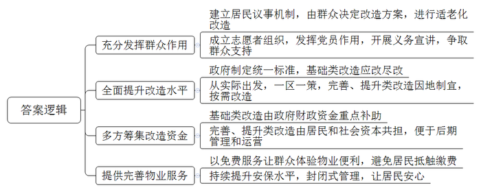
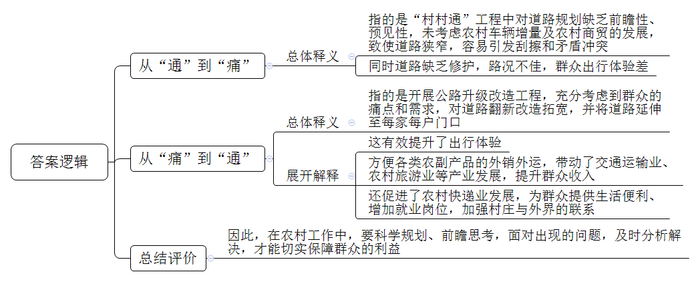
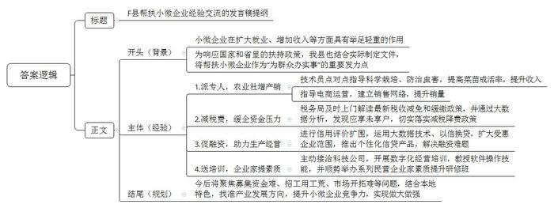

# 2022年公务员多省联考《申论》题（山西省市卷）

<!-- gwy:overview:start -->
> **山西 · 2022 · 申论 · 省市卷** ｜ 4 题 · 图片 4 处 · 答案随题折叠

导航：[题目](#题目) · [材料 1](#材料-1)
<!-- gwy:overview:end -->

> 候选采集稿。参考答案及解析来自粉笔页面，不代表官方答案或真实高分答卷；来源使用许可与原卷对应关系仍需人工核实。

## 给定材料

### 材料 1

去年，陈阿姨执意要搬回D市进步新村的老房住，这让特意接她到新家养老的儿子有些不解：“老人家非说回去住着更舒心。”进步新村建于上世纪80年代，被D市市政府选为老旧小区改造试点。根据小区老人较多的情况，小区进行了适老化改造：楼梯旁安了扶手，每层平台转角处放有折叠椅，还有新建的阳光餐厅、无障碍助浴室……陈阿姨看后觉得非常适合自己，坚决要搬回来和老邻居在一起。

为什么这么改？“都是大家在‘进步议事港’议出来的。小区60%以上居民都是老人，老人的需求必须考虑到。”街道党工委饶书记说。“进步议事港”是改造之初街道建立的居民议事机制。改不改、改什么、怎么改，都由居民来决定。刚开始，一些居民积极性不高，有居民不愿参与对改造方案的讨论，或者就是简单表态不同意。“只有群众参与进来，小区才有活力。”饶书记说，“我们在小区成立了志愿者组织，要求党员在小区改造中发挥作用。”杨老师是一位老党员，去年刚退休，“小区改造与我们每位居民切身利益息息相关，大家都应该出力加油。”杨老师积极加入志愿者组织，成为一名小区改造的义务宣讲员。已经搬家的周老太不同意加装电梯，“我房子都出租了，改造跟我没什么关系。”只要有一户不同意，一栋楼都装不了电梯，这让楼里居住的其他老人很着急。为了说动周老太，杨老师愣是穿过大半个城市，上门数十趟。“杨老师不厌其烦地给我讲道理、分析改造好处，我被这份真诚打动了。”周老太最后欣然在电梯安装协议书上签了字。

走进改造后的小区，过去坑坑洼洼的路面变得平坦宽敞，蜘蛛网般的电线全部入地，路灯全部亮起来了……陈阿姨竖起大拇指：“环境一天比一天好，住得越来越舒心！”让居民点赞的，除了环境变化，还有民生服务设施的提升完善：新划定100个停车位，新安装81个监控摄像头，新建三处电动车棚……“不光改‘面子’，更要改‘里子’。”D市住建局张局长说。本轮小区改造不仅有市政配套等基础类改造，更多的是新建停车场、加装电梯等完善类改造，以及养老托育服务等提升类改造，基础类要应改尽改，完善类、提升类则要因地制宜、按需改造。为此，市政府制定了老旧小区改造统一标准，还特别提出从实际出发，一区一策。小区的老人休养中心是新建的提升类项目，一开业就迎来10位老人入住。“这地方过去是一个宾馆的闲置库房，物业承包后改造为休养中心，小区老年人比较多，身体有些小毛病，休养中心帮助他们进行日常调养。”饶书记说。

如今的进步新村焕然一新，投入的改造资金可不少。按照市政府的规划，市政府财政资金重点补助基础类改造内容。可是提升小区环境、引入公共服务这些完善类、提升类改造，所需资金也不是个小数目，由谁来承担？“居民要出一点，居民出资参与改造，可以提高小区居民的主人翁意识和归属感，为后续管理埋下了伏笔。”饶书记说，“更重要的是让社会力量参与进来，各方合理共担改造资金。目前，我们街道已在全市率先引入社会资本，委托前程集团参与改造。”

“目前我们在小区已投入改造资金200多万元，开始提供物业服务。”前程集团城区更新事业部刘经理说。进步新村长期没有物业，一开始刘经理还很担心居民对缴物业费会有抵触。然而，小区物业费缴纳率之高却超出了刘经理的预期。老潘就是缴纳物业费的“积极分子”：“我们先体验了几个月的免费服务，确实感受到了物业入驻后的便利，尤其是在疫情防控期间消毒检测等服务做得很到位。”如今，小区各出入口都安装了门禁，还有保安值班，实现封闭式管理，为控制人员流动、防控疫情起到了关键作用，居民们都很安心。

“很多小区都是我们城市高速发展的产物，虽然逐渐老旧了，但经过精心改造后将旧貌换新颜，依然是我们城市的动人风景。”张局长说，“我们将及时总结进步新村的试点经验，并进行推广，让老旧小区重新焕发生机活力，让老年居民过上更加幸福的生活，推动改革发展成果更多更公平地惠及全体人民。”

### 材料 2

在李家村的生态农场里，几名头戴草帽的村民忙得不可开交。“大家动作快一点，上午要把最后一车运出去。”农场技师老卢一边指挥着工友装运蔬菜，一边说，“前来收购的货车就停在路边，清晨采摘，上午运送，保证新鲜。幸亏路好，叶子不会被颠坏，我们的蔬菜水果都不愁销路了。”老卢提到的这条路是李家村通往外界的村路，宽8米，长700米，是新修的沥青路，平整宽敞，三轮车、小汽车、货车在路上川流不息。

“最早是泥土路，一下雨就变成一片烂泥，又滑又臭，接着是砂石路，后来‘村村通’时硬化成3米宽的水泥路，现在是升级改造后的沥青路。”想起当时“村村通”工程把水泥路修到村口时的情景，李家村村支书老李记忆犹新：“虽然水泥路只修到了村口，村子里还是泥土路，但大伙儿个个都夸党的政策好，祖祖辈辈出行难的问题解决了。”但是没过多久，许多村民都买了小车，还有做生意的货车也多起来了，原来还算宽敞的水泥路很快就显得太窄了，两车相遇经常发生刮擦，甚至引发司机争吵，<u>“村村通”变成了“村村痛”</u>。“为方便群众出行，县里启动农村公路升级改造工程。”老李说，“县政府提出要村村通沥青路，组组通水泥路，户户通连户路。”李家村的村路经过翻新改造拓宽，从3米变成了8米，还建了两条水泥路从庄子里穿过，然后又在每家每户门口修了一条小路连到村子里的水泥路上。

“现在车子每次都能坐满了。”村里开客车的小李说，“以前道路狭窄，行人、摩托车都紧靠客车，自己开车提心吊胆，而且道路缺乏修护，有很多裂缝和坑坑洼洼，一路颠簸不停，让人很难受。现在新修的沥青路宽敞平整，乘客们很舒心，我的生意也越来越好。”

在村里开着农家乐的村民小曾也是道路变迁的受益者。“现在道路越来越宽，基础设施越来越好，开车来游玩的人越来越多，我们以前一天只有两三桌客人，现在每天都有六七桌。”小曾说，“这条路成为名副其实的‘致富路’，村路宽后，旅游大巴都能开进来了，大家都想办法发展副业，番薯酒、腊味、自制的‘土菜’通过新修建的村路运到了一个个买家的手中。”

“你看，自从道路改造升级后，我们这里也兴起了快递。”指着一辆运送快递的电动三轮车，老李说，“以前道路不好，我们寄快递、拿快递都要走很远的路到镇上去。”在老李看来，快递的兴起不仅意味着提供生活便利、增加就业岗位，还意味着这个原本偏僻的村庄与外面的世界越来越紧密地联系起来了。<u>“村村</u><u>痛</u><u>”又变成了“村村通”</u>，看着村路上来来往往的车子和行人，老李满脸笑容地说：“这条路不仅是修到了村庄，也修到了我们群众的心里啊。”

### 材料 3

走进F县现代农业示范园区，农民专业合作社负责人老杨正在大棚内侍弄自己培育的瓜果蔬菜苗，一盆盆幼苗在阳光的照射下茁壮生长。“县农村农业局派了技术员点对点指导我们科学栽培、防治虫害，我们的菜苗成活率比以前高多了。去年一年，光种苗我们合作社就卖了500多万株，抛去各种成本，一年下来能有40多万元的纯利润。”说起去年的收入，老杨掩不住内心的喜悦。“以前我们只知道种自家的田，后来随着时代发展，几户人家成立起合作社。”老杨说，种植规模不断扩大，但种植的作物怎么卖出去却让自己觉得力不从心，幸好县里有关部门一路跟着服务，“商务局派了工作人员指导我们怎样做电商，建立销售网络，让我们不愁卖不出去。”

老杨说的是F县帮扶小微企业行动中的一部分。小微企业是国民经济和社会发展的重要基础，在扩大就业、增加收入、改善民生、促进稳定等方面具有举足轻重的作用。“近年来，国家和省里都出台了一系列的政策，扶持小微企业发展，我们县也结合自身实际情况制定了相关的文件，把帮扶小微企业当作‘为群众办实事’活动的重要内容来抓。”F县王县长说。

“作为小企业，我们市场竞争力小，面对突如其来的新冠肺炎疫情，企业发展资金压力很大，是税务局及时上门解读最新的税收减免和缓缴政策，帮助减免了40多万元税款，解了燃眉之急。”未来食品公司蔡经理感激地说。未来食品公司主要经营糕点糖果批发。去年，该企业实现利润总额274万元，原本按25%的税率应缴纳企业所得税61.87万元，由于该企业符合小微企业条件，享受小微企业普惠性减税降费政策，实际仅缴纳企业所得税19.75万元，减免税额达42.12万元。“有些我们这样的小微企业并不了解国家税务政策的变化，是县税务局通过大数据分析，发现了我们这些应享未享户，切实给我们带来了国家减税降费政策的温暖。”

“小微贷情系小微”，在当地一家银行，有这样一面锦旗，7个字饱含了一个企业家对银行有力支持小微企业发展的衷心感谢。送锦旗的纳税人老魏是县里一家五金模具厂的老板。受新冠肺炎疫情影响，该企业连续停业2个月，生产经营面临巨大困难。县政府组织多家金融机构主动服务受困企业，提供个性化融资支持服务。银行刘行长说：“我们积极配合县政府的行动，通过信用评价扩围，运用大数据分析技术和‘以信换贷’方式，将受惠企业范围由纳税信用A级和B级扩大至M级，推出多种个性化的信贷产品，最大限度赋能企业渡过难关。”2021年，全县共有183家小微企业获得信用贷款，融资难、融资贵问题得到极大缓解。老魏的模具厂获得了银行线上发放的47.9万元低息信用贷款。“这笔贷款是旱日的甘霖，我们立即用这笔贷款购买开工原材料、支付人员工资等，给我们复工复产带来莫大的信心。”老魏说。

县综合市场石材批发店的老板老黄，凭着不怕吃苦的劲儿，生意越来越好，老伴一笔笔手工记账，很快就赶不上他们生意的节奏了。可石材批发店人手不多，专门雇人记账成本太高。“近年来，随着国家跨入数字时代，数字化运营成为企业的必由之路。”王县长说，“但我们县小微企业离真正的数字化运营还很远，这成为企业发展的一个瓶颈。”县政府主动接洽一家科技公司，对全县小微企业开展数字化经营的专门培训。“目的是帮助小微企业尽快跟上数字化运营的时代步伐，不断做优做强。这是我们为群众办实事的具体实践。”王县长介绍道。首场培训选在小微企业集中的县综合市场，大家热情高涨，包括老黄在内的近百名企业家参加了数字化运营培训班。老黄很快学会使用数字记账软件，每日、每周、每月的顾客人数、收款笔数、单笔款项等一目了然。看到这些企业如此踊跃参加培训班，县政府又顺势而为举办一系列民营企业家素质提升研修班，也受到众多小微企业的热捧。

“我们县小微企业居多，今后县委、县政府还打算聚焦募集资金难、招工用工荒、市场开拓难等问题，采取实际行动提升小微企业竞争能力。我们要结合本地特色谋发展，比如农村农业局正在协调推进建设商业化育种能力，加大培育抗病虫害的高产果苗，充分发挥本地瓜果个大果甜的特色，目前已经和几所农业科研院校进行了初步接洽。县里还打算找准产业发展方向，通过打造长途蔬菜冷链物流配送体系、发展蔬菜深加工产业等，凝聚小微企业脚踏实地做大做强产业链。”王县长说。

### 材料 4

“早就想买新能源汽车，可总是担心充电难。看到写字楼地库新增了10多个公共充电桩，我终于下定决心了！”受益于充电桩建设不断提速，K市市民李先生前不久得偿所愿，买下一台新款纯电动汽车。随着新能源汽车在K市越来越受欢迎，充电桩也发展迅猛，已经建成充电桩三万多个，车桩比接近2：1。“市政府的规划是车桩比要达到1：1，但新能源汽车越来越多，充电桩建设的速度还是跟不上。”K市工信局崔局长说，“我市的充电桩建设已经取得很大进展，但也正面临‘成长的烦恼’。”

“家里的车位按年续租、没有产权。按以往经验，物业很难允许安装充电桩，可这次却痛快地签了安装协议。”前不久，小钱终于在家门口安上了充电桩。这得益于K市出台的相关规定：用户安装充电桩时，物业需指定专人配合新能源汽车生产企业和属地供电公司勘查现场，提供相关材料，配合办理相关手续。“装是装上了，可是一波三折，等了两周多时间。”小钱说。在小区安充电桩要办理建设用地规划许可证、建设工程规划许可证和施工许可证等，需要填写一堆表格；用电和施工要进行可行性勘查，电力、消防、物业等都得到场，协调时间有难度；物业也设置隐形门槛，以走流程为借口拖着不肯办……“电力负荷不够，可以申请扩容，但扩容这笔钱谁来掏？”物业宋经理也有自己的顾虑，近年来，部分老旧小区已由市供电公司进行电力扩容改造，但改造后又出现了新问题：“私桩无人值守，管理隐患和安全风险都不容小觑，而且责权不清，出事谁负责呢？”

扫码、缴费、插枪……在城郊的新能源汽车充电站里，看着手机屏幕上显示出“正在充电”的字样，出租车司机钟师傅终于长舒了一口气。此前，他送客人到城郊，看到只有百分之三十的电，就用手机导航寻找充电桩，发现周边充电桩很少，最近的离自己也有五六千米。钟师傅开过去一看，却是慢充电桩，充好电要五个多小时，怕耽误接生意，只好继续寻找。最后终于找到了这家充电站，这里是快充电桩，不到一个小时就可以充好。“市区大概一两千米就有快充电桩，城郊就少很多，而且像这个充电站离主干道很远，开车找过来很不容易。”钟师傅的手机里装着四个充电桩应用软件，钟师傅解释说：“我们市的充电桩分属不同平台运营。就怕着急用的时候周围没有熟悉的充电平台，多下载几个应用软件，才能方便寻找和使用，就是操作起来比较繁琐、费时费力。”

“新能源车主最怕啥？怕车子开半路没电。比没电更可怕的是啥？找到充电桩却充不了电。”张先生因为在充电站没法充电，只好打拖车救援电话。原来，这家充电站有100多个充电桩，张先生按操作说明，多次扫码充电，均显示乱码，现场也找不到管理人员。“有的充电桩设备老化，但又没有及时清理，手机软件上显示还在，但实际上无法充电了。”一家充电桩运营公司的周经理说，“有的则是运营公司倒闭了。充电桩的安装成本和运营成本都很高，虽然有政府补贴，但如果公司的规划和实际脱节，公司就很难坚持下去，拆除也要一大笔钱，有的公司就弃置不管了。”

“这是谁的车子，怎么停了这么久？”在一家停车场，保安小刘焦急地大喊。这家停车场共有150多个车位，其中21个是充电车位。由于充电桩是分时段差异化收费，在平时（8时至16时，电价0.6元/度）和峰时（16时至0时，电价超过1元/度），来充电的新能源车较少，而这期间正值商业广场经营高峰期，车位紧张，很多汽油车就会停到新能源车位上。但到了谷时（0时至8时，电价0.3元/度），前来充电的新能源车会增多，部分原先停在新能源车位上的汽油车没有及时开走，使得新能源车充不了电。“经常出现纠纷，我们也很头疼。”小刘说。

小小充电桩，一头连着产业，一头连着民生。“充电桩关系到清洁能源革命和绿色交通发展。”崔局长说，“<u>成长的烦恼总是在成长中化解的。</u>”

## 题目

### 第 1 题

**根据****“给定资料**1**”，请概括D市在老旧小区进步新村试点改造中的主要做法。（15分）**

关联材料：材料 1

作答要求：

要求：全面、准确、有条理，不超过300字。

第 1 题 · 答案与解析

**参考答案（粉笔题库参考内容）**

1.充分发挥群众作用。建立居民议事机制，由群众决定改造方案，进行适老化改造；成立志愿者组织，发挥党员作用，开展义务宣讲，争取群众支持。

2.全面提升改造水平。政府制定统一标准，基础类改造应改尽改；从实际出发，一区一策，完善、提升类改造因地制宜，按需改造。

3.多方筹集改造资金。基础类改造由政府财政资金重点补助；完善、提升类改造由居民和社会资本共担，便于后期管理和运营。

4.提供完善物业服务。以免费服务让群众体验物业便利，避免居民抵触缴费；持续提升安保水平，封闭式管理，让居民安心。

**参考答案说明：**本参考答案从“充分发挥群众作用”“全面提升改造水平”“多方筹集改造资金”“提供完善物业服务”四个方面进行了分条撰写，各条答案要点之间在内容上相互并列，没有交叉。

**解析状态：unknown（来源未提供）**

### 第 2 题

**“给定资料**2**”中画线部分提到，“‘村村通’变成了‘村村痛’”“‘村村痛’又变成了‘村村通’”。请你对李家村从“通”到“痛”，又从“痛”到“通”的变化进行分析。（20分）**

关联材料：材料 2

作答要求：

要求：

（1）紧扣资料，分析全面；

（2）条理清晰，逻辑性强；

（3）不超过300字。

第 2 题 · 答案与解析

**参考答案（粉笔题库参考内容）**

1.从“通”到“痛”指的是“村村通”工程中对道路规划缺乏前瞻性、预见性，未考虑农村车辆增量及农村商贸的发展，致使道路狭窄，容易引发刮擦和矛盾冲突；同时道路缺乏修护，路况不佳，群众出行体验差。

2.从“痛”到“通”指的是开展公路升级改造工程，充分考虑到群众的痛点和需求，对道路翻新改造拓宽，并将道路延伸至每家每户门口。这有效提升了出行体验；方便各类农副产品的外销外运，带动了交通运输业、农村旅游业等产业发展，提升群众收入；还促进了农村快递业发展，为群众提供生活便利、增加就业岗位，加强村庄与外界的联系。

因此，在农村工作中，要科学规划、前瞻思考，面对出现的问题，及时分析解决，才能切实保障群众的利益。

**参考答案说明：**思路方面，本参考答案按照词句解释题“总体释义+展开解释+总结”的一般答题思路展开。内容方面，本参考答案先对“从‘通’到‘痛’”进行了总体释义，后对“从‘痛’到‘通’”进行了总体释义，并对其意义展开解释，最后总结部分提出了对策。词句表达方面，本参考答案加上了“指的是”等连接词来承接上下文。

**解析状态：unknown（来源未提供）**

### 第 3 题

**市政府拟召开帮扶小微企业经验交流会，****F县领导将在会上就本县经验作交流发言，假设你是F县政府办公室的工作人员，请根据“给定资料**3**”，为县领导拟写一份会议发言提纲。（25分）**

关联材料：材料 3

作答要求：

要求：

（1）紧扣资料，要点完整；

（2）条理清晰，语言流畅；

（3）不超过500字。

第 3 题 · 答案与解析

**参考答案（粉笔题库参考内容）**

F县帮扶小微企业经验交流的发言稿提纲

一、背景：小微企业在扩大就业、增加收入等方面具有举足轻重的作用。为响应国家和省里的扶持政策，我县也结合实际制定文件，将帮扶小微企业作为“为群众办实事”的重要发力点。

二、经验：1.派专人，农业社增产销。技术员点对点指导科学栽培、防治虫害，提高菜苗成活率，提升收入；指导电商运营，建立销售网络，提升销量。2.减税费，缓企资金压力。税务局及时上门解读最新税收减免和缓缴政策，并通过大数据分析，发现应享未享户，切实落实减税降费政策。3.促融资，助力生产经营。进行信用评价扩围，运用大数据技术、以信换贷，扩大受惠企业范围，推出个性化信贷产品，解决融资难题。4.送培训，企业家提素质。主动接洽科技公司，开展数字化经营培训，教授软件操作技能，并顺势举办系列民营企业家素质提升研修班。

三、结尾：今后将聚焦募集资金难、招工用工荒、市场开拓难等问题，结合本地特色，找准产业发展方向，提升小微企业竞争力，实现做大做强。

**参考答案说明：**（1）本题虽然是写“发言提纲”，不必考虑格式，但是为了保险起见，建议加上标题。（2）正文部分，从内容来看，围绕着“帮扶小微企业”这一主题，本参考答案开头部分写出了帮扶小微企业的背景；主体部分从“派专人，农业社增产销”“减税费，缓企资金压力”“促融资，助力生产经营”“送培训，企业家提素质”四个方面给出了具体的经验做法；最后结尾部分给出了未来工作计划。从形式来看，本参考答案做到了分段、分条撰写，整体上条理颇为清晰。

**解析状态：unknown（来源未提供）**

### 第 4 题

**请你对****“给定资料**4**”中画线部分提到的“成长的烦恼总是在成长中化解的”这句话进行深入思考，结合给定资料，联系实际，自选角度，自拟题目，写一篇文章。（40分）**

关联材料：材料 1、材料 2、材料 3、材料 4

作答要求：

要求：

（1）观点明确，见解深刻；

（2）内容全面，结构完整；

（3）思路清晰，语言流畅；

（4）总字数1000-1200字。

第 4 题 · 答案与解析

**参考答案（粉笔题库参考内容）**

**推动新兴民生产业高质量发展**

经济社会的高速发展催生了越来越多的新兴民生产业：智慧医疗、在线教育、新零售……，它们不仅满足了人民日益增长的需求，还为经济发展带来了新机遇。但这些新兴民生产业在发展的过程中，却渐渐暴露出了规划滞后、制度缺失、服务品质低等系列问题。民生产业关乎民生，问题待解决，前路需笃行，要推动新兴民生产业高质量发展，不仅需要具备前瞻性思维和应对解决纠纷的能力，更要不断提升服务水平，始终将人民放在心中。

**更好地应对新兴民生产业，需要着眼未来，做好前瞻性设计。政府不仅要通过研判未来的发展趋势，制定产业规划，避免因为规划的短视造成长远建设的被动；还要做好及时填补相应的制度空白，健全体制机制。**“凡事预则立，不预则废”。从养老服务机构摇号进入，到直播行业虚假宣传、价格误导……这些问题都是由于产业发展初期，政府只从当下需求和利益出发而做出相应的规划设计，但是随着产业不断发展，起初的规划设计逐渐远远落后于现实，导致问题频发。因此，在面对新兴民生产业时，政府部门必须通过研究产业的过去与现在，根据产业发展规模和速度的趋势，制定出具有可预见性的计划与部署，并且提前出台支撑产业发展的政策体系，为新事物打造良好的发展环境。

**更好地应对新兴民生产业，需要坚持以人为本，提升服务质量。既要推进服务便利化，让群众轻松容易地获取服务；也要推进服务精细化，力争做好每个细节，加强各环节的衔接；还要加大投入，促进服务持续升级，让群众享受到更优质的服务。**民生产业为人民，必须坚持以人民为中心，将群众需求放到首位，不断推动服务向便利化、精细化、优质化转型，加快新兴民生产业高质量发展。正如新材料产业通过特殊技术，为人们提供衣食住行新体验；新零售产业打通线上线下，给消费者带来更加贴心的服务。我们既要转变思维，想人民之所想，创新服务内容，还要查缺补漏，不断精进，强化资金支持，持续优化服务水平，让人民群众充分享受新兴民生产业发展红利。

**我们更应该认识到，作为与人直接发生联系的民生产业，必然少不了摩擦纠纷的发生，这就需要做好应对工作。当纠纷发生时，要快速反应，第一时间处理；同时，针对频发、易发的纠纷，要在工作中总结出明确的处理方法、流程，提升处置效果。**“前途是光明的，道路是曲折的”。从共享行业泄露个人信息，到人工智能冲击传统产业，再到新能源汽车充电难……不可否认，我国在新兴民生产业发展过程中存在问题，引起了人们的质疑和批判，制约了产业的进一步发展。如何快速解决并避免类似情况发生呢？一方面，我们要全面了解并根据实际情况，快速给出合理处置，做好解释工作，避免事态扩大；另一方面，要认真分析问题产生的深层次原因，通过完善制度、规范管理等方式堵塞漏洞，构建长效处理机制。

春天的道路依然充满泥泞。回顾过去，我们曾经面对很多看似难以克服的问题，但发展本身正是一个不断解决问题的过程。相信通过不断提高治理能力，新兴民生产业的发展必将蹄疾步稳、充满活力。

**文章分析**

**推动新兴民生产业高质量发展**

【**标题的优点：**标题中含有主题词，使文章主题更突出、清晰。】

（1）经济社会的高速发展<u>催生了越来越多的新兴民生产业</u>：<u>智慧医疗、在线教育、新零售</u>……，它们不仅<u>满足了人民日益增长的需求</u>，还<u>为经济发展带来了新机遇</u>。（2）但这些新兴民生产业在发展的过程中，却<u>渐渐暴露出了规划滞后、制度缺失、服务品质低</u>等系列问题。（3）民生产业关乎民生，问题待解决，前路需笃行，要推动新兴民生产业高质量发展，不仅<u>需要具备前瞻性思维和应对解决纠纷的能力</u>，更要<u>不断提升服务水平</u>，<u>始终将人民放在心中</u>。

【**开头的优点：**★内容方面。范文的开头是紧扣题目给定的“新兴民生产业发展”这一主题展开的。（1）介绍了新兴民生产业发展的良好态势及影响；（2）指出了当前新兴民生产业发展中存在的问题；（3）从整体上指出了推动新兴民生产业发展的措施。★文字表达方面。使用了“不仅……还”“但……”“不仅……更”等连接词，使语言表达具有严谨的逻辑性。】

**更好地应对新兴民生产业，需要着眼未来，做好前瞻性设计。政府不仅要通过研判未来的发展趋势，制定产业规划，避免因为规划的短视造成长远建设的被动；还要做好及时填补相应的制度空白，健全体制机制。**（1）“凡事预则立，不预则废”。从养老服务机构摇号进入，到直播行业虚假宣传、价格误导……<u>这些问题都是由于产业发展初期</u>，<u>政府只从当下需求和利益出发而做出相应的规划设计</u>，但是<u>随着产业不断发展</u>，<u>起初的规划设计逐渐远远落后于现实</u>，<u>导致问题频发</u>。（2）因此，在面对新兴民生产业时，<u>政府部门必须通过研究产业的过去与现在</u>，<u>根据产业发展规模和速度的趋势</u>，<u>制定出具有可预见性的计划与部署</u>，并且<u>提前出台支撑产业发展的政策体系</u>，<u>为新事物打造良好的发展环境</u>。

【**论述段****1的优点：**★观点句：范文的观点句是紧扣“新兴民生产业发展”这一文章主题提出的。形式上，它在段首处直接写出，位置突出，容易发现。内容上，关键词突出，内容要点明确，可以明显看出是从“前瞻规划”角度，对“促进新兴民生产业发展”展开了论述。★论述内容：（1）以养老服务业、直播行业为例，指出了当前民生产业存在的问题及原因；（2）指出了政府部门应当立足过去与现在，对新兴民生产业做出科学合理的规划。注意：以上两个方面的内容都是紧扣“更好地应对新兴民生产业，需要着眼未来，做好前瞻性设计。政府不仅要通过研判未来的发展趋势，制定产业规划，避免因为规划的短视造成长远建设的被动；还要做好及时填补相应的制度空白，健全体制机制”这个观点句进行分析论述的，论述的针对性强，内容层次丰富。在论述方法上采用了摆事实、讲道理相结合的方式，论述清晰透彻。】

**更好地应对新兴民生产业，需要坚持以人为本，提升服务质量。既要推进服务便利化，让群众轻松容易地获取服务；也要推进服务精细化，力争做好每个细节，加强各环节的衔接；还要加大投入，促进服务持续升级，让群众享受到更优质的服务。**（1）<u>民生产业为人民</u>，<u>必须坚持以人民为中心</u>，<u>将群众需求放到首位</u>，<u>不断推动服务向便利化、精细化、优质化转型</u>，<u>加快新兴民生产业高质量发展</u>。正如新材料产业通过特殊技术，为人们提供衣食住行新体验；新零售产业打通线上线下，给消费者带来更加贴心的服务。（2）我们<u>既要转变思维</u>，<u>想人民之所想</u>，<u>创新服务内容</u>，<u>还要查缺补漏</u>，<u>不断精进</u>，<u>强化资金支持</u>，<u>持续优化服务水平</u>，<u>让人民群众充分享受新兴民生产业发展红利</u>。

【**论述段****2的优点：**★观点句：范文的观点句是紧扣“新兴民生产业发展”这一文章主题提出的。形式上，它在段首处直接写出，位置突出，容易发现。内容上，关键词突出，内容要点明确，可以明显看出是从“提升服务质量”角度，对“促进新兴民生产业发展”展开了论述。★论述内容：（1）指出了要重视群众需求，推进民生服务向高质量水平跃进；（2）指出了要转变思维，创新民生服务，让群众享受发展红利。注意：以上两个方面的内容都是紧扣“更好地应对新兴民生产业，需要坚持以人为本，提升服务质量。既要推进服务便利化，让群众轻松容易地获取服务；也要推进服务精细化，力争做好每个细节，加强各环节的衔接；还要加大投入，促进服务持续升级，让群众享受到更优质的服务”这个观点句进行分析论述的，论述的针对性强，内容层次丰富。在论述方法上采用了摆事实、讲道理相结合的方式，论述清晰透彻。】

**我们更应该认识到，作为与人直接发生联系的民生产业，必然少不了摩擦纠纷的发生，这就需要做好应对工作。当纠纷发生时，要快速反应，第一时间处理；同时，针对频发、易发的纠纷，要在工作中总结出明确的处理方法、流程，提升处置效果。**（1）“前途是光明的，道路是曲折的”。从共享行业泄露个人信息，到人工智能冲击传统产业，再到新能源汽车充电难……不可否认，<u>我国在新兴民生产业发展过程中存在问题</u>，<u>引起了人们的质疑和批判</u>，<u>制约了产业的进一步发展</u>。（2）如何快速解决并避免类似情况发生呢？一方面，<u>我们要全面了解并根据实际情况</u>，<u>快速给出合理处置</u>，<u>做好解释工作</u>，<u>避免事态扩大</u>；另一方面，<u>要认真分析问题产生的深层次原因</u>，<u>通过完善制度、规范管理等方式堵塞漏洞</u>，<u>构建长效处理机制</u>。

【**论述段****3的优点：**★观点句：范文的观点句是紧扣“新兴民生产业发展”这一文章主题提出的。形式上，它在段首处直接写出，位置突出，容易发现。内容上，关键词突出，内容要点明确，可以明显看出是从“应对摩擦纠纷”角度，对“促进新兴民生产业发展”展开了论述。★论述内容：（1）以共享行业、人工智能产业为例，指出了我国新兴民生产业的问题及影响；（2）从避免事态扩大、完善制度与管理方式的角度，提出了解决问题的措施。注意：以上两个方面的内容都是紧扣“我们更应该认识到，作为与人直接发生联系的民生产业，必然少不了摩擦纠纷的发生，这就需要做好应对工作。当纠纷发生时，要快速反应，第一时间处理；同时，针对频发、易发的纠纷，要在工作中总结出明确的处理方法、流程，提升处置效果”这个观点句进行分析论述的，论述的针对性强，内容层次丰富。在论述方法上采用了摆事实、讲道理相结合的方式，论述清晰透彻。】

【**论述段之间的关系：**三个论述段分别从“前瞻规划”“提升服务质量”“应对摩擦纠纷”等三个角度，对文章主题“新兴民生产业发展”展开了论述，在内容上，彼此之间呈现出并列的逻辑。】

春天的道路依然充满泥泞。回顾过去，我们曾经面对很多看似难以克服的问题，但发展本身正是一个不断解决问题的过程。相信通过<u>不断提高治理能力</u>，<u>新兴民生产业的发展必将蹄疾步稳、充满活力</u>。

【**结尾的优点：**范文的结尾回扣了“新兴民生产业发展”这个主题，并且进行了总结升华。】

**解析状态：unknown（来源未提供）**

