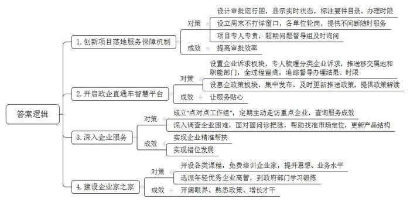
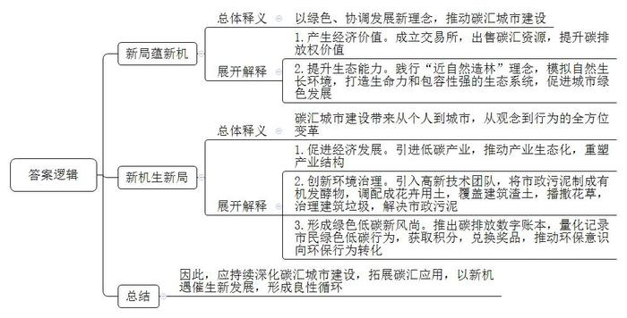
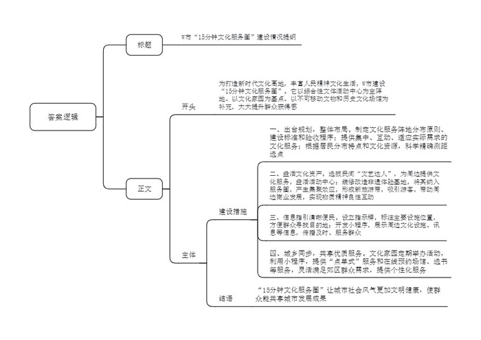

# 2023年公务员多省联考《申论》题（山西省市卷）

<!-- gwy:overview:start -->
> **山西 · 2023 · 申论 · 省市卷** ｜ 4 题 · 图片 4 处 · 答案随题折叠

导航：[题目](#题目)
<!-- gwy:overview:end -->

> 候选采集稿。参考答案及解析来自粉笔页面，不代表官方答案或真实高分答卷；来源使用许可与原卷对应关系仍需人工核实。

## 给定材料

### 材料 material-04cfad941323ec1e

走进H市政务服务中心大厅，首先映入眼帘的是一块大屏幕。屏幕上有一张类似地铁运行的线路图，各个站点闪烁着指示灯，“行驶”其间的并非列车，而是H市招商引资项目。H市创新项目落地服务保障机制，把项目建设的各环节设计成14个站点的“地铁运行图”，每个站点代表一个审批事项，绿、蓝、黄、红4色指示灯分别标识该环节办结、未办、在办及超期4种状态。为了实现企业项目早落地，政务服务中心还设立“周末不打烊”窗口。“我们公安、不动产、税务、社保等24个单位实行轮岗制，随时为企业提供服务。”市政务服务中心林主任说，“我们采取专人负责制，每个项目都安排一位对接人员，所有环节只要联系他一个人就好了。如果出现超期，信息会迅速传递到市优化营商环境工作督导组，督导组都会及时询问。”服务窗口前，一家节水设备有限公司正在准备要件进行注册登记，新项目即将从“始发站”上车。“每站都标注了所需的要件目录、办理时限，一目了然。”公司总经理高先生说，“这种机制带来的最明显变化就是效率高，审批时间较以前减了一半。”

建新厂投资大，市羊毛衫产业园的流动资金一时短缺，发工资都成了问题。总经理李先生的眉头拧成疙瘩。“有一笔钱能应急，可看得见，拿得慢。”李先生说，公司外贸订单多，每月出口退税，按流程要办两周。有人提醒他可以到H市年初开启的“政企直通车”智慧平台提出诉求。问题反映上去，被列入“红色”加急清单，办理进度加快，仅两天就办完了。点开“政企直通车”智慧平台的“企业诉求”板块，清晰可见每一条诉求的主办部门、办理进度、完结日期。H市安排专人对企业留言和诉求梳理分类，根据属地和部门职责推送移交，全过程留痕，并对办理结果、时限进行追踪督导。“这个平台不只是处理企业提出的诉求，还主动为企业提供政策解读。”向阳水泥厂刘经理使用这个平台后发现，在平台的“惠企政策”板块，所有相关政策都是集中发布，滚动更新。只要输入查询关键词，相关政策就全部出现了，还配有工作人员的讲解视频。“平台最近上线了推送功能，根据搜索记录，及时推送最新政策。从人找政策到政策找人，服务变得真是越来越贴心了。”

线上服务快速高效，线下帮扶周到细致。在一家纺织公司的厂房里，一条条细如发丝的化纤从卷轴拉出，经过上浆、并轴，织成连绵不断的布匹。“别看现在生产线满负荷运转，几个月前，订单少，三天两头停产。”公司负责人徐女士说，“幸亏有‘点对点工作组’，他们看到我们的困难后主动组织企业间对接，逐渐打开了销路。”徐女士所说的“点对点工作组”，是H市党政干部常态化联系民营企业的制度，一家重点企业安排一名科级干部为“首席服务官”、一名科员为“首席服务员”、一名主办银行负责人为“首席金融官”，“点对点工作组”要定期、主动走访企业。“我最初没把这个工作组当回事，以为只是走走过场。”徐女士说。看到工作组为公司开拓销路不断奔波，甚至节假日还在忙碌，市督导组也经常过来查询工作组的服务成效，徐女士发现政府对这个帮扶制度是非常认真的，“现在，政府对企业更加了解了，帮扶也更加精准到位了。”

“我们公司生产的汽车安全气囊丝，质量过硬。我们就想着谋求产品全、产量大，但很快就发现摊子铺得太大，分支业务没有发展起来，还影响主营业务下滑。”市化纤股份有限公司副总经理王先生说，市里得知后及时组织相关部门的工作人员和专家来到公司，深入调查，召开座谈，面对面问诊把脉，帮助寻找准确的市场定位，指导企业专攻色纱、安全气囊丝、阻燃纤维等细分领域，形成新的产品结构。“错位发展，让我们获得了明显的比较优势。”企业健康发展，离不开企业家的成长。每次走进H市的“企业家之家”，王先生都感觉自己“找到了家”。这里开设了“商务大讲堂”“民营企业家学院”，免费举办针对企业家的培训，提升企业家的思想、业务水平。除了在这里接受培训之外，王先生还有一番独特的经历——去H市商务局学习锻炼。市委、市政府出台文件，每年选派15名年轻优秀企业高管，用两到三个月时间，到市政府经济管理部门学习锻炼，王先生成为其中之一。两个月下来，王先生对外贸政策、海外市场更了解了，为公司开拓海外市场做了充分准备。“在政府部门锻炼，可以开阔眼界、熟悉政策、增长才干。”王先生总结道。

2022年H市市场主体数量同比增长47%，居民收入也明显提高。“我们就是因为看中这里营商环境的变化，才将总计176亿元的高纯多晶硅项目选择在这里。”新晶材料公司总经理夏先生说。“营商环境是一个地方的重要软实力，优化营商环境就是解放生产力，提高综合竞争力。”H市委张书记说，“我们所有的变化都是聚焦于人民对美好生活的向往，出于我们对全市人民不变的承诺。优化营商环境没有终点，今后我们将继续探索，提升政务服务水平。”

### 材料 material-212df45e698d5773

位于C市高新区的碳交易所大厅内，当天的碳汇交易信息正在超大屏幕上实时滚动。交易员小冯神情专注，认真地为企业办理碳汇交易账户。“朋友都觉得我的工作很‘洋气’。”谈及自己的工作，小冯露出了笑容。碳汇是指通过植树造林、植被恢复等措施，吸收大气中的二氧化碳，从而减少温室气体在大气中浓度的过程、活动或机制。碳汇交易则是一方通过减少排放或者吸收二氧化碳，将多余的碳排放指标转卖给有需要的另一方，以抵消他们的减排任务，也就是“卖空气”。“目前碳汇交易的活跃度和金融化程度还比较低，相关的制度规则还有待完善。”小冯说，“但是交易所的成立标志着碳汇交易开启了正规化的局面，这将促使企业更加意识到碳排放权的价值，相信未来的碳汇交易市场会有更多的新机遇。”

成立碳交易所只是C市打造“碳汇城市”品牌的一个侧影，C市正在全面探索提升碳汇能力的新路径。C市近年引进的10个亿元项目中，大多为低碳产业。其中，新引进的生物质发电有限公司年发电量约2.1亿千瓦时，年均节省标煤耗量9.5万吨，年均减少二氧化碳排放量24万吨。“我们将着力重塑产业结构，推动产业生态化，借助建设‘碳汇城市’的新机遇，打开城市经济发展的新局面。”C市龙市长说。

在市区的一座公园里，工人们正忙着植树。树与树之间不讲究“整齐”，而是自然随机布点。与一般造林不同，C市造林践行的是“近自然造林”理念。何谓“近自然”？“这是目前比较先进的造林理念，就是遵循‘尊重自然、顺应自然、保护自然’的原则，最大限度地模拟自然界中森林生长的环境，让树木实现个性生长、自然演替，从而形成一个生命力和包容性都极强的生态系统。”市城建局张局长说，经过多年的不懈努力，生态碳汇能力大大提高，“青山绿道碧水”的城市空间新格局不断成型，“步步见绿”正成为C市的美丽名片。

不知不觉中，“碳汇”理念浸润到了C市治理的方方面面，形成城市治理的新局面，为破解多年未解的难题提供了新机遇。以前，C市的一座高架桥下，经常有大量的砖石、渣土等建筑废料绵延上百米，犹如灰色的“城市疮疤”。现在，上有蓝天白云，中有高架桥，下有花海绿廊。这个变化是怎么发生的？“我们给这里覆盖了一层‘营养土’，这层营养土与建筑渣土混合后，能有效改善土壤营养成分，为植物的生长提供优质条件。”张局长说。

让很多人意想不到的是，覆盖在这些建筑渣土上的营养土，竟是市政污泥等有机固废制成的。市政污泥是污水处理过程中产生的固体沉淀物质，过去一般采用填埋和焚烧的方法处理，但这两种方式会污染环境，增加碳排放量。C市引入一家高新技术团队，把市政污泥制成有机发酵物，调配成花卉用土，覆盖在建筑渣土上，再播撒花草，这片“城市疮疤”很快就变成了新的城市风景线。“这种‘碳汇’模式一举两得，既治理建筑垃圾，也解决市政污泥。”张局长说。

随着碳汇理念的普及，绿色低碳正成为全民新风尚。点开“碳汇积分”小程序，苗小姐骄傲地展示自己的4位数积分。“我在绿色商城兑换了好多奖励，现在又在攒积分。”她笑道。“碳汇积分”小程序是C市推出的碳减排数字账本，市民衣食住行游的每次减排行为，在小程序上进行量化和记录，形成个人“碳账本”。在C市，乘坐公共交通、围着社区绿道骑行、旧物回收等这些“举手之劳”的绿色低碳行为都可以收获碳汇积分，这些积分可以兑换奖品，推动从“环保意识”到“环保行为”的转化。如今碳汇积分成为了苗小姐和朋友天天“比拼”的项目。“与其说是我们为‘碳汇城市’建设贡献力量，不如说是碳汇理念改变了我们的生活习惯。”苗小姐说。

“空气卖出近4万元！”浦上村村支书老林兴奋地说，浦上村是C市郊区的一个山村，今年以100元每吨的价格向一家企业出售了375吨碳汇资源。像一股春风，碳汇交易给这个本来有些偏僻的山村带来了新机遇，让这个山村的农民当上了“卖碳翁”。老林算了一笔账：按照现在的碳汇价格计算，村里有1.3万亩毛竹林，碳汇收入能有20多万元。这几年毛竹价格连年走低，而且人工成本高，有时候卖一季毛竹，成本都收不回来。C市的碳汇城市建设带来了新机遇，有了碳汇，只要把毛竹林养好，“竹叶子”就能变成“钱票子”。

“新局蕴新机，新机生新局。我们正以绿色发展、协调发展的新理念推动碳汇城市建设，点‘碳’成金，把‘碳汇城市’打造成我们的金字招牌。”龙市长说，“以变促变，以新求新，‘碳汇城市’建设将给我们带来一场从个人到城市，从观念到行为的全方位变革。”

### 材料 material-9fa81c1489dc6dc6

最近，家住W市康美家园的王大伯不打麻将了。今年刚投入使用的综合性文体活动中心，成了附近居民追捧的场所。王大伯喜滋滋地说：“家门口有这么高端大气的文化场馆，只要步行15分钟左右就能到达。”王大伯因为钢琴弹得好，还被社区选为“文艺达人”，每周六都到文体活动中心和伙伴们一起表演。市里今年启用了很多文体活动中心。一开始参加的人不多，活动中心几乎开不起来。市里又没有那么多文艺人才，怎么办？后来，市里从民间选拔“文艺达人”，让每个活动中心都能真正活动起来，为周边社区提供文化服务。有广场的地方就有欢快的舞者，有公园的地方就会传出愉悦的歌声。漫步W市街头，以综合性文体活动中心为主阵地、以文化家园为基点、以其他不可移动文物和历史文化场馆为补充的“15分钟文化服务圈”，大大提升了人们的获得感。

“为了打造新时代文化高地，丰富人民精神文化生活，市委、市政府提出建设‘15分钟文化服务圈’的规划，制定了公共文化服务阵地的分布原则、建设标准和验收程序。”W市文旅局李局长说，“过去为了给群众提供文化服务，我们也做了很多工作，但这些服务偏于分散，缺乏互动，有些还流于形式，不太适应实际需求。现在有了市委、市政府的规划，我们就能从整体布局，工作时有章可依。”W市空间大、人口多，原有文化设施分布不均衡，“15分钟文化服务圈”建设一开始就遇到了难题。“我们根据辖区内居民分布特点，结合区域内文化地标和旅游线路布设，用无人机对全市文化设施扫描绘图，然后用电脑通过运算确定合适的位置。”李局长说，通过科学精确的测距、选点，目前W市已经完成所有项目的选址。

走进W市瓷窑非遗体验基地，市民或泥条盘筑，或捉刀镂刻，正在兴致勃勃地体验非遗技艺。W市类似的非遗体验基地48个，吸引了大量的游客，经常一票难求，周边的零售、酒店等商业也跟着火了。“‘15分钟文化服务圈’不仅要丰富周边群众的文体生活，还要重视地域文化的传承，植入地方特色文化的‘基因’。”李局长说，“15分钟文化服务圈”需要较多的文化空间，经费和用地压力都比较大。“我们决定充分利用既有资源。通过调研，我们发现很多非遗体验基地比较冷清，于是就把它们重新装修和改造，纳入‘15分钟文化服务圈’，与其他文化阵地一起产生聚集效应，形成新的旅游带，这样既彰显当地文化特色，又能盘活这些文化资产，实现物质富足和精神富有的良性互动。”

在瓷窑非遗体验基地门口，矗立着一块“15分钟文化服务圈”指示牌，指示牌上有周边主要公共文化设施的所在位置。“有些人还不太会使用手机，每个文化服务点都树立了这样的牌子，可以方便他们找到自己的目的地。”基地的工作人员小张说，“市里还开发了‘15分钟文化服务圈’小程序，只要扫一扫二维码，就能知晓自己周边有哪些公共文化设施。”打开小程序，几乎所有的“15分钟文化服务圈”都可以在程序上进行定位，每个“圈”的主页都有文化设施、文化讯息、文化团体等各类信息，要去哪、能看什么展览、可以报名参加哪些文艺团队等信息都一目了然。“刚开始的时候，很多文化服务信息不太流通，明明有的地方在展出三星堆文物，可是很多人不知道，等知道的时候展览已经结束了。”小张说，“现在有了这个小程序，文化服务信息就能及时传播，真正能服务到最多的人。”

这几天，摄影爱好者陈先生每到凌晨就和伙伴们带着相机去海边拍摄日出。他参加了社区文化家园举办的摄影公益课堂。陈先生家住郊区的农村，过去由于参加的人少，而且兴趣分散，文化家园很少举办活动，这让喜欢摄影的陈先生很遗憾。今年，W市启动“15分钟文化服务圈”建设，城乡同步进行，共享优质文化服务。陈先生家旁边的文化家园就热闹了起来，每周都有文艺活动，摄影公益课堂是社区文化家园的服务项目之一。“‘15分钟文化服务圈’小程序推出了‘文化点单’栏目，只要在上面报名的人达到一定数量，社区文化家园就会开设公益课堂。”陈先生说，在小程序上还有“场馆预约”“阅读传递”等服务，在上面可以查看哪些文体场馆有空位，提前进行预约，还可以足不出户在线选书借阅，然后快递到家。这些精准的服务非常灵活地满足了郊区群众的需求。“现在我们郊区也一样可以享受市区的文化服务了。”每到周末，去海边拍摄日出，约几个朋友打一场羽毛球，或在家里静静地读一本书，陈先生尽情享受“15分钟文化服务圈”带来的这些个性化的文化服务。

“‘15分钟文化服务圈’建设一年以来，我们城市的社会风气发生了显著变化，变得更文明、更健康了。”在李局长看来，城市不仅是人们的栖身之所，还应该是人们的安心之地。“15分钟文化服务圈”让所有人都能共享城市发展的成果，一个个“文化服务圈”就像一盏盏明灯，连点成片，照亮了这个城市里的每一个人。

## 题目

### 第 1 题

**根据****“给定资料**1**”，请概括H市为优化营商环境采取了哪些措施，取得了哪些成效。（15分）**

关联材料：材料 material-04cfad941323ec1e

作答要求：

要求：全面、准确、有条理，不超过350字。

第 1 题 · 答案与解析

**参考答案（粉笔题库参考内容）**

1.创新项目落地服务保障机制。设计审批运行图，显示实时状态，标注要件目录、办理时限；设立周末不打烊窗口，各单位轮岗，提供不间断随时服务；项目专人专责，超期问题督导组及时询问，提高审批效率。

2.开启政企直通车智慧平台。设置企业诉求板块，专人梳理分类企业诉求，推送移交属地和职能部门，全过程留痕，追踪督导办理结果、时限；设惠企政策板块，集中发布、及时更新推送政策，提供政策解读，让服务贴心。

3.深入企业服务。成立“点对点工作组”，定期主动走访重点企业，查询服务成效，实现企业精准帮扶；深入调查企业困难，面对面问诊把脉，帮助找准市场定位，更新产品结构，实现错位发展。

4.建设企业家之家。开设各类课程，免费培训企业家，提升思想、业务水平；选派年轻优秀企业高管，到政府部门学习锻炼，开阔眼界、熟悉政策、增长才干。

**解析**

**参考答案说明**：本参考答案从“创新项目落地服务保障机制”“开启政企直通车智慧平台”“深入企业服务”“建设企业家之家”这四个方面，介绍了其做法和成效。做法和成效是一一对应的关系。各条答案要点之间在内容上相互并列，没有交叉。

**考点**：考点多要素组合类

**来源**：来源2023年公务员多省联考《申论》题（山西省市卷）

粉笔申论页面对本题只提供「解析视频」入口，该入口是会员推广位，页面无视频地址与文字解析。

### 第 2 题

**“给定资料**2**”中画线部分提到，“新局蕴新机，新机生新局。”请你谈谈对这句话的理解。（20分）**

关联材料：材料 material-212df45e698d5773

作答要求：

要求：

（1）紧扣资料，分析透彻；

（2）条理清晰，逻辑性强；

（3）不超过350字。

第 2 题 · 答案与解析

**参考答案（粉笔题库参考内容）**

“新局蕴新机”指：以绿色、协调发展新理念，推动碳汇城市建设。1.产生经济价值。成立交易所，出售碳汇资源，提升碳排放权价值；2.提升生态能力。践行“近自然造林”理念，模拟自然生长环境，打造生命力和包容性强的生态系统，促进城市绿色发展。

“新机生新局”指：碳汇城市建设带来从个人到城市，从观念到行为的全方位变革。1.促进经济发展。引进低碳产业，推动产业生态化，重塑产业结构。2.创新环境治理。引入高新技术团队，将市政污泥制成有机发酵物，调配成花卉用土，覆盖建筑渣土，播撒花草，治理建筑垃圾，解决市政污泥。3.形成绿色低碳新风尚。推出碳排放数字账本，量化记录市民绿色低碳行为，获取积分，兑换奖品，推动环保意识向环保行为转化。

因此，应持续深化碳汇城市建设，拓展碳汇应用，以新机遇催生新发展，形成良性循环。

**解析**

**参考答案说明：**思路方面，本参考答案按照“‘新局蕴新机’的总体释义和展开解释+‘新机生新局’的总体释义和展开解释+总结”的答题思路展开。内容方面，本参考答案先总体解释了“新局蕴新机”的含义和“产生经济价值”“提升生态能力”两方面的具体表现，再总体解释了“新机生新局”的含义和“促进经济发展”“创新环境治理”“形成绿色低碳新风尚”三方面的具体表现，最后进行总结。词句表达方面，本参考答案加上了“因此”等连接词来承接上下文。

**考点**：考点词句解释类

**来源**：来源2023年公务员多省联考《申论》题（山西省市卷）

粉笔申论页面对本题只提供「解析视频」入口，该入口是会员推广位，页面无视频地址与文字解析。

### 第 3 题

**邻市有关部门拟到****W市考察“15分钟文化服务圈”建设问题。假如你是W市政府工作人员，请根据“给定资料**3**”拟写一份介绍“15分钟文化服务圈”建设情况的提纲。（25分）**

关联材料：材料 material-9fa81c1489dc6dc6

作答要求：

要求：

（1）紧扣资料，要点完整；

（2）条理清晰，语言流畅；

（3）不超过500字。

第 3 题 · 答案与解析

**参考答案（粉笔题库参考内容）**

W市“15分钟文化服务圈”建设情况提纲

背景：为打造新时代文化高地，丰富人民精神文化生活，W市建设“15分钟文化服务圈”。它以综合性文体活动中心为主阵地、以文化家园为基点、以不可移动文物和历史文化场馆为补充，大大提升群众获得感。

建设措施：

一、出台规划，整体布局。制定文化服务阵地分布原则、建设标准和验收程序；提供集中、互动、适应实际需求的文化服务；根据居民分布特点和文化资源，科学精确测距选点。

二、盘活文化资产。选拔民间“文艺达人”，为周边提供文化服务，盘活活动中心；装修改造非遗体验基地，将其纳入服务圈，产生集聚效应，形成新旅游带，吸引游客，带动周边商业发展，实现物质精神良性互动。

三、信息指引清晰便民。设立指示牌，标注主要设施位置，方便群众寻找目的地；开发小程序，展示周边文化设施、讯息等信息，传播及时、服务群众。

四、城乡同步，共享优质服务。文化家园定期举办活动，利用小程序，提供“点单式”服务和在线预约场馆、选书等服务，灵活满足郊区群众需求，提供个性化服务。

结语：“15分钟文化服务圈”让城市社会风气更加文明健康，使群众能共享城市发展成果。

**解析**

**参考答案说明：**（1）格式方面，本参考答案写到了“标题”“正文”两个部分。（2）正文部分，一方面从内容上来看，围绕“W市建设15分钟文化服务圈”这一主题，本参考答案的开头先写到了“W市建设15分钟文化服务圈的相关背景”；主体部分从“出台规划，整体布局”“盘活文化资产”“信息指引清晰便民”“城乡同步，共享优质服务”等几个方面给出了具体的建设措施。最后，结尾对建设成效进行了总结。另一方面，形式上，本参考答案做到了分段、分条撰写，整体上条理颇为清晰。

**考点**：考点总结类

**来源**：来源2023年公务员多省联考《申论》题（山西省市卷）

粉笔申论页面对本题只提供「解析视频」入口，该入口是会员推广位，页面无视频地址与文字解析。

### 第 4 题

**“给定资料**4**”中，两处画线部分先后提到，“我们要以不变应万变”，“我们要以变应变”。请你深入思考这两句话之间的关系，参考给定资料，联系实际，自选角度，自拟题目，写一篇议论文。（40分）**

关联材料：材料 material-04cfad941323ec1e

作答要求：

要求：

（1）观点明确，见解深刻；

（2）内容全面，结构完整；

（3）思路清晰，语言流畅；

（4）总字数1000-1200字。

第 4 题 · 答案与解析

**参考答案（粉笔题库参考内容）**

**文化传承的****“不变”与“变”**

习近平总书记曾在党的十九大报告中指出，没有高度的文化自信，没有文化的繁荣兴盛，就没有中华民族伟大复兴。而建立文化自信的关键是文化的传承。文化的传承既要变，又要不变。

**文化传承的****“以不变应万变”，是要守住文化的根，****保持文化自身的核心价值****和传统魅力，履行传承使命，实现文化辐射****。**以文化人启智润心，以文育人培根铸魂，文化是一个民族的底蕴，是发展道路上的路基。只有守住文化的根，发展的力量才能源源不断，这就需要博物馆筛选文化精品，精心设计文创产品，这种文化精品的选择不仅仅是外形上的美观，更要内含文化价值，给人以力量。故宫文创千里江山拍拍灯，选取原画中山峦重叠的部分，印刷在不同材质的亚克力板上，灯光亮起，尤如清晨升起的明日，象征人生光明前景，既展现国画的艺术魅力，更温暖人心，给无数年轻人在黑夜前行力量。只有各地博物馆意识到、承担起自己的责任，文化之根才能留在人心。

**文化传承的****“以变应变”，就是要与时俱进，以创新的手段发展。****活化利用****文物资源****，****实现****社会效益与文化效益双收；****借助****现代科技手段，实现传统文化在当代的创新传播****。**当文物束之高阁，文物是没有尊严的，同时文物所蕴含的文化内涵也被封禁，文化的传播传承更无从谈起。文化的传承要让文物走出高墙深闺，来到寻常百姓家。一方面可以开展多元的文化活动，如线上播放文化综艺、纪录片，在声与画的流动中感受文化的价值，还可以开展线下体验活动，寓教于乐，感受文化内核，唯有线上线下相结合，才能满足各个年龄段全体的文化需求。另一方面，还要紧跟时代脚步，利用好3D技术，还原过去的发展场景，置身其中，提供沉浸式体验让文物“复活”。花开花落，潮涨潮落，时代在变，社会在变，方法和手段也要不断改变。

**文化传承的****“不变”是“守正”，文化传承的“变”是“创新”，二者都是为了更好****地****传播文化，****它们是统一的、****互补的，****它们****相辅相成、缺一不可****。**文化传承的“不变”，是文化自信的“坚定”，是文化传承的“责任”，是更多的群众了解文化、欣赏文化“初心”，是让文化更具“感染力”。而“变”的，则是“创新”，是紧跟时代，是让本来“死”的文物，用现代的方式再“活”一次，让文化具有“生命力”。所以，文化的传承不仅要让群众了解珍贵文化资源、感受文化价值，更要以创新的手段，传播文化的内涵。唯有如此，才能让文化历久弥新、经久不衰。

“不变”与“变”，其实殊途同归，都是继承和发扬文化，建设共同的精神家园。只要我们不忘初心，就一定能让文化进入生活，让文化在新时代中焕发活力。

**解析**

**文章分析**

**文化传承的****“不变”与“变”**

【**标题的优点：**首先，范文的标题突出了“‘变’与‘不变’”这一主题。其次，形式上，文字简洁明快。】

习近平总书记曾在党的十九大报告中指出，没有高度的文化自信，没有文化的繁荣兴盛，就没有中华民族伟大复兴。而建立文化自信的关键是文化的传承。文化的传承既要变，又要不变。

【**开头的优点：**★内容方面：范文的开头是紧扣“‘变’与‘不变’”这一主题展开的。首先指出了文化的重要性；然后指出了文化自信的关键是文化传承；最后引出核心观点，文化的传承要变，又要不变。★文字表达方面：长短句配合使用，使语言表达有节奏感。】

**文化传承的****“以不变应万变”，是要守住文化的根，****保持文化自身的核心价值****和传统魅力，履行传承使命，实现文化辐射****。**（1）以文化人启智润心，以文育人培根铸魂，文化是一个民族的底蕴，是发展道路上的路基。（2）只有守住文化的根，发展的力量才能源源不断，这就需要博物馆筛选文化精品，精心设计文创产品，这种文化精品的选择不仅仅是外形上的美观，更要内含文化价值，给人以力量。（3）故宫文创千里江山拍拍灯，选取原画中山峦重叠的部分，印刷在不同材质的亚克力板上，灯光亮起，尤如清晨升起的明日，象征人生光明前景，既展现国画的艺术魅力，更温暖人心，给无数年轻人在黑夜前行力量。（4）只有各地博物馆意识到、承担起自己的责任，文化之根才能留在人心。

【**论述段****1的优点：**★观点句：范文的观点句是紧扣“‘变’与‘不变’”这一文章主题提出的。形式上，它在段首处直接写出，位置突出，容易发现。内容上，关键词突出，内容要点明确，可以明显看出他是从“不变”出发，指出了文化传承要守住文化的根。★论述内容：（1）首先介绍了文化的重要性；（2）如何守住文化的根——博物馆筛选文化精品；（3）以故宫文创千里江山拍拍灯为例，展现传统文化的魅力；（4）如何守住文化的根——博物馆承担责任。注意：以上四个方面的内容都是紧扣“文化传承的‘以不变应万变’，是要守住文化的根，保持文化自身的核心价值观和传统魅力，履行传承使命，实现文化辐射”这个观点句论述的，论述的针对性强，内容层次丰富。在论述方法上采用了讲道理、举例子相结合，做到了丰富多样。】

**文化传承的****“以变应变”，就是要与时俱进，以创新的手段发展。****活化利用****文物资源****，****实现****社会效益与文化效益双收；****借助****现代科技手段，实现传统文化在当代的创新传播****。**（1）当文物束之高阁，文物是没有尊严的，同时文物所蕴含的文化内涵也被封禁，文化的传播传承更无从谈起。文化的传承要让文物走出高墙深闺，来到寻常百姓家。（2）一方面可以开展多元的文化活动，如线上播放文化综艺、纪录片，在声与画的流动中感受文化的价值，还可以开展线下体验活动，寓教于乐，感受文化内核，唯有线上线下相结合，才能满足各个年龄段全体的文化需求。（3）另一方面，还要紧跟时代脚步，利用好3D技术，还原过去的发展场景，置身其中，提供沉浸式体验让文物“复活”。花开花落，潮涨潮落，时代在变，社会在变，方法和手段也要不断改变。

【**论述段****2****的优点：**★观点句：范文的观点句是紧扣“‘变’与‘不变’”这一文章主题提出的。形式上，它在段首处直接写出，位置突出，容易发现。内容上，关键词突出，内容要点明确，可以明显看出他是从“变”出发，指出了文化传承要与时俱进。★论述内容：（1）文物被封禁的危害；（2）如何进行文化传承——开展文化活动；（3）如何进行文化传承——利用技术，还原过去发展场景。注意：以上三个方面的内容都是紧扣“文化传承的‘以变应变’，就是要与时俱进，以创新的手段发展。活化利用文物资源，实现社会效益与文化效益双收；借助现代科技手段，实现传统文化在当代的创新传播”这个观点句论述的，论述的针对性强，内容层次丰富。在论述方法上采用了讲道理、举例子相结合，做到了丰富多样。】

**文化传承的****“不变”是“守正”，文化传承的“变”是“创新”，二者都是为了更好****地****传播文化，****它们是统一的、****互补的，****它们****相辅相成、缺一不可****。**（1）文化传承的“不变”，是文化自信的“坚定”，是文化传承的“责任”，是更多的群众了解文化、欣赏文化“初心”，是让文化更具“感染力”。（2）而“变”的，则是“创新”，是紧跟时代，是让本来“死”的文物，用现代的方式再“活”一次，让文化具有“生命力”。（3）所以，文化的传承不仅要让群众了解珍贵文化资源、感受文化价值，更要以创新的手段，传播文化的内涵。唯有如此，才能让文化历久弥新、经久不衰。

【**论述段****3****的优点：**★观点句：范文的观点句是紧扣“‘变’与‘不变’”这一文章主题提出的。形式上，它在段首处直接写出，位置突出，容易发现。内容上，关键词突出，内容要点明确，可以明显看出他是从“‘变’与‘不变’的关系”出发，指出了文化传承的“变”与“不变”相辅相成、缺一不可。★论述内容：（1）阐释文化传承的“不变”；（2）阐释文化传承的“变”；（3）文化传承“守正”与“创新”“不变”与“变”的意义。注意：以上三个方面的内容都是紧扣“文化传承的‘不变’是‘守正’，文化传承的‘变’是‘创新’，二者都是为了更好地传播文化，它们是统一的、互补的，它们相辅相成、缺一不可”这个观点句论述的，论述的针对性强，内容层次丰富。在论述方法上采用了讲道理、举例子相结合，做到了丰富多样。】

【**论述段之间的关系：**★内容的内在逻辑：论述段1先写了“文化传承要‘不变’”，论述段2接着写了“文化传承要‘变’”，论述段3最后写了“文化传承‘变’与‘不变’的关系”，各论述段之间逻辑清晰。】

“不变”与“变”，其实殊途同归，都是继承和发扬文化，建设共同的精神家园。只要我们不忘初心，就一定能让文化进入生活，让文化在新时代中焕发活力。

【**结尾的优点：**范文的结尾回扣了“‘变’与‘不变’”这个主题，并且进行了总结提升。】

参考答案二

**文化传承的“不变”与“变”**

新的起点，新的时代，文化传承既要不变应万变，也要以变应万变。文化传承的“不变”，是文化自信的“坚定”，是文化传承的“使命”，是让更多的群众了解文化、欣赏文化“初心”。而“变”则是“创新”，是紧跟时代，创新产品，变革体制，革新推广方式，让本来“死”的文物，用现代的方式再“活”一次。

文化传承的“变”与“不变”犹如文化繁荣的鸟之两翼、车之两轮，两者相互支撑、缺一不可，新时代文化繁荣需要二者共同推动。

**不变为变指明方向，变让不变放大光芒。**秉持文化传承的使命，能够让创新把握方向、有的放矢；反之，注重文化创新，能够让文化传承更好履行使命，扩大辐射范围。有使命而无创新，一成不变、墨守成规的文化必然滞后于人民和时代的需求，湮没于历史的长河；有创新而无使命，缺乏支撑的文化势必掏空根基，成为经不起时代检验的空中楼阁。只有妥善处理好“变”与“不变”之间的关系，在传承中不断发展，在发展中实现传承，做到守正而不守旧、尊古而不复古，如此才能真正建成文化强国，推动新时代文化繁荣。

**不变让变更有内涵，变让不变更接地气。**不变的是以文物为载体，直观展现中华文明的丰富多彩，汲取民族智慧，树立文化自信；变的是推广方式，让文物推广更有趣，更系统，更具针对性。线上线下举办形式多样的非遗展览，全方位打造“沉浸式”非遗文化体验；开设“非遗购物节”，促进非遗更好地融入现代生活；围绕“文化遗产保护利用”举办文物科技创新论坛，激发文物科技创新活力……花开花落，潮涨潮落，时代在变，社会在变，方法和手段也要不断改变，唯有如此，才能让文化历久弥新、经久不衰。

**传统与现代相结合，利用现代技术，让文物以更便捷、更普及、更广泛的方式走进现代生活。**当文物束之高阁，文物是没有尊严的，同时文物所蕴含的文化内涵也被封禁，文化的传播传承更无从谈起。活化利用文物资源，实现社会效益与文化效益双收,借助现代科技手段，实现传统文化在当代的创新传播。一方面可以开展多元的文化活动，如线上播放文化综艺、纪录片，在声与画的流动中感受文化的价值，还可以开展线下体验活动，寓教于乐，感受文化内核，唯有线上线下相结合，才能满足各个年龄段的文化需求。另一方面，还要紧跟时代脚步，利用好3D技术，还原过去的发展场景，置身其中，提供沉浸式体验让文物“复活”。

“欲流之远者，必浚其泉源”，站在新时代新起点上，“变”与“不变”双管齐下，方能推动文化繁荣，传承和守护好中华优秀传统文化。

**考点**：考点文章写作题

**来源**：来源2023年公务员多省联考《申论》题（山西省市卷）

粉笔申论页面对本题只提供「解析视频」入口，该入口是会员推广位，页面无视频地址与文字解析。

