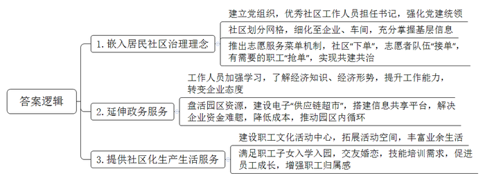
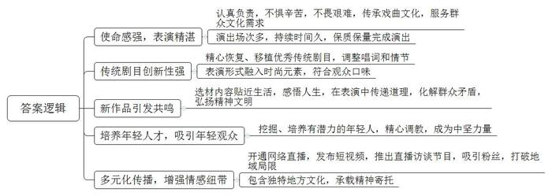
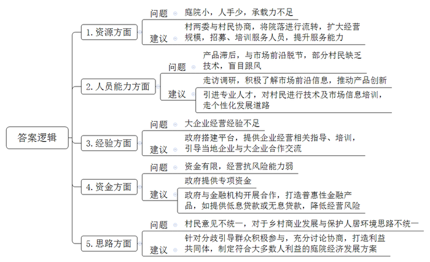

# 2024年公务员多省联考《申论》题（山西省市卷）

> 候选采集稿。参考答案及解析来自粉笔页面，不代表官方答案或真实高分答卷；来源使用许可与原卷对应关系仍需人工核实。

## 给定材料

### 材料 material-ef48e57fb927d9dd

H市，一个因工业而兴的城市。在这里，一个又一个的产业园区成为城市的引擎，创造财富与商机，催生了城市快速发展中数不清的奇迹。这些产业园区以它们独特的魅力，吸引了很多人前来追逐梦想。但是，早年间的产业园区重招商引资，轻管理服务，强产业，弱配套，导致产业园区虽产值占地区比重高但公共服务投入不高，虽人口聚集但人气难以集聚，虽归属城市但居民缺少归属感。这在“赚了钱就寄回家”的第一代进城务工人员那里“不是什么问题”，但在追求生活品质的新一代进城务工人员那里“都是问题”。为了解决产业园区遇到的这一难题，实现产业园区的持续发展，H市以南山工业园区为试点，推出了工业社区的治理模式，将居民社区治理理念嵌入产业园区，延伸政务服务内容和触角，为企业和员工提供社区化服务。

“小社区也能完成大治理。”H市南山工业社区党委书记老柯说，“党建统领是‘定盘星’。”南山工业社区只有6名社区工作人员，而各类企业有500多家、员工近8万名。南山工业社区在成立之初就建立了党组织，书记主要推选优秀社区工作人员担任。社区划分成几个网格，每个网格再进一步分成若干个微网格，微网格细化到企业甚至车间，是社区掌握基层信息的触角，也是治理和服务的抓手。“大家的园区大家建，我们还推出了志愿服务菜单机制，吸引志愿者参与社区共建共治。”老柯说。交通引导、平安夜巡、家园美化……社区有服务需求“下单”，志愿者队伍“接单”，有落户、子女入学积分需要的职工“抢单”，服务对象摇身一变成为共同服务者，让社区服务更加及时高效。如今，志愿者已成为了园区治理的重要参与力量。

“作为工业社区，我们的工作跟着经济形势走。”老柯原来在城市社区工作，刚到南山工业社区时，因不熟悉经济差点闹了笑话。后来老柯带领社区工作人员不断学习经济知识，了解经济形势。如今，他和企业负责人对话时，已经可以侃侃而谈，熟练地提到“资金链”“内循环”“供给侧”等词语，企业的态度也在潜移默化中改变。“原来一听到社区，总觉得跟企业无关；现在发现小社区有大本领。”某电子材料有限公司的张经理说。张经理的公司曾遇到如何加快上市的难题，没想到社区专门组织了一场园区内科技企业和金融机构的对接会，帮助其入选上市企业后备库。“工业社区已经从简单为职工衣食住行提供服务的配角，变成盘活园区资源、推动园区发展的主角之一。”张经理说，“有了他们暖心的帮助，我们这些做企业的感到放心。”去年，南山工业社区还牵头建设电子平台“供应链超市”，承担起了供需信息播报、物流信息共享、降成本方案共通等功能。老柯最近就在忙两件事，一是协调银行，建立一个5亿元规模的贷款资金池，缓解园区内企业资金压力；二是联系园区的售电公司，把百余家中小企业组织起来，共商如何降低用电成本。“‘供应链超市’以数字化赋能企业发展，搭建了园区内企业的信息共享平台，推动园区内成百上千家企业建立起‘内循环最小单元’。”老柯说。

南山工业社区的职工文化活动中心不久前正式投入使用，宽敞的室外健身休闲区和多功能的室内教育休闲活动区解决了众多企业职工活动空间少的问题。每天晚上，篮球场、健身房、图书馆、咖啡吧里，都有职工前来享受丰富的夜间生活。“在这里，不管是职工子女入学入园，还是年轻人交友婚恋、技能培训，都有了充足的条件。”某公司的人事专员万女士感慨，社区化的生产生活环境，成了企业招聘、留人的一大亮点，“职工们都安心在这里发展。”南山工业社区每年都举办“工匠学堂”“社区技校”等技能培训。自从成为试点以来，南山工业社区的职工收入年均增速高于全市4.2个百分点。园区一家汽配有限公司的车间主任老何，参加技能培训取得模具工程师证书之后，从一名普通技术工人逐渐成长为企业中层，收入也大幅提升，这让他对未来越来越有信心。

按照H市委市政府的规划，H市将总结推广南山工业社区的试点经验，全市的产业园区都将升级为配套完善、绿色智慧的工业社区，成为融产业园区、邻里中心、创意中心为一体的城市新形态。“不能因为是产业园区就只关注生产方面，而忽视了生活方面的管理和服务，我们的发展就是要满足人民日益增长的美好生活需要。”老柯说。

### 材料 material-13be9a73b4310d6d

晚上7点，太阳的余热还没散去，晚霞将天空染成橘红色。一天劳作结束，村民们摇着蒲扇，搬着马扎，三步并作两步往东山文化广场涌去，想抢占个好位置。Y市地方戏剧团要来唱戏了，5天6场戏，比过年都热闹。

虽然今晚的剧目，大家已经表演过很多次，轻车熟路了，但剧团团长老项还是和大家一大早就开始排练。他对每部戏的演出都非常认真，“要对得起观众，也对得起自己”。这会儿，他正在后台换装，一层层戏服穿下来，还没登台，额头上已经沁出一层汗。“三伏天唱戏就像蒸桑拿。不过每次演出，看着台下满满的戏迷，哪怕再累也一下子浑身是劲。”他笑着说。晚上8点，好戏开场，慷慨激昂的唱腔让人听得过瘾。两个半小时的演出，台下不时爆发出热烈掌声。

Y市是有名的“戏窝子”，这里的百姓爱听戏，不少村子都有古戏台。送戏下乡加上商演，市地方戏剧团一年要演出500多场，其中95%在农村。“我们要把最好的剧目、最精彩的演出送到乡间去，让百姓在家门口就能听到好戏。”老项说，地方戏剧团是基层群众文化活动的轻骑兵，传承戏曲文化、服务群众的文化需求是基层剧团的使命。不管酷暑三夏还是数九寒冬，不管是在剧院舞台还是山间僻壤，剧团演出都不惜力气、不打折扣。一年冬天，剧团演出的当日下了很大的雪，演员们穿着单衣，台下只有十几个观众，大家一样认真唱到最后。多年下乡演出，剧团与广大戏迷结下深厚情谊。“每次下乡，乡亲们总是高接远送，不是亲人胜似亲人。”老项说。

曾有一段时间，戏曲市场受到冲击，Y市地方戏剧团一场戏报价三五百元都没人看。主要演员有的调走，有的停薪留职，戏都没法排。后来，老项临危受命，成为戏剧团团长。在Y市市政府的支持下，剧团招聘优秀演员，重新组建队伍。在老项看来，好剧目是剧团生存发展的命根子，必须排好戏、出精品。剧团精心恢复、移植优秀传统剧目，“继承传统戏，不能照葫芦画瓢，必须要让观众看到新东西。”老项说，剧团对部分传统戏的唱词和情节进行了调整，让观众觉得更有意思，“表演形式也融入了更多时尚元素，更符合年轻观众的口味了。”在改编《赵氏孤儿》时，剧团邀请了专业的灯光和舞美设计团队，这在当时的市级团里还是独一份。

今年55岁的刘大姐是一名资深戏迷，每逢市地方戏剧团来村里演出，她就带着小板凳找个最靠前的位置坐下来，一直看到散场才依依不舍地离开。Y市地方戏剧团这几年推出的一系列新作品让她耳目一新，不仅唱腔动人，表演唯美，而且大都演的是身边人，讲的是身边事，故事贴近生活，让她觉得自己既是看戏人，也是戏中人。“我们把许多生活中的道理搬上舞台，让老百姓看的是戏、悟的是理，为新时代的精神文明建设添砖加瓦。”老项说。在新戏《鸡毛蒜皮》中，两户人家因为鸡毛蒜皮的小事闹矛盾，朴实机智的村民组长巧妙劝解，最终让两家人握手言和。戏演到哪里，就在哪里引起一连串会心的笑声。有一次演出结束后，当地的司法助理跑到后台对老项说：“这部戏编得太好了！这部戏演完，以后我们再去做工作，就会容易多了。”

凭借这些戏，剧团的市场逐渐打开，演出收入大幅增加，实现了以戏养戏，极大地改善了剧团的处境，提高了剧团的吸引力。很多年轻演员也在不断的表演过程中得到成长。“文化的传承与人才的培养息息相关。”老项说，“只有多推新人，剧团才能永葆活力。”小周现在是剧团的中坚力量。初中毕业后，小周考进艺校，他天生嗓子好，是唱戏的料，老项到艺校挑人，一下就选中了他。老项和剧团的老人精心调教小周，这些年，小周一路成长，获得了不少荣誉。现在，Y市地方戏剧团平均年龄不到四十岁，年轻人逐渐挑起了大梁。“年轻人与年轻人更容易互相吸引。”老项发现，随着剧团里年轻人增多，舞台下年轻的观众多起来了，还有不少中小学生。每次演出，看着台上台下那么多年轻的面孔，老项就笑逐颜开：“地方戏要发展，不仅需要年轻演员，也需要年轻的观众啊！”

为了顺应时代的数字化潮流，实现戏曲传播的多元化，市地方戏剧团开通了网络直播，还定期发布短视频、推出直播访谈节目。这让一些演员得到了锻炼，学会了如何在网上表演，吸引了越来越多的粉丝。53岁的老孟便是一名忠实粉丝，老孟年轻时离家闯荡，如今在网络直播间听家乡的地方戏成为了他的精神依托，“地方戏就是我和家乡的纽带，它包含着家乡独特的地方文化，承载着人们的乡愁。”前不久，外国学者伊恩到中国采风，老孟带他看了一场Y市地方戏剧团的演出。“这是我第一次听到这样的地方戏，也是第一次在村子里看戏。这种体验真是太特别了，真是令人着迷！”伊恩说。

### 材料 material-f2ebee7ff896a814

2020年，W市开始试点推进庭院经济，经过几年努力，庭院经济初显蓬勃之势。2023年中央一号文件提出，鼓励脱贫地区有条件的农户发展庭院经济。为评估庭院经济发展情况，进一步助力乡村振兴，W市农业农村局在学习贯彻习近平新时代中国特色社会主义思想主题教育期间，深入W市乡村开展调研工作，以下是调研组成员小江的部分调研笔记内容。

·陈村。村民老陈因地制宜，把自家庭院重新装修，在家里开起农家乐。

老陈：“我们这里是山区，风景好，而且山里的菜新鲜、地道、有特色，隔三岔五就有游客来山上游玩，顺便品尝我们的农家菜，都夸我们家的菜好。经常有客人提前打电话来，点名要吃我们家的炖鸡。现在政府鼓励发展庭院经济，我这房前屋后都种了菜，加工出来就能变现钱，庭院经济有赚头！有点可惜的是，家里的地方还是太小了，客人一多就没地方坐，种的菜也不够招待，有时候单凭家里的几口人也忙不过来。”

·郭家村。村党支部书记老郭：“我们村算是找准了庭院经济的发展方向，就是在自己庭院加工软体沙发。现在我们村的软体沙发加工业已初具规模，村民们逐渐走上了一条致富的道路。这都是因为我们有小章啊！他懂技术，也懂市场。”

小章：“我以前在沿海一家沙发公司上班，回家过年时，正遇上郭书记在宣传庭院经济，我在外很多年，也想回家发展，就抱着试一试的想法，利用自家庭院干起软体沙发的加工。现在，我们通过网络把小庭院和大市场联系起来，在多家电商平台开设网店，也和直播带货的主播合作，每天订单有一百多单。”

老郭：“我们村在自家庭院加工软体沙发的农户超过20家，不仅收益可观，还带动了近200名村民的就业。周边村子的很多人纷纷前来取经学习，也准备从事沙发加工。”

小章：“其实我们的市场是受限的，因为沙发的工艺技术、设计理念和款式风格一直在变化，而我们与市场前沿有些脱节，产品始终稍显滞后。很多人没有技术，也不懂市场，一窝蜂来学做沙发，这未必是件好事。”

·赵村。这是一个有着300多年铁编加工历史的村庄，村里80%的人都有铁编手艺，但一直以来，铁编生产都是家庭作坊、自产自销，这导致村子的铁编产业一直走不出“庭院”。村党支部书记老赵带着铁编加工户代表到沿海发达地区考察学习。回来后，赵村成立了金属制品产业合作社。合作社有人专门负责采购原材料和推广产品，铁编加工户只需要按统一标准在自家庭院加工制作。

老赵：“我们之前太局限于传统小农经济的思想。要面向市场！市场需要什么，我们就生产什么。小作坊创造大产业，去年一年，我们村铁编销售额突破了两亿元。现在随着规模不断扩大，合作社的事情越来越多，资金往来也越来越复杂，我们没有经营大企业的经验，觉得还是很有压力。”

·方沟村。村民小方通过网络直播销售花卉。这些花卉都是她在自家庭院里种的，品种虽然比较少，但都是市面上比较少见的。

小方：“我最喜欢的工作就是每天在自家小院直播推销花卉。我的客户主要是一些对新奇植物抱有好奇心的城市白领，她们一般不太在乎价格，主要看颜值。我还想扩大一些规模，但这些花卉成本很高，我的资金有限，经不起风险，后面再找机会吧。”除了直播花卉的品种、价格、种植注意事项外，小方还喜欢与她的观众分享绿植美化居室和庭院的心得：“庭院经济很有看头！院子闲着也是闲着，种上花卉，看着舒心，住着养心。”

·张店村。村党支部夏书记联系五户不在村里居住的村民召开协商会，与他们协商将院子流转给村里发展民宿。

夏书记：“院子流转给村里发展民宿，我们把‘小’而‘散’的庭院打造出各自的特色，通过设计形成一个大旅馆。这样大家不仅获得租金和分红，还可以在民宿就业。”

村民老韩：“之前隔壁石条村老江家办过民宿，开始红火过一阵子，后来因为激烈的同质化竞争，老江只能通过压低报价来吸引客户，可是报价降低了，服务品质也跟着降低了，无法吸引客户，最终陷入了恶性循环。”

村民老张：“我觉得我们村现在这样子就很好，干干净净，又安静，顺其自然就行了。有的地方办民宿，一下子迎来很多客人，吵吵嚷嚷，还带来很多垃圾。”

由于大家意见不一，协商会最后没有达成结果。“庭院经济有奔头，带领大家走出‘庭院’，奔赴美好生活。周围很多村都搞得红红火火，我们村没有搞不好的道理。”夏书记会后说，“新思路带来新发展，会使大家走上致富路。只要我们沿着党和国家指引的方向不懈努力，就一定能把村里的庭院经济搞起来。”

## 题目

### 第 1 题

**H市拟在全市进一步推广工业社区治理模式，请根据“给定资料**1**”，谈谈南山工业社区有哪些经验值得借鉴推广。（20分）**

关联材料：material-ef48e57fb927d9dd

作答要求：

要求：全面、准确、有条理，不超过350字。

### 第 2 题

**“给定资料**2**”中画线部分提到“每次下乡，乡亲们总是高接远送，不是亲人胜似亲人”。请根据“给定资料**2**”，谈谈是什么让乡亲们对戏剧团产生了如此深厚的感情。****（****15分****）**

关联材料：material-13be9a73b4310d6d

作答要求：

要求：分析全面，条理清晰，不超过300字。

### 第 3 题

**请根据****“给定资料**3**”，对W市在发展庭院经济时遇到的问题进行梳理，并提出相应的解决建议。****（****25分）**

关联材料：material-f2ebee7ff896a814

作答要求：

要求：

（1）问题梳理全面、准确、有条理；

（2）所提建议与问题相对应，具体明确、切实可行；

（3）不超过450字。

### 第 4 题

**“给定资料**4**”中画线部分提到“青山绿水是无价之宝”，又提到“生态有价”。既有价又无价的事物在现实中还有很多，请对此进行深入思考，参考给定资料，联系实际，自选角度，自拟题目，写一篇文章。（40分）**

关联材料：material-ef48e57fb927d9dd

作答要求：

要求：

（1）观点明确，见解深刻；

（2）内容全面，结构完整；

（3）思路清晰，语言流畅；

（4）总字数1000～1200字。

## 答案与解析

第 1 题

**参考答案（粉笔题库参考内容）**

1.嵌入居民社区治理理念。建立党组织，优秀社区工作人员担任书记，强化党建统领；社区划分网格，细化至企业、车间，充分掌握基层信息；推出志愿服务菜单机制，社区“下单”，志愿者队伍“接单”，有需要的职工“抢单”，实现共建共治。

2.延伸政务服务。工作人员加强学习，了解经济知识、经济形势，提升工作能力，转变企业态度；盘活园区资源，建设电子“供应链超市”，搭建信息共享平台，解决企业资金难题，降低成本，推动园区内循环。

3.提供社区化生产生活服务。建设职工文化活动中心，拓展活动空间，丰富业余生活；满足职工子女入学入园，交友婚恋，技能培训需求，促进员工成长，增强职工归属感。

**解析**

**参考答案说明：**本题答案分别从“嵌入居民社区治理理念”“延伸政务服务”“提供社区化生产生活服务”三个方面介绍了南山工业社区的经验做法，各条答案要点之间在内容上相互并列，没有交叉。

**考点**：考点经验启示类

**来源**：来源2024年公务员多省联考《申论》题（山西省市卷）

粉笔申论页面对本题只提供「解析视频」入口，该入口是会员推广位，页面无视频地址与文字解析。

第 2 题

**参考答案（粉笔题库参考内容）**

1.使命感强，表演精湛。认真负责，不惧辛苦，不畏艰难，传承戏曲文化，服务群众文化需求；演出场次多，持续时间久，保质保量完成演出。

2.传统剧目创新性强。精心恢复、移植优秀传统剧目，调整唱词和情节；表演形式融入时尚元素，符合观众口味。

3.新作品引发共鸣。选材内容贴近生活，感悟人生，在表演中传递道理，化解群众矛盾，弘扬精神文明。

4.培养年轻人才，吸引年轻观众。挖掘、培养有潜力的年轻人，精心调教，成为中坚力量。

5.多元化传播，增强情感纽带。开通网络直播，发布短视频，推出直播访谈节目，吸引粉丝，打破地域局限；包含独特地方文化，承载精神寄托。

**解析**

**参考答案说明**：本参考答案从“使命感强，表演精湛”“传统剧目创新性强”“新作品引发共鸣”“培养年轻人才，吸引年轻观众”和“多元化传播，增强情感纽带”这五个方面进行了分条撰写。各条答案要点在内容上相互并列，没有交叉。

**考点**：考点原因类

**来源**：来源2024年公务员多省联考《申论》题（山西省市卷）

粉笔申论页面对本题只提供「解析视频」入口，该入口是会员推广位，页面无视频地址与文字解析。

第 3 题

**参考答案（粉笔题库参考内容）**

1.问题：庭院小，人手少，承载力不足。建议：村两委与村民协商，将院落进行流转，扩大经营规模，招募、培训服务人员，提升服务能力。

2.问题：产品滞后，与市场前沿脱节，部分村民缺乏技术，盲目跟风。建议：走访调研，积极了解市场前沿信息，推动产品创新；引进专业人才，对村民进行技术及市场信息培训，走个性化发展道路。

3.问题：大企业经营经验不足。建议：政府搭建平台，提供企业经营相关指导、培训，引导当地企业与大企业合作交流。

4.问题：资金有限，经营抗风险能力弱。建议：政府提供专项资金；政府与金融机构开展合作，打造普惠性金融产品，如提供低息贷款或无息贷款，降低经营风险。

5.问题：村民意见不统一，对于乡村商业发展与保护人居环境思路不统一。建议：针对分歧引导群众积极参与，充分讨论协商，打造利益共同体，制定符合大多数人利益的庭院经济发展方案。

**解析**

**参考答案说明：**本参考答案从“资源”“人员能力”“经验”“资金”“思路”五个方面介绍了问题，并针对每一方面的问题给出了相应的建议。此外，形式方面，本答案做到了分类分条撰写，各条要点之间在内容上是并列关系，没有交叉。

**考点**：考点提出对策类

**来源**：来源2024年公务员多省联考《申论》题（山西省市卷）

粉笔申论页面对本题只提供「解析视频」入口，该入口是会员推广位，页面无视频地址与文字解析。

第 4 题

**参考答案（粉笔题库参考内容）**

**论有价与无价的统一**

习总书记提出，绿水青山就是金山银山。“金山银山”，既有字面含义上的经济之义，也深层次体现出深刻、长远的思想。从这个角度上说，生态环境是有价的，有经济价值，又是无价的，利于长远发展，是二者的有机统一。既有价又无价的事物在现实中还有很多，社会治理、文化建设、经济发展新思路等，都是有价又无价的生动体现。

**有价，指的是有直接的价值，强调实用性，主要体现在经济、市场等层面；无价，指的是无法计算价值，比喻极为珍贵的事物，这种价值往往是丰富多元、深刻、长远的。**既有价又无价的事物还有很多，这给我们的启发是：既要重视现在，还要看到未来；既要看到表层价值，还要挖掘深层价值。兼顾有价与无价，我们应树立系统思维，坚持两点论和重点论的统一。

**生态建设是有价与无价的统一。**生态有价，主要体现在生态资源可以通过确权、入股经营等市场化方式产生经济价值。如有的地方自然环境优美，发展了旅游业，促进经济发展；有的地方森林覆盖率高，利用碳汇交易，带动了增收。生态有价，也无价。生态好了，经济发展了，生产要素流向改变了，民众建设家乡的积极性也提高了，社会治理更顺畅了，也为子孙后代发展攒下了“家底”。生态的无价，是丰富、深刻、长远的。

**社会治理是有价与无价的统一。**治理有价，它能给人以安定有序的环境、高效便捷的服务，也能为经济发展提供保障。如厦门市开启平安小区建设，为民众带去安宁；宁波市开展“无柜台”服务模式，为民众、企业提供贴心、优质服务；丽江市黎光村动员村民，群策群力，发展了旅游经济。治理有价，也无价。好的治理，能给人归属感，促进人的长远发展，满足人民日益增长的美好生活需要。如有的工业园区将居民社区治理理念嵌入产业园区，延伸政务服务内容和触角，为企业和员工提供社区化服务。好的治理，是有价与无价的统一。

**文化发展是有价与无价的统一。**当下，文化市场热闹非凡，一出好戏，引得台下观众高声叫好；一个个文化IP被改编成电影，引得人们竞相观看。文化产业繁荣展现了文化的有价。比起有价，文化更能滋润人心，承载人们的精神依托。一首诗，可以寄托忧思；一本好书，可以涤荡心灵；一部好剧，可以引人深省。文化的无价，在于它能触达灵魂，抵达心灵。但当下，我国文化建设出现“有高原无高峰”的现象，既有“繁花”，也有“野稗”。因此，文化建设应怀使命意识，进行创造性转化，创新性发展，推动文化建设更上一层楼。

老子说：“凿户牖以为室，有之以为利，无之以为用。”有价与无价，统一在一起，才能彰显事物的全部价值。这也为我们在做人生选择时提供了一些启示：心怀梦想，脚踏实地。

**解析**

**文章分析**

**论有价与无价的统一**

【**标题的优点：**标题中含有主题词，使文章主题更突出、清晰。】

（1）习总书记提出，绿水青山就是金山银山。“金山银山”，既有字面含义上的经济之义，也深层次体现出深刻、长远的思想。从这个角度上说，生态环境是有价的，有经济价值，又是无价的，利于长远发展，是二者的有机统一。（2）既有价又无价的事物在现实中还有很多，社会治理、文化建设、经济发展新思路等，都是有价又无价的生动体现。

（3）有价，指的是有直接的价值，强调实用性，主要体现在经济、市场等层面；无价，指的是无法计算价值，比喻极为珍贵的事物，这种价值往往是丰富多元、深刻、长远的。既有价又无价的事物还有很多，（4）这给我们的启发是：既要重视现在，还要看到未来；既要看到表层价值，还要挖掘深层价值。兼顾有价与无价，我们应树立系统思维，坚持两点论和重点论的统一。

【**开头的优点：**★内容方面。范文的开头是紧扣“有价和无价”这一主题展开的。（1）首先通过习总书记的话解释了题干给定句的含义；（2）指出了在现实生活中既有价又无价的事物有哪些；（3）指出了“有价”和“无价”的含义；（4）指出了既有价又无价的事物带给我们启发。★文字表达方面。使用了“从这个角度上说”“这给我们的启发是”等过渡句，使语言表达有逻辑性；长短句配合使用，使得语言表达有节奏感。】

**生态建设是有价与无价的统一**。（1）生态有价，主要体现在生态资源可以通过确权、入股经营等市场化方式产生经济价值。如有的地方自然环境优美，发展了旅游业，促进经济发展；有的地方森林覆盖率高，利用碳汇交易，带动了增收。（2）生态有价，也无价。生态好了，经济发展了，生产要素流向改变了，民众建设家乡的积极性也提高了，社会治理更顺畅了，也为子孙后代发展攒下了“家底”。生态的无价，是丰富、深刻、长远的。

【**论述段****1的优点：**★观点句：范文的观点句是紧扣“有价和无价”这一文章主题提出的。形式上，它在段首处直接写出，位置突出，容易发现。内容上，关键词突出，内容要点明确，可以明显看出主要论述“生态建设是有价与无价的统一”。★论述内容：（1）先介绍了生态是有价的；（2）然后介绍了生态是无价的。注意：以上两个方面的内容都是紧扣“生态建设是有价与无价的统一”这个观点句进行分析论述的，论述的针对性强，内容层次丰富。在论述方法上主要采用了讲道理、举例子相结合的方式，论述充实深刻。】

**社会治理是有价与无价的统一**。（1）治理有价，它能给人以安定有序的环境、高效便捷的服务，也能为经济发展提供保障。如厦门市开启平安小区建设，为民众带去安宁；宁波市开展“无柜台”服务模式，为民众、企业提供贴心、优质服务；丽江市黎光村动员村民，群策群力，发展了旅游经济。（2）治理有价，也无价。好的治理，能给人归属感，促进人的长远发展，满足人民日益增长的美好生活需要。如有的工业园区将居民社区治理理念嵌入产业园区，延伸政务服务内容和触角，为企业和员工提供社区化服务。好的治理，是有价与无价的统一。

【**论述段****2****的优点：**★观点句：范文的观点句是紧扣“有价和无价”这一文章主题提出的。形式上，它在段首处直接写出，位置突出，容易发现。内容上，关键词突出，内容要点明确，可以明显看出主要论述“社会治理是有价与无价的统一”。★论述内容：（1）先介绍了社会治理是有价的；（2）然后介绍了社会治理是无价的。注意：以上两个方面的内容都是紧扣“社会治理是有价与无价的统一”这个观点句进行分析论述的，论述的针对性强，内容层次丰富。在论述方法上主要采用了讲道理、举例子相结合的方式，论述充实深刻。】

**文化发展是有价与无价的统一**。（1）当下，文化市场热闹非凡，一出好戏，引得台下观众高声叫好；一个个文化IP被改编成电影，引得人们竞相观看。文化产业繁荣展现了文化的有价。（2）比起有价，文化更能滋润人心，承载人们的精神依托。一首诗，可以寄托忧思；一本好书，可以涤荡心灵；一部好剧，可以引人深省。文化的无价，在于它能触达灵魂，抵达心灵。（3）但当下，我国文化建设出现“有高原无高峰”的现象，既有“繁花”，也有“野稗”。因此，文化建设应怀使命意识，进行创造性转化，创新性发展，推动文化建设更上一层楼。

【**论述段****3****的优点：**★观点句：范文的观点句是紧扣“有价和无价”这一文章主题提出的。形式上，它在段首处直接写出，位置突出，容易发现。内容上，关键词突出，内容要点明确，可以明显看出主要论述“文化发展是有价与无价的统一”。★论述内容：（1）先介绍了文化发展是有价的；（2）然后介绍了文化发展是无价的；（3）最后介绍了文化发展中存在的问题，以及解决的对策。注意：以上两个方面的内容都是紧扣“生态建设是有价与无价的统一”这个观点句进行分析论述的，论述的针对性强，内容层次丰富。在论述方法上主要采用了讲道理、举例子相结合的方式，论述充实深刻。】

【**论述段之间的关系**：★内在逻辑上：文章先论述“生态建设是有价与无价的统一”，再论述“社会治理是有价与无价的统一”，最后论述“文化发展是有价与无价的统一”，并列逻辑清晰严谨。】

老子说：“凿户牖以为室，有之以为利，无之以为用。”有价与无价，统一在一起，才能彰显事物的全部价值。这也为我们在做人生选择时提供了一些启示：心怀梦想，脚踏实地。

【**结尾的优点：**范文的结尾回扣了“有价和无价”这个主题，并且进行了展望，发出了号召。】

**考点**：考点文章写作题

**来源**：来源2024年公务员多省联考《申论》题（山西省市卷）

粉笔申论页面对本题只提供「解析视频」入口，该入口是会员推广位，页面无视频地址与文字解析。

