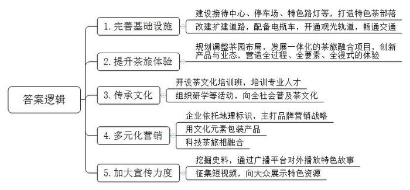
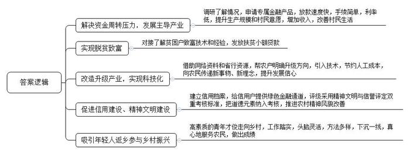
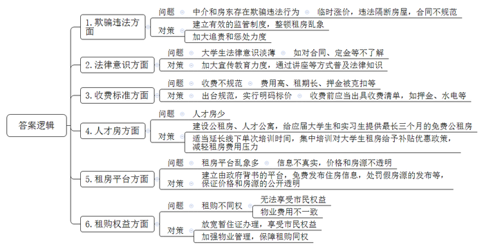
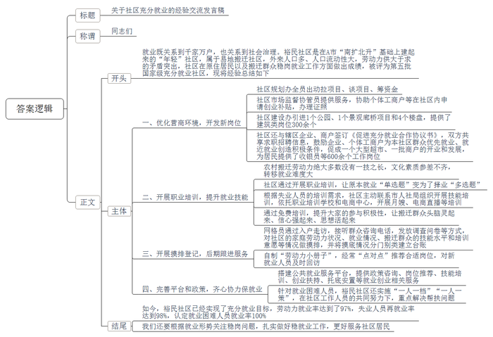

# 2024年公务员多省联考《申论》题（山西县乡卷）

> 候选采集稿。参考答案及解析来自粉笔页面，不代表官方答案或真实高分答卷；来源使用许可与原卷对应关系仍需人工核实。

## 给定材料

### 材料 material-c44151f154774030

黄村，这个大山深处的小村庄，每年“寻茶”而来的游客就超过两万人。2019年，村里基于茶厂的各自特点打造了风格不同的“到黄村吃茶去”接待点，又发动农户，把闲置的古旧民居改建成接待中心，又在村头建了大停车场，村道上安装了特色路灯，布置了乡村小夜景，“黄村特色茶部落”应运而生，成了W县推进茶旅融合发展最具特色的写照。

为解决W县地处山区交通不畅的问题，县里兴建了一条12公里长的环山道路，通过截弯取直和路面整治对原有的茶山道路进行改建扩建。为方便游客在景区内观光游览，县里还配备了10辆电瓶车。“旅游观光轨道交通项目一期开通试运营以来，游客的观光体验比起以前有了很大的提升。”轨道交通项目负责人说，这条线路从高铁站至景区南入口，全长26.43公里，途经大片茶山，可以让游客领略茶乡美景、感受茶文化魅力，推动更多茶园变身“打卡地”“美丽风景线”。

“我们重新规划和调整了茶园布局，腾出的空间用于发展一批集休闲观光、知识科普、采摘体验、茗茶品鉴为一体的茶旅融合项目。”县茶业局张局长介绍说。这些项目以茶旅小镇、茶文化园、茶主题民宿等为载体，融入了茶文化内涵，增添了山水情怀，不断创新茶旅融合产品与业态，让游客吃有茶味、住有茶香、行有茶路、游有茶韵、购有茶礼、娱有茶戏，营造出了全过程、全要素的茶旅体验。

走出小镇，举目所见的是绵延起伏的茶山。“14万亩茶园不再仅仅是茶叶产地，摇身一变成了一个天然大景区。以茶为媒，以旅为用，游客不仅能参观生态茶园，吃农家宴，了解制茶器具和工序，还能参与茶叶制作的过程，体验一场‘全浸式’茶文化之旅。”茶叶技术员小田说，过去卖茶叶，价格波动大，收入不稳定，如今卖风景、卖茶文化，很多村民都融入到茶旅融合产业中，收入来源更加多元化了。

“从文化角度来看，茶文化往往与传统文化、养生文化及道德修养结合紧密。从产业匹配程度来看，茶产业和旅游产业存在天然的契合度。”茶叶协会王副会长介绍说，中国茶历史悠久，源远流长，积淀了庞博、精微、厚重的独特文化。茶旅融合就是通过旅游、观赏、娱乐、体验、休闲等方式，去欣赏茶、茶园、茶叶加工技艺，感受茶文化所蕴涵的价值和人文精神。

随着市场需求的变化，各类茶文化相关的培训班纷纷涌现。星愿茶文化旅游开发有限公司负责培训工作的吴经理表示，公司每年都会培训一批茶艺传承人、茶旅从业者等专业人才。她说：“我们不定期地组织茶文化进校园、茶文化主题研学等活动，在中小学生中传播茶文化知识，每年都要组织专业团队创作和表演以茶文化为主题的文艺节目，推动茶技艺和茶文化在全社会的推广普及，让更多人感受到中国茶文化的博大精深和独特魅力。”

茶旅融合也为传统茶企带来了新的发展机遇。“我们依托茶叶地理标识，主打品牌营销战略，挖掘茶叶的历史和文化内涵，用文化元素包装产品，改变了传统橱窗式、订单式的营销方式，形成了多元化的营销模式。”启辉茶叶公司李经理介绍。李经理从事茶叶营销多年，他认为，将科技与茶旅结合，通过影像展示、创意装置、主题场景等方式，为游客带来了更多的互动感、新奇感和体验感，也展现了传统茶文化的现代“玩法”。

在县茶业局的展示大厅里，陈列着W县茶文化发展历史图片和相关资料。张局长表示：“我们充分挖掘丰富的茶文化史料，通过广播平台对外播放2300余集特色故事；主办全国茶文化短视频征集大赛，共征集短视频千余条，曝光量超1.2亿次，向大众展示了W县茶旅等特色资源，推动茶产业和旅游资源深度融合。”

### 材料 material-1d5ff2b9f1ba3b9a

普惠金融，顾名思义，就是将优惠的金融服务提供给更多的人，特别是急需资金支持的小微企业、“三农”和偏远地区的人们。普惠金融服务如何落地？在多山多水的F市，为了将金融服务送到山间、沿海的家家户户，当地探索形成了别具特色的“背包银行”模式。什么是“背包银行”？“就是银行的客户经理背上包包就进村了，挨家挨户去普及金融知识、推广金融服务。”F市某国有银行支行刘行长说。

2019年以来，为发展普惠金融，助推乡村振兴，F市每年都选派100名优秀的信贷客户经理到100个特色产业村担任金融村官，他们背上背包，走出柜台，走进村组农户和田间地头，向这片乡村热土浇灌金融活水。

蟹苗养殖培育是七房村的主导产业，每年三四月份，正是养殖户采购蟹苗、饲料，扩大生产经营的时节，不少养殖户都面临较大的资金周转压力。2023年3月，金融村官小梅根据前期调研的结果，在充分掌握了蟹苗养殖信用户相关情况的基础上，向上级部门申请了专属金融产品“蟹苗贷”。“我们一直把服务‘三农’作为普惠金融的重点，不仅放款速度快，手续简单，年利率也低，比市面上大多数金融贷款要低1.5至4个点，按照借10万元来算，一年能省至少1500元。”小梅说。有了金融支持，七房村蟹苗养殖规模大幅度提高，村民的养殖意愿越发强烈。“2023年养殖收入增加了快一倍，好多村民都买了小车，今年又引入了新的蟹苗品种，规模进一步扩大，村民们日子越来越好啦！”小梅的声音难掩喜悦。

“虽然我是残疾人，但我致富的决心可不比其他人差！”村民老陈原是西界村建档立卡贫困户，早年间因意外不幸失去左手，劳力较差。在得知老陈打算养猪却苦于没有启动资金后，金融村官小刘积极对接，了解到他有丰富的养殖技术和经验，且家里边有约600平方米的场地可以用来办养猪场后，小刘为其制定了无抵押的信贷支持计划，发放了扶贫小额贷款。今年，老陈想扩大养殖规模，小刘继续为其争取资金支持，又发放了贷款5万元供其购买猪仔，目前养殖规模已增加到了300头。有了信贷资金支持，勤劳肯干的老陈成了村里的致富能手。

“打药用上无人机，原本几天的工作现在两小时就能完成了，高科技的东西就是不一样，多亏了我们的金融村官小李啊！”老钟指着不远处正在喷洒农药的无人机，开心地说道。老钟是茗香茶厂的老板，随着茶园的扩大，传统的人工喷药方式费时费力，如何改造升级？农民出身的老钟没了主意。一天，小李到家闲聊，老钟把他的困扰告诉了小李。虽然这项业务和金融服务无关，但小李总觉得可以为老钟做点什么。他上网查阅相关资料，了解到植保无人机可将农药喷洒到茎叶背面和根部，能节约农药并有利于减少农药残留和环境污染。在帮助老钟明确了升级方向后，小李又借助省行资源帮助他成功引入了先进实惠的无人机施药技术。“现在，我们这个无人机每启动一次，就可以节约人工成本1万元左右。”老钟对这项新技术赞不绝口，“我们对很多新鲜事物不了解，是小李把城里一些新的东西、新的理念带给了我们。最近他又教会了我直播带货，现在我的茶都卖到国外去了……”老钟对未来的发展充满了信心。

“背包银行不仅为农村送去了普惠金融服务，对农村的信用建设、精神文明建设也起到了很大的促进作用。”刘行长说，随着金融村官对各村情况的摸底了解，F市对上万户农村家庭进行了评级、授信，初步建立了农户信用档案，半数以上农村家庭被认定为“信用户”，可以享受到更优惠、便捷的绿色金融通道。由于大部分农民无抵押、无担保，在评估“信用户”的时候，F市就采用精神文明与信誉评定双重考核标准，把邻里和谐、孝道等道德元素纳入考核，在推进乡村信用建设的同时，也推进了农村的精神风貌。

“在背包银行模式形成之初，我们担心年轻人不愿意舍弃城里的舒适生活奔赴偏远的农村，几年过去了，事实证明我们的担心是多余的。这些高素质的青年才俊到了乡村之后，工作踏实，头脑灵活，方法多样，都能够下沉一线，真心地服务农民。”刘行长说，去年以来，越来越多的年轻人主动报名要加入背包队伍，参与到乡村振兴的时代浪潮中，“我们看到这么多年轻人愿意走向农村、服务乡村，既有喜悦也有欣慰，准备在F市更多的村庄开启普惠金融背包之旅。”

### 材料 material-ce0d625317ea698c

近年来，S县乘着新时代改革东风，发展了一批特色产业，经济实现了快速发展，加上毗邻省会城市，吸引了许多大学生来此就业。为进一步优化人才发展环境，县委人才办、县融媒体中心联合开展了“人才服务大家谈”线上意见征集活动，不少网友就人才落户、住房保障、医疗保障等方面提出意见建议。以下是一些关于大学生租房问题的留言：

·中介的欺骗行为很让人恼火！要么就搪塞你，图上的房子已经租出去了；要么先把人骗出来看房，然后敷衍说现在价格翻倍了。很多人看了几套，觉得累了，可能就直接签了。朋友们，我就想知道你们的一居室都是怎么找到的？

·2023年，我在S县找到了一份实习工作，朋友说她租的套房还空一间，邀请我与她合租。由于实习时长是3个月，我朋友跟房东反复强调只租3个月。房东满口答应，但提供的合同上租期却是一年。房东表示这只是中介公司的合同模板，实际操作可以按聊天记录的约定来，我们就签下了租房合同。然而入住仅两个月，房东就开始催缴下一季度的房租，否则就让我们搬离。后来协商无果，我们只能搬走，房东扣除了第三个月的租金和全部押金。虽然很生气，但因为这是合同中规定的，我们也没有办法。

·我在校内“租房信息交流群”找到一套与自己需求较为匹配的房子，价格也比较满意。临近约定看房的时间，房东提出需要预交300元定金，以体现看房的“诚意”。虽然将信将疑，但一时半会儿也找不到比这个看起来更合适的，就将钱打了过去。看房后感觉也还行，正准备签约，房东却将原本标价一个月1000元租金的房子，涨到了1500元。我当然不愿接受，于是被房东扣除了200元的定金。房东说我看房不租导致他损失了今天的生意，所以我需要承担这部分损失。

·除了房屋的租金，电费1.5元一度，水费5元一吨，还有其他乱七八糟的费用，实在太贵了。我们刚毕业，本身就没什么钱，还要一年起租、押二付一或押三付一，真的很难承受。退租的时候还经常会以各种理由克扣一部分押金。

·刚来时因为没有多少钱，我就找了一个三居室隔成六七间的群租房，租了其中一间，价格倒是很便宜。但没多久，这里就被举报了，我们被强制清退。找房东退押金时，才知道租给我们的“二房东”早就跑得不见踪影了！

·房租有时候还不是最头疼的问题，关键是花了钱可能还住得不舒心，比如说押金难退、水电乱跑、随意清退等等，非常折腾人。

·我们大学生刚毕业，资历浅，县里人才房只有几栋，太少了，根本轮不到我们。现在，连很多大城市都在出台政策吸引人才，我们县更要多建一些公租房、人才公寓，最好能给应届大学生和实习生提供最长三个月的免费公租房。只有这样，才能吸引人才、留住人才，未来才能发展得更好更强大。

·租房平台的信息一点都不真实，价格和房源都不透明。网上图片说好1500元/月，去到那里给你找2000元/月的，还是差的那种。找中介又怕被坑，太难了。能不能建一个由政府背书的平台，免费发布住房信息。对发布假房源的，一定要严惩！

·招租各种好，入住坑不少，满眼都是泪！退租时被告知合同下面写了一行小字，设备使用费500元，房屋清扫费200元。

·我们虽然在这里工作、居住，但户口还在老家。因为房东不愿意配合我们办暂住证，所以很多市民权益我们没法享受。还有，同住一个小区，我们租房的和业主待遇大不一样。比如说停车费，业主都是50元/月，而我们要100元/月。

·作为被伤害过的租客，真心希望政府能够建立有效的制度，整顿房屋中介公司的乱象；对已违法的公司保持追责，请一定要严惩他们。大多数人生活不易，还请相关部门不要再让他们伤害我们！

·刚毕业或者正在实习的学生工作一般还没有稳定下来，要是工作变动，押金都没得退。可否解决租期必须“一年”“半年”起租，否则扣押金的问题呢？

## 题目

### 第 1 题

**请根据****“给定资料**1**”****，概括****W县推进茶旅融合发展的主要做法。****（****15分****）**

关联材料：material-c44151f154774030

作答要求：

要求：内容全面，表达准确，不超过250字。

### 第 2 题

**根据****“给定资料**2**”，请你谈谈F市“背包银行”在推动乡村振兴过程中起到了哪些作用，并分析产生这些作用的原因。（20分）**

关联材料：material-1d5ff2b9f1ba3b9a

作答要求：

要求：全面准确，条理清晰，分析透彻，不超过350字。

### 第 3 题

**请根据****“给定资料**3**”，对当前S县大学生租房面临的问题进行梳理，并提出相应的解决建议。（25分）**

关联材料：material-ce0d625317ea698c

作答要求：

要求：

（1）问题梳理全面、准确；

（2）所提建议与问题相对应，具体明确、切实可行；

（3）不超过400字。

### 第 4 题

**A市计划召开“社区充分就业经验交流****座****谈会****”****，****裕民****社****区党支部张书记将在****座****谈会上发言****，****为张书记草拟一份发言稿。****（****40分）**

关联材料：material-c44151f154774030

作答要求：

要求：紧扣资料，内容全面；逻辑清晰，语言流畅；总字数800～1000字。

## 答案与解析

第 1 题

**参考答案（粉笔题库参考内容）**

1.完善基础设施。建设接待中心、停车场、特色路灯等，打造特色茶部落；改建扩建道路，配备电瓶车，开通观光轨道，畅通交通。

2.提升茶旅体验。规划调整茶园布局，发展一体化的茶旅融合项目，创新产品与业态，营造全过程、全要素、全浸式的体验。

3.传承文化。开设茶文化培训班，培训专业人才；组织研学等活动，向全社会普及茶文化。

4.多元化营销。企业依托地理标识，主打品牌营销战略；用文化元素包装产品；科技茶旅相融合。

5.加大宣传力度。挖掘史料，通过广播平台对外播放特色故事；征集短视频，向大众展示特色资源。

**解析**

**参考答案说明：**本参考答案从“完善基础设施”“提升茶旅体验”“传承文化”“多元化营销”“加大宣传力度”五个方面展开，各条答案要点之间在内容上相互并列，没有交叉。

**考点**：考点概括措施类

**来源**：来源2024年公务员多省联考《申论》题（山西县乡卷）

粉笔申论页面对本题只提供「解析视频」入口，该入口是会员推广位，页面无视频地址与文字解析。

第 2 题

**参考答案（粉笔题库参考内容）**

1.解决资金周转压力，发展主导产业。调研了解情况，申请专属金融产品，放款速度快，手续简单，利率低，提升生产规模和村民意愿，增加收入，改善村民生活。

2.实现脱贫致富。对接了解贫困户致富技术和经验，发放扶贫小额贷款。

3.改造升级产业，实现科技化。借助网络资料和省行资源，帮农户明确升级方向，引入技术，节约人工成本，向农民传递新事物、新理念，提升发展信心。

4.促进信用建设、精神文明建设。建立信用档案，给信用户提供绿色金融通道，评级采用精神文明与信誉评定双重考核标准，把道德元素纳入考核，推进农村精神风貌改善。

5.吸引年轻人返乡参与乡村振兴。高素质的青年才俊走向乡村，工作踏实，头脑灵活，方法多样，下沉一线，真心地服务农民，做出成绩。

**解析**

**参考答案说明**：本答案分别从“背包银行”在推动乡村振兴过程中起到的“解决资金周转压力，发展主导产业”“实现脱贫致富”“改造升级产业，实现科技化”“促进信用建设、精神文明建设”“吸引年轻人返乡参与乡村振兴”这五个方面的作用及其原因展开，分条撰写，每条要点之间内容上没有交叉。

**考点**：考点多要素组合类

**来源**：来源2024年公务员多省联考《申论》题（山西县乡卷）

粉笔申论页面对本题只提供「解析视频」入口，该入口是会员推广位，页面无视频地址与文字解析。

第 3 题

**参考答案（粉笔题库参考内容）**

1.问题：中介和房东存在欺骗违法行为。如临时涨价，违法隔断房屋，合同不规范。对策：建立有效的监管制度，整顿租房乱象；加大追责和惩处力度。

2.问题：大学生法律意识淡薄。如对合同、定金等不了解。对策：加大宣传教育力度，通过讲座等方式普及法律知识。

3.问题：收费不规范。如费用高、租期长、押金被克扣等。对策：出台规范，实行明码标价。收费前应当出具收费清单，如押金、水电等。

4.问题：人才房少。对策：建设公租房、人才公寓，给应届大学生和实习生提供最长三个月的免费公租房；对大学生租房给予补贴优惠政策，减轻租房费用压力。

5.问题：租房平台乱象多。如信息不真实，价格和房源不透明。对策：建立由政府背书的平台，免费发布住房信息，处罚假房源的发布等，保证价格和房源的公开透明。

6.问题：租购不同权。如无法享受市民权益；物业费用不一致。对策：放宽暂住证办理，享受市民权益；加强物业管理，保障租购同权。

**解析**

**参考答案说明：**本参考答案从“欺骗违法”“法律意识”“收费标准”“人才房”“租房平台”“租购权益”这六个方面展开，每个方面内部先阐释问题，再给出相应的解决建议，做到了所提建议与问题相对应。各条答案要点之间在内容上相互并列，没有交叉。

**考点**：考点提出对策类

**来源**：来源2024年公务员多省联考《申论》题（山西县乡卷）

粉笔申论页面对本题只提供「解析视频」入口，该入口是会员推广位，页面无视频地址与文字解析。

第 4 题

**参考答案（粉笔题库参考内容）**

关于社区充分就业的经验交流发言稿

同志们：

就业既关系到千家万户，也关系到社会治理。裕民社区是在A市“南扩北升”基础上建起来的“年轻”社区，属于易地搬迁社区，外来人口多、人口流动性大，劳动力供大于求的矛盾突出，社区在原住居民以及搬迁群众稳岗就业工作方面做出成绩，被评为第五批国家级充分就业社区，现将经验总结如下：

一、优化营商环境，开发新岗位。社区规划办全员出动拉项目、谈项目、筹资金；社区市场监督协管员提供服务，协助个体工商户等在社区内申请创业补贴，办理证照；社区建设办引进1个公园、1个景观廊桥项目和4个楼盘，提供了建筑类岗位300余个；社区还与辖区企业、商户签订《促进充分就业合作协议书》，双方共享求职招聘信息，鼓励企业、个体工商户为本社区群众优先就业、就近就业创造积极条件，促成一个大型超市、一批商户的开业和发展，为居民提供了收银员等600余个工作岗位。

二、开展职业培训，提升就业技能。农村搬迁劳动力绝大多数没有一技之长，文化素质参差不齐，转移就业难度大。对此，社区通过开展职业培训，让原本就业“单选题”变为了择业“多选题”。根据失业人员的培训需求，社区主动联系市人社局组织开展技能培训，依托职业培训学校和电商中心，开展月嫂、电商直播等培训。通过免费培训，提升大家的参与积极性，让搬迁群众头脑灵起来、信心强起来、思想活起来。

三、开展摸排登记，后期跟进服务。网格员通过入户走访，接听群众咨询电话，发放调查问卷等方式，对社区的家庭劳动力状况、就业情况、搬迁群众的技能水平和培训意愿等情况做摸排，并将摸底情况分门别类建立台账。自制“劳动力小册子”，经常“点对点”推荐合适岗位，对新就业人员及时回访。

四、完善平台和政策，齐心协力保就业。搭建公共就业服务平台，提供政策咨询、岗位推荐、技能培训、创业扶持、托底安置等就业创业相关服务。此外，针对就业困难人员，裕民社区还实施“一人一档”“一人一策”，在社区工作人员的共同努力下，重点解决帮扶问题。

如今，裕民社区已经实现了充分就业目标，劳动力就业率达到了97%，失业人员再就业率达到98%，认定就业困难人员就业率100%。我们还要根据就业形势关注稳岗问题，扎实做好稳就业工作，更好服务社区居民。

**解析**

**参考答案说明**：（1）格式方面，本参考答案写到了“标题”“称谓”“正文”三个部分。（2）正文部分，一方面从内容上来看，围绕“社区充分就业经验交流”这一主题，本参考答案的开头先写到了“裕民社区开展就业工作的背景”；主体部分从“优化营商环境，开发新岗位”“开展职业培训，提升就业技能”“开展摸排登记，后期跟进服务”“完善平台和政策，齐心协力保就业”这四个方面给出了具体的经验；结尾进行了总结和展望。另一方面，形式上，本参考答案做到了分段、分条撰写，整体上条理较为清晰。

**考点**：考点总结类

**来源**：来源2024年公务员多省联考《申论》题（山西县乡卷）

