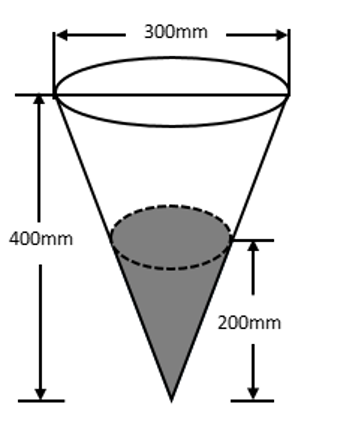
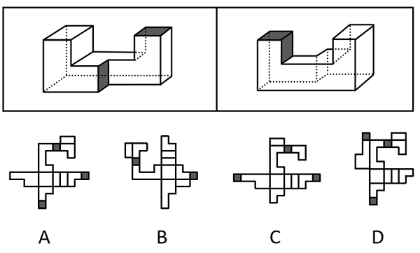
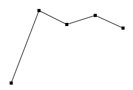
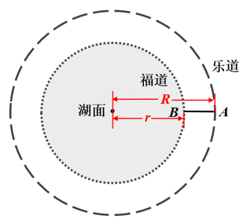
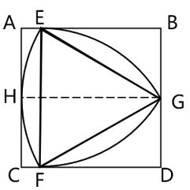
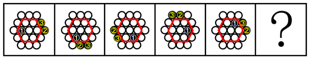

# 2024年山西省公务员录用考试《行测》题（网友回忆版）

> 候选采集稿。参考答案及解析来自粉笔页面，不代表官方答案或真实高分答卷；来源使用许可与原卷对应关系仍需人工核实。

## 题型与作答说明

常识判断

（20题）

根据题目要求，在四个选项中选出一个最恰当的答案。

言语理解与表达

（40题）

本部分包括表达与理解两方面的内容。请根据题目要求，在四个选项中选出一个最恰当的答案。

数量关系

（15题）

在这部分试题中，每道题呈现一段表述数字关系的文字，要求你迅速、准确地计算出答案。

判断推理

（35题）

本部分包括图形推理、定义判断、类比推理与逻辑判断四种类型的试题，在四个选项中选出一个最恰当的答案。

资料分析

（15题）

所给出的图、表、文字或综合性资料均有若干个问题要你回答。你应根据资料提供的信息进行分析、比较、计算和判断处理。

## 给定材料

### 材料 dom-material-7d8a1cfae892e10a

### 材料 dom-material-7c80c26777fdf576

2022年，我国废钢铁、废有色金属等十个品种（详见表格）再生资源回收总重量约为37067.7万吨，同比下降2.62%，回收总金额约为13140.6亿元，同比下降4.05%。2022年废有色金属中废铅回收重量同比增长5.56%。2022年我国报废机动车回收数量399.1万辆，同比增长32.9%，回收数量占我国机动车保有量的9.57‰。

### 材料 dom-material-d310cc59d474b366

2022年，全国共有260家银行机构和29家理财公司累计新发理财产品2.94万只，同比下降38.23%，降幅比上年同期扩大7.22个百分点；累计募集资金89.62万亿元，同比减少32.57万亿元。

截至2022年底，全国共有278家银行机构和29家理财公司有存续的理财产品，共存续产品3.47万只，同比下降4.41%；存续规模27.65万亿元，同比下降4.66%。分机构类型来看，理财公司存续产品13947只，存续规模22.24万亿元，同比增长29.36%。银行机构中，城商行存续产品9064只，存续规模2.45万亿元，同比下降32.34%；农村金融机构存续产品7808只，存续规模1.09万亿元，同比下降2.63%；股份制银行存续产品1208只，存续规模0.88万亿元，同比下降82.99%；大型银行存续产品668只，存续规模0.92万亿元，同比下降49.26%；其他机构存续产品1980只，存续规模0.07万亿元，同比下降13.42%。

截至2022年底，持有理财产品的投资者数量为9671.27万个，较年初增长18.96%，其中机构投资者数量为95.95万个，数量占比同比提升了0.22个百分点；在持有理财产品的个人投资者中，数量最多的是风险偏好为二级（稳健型）的投资者，占比35.44%。

## 题目

### 第 1 题

习近平新时代中国特色社会主义思想是当代中国马克思主义、21世纪马克思主义。下列对此理解正确的有几项：

①党的十九大把习近平新时代中国特色社会主义思想确立为党必须长期坚持的指导思想并庄严地写入党章

②习近平新时代中国特色社会主义思想是马克思主义中国化最新成果，是当今时代最现实、最鲜活的马克思主义

③今天我们所处的时代同马克思所处的时代相比发生了巨大而深刻的变化，已经脱离了马克思主义所指明的历史时代

④习近平新时代中国特色社会主义思想，始终把马克思主义作为中国共产党人的“真经”，始终坚持马克思主义基本原理

A. 1项

B. 2项

C. 3项

D. 4项

### 第 2 题

2023年，《习近平著作选读》第一卷、第二卷出版发行，这是党和国家政治生活中的一件大事。下列著作内容和篇名对应正确的是：

A. 生态环境是关系党的使命宗旨的重大政治问题，也是关系民生的重大社会问题——《加强生态文明建设必须坚持的原则》

B. 做好新形势下宣传思想工作，必须自觉承担起举旗帜、聚民心、育新人、兴文化、展形象的使命任务——《开展党史学习教育要突出重点》

C. 我们说的共同富裕是全体人民共同富裕，是人民群众物质生活和精神生活都富裕，不是少数人的富裕，也不是整齐划一的平均主义——《在全国脱贫攻坚总结表彰大会上的讲话》

D. “两个维护”要体现在坚决贯彻党中央决策部署的行动上，体现在履职尽责、做好本职工作的实效上，体现在党员、干部的日常言行上——《不断提高政治判断力、政治领悟力、政治执行力》

### 第 3 题

在2023年12月召开的中央经济工作会议上，习近平总书记全面总结2023年经济工作，深刻分析当前经济形势，系统部署2024年经济工作。下列关于做好2024年经济工作的要求，表述正确的有：

①强化宏观政策逆周期和跨周期调节

②坚持稳中求进、以进促稳、先立后破

③积极的财政政策要适度加力、提质增效

④稳健的货币政策要灵活适度、精准有效

A. ①②

B. ①②③

C. ②③④

D. ①②③④

### 第 4 题

2023年是习近平总书记提出共建“一带一路”倡议10周年。10年来，“一带一路””合作从“大写意”进入“工笔画”阶段，实现了从硬联通扩展到软联通的愿景。下列关于“一带一路”的表述正确的有：

①截止2023年底，已有150多个国家、30多个国际组织签署共建“一带一路”合作文件

②落地落实了“鲁班工坊”“丝路一家亲”等人文交流项目

③建成了中老铁路、雅万高铁等一批标志性项目

④“一带一路”合作从亚欧大陆延伸到非洲和拉美

⑤现已举办5届“一带一路”国际合作高峰论坛

A. 2项

B. 3项

C. 4项

D. 5项

### 第 5 题

党的二十大报告提出，在社会基层坚持和发展新时代“枫桥经验”，完善正确处理新形势下人民内部矛盾机制，及时把矛盾纠纷化解在基层、化解在萌芽状态。下列关于新时代“枫桥经验”的表述不正确的是：

A. 党建引领是新时代“枫桥经验”的政治灵魂

B. 人民主体是新时代“枫桥经验”的核心价值

C. 新时代“枫桥经验”是以制度现代化为优先价值导向的基层治理现代化经验

D. 新时代“枫桥经验”主要内容是变群众上访为领导下访，深入基层，联系群众，真下真访民情，实心实意办事

### 第 6 题

党的十八大以来，以习近平同志为核心的党中央始终把未成年人工作摆在突出位置。2024年1月1日起施行的《未成年人网络保护条例》是我国第一部针对未成年人网络保护的专门性综合立法，是贯彻落实习近平法治思想的生动体现。下列关于该条例内容表述正确的有几项？

①国家教育部门负责统筹协调未成年人网络保护工作

②网络产品和服务提供者不得为未成年人提供游戏账号租售服务

③网络产品和服务提供者不得通过自动化决策方式向未成年人进行商业营销

④网络直播服务提供者应当建立网络直播发布者真实身份信息动态核验机制

⑤网络服务提供者可根据实际引导未成年人参与应援集资、投票打榜、刷量控评等网络活动

A. 2项

B. 3项

C. 4项

D. 5项

### 第 7 题

党的十八大以来，我国贯彻“绿水青山就是金山银山”的发展理念，由北到南，从生态保护实践到体制保障，美丽中国踏绿而来。下列有关我国生态文明建设的表述错误的是：

A. 2023年5月31日是首个全国生态日

B. 2018年宪法修正案将“生态文明”写入宪法

C. 福建、江西、贵州被列为首批国家生态文明试验区

D. 生态文明建设被纳入中国特色社会主义事业“五位一体”总体布局

### 第 8 题

习近平总书记强调，要坚定维护宪法权威和尊严，推动宪法完善和发展，更好发挥宪法在治国理政中的重要作用。下列有关表述正确的有几项：

①要加强宪法理论研究和宣传教育，坚持知识普及、理论阐释、观念引导全面发力

②加快完善以宪法为核心的中国特色社会主义法律体系，不断提高宪法实施和监督水平

③坚持宪法确定的中国共产党领导地位不动摇，坚持宪法确定的人民民主专政的国体和人民代表大会制度的政体不动摇

④宪法是治国安邦的总章程，是我们党治国理政的根本法律依据，是国家政治和社会生活的最高法律规范

A. 1项

B. 2项

C. 3项

D. 4项

### 第 9 题

司机王某骑电动自行车载其外籍女友去艺术馆参观，二人均未佩戴头盔，被交警发现。对于二人可能面临的行政处罚，下列表述正确的是：

A. 交警可以当场对王某进行罚款

B. 交警可以暂扣王某的机动车驾驶证

C. 王某女友适用《中华人民共和国行政处罚法》，可予以行政拘留

D. 王某女友不适用《中华人民共和国行政处罚法》的规定，不予处罚

### 第 10 题

《中华人民共和国法律援助法》对于规范和促进法律援助工作、保障公民和有关当事人合法权益具有重大意义。下列情况属于可经指派获得法律援助的是：

①15岁的学生小明涉嫌贩卖毒品，没有委托辩护人

②25岁的精神病人赵某涉嫌抢劫，其患病多年经济困难，没有委托辩护人

③35岁的村民张某因向村中水井投毒，可能被判处死刑，没有委托辩护人

④45岁的聋哑人李某创设公司后涉嫌逃税罪，其个人资产过亿，没有委托辩护人

A. ①②③

B. ②③④

C. ①③④

D. ①②③④

### 第 11 题

下列诗句中涉及的典故人物与其时代对应说法不正确的一项是：

A. 林暗草惊风，将军夜引弓。平明寻白羽，没在石棱中——西汉

B. 闲来垂钓碧溪上，忽复乘舟梦日边——先秦

C. 怀旧空吟闻笛赋，到乡翻似烂柯人——东汉

D. 求田问舍，怕应羞见，刘郎才气——三国

### 第 12 题

唐代是丝绸之路的鼎盛时期，当时丝绸之路上的商队可能携带的商品是：

A. 线装本的《史记》

B. 精心制作的宣德炉

C. 《司马温公神道碑》拓片

D. 鎏金工艺制作的莲瓣银茶托

### 第 13 题

戏曲是中华优秀传统文化的重要组成部分，下列有关说法错误的是：

A. 京剧、豫剧、评剧、黄梅戏、越剧是中国戏剧五大剧种

B. 《群英会》是依据《水浒传》改编的传统京剧

C. 黄梅戏代表剧目中有《天仙配》和《女驸马》

D. 豫剧与梆子腔关系紧密

### 第 14 题

下列选项描述的历史场景与时代不符的是：

A. 唐玄宗时期，百姓可以在祠堂祭拜祖先

B. 南宋时期，人们可以到商业街购买东西

C. 永乐年间，大部分州县由粮长负责征解税粮

D. 道光年间，福建、广东等地的百姓可以用银元完纳钱粮

### 第 15 题

下列所描述现象与相关专业术语对应正确的是：

A. 某商品的价格越高，其需求量越大——价值悖论

B. 工资率随劳动供求的变动而及时迅速地变动——工资粘性

C. 人们倾向于将从小样本中得到的结论错误地移植到大样本中——小数定律

D. 在完全竞争的市场上，相同交易产品经过汇率调整后，在世界范围内其交易成本是相同的——一价定律

### 第 16 题

宝石是用于装饰的、有经济价值的矿物及生物矿物和岩石的总称，呈现晶体、集合体等形态，是地球送给人类的珍贵礼物。下列不属于宝石形成机制的是（ ）。

A. 由炽热岩浆喷发所生成的熔岩蒸汽冷凝产生

B. 岩浆冷却凝固时浓缩的成分结晶后形成

C. 在地核内部高温高压变质瘤结成型

D. 从岩浆产生的热液中结晶生长

### 第 17 题

小明被困在一个无人、无食物来源但有淡水的荒岛上。假如他在等待救援期间可以从相同重量的葡萄、馒头、酸奶、花生仁这四种食物中选择一种，那么为了能在岛上生存的时间最长，他应该选择的食物是（ ）。

A. 葡萄

B. 馒头

C. 酸奶

D. 花生仁

### 第 18 题

下列病毒与其主要感染的人体系统对应正确的是：

A. 狂犬病毒——免疫系统

B. 流感病毒——神经系统

C. 乙肝病毒——消化系统

D. 艾滋病毒——生殖系统

### 第 19 题

下列表述不符合物理常识的是：

A. 一杯泡好的茶，用勺子作圆形搅动茶叶会向杯底中心聚集

B. 用洗衣机洗裤子并脱干后，取出时经常会看到裤兜被翻出来

C. 在河流的弯道上，外圈河床要比内圈浅，因为泥沙会被河水带到外圈

D. 锅里剩下最后几根面条时，用筷子在锅中作圆形搅动，使面汤旋转起来，面条会集中到锅底中心

### 第 20 题

下列关于国债逆回购的说法正确的是：

A. 投资者可以通过银行网点购买国债逆回购

B. 国债逆回购是以国家为主体进行债券回购

C. 国债逆回购本质上是一种短期资金借贷方式

D. 国债逆回购利率上行20个基点表示利率增加2%

### 第 21 题

面对北宋王朝百余年的积贫积弱，怀“回天转地”之气概、视“天下大治”为己任的王安石，从“继道而行”“以道求治”的哲学立场和政治观念出发，借论周公之政畅抒其立法施治的观点，其        显然不仅仅是治必有法，而更在于强调治须“良法”。

填入划横线部分最恰当的一项是：

A. 缘由

B. 动机

C. 设想

D. 意图

### 第 22 题

鸿雁南飞、菊花盛开之时，文人墨客秋思绵延，绘就一幅幅绚丽多姿的晚秋画卷。卢纶笔下的寒露是“数派清泉黄菊盛，一林寒露紫梨繁”，一派明艳繁茂；王安石眼中却是“空庭得秋长漫漫，寒露入暮愁衣单”，满眼的寂寥惆怅；元稹诗里描绘“寒露惊秋晚，朝看菊渐黄。千家风扫叶，万里雁随阳”，充盈着            。

依次填入划横线部分最恰当的一项是：

A. 恬淡之意

B. 肃杀之气

C. 离愁之情

D. 清丽之美

### 第 23 题

镜像神经元是大脑中一种具有特别能力的神经元，它是人类“代入感”及“同理心”的生物基础。它就像一面镜子，让我们能反映和模仿他人行为，产生“感同身受”的体验。而天生发达的镜像神经元也是泪点低的原因之一。比如，看到别人吃东西，自己也会流口水；看见他人发怒，自己头皮也会发紧；别人情绪低落，自己内心也不好受······所以，一听到悲情故事就止不住落泪的人，不是太脆弱、        ，而可能是镜像神经元太发达。

填入画横线部分最恰当的一项是：

A. 敏捷

B. 敏感

C. 灵敏

D. 敏锐

### 第 24 题

音乐诗画《听此青绿——乐咏千里江山》以十三幅        图景展现传世名画《千里江山图》中的景观和风情，借鉴《高山流水》《渔舟唱晚》《梅花三弄》等古曲的艺术表达，融合编钟、箜篌、筑等民族乐器和西洋铜管乐，加入绘画、书法、意境化舞蹈等表现方式，为千山万壑、江河交错的盛景注入        而深邃、浑厚而轻盈的悠远神韵。

依次填入划横线部分最恰当的一项是：

A. 壮丽 磅礴

B. 华丽 壮阔

C. 宏伟 清雅

D. 绮丽 恢宏

### 第 25 题

20世纪下半叶兴起的信息通信技术等高新科技，有两个明显特征：一是与每个人的日常生活            ，无人能须臾脱离高新科技的影响；二是高新科技发展速度        ，科技风险随之增加且难以预测。科技创新活动一旦脱靶，将造成不可逆的负面影响甚至巨大灾难。为此，需努力控制科技伦理问题的出现，避免被动治理局面。

依次填入画横线部分最恰当的一项是：

A. 休戚与共 惊人

B. 如影随形 迅速

C. 息息相关 迅猛

D. 一脉相连 飞快

### 第 26 题

从遏制“舌尖上的浪费”，到刹住“车轮上的腐败”，再到        “会所里的歪风”；从多措并举遏制“天价月饼”“天价烟酒”，到厉行节约、反对浪费成为社会新风尚，再到婚事新办、丧事简办被越来越多人接受······党风政风        社风民风，人民群众成了作风建设的参与者和受益者。

依次填入画横线部分最恰当的一项是：

A. 取缔 指引

B. 遏止 引导

C. 整治 引领

D. 整顿 指点

### 第 27 题

金秋时节，五彩斑斓的丰收画卷在广袤大地徐徐展开。14亿人的饭碗，依赖有限耕地上的产出，良种的重要性不言而喻。“种地不选种，累死落个空”“好种多打粮”“千算万算，不如良种合算”······一句句        而直白的农谚，道出一粒小小的种子如何承载粮食安全这“国之大者”。当良种与土地相遇，丰收的希望便开始        。

依次填入划横线部分最恰当的一项是：

A. 朴陋 酝酿

B. 朴实 滋生

C. 俭朴 点燃

D. 朴素 孕育

### 第 28 题

碳达峰和碳中和“双碳”目标的提出是        生态环境发展趋势、推动经济方式升级的迫切需要。        碳达峰和碳中和的“双碳”目标，需要将长期绿色低碳发展战略纳入美丽中国建设总体框架，制定灵活的低碳发展战略目标和实施战略，强化国家战略科技力量和低碳前沿技术，深化生态环境领域的国际合作等。

依次填入画横线部分最恰当的一项是：

A. 顺乎 确定

B. 符合 实现

C. 顺应 锚定

D. 适应 明确

### 第 29 题

中华民族的历史是各民族共同创造的。其间汉族的发展也是因为有其他民族        、        而不断进步。汉族人口多，原本是由许多少数民族混血形成的，故汉族的贡献也包含了许多少数民族的贡献。

依次填入划横线部分最恰当的一项是：

A. 参加 融合

B. 参与 融入

C. 汇合 创造

D. 凝聚 交融

### 第 30 题

湿地被誉为“地球之肾”，和森林、海洋一起，构成了地球的三大生态系统，它在净化水质、        水源、调节气候、        生物多样性等方面，具有不可替代的生态价值。

依次填入划横线部分最恰当的一项是:

A. 滋养 维持

B. 涵养 维护

C. 保护 衡量

D. 充沛 助力

### 第 31 题

我国已经形成了相对完善的中药质量标准控制体系，        了中药材源头种植到终端产品流通的各个环节。医院积极利用现代制药新技术        了传统医院中药制剂的给药剂型和给药方法，走科学化的特色制剂发展方式，满足群众多元化用药需求。

依次填入划横线部分最恰当的一项是:

A. 包揽 改革

B. 蕴涵 改换

C. 涵盖 改变

D. 囊括 改成

### 第 32 题

在当今世界，科学家利用基因编辑技术，为“复活”灭绝物种        了生态修复的新途径，但挽救濒危物种，保护生物多样性才是核心要义，人类需要采取组合措施来遏制和        生物多样性丧失的严峻形势。

依次填入划横线部分最恰当的一项是：

A. 发明 拯救

B. 开拓 扭转

C. 发现 抢救

D. 开辟 缓解

### 第 33 题

据介绍，光学产品的装配和调试，直接影响成像效果。高精密复杂光学系统对性能有严苛的要求，不仅要实现狭小空间内超精密光学镜片的精密装调，还需        光学系统的稳定性。高精密复杂光学系统的装配和调试，往往靠经验丰富的匠人        精密仪器完成，存在装调难度大、周期长、制造加工一致性差等问题。

依次填入划横线部分最恰当的一项是：

A. 维持 制作

B. 确保 配合

C. 保持 组合

D. 确认 搭配

### 第 34 题

党的十八大以来的党中央重要文献是从整体上把握习近平新时代中国特色社会主义思想丰富内容及其相互关系的重要文本和专题教材，需要我们认真学习、        研读，努力把其中每一个方面的内容都理解        、领悟        、贯彻落实。

依次填入画横线部分最恰当的一项是：

A. 重复 得当 精准

B. 不断 全面 准确

C. 一再 到位 完整

D. 反复 深刻 透彻

### 第 35 题

数字治理借助于现代信息技术手段，        了对政府组织的流程再造与体制机制重塑，提升了公共产品和服务需求匹配的精准度，        了社会公共资源配置，增强了政府与社会以及公众之间的协同与信任，        了数字时代的人文精神，本质上就是在更加高效地创造公共价值。

依次填入划横线部分最恰当的一项是：

A. 履行 强化 改变

B. 达到 支配 拓展

C. 实现 优化 凝聚

D. 落实 调整 适应

### 第 36 题

历史上的关羽之所以经历由人到神的        跃升，从根本上讲，是因为他的道德品行和人格气质满足了不同时代价值信仰重构的精神需求，即在关公身上蕴含着中华优秀文化            的核心价值。那么这种核心价值是什么？主张刚、毅、直、俭者有之，认为孝、悌、忠、信者有之，可谓众说多歧，            。

依次填入划横线部分最恰当的一项是：

A. 改变 一脉相承 鞭辟入里

B. 擢拔 一以贯之 莫衷一是

C. 提携 一如既往 各执一词

D. 擢用 自始至终 众口难调

### 第 37 题

“巴赫金对话”理论的概念经过西方社会学的发展，被        成一种克服现代性危机、重构认同与共同体的有效手段。具体到政治传播的        里，强调政府与公众的“垂直对话”，其本质是政府紧密围绕民生民意与社会需求，通过及时的信息公开        不确定性，弥合不同意见并最终确认共同价值的手段。

依次填入划横线部分最恰当的一项是：

A. 推演 领域 消灭

B. 演绎 语境 消弭

C. 论证 情境 消损

D. 归纳 环境 消解

### 第 38 题

短视频已成为互联网的底层应用。某研究报告显示，目前我国短视频用户有10.12亿，青年是绝对主力军。作为互联网原住民一代，青年会被短视频“集体        ”并不奇怪：“短”        了信息时代消费内容快餐化的需求，而“视觉化”带来的生动直观、即时满足等特点，        了对年青一代沉浸式体验的“注意力抓取”。

依次填入画横线部分最恰当的一项是：

A. 攻陷 迎合 实现

B. 攻陷 满足 弥补

C. 沦陷 逢迎 达成

D. 沦陷 契合 兑现

### 第 39 题

暗物质，一种在物质起源和宇宙        过程中具有重要地位的物质，约占整个宇宙物质质量的85%。但它看不见、摸不着，几乎不和任何物体发生作用。为了捕捉到这        又“腼腆”的暗物质，21世纪以来，国际上        开展了20多个探测实验。人们相信，谁先揭开它的面纱，谁就将促成人类对物质世界和宇宙认识的又一次重大飞跃。

依次填入画横线部分最恰当的一项是：

A. 蜕变 严肃 持续

B. 演化 神秘 相继

C. 运动 神奇 广泛

D. 膨胀 冷酷 及时

### 第 40 题

中国汉字经历岁月洗礼，            ，如今已发展出成熟而多样的字体系统。随着科学技术的        ，激光照排技术替代活字印刷，让汉字的传播方式发生了革命性变化，而数字媒体的        使汉字字体的设计迎来了质的飞跃。当我们以全新的视角重新审视汉字时，会发现其创新的设计方法如万花筒般千姿百态、绚丽多彩。

依次填入划横线部分最恰当的一项是：

A. 久久为功 提升 创新

B. 历久弥新 增长 融合

C. 薪火相传 更迭 介入

D. 厚积薄发 普及 应用

### 第 41 题

到2030年，我国数字人整体市场规模将达2700亿元。数字人应用的多元拓展，得益于我国数字技术的不断进步和产业布局的持续完善。我国数字人产业上下游均已具备一定规模的企业集群，有较深厚的技术积累。看上游，成像设备产品已发展成熟，智能传感器等关键技术正被集中攻坚；看下游，应用领域加速从文娱行业向制造业、现代服务业延伸。同时，数字人产品制作企业高速发展、相关服务平台正加快打造，数字人制作水平明显提升，数字人产业将加快走向成熟。

对这段文字理解不正确的是：

A. 数字人应用场景将更为广泛

B. 目前数字人产业仍处在成长期

C. 我国数字人市场发展前景良好

D. 智能传感器等关键技术已有重大突破

### 第 42 题

冰冻圈主要分布在地球两极和中低纬度的高山地区，在气候系统和气候变化中扮演着重要角色。极地温度对于全球的影响力也许比我们想象中要大得多。可以说，极地温度就像一个遥控器，控制着地球上其他地方的“恒定”温度。卫星数据显示，北极的浮冰正在加速消融、减少。冰越来越少，意味着地球能够反射到太空的阳光变少了，也意味着更多深海海水被暴露出来去吸收阳光而变暖，地球会变得更暖，冰会融化得更快，而且很难恢复，如此往复，会放大全球的温度变化情况。

与这段文字的意思相符的一项是：

A. 极地和高山地区地表上存在多年冰体

B. 极地温度决定着地球上其他地方的温度

C. 北极冰冻圈的加速融化会导致全球变暖

D. 极地冰冻圈的融化速度慢于中低纬度高山冰冻圈

### 第 43 题

伴随着城市化快速发展的步伐，今天的少年儿童与乡土田园渐行渐远。如何开展既符合时代特色又“接地气”的耕读教育？这道“考题”，考验的是学校与教师勇于创新的意识、因地制宜的本领。很多学校意识到：“耕”离不开土地和自然，“读”重在学习广博有趣的各类知识、涵养自强不息的人格品德、树立报效国家的崇高志气。于是，越来越多的学生被老师们带到原野田间，越来越多的课堂开设在了大自然里。学生们饶有兴致地学习农耕知识、活泼健朗地舒展心胸情怀，耕读教育的真正意义由此得以实现。

对这段文字概括最恰当的一项是：

A. 耕读为本，计之久远

B. 古为今用.耕读传家

C. 劳动教育能够激发内生动力

D. 在“土味”课堂实现耕读教育的价值

### 第 44 题

如今无论什么季节，任何水果都能随时买回家尝鲜，很多人对此并不赞同，理由是反季水果的种植过程中总会有不利于健康的因素，因此他们在选购水果的时候，会侧重购买当季、当地产的水果。但是，果蔬中是否存在不利于健康的因素，与自然栽种还是大棚栽种没有必然联系。随着现代化农业技术的推广应用，大棚栽种水果技术越来越成熟，所有的保鲜剂、食品添加剂、植物生长调节剂，只要是国家相关标准允许使用的，且在规定的用量下，对人体健康是没有危害的。

这段文字旨在说明：

A. 人们倾向于购买当季当地产的水果

B. 反季水果在种植过程中会产生不利于健康的因素

C. 水果是否存在不利于健康的因素与栽种方式的选择无关

D. 应加强现代农业技术的推广应用，减少添加剂对健康的危害

### 第 45 题

腹泻早期由于胃肠道急性充血、水肿、发炎和渗出，肠蠕动活跃且处于痉挛状态，其消化吸收功能比较弱，脂肪、蛋白质会出现吸收、代谢障碍，这时可以进食一些淀粉类食物，如大米粥、藕粉、面糊、细挂面、面片等，可避免呕吐，减少体液的流失，有利于止泻，还可以有效地养护肠道。如果腹泻严重或出汗较多，还应适当给患者多喝一些米汁，以补充体内水、电解质的不足。

这段文字旨在说明：

A. 饮食调理是治疗腹泻的重要手段

B. 腹泻早期吃淀粉类食物有利止泻

C. 食用淀粉类食物可有效治疗腹泻

D. 吃含淀粉的流质食物可养护肠道

### 第 46 题

新农人，不同于传统农民，也异于新型职业农民，他们多是从城市回流农村的新群体。如果说过去大部分年轻人以跳出农门为奋斗目标之一的话，近年来，跳回农门正在成为新时尚。新农人带来了新技术、新商业模式和运营理念，创造了新的就业机会和空间，丰富并拓展了农村经济业态。但在现实中，新农人融入农村社会网络，激活产业网络并没有那么容易。不少人虽然在物理意义上返乡回乡了，但在社会关系上仍是“异乡人”。正如不少调研所显示的，新农人不了解农村，不知道如何与农民打交道，难以有效嵌入当地产业网络开展分工合作。

这段文字主要说明了：

A. 新农人，回得去并不等于融得进

B. 新农人需补短板，否则创业难成

C. 新农人具备新理念，掌握新技术

D. 时代呼唤更多新农人回农村创业

### 第 47 题

元素周期表是化学科学的基石，在化学发展史上具有里程碑意义。作为元素周期表中的“住户”，元素的发现几乎与人类文明相伴。像铁、铜、金、银等容易以单质形态存在的元素发现得最早，之后从铁器时代到青铜时代，从炼金术到电解技术，从核辐射到核裂变，                    ，新“住户”不断占据各自的位置。直至今日，仍然有新的元素被发现（合成），而且关于元素在生命起源、物种进化中的作用以及元素如何精准调控材料性能及生命过程等仍然是科学家们非常关注的科学问题。

填入划横线处最恰当的一句是:

A. 元素周期表逐步被填充并扩展

B. 元素周期表被有序地组织起来

C. 元素周期表得到较完美的呈现

D. 元素在周期表不同行列排列着

### 第 48 题

目前，学术界对数字经济在促进乡村产业振兴中的实际作用方面已有一定研究，但对数字经济影响乡村产业振兴的内在机制等尚缺乏系统的理论阐释，由此可能夸大或弱化数字经济在乡村产业振兴中的作用，甚至有可能导致政策制定的偏差。因此，我们拟在厘清数字经济对乡村产业振兴的关键作用基础上，从效率提升、产业变革、结构优化三个角度剖析数字经济促进乡村产业振兴的内在机制，并立足现实提出相应的实现路径。

这段文字接下来最可能介绍：

A. 数字经济促进乡村产业振兴的方法

B. 数字经济对乡村产业振兴的关键作用

C. 数字经济如何使乡村产业振兴的效率得以提升

D. 借助数字经济促进乡村产业振兴的过程中有哪些现实制约

### 第 49 题

神经科学领域已有研究揭示脑衰老的分子、细胞、器官、系统多层级多种生物学特征，它们相互依赖、彼此互为联系，共同构成脑衰老特征及其发生机制的复杂性。此外，该领域新技术和新方法的应用也使研究内容得到极大丰富与发展。在对抗衰老过程中维持脑健康及其功能，是一项挑战，运动可以通过改善脑衰老的生物学特征及生理功能，促进脑的可塑性。因此，临床实践中运动干预可作为补充策略，改善衰老人群及相关慢性疾病患者的脑健康。

最适合做这段文字标题的是：

A. 运动促进脑生长：加强认知与记忆

B. 运动干预脑衰老：新进展与再认识

C. 运动改变脑结构：挑战性与安全性

D. 运动影响脑健康：运动疗法有前景

### 第 50 题

目前我国氢能应用占比最大的领域是工业领域。氢能与建筑融合，是近年兴起的一种绿色建筑新理念。在电力领域，氢能可成为一种新型的储能形式。从清洁低碳角度看，氢能可以在钢铁、化工、公路运输、航运和航空等难以深度脱碳的行业领域发挥重要作用。从安全高效角度看，氢能可以促进更高份额的可再生能源发展。此外，氢能与电能作为能源枢纽，更容易耦合热能、冷能、燃料等多种能源，共同建立互联互通的现代能源网络，形成极具韧性的能源供应体系。

这段文字意在说明：

A. 氢能产业发展有所突破

B. 氢能产业链涉及多种技术和行业领域

C. 氢能的应用正在引发深刻的能源变革

D. 氢能作为一种替代能源进入人们的视野

### 第 51 题

碳纤维是由有机纤维经过一系列热处理转化而成，含碳量高于90%的无机高性能纤维，是一种力学性能优异的新材料，其比重不到钢的五分之一。碳纤维树脂复合材料抗拉强度是钢的7至9倍，还具有出色的耐热性、优秀的抗腐蚀性与抗辐射性。以碳为主要原料，以碳纤维复合材料、石墨烯等为核心的新一代复合材料是21世纪最具应用前景的新材料，可应用于飞机结构材料、人工韧带等身体代用材料以及火箭外壳、工业机器人等领域，但碳纤维复合材料发展也面临着高质量树脂基材缺乏等发展瓶颈问题。

根据这段文字，下列说法正确的是：

A. 碳纤维是一种含碳量高的有机纤维

B. 碳正成为21世纪的主导型先进材料

C. 碳纤维树脂复合材料的抗拉强度优于钢

D. 碳纤维树脂复合材料是一种最耐热且最坚硬的材料

### 第 52 题

经济活动的可持续性和相关金融资产的价值依赖于生物多样性和环境提供的生态系统服务。与气候变化类似，生物多样性丧失也是本世纪面临的最大危机之一。导致环境恶化和气候变化的罪魁祸首是大量不考虑环境影响、破坏生物多样性、只顾赚钱的投资活动。因此，                  。

填入划横线部分最恰当的一句是：

A. 在保护生物多样性方面金融业有着不可推卸的责任

B. 人类将面临气候变化和生物多样性丧失的巨大危机

C. 应逐步建立对金融机构管理的监管框架和稳定机制

D. 导致环境恶化的根本原因是大量经济活动的可持续性

### 第 53 题

伴随着人类社会的发展进步，我们对时间精准度和稳定性的要求越来越高。目前氢钟的计时已经非常精准，但从长远来看，仍然存在着稳定性不够的问题。研究脉冲星的一个重要价值，就在于弥补这一问题。脉冲星具有稳定的旋转周期，每万亿年才会慢1秒，具有长期的稳定性。而且，脉冲星是永不“断电”的，不像氢钟这样的精密仪器需要精心的保护，脉冲星则没有这样的担忧，没有什么能够干扰到脉冲星，只要几架大型射电望远镜便可接收到它们的信号。

这段文字主要说明了：

A. 脉冲星可以满足人类对时间精准度和稳定性的要求

B. 脉冲星有稳定旋转周期，能满足对时间稳定性的要求

C. 脉冲星具有极强精准性和稳定性，有很多潜在的应用

D. 将氢钟和脉冲星结合，可得到精准、稳定的时间系统

### 第 54 题

社会心理学先驱所罗门·阿希通过一系列著名的阿希从众实验证明，即使是判断“三段线段谁最长”这样的简单任务，人们的回答也会受到他人的强烈影响，进而在并无胁迫的情况下服从某种群体规范。人们为什么会服从规范？这可能源于群体中的个人害怕被其他成员视为“一匹离群之马（越轨者）”而遭到孤立。人的这种顺从行为在动物身上也有所体现。比较心理学家本内特·加利夫的研究发现，挪威大鼠会忽视自己的偏好转而选择同伴偏爱的食物味道，尽管有时这种味道并不怎么好。

这段话所要表达的中心思想是：

A. 人的行为活动容易受到他人的影响

B. 离群之马都会遭到社会群体的孤立

C. 人们在无胁迫下往往会服从群体规范

D. 挪威大鼠会忽视自己偏好而选择顺从

### 第 55 题

从古到今，人类不断梦想着能够找到长生不老的“灵丹妙药”，但目前也未有合法批准的能够真正用于抵抗衰老的药物或疗法。以干细胞抗衰老疗法为例，由于具有自我更新和多向分化能力，干细胞在组织再生等领域具有良好的应用潜力，也被宣传为延缓衰老的有力武器。然而科研人员提醒，虽然干细胞疗法在动物实验中表现出一定的治疗效果，但对于人类而言，还需要等待临床试验结果。衰老是机体在整体水平上的系统性变化，不是单一组织的变化，干细胞目前还无法同时针对所有组织细胞发挥治疗或起到延缓衰老的作用。

这段文字意在强调：

A. 采用干细胞疗法抵抗衰老大有可为

B. 干细胞治疗用于延缓衰老还有许多问题

C. 从古到今人类为延缓衰老进行了各种尝试

D. 当前干细胞的抗衰老研究仍处于实验探索阶段

### 第 56 题

文化遗产保护体系，是针对与保护对象有关的内部、外部考察范围，所确定的定性、定量、定形态的科学研究体系，也是一个发展着的动态体系。伴随着人类社会价值观念的演变，有关文化遗产资源的观念也不断发生变化，对文化多样性和生物多样性的尊重必然更加突出，文化遗产的外延种类和评价体系也必然不断丰富。

接下来最有可能介绍：

A. 要重视文化遗产的保护方向

B. 要建立新的文化遗产资源观

C. 要将更多文化遗产资源纳入保护范畴

D. 在着力保护文化遗产物质载体的同时，还要重视发掘和保存非物质文化遗产

### 第 57 题

实践是人的思维方式得以形成的最切近的现实基础，人的思维方式是实践的要素、结构、过程、程序、规律的观念反映，是实践方式的内化与积淀。没有实践活动，也就没有思维方式或思维结构。而思维方式或思维结构一经形成，又成为人们进行认知活动、评价活动和实践活动的思维的框架、定势、模式、取向。实践方式作为由实践的各种要素、活动构成的实践逻辑，经过实践的无数次的重复，逐步扬弃了具体实践活动的个别性、特殊性与偶然性而具备了一般性、普遍性与必然性，人类实践也逐渐趋向稳定、成熟并形成了相对稳定的模式。

与这段文字的意思相符的一项是：

A. 实践即是一种思维方式

B. 思维即是一种实践方式

C. 实践方式形成思维方式

D. 思维方式形成实践方式

### 第 58 题

数字文化产业是数字技术与文化创意的融合创生。数字技术从根本上改变了文化生产的创意、生产、传播、流通和消费等价值链的生成机制与内生结构，提高了文化创意的产生速度，丰富了文化内容的创意数量，提高了文化传播和流通的精准度和互动性，拓展了文化消费的体验感和辐射面。文化产品在创意、生产、传播、流通与消费等环节中，运用各类数字技术，将文化符号、审美感知和价值观念等文化内容转化为具有可感知性、可复制性、可推广性的数字文化产品，提升了文化产业高感知、高技术和高品质的价值内涵。

与这段文字的意思不相符的一项是:

A. 数字技术改变了文化产业的机制和形态

B. 文化创意是文化运用数字技术后的结果

C. 数字技术具有转化文化产品形象的功能

D. 数字技术渗透于文化产业的各个环节中

### 第 59 题

①已经投入应用的主要是针对健康人群开发的、精准性稍差一些的非植入式设备

②到目前为止，科学家们已经发明了多种获取脑电波的设备

③近些年来，科学家们则在开发用于特殊病人的植入式设备上花费了大量精力

④但基于安全性、伦理性等方面的考虑，一直没有在人类的临床上取得突破

⑤这类设备被称为脑机芯片或干脆简称为脑机接口，它能获得更加精准的脑电信息，也能将外界电信号更加精准地输入大脑

⑥然而随着人工智能相关技术和工程技术、材料技术的飞速发展，不少科学家又开始了这类尝试

将以上6个句子重新排列，语序正确的是：

A. ③②①⑥⑤④

B. ③⑥④①②⑤

C. ②①③⑤④⑥

D. ②④①③⑤⑥

### 第 60 题

①设施农业大有可为，要发展日光温室、植物工厂和集约化畜禽养殖，推进陆基和深远海养殖渔场建设，拓宽农业生产空间领域

②要构建多元化食物供给体系，在保护好生态环境前提下，从耕地资源向整个国土资源拓展，从传统农作物和畜禽资源向更丰富的生物资源拓展

③“吃饭”不仅仅是消费粮食，肉蛋奶、果菜鱼、菌菇笋等样样都是美食

④向森林、草原、江河湖海要食物，向植物动物微生物要热量、要蛋白，多途径开发食物来源

⑤耕地以外，我国还有40多亿亩林地、近40亿亩草地和大量的江河湖海等资源

⑥解决吃饭问题，不能光盯着有限的耕地，要把思路打开，树立大食物观

将以上6个句子重新排列，语序正确的是：

A. ①⑥⑤③②④

B. ⑥①②④③⑤

C. ⑥③⑤②④①

D. ①⑥②④③⑤

### 第 61 题

大学生创业主要集中在高科技、智力服务、连锁加盟和自媒体运营四个领域。某学院今年选择创业的大学毕业生不到50人，其中选择智力服务领域、连锁加盟领域和自媒体运营领域的分别占，和。那么该学院今年选择高科技领域创业的大学毕业生有多少人?

A. 1

B. 3

C. 5

D. 7

### 第 62 题

某单位为解决职工暑期“带娃难”的问题，开设了暑托班。开班时男孩与女孩的比例为3：4，后来有2个男孩、1个女孩退出暑托班，此时男孩与女孩的比例为2：3。那么开班时女孩有多少人?

A. 10

B. 12

C. 14

D. 16

### 第 63 题

某旅游公司定制甲、乙两种纪念品，第一次共定制50个。试销后根据反馈，第二次定制两种纪念品共70个，其中乙纪念品个数是第一次的。已知甲纪念品单价为15元，第一次定制花费1150元，那么第二次定制花费多少元?

A. 1150

B. 1725

C. 2300

D. 2875

### 第 64 题

某农产品基地对外供应一批农副产品。假设这批农副产品每天都有定量的自然损耗，如果提货方每天运走1.5吨产品，则50天运完；如果提货方每天运走2吨产品，则40天运完。那么这批农副产品有多少吨?

A. 75

B. 80

C. 100

D. 110

### 第 65 题

运输公司准备将475箱相同的救灾物资运往灾区。现在有足够多的大、小两种货车可供选择，大货车每辆最多可装载48箱物资，小货车每辆最多可装载32箱物资。每辆大货车配两名驾驶员，每辆小货车配一名驾驶员，目前公司有17名驾驶员可供派遣。若装载物资时，应先装满大货车，再依次装满小货车，且最后一辆小货车的装载率至少要达到三分之二，则可选择的派车方案有多少种?

A. 2

B. 3

C. 4

D. 5

### 第 66 题

中秋节前夕，小赵买了6个外观相同的月饼，其中有3个是蛋黄馅的。回到家后，小赵从中任取3个月饼，里面恰好有1个是蛋黄馅的概率是：

A. 

B. 

C. 

D. 

### 第 67 题

某社区服务中心拟引入优质资源为本社区45名老人提供居家养老服务。已知老人的年龄构成如下（设老人的年龄为x）：有17人，有12人，有11人，90岁及以上有5人。现从该社区中随机抽取两名老人了解居家养老服务情况，那么这两名老人恰好都在80岁以上（含80岁）的概率是：

A. 

B. 

C. 

D. 

### 第 68 题

中国空间站主体由天和核心舱、问天实验舱、梦天实验舱构成。某次实验需要5名宇航员同时在三个舱中开展，每个人只能去一个舱，每个舱至少安排1名宇航员，其中甲宇航员只能去问天实验舱和梦天实验舱中的一个，则不同的安排方法有多少种？

A. 72

B. 88

C. 100

D. 144

### 第 69 题

某公司开展迎新春三分球投篮比赛。3个部门分别派出2、4、4个选手共计10人参加。规则要求同一个部门的选手顺序相连、全部投完再安排另一个部门的人员开始投篮，则这10人不同的投篮顺序种数的范围是：

A. 小于1000

B. 1000~5000

C. 5001~10000

D. 10000以上

### 第 70 题

某地人工湖景区开辟了沿湖福道和环湖乐道两条圆形观景道供市民休闲健身（如下图所示）。小李和他的妈妈分别沿乐道和福道从A、B两地同时同向而行（A、B两点间距离为50米），小李骑自行车的速度是妈妈步行速度的6倍，已知妈妈步行速度为每小时5千米，妈妈沿福道步行一周的时间是小李骑行乐道时间的4倍，那么这个湖面的面积约多少万平方米?（圆周率取3）

A. 2

B. 3

C. 4

D. 6

### 第 71 题

莱洛三角形是以等边三角形三个顶点为圆心，边长为半径，在顶点的对边画弧所得的封闭图形，这种形状的钻头可钻出四角为圆弧的正方形的孔洞（如左下图所示）。现将某莱洛三角形钻头所钻孔洞近似为正方形，测得该正方形孔洞截面积为（如右下图所示），则该钻头的截面积为：

A. 

B. 

C. 

D. 

### 第 72 题

气象学中，24小时内降落在某面积上的雨水深度叫做日降雨量（不考虑渗漏、蒸发、流失等损耗，单位：mm），将日降雨量记为w，其等级划分如下：小雨（），中雨（），大雨（），暴雨（）。某地某日用一个圆锥形容器接了24小时的雨水（如下图所示），则该地日降雨量等级是：

A. 暴雨

B. 大雨

C. 中雨

D. 小雨

### 第 73 题

原油A每吨的价格为0.3万元，可提炼苯乙烯0.5吨，提炼过程中每吨原油产生的废气量为0.4吨；原油B每吨的价格为0.4万元，可提炼苯乙烯0.7吨，提炼过程中每吨原油产生的废气量为0.3吨。若要提炼至少1.9吨的苯乙烯且产生的废气量不超过1吨，则购买原油的最低费用为多少万元？

A. 1

B. 1.1

C. 1.2

D. 1.3

### 第 74 题

A、D两地设有通信基站（如下图所示），发射信号范围分别是以A、D为圆心，AE和DB为半径的圆形区域，小林从B地出发，沿与DB垂直的BA方向匀速行进，步行速度为4千米/小时，那么步行约多少分钟后小林的手机能够重新接收到信号？（）

A. 8

B. 10

C. 12

D. 14

### 第 75 题

某公园绿化管理部门采购了100片围栏，每片长1米且不可弯折。现拆分拟围成5块周长相等且互不相邻的矩形花卉区域。若不考虑拼接间隙，那么这5块区域的最大与最小面积最多可相差多少平方米？

A. 10

B. 12

C. 16

D. 25

### 第 76 题

把下面的六个图形分为两类，使每一类图形都有各自的共同特征或规律，分类正确的一项是：

A. ①②③，④⑤⑥

B. ①②⑤，③④⑥

C. ①③⑥，②④⑤

D. ①④⑥，②③⑤

### 第 77 题

把下面的六个图形分为两类，使每一类图形都有各自的共同特征或规律，分类正确的一项是：

A. ①④⑥，②③⑤

B. ①②③，④⑤⑥

C. ①⑤⑥，②③④

D. ①③⑤，②④⑥

### 第 78 题

从所给四个选项中，选择最合适的一个填入问号处，使之呈现一定的规律性。

A. A

B. B

C. C

D. D

### 第 79 题

从所给四个选项中，选择最合适的一个填入问号处，使之呈现一定的规律性。

A. A

B. B

C. C

D. D

### 第 80 题

下列两图分别是从正面和后面观察某个多面体所得的立体图形，下列哪项是其正确的外表面展开图？

A. A

B. B

C. C

D. D

### 第 81 题

供应商绿色压力是指企业供应商的环保意识和环保行为对企业绿色创新的影响。它会促使企业显著改进产品生产流程，以减少对自然资源的使用，并在产品生命周期内减少有害物质的释放。研究表明，供应商的绿色环保意识越强，绿色环保行为越主动，就越有可能通过供应链来影响链上企业的绿色创新行为。

根据上述定义，下列属于供应商绿色压力的是:

A. 随着绿色意识的增强，消费者更愿意选择资源节约和环境友好的产品

B. 随着国家生态建设的推进，企业会更加谨慎地选择自己的下游客户

C. 供应商可以为链上企业提供“绿色创新”方面的资源和知识

D. 供应商的绿色环保行为倒逼企业进行绿色创新行为

### 第 82 题

正常化偏见，就是指大家对某个事物感到习惯后，就会产生安于现状、不愿意再去尝试新事物的惰性心理。

根据上述定义，下列不属于正常化偏见的是：

A. 某些喜欢看西医的病人排斥看中医

B. 上了年纪的老年人更倾向去菜市场买菜

C. 只要吃外卖，小张就只使用某平台下单

D. 当人们试吃样品满意后更有可能进店消费

### 第 83 题

湖陆风是指湖陆之间相互转换的热力环流现象。入夜以后，陆地降温速度比湖水快，近地面空气变冷变重，而湖水降温慢，温度比陆地高，空气暖而轻，形成上升气流，陆上气流流向湖心形成陆风。太阳升起后，陆地吸热和升温速度比湖水快，直至陆上空气升温形成上升气流，湖面空气流向陆地形成湖风。

根据上述定义，下列诗句最能体现湖陆风现象的是：

A. 轮台九月风夜吼，一川碎石大如斗，随风满地石乱走

B. 潮没具区薮，潦深云梦田。朝随北风去，暮逐南风旋

C. 鸱枭养子庭树上，曲墙空屋多旋风

D. 鹊飞山月曙，蝉噪野风秋

### 第 84 题

磁滞现象指的是磁场把未带磁性的铁磁性物质（如铁、钴、镍及其合金等）磁化，使之带有磁性，但外加磁场去除后，铁磁性物质的磁性也不会马上消除，仍保有磁性的现象。

根据上述定义，下列属于磁滞现象的是：

A. 当水中溶解了某些铁磁性物质，水在强磁场下流过时，周围金属物体中会产生磁感应现象，金属中有电流流过

B. 由导线将电池、小灯泡、电流表、开关连接成闭合电路，闭合开关时，灯泡亮暗、电流表指针的指向等都会有变化

C. 电饭锅中的温控元件都有设置好的温度值，电饭锅运行达到一定温度后，感温磁钢会消磁，依靠弹簧的反作用力断开电源

D. 把烧红的铁片放置在子午线的方向，使铁分子顺着地球磁场方向排列，达到磁化目的，之后挪动铁片，铁分子仍然按照磁场方向排列

### 第 85 题

在统计学中，生态谬误是指用一种高层次的分析单位做调查，却用另一种低层次的分析单位做结论，即运用数据时错误地将整组的汇总结果应用到组内的单位中。

根据以上定义，下列属于生态谬误的是：

A. 一项调研发现甲地居民的收入普遍比乙地居民的收入更高，由此认为甲地教师的收入高于乙地教师的收入

B. 服务业占比大的区域比服务业占比小的区域更容易吸引高层次人才，由此认为服务业占比大的区域高层次人才更多

C. 某杂志开设了读者意见反馈邮箱，几天后收到28个不喜欢时装栏目的反馈邮件。某编辑认为有读者不喜欢，就一定有读者喜欢

D. 某公司规定，上一年工资数额在公司前6%的要降低工资，小王上一年的工资低于公司的平均水平，可以推出小王今年的工资可能降低

### 第 86 题

蒸发冷却是一种通过水的蒸发来冷却空气的过程，即水会吸收空气的热量而蒸发从而冷却空气。空气越干燥，其容纳水分的能力越强，当用水喷淋空气时，则空气温度的降低幅度越大。如果采用温度更低的自来水或井水，其空气的降温效果更佳。

根据上述定义，下列未体现蒸发冷却的是:

A. 用喷水壶装满冰凉刺骨的井水，然后喷淋房屋周边

B. 在逆风处设置风井，使空气沿风井流入楼内喷泉处

C. 沿海国家在风口建造风车，利用空气流动驱动扇叶

D. 将冷水输送到屋顶，冷水从房檐四周流下形成水帘

### 第 87 题

政策合成谬误，是指从各部门来看，每项政策都是对的，组合起来实施时却是错的。政策分解谬误，是指不该分解的系统性任务被分解了，有的分解到各部门、各地方，有的分解到各个时间段。

根据上述定义，下列属于政策分解谬误的是：

A. 为了让居民买得起房，某省各部门实施了一系列举措调控房价，几年后该省的房地产商数量明显减少

B. 为了推动乡村振兴，某乡镇决定帮扶辖区内村民养殖黑山羊，一年后黑山羊数量剧增，导致附近山林遭到破坏

C. 为了加快新能源产业的发展，某省出台政策鼓励居民购买电动汽车，半年后发现，该省范围内充电桩数量严重不足

D. 某地政府欲出台一部环境卫生管理条例，其中各部分内容被分配到相关部门草拟，但最终统筹草案后发现各部分之间难以衔接

### 第 88 题

相变指的是物质微观粒子在不同聚集状态间的转变。在等温等压条件下，从一相转变为另一相时吸收或放出的热量是相变潜热。第一类相变是指伴有相变潜热和体积突变的相变。第二类相变则不伴有相变潜热和体积突变，但有热容跃变。

根据上述定义，下列属于第一类相变的是：

A. 热致变色印刷工艺采用遇热可产生色变的物质，如金属碘化物、络合物等，制成油墨在印品上形成色变层

B. 在1个大气压的情况下，1公斤的冰转变成同温度的水，要吸收79.6千卡的热量，与此同时体积亦收缩

C. 含羞草叶茎部的叶褥含有很多水分，当叶片振动时，叶褥中的水分流向其它地方，叶片逐渐干瘪蜷缩到一起

D. 核磁共振成像是通过使人体本身的磁场和仪器自身的磁性物质相互作用形成检测显影，进而查看到病变的位置

### 第 89 题

生物学重复是指对不同生物个体或者不同生物群体的样品采用相同的处理方式进行实验。技术重复则是指对同一样品进行的多次相同实验。

根据上述定义，下列属于生物学重复的是：

A. 采集小王的血样一次并采用三种不同方式分别进行一次检测

B. 采用三种不同方式对分三次采集的小王血样各进行一次检测

C. 采集小王、小李、小张三人的血样并用同样方式分别进行一次检测

D. 采集小王、小李、小张三人的血样混合后用三种方式进行三次检测

### 第 90 题

“嗜睡”是一种睡眠失调现象，患者会持续感到极端疲倦，昏昏欲睡，往往会在毫无预警的情况下睡着，甚至是在活动中途突然入睡。“醉睡”则指酒醒后并没有完全清醒的状态，“醉睡”往往伴随混乱、迷惑、甚至暴力反应和失忆。

根据上述定义，下列选项未体现“嗜睡”或“醉睡”的是：

A. 昨夜雨疏风骤，浓睡不消残酒

B. 终日昏昏醉梦间，忽闻春尽强登山

C. 老眠早觉常残夜，病力先衰不待年

D. 临川税驾忽数月，嗜睡爱闲常闭门

### 第 91 题

伸延：延伸

A. 登攀：攀登

B. 喜欢：欢喜

C. 生产：产生

D. 等次：次等

### 第 92 题

牡丹花：牵牛花

A. 金枪鱼：八爪鱼

B. 东北菜：黄花菜

C. 布谷鸟：啄木鸟

D. 变色龙：霸王龙

### 第 93 题

虫害：植物受损

A. 雾霾：慢性肺炎

B. 除名：查无此人

C. 赤潮：海水污染

D. 失眠：辗转反侧

### 第 94 题

网箱养殖：深海养殖

A. 网络设备：无线网卡

B. 成人教育：职业教育

C. 载人飞船：返回舱

D. 娱乐项目：剧本杀

### 第 95 题

泡沫经济：实体经济：通货膨胀

A. 生态农业：传统农业：稻田养鱼

B. 清洁能源：传统能源：污染减少

C. 生理反应：心理反应：望梅止渴

D. 自然现象：社会现象：火山爆发

### 第 96 题

热传递：热传导：热辐射

A. 隔离：冷却：灭火

B. 混合物：化合物：纯净物

C. 播种：撒播：条播

D. 说明文：举例子：作比较

### 第 97 题

锁骨：肋骨：坐骨

A. 头脑：头皮：头发

B. 腹腔：口腔：鼻腔

C. 盲肠：大肠：直肠

D. 颈椎：胸椎：腰椎

### 第 98 题

服装：唐装：西装

A. 刷牙：牙刷：牙膏

B. 豪车：赛车：轿车

C. 旗帜：国旗：红旗

D. 武术：太极拳：咏春拳

### 第 99 题

缘木求鱼 对于 （ ） 相当于 （ ） 对于 抱薪救火

A. 事与愿违 抽薪止沸

B. 南辕北辙 通宵达旦

C. 刻舟求剑 纵风止燎

D. 扬汤止沸 凿壁偷光

### 第 100 题

数字经济 对于 （ ） 相当于 （ ） 对于 人工智能

A. 信息工具 家用电器

B. 信息技术 无人驾驶

C. 数字资源 现代农业

D. 数字货币 远程医疗

### 第 101 题

对世界上最常见的火山类型而言，含水量较高的岩浆往往储存在地壳更深处。水在很大程度上引发并助长了火山爆发，岩浆的含水量越多，岩浆上升得越快，喷发就越猛烈。此时，岩浆的浮力不再是岩浆喷发的关键，岩浆中越多的水分含量才意味着越多的气泡和潜在更猛烈的喷发。

以下哪项如果为真，最能加强上述研究发现？

A. 岩浆之所以能通过地壳裂缝上升，是因为岩浆比周围岩石的浮力更大

B. 若除水外还有额外的浮力，也会在火山被触发时将更多的岩浆带到地面

C. 水和岩浆的混合物在上升过程中有时会发生脱气现象，使混合物变得更加粘稠，导致上升缓慢甚至停滞

D. 水和岩浆的混合物储存在火山中，当岩浆上升到地表附近后，压力下降就会形成气泡，气泡迅速膨胀导致岩浆喷射而出

### 第 102 题

长期只给中老年人提供一些对大脑神经系统有益的营养素，如DHA、抗氧化剂等，对预防脑力衰老似乎没有明显的效果，但改变整体的膳食模式则有利于延缓中老年人的认知退化。研究者发现地中海膳食和得舒膳食模式能保护老年人的认知能力。绿叶蔬菜、鱼类和全谷物是这两种膳食模式强调要充分摄入的三类核心食物。此外，还要严格限制油炸、高盐、甜食饮料等，因为它们不利于预防肥胖和三高，而这些则都是加剧认知退化的重要因素。

以下哪项如果为真，最能支持上述研究发现？

A. 食用蔬果总量高的老年人认知能力保持得较好

B. 地中海膳食、得舒膳食等饮食模式有利于延缓认知退化

C. 预防脑力衰老仅靠摄入营养素或改变整体的膳食模式是不够的

D. 全谷物有利于控制血糖，绿叶蔬菜有利于改善血脂，鱼类所含的脂肪酸更易消化

### 第 103 题

白居易在《荔枝图序》中言道：“若离本枝，一日而色变，二日而香变，三日而味变，四五日外，色香味尽去矣。”研究表明，荔枝难以保鲜是因为果实的呼吸强度很高，导致果实品质急剧下降。

以下哪项如果为真，最能支持上述研究结论？

A. 荔枝的可食用部位不是像桃子那样的果皮，而是“假果皮”，它与外皮之间没有直接的维管束相连，外皮失水时不能直接从果肉处获得补充

B. 荔枝离枝后会继续分解糖分：氧气充足时，糖分会分解为二氧化碳；氧气不足时，糖分会转化为一些影响风味的醇、醛类物质

C. 荔枝自身会不断产生乙烯，加速果实成熟甚至腐烂，自然更容易变质

D. 荔枝花能产生花蜜，并且它们的蜜腺很发达，是很好的蜜源植物

### 第 104 题

河西走廊西部的荒原地处内陆，气候干燥，大部分地方都是戈壁沙漠，绿洲面积仅占总面积的很小一部分。千百年来，这里留下了一座又一座的古城址，它们有的彼此连缀，仿佛庞大的星座，有的则间断闪耀，形成多层结构。专家认为，水源变化是形成多个古城址的原因。

以下哪项如果为真，最能支持上述专家的观点？

A. 河西走廊西部的部分地区素有“世界风库”之称，每年三分之一的时间刮着七级以上大风

B. 一旦水量减少，耕地很快会沙化，古城烟火无以为继，人们就会寻找新的绿洲再建一座城

C. 在1000多年的时间中，河西走廊骆驼城的地下水位下降了几十米

D. 在河西走廊，古城都是依水而建

### 第 105 题

心理学家曾做过一个实验，将被试者分为两组，给他们看同一张交通事故的照片，并询问有关车速的问题。对第一组问“你认为是以多快的速度相撞的”，而对第二组则问“你认为是以多快的速度猛烈撞击到一起的”。后者是让人想到撞击非常猛烈的表达方式。一周后，再询问被试者“汽车的挡风玻璃是否撞碎了”（实际上并没有撞碎）。结果显示，回答“是”的人，第二组的比例比第一组多两倍以上。心理学家由此得出结论：人类的记忆并不是固定的，而是根据之后获取的信息而变化。

以下哪项如果为真，最能削弱心理学家的结论？

A. 第二组被试者的人数比第一组的多

B. 第二组被试者的记忆力本来就偏弱

C. 时隔一周再询问的合理性有待斟酌

D. 两组被试者在认知水平上没有差距

### 第 106 题

人的跖趾关节将其脚趾与脚的其他部位相连，使得双脚在行走和跑步中更加平稳，动作更加迅速。有研究认为，当跖趾关节向上弯曲时，连接着脚趾骨和跟骨的足底腱膜会变得更加紧绷，产生一个向上的力，来抵消脚纵弓承受的一部分压力，从而让双脚在前进中更加稳定。因此，一些常见的运动鞋或者老年健步鞋会有一个特征——具有鞋尖翘度。当人们穿上一双鞋尖向上翘起的鞋时，跖趾关节会顺着鞋尖翘起的弧度向上翘起，产生相似的效果。

以下哪项如果为真，最能削弱上述研究者的观点？

A. 这些具有足弓支持、缓冲等作用的鞋出现的时间并不长

B. 脚发力过程中，鞋尖翘度会明显影响跖趾关节的弯曲范围，限制其活动

C. 穿上鞋尖有翘度的鞋行走感觉更轻盈，这是由于脚纵弓承受的压力减少所导致的

D. 跖趾关节向上弯曲产生的向上力虽可抵消脚纵弓承受的一部分压力，但十分微弱，对人类稳定行走的影响不大

### 第 107 题

目前，研究人员已可以利用基因组编辑技术，破坏致病基因或插入外源基因，来预防或治疗疾病。艾滋病（AIDS）是具有免疫功能的淋巴细胞感染了艾滋病病毒（HIV）造成的，在感染淋巴细胞时，HIV通过识别淋巴细胞表面一种名为CCR5的蛋白质，以此为记号并进行侵入。研究人员可以从患者身上采集淋巴细胞，对其进行基因组编辑，再把编辑后的淋巴细胞送回患者体内，达到治疗效果。

要得到上述结论，需要补充的前提是：

A. CCR5基因是AIDS的相关基因

B. 患者的淋巴细胞可以由直系亲属的淋巴细胞代替

C. HIV面对丧失功能的CCR5，会找到淋巴细胞上的另一种CXCR4细胞来侵入

D. 基因组编辑技术可以使CCR5基因丧失功能，这样HIV就无法感染淋巴细胞了

### 第 108 题

土楼是客家文化的象征，主要集中在福建。其实，在广东潮汕地区也存在大量土楼，仅潮州饶平县就有781座。潮汕的土楼始建于元代，盛于明清，迄今已有700余年的营造史。专家认为，土楼生于乱世，是应潮客先民们聚族而居，集体防卫的需要而产生的。

要得到上述结论，需要补充的前提是：

A. 在古老的土楼守护下，家族得以躲过漫长岁月中的种种侵袭和战乱

B. 潮汕历史上有过漫长的山海动荡，从明至清屡遭山贼、海盗的侵扰

C. 千百年来，大量的客家人和闽南人从陆路和水路迁入潮汕，带去了土楼文化

D. 潮汕地区古有“无村不寨”的说法，曾有大量军事性、封闭型的围寨，类型多样

### 第 109 题

某单位由于工作需要，本周六必须安排赵、钱、孙、李、周、吴、郑7名工作人员值班，每个人都要值半天班，上午安排4人一起值班，下午安排3人一起值班。值班人员的分配满足下列条件：

(1）赵和孙不在一起值班；

(2）周和孙不在一起值班；

(3）如果郑在下午值班，那么赵和李也在下午值班；

(4）或者钱在上午值班，或者郑在下午值班。

根据以上信息，必须在上午值班的工作人员是：

A. 钱和郑

B. 赵和郑

C. 赵和周

D. 吴和孙

### 第 110 题

与储存能量的白色脂肪细胞不同，棕色脂肪细胞会将能量以热的形式消耗掉。实验发现，正在死亡的棕色脂肪细胞会分泌出大量肌苷。接收到肌苷分子信号后，不仅周围的棕色细胞被激活，就连周围的白色脂肪细胞也被转化成棕色脂肪细胞。但是肌苷转运蛋白能将肌苷转至细胞内降低了细胞外的肌苷浓度，致使肌苷的“促燃”作用大打折扣。对照实验证实，喂食高能量饮食并同时使用肌苷转运蛋白抑制剂的小鼠仍然较瘦，且免受糖尿病的困扰。

由此可以推出：

A. 肌苷能调节棕色脂肪细胞在生物体中的产热过程

B. 棕色脂肪细胞有助于身体维持体温，抵御寒冬

C. 刺激棕色脂肪细胞，能够增加身体能量燃烧

D. 干扰转运蛋白活性的物质可用于肥胖症治疗

### 第 111 题

2019~2022年全国体育场地面积增长最快的年份是：

关联材料：dom-material-7d8a1cfae892e10a

A. 2019年

B. 2020年

C. 2021年

D. 2022年

### 第 112 题

2022年全国每万人拥有的体育场地数量约为：

关联材料：dom-material-7d8a1cfae892e10a

A. 26.2个

B. 29.9个

C. 34.7个

D. 39.4个

### 第 113 题

2022年，按体育场地类型的数量，从大到小排位第二的约占全国体育场地数量的：

关联材料：dom-material-7d8a1cfae892e10a

A. 5.4%

B. 23.2%

C. 29.6%

D. 62.1%

### 第 114 题

2022年全国人均体育场地面积同比增量约为2018~2022年年均增长量的：

关联材料：dom-material-7d8a1cfae892e10a

A. 108.7%

B. 110.5%

C. 115.6%

D. 118.2%

### 第 115 题

2019-2022年全国体育场地数量年均增量约为：

关联材料：dom-material-7d8a1cfae892e10a

A. 17.1万个

B. 22.7万个

C. 26.6万个

D. 29.4万个

### 第 116 题

相比2021年，2022年我国十个品种再生资源回收总金额同比下降了约：

关联材料：dom-material-7c80c26777fdf576

A. 511亿元

B. 532亿元

C. 555亿元

D. 578亿元

### 第 117 题

相比2021年，2022年我国十个品种再生资源回收重量降幅超过10%的有：

关联材料：dom-material-7c80c26777fdf576

A. 2个

B. 3个

C. 4个

D. 5个

### 第 118 题

按2022年我国十个品种再生资源回收重量从大到小进行排序，以下哪个折线图能准确反映排名前5位再生资源同比增量的变化趋势？

关联材料：dom-material-7c80c26777fdf576

A. 

B. 

C. 

D. 

### 第 119 题

2022年我国废有色金属中废铅回收重量约为：

关联材料：dom-material-7c80c26777fdf576

A. 261万吨

B. 275万吨

C. 285万吨

D. 291万吨

### 第 120 题

能够从上述资料中推出的是：

关联材料：dom-material-7c80c26777fdf576

A. 截止2022年底，我国机动车保有量约为4170万辆

B. 2022年我国十个品种再生资源平均回收价格最高的是废有色金属

C. 2021年回收金额排前两名的再生资源回收金额之和的比值超过75%

D. 2022年除废铅以外的废有色金属回收重量总和比2021年的有所下降

### 第 121 题

2022年全国银行机构和理财公司累计新发理财产品只数与2020年相比约：

关联材料：dom-material-d310cc59d474b366

A. 下降45%

B. 下降57%

C. 下降66%

D. 下降69%

### 第 122 题

2021年银行机构存续的理财产品存续规模约为多少万亿元？

关联材料：dom-material-d310cc59d474b366

A. 5.4

B. 6.7

C. 10.5

D. 11.8

### 第 123 题

2022年不同机构每只存续理财产品平均存续金额从大到小排前三名的是：

关联材料：dom-material-d310cc59d474b366

A. 大型银行、理财公司、城商行

B. 理财公司、大型银行、城商行

C. 大型银行、理财公司、股份制银行

D. 理财公司、大型银行、股份制银行

### 第 124 题

以存续规模计算市场份额，2022年理财公司存续理财产品的市场份额是2021年理财公司的多少倍？

关联材料：dom-material-d310cc59d474b366

A. 0.45

B. 0.78

C. 1.36

D. 1.56

### 第 125 题

能够从上述资料中推出的是：

关联材料：dom-material-d310cc59d474b366

A. 2021年持有理财产品的个人投资者数量占比为98.88%

B. 2022年新发理财产品中平均每只产品募集资金低于2021年

C. 2022年城商行存续产品存续金额在银行机构存续产品中比例为8.85%

D. 2022年持有理财产品的个人投资者中风险偏好为二级的数量约为3393万个

## 答案与解析

第 1 题

**参考答案（粉笔题库参考内容）**

C

**解析**

本题考查政治常识。

①正确，中国共产党第十九次全国代表大会，把习近平新时代中国特色社会主义思想确立为党必须长期坚持的指导思想并庄严地写入党章，实现了党的指导思想的与时俱进。这是一个历史性决策和历史性贡献，体现了党在政治上理论上的高度成熟、高度自信。

②正确，习近平新时代中国特色社会主义思想是马克思主义中国化最新成果，是当代中国马克思主义、21世纪马克思主义，是新时代中国共产党的思想旗帜，是实现中华民族伟大复兴的行动指南。习近平马克思主义观是习近平新时代中国特色社会主义思想的理论精髓，是中国共产党马克思主义观演进与升华的最新成果。这一重大思想为发展马克思主义作出了具有鲜明中国风格、中国气派、时代特色、实践品格的原创性贡献，谱写了马克思主义的新篇章，是当今时代最现实、最鲜活的马克思主义。

③错误，2017年9月29日，习近平总书记在十八届中央政治局第四十三次集体学习时发表重要讲话并明确指出：“尽管我们所处的时代同马克思所处的时代相比发生了巨大而深刻的变化，但从世界社会主义500年的大视野来看，我们依然处在马克思主义所指明的历史时代。”

④正确，习近平新时代中国特色社会主义思想始终坚持马克思主义基本原理，既坚持把马克思主义作为中国共产党人的“真经”，又坚持把马克思主义基本原理同中国具体实际相结合，同中华优秀传统文化相结合，实现了马克思主义的创造性升华，是当代中国马克思主义。

故①②④表述正确。

故正确答案为C。

第 2 题

**参考答案（粉笔题库参考内容）**

A

**解析**

本题考查政治常识。

A项正确，《加强生态文明建设必须坚持的原则》指出，生态环境是关系党的使命宗旨的重大政治问题，也是关系民生的重大社会问题。广大人民群众热切期盼加快提高生态环境质量。我们要积极回应人民群众所想、所盼、所急，大力推进生态文明建设，提供更多优质生态产品，不断满足人民群众日益增长的优美生态环境需要。

B项错误，《宣传思想工作的使命任务》指出，做好新形势下宣传思想工作，必须自觉承担起举旗帜、聚民心、育新人、兴文化、展形象的使命任务，促进全体人民在理想信念、价值理念、道德观念上紧紧团结在一起，为服务党和国家事业全局作出更大贡献。《开展党史学习教育要突出重点》是习近平同志2021年2月20日在党史学习教育动员大会上讲话的一部分。

C项错误，《扎实推动共同富裕》指出，共同富裕是社会主义的本质要求，是中国式现代化的重要特征。我们说的共同富裕是全体人民共同富裕，是人民群众物质生活和精神生活都富裕，不是少数人的富裕，也不是整齐划一的平均主义。《在全国脱贫攻坚总结表彰大会上的讲话》（2021年2月25日）中指出，我国脱贫攻坚战取得了全面胜利，区域性整体贫困得到解决，完成了消除绝对贫困的艰巨任务，创造了又一个彪炳史册的人间奇迹。

D项错误，《带头做到“两个维护”，着力推进中央和国家机关党的政治建设》指出，“两个维护”要体现在坚决贯彻党中央决策部署的行动上，体现在履职尽责、做好本职工作的实效上，体现在党员、干部的日常言行上。带头做到“两个维护”，从根本上讲就是要做到对党忠诚，既要体现高度的理性认同、情感认同，又要有坚决的维护定力和能力。《不断提高政治判断力、政治领悟力、政治执行力》是习近平同志2020年12月24日、25日主持中共十九届中央政治局民主生活会时讲话的要点。

故正确答案为A。

第 3 题

**参考答案（粉笔题库参考内容）**

D

**解析**

本题考查政治常识。

2023年12月11日至12日，中央经济工作会议在北京举行。

①②正确，会议要求，明年要坚持稳中求进、以进促稳、先立后破，多出有利于稳预期、稳增长、稳就业的政策，在转方式、调结构、提质量、增效益上积极进取，不断巩固稳中向好的基础。要强化宏观政策逆周期和跨周期调节，继续实施积极的财政政策和稳健的货币政策，加强政策工具创新和协调配合。

③正确，会议要求，积极的财政政策要适度加力、提质增效。要用好财政政策空间，提高资金效益和政策效果。优化财政支出结构，强化国家重大战略任务财力保障。合理扩大地方政府专项债券用作资本金范围。落实好结构性减税降费政策，重点支持科技创新和制造业发展。严格转移支付资金监管，严肃财经纪律。增强财政可持续性，兜牢基层“三保”底线。严控一般性支出。党政机关要习惯过紧日子。

④正确，会议要求，稳健的货币政策要灵活适度、精准有效。保持流动性合理充裕，社会融资规模、货币供应量同经济增长和价格水平预期目标相匹配。发挥好货币政策工具总量和结构双重功能，盘活存量、提升效能，引导金融机构加大对科技创新、绿色转型、普惠小微、数字经济等方面的支持力度。促进社会综合融资成本稳中有降。保持人民币汇率在合理均衡水平上的基本稳定。

综上所述，①②③④均表述正确。

故正确答案为D。

第 4 题

**参考答案（粉笔题库参考内容）**

C

**解析**

本题考查政治常识。

①④正确，⑤错误，习近平主席在第三届“一带一路”国际合作高峰论坛开幕式上的主旨演讲中指出：“‘一带一路’合作从亚欧大陆延伸到非洲和拉美，150多个国家、30多个国际组织签署共建‘一带一路’合作文件，举办3届‘一带一路’国际合作高峰论坛，成立了20多个专业领域多边合作平台。”

②正确，习近平主席在第三届“一带一路”国际合作高峰论坛开幕式上的主旨演讲中总结10年来取得的丰硕成果时指出：“精彩纷呈的文化年、艺术节、博览会、展览会，独具特色的鲁班工坊、‘丝路一家亲’‘光明行’等人文交流项目，不断深化的民间组织、智库、媒体、青年交流，奏响新时代的丝路乐章。”

③正确，2023年10月10日，国务院新闻办公室发布《共建“一带一路”：构建人类命运共同体的重大实践》白皮书。其中提到，在“硬联通”方面，中老铁路、雅万高铁、匈塞铁路、比雷埃夫斯港等一批标志性项目陆续建成并投运，中欧班列开辟了亚欧陆路运输新通道，“丝路海运”国际航线网络遍及全球，“六廊六路多国多港”的互联互通架构基本形成。

故①②③④说法正确，共4项。

故正确答案为C。

第 5 题

**参考答案（粉笔题库参考内容）**

D

**解析**

本题考查政治常识。

A项正确，党建引领是新时代“枫桥经验”的政治灵魂，反映了新时代“枫桥经验”的本质特征。

B项正确，人民主体是新时代“枫桥经验”的核心价值，实现人民的利益是新时代“枫桥经验”的价值导向。

C项正确，新时代“枫桥经验”是以制度现代化为优先价值导向的基层治理现代化经验。习近平总书记指出，随着互联网特别是移动互联网发展，社会治理模式正在从单向管理转向双向互动，从线下转向线上线下融合，从单纯的政府监管向更加注重社会协同治理转变。中国特色社会主义进入新时代，“枫桥经验”也在信息化、智能化驱动下，在创新发展中插上科技翅膀，注入大数据动力，内涵不断丰富，重点不断调整，形成具有矛盾精准数据化、解决路径最短化、决策依据信息化、态势研判前置化等鲜明特点的新时代“枫桥经验”，但无论其形式如何变迁，“枫桥经验”的本质和内核始终不变。

D项错误，“枫桥经验”是指上世纪60年代初，诸暨枫桥镇干部群众创造的“发动和依靠群众，坚持矛盾不上交，就地解决，实现捕人少，治安好”的基层社会治理经验。“变群众上访为领导下访，深入基层，联系群众，真下真访民情，实心实意办事”是“浦江经验”的主要内容。

本题为选非题，故正确答案为D。

第 6 题

**参考答案（粉笔题库参考内容）**

B

**解析**

本题考查法律常识。

①错误，根据《未成年人网络保护条例》第三条第一款规定：“国家网信部门负责统筹协调未成年人网络保护工作，并依据职责做好未成年人网络保护工作。”

②正确，根据《未成年人网络保护条例》第四十六条第二款规定：“网络产品和服务提供者不得为未成年人提供游戏账号租售服务。”

③正确，根据《未成年人网络保护条例》第二十四条第三款规定：“网络产品和服务提供者不得通过自动化决策方式向未成年人进行商业营销。”

④正确，根据《未成年人网络保护条例》第三十一条第二款规定：“网络直播服务提供者应当建立网络直播发布者真实身份信息动态核验机制，不得向不符合法律规定情形的未成年人用户提供网络直播发布服务。”

⑤错误，根据《未成年人网络保护条例》第四十五条规定：“网络游戏、网络直播、网络音视频、网络社交等网络服务提供者应当采取措施，防范和抵制流量至上等不良价值倾向，不得设置以应援集资、投票打榜、刷量控评等为主题的网络社区、群组、话题，不得诱导未成年人参与应援集资、投票打榜、刷量控评等网络活动，并预防和制止其用户诱导未成年人实施上述行为。”

综上，②③④三项内容均表述正确。

故正确答案为B。

第 7 题

**参考答案（粉笔题库参考内容）**

A

**解析**

本题考查政治常识。

A项错误，2023年6月28日，依据《全国人民代表大会常务委员会关于设立全国生态日的决定》，将8月15日设立为全国生态日，国家通过多种形式开展生态文明宣传教育活动。2023年8月15日是首个全国生态日。

B项正确，2018年3月11日，十三届全国人大一次会议第三次全体会议经投票表决通过了《中华人民共和国宪法修正案》，“生态文明”正式写入宪法。

C项正确，2016年8月，中办、国办印发《关于设立统一规范的国家生态文明试验区的意见》，福建、江西和贵州三省作为生态基础较好、资源环境承载能力较强的地区，被纳入首批统一规范的国家生态文明试验区，探索形成可在全国复制推广的成功经验。

D项正确，2012年11月，党的十八大胜利召开，十八大将生态文明建设纳入中国特色社会主义事业总体布局，正式拓展为经济建设、政治建设、文化建设、社会建设和生态文明建设“五位一体”。

本题为选非题，故正确答案为A。

第 8 题

**参考答案（粉笔题库参考内容）**

D

**解析**

本题考查政治常识。

①②③正确，中共中央总书记、国家主席、中央军委主席习近平在第十个国家宪法日到来之际作出重要指示，强调要坚定政治制度自信，坚持宪法确定的中国共产党领导地位不动摇，坚持宪法确定的人民民主专政的国体和人民代表大会制度的政体不动摇。要贯彻新时代中国特色社会主义法治思想，坚持宪法规定、宪法原则、宪法精神全面贯彻，坚持宪法实施、宪法解释、宪法监督系统推进，加快完善以宪法为核心的中国特色社会主义法律体系，不断提高宪法实施和监督水平。要加强宪法理论研究和宣传教育，坚持知识普及、理论阐释、观念引导全面发力，在全社会大力弘扬宪法精神、社会主义法治精神，推动宪法实施成为全体人民的自觉行动。

④正确，中共中央总书记、国家主席、中央军委主席习近平在第十个国家宪法日到来之际作出重要指示指出，宪法是治国安邦的总章程，是我们党治国理政的根本法律依据，是国家政治和社会生活的最高法律规范。

综上所述，①②③④均表述正确，共有4项。

故正确答案为D。

第 9 题

**参考答案（粉笔题库参考内容）**

A

**解析**

本题考查法律常识。

A项正确，B项错误，根据《天津市道路交通安全若干规定》第四十三条第五项规定：“非机动车在道路上通行，应当遵守下列规定：（五）驾驶电动自行车上道路行驶时，驾驶人以及乘车人应当规范佩戴安全头盔。”《中华人民共和国道路交通安全法》第八十九条规定：“行人、乘车人、非机动车驾驶人违反道路交通安全法律、法规关于道路通行规定的，处警告或者五元以上五十元以下罚款；非机动车驾驶人拒绝接受罚款处罚的，可以扣留其非机动车。”《中华人民共和国道路交通安全法》第一百零七条第一款规定：“对道路交通违法行为人予以警告、二百元以下罚款，交通警察可以当场作出行政处罚决定，并出具行政处罚决定书。”由此可见，王某与其外籍女友骑乘电动自行车未佩戴头盔，违反《天津市道路交通安全若干规定》，依据《中华人民共和国道路交通安全法》的规定，对王某与其女友都可处警告或者五元以上五十元以下罚款，同时警告与五十元以下罚款可以当场作出。

C、D两项错误，根据《中华人民共和国行政处罚法》第八十四条规定：“外国人、无国籍人、外国组织在中华人民共和国领域内有违法行为，应当给予行政处罚的，适用本法，法律另有规定的除外。”由此可见，王某女友的违法行为适用《中华人民共和国行政处罚法》，同时对于王某女友的处罚是警告或者五元以上五十元以下罚款，而非行政拘留。

故正确答案为A。

第 10 题

**参考答案（粉笔题库参考内容）**

D

**解析**

本题考查法律常识。

①②③④正确，根据《中华人民共和国法律援助法》第二十五条第一款规定：“刑事案件的犯罪嫌疑人、被告人属于下列人员之一，没有委托辩护人的，人民法院、人民检察院、公安机关应当通知法律援助机构指派律师担任辩护人：（一）未成年人；（二）视力、听力、言语残疾人；（三）不能完全辨认自己行为的成年人；（四）可能被判处无期徒刑、死刑的人；（五）申请法律援助的死刑复核案件被告人；（六）缺席审判案件的被告人；（七）法律法规规定的其他人员。”其中，①中小明是未成年人，②中赵某是不能完全辨认自己行为的成年人。

故正确答案为D。

第 11 题

**参考答案（粉笔题库参考内容）**

C

**解析**

本题考查人文常识。

A项正确，“林暗草惊风，将军夜引弓。平明寻白羽，没在石棱中。”出自唐代卢纶的《和张仆射塞下曲六首·其二》。意思是树林幽暗，突来的疾风使草木惊倒纷披，将军以为有虎，黑夜里拉弓射箭。天亮时去寻找那支白羽毛的箭，箭头已深埋在石头里。这里的将军指西汉飞将军李广猎虎的故事，取材于西汉史学家司马迁记载李广事迹的《李将军列传》。

B项正确，“闲来垂钓碧溪上，忽复乘舟梦日边。”出自唐代李白的《行路难·其一》。意思是像姜太公吕尚垂钓溪，闲待东山再起；又像伊尹做梦，乘船经过日边。引用吕尚、伊尹的历史典故，时间对应先秦，即秦朝之前。

C项错误，“怀旧空吟闻笛赋，到乡翻似烂柯人。”出自唐代刘禹锡的《酬乐天扬州初逢席上见赠》。意思是怀念故去旧友徒然吟诵闻笛小赋，久谪归来感到已非旧时光景。“闻笛赋”指西晋向秀的《思旧赋》，刘禹锡借用这个典故怀念已死去的王叔文、柳宗元等人。

D项正确，“求田问舍，怕应羞见，刘郎才气。”出自宋代辛弃疾的《水龙吟·登建康赏心亭》。意思是像只为自己购置田地房产的许汜，应怕惭愧去见，才气双全的刘备。此句用许汜与陈登的典故，时间对应东汉末年至三国时期。

本题为选非题，故正确答案为C。

第 12 题

**参考答案（粉笔题库参考内容）**

D

**解析**

本题考查人文常识。

A项错误，线装书是指以线类进行装订的图书类型，又称古线装。中国古代的纸本书，经历了卷轴和册页两个阶段。卷轴由卷、轴、缥、带组装成。汉、唐代只有这种卷轴形式的书。宋代是书籍印刷爆发的时代，开始出现多种多样的装订方法，宋代是书籍装订形式最重要的一个时期，是书籍装订形式大发展时期与奠定时期，不仅蝴蝶装、包背装等明确产成在宋代，线装书也产成于宋代。唐代丝绸之路上的商队不可能携带线装本的《史记》。

B项错误，宣德炉是由明宣宗朱瞻基在大明宣德三年参与设计监造的铜香炉，简称“宣炉”，是中国历史上第一次运用风磨铜铸成的铜器。唐代丝绸之路上的商队不可能携带精心制作的宣德炉。

C项错误，《司马温公神道碑》是宋代苏轼五十三岁时奉宋哲宗之命为司马光撰写的碑文，碑文充满了苏轼对司马光的尊敬怀念之情。唐代丝绸之路上的商队不可能携带其拓片。

D项正确，鎏金是一种金属加工工艺，始于战国，同时中国也是世界上最早使用这一技术的国家。1957年陕西省西安市唐长安城平康坊遗址出土了唐朝鎏金莲瓣银茶托，茶托盘底心下凹，周围有凸起托圈。唐代丝绸之路上的商队有可能携带鎏金工艺制作的莲瓣银茶托。

故正确答案为D。

第 13 题

**参考答案（粉笔题库参考内容）**

B

**解析**

本题考查人文常识。

A项正确，中国戏曲剧种种类繁多，其中“京剧、豫剧、评剧、黄梅戏、越剧”为五大戏曲剧种。京剧在清光绪年间形成于北京，现已成为中国影响最大、最具有代表性的一个剧种。豫剧也称河南梆子、河南高调，形成于清朝初年，至今已有300多年历史，是洛阳、河南的主要剧种，在国内外影响仅次于京剧。评剧是我国北方地区的一种地方戏，在华北、东北及其他一些地区流行很广，是广大人民所喜闻乐见的剧种之一。黄梅戏起源于湖北黄梅，是安徽省的主要地方戏曲剧种，是十八世纪后期在皖、鄂、赣三省毗邻地区形成的一种民间小戏。评剧原名“平腔梆子戏”，俗称“唐山落子”，“蹦蹦戏”。越剧，是以嵊县一带的民间说唱艺术“落地唱书”为基础，并在余姚鹦歌（秧歌）和湖州滩簧的影响下发展形成的。

B项错误，京剧以历史故事为主要演出内容，传统剧目约有一千三百多个，常演的在三四百个以上，其中《群英会》等剧目家喻户晓，为广大观众所熟知。《群英会》是依据《三国演义》第45回改编的传统京剧，故事叙述：曹操谋士蒋干，与周瑜故交，请求过江劝降。周瑜将计就计，盛会隆重宴请诸将和挚友，号称“群英会”。

C项正确，黄梅戏中有许多为人熟知的优秀剧目，代表剧目中有《天仙配》和《女驸马》。《天仙配》讲述了七仙女不顾天规，私自下凡与董永结为伉俪，憧憬美好生活，最终被玉帝生生拆散的爱情故事。《女驸马》讲述了民女冯素珍冒死救夫，经历了种种曲折，终于如愿以偿，成就了美满姻缘的故事。

D项正确，豫剧因早期演员用本嗓演唱，起腔与收腔时用假声翻高尾音带“讴”，又叫“河南讴”。豫剧在声腔上属梆子腔系。豫剧划分主要有五大流派：以开封为中心的唱法称“祥符调”；以商丘为中心的唱法称“豫东调”，又称“东路调”；以洛阳为中心流传的唱法称为“豫西调”，又称“西府调”；流行于豫东南的称“沙河调”，又叫“本地梆”；建国后，在杨兰春等的领导下，对豫剧四大地域流派唱腔进行了综合吸收和大幅改革，运用科学的发音，融入了歌剧元素，形成了“现代流派”，又称“现代戏流派”。

本题为选非题，故正确答案为B。

第 14 题

**参考答案（粉笔题库参考内容）**

A

**解析**

本题考查人文常识。

A项错误，祠堂是供奉与祭祀祖先或先贤的场所。“祠堂”一名最早出现于汉代，从秦汉到北宋，有资格建祠堂的不是王公贵族，就是士大夫官员，民间不得立祠。南宋时，理学家朱熹著《家礼》立祠堂之制，创制祠堂以敬祖，民间祠堂已有所发展。故在唐玄宗时期，百姓不可以在祠堂祭拜祖先。

B项正确，南宋时期，商品经济空前繁荣，越来越多的商人在街道两旁开设店铺，商品种类众多，因此带动了商业街的发展，其中最为著名的就是南宋御街。故在南宋时期，人们可以到商业街购买东西。

C项正确，粮长制，始创于洪武四年，是中国明代在各州县设置的由粮长负责征解税粮的制度。粮长的主要任务是负责本区的田粮催征、经收、解运诸事宜，后来其职权范围也有所扩大，行使拟订田赋科则、编造鱼鳞图册、检举流人户等职责。嘉靖后，实行一条鞭法，裁粮归里，粮长的职责由里长担任。洪武为明朝开国国君朱元璋的年号，永乐是明朝第三个皇帝朱棣的年号。故永乐年间，大部分州县由粮长负责征解税粮。

D项正确，银元大约在明万历年间流入中国；乾隆年间，清政府首次在西藏铸行“乾隆宝藏”银币；道光年间，台湾、福建、广东等地也曾仿制银元，称为银饼；光绪年间，清廷开始正式铸造银元“光绪元宝”（即龙洋），各省纷纷效仿铸造。故道光年间，福建、广东等地的百姓可以用银元完纳钱粮。

本题为选非题，故正确答案为A。

第 15 题

**参考答案（粉笔题库参考内容）**

D

**解析**

本题考查经济常识。

A项错误，价值悖论，也被称为钻石与水悖论，是亚当·斯密在《国富论》中提出的一个观点。这个观点指出了物品的使用价值与交换价值之间存在一个反差，即使用价值大的物品（如水）的交换价值却很小，而交换价值大的物品（如钻石）的使用价值却很小。凡勃伦效应是指消费者对一种商品需求的程度因其标价较高而不是较低而增加，如价格昂贵的手表、钢琴等，往往也能在市场上走俏。消费者购买这类商品不仅仅是为了获得直接的物质满足和享受，更大程度上是为了获得心理上的满足。

B项错误，工资粘性或工资黏性指工资率不能随劳动供求的变动而及时迅速地变动。20世纪70年代后半期至80年代，早期的新凯恩斯主义者以长期劳动合同的形式引入了名义工资粘性。在发达的经济中，工资不是在即时交易中决定的，而是由劳资双方以明确（或隐含）的合同确定的。在合同期限内，劳动者必须按照根据他预期的价格水平而计算出来的工资提供劳动，即使在此期间实际的价格水平有所变动，劳资双方也必须遵守合同中规定的工资水平。

C项错误，小数定律又称小数定理，是阿莫斯·特沃斯基和丹尼尔·卡纳曼在其研究中对“赌徒谬误”的总结。小数定律是指把从大样本中得到的结论错误地移植到小样本中的倾向。如“赌博者谬误”：许多人都经常预期一个随机赌局的第二轮会得到与第一轮相反的结果，如果一项投硬币游戏前若干轮出现太多的“头像”，那么许多参与者确信下一轮便应该是“文字”了，而实际上，每一轮在统计上都是独立的。

D项正确，一价定律是绝对购买力平价理论的一种表现形式，它是由货币学派的代表人物弗里德曼提出的。一价定律可简单地表述为：当贸易开放且交易费用为零时，同样的货物无论在何地销售，用同一货币来表示的货物价格都相同。这揭示了国内商品价格和汇率之间的一个基本联系。在完全竞争的市场上，相同的交易产品或金融资产经过汇率调整后，在世界范围内其交易成本一定是相等的。

故正确答案为D。

第 16 题

**参考答案（粉笔题库参考内容）**

C

**解析**

本题考查地理国情。

A、B两项正确，按岩石性质，宝石可分三类：火成岩（岩浆岩）、变质岩与沉积岩。岩浆岩又称火成岩，是由炽热岩浆喷出地表或侵入地壳冷却凝固所形成的岩石。岩浆在冷却过程中，由于温度和压力的变化，会形成不同类型的火成岩，包括侵入岩和喷出岩。火成岩中的宝石，如钻石和蓝宝石，通常是在岩浆上升到地表的过程中，由于冷却速度的不同而形成的。变质岩是由火成岩或沉积岩在高温高压下经历化学和物理变化而形成。沉积岩，又称为水成岩，是由地表或接近地表的水溶液结晶而成的，这些水溶液可能含有特定的矿物质，如二氧化碳和二氧化硅。沉积岩通常成层堆叠，如石灰岩和页岩，它们可以形成各种宝石，如蛋白石和绿松石。

C项错误，宝石分布在地壳和地幔中，不是在地核内部高温高压变质瘤结成型。

D项正确，当水热与地球内部岩浆相互作用时，形成热液。从岩浆产生的热液中可以形成结晶，当岩浆冷却时，如果有合适的温度、压力、空间和足够时间就可以形成宝石，包括紫水晶、黄晶以及祖母绿等。

本题为选非题，故正确答案为C。

第 17 题

**参考答案（粉笔题库参考内容）**

D

**解析**

本题考查科技常识。

A项错误，葡萄的主要成分是水分和糖类，每100克葡萄的热量约为45大卡。每100克葡萄中水分占到81克，碳水化合物为15.7克左右，蛋白质为0.7克，脂肪为0.6克，因此为了能在岛上生存的时间最长不适合选择葡萄。

B项错误，馒头的主要成分是糖类，每100克馒头的热量约为230千卡。每100克馒头中碳水化合物的含量为47克，蛋白质为7克，脂肪为1.1克，因此为了能在岛上生存的时间最长不适合选择馒头。

C项错误，酸奶是牛奶经过乳酸菌发酵而成，主要含有蛋白质、脂肪、乳酸菌、钙以及多种维生素，每100克酸奶的热量约为70大卡。每100克酸奶中的蛋白质含量为4.3克左右，脂肪为2.9克左右。因此为了能在岛上生存的时间最长不适合选择酸奶。

D项正确，花生仁的主要成分是脂肪、蛋白质、碳水化合物，每100克花生仁的热量约为560大卡。每100克花生中蛋白质的含量为24.8克左右，脂肪为44.3克左右，碳水化合物为21.7克左右。相同重量的花生所含能量最多，因此为了能在岛上生存的时间最长应该选择花生仁。

故正确答案为D。

第 18 题

**参考答案（粉笔题库参考内容）**

C

**解析**

本题考查科技常识。

A项错误，狂犬病毒主要感染神经系统。人类被携带狂犬病毒的动物咬伤后，狂犬病毒会从伤口处进入人体，但并不会马上侵染神经元，而是在肌肉内停留一段时间，这就是潜伏期。潜伏期之后，狂犬病毒会经过运动神经和骨骼肌之间的连接，进入神经系统，一旦狂犬病毒开始侵染神经系统，便会在神经元之间高速运输，神经系统会受到致命的破坏。狂犬病毒主要是通过动物咬抓伤传播。

B项错误，流感病毒是一种影响上呼吸道和下呼吸道的传染性病毒性疾病，主要感染呼吸系统，通过空气飞沫传播。

C项正确，乙肝病毒主要感染消化系统。乙肝病毒主要感染身体中的肝脏部位，可能会造成肝功能损伤，肝脏属于消化系统。乙肝的传播方式主要是血液传播、性传播和母婴传播。

D项错误，艾滋病毒主要感染免疫系统。艾滋病毒会攻击并逐渐破坏人类的免疫系统，致使宿主在被感染时得不到保护。感染人类免疫缺陷病毒并且去世的人，往往死于继发感染或者癌症。艾滋病毒主要是血液传播、性传播和母婴传播。

故正确答案为C。

第 19 题

**参考答案（粉笔题库参考内容）**

C

**解析**

本题考查科技常识。

A项正确，当搅动茶杯里的水时，水会做圆周运动。由于茶杯壁会对水产生摩擦，减慢水的流速。所以此时茶杯壁处的流速小于茶杯中心处的流速。由伯努利原理（等高流动时，流速越大，压力越小）可知，茶杯壁处水的压强要大于中心处的压强，形成高压的边界层，引起二次流，从而形成一个新的螺旋，这个螺旋会推动茶叶向心运动。

B项正确，当洗衣机转动时，衣服兜口附近流体有一个相当的速度，而衣服兜的底部流体的速度就要小。这是因为裤兜的底部是在裤筒里，上衣的衣兜底部也是裹在衣服的里头，所以那里的流体相对于衣服的速度要小得多。根据伯努利定律，衣兜底部的压强就比衣兜口附近的大，这种压差就会驱使水从衣兜底部流向衣兜口。洗衣机反复转动，压差就一次次使流体从兜底流向兜口，这种流动就足以把衣兜翻过来。

C项错误，二次流是指一种流动引起的另一种性质不同的流动。在河流的弯道上，由于二次流而使河底处水流所携带的沙子、砾石等从弯段的外侧移走，而在弯段的内侧堆积起来，结果造成河道的外侧被掏深而内侧则变浅。故应该是“外侧深而内侧浅”，而不是“外圈河床要比内圈浅”。

D项正确，如果将旋转起来的面汤看为一次流动，这时微团体做圆周运动，微团加速度指向圆心，其加速度与压力梯度符号相反，压强由锅中心向锅边是增加的，又由于锅底这层流速很小，惯性力与压差不平衡，由此将面条带到锅底中心，这就是所谓的二次流现象，正是这个流动将面条带到锅底中心。

本题为选非题，故正确答案为C。

第 20 题

**参考答案（粉笔题库参考内容）**

C

**解析**

本题考查经济常识。

A项错误，投资者应选择有国债逆回购业务的证券营业部开户。此外，证券交易所还会和投资者签一个“指定交易协议”，所以投资者应在证券交易所开户进行交易。但不可以通过银行网点进行购买。

B项错误，国债逆回购参与主体大致分为两类：第一类为融资方，一般是商业银行、非银行金融机构等，第二类为资金出借方，一般有个人投资者、基金公司、保险公司等。所以国债逆回购并不是以国家为主体进行债券回购。

C项正确，国债逆回购本质就是一种短期贷款，即将资金通过国债回购市场拆出，其实就是一种短期贷款。个人通过国债回购市场把自己的资金借出去，获得固定的利息收益；而回购方，也就是借款人用自己的国债作为抵押获得这笔借款，到期后还本付息。

D项错误，基点是利率的计数单位，一个百分点等于100个基点，也叫BP。如原来利率是3.25%，下降25个基点，就成了3%。此处上行20个基点表示利率增加0.2%。

故正确答案为C。

第 21 题

**参考答案（粉笔题库参考内容）**

D

**解析**

根据横线前“其”指代“王安石”，并结合横线后“显然不仅仅是······更在于强调治须‘良法’”可知，横线处所在句子属于对王安石“立法施治”观点主要思想的解释说明。故横线处应表达“主要思想、主旨”之意，D项“意图”指希望达到某种目的的想法，符合文意，当选。

A项“缘由”指事情发生的原因，B项“动机”指内在心理过程或内部动力，C项“设想”指想象，假想，均与文段语义不符，排除。

故正确答案为D。

【文段出处】光明日报《立善法于天下，则天下治》

第 22 题

**参考答案（粉笔题库参考内容）**

B

**解析**

横线处所填词语对应元稹的诗句，诗中“寒露惊秋晚，朝看菊渐黄。千家风扫叶，万里雁随阳”所描绘的是“深秋寒露时节，菊花渐黄，秋风吹起，留下满地落叶，大雁随着太阳的方向南飞”的景象，故横线处所填词语应表达深秋时节，菊花渐黄，风吹落叶的萧瑟景象，B项“肃杀之气”形容秋冬天气寒冷，草木凋落，置于此处可体现秋风萧瑟、树叶凋零的秋日景色，符合文意，当选。

A项“恬淡之意”指心境平静、淡泊名利，C项“离愁之情”指离别的愁苦、思念，D项“清丽之美”指清新明亮、优雅美丽，均无法对应元稹诗句中秋天的景色，不符合文意，排除。

故正确答案为B。

【文段出处】光明日报《寒露：秋寒渐起 秋粮入库》

第 23 题

**参考答案（粉笔题库参考内容）**

B

**解析**

横线处由顿号引导，与“脆弱”构成同义并列，且根据“天生发达的镜像神经元也是泪点低的原因之一······一听到悲情故事就止不住落泪的人”及“而可能是镜像神经元太发达”可知，横线处所填词语应体现对事物敏感、不坚强之意，B项“敏感”指生理上或心理上对外界事物反应很快，不坚强，符合文意，当选。

A项“敏捷”指（动作、思路等）迅速而灵敏，与文意不符，排除；C项“灵敏”指对极其微弱的刺激能迅速地做出反应来，侧重反应快，D项“敏锐”指（感觉）灵敏或（眼光）尖锐，侧重反应快或头脑灵活，均与文意不符，排除。

故正确答案为B。

【文段出处】沈阳晚报《泪失禁体质可能是大脑太发达》

第 24 题

**参考答案（粉笔题库参考内容）**

A

**解析**

第一空，搭配“图景”，且根据“十三幅······图景”“传世名画《千里江山图》”可知，横线处所填词语需体现图景的恢宏壮阔。A项“壮丽”指宏伟瑰丽、雄壮美丽，C项“宏伟”指雄伟而宽大，均符合文意，保留。B项“华丽”指美丽而有光彩，常搭配衣着、语言，侧重于华美，与文意不符，排除；D项“绮丽”指鲜艳美丽，侧重于颜色鲜艳，但文段并非单指图画颜色鲜艳，与文意不符，排除。

第二空，横线处所填词语对应“千山万壑、江河交错的盛景”，A项“磅礴”形容气势盛大，广大无边，可以用来形容前文描述的盛大的场面，符合文意，当选。C项“清雅”指清新秀雅，与文意不符，排除。

另外，本题也可从整体语境入手，把握两空之间的关系。本题两空所填词语都是在修饰《千里江山图》所展示出的雄浑壮阔的图景，所以两空所填词语语义相近，A项“壮丽”和“磅礴”都有宏大壮阔的意思，近义关系最为明显，符合文意，当选。而其他三项所设的两个词语均不如A项对应明显，排除。

故正确答案为A。

【文段出处】中国新闻网《“听”千里江山，东西方乐器共同奏响音乐诗画<听此青绿>》

第 25 题

**参考答案（粉笔题库参考内容）**

C

**解析**

第一空，根据后文“无人能须臾脱离高新科技的影响”可知，横线处所填内容需体现出科技与人们日常生活联系非常紧密的语义，B项“如影随形”形容关系密切不可分离，C项“息息相关”形容关系密切，均符合文意，保留。A项“休戚与共”指共同承受幸福与灾祸，文段未提及幸福与灾祸等利害关系，排除；D项“一脉相连”指从同一血统、派别世代相承流传下来，文段未提及“世代相承”，排除。

第二空，横线处搭配“发展速度”，C项“迅猛”指迅速而猛烈，与“发展速度”搭配恰当，当选。B项“迅速”与“速度”搭配不当，排除。

故正确答案为C。

【文段出处】论述百练：科技伦理治理

第 26 题

**参考答案（粉笔题库参考内容）**

C

**解析**

第一空，搭配“会所里的歪风”，根据“从遏制‘舌尖上的浪费’，到刹住‘车轮上的腐败’，再到······”可知，横线处所填词语应与“遏制”“刹住”语义相近，C项“整治”指整顿、治理，D项“整顿”指使紊乱的变为整齐，不健全的健全起来（多指纪律、作风等），均符合文意，保留。A项“取缔”指明令取消、关闭，禁止，多搭配“场所”“作坊”等，与“会所里的歪风”搭配不当，排除；B项“遏止”指阻止，多搭配“行为”“发展趋势”等，与“会所里的歪风”搭配不当，排除。

第二空，结合文意可知，横线处应体现“党风政风”与“社风民风”之间的关系，C项“引领”指引导带领，填入文段可体现出“党风政风”对“社风民风”的带动之意，当选。D项“指点”意思是指示，点明，多搭配人，与前后文搭配不当，排除。

故正确答案为C。

【文段出处】云南网《党员干部要时刻整理“廉洁清单”》

第 27 题

**参考答案（粉笔题库参考内容）**

D

**解析**

第一空，搭配“农谚”，且根据前文的“‘种地不选种，累死落个空’‘好种多打粮’‘千算万算，不如良种合算’”以及与后文“直白”构成并列，语义相近可知，横线处所填词语应体现农谚语言朴实、不浮夸之意，B项“朴实”、D项“朴素”均符合文意，保留。A项“朴陋”指朴素简陋，多形容“陈设”，与“农谚”搭配不当，排除；C项“俭朴”指俭省朴素，多形容“生活习惯”，与“农谚”搭配不当，排除。

第二空，搭配“希望”，且根据“当良种与土地相遇，丰收的希望便开始”可知，文段感情色彩积极，D项“孕育”指怀胎生育，比喻在既存的事物中酝酿着新事物，感情色彩偏积极，符合文意，当选。B项“滋生”指繁殖，生育，多用于消极语境，如“滋生细菌”“滋生腐败”，与文段感情色彩不符，排除。

故正确答案为D。

【文段出处】光明网《【领航中国】把种子牢牢攥在自己手里》

第 28 题

**参考答案（粉笔题库参考内容）**

C

**解析**

第一空，搭配“发展趋势”，且横线所在分句与后文“推动经济方式升级”构成并列，故横线处所填词语需体现“双碳”目标的提出是基于生态环境发展趋势之意，C项“顺应”指顺着某种趋势去适应，D项“适应”指符合客观条件或需要，均与“发展趋势”搭配恰当，且可体现出满足生态环境发展趋势之意，符合文意，保留。A项“顺乎”指遵从，常搭配“天意”“自然”等，与“发展趋势”搭配不当，排除；B项“符合”指与存在的式样、形式或标准一致，无法体现顺从生态环境发展趋势之意，排除。

第二空，搭配“‘双碳’目标”，且根据后文“需要······”可知，横线处所填词语需体现达成目标之意，C项“锚定”指稳定住，可体现达成目标之意，且“锚定目标”为常见热词搭配，当选。D项“明确”指清晰明白，侧重强调清晰之意，无法体现出达成目标之意，排除。

故正确答案为C。

【文段出处】中国社会科学网《锚定“双碳”目标 建设美丽中国》

第 29 题

**参考答案（粉笔题库参考内容）**

B

**解析**

第一空，搭配“其他民族”，且根据并列关联词“也”可知，横线处所填词语与前文语义相近，由前文“中华民族的历史是各民族共同创造的”及后文“汉族的贡献也包含了许多少数民族的贡献”可知，应体现出汉族的发展中也包含了其他民族的共同创造、积极贡献之意，A项“参加”指参与、加入，B项“参与”指介入，参加，均符合文意，保留。C项“汇合”指（水流）聚集、会合，多指空间上从四面八方汇聚到某一点，与文意无关，排除；D项“凝聚”指聚集、积聚，常见搭配为“凝聚共识”“凝聚力量”等，与“其他民族”搭配不当，且无法体现汉族的发展离不开其他民族的积极贡献之意，排除。

第二空，根据“汉族人口多，原本是由许多少数民族混血形成的，故汉族的贡献也包含了许多少数民族的贡献”可知，汉族的发展是少数民族共同参与、共同努力的结果，B项“融入”指小的事物进入大的整体，成为整体的一部分，符合文意，当选。A项“融合”指融化汇合，合成一体，文段并未提及汉族的发展与少数民族的发展合成一体，与文意不符，排除。

故正确答案为B。

【文段出处】《民族学考研：中华民族共同体形成、发展、壮大与巩固之自发阶段的历史后》

第 30 题

**参考答案（粉笔题库参考内容）**

B

**解析**

第一空，搭配“水源”，且根据文意可知，横线处词语形容湿地对水源的作用，B项“涵养”指蓄积并保持（水分等），C项“保护”指尽力照顾，使不受损害，均与“水源”搭配恰当且符合文意，保留。A项“滋养”指供给养分，与“水源”搭配不当，排除；D项“充沛”指充足而旺盛，为形容词，常用以形容精力、雨水等等，如精力充沛、雨水充沛，而横线处应填入动词，用法不当，排除。

第二空，搭配“生物多样性”，且根据横线后“具有不可替代的生态价值”可知，横线处词语应体现湿地对于生物多样性的积极作用，B项“维护”指维持保护，使免于遭受破坏，与“生物多样性”搭配恰当且符合文意，当选。C项“衡量”指比较、评定，考虑、斟酌，无法体现湿地对生物多样性的积极作用，排除。

故正确答案为B。

【文段出处】红网-芙蓉国评论《守护“地球之肾”，描绘人类诗意栖居“工笔画”》

第 31 题

**参考答案（粉笔题库参考内容）**

C

**解析**

第一空，搭配“各个环节”，根据“我国已经形成了相对完善的中药质量标准控制体系”可知，横线处应体现“包含”之意，C项“涵盖”指包括、覆盖，D项“囊括”指把全部包罗在内，均与“各个环节”搭配得当，符合文意，保留。A项“包揽”指兜揽过来，全部承担，常用以搭配任务等等，与文意不符，排除；B项“蕴涵”意思是包含在内，侧重于“内涵”，常搭配“思想”“哲理”等，与“各个环节”搭配不当，排除。

第二空，搭配“新技术”，根据“走科学化的特色制剂发展方式，满足群众多元化用药需求”可知，文段意在说明新技术让传统方法有所变化，故横线处应体现“变化”之意，C项“改变”指的是事物变得和原来不一样，搭配得当，符合文意，当选。D项“改成”指将一种用途或目的改变为另一种，填入此处表达将新技术改成老技术之意，显然不符合常理，排除。

故正确答案为C。

【文段出处】光明网《何明丰：推动中医药现代化制剂中心建设，满足群众用药需求》

第 32 题

**参考答案（粉笔题库参考内容）**

B

**解析**

第一空，搭配“新途径”，B项“开拓”指开辟、扩展，C项“发现”指经过研究探索，看到或找到前人没有看到或找到的事物或规律，D项“开辟”指开创、拓展，均与“新途径”搭配恰当，保留。A项“发明”指创造出前所未有的新事物，常与具体事物搭配，与“新途径”搭配不当，排除。

第二空，搭配“严峻形势”，且根据“采取组合措施来遏制”可知，横线处词语应体现不让“严峻形势”继续发展下去，且语义程度较重。B项“扭转”指纠正或改变某种现象或局面，符合文意，当选。C项“抢救”指在紧急危险的情况下迅速救护，与“严峻形势”搭配不当，排除；D项“缓解”指使矛盾缓和或程度减轻，置于此处程度较轻，排除。

故正确答案为B。

【文段出处】《陈林博：消失的北极“企鹅”》

第 33 题

**参考答案（粉笔题库参考内容）**

B

**解析**

第一空，根据前文“高精密复杂光学系统对性能有严苛的要求”可知，横线处应体现保证稳定性之意。A项“维持”指保持使继续存在，B项“确保”指确实地保持或保证，C项“保持”指维持下去，使不减弱或消失，均符合文意，保留。D项“确认”指明确承认，与文意不符，排除。

第二空，形容 “匠人”和“仪器”二者的关系，且根据前文“高精密复杂光学系统的装配和调试，往往靠······”可知，横线处应该表达往往靠匠人和仪器共同协作完成之意，B项“配合”指各方面相互协作完成共同的任务，可以形容“匠人”和“仪器”二者的关系，且符合文意，当选。A项“制作”指的是用原材料做成各种不同的作品，与文意不符，排除；C项“组合”指组织成为整体，无法形容“匠人”和“仪器”二者的关系，排除。

故正确答案为B。

【文段出处】人民网《航天光学定心车床实现微米级自动调整》

第 34 题

**参考答案（粉笔题库参考内容）**

D

**解析**

第一空，搭配“研读”，且“、”表并列，故横线处所填词语应与“认真”语义相近，体现我们需要认真研读党中央重要文献。B项“不断”指不间断、不停止，置于文段可体现对党中央重要文献研读的持续性，D项“反复”指一遍又一遍来回重复，置于文段可体现对党中央重要文献多次研读，均能够体现“认真”的态度，符合文意，保留。A项“重复”指同样的东西再次出现，或又一次做同样的事，侧重强调原样重复，没有变化，对党中央重要文献的研读绝非原样重复，与文意不符，排除；C项“一再”指多次，一次又一次，可表述为“一再强调”“一再重申”等，通常不与“研读”搭配使用，排除。

第二空，根据文意可知，横线处词语应体现对每一方面内容都理解透彻、深入之意。D项“深刻”指深入透彻，达到事物实质，符合文意，保留。B项“全面”指所有方面、全方位，与前文“每一个方面的内容”表述矛盾，排除。

第三空，代入验证，搭配“领悟”。D项“透彻”指深入，完全了解，与“领悟”搭配恰当，当选。

故正确答案为D。

第 35 题

**参考答案（粉笔题库参考内容）**

C

**解析**

第一空，搭配“流程再造与体制机制重塑”，C项“实现”指使成为事实，D项“落实”指落到实处，均搭配得当，保留。A项“履行”指实践自己答应做的或应该做的事，一般搭配“职责”“承诺”“合同”等，B项“达到”指实现、完成或到达某一特定的标准、目标或程度，一般搭配“目标”“水平”“要求”等，均与“流程再造与体制机制重塑”搭配不当，排除。

第二空，搭配“资源配置”，且根据“提升了公共产品和服务需求匹配的精准度”“增强了政府与社会以及公众之间的协同与信任”可知，文段感情色彩积极，C项“优化”指加以改变或选择使优良，“优化资源配置”为常见搭配，且与文段感情色彩相符，保留。D项“调整”指改变原有的情况，使适应客观环境和要求，感情色彩中性，与文段感情色彩不符，排除。

第三空，代入验证，C项“凝聚”指思想、感情或力量的集中和汇聚，与“精神”搭配得当，当选。

故正确答案为C。

【文段出处】理论学刊《基于公共价值的城市数字治理：理论阐释与实践路径》

第 36 题

**参考答案（粉笔题库参考内容）**

B

**解析**

第一空，根据“由人到神的        跃升”可知，横线处应体现关羽地位极大提升之意。A项“改变”指事物发生显著的差别，B项“擢拔”指①拔取，②犹耸出，耸拔，③提拔，D项“擢用”指提升任用，均符合文意，保留。C项“提携”指照顾，扶持，多指在事业上扶植后辈或后进，与前文“由人到神”对应不当，排除。

第二空，搭配“中华优秀文化”，且根据前文“即”可知，所填成语应与“满足了不同时代价值”对应。A项“一脉相承”指从同一血统、派别世代相承流传下来，B项“一以贯之”指用一种思想理论贯穿于始终，均与“中华优秀文化”搭配恰当，且与前文对应恰当，保留。D项“自始至终”指从开始到结束，若置于文段中应表述为“关公身上自始至终蕴含着中华优秀文化的核心价值”，置于此处语法错误，排除。

第三空，根据“众说多歧，            ”可知，横线处所填成语应与“众说多歧”形成近义并列，应体现出大家的说法有分歧之意。B项“莫衷一是”指意见分歧，难有一致的定论，符合文意，当选。A项“鞭辟入里”形容言论或文章说理透彻、深刻，无法体现出大家的说法有分歧之意，与文意不符，排除。

故正确答案为B。

【文段出处】光明网-光明日报《历史上的关公文化及其现代性转型》

第 37 题

**参考答案（粉笔题库参考内容）**

B

**解析**

第一空，根据横线前后语义可知，横线处需体现出将“巴赫金对话”这一理论发展成一种克服现代性危机、重构认同与共同体的有效手段，即将理论具体应用的过程，A项“推演”指把原理等加以说明并推广运用，B项“演绎”指铺陈、表现，均符合文意，保留。C项“论证”指论述并证明，与横线后“成”搭配不当，排除；D项“归纳”指由一系列具体的事实概括出一般的原理，与文意相反，排除。

第二空，横线处搭配“政治传播”，且强调政府与公众的“垂直对话”，B项“语境”指使用语言的环境，与文段中的“对话”对应恰当，保留。A项“领域”指一种特定的范围或区域，语义尚可，但对比“语境”，不如“语境”与“对话”对应更为恰当，排除。

第三空，代入验证，横线处搭配“不确定性”，根据后文“弥合不同意见”可知，此处需体现出使“不确定性”消失之意，B项“消弭”指清除、消除某些不好的事情，符合文意，当选。

故正确答案为B。

【文段出处】光明网《政府新闻发布可更精准》

第 38 题

**参考答案（粉笔题库参考内容）**

A

**解析**

第一空，根据前文可知，横线处要体现短视频对青年的影响，且搭配“被”，A、B两项“攻陷”指在战争中某个地方被敌军占领，置于此处可体现大量青年受到短视频影响之意，且与“被”搭配得当，均保留。C、D两项“沦陷”意为领土为敌人占领，与“被”搭配不当，均排除。

第二空，搭配“需求”，A项“迎合”指逢迎，猜测或揣度别人的心意以便顺从或投合，B项“满足”指使满意，达到一定要求，均与“需求”搭配得当，保留。

第三空，搭配“注意力抓取”，A项“实现”指使成为现实，与“注意力抓取”搭配恰当，当选。B项“弥补”指填补，补偿，一般搭配“不足”“损失”等，与“注意力抓取”搭配不当，排除。

故正确答案为A。

【文段出处】光明网《青年人与短视频的关系未必是“沉迷”》

第 39 题

**参考答案（粉笔题库参考内容）**

B

**解析**

第一空，所填词语修饰宇宙的某个过程。B项“演化”指生态的群落或自然群落的逐渐进化，C项“运动”指运行转动，D项“膨胀”指扩大、增长，均符合文意，保留。A项“蜕变”比喻形质的改变、转化，通常不与“宇宙”搭配使用，排除。

第二空，根据文段可知，横线处应体现暗物质“看不见、摸不着”的性质。B项“神秘”指难以捉摸，置于文段能体现看不见、摸不着的特点，且与后文“揭开它的面纱”对应恰当，保留。C项“神奇”指非常奇妙，侧重奇特巧妙，与B项“神秘”对比，不如B项与前后文对应恰当，排除；D项“冷酷”指冷淡苛刻，与文意不符，排除。

第三空，代入验证，根据文段“21世纪以来”“开展了20多个探测实验”可知，横线处应体现在不停探索暗物质之意，B项“相继”指连续不断，符合文意，当选。

故正确答案为B。

【文段出处】光明日报《中国锦屏地下实验室：捕捉最“弱”的光》

第 40 题

**参考答案（粉笔题库参考内容）**

C

**解析**

第一空，搭配“汉字”，且根据前后文“中国汉字经历岁月洗礼”以及“如今已发展出成熟而多样的字体系统”可知，横线处应体现中国汉字历经漫长的时间而发展出如今的成熟字体系统之意，B项“历久弥新”指经历长久的时间而更加鲜活，更加有活力，更显价值，C项“薪火相传”比喻学问和技艺一代代地继承下去，D项“厚积薄发”指经过长时间的积累和准备而获得大的成功，均符合文意，保留。A项“久久为功”意为要持之以恒，锲而不舍，与“汉字”搭配不当，且文段并未体现汉字需要坚持之意，与文意不符，排除。

第二空，搭配“科学技术”，且根据“激光照排技术替代活字印刷”可知，横线处应体现科学技术取得进步之意，C项“更迭”指轮流更替，置于此处可体现新技术取代旧技术，符合文意，保留。B项“增长”指增加，提高，与“科学技术”搭配不当，排除；D项“普及”指普遍推广，与文意无关，排除。

第三空，代入验证，C项“介入”指参与、干预，置于此处可体现汉字字体的设计在数字媒体的助力之下迎来新发展之意，符合文意，当选。

故正确答案为C。

【文段出处】光明日报《汉字设计，激发传统文化新活力》

第 41 题

**参考答案（粉笔题库参考内容）**

D

**解析**

A项，根据“应用领域加速从文娱行业向制造业、现代服务业延伸”可知，表述正确，排除；

B项，根据“智能传感器等关键技术正被集中攻坚”“相关服务平台正加快打造”“数字人产业将加快走向成熟”可知，表述正确，排除；

C项，根据“到2030年，我国数字人整体市场规模将达2700亿元”“我国数字人产业上下游均已具备一定规模的企业集群······数字人产业将加快走向成熟”可知，表述正确，排除；

D项，根据“智能传感器等关键技术正被集中攻坚”可知，“正”表示正在进行，而“已”属于完成时，偷换时态，当选。

本题为选非题，故正确答案为D。

【文段出处】人民日报《数字人产业加快走向成熟》

第 42 题

**参考答案（粉笔题库参考内容）**

C

**解析**

A项，根据“冰冻圈主要分布在地球两极和中低纬度的高山地区”可知，“多年冰体”无中生有，排除；

B项，根据“极地温度就像一个遥控器，控制着地球上其他地方的‘恒定’温度”可知，文段表达的意思是极地温度控制其他地方，使其有一个“恒定”温度，而非控制其他地方温度的高低，偷换概念，排除；

C项，根据“卫星数据显示，北极的浮冰正在加速消融、减少”以及“冰越来越少，意味着······地球会变得更暖”可知，加速融化会导致全球变暖，表述正确，当选；

D项，文段并未提及“中低纬度高山冰冻圈的融化速度”，无关对比，排除。

故正确答案为C。

【文段出处】学习强国《假如冰冻圈融化了会怎么样？》

第 43 题

**参考答案（粉笔题库参考内容）**

D

**解析**

文段开篇指出随着时代发展，少年儿童存在与乡土田园远离的问题，并提出疑问：如何开展好耕读教育，随后详细解释了“耕”与“读”，后文通过“于是”对前文进行总结并回答前文提出的问题，强调开展好耕读教育，需要亲近原野田间，回归大自然，这样学生能更好地学习和舒展心胸情怀，耕读教育的真正意义得以实现，对应D项。

A项，“计之久远”意为要规划好以后要走的路，表述不明确，且缺乏文段核心话题“教育”，排除；

B项，“古为今用”文段未提及，无中生有，排除；

C项，“劳动教育”范围扩大，文段核心话题为“耕读教育”，偏离文段中心，排除。

故正确答案为D。

【文段出处】《“耕”以强体，“读”以润心》

第 44 题

**参考答案（粉笔题库参考内容）**

C

**解析**

文段开篇指出很多人不赞同随时购买任何水果的做法，之后阐述原因，接下来通过转折词“但是”强调果蔬中是否存在不利于健康的因素与栽种方法无关，之后具体介绍大棚栽种水果的情况，并指出只要添加剂是国家相关标准允许使用的且用量符合规定就不会危害人体健康。故文段重在强调反季水果并没有不健康，水果健康与否与栽种方法无关，对应C项。

A项“购买当季当地产的水果”、B项“在种植过程中会产生不利于健康的因素”均对应转折之前的内容，非重点，排除；

D项，未包含文段核心话题“水果”，且文段强调反季水果在满足各项标准规定条件的前提下对人体健康没有危害，而非选项中所表达的“减少添加剂对健康的危害”的对策，与文意不符，排除。

故正确答案为C。

【文段出处】澎湃新闻《【网络辟谣】反季水果不健康？应保持多样性！》

第 45 题

**参考答案（粉笔题库参考内容）**

B

**解析**

文段开篇介绍了早期腹泻的特征是消化吸收功能比较弱，紧接着指出这时进食一些淀粉类食物有利于止泻和养护肠道，随后通过关联词“还”，介绍了腹泻严重的时候，喝一些米汁有利于补充相应物质，故文段为“还”所引导的并列结构，重点论述了腹泻早期可以通过摄入淀粉类食物缓解症状，对应B项。

A项，偏离文段核心话题“淀粉类食物”，排除；

C项，“有效治疗腹泻”无中生有，且未体现“腹泻早期”这一前提，排除；

D项，“含淀粉的流质食物”主题词缩小，文段核心话题为“淀粉类食物”，且“养护肠道”偏离文段中心，排除。

故正确答案为B。

【文段出处】人民网《肠炎治疗过程中的饮食需求——食品》

第 46 题

**参考答案（粉笔题库参考内容）**

A

**解析**

文段首句介绍了新农人的含义， 之后指出近年来年轻人跳回农门正在成为新时尚。接下来论述新农人带给农村的积极影响，然后通过转折关联词“但”引出重点，指出新农人融入农村社会网络，激活产业网络并不容易，不少人在社会关系上仍是“异乡人”，并没有真正融入农村。尾句通过调研情况对前文的问题进行进一步的解释说明。文段重在提出新农人返乡之后面临难以融入农村的问题，A项是对文段重点的概括，当选。

B项，“需补短板”表述不明确，没有指出“融入难”这一关键问题，偏离文段重点，排除；

C项，“具备新理念，掌握新技术”对应转折前的内容，非重点，排除；

D项，“时代呼唤更多新农人回农村”无中生有，排除。

故正确答案为A。

【文段出处】《让村里来的新农人留得下闯得开》

第 47 题

**参考答案（粉笔题库参考内容）**

A

**解析**

横线位于文段中间，需联系前后文共同分析。文段开篇引出元素周期表这一话题，并且指出“元素的发现几乎与人类文明相伴”，即元素周期表里的元素随着文明的提高不断增加，随后通过“铁、铜、金、银”等进行举例说明。横线后依旧强调不断有新的元素被发现。故横线处应体现随着时间的发展不断有新的元素被发现，并被填入元素周期表中，对应A项。

B项“有序地组织起来”、C项“较完美的呈现”、D项“不同行列排列着”文段均未提及，与前后文衔接不当，排除。

故正确答案为A。

【文段出处】中华读书报《更完美的元素周期表一定会出现》

第 48 题

**参考答案（粉笔题库参考内容）**

B

**解析**

本题为接语选择题，需通读全文，重点把握文段最后论述的核心话题。文段开篇引出“数字经济”和“乡村产业振兴”的话题，接着通过转折词“但”提出问题，即目前对数字经济影响乡村产业振兴的内在机制等缺乏系统的理论阐释，然后分析了该问题带来的危害，即不利于正确认识数字经济在乡村产业振兴中的作用，甚至可能导致政策制定的偏差，随后通过“因此”总结上文，强调要先厘清数字经济对乡村产业振兴的关键作用，再从效率提升、产业变革、结构优化三个角度进行剖析，接着立足现实提出实现路径。故文段最后论述的核心话题为“数字经济”和“乡村产业振兴”，接下来应继续围绕这两个话题展开论述，且应先介绍数字经济对乡村产业振兴的关键作用，对应B项。

A项，“方法”强调对策，按照正常的逻辑顺序，应先介绍数字经济对乡村产业振兴的作用，然后再提出对策，故A项应放在B项之后进行论述，排除；

C项，是针对乡村产业振兴的效率提升提出对策，根据文段最后的结论句可知，应先介绍数字经济对乡村产业振兴的作用，然后再从效率提升角度进行剖析，故C项应放在B项之后进行论述，排除；

D项，文段最后并未提及“制约”，无中生有，与前文衔接不当，排除。

故正确答案为B。

【文段出处】中州学刊《数字经济促进乡村产业振兴的机制与路径研究》

第 49 题

**参考答案（粉笔题库参考内容）**

B

**解析**

文段开篇指出神经科学领域对于脑衰老特征及其发生机制已有研究，之后通过“此外”指出新技术和新方法的应用使其研究内容得到极大丰富与发展，随后提出运动可以改善脑衰老的生物学特征及生理功能，促进脑的可塑性。尾句通过“因此”总结前文，强调运动干预可以作为改善衰老人群及相关慢性疾病患者脑健康的补充策略。文段重在强调运动对于脑衰老的积极影响，对应B项。

A项“运动促进脑生长”、C项“运动改变脑结构”、D项“运动影响脑健康”均未提及主题词“脑衰老”，偏离文段核心话题，排除。

故正确答案为B。

【文段出处】《运动干预脑衰老：新进展与再认识》

第 50 题

**参考答案（粉笔题库参考内容）**

C

**解析**

文段首句介绍氢能在我国工业领域中的广泛应用和重要地位，然后指出氢能应用在绿色建筑方面的潜力，以及氢能在电力领域中可成为一种新型的储能形式，接着从清洁低碳角度论述氢能应用可推动诸多行业实现绿色转型，最后介绍氢能应用的安全高效性。故整个文段从不同的领域以及角度围绕氢能应用进行介绍，指出其在我国的重要性和广泛的应用，对应C项。

A、B两项，“氢能产业发展”“氢能产业链”均偏离文段核心，文段重在强调“氢能的应用”，且“产业”无中生有，排除；

D项，缺少核心话题“氢能的应用”，“进入人们的视野”属于刚刚被发现的阶段而文段已经进入应用相对成熟期了，语义不符，另外“作为一种替代能源”文段并未提及，无中生有，排除。

故正确答案为C。

【文段出处】光明日报《氢能，现代能源体系新密码》

第 51 题

**参考答案（粉笔题库参考内容）**

C

**解析**

A项，根据“碳纤维是由有机纤维经过一系列热处理转化而成，含碳量高于90%的无机高性能纤维”可知，碳纤维是一种“无机高性能纤维”，而非“有机纤维”，偷换概念，排除；

B项，根据“以碳为主要原料，以碳纤维复合材料、石墨烯等为核心的新一代复合材料是21世纪最具应用前景的新材料”可知，21世纪最具应用前景的新材料是“新一代复合材料”而非“碳”本身，偷换概念，排除；

C项，根据“碳纤维树脂复合材料抗拉强度是钢的7至9倍”可知，选项表述正确，当选；

D项，根据“碳纤维树脂复合材料抗拉强度是钢的7至9倍，还具有出色的耐热性、优秀的抗腐蚀性与抗辐射性”可知，“最”表述绝对，且“最坚硬”无中生有，排除。

故正确答案为C。

第 52 题

**参考答案（粉笔题库参考内容）**

A

**解析**

横线在文段结尾，且由“因此”可知，横线处应总结前文内容。文段首句指出经济活动的可持续性和相关金融资产的价值依赖于生物多样性和环境提供的生态系统服务，接着指出与气候变化类似，生物多样性的丧失也是本世纪面临的危机，随后指出大量不顾后果的投资活动会导致环境恶化和气候变化，结合前一句可知，这类投资活动也会导致生物多样性的丧失。尾句应总结上文，指出金融活动和生物多样性之间的联系，对应A项。

文段讨论的是经济、金融与生物多样性之间的联系，B项缺少“经济、金融”这一话题，C项缺少“生物多样性”这一话题，均不符合文意，排除；

D项，“经济活动的可持续性”对应文段首句，并非环境和气候恶化的原因，偏离文段重点，排除。

故正确答案为A。

【文段出处】《专访马骏：生物多样性风险应被纳入金融监管框架》

第 53 题

**参考答案（粉笔题库参考内容）**

D

**解析**

文段开篇交代背景，指出当前人类对时间精准度和稳定性的要求越来越高，并利用氢钟进行精准计时，接着通过转折关联词“但”引出目前氢钟计时存在稳定性不够的问题，随后针对这一问题，提出对策，即“研究脉冲星”能弥补氢钟计时稳定性不够这一问题，后文从“脉冲星具有稳定的旋转周期”及“抗干扰能力强”两个方面对脉冲星的“稳定性”进行解释说明，支撑论证前文对策。故文段为分总分结构，重点强调脉冲星能弥补氢钟计时稳定性不够的问题，使计时系统能够满足人们对时间精准度和稳定性的双重需求，对应D项。

A项，“脉冲星可以满足人类对时间精准度的要求”文段未提及，文中只是强调脉冲星具备稳定性这一特点，对其精准性的论述并未涉及，无中生有，排除；

B项，“脉冲星有稳定旋转周期”为文段论述脉冲星具备稳定性的其中一个原因，表述片面，且为文段解释说明部分，属于分述句内容，非重点，排除；

C项，“极强精准性”和“有很多潜在的应用”文段均未提及，无中生有，排除。

故正确答案为D。

【文段出处】光明日报《“眨眼睛”的星星：探秘脉冲星》

第 54 题

**参考答案（粉笔题库参考内容）**

C

**解析**

文段开篇引出阿希从众实验，说明即使是面对简单的任务，人们也会受到他人的影响，并通过递进关联词“进而”得出结论，即人们在并无胁迫的情况下会服从某种群体规范。随后对人们服从规范的原因进行解释，并通过“挪威大鼠”的例子进一步说明了这种顺从行为。故文段重在强调人们在并无胁迫的情况下会服从某种群体规范，对应C项。

A项对应“进而”之前的内容，B项“离群之马”对应原因解释的内容，D项“挪威大鼠”对应尾句的例子，均为非重点内容，排除。

故正确答案为C。

第 55 题

**参考答案（粉笔题库参考内容）**

D

**解析**

文段开篇论述从古至今，人类不断尝试寻找能够长生不老的方法，接着通过转折关联词“但”指出目前并未找到适合抗衰老的药物或疗法，随后围绕“干细胞抗衰老疗法”进行论述，强调干细胞抗衰老疗法虽然具有良好的应有潜力，但是对于人类来说，还需进行进一步的临床试验来确定结果，尾句围绕这一疗法可能存在的问题做了进一步的补充论证，故文段重在强调对干细胞抗衰老疗法的研究还需要进一步的实验探索，对应D项。

A项，“干细胞疗法抵抗衰老大有可为”对应文段转折之前的内容，非重点，排除；

B项，“干细胞治疗用于延缓衰老还有许多问题”对应文段尾句补充论证的部分，非重点，排除；

C项，“人类为延缓衰老进行了各种尝试”对应首句转折之前，文段主要强调的是对于干细胞抗衰老疗法需要进一步的实验探索，非重点，排除。

故正确答案为D。

【文段出处】《开发干细胞疗法、对细胞进行“重新编程”······对抗衰老，人类一直在努力》

第 56 题

**参考答案（粉笔题库参考内容）**

B

**解析**

本题为接语选择题，需通读全文，重点关注文段最后谈论的核心话题。文段首先围绕“文化遗产保护体系”的概念进行详细介绍，随后指出“文化遗产资源的观念”随着人类社会价值观念的演变也在不断发生变化，并从两方面进行具体论述。因此文段接下来应继续围绕“文化遗产资源的观念”的话题展开论述，对应B项。

A项“文化遗产的保护方向”、D项“文化遗产物质载体”“非物质文化遗产”均与文段最后谈论的核心话题不一致，与前文衔接不当，排除；

C项，“将更多文化遗产资源纳入保护范畴”仅能对应尾句“文化遗产的外延种类不断丰富”，表述片面，且“更多文化遗产资源纳入”这一举措的实施，应在树立正确的观念之后，即文化遗产的观念发生变化，建立全新的文化遗产资源观，故与前文衔接不够紧密，排除。

故正确答案为B。

【文段出处】知网《全球视野下中国文化遗产保护新发展》

第 57 题

**参考答案（粉笔题库参考内容）**

C

**解析**

A、B两项，根据“实践是人的思维方式得以形成的最切近的现实基础，人的思维方式是实践的要素、结构、过程、程序、规律的观念反映，是实践方式的内化与积淀”可知，实践是思维方式形成的基础，两者概念并不等同，因此均表述错误，排除；

C项，根据“人的思维方式是实践的要素、结构、过程、程序、规律的观念反映，是实践方式的内化与积淀。没有实践活动，也就没有思维方式或思维结构”可知，表述正确，当选；

D项，根据“而思维方式或思维结构一经形成，又成为人们进行认知活动、评价活动和实践活动的思维的框架、定势、模式、取向”可知，思维方式形成后，会成为人们进行各种活动的思维的框架、定势、模式、取向，而非“形成实践方式”，表述错误，排除。

故正确答案为C。

【文段出处】《思维、思维方式与当代中国思维方式的建构（期刊<马克思主义哲学>2022年第5期）》

第 58 题

**参考答案（粉笔题库参考内容）**

B

**解析**

A项，根据“数字技术从根本上改变了文化生产的创意、生产、传播、流通和消费等价值链的生成机制与内生结构······拓展了文化消费的体验感和辐射面”可知，表述正确，排除；

B项，根据“数字文化产业是数字技术与文化创意的融合创生”可知，文化创意并不是文化运用数字技术后的结果，表述错误，当选；

C项，根据“文化产品在创意、生产、传播、流通与消费等环节中，运用各类数字技术······转化为具有可感知性、可复制性、可推广性的数字文化产品”可知，表述正确，排除；

D项，根据“数字技术从根本上改变了文化生产的创意、生产、传播、流通和消费等价值链的生成机制与内生结构”“文化产品在创意、生产、传播、流通与消费等环节中，运用各类数字技术”可知，表述正确，排除。

本题为选非题，故正确答案为B。

【文段出处】《人民论坛·学术前沿》2022年12月上 《数字文化产业高质量发展的融合机制：连接、赋能与共生》

第 59 题

**参考答案（粉笔题库参考内容）**

C

**解析**

对比选项，确定首句。②句引出脑电波设备的话题，可以作首句，保留C、D两项。③句出现“则”，为关联词后半部分，不适合作首句，排除A、B两项。

继续分析所给语句，⑥句出现“然而”及“这类尝试”，既有转折关系又有指代词，据此可寻找捆绑内容，⑥句介绍技术的飞速发展，使得科学家又开始了原有的尝试，结合选项分析，⑥句前分别是④⑤两句，④句介绍因为安全性和伦理性等方面的考虑，在人类临床上未取得突破，可与⑥句捆绑构成转折关系，且“这类尝试”指代前文的“临床”，C项当选。⑤句介绍设备的名称及其工作原理，无法与⑥句捆绑构成转折关系，排除D项。

故正确答案为C。

【文段出处】光明日报《脑机接口：人工智能下一站？》

第 60 题

**参考答案（粉笔题库参考内容）**

C

**解析**

对比选项，判断首句。首句分别为①句和⑥句，①句指出设施农业要发展日光温室、植物工厂和集约化畜禽养殖，推进陆基和深远海养殖渔场建设，⑥句指出解决吃饭问题不能光盯着有限的耕地，要把思路打开，对比发现，①句是对⑥句“不能光盯着有限的耕地，要把思路打开”的解释说明，故⑥句应在①句之前，排除A、D两项。

继续观察选项，对比尾句。尾句分别为①句和⑤句，⑤句介绍我国除了耕地以外还有丰富的资源，根据逻辑顺序，应先介绍我国除了耕地以外还有丰富的资源，再提出如何利用这些资源，故⑤句应在①句之前，C项当选。

故正确答案为C。

【文段出处】求是网《加快建设农业强国 推进农业农村现代化》

第 61 题

**参考答案（粉笔题库参考内容）**

A

**解析**

根据“其中选择智力服务领域、连锁加盟领域和自媒体运营领域的分别占，和”可知，总人数是7、2、3的倍数，又因7、2、3互质，所以总人数为7×2×3=42的倍数。由于选择创业的大学毕业生不到50人，则总人数为42人。因此选择智力服务领域、连锁加盟领域和自媒体运营领域的人数分别为：人、人、人，则选择高科技领域创业的大学毕业生有42-6-21-14=1人。

故正确答案为A。

第 62 题

**参考答案（粉笔题库参考内容）**

D

**解析**

方法一：设开班时男孩有3x人，女孩有4x人，后来有2个男孩、1个女孩退出，可得，解得x=4，则开班时女孩有16人。

方法二：开班时男孩、女孩的比例为3：4，则开班时女孩为4的倍数，排除A、C两项；后来女孩退出1人后为3的倍数，将B项代入12-1=11，不满足3的倍数，排除；D项16-1=15，满足3的倍数，当选。

故正确答案为D。

第 63 题

**参考答案（粉笔题库参考内容）**

A

**解析**

根据题意，第二次定制的乙变为第一次的，假设第二次定制的甲也变为第一次的，则第二次总定制数量为个，第二次总金额为元。此时比实际第二次定制少了70-12.5＝57.5个甲，总金额少了57.5×15＝862.5元，所以实际第二次定制花费287.5+862.5=1150元。

故正确答案为A。

第 64 题

**参考答案（粉笔题库参考内容）**

C

**解析**

根据题意，设每天定量的自然损耗为x吨，根据农副产品总量不变可列式：1.5×50+50x=2×40+40x，解得x=0.5，即每天定量的自然损耗为0.5吨，故这批农副产品有1.5×50+0.5×50=100吨。

故正确答案为C。

第 65 题

**参考答案（粉笔题库参考内容）**

A

**解析**

设小车有x辆，则大车为辆，根据题意可列方程：，解得：x≥8.375，即小车至少为9辆，则此时大车至多为辆；根据题意，“最后一辆小货车的装载率至少要达到三分之二”，则最后一辆小货车应装箱，即最后一辆小货车至少装22箱货物；

根据题意，“应先装满大货车，再依次装满小货车”，可分类讨论：

情况①：大货车4辆时，此时货物剩余量=475-48×4=283箱，驾驶员剩余人数=17-2×4=9人，283÷32=8余27，即小货车使用9辆，且最后一辆小货车装载27箱货物，符合要求；

情况②：大货车3辆时，此时货物剩余量=475-48×3=331箱，驾驶员剩余人数=17-2×3=11人，331÷32=10余11，即小货车使用11辆，且最后一辆小货车装载11箱货物，不符合要求；

情况③：大货车2辆时，此时货物剩余量=475-48×2=379箱，驾驶员剩余人数=17-2×2=13人，379÷32=11余27，即小货车使用12辆，且最后一辆小货车装载27箱货物，符合要求；

情况④：大货车1辆时，此时货物剩余量=475-48×1=427箱，驾驶员剩余人数=17-2×1=15人，427÷32=13余11，即小货车使用14辆，且最后一辆小货车装载11箱货物，不符合要求；

情况⑤：大货车0辆时，475÷32=14余27，即小货车使用15辆，且最后一辆小货车装载27箱货物，但根据题意“应先装满大货车”，大货车至少有1辆，故不符合要求；

所以符合要求的有情况①、情况③，共2种。

故正确答案为A。

注：本题存在争议，由于题干“大货车足够多且优先装满大货车”，故粉笔认为至少得有大货车参与运输，全派小货车不符合题干要求。如果全派小货车也符合题意的话，本题答案应选B。

第 66 题

**参考答案（粉笔题库参考内容）**

A

**解析**

根据题意可知，总情况数为小赵从6个月饼中选择3个，共有种情况。满足条件情况数为小赵从3个蛋黄馅月饼中选择1个，从余下3个月饼中选择2个，共有种情况。则所求概率P。

故正确答案为A。

第 67 题

**参考答案（粉笔题库参考内容）**

A

**解析**

根据概率问题公式，概率。总情况数为45名老人随机选两人，共有种情况。满足要求的情况数为在80岁以上（含80岁）的11+5=16人中随机选两人，共有种情况。则所求概率。

故正确答案为A。

第 68 题

**参考答案（粉笔题库参考内容）**

C

**解析**

根据题意，5名宇航员安排到三个舱，每个舱至少安排1名宇航员，那么三个舱中的人数有两种情况：

①人数分别为1人、2人、2人。

若甲在1人舱，甲有种情况，剩下4人平均安排到剩下2个舱有种情况，则共有种情况；

若甲在2人舱，甲有种情况，剩余4人选1人和甲同一舱有种情况，还剩下3人安排到剩下2个舱，其中一个1人，另一个2人，有种情况，则共有种情况；

②人数分别为1人、1人、3人。

若甲在1人舱，甲有种情况，剩下4人安排到剩下2个舱，其中一个1人，另一个3人，有种情况，则共有种情况；

若甲在3人舱，甲有种情况，剩余4人选2人和甲同一舱有种情况，还剩下2人平均安排到剩下2个舱有种情况，则共有种情况；

综上共有12+48+16+24=100种情况。

故正确答案为C。

第 69 题

**参考答案（粉笔题库参考内容）**

C

**解析**

根据题意，要求同一部门的选手顺序相连，故可先将同一部门的选手捆绑起来，再对三个部门进行排序。因同一部门的选手有先后之分，则3个部门分别有、、种排列方式，3个部门共有种排列方式。故一共有2×24×24×6=6912种不同的投篮顺序，在C项范围内。

故正确答案为C。

第 70 题

**参考答案（粉笔题库参考内容）**

B

**解析**

设小李骑行外圆（乐道）的半径为R、妈妈步行内圆（福道）的半径为r，如下图所示：

设小李骑行外圆一周的时间为t，则妈妈步行内圆一周的时间为4t。因两人的路程分别为内外两圆的周长，则可列式：······①，······②，根据A、B两点间距离为50米，即R=r+50，联立①②式，解得r=100米，则湖面面积（图中内圆面积）。

故正确答案为B。

第 71 题

**参考答案（粉笔题库参考内容）**

D

**解析**

如下图所示，扇形GEF与AC相切于点H，连接GH，则，且三角形GEF为正三角形，则GE=GF=EF=GH=AB，即三角形GEF的边长与正方形ABDC的边长相等。已知，则EF=AB=5cm，。由于正三角形内角为，，则所求钻头的截面积。

故正确答案为D。

第 72 题

**参考答案（粉笔题库参考内容）**

C

**解析**

由题意可得，总降雨量为圆锥CDE的体积，本题所求日降雨量w是降落在直径为300mm面积上的水深。如图，，所以，由此可得mm，总降雨量。则所求日降雨量 ，求得mm，在中雨范围内。

故正确答案为C。

第 73 题

**参考答案（粉笔题库参考内容）**

B

**解析**

根据题意可知，原油A提炼出1吨苯乙烯的成本为万元，原油B提炼出1吨苯乙烯的成本为万元，因此购买原油B提炼苯乙烯的费用更低；每吨A、B原油产生的废气量分别为0.4吨、0.3吨，原油B产生废气量更少，综合考虑应尽可能多购买原油B。提炼1.9吨的苯乙烯，优先购买原油B：······0.5（注：默认每类原油都购买整数吨），即最多购买2吨原油B，提炼剩下的0.5吨的苯乙烯还需要购买1吨原油A，此时共产生废气量为2×0.3+0.4=1吨，符合题干要求，则最低费用为2×0.4+0.3=1.1万元。

故正确答案为B。

备注：本题若不默认按整数吨购买，计算为万元，也需选择B项。

第 74 题

**参考答案（粉笔题库参考内容）**

C

**解析**

根据题意可知，扇形AEC和扇形DEB分别被A、D两地的通信基站发射的信号所覆盖，故小林由B点出发后，手机就不能接收到信号，沿与DB垂直的BA方向匀速行进到C点后手机可以重新接收到信号。根据勾股定理可得km，又由DE=DB=1km，可得km，故km；根据题意，需要计算小林步行走BC的时间，步行速度为4km/小时，BC=0.77km，故所需时间为分钟。

故正确答案为C。

第 75 题

**参考答案（粉笔题库参考内容）**

C

**解析**

根据题意，这5块矩形花卉区域周长相等，则每块矩形的周长为米。因为围栏不可弯折，则矩形的宽最小为1米，那么：

当宽为1米时，长为米，面积为1×9=9平方米；

当宽为2米时，长为米，面积为2×8=16平方米；

当宽为3米时，长为米，面积为3×7=21平方米；

当宽为4米时，长为米，面积为4×6=24平方米；

当宽为5米时，长为米，面积为5×5=25平方米。

综上可得，面积最大为25平方米，最小为9平方米，最多相差25-9=16平方米。

故正确答案为C。

第 76 题

**参考答案（粉笔题库参考内容）**

C

**解析**

解析一：

元素组成不同，优先考虑属性规律。观察发现，题干图形有曲有直，可以考虑曲直性是否存在规律。图①③⑥中，图形的线条种类均为2（图形既有直线又有曲线）；图②④⑤中，图形的线条种类均为1（图形为纯曲线或纯直线），即图①③⑥为一组，图②④⑤为一组。

故正确答案为C。

解析二：

元素组成不同，优先考虑属性规律。观察发现，图①②③⑥均为轴对称图形，图⑤为中心对称图形，图④不是对称图形，没有答案。继续观察发现，题干出现生活化图形且封闭区域明显，考虑数量规律中的面数量。题干图形的面数量依次为7、9、7、8、4、8，图①②③的面数量均为奇数，图④⑤⑥的面数量均为偶数，即图①②③为一组，图④⑤⑥为一组。

故正确答案为A。

注：本题两种规律均不是非常严谨，分组分类按曲直线条种类数和数量奇偶分组考查都较少，大家了解基本解题思路即可，无需作为备考重点。

第 77 题

**参考答案（粉笔题库参考内容）**

C

**解析**

本题为分组分类题目。元素组成不同，且题干出现很多等腰三角形，优先考虑对称性。观察发现，图②③④均是轴对称图形，图①⑤⑥均不是轴对称图形，即图①⑤⑥为一组，图②③④为一组。

故正确答案为C。

注1：可能有部分同学根据对称轴数量是1还是3将题干分为①③⑤一组和②④⑥一组，然而本题图①、图⑥均存在由斜线构成的阴影，考虑到斜线也是图形的一部分，而斜线之间并不对称，因此认为图①和图⑥均不是轴对称图形。此外，若认为图⑤存在从右上到左下的对称轴，则画出该“对称轴”后，可以发现“对称轴”两侧的线条并不完全对应等长，图⑤也不是轴对称图形。

注2：分组分类题目优先考虑两组图形分别具有各自的规律，无法分成具有各自规律的两组时，才考虑将图形分成一组具有该规律，一组不具有该规律。

第 78 题

**参考答案（粉笔题库参考内容）**

C

**解析**

元素组成相同，优先考虑位置规律。观察发现，题干图形内圈和外圈的黑球数量均相同，优先内外分开看。如下图所示，标记为①的黑球在内圈每次逆时针移动一格，标记为②③的黑球在外圈每次顺时针移动三格，只有C项符合规律。

故正确答案为C。

第 79 题

**参考答案（粉笔题库参考内容）**

D

**解析**

九宫格横行观察无规律，但竖着看发现，相同线条重复出现，优先考虑样式规律中的加减同异。第一列图1和图2求异得到图3；经验证，第二列满足此规律；第三列应用此规律，故“？”处应选择图1和图2求异得到的图形，只有D项符合。

故正确答案为D。

第 80 题

**参考答案（粉笔题库参考内容）**

A

**解析**

本题为空间重构题。

由题干立体图形可知，存在3个灰色面，因此展开图中也应有3个灰色面，排除B项。

继续观察发现，本题图形存在唯一且明显的大L型面（即底面），将其标记为面e。观察A、C、D三项，可以发现灰色面与面e的相邻关系不同，在立体图形中，从正面观察面e，面e最右侧的边（最凸出的顶端）与白色长方形面相邻，不与灰色面相邻，而C、D两项中面e最凸出的顶端均与灰色面相邻，因此排除C、D两项。

故正确答案为A。

第 81 题

**参考答案（粉笔题库参考内容）**

D

**解析**

第一步：找出定义关键词。

“企业供应商的环保意识和环保行为”、“对企业绿色创新的影响”。

第二步：逐一分析选项。

A项：随着绿色意识的增强，消费者更愿意选择资源节约和环境友好的产品，未提及企业，不符合“企业供应商的环保意识和环保行为”、“对企业绿色创新的影响”，不符合定义，排除；

B项：随着国家生态建设的推进，企业会更加谨慎地选择自己的下游客户，未提及企业的环保意识和绿色创新行为，不符合“企业供应商的环保意识和环保行为”、“对企业绿色创新的影响”，不符合定义，排除；

C项：供应商为链上企业提供“绿色创新”方面的资源和知识，但不明确是否对这些企业产生了绿色创新的影响，不符合“对企业绿色创新的影响”，不符合定义，排除；

D项：供应商的绿色环保行为，符合“企业供应商的环保意识和环保行为”，倒逼企业进行绿色创新行为，符合“对企业绿色创新的影响”，符合定义，当选。

故正确答案为D。

第 82 题

**参考答案（粉笔题库参考内容）**

D

**解析**

第一步：找出定义关键词。

“对某个事物感到习惯后”、“产生安于现状、不愿意再去尝试新事物的惰性心理”。

第二步：逐一分析选项。

A项：习惯看西医的病人会不愿意去尝试看中医，符合“对某个事物感到习惯后”、“产生安于现状、不愿意再去尝试新事物的惰性心理”，符合定义，排除；

B项：老年人更倾向去菜市场买菜，即老年人习惯了去菜市场而不愿意去别的地方（商超、线上平台等）买菜，符合“对某个事物感到习惯后”、“产生安于现状、不愿意再去尝试新事物的惰性心理”，符合定义，排除；

C项：小张只使用某一个平台下单点外卖，说明小张习惯了使用该平台而不愿意使用其他平台，符合“对某个事物感到习惯后”、“产生安于现状、不愿意再去尝试新事物的惰性心理”，符合定义，排除；

D项：人们试吃样品满意后会更有可能进店消费，人们进店消费是因为“试吃样品满意”，不符合“对某个事物感到习惯后”、“产生安于现状、不愿意再去尝试新事物的惰性心理”，不符合定义，当选。

本题为选非题，故正确答案为D。

第 83 题

**参考答案（粉笔题库参考内容）**

B

**解析**

第一步：找出定义关键词。

“湖陆之间相互转换的热力环流现象”。

第二步：逐一分析选项。

A项：诗句的意思是轮台九月整夜里狂风怒号，到处的碎石块块大如斗，狂风吹得斗大乱石满地走。诗句只涉及陆地上的风，没有涉及湖水，不符合“湖陆之间相互转换的热力环流现象”，不符合定义，排除；

B项：诗句的意思是潮水沉没于太湖，潮水沉没于云梦泽里的田地，早上顺着北风驾船进入湖中打鱼采菱，傍晚乘着南风，可以毫不费力地驾船回家。诗句描写了湖水和陆地之间风的形成情况，符合“湖陆之间相互转换的热力环流现象”，符合定义，当选；

C项：诗句的意思是庭院里的树上，凶猛的猫头鹰都养出了小雏；曲折的院墙，空荡的房屋，多有旋风翻卷。诗句只涉及陆地上的风，没有涉及湖水，不符合“湖陆之间相互转换的热力环流现象”，不符合定义，排除；

D项：诗句的意思是曙光微明，月挂西山，鹊鸟出林，寒蝉在初秋的野外晨风中嘶声噪鸣。诗句只涉及陆地上的风，没有涉及湖水，不符合“湖陆之间相互转换的热力环流现象”，不符合定义，排除。

故正确答案为B。

第 84 题

**参考答案（粉笔题库参考内容）**

D

**解析**

第一步：找出定义关键词。

“磁场把未带磁性的铁磁性物质(如铁、钴、镍及其合金等）磁化”、“外加磁场去除后，铁磁性物质的磁性也不会马上消除”。

第二步：逐一分析选项。

A项：带有铁磁性物质的水在强磁场下流过时，周围的金属物体会产生磁感应现象，但未提及磁场去除后，是否还会有磁感应现象，不符合“外加磁场去除后，铁磁性物质的磁性也不会马上消除”，不符合定义，排除；

B项：由导线将电池、小灯泡、电流表、开关连接成闭合电路，闭合开关时，灯泡亮暗、电流表指针指向会有变化，没有涉及磁化，不符合“磁场把未带磁性的铁磁性物质(如铁、钴、镍及其合金等）磁化”，不符合定义，排除；

C项：电饭锅运行达到设定温度后，感温磁钢会消磁，说明感温磁钢本身具有磁性，不符合“磁场把未带磁性的铁磁性物质(如铁、钴、镍及其合金等）磁化”，不符合定义，排除；

D项：把烧红的铁片放置在子午线方向，铁分子顺着地球磁场方向排列，磁场使铁片磁化，符合“磁场把未带磁性的铁磁性物质(如铁、钴、镍及其合金等）磁化”，挪动铁片后铁分子仍然按照磁场方向排列，说明铁片磁性没有马上消除，符合“外加磁场去除后，铁磁性物质的磁性也不会马上消除”，符合定义，当选。

故正确答案为D。

第 85 题

**参考答案（粉笔题库参考内容）**

A

**解析**

第一步：找出定义关键词。

“运用数据时错误地将整组的汇总结果应用到组内的单位中”。

第二步：逐一分析选项。

A项：根据“甲地居民普遍比乙地居民的收入高”，得到“甲地教师比乙地教师的收入高”，即将整组数据的结果用来得到部分个体的结论，符合“运用数据时错误地将整组的汇总结果应用到组内的单位中”，符合定义，当选；

B项：根据“服务业占比大的区域更容易吸引高层次人才”，得到“服务业占比大的区域高层次人才更多”，前后均为服务业占比大的区域和服务业占比小的区域的对比，不符合“运用数据时错误地将整组的汇总结果应用到组内的单位中”，不符合定义，排除；

C项：根据“有28个不喜欢时装栏目的反馈邮件”，得到“有读者不喜欢，就一定有读者喜欢”，不涉及数据间的错误运用，不符合“运用数据时错误地将整组的汇总结果应用到组内的单位中”，不符合定义，排除；

D项：根据“小王上一年的工资低于公司的平均水平”，得到“小王今年的工资可能降低”，前后均为小王的工资，是根据过去的数据推导现在的情况，不符合“运用数据时错误地将整组的汇总结果应用到组内的单位中”，不符合定义，排除。

故正确答案为A。

第 86 题

**参考答案（粉笔题库参考内容）**

C

**解析**

第一步：找出定义关键词。

“水会吸收空气的热量而蒸发从而冷却空气”。

第二步：逐一分析选项。

A项：用喷水壶装满冰凉刺骨的井水喷淋房屋周边时，水接触到空气会吸收空气中的热量而蒸发，从而冷却空气，符合“水会吸收空气的热量而蒸发从而冷却空气”，符合定义，排除；

B项：在逆风处设置风井，使空气沿风井流入楼内喷泉处时，喷泉中的水接触到空气会吸收空气中的热量而蒸发，从而冷却空气，符合“水会吸收空气的热量而蒸发从而冷却空气”，符合定义，排除；

C项：沿海国家在风口建造风车，利用空气流动驱动扇叶时，没有体现水会接触到空气而蒸发，不符合“水会吸收空气的热量而蒸发从而冷却空气”，不符合定义，当选；

D项：将冷水输送到屋顶，冷水从房檐四周流下形成水帘时，水接触到空气会吸收空气中的热量而蒸发，从而冷却空气，符合“水会吸收空气的热量而蒸发从而冷却空气”，符合定义，排除。

本题为选非题，故正确答案为C。

第 87 题

**参考答案（粉笔题库参考内容）**

D

**解析**

第一步：找出定义关键词。

政策合成谬误：“从各部门来看，每项政策都是对的”、“组合起来实施时却是错的”；

政策分解谬误：“不该分解的系统性任务被分解了”、“有的分解到各部门、各地方，有的分解到各个时间段”。

第二步：逐一分析选项。

A项：为了让居民买得起房，某省各部门实施了一系列举措调控房价，符合“从各部门来看，每项政策都是对的”，但几年后该省的房地产商数量明显减少，说明最终的结果可能并不好，符合“组合起来实施时却是错的”，符合“政策合成谬误”定义，不符合“政策分解谬误”定义，排除；

B项：某乡镇决定帮扶辖区内村民养殖黑山羊，没有体现出政策被分解，不符合“不该分解的系统性任务被分解了”，不符合“政策分解谬误”定义，排除；

C项：某省出台政策鼓励居民购买电动汽车，没有体现出政策被分解，不符合“不该分解的系统性任务被分解了”，不符合“政策分解谬误”定义，排除；

D项：某地政府欲出台一部环境卫生管理条例，是一个系统性的任务，其中各部分内容被分配到相关部门草拟，符合“有的分解到各部门、各地方，有的分解到各个时间段”，但最终统筹后发现各部分难以衔接，说明该任务不应该被分解，符合“不该分解的系统性任务被分解了”，符合“政策分解谬误”定义，当选。

故正确答案为D。

第 88 题

**参考答案（粉笔题库参考内容）**

B

**解析**

第一步：找出定义关键词。

相变：“物质微观粒子在不同聚集状态间的转变”；

相变潜热：“在等温等压条件下”、“从一相转变为另一相时”、“吸收或放出的热量”；

第一类相变：“伴有相变潜热和体积突变的相变”；

第二类相变：“不伴有相变潜热和体积突变，但有热容跃变”。

第二步：逐一分析选项。

A项：热致变色印刷工艺采用“遇热”可产生色变的物质，“遇热”表明温度发生了变化，不符合“在等温等压条件下”，不符合“相变潜热”定义，故也不符合“伴有相变潜热和体积突变的相变”，不符合“第一类相变”定义，排除；

B项：在1个大气压的情况下，符合“在等温等压条件下”，1公斤的冰转变成同温度的水，符合“从一相转变为另一相时”，要吸收79.6千卡的热量，符合“吸收或放出的热量”，符合“相变潜热”定义，与此同时体积亦收缩，符合“伴有相变潜热和体积突变的相变”，符合“第一类相变”定义，当选；

C项：当含羞草的叶片振动时，叶褥中的水分流向其它地方，叶片逐渐干瘪蜷缩到一起，不符合“物质微观粒子在不同聚集状态间的转变”，不符合“相变”定义，故也不符合“第一类相变”定义，排除；

D项：核磁共振成像是通过使人体本身的磁场和仪器自身的磁性物质相互作用形成检测显影，进而查看到病变的位置，不符合“物质微观粒子在不同聚集状态间的转变”，不符合“相变”定义，故也不符合“第一类相变”定义，排除。

故正确答案为B。

第 89 题

**参考答案（粉笔题库参考内容）**

C

**解析**

第一步：找出定义关键词。

生物学重复：“不同生物个体或者不同生物群体的样品”、“采用相同的处理方式”；

技术重复：“同一样品”、“多次相同实验”。

第二步：逐一分析选项。

A项：仅采集小王的血样一次，不符合“不同生物个体或者不同生物群体的样品”，采用三种不同方式，不符合“采用相同的处理方式”，不符合“生物学重复”定义，排除；

B项：采用三种不同方式，不符合“采用相同的处理方式”，分三次采集的都是小王血样，不符合“不同生物个体或者不同生物群体的样品”，不符合“生物学重复”定义，排除；

C项：采集小王、小李、小张三人的血样，符合“不同生物个体或者不同生物群体的样品”，用同样方式分别进行一次检测，符合“采用相同的处理方式”，符合“生物学重复”定义，当选；

D项：用三种方式进行三次检测，不符合“采用相同的处理方式”，不符合“生物学重复”定义，排除。

故正确答案为C。

第 90 题

**参考答案（粉笔题库参考内容）**

C

**解析**

第一步：找出定义关键词。

嗜睡：“睡眠失调现象”、“持续感到极端疲倦，昏昏欲睡”、“在毫无预警的情况下睡着”；

醉睡：“酒醒后并没有完全清醒的状态”、“伴随混乱、迷惑、甚至暴力反应和失忆”。

第二步：逐一分析选项。

A项：诗句意思是昨夜雨下得稀疏，风刮得很急，酣睡一夜，然而醒来之后依然觉得还有一点酒意没有消尽，符合“酒醒后并没有完全清醒的状态”，符合“醉睡”定义，排除；

B项：诗句意思是整日昏昏沉沉恍若梦中，忽然发现春天即将过去便强打精神登山赏景，符合“睡眠失调现象”、“持续感到极端疲倦，昏昏欲睡”，符合“嗜睡”定义，排除；

C项：诗句意思是人老了之后晚上睡眠很少，常常很早就醒来，坐送残夜，等待天晓，因为有病，身体早早地衰老，恐怕不到致仕之年，就要告老还乡了，说的是年老之后睡眠变少，不符合定义，当选；

D项：诗句意思是在临川休息住宿一晃几个月过去了，喜欢睡觉热爱闲适不被打扰，所以经常闭门谢客，符合“持续感到极端疲倦，昏昏欲睡”，符合“嗜睡”定义，排除。

本题为选非题，故正确答案为C。

第 91 题

**参考答案（粉笔题库参考内容）**

A

**解析**

第一步：判断题干词语间逻辑关系。

伸延，指的是伸展、延伸；延伸，指的是延长伸展，二者为近义关系。

第二步：判断选项词语间逻辑关系。

A项：登攀，指攀援登高，也指进取；攀登，指的是抓住东西向上爬，也比喻不畏艰险,积极进取，二者为近义关系，与题干逻辑关系一致，保留；

B项：喜欢，指的是对人或事物有好感或感兴趣，也指愉快、高兴；欢喜，指快乐、高兴，也指喜欢、喜爱，二者是近义关系，与题干逻辑关系一致，保留；

C项：生产，指的是人们通过工具来创造各种生活和生产资料；产生，指的是由已有的事物中派生出新的事物，二者不是近义关系，与题干逻辑关系不一致，排除；

D项：等次，指的是等级高下次序；次等，指的是第二等的，低于或次于最好的，二者不是近义关系，与题干逻辑关系不一致，排除。

比较A、B两项，题干和A选项的词汇都只是动词，而B选项的欢喜既可以做动词也可以做形容词，故A项与题干逻辑关系更一致。

故正确答案为A。

第 92 题

**参考答案（粉笔题库参考内容）**

C

**解析**

第一步：判断题干词语间逻辑关系。

“牡丹花”和“牵牛花”是两种不同的花，二者为并列关系。

第二步：判断选项词语间逻辑关系。

A项：“金枪鱼”是鱼类，而“八爪鱼”是软体动物，二者不是并列关系，与题干逻辑关系不一致，排除；

B项：“东北菜”是东北地区的本土菜系，“黄花菜”是一种可以食用的植物，二者不是并列关系，与题干逻辑关系不一致，排除；

C项：“布谷鸟”和“啄木鸟”是两种不同的鸟，二者为并列关系，与题干逻辑关系一致，当选；

D项：“变色龙”是一种爬行动物，“霸王龙”是一种恐龙，而变色龙不是恐龙，二者不是并列关系，与题干逻辑关系不一致，排除。

故正确答案为C。

第 93 题

**参考答案（粉笔题库参考内容）**

A

**解析**

第一步：判断题干词语间逻辑关系。

虫害导致植物受损，二者为因果关系。

第二步：判断选项词语间逻辑关系。

A项：雾霾导致慢性肺炎，二者为因果关系，与题干逻辑关系一致，保留；

B项：除名是使退出集体，从名册中除掉姓名，除名导致查无此人，二者为因果关系，与题干逻辑关系一致，保留；

C项：赤潮是由于海洋富营养化，使某些浮游生物暴发性繁殖和高度密集所引起的海水变红的现象，一般是海水先被污染，然后再引发赤潮，海水污染导致赤潮，二者为因果关系，但顺序与题干相反，与题干逻辑关系不一致，排除；

D项：辗转反侧指躺在床上翻来覆去地不能入睡，失眠和辗转反侧不是因果关系，与题干逻辑关系不一致，排除。

对比A、B项，题干中“虫害”是自然现象，A项中“雾霾”也是自然现象，B项中“除名”不是自然现象，故A项更为合适。

故正确答案为A。

第 94 题

**参考答案（粉笔题库参考内容）**

B

**解析**

第一步：判断题干词语间逻辑关系。

有的网箱养殖是深海养殖，有的网箱养殖不是深海养殖，有的深海养殖是网箱养殖，有的深海养殖不是网箱养殖，二者为交叉关系。

第二步：判断选项词语间逻辑关系。

A项：无线网卡是一种网络设备，二者为种属关系，与题干逻辑关系不一致，排除；

B项：有的成人教育是职业教育，有的成人教育不是职业教育，有的职业教育是成人教育，有的职业教育不是成人教育，二者为交叉关系，与题干逻辑关系一致，当选；

C项：返回舱是载人飞船的一部分，二者为组成关系，与题干逻辑关系不一致，排除；

D项：剧本杀是一种娱乐项目，二者为种属关系，与题干逻辑关系不一致，排除。

故正确答案为B。

第 95 题

**参考答案（粉笔题库参考内容）**

B

**解析**

第一步：判断题干词语间逻辑关系。

泡沫经济指因投机交易极度活跃，金融证券、房地产等的市场价格脱离实际价值大幅上涨，造成表面繁荣的经济现象；实体经济指一个国家生产的商品价值总量，是人们通过思想、使用工具在地球上创造的经济；当泡沫经济越多而实体经济越少时，就会产生通货膨胀的现象，三者为因果对应关系。

第二步：判断选项词语间逻辑关系。

A项：生态农业是指按照生态学原理，应用现代科学技术进行集约经营管理的综合农业生产体系，传统农业是指采用传统手工劳动方式和生产技术的农业，二者为并列关系，稻田养鱼是一种生态农业，二者为种属关系，与题干逻辑关系不一致，排除；

B项：清洁能源是指开发利用过程中不产生或很少产生污染物的能源，如风能、水能、太阳能、地热能等，传统能源是指已经大规模生产和广泛利用的能源，当使用的清洁能源越多而传统能源越少时，能让污染减少，三者为因果对应关系，与题干逻辑关系一致，当选；

C项：生理反应是个体受到外界刺激而使机体有所反应的一种紧张状态，心理反应是指人们在面对客观事物时产生的主观体验，包括情感、思维和行为等方面的变化，二者为并列关系，望梅止渴是一种生理反应，二者为种属关系，与题干逻辑关系不一致，排除；

D项：自然现象是指自然界中由于大自然的运作规律自发形成的某种状况，社会现象是指所有与同物种共同体有关的活动产生、存在和发展密切联系的现象，二者为并列关系，火山爆发是一种自然现象，二者为种属关系，与题干逻辑关系不一致，排除。

故正确答案为B。

第 96 题

**参考答案（粉笔题库参考内容）**

C

**解析**

第一步：判断题干词语间逻辑关系。

热传递是物理学上的一个物理现象，是指由于温度差引起的热能传递现象，热传递主要存在三种基本形式：热传导、热辐射和热对流。热传导和热辐射为并列关系，分别与热传递构成种属关系。

第二步：判断选项词语间逻辑关系。

A项：隔离和冷却是两种不同的灭火方式，二者为并列关系，与题干逻辑关系不一致，排除；

B项：混合物是指由两种或两种以上的单质或化合物混合而成的物质，化合物是指由两种或两种以上不同元素组成的纯净物，纯净物是指由一种单质或一种化合物组成的聚合物。混合物与纯净物为并列关系，化合物与纯净物为种属关系，与题干逻辑关系不一致，排除；

C项：撒播是指把作物的种子均匀地撒在地里，必要时进行覆土的播种方式，条播是指沿着一条浅犁沟撒布种子的播种方式。撒播和条播是两种不同的播种方式，二者为并列关系，分别与播种构成种属关系，与题干逻辑关系一致，当选；

D项：举例子和作比较是写说明文采用的两种不同的写作手法，二者为并列关系，分别与说明文构成对应关系，与题干逻辑关系不一致，排除。

故正确答案为C。

第 97 题

**参考答案（粉笔题库参考内容）**

D

**解析**

第一步：判断题干词语间逻辑关系。

锁骨、肋骨、坐骨是三种不同的人体骨骼，三者为并列关系。

第二步：判断选项词语间逻辑关系。

A项：头脑由头发、头皮、肌肉、骨骼和脑体组成，后两词均与第一词构成组成关系，与题干逻辑关系不一致，排除；

B项：腹腔、口腔、鼻腔是三种不同的人体部位，三者为并列关系，与题干逻辑关系一致，保留；

C项：大肠是消化管的下段，可分为盲肠、阑尾、结肠、直肠和肛管5部分，第一词与第三词为并列关系，且均与第二词构成组成关系，与题干逻辑关系不一致，排除；

D项：颈椎、胸椎、腰椎是三种不同的椎骨，三者为并列关系，与题干逻辑关系一致，保留。

对比B、D两项，题干中锁骨、肋骨、坐骨所在的位置依次为从上到下，B项中腹腔、口腔、鼻腔所在的位置依次为从下到上，而D项中颈椎、胸椎、腰椎所在的位置依次为从上到下，因此D项与题干逻辑关系更为一致，当选。

故正确答案为D。

第 98 题

**参考答案（粉笔题库参考内容）**

D

**解析**

第一步：判断题干词语间逻辑关系。

唐装和西装是两种不同的服装，后两词为并列关系，且均与第一词构成种属关系。

第二步：判断选项词语间逻辑关系。

A项：牙刷和牙膏是刷牙时配套使用的工具，后两词为配套使用关系，与题干逻辑关系不一致，排除；

B项：豪车、赛车和轿车是从不同的划分角度命名的汽车，三者互为交叉关系，与题干逻辑关系不一致，排除；

C项：有的国旗是红旗，有的国旗不是红旗，有的红旗是国旗，有的红旗不是国旗，后两词为交叉关系，与题干逻辑关系不一致，排除；

D项：太极拳和咏春拳是两种不同的武术，后两词为并列关系，且均与第一词构成种属关系，与题干逻辑关系一致，当选。

故正确答案为D。

第 99 题

**参考答案（粉笔题库参考内容）**

C

**解析**

逐一代入选项。

A项：“缘木求鱼”指爬上树去找鱼，比喻行事的方向、方法不对，一定达不到目的，“事与愿违”指事情的发展与主观愿望相反，二者无明显逻辑关系；“抽薪止沸”意思是抽掉锅底下的柴火，使锅里的水不再翻滚，比喻从根本上解决问题，“抱薪救火”比喻因为方法不对，虽然有心消灭祸患，结果反而使祸患扩大，二者是反义关系，前后逻辑关系不一致，排除；

B项：“缘木求鱼”指爬上树去找鱼，比喻行事的方向、方法不对，一定达不到目的，“南辕北辙”指心里想往南去，却驾车往北走，比喻行动和目的相反，二者无明显逻辑关系；“通宵达旦”指的是从入夜直到天亮，“抱薪救火”比喻因为方法不对，虽然有心消灭祸患，结果反而使祸患扩大，二者无明显逻辑关系，前后逻辑关系不一致，排除；

C项：“缘木求鱼”指爬上树去找鱼，比喻行事的方向、方法不对，一定达不到目的，“刻舟求剑”比喻看问题做事情死板不灵活，不知情随势变，二者是近义关系；“纵风止燎”指的是用鼓风的方法灭火，比喻本欲消弭其事，却反而助长其声势，“抱薪救火”比喻因为方法不对，虽然有心消灭祸患，结果反而使祸患扩大，二者是近义关系，前后逻辑关系一致，当选；

D项：“缘木求鱼”指爬上树去找鱼，比喻行事的方向、方法不对，一定达不到目的，“扬汤止沸”指把锅里烧的沸水舀起来再倒回去，想叫它不沸腾，比喻办法不对头，不能从根本上解决问题，二者是近义关系；“凿壁偷光”原指西汉匡衡凿穿墙壁引邻舍之烛光读书，后用来形容家贫而读书刻苦，“抱薪救火”比喻因为方法不对，虽然有心消灭祸患，结果反而使祸患扩大，二者无明显逻辑关系，前后逻辑关系不一致，排除。

故正确答案为C。

第 100 题

**参考答案（粉笔题库参考内容）**

B

**解析**

逐一代入选项。

A项：数字经济是以新一代信息技术为依托的一种新经济形态，数字经济一定需要利用信息工具，二者为必然利用的对应关系；家用电器可能需要利用人工智能，二者为或然利用的对应关系，前后逻辑关系不一致，排除；

B项：数字经济一定需要利用信息技术，二者为必然利用的对应关系；无人驾驶一定需要利用人工智能，二者为必然利用的对应关系，前后逻辑关系一致，当选；

C项：数字经济一定需要利用数字资源，二者为必然利用的对应关系；现代农业可能需要利用人工智能，二者为或然利用的对应关系，前后逻辑关系不一致，排除；

D项：数字经济的发展导致了数字货币的产生，二者为产物的对应关系；远程医疗可能需要利用人工智能，二者为或然利用的对应关系，前后逻辑关系不一致，排除。

故正确答案为B。

第 101 题

**参考答案（粉笔题库参考内容）**

D

**解析**

第一步：找出论点和论据。

论点：水在很大程度上引发并助长了火山爆发，岩浆的含水量越多，岩浆上升得越快，喷发就越猛烈。此时，岩浆的浮力不再是岩浆喷发的关键，岩浆中越多的水分含量才意味着越多的气泡和潜在更猛烈的喷发。

论据：无。

本题只有论点，没有论据，加强优先考虑补充论据。

第二步：逐一分析选项。

A项：该项说的是因为岩浆浮力更大，所以岩浆能上升，强调了浮力对岩浆上升的重要性，而论点说的是岩浆的含水量越多则岩浆喷发得越猛烈，浮力并不是岩浆喷发的关键，削弱论点，无法加强，排除；

B项：该项说的是除水之外的浮力对岩浆喷发的影响，而论点讨论的是岩浆的含水量对岩浆喷发的影响，为无关项，无法加强，排除；

C项：该项说的是水和岩浆的混合物有时会导致岩浆上升缓慢，而论点说的是岩浆的含水量越多则岩浆喷发得越猛烈，削弱论点，无法加强，排除；

D项：该项说的是水和岩浆的混合物在上升到地表附近后会因为压力下降形成气泡，气泡迅速膨胀导致岩浆喷射，解释了水越多就意味着气泡越多，进而会造成岩浆的猛烈喷发，补充论据，可以加强，当选。

故正确答案为D。

第 102 题

**参考答案（粉笔题库参考内容）**

D

**解析**

第一步：找出论点和论据。

论点：地中海膳食和得舒膳食模式能保护老年人的认知能力。

论据：绿叶蔬菜、鱼类和全谷物是这两种膳食模式强调要充分摄入的三类核心食物。此外，还要严格限制油炸、高盐、甜食饮料等，因为它们不利于预防肥胖和三高，而这些则都是加剧认知退化的重要因素。

本题论点和论据都在说地中海膳食和得舒膳食模式与老年人认知之间的关系，二者话题一致，加强优先考虑补充论据。

第二步：逐一分析选项。

A项：该项说的是蔬果总量高的老年人认知能力保持得较好，但论点中的地中海膳食和得舒膳食模式并没有强调摄入的蔬果总量要高，话题不一致，无法加强，排除；

B项：该项说的是地中海膳食、得舒膳食等饮食模式有利于延缓认知退化，但没有详细展开说明这两种饮膳食模式如何延缓认知退化，只是简单对论点进行重复，可以加强，保留；

C项：该项说的是预防脑力衰老不能仅靠摄入营养素或改变整体的膳食模式，而论点说的是地中海膳食和得舒膳食模式能否保护老年人的认知能力，话题不一致，无法加强，排除；

D项：该项说的是全谷物、绿叶蔬菜、鱼类三种食物分别可以控制血糖、改善血脂、易被消化，说明按照论点中的两种膳食模式摄入的三类核心食物可以帮助控制三高（高血压、高血糖、高血脂），而论据中提到“三高是加剧认知退化的重要因素”，这表明地中海膳食和得舒膳食模式确实能延缓认知退化、保护老年人的认知能力，解释原因，可以加强，保留。

对比B、D两项，B项只是重复论点，而D项解释说明了“膳食模式中的三类核心食物”与“三高”之间的关系，是对论证逻辑的补充，加强力度强于简单重复论点，故D项更为合适。

故正确答案为D。

第 103 题

**参考答案（粉笔题库参考内容）**

B

**解析**

第一步：找出论点和论据。

论点：荔枝难以保鲜是因为果实的呼吸强度很高，导致果实品质急剧下降。

论据：无。

本题只有论点没有论据，加强优先考虑补充论据，即解释原因或举例子。

第二步：逐一分析选项。

A项：该项讨论的是荔枝的可食用部位是“假果皮”以及外皮失水时的情况，但外皮失水与论点中果实的呼吸强度无明确关联，话题不一致，无法加强，排除；

B项：该项讨论的是荔枝离枝后会继续分解糖分，以及分别在氧气充足时和氧气不足时的糖分转化情况，说明荔枝的果实确实存在呼吸作用，补充论据，可以加强，当选；

C项：该项讨论的是荔枝自身不断产生的乙烯会导致其变质，但乙烯的产生与论点中果实的呼吸强度无明确关联，话题不一致，无法加强，排除；

D项：该项讨论的是荔枝花能产生花蜜，与论点中果实的呼吸强度完全无关，话题不一致，无法加强，排除。

故正确答案为B。

第 104 题

**参考答案（粉笔题库参考内容）**

B

**解析**

第一步：找出论点和论据。

论点：水源变化是形成多个古城址的原因。

论据：无。

本题只有论点，没有论据，加强优先考虑补充论据，即解释原因或举例子。

第二步：逐一分析选项。

A项：该项讨论的是河西走廊部分地区每年的刮风情况，而论点讨论的是水源变化是否是形成多个古城址的原因，话题不一致，无法加强，排除；

B项：该项讨论的是水量减少会引起耕地沙化，人们就会寻找新的绿洲再建一座城，所以一旦水源变化，那么就要换新城址，解释了为什么水源变化是形成多个古城址的原因，补充论据，可以加强，当选；

C项：该项讨论的是在1000多年中，河西走廊骆驼城地下水位的变化，但是不明确其他城址的水源变化，无法判断水源变化是否是形成多个古城址的原因，为不明确项，无法加强，排除；

D项：该项讨论的是在河西走廊，古城都是依水而建，说明河西走廊的古城都坐落在水源的附近，但是无法判断水源变化是否是形成多个古城址的原因，为不明确项，无法加强，排除。

故正确答案为B。

第 105 题

**参考答案（粉笔题库参考内容）**

B

**解析**

第一步：找出论点和论据。

论点：人类的记忆并不是固定的，而是根据之后获取的信息而变化。

论据：让两组被试者看同一张交通事故的照片，并询问有关车速的问题。第二组的问题是让人想到撞击非常猛烈的表达方式。一周后，再询问被试者“汽车的挡风玻璃是否撞碎了”（实际上并没有撞碎）。结果显示，回答“是”的人，第二组的比例比第一组多两倍以上。

本题论据是用实验表明回答不同的问题对人的记忆力存在影响，论点是基于此得出的结论，二者话题一致，削弱优先考虑削弱论点，且论据是对比实验，也可指出实验起点不一致或实验不可靠。

第二步：逐一分析选项。

A项：该项指出两组被试者的人数存在差异，但实验对比的是各组中回答“是”的比例，与各组被试者的人数无关，为无关项，无法削弱，排除；

B项：该项指出第二组被试者的记忆力本来就“偏弱”，说明两组被试者的“记忆力”本身就存在差异，即实验起点不一致，可以削弱，当选；

C项：该项指出时隔一周再询问的合理性“有待斟酌”，不明确时隔一周再询问对被试者的回答是否会产生影响，为不明确项，无法削弱，排除；

D项：该项指出两组被试者在认知水平上没有差距，说明实验起点一致，为加强项，无法削弱，排除。

故正确答案为B。

第 106 题

**参考答案（粉笔题库参考内容）**

D

**解析**

第一步：找出论点和论据。

论点：当人们穿上一双鞋尖向上翘起的鞋时，跖趾关节会顺着鞋尖翘起的弧度向上翘起，产生相似的效果（即会抵消脚纵弓承受的一部分压力，从而让双脚在前进中更加稳定）。

论据：当跖趾关节向上弯曲时，连接着脚趾骨和跟骨的足底腱膜会变得更加紧绷，产生一个向上的力，来抵消脚纵弓承受的一部分压力，从而让双脚在前进中更加稳定。

本题论点和论据均在说当跖趾关节向上弯曲时，可以让双脚在前进中更加稳定，论点论据话题一致，削弱可以考虑削弱论点和削弱论据。

第二步：逐一分析选项。

A项：指出具有足弓支持、缓冲等作用的鞋出现的时间并不长，但论点讨论的是鞋尖翘度导致的跖趾关节向上弯曲能否让双脚在前进中更加稳定，话题不一致，不能削弱，排除；

B项：指出脚发力过程中，鞋尖翘度会限制跖趾关节的活动，但论点讨论的是鞋尖翘度导致的跖趾关节向上弯曲能否让双脚在前进中更加稳定，话题不一致，不能削弱，排除；

C项：指出穿上鞋尖有翘度的鞋行走感觉更轻盈是由于脚纵弓承受的压力减少所导致的，说明当跖趾关节向上弯曲时，会抵消脚纵弓承受的一部分压力，为加强项，不能削弱，排除；

D项：指出跖趾关节向上弯曲产生的向上力所抵消的脚纵弓承受的压力十分微弱，对人类稳定行走的影响不大，削弱论据，当选。

故正确答案为D。

第 107 题

**参考答案（粉笔题库参考内容）**

D

**解析**

第一步：找出论点和论据。

论点：研究人员可以从患者身上采集淋巴细胞，对其进行基因组编辑，再把编辑后的淋巴细胞送回患者体内，达到治疗效果。

论据：艾滋病(AIDS）是具有免疫功能的淋巴细胞感染了艾滋病病毒(HIV）造成的，在感染淋巴细胞时，HIV通过识别淋巴细胞表面一种名为CCR5的蛋白质，以此为记号并进行侵入。

本题提问为“需要补充的前提”，优先考虑搭桥和必要条件。论据讨论的是“淋巴细胞表面的CCR5”，论点讨论的是“对淋巴细胞进行基因组编辑”，二者话题不一致，优先考虑搭桥，即建立“CCR5”和“基因组编辑”之间的关系。

第二步：逐一分析选项。

A项：CCR5基因是艾滋病相关的基因，也就说明论据中所提到的艾滋病病毒会通过识别CCR5来侵入是真的，补充论据，可以加强，保留；

B项：患者的淋巴细胞可以由直系亲属的淋巴细胞代替，但是不知道对淋巴细胞进行编辑了之后，是否能够治疗艾滋病，话题不一致，无法加强，排除；

C项：HIV面对丧失功能的CCR5，会找另一种细胞进行侵入，说的是HIV对人体的攻击，但是论点讨论的是通过基因组编辑是否可以治疗艾滋病，话题不一致，无法加强，排除；

D项：基因组编辑技术可以使CCR5基因丧失功能，题干中提到HIV是通过识别CCR5来侵入，而现在基因组编辑技术可以使CCR5基因丧失功能，因此HIV无法感染淋巴细胞，达到治疗效果，为搭桥项，可以加强，保留。

比较A、D两项，A项为补充论据，D项为搭桥，搭桥的力度大于补充论据，D项当选。

故正确答案为D。

第 108 题

**参考答案（粉笔题库参考内容）**

B

**解析**

第一步：找出论点和论据。

论点：土楼生于乱世，是应潮客先民们聚族而居，集体防卫的需要而产生的。

论据：无。

本题只有论点没有论据，且提问方式为“前提”，加强优先考虑必要条件。

第二步：逐一分析选项。

A项：该项指出家族在土楼的守护下躲过侵袭和战乱，说明土楼有防卫的作用，补充论据，可以加强，保留；

B项：该项指出潮汕从明至清屡遭侵扰，如果潮汕未在此时期内遭受侵扰，那么就无需建造土楼用于防卫，是论点成立的必要条件，可以加强，保留；

C项：该项指出土楼文化是由客家人和闽南人带来的，并未说明土楼因何而生，无法加强，排除；

D项：该项指出潮汕曾有类型多样的围寨，并未说明土楼是因何而生的，无法加强，排除。

对比A、B两项，B项必要条件的加强力度大于A项的补充论据，B项当选。

故正确答案为B。

第 109 题

**参考答案（粉笔题库参考内容）**

A

**解析**

第一步：分析题干条件。

(1）赵和孙不在一起值班；

(2）周和孙不在一起值班；

(3）郑下午值班赵 且 李下午值班；

(4）钱上午值班 或 郑下午值班；

(5）上午4人值班，下午3人值班。

第二步：根据题干条件进行推理。

根据条件（1）（2）可知，赵和孙不在一起值班，周和孙也不在一起值班，那么赵和周在一起值班；结合条件（3），如果郑在下午值班，那么赵和李也在下午值班，此时周也应该在下午值班，下午值班的人数为4，与条件（5）矛盾，因此郑一定在上午值班；再结合条件（4），钱上午值班或郑下午值班，根据或关系“否一推一”可知，钱一定在上午值班，即钱和郑在上午值班。

故正确答案为A。

第 110 题

**参考答案（粉笔题库参考内容）**

C

**解析**

日常结论题，根据题干信息逐一分析选项。

A项：根据第四句话“肌苷转运蛋白能将肌苷转至细胞内降低了细胞外的肌苷浓度，致使肌苷的‘促燃’作用大打折扣”可知，是“肌苷转运蛋白”可以调节产热过程，而不是“肌苷”，偷换概念，无法推出，排除；

B项：根据第一句话“棕色脂肪细胞会将能量以热的形式消耗掉”可知，没有提及是否能维持体温，无中生有，无法推出，排除；

C项：根据第一句话“棕色脂肪细胞会将能量以热的形式消耗掉”和第三句话“接收到肌苷分子信号后，不仅周围的棕色细胞被激活”可知，刺激棕色细胞后，棕色细胞会将能量燃烧，可以推出，当选；

D项：题干讨论的是“肌苷转运蛋白”，但该项讨论的是“转运蛋白”，因此无法推出，排除。

故正确答案为C。

第 111 题

**参考答案（粉笔题库参考内容）**

A

**解析**

根据题干“2019~2022年······增长最快的年份是”，可判定本题为一般增长率问题。定位统计图可知2018~2022年全国体育场地面积。根据公式：增长率，则2019~2022年全国体育场地面积同比增长率分别为：

2019年：；

2020年：；

2021年：；

2022年：。

比较发现，2019~2022年全国体育场地面积增长最快的年份是2019年。

故正确答案为A。

第 112 题

**参考答案（粉笔题库参考内容）**

B

**解析**

根据题干“2022年全国每万人拥有的体育场地数量约为”，结合统计图给出2022年数据，可判定本题为现期平均数问题。定位统计图可知，2022年全国体育场地数量为422.68万个，全国体育场地面积为37.02亿平方米，人均体育场地面积为2.62平方米。因为人均体育场地面积，所以2022年全国每万人拥有的体育场地数量个，与B项最接近。

故正确答案为B。

第 113 题

**参考答案（粉笔题库参考内容）**

C

**解析**

根据题干“2022年······约占······的”，结合材料时间为2022年，可判定本题为现期比重问题。定位统计图可得：2022年全国体育场地数量为422.68万个；定位表格可得2022年全国主要分项体育场地数量。则2022年各体育场地类型的数量分别为：

基础大项场地，万个；

球类运动场地，13.59+110.28+10.12万个；

冰雪运动场地，1576+876=2452个；

体育健身场地，万个。

因此，按体育场地类型的数量从大到小排位第二的是体育健身场地。根据公式：比重，则题干所求比重为，与C项最接近。

故正确答案为C。

第 114 题

**参考答案（粉笔题库参考内容）**

B

**解析**

根据题干“2022年······同比增量约为······年均增长量的”，结合选项为百分数，可判定本题为比值计算问题。定位统计图可得：2018年、2021年、2022年全国人均体育场地面积分别为1.86平方米、2.41平方米、2.62平方米。根据公式：增长量=现期量-基期量，可得2022年全国人均体育场地面积同比增量=2.62-2.41=0.21平方米；根据公式：年均增长量，可得2018~2022年全国人均体育场地面积年均增长量平方米。则所求。

故正确答案为B。

第 115 题

**参考答案（粉笔题库参考内容）**

B

**解析**

根据题干“2019-2022年······年均增量约为”，可判定本题为年均增长量问题。定位柱状图可得：2019年和2022年全国体育场地数量分别为354.44万个和422.68万个。根据公式：年均增长量，则所求万个，与B项最接近。

故正确答案为B。

第 116 题

**参考答案（粉笔题库参考内容）**

C

**解析**

根据题干“相比2021年，2022年······同比下降了约”，结合选项单位为“亿元”，可判定本题为增长量计算问题。定位文字材料可得：2022年我国十个品种再生资源回收总金额约为13140.6亿元，同比下降4.05%。根据公式：增长量，则题干所求亿元，即下降了约548亿元，与C项最接近。

故正确答案为C。

第 117 题

**参考答案（粉笔题库参考内容）**

B

**解析**

根据题干“相比2021年······降幅超过10%······”，可判定本题为一般增长率问题。定位统计表可知2021-2022年我国十个品种再生资源回收重量。根据公式：增长率，则相比2021年，我国十个品种再生资源回收重量同比增速分别为：

废钢铁：；

废有色金属：；

废塑料：；

废纸：；

废轮胎：；

废弃电器电子产品：，即降幅超过10%；

报废机动车：；

废旧纺织品：，即降幅超过10%；

废玻璃：，即降幅超过10%；

废电池（铅酸电池除外）：；

综上可知，相比2021年，我国十个品种再生资源回收重量降幅超过10%的有废弃电器电子产品、废旧纺织品、废玻璃，共3个。

故正确答案为B。

第 118 题

**参考答案（粉笔题库参考内容）**

D

**解析**

根据题干“······同比增量的变化趋势”，可判定本题为增长量比较问题。定位统计表可得2021年和2022年我国十个品种再生资源回收重量，其中2022年再生资源回收重量从大到小排名前5位的为废钢铁（24081.0万吨）、废纸（6585.0万吨）、废塑料（1800.0万吨）、废有色金属（1375.0万吨）、废玻璃（850.0万吨）。根据公式：增长量=现期量-基期量，可得2022年排名前5位再生资源的同比增量分别为：

废钢铁：24081.0-25021.0=-940万吨；

废纸：6585.0-6491.0=94万吨；

废塑料：1800.0-1900.0=-100万吨；

废有色金属：1375.0-1348.0=27万吨；

废玻璃：850.0-1005.0=-155万吨。

综上可知，废钢铁的同比增量最小，应处于折线图最低点，A、B、C三项中排名第一的废钢铁的同比增量均不在最低点位置，排除。

故正确答案为D。

第 119 题

**参考答案（粉笔题库参考内容）**

C

**解析**

根据题干“2022年我国废有色金属中废铅······”，结合材料时间为2022年，可判定本题为现期计算问题。定位统计表可得，2021年我国废有色金属回收重量为1348.0万吨；定位饼状图可得，2021年废有色金属中废铅回收重量占比=1-51.93%-17.88%-10.16%=20.03%；定位文字材料可得，2022年废有色金属中废铅回收重量同比增长5.56%。根据公式：部分=整体×比重，现期量=基期量×（1+增长率），则所求万吨。

故正确答案为C。

第 120 题

**参考答案（粉笔题库参考内容）**

C

**解析**

A项：定位文字材料可得：2022年我国报废机动车回收数量399.1万辆，回收数量占我国机动车保有量的9.57‰。根据公式：整体，可知截止2022年底，我国机动车保有量为万辆，错误；

B项：定位统计表可知2022年我国十个品种再生资源的回收重量以及回收金额。根据公式：平均回收价格，可得2022年废有色金属的平均回收价格为万元/吨；废电池（铅酸电池除外）的平均回收价格为万元/吨，可知废有色金属的平均回收价格低于废电池（铅酸电池除外），则2022年我国十个品种再生资源平均回收价格最高的并非废有色金属，错误；

C项：定位文字材料可得：2022年，我国废钢铁、废有色金属等十个品种再生资源回收总金额约为13140.6亿元，同比下降4.05%。定位统计表可知2021年我国十个品种再生资源的回收金额。观察可知：2021年回收金额排前两名的再生资源分别为废钢铁（7523.6亿元）、废有色金属（2878.5亿元），根据公式：基期量，则所求为，正确；

D项：定位文字材料可得：2022年废有色金属中废铅回收重量同比增长5.56%。定位统计表可得：2021年、2022年废有色金属的回收重量分别为1348.0万吨、1375.0万吨。定位统计图可知2021年废有色金属中除废铅以外的各类废金属回收重量的占比情况。

方法一：定位统计图可知，2021年废有色金属中废铅回收重量的占比为1-（51.93%+17.88%+10.16%）=1-79.97%=20.03%。根据公式：部分=整体×比重，可知2021年废有色金属中废铅回收重量为万吨，则2021年废有色金属中除废铅以外的各类废金属回收重量约为1348.0-270=1078万吨。根据公式：现期量=基期量×（1+增长率），可知2022年废有色金属中废铅回收重量为万吨，则2022年废有色金属中除废铅以外的各类废金属回收重量为1375.0-285=1090万吨>1078万吨，即2022年除废铅以外的废有色金属回收重量总和比2021年的有所上升，错误。

方法二：2021年废有色金属中除废铅以外的废有色金属回收重量的占比为51.93%+17.88%+10.16%=79.97%，则2021年废有色金属中废铅回收重量的占比为1-79.97%=20.03%。根据公式：增长率，可知2022年废有色金属的回收重量同比增长率为，设2022年除废铅以外的废有色金属回收重量总和的同比增长率为r，根据线段法“距离与基期量成反比”，可知：，解得：，即2022年除废铅以外的废有色金属回收重量总和比2021年的有所上升，错误。

故正确答案为C。

第 121 题

**参考答案（粉笔题库参考内容）**

B

**解析**

根据题干“2022年······与2020年相比约”，结合选项均为“下降+百分数”，可判定本题为间隔增长率问题。定位文字材料第一段可得：2022年，全国银行机构和理财公司累计新发理财产品2.94万只，同比下降38.23%（），降幅比上年同期扩大7.22个百分点。则2021年全国银行机构和理财公司累计新发理财产品只数的同比增速。根据间隔增长率公式：，则题干所求，即约下降57%。

故正确答案为B。

第 122 题

**参考答案（粉笔题库参考内容）**

D

**解析**

根据题干“2021年银行机构存续的理财产品存续规模约为······万亿元”，结合材料所给的是2022年银行机构和理财公司存续的理财产品总存续规模及理财公司的存续规模，可以判定本题为基期和差问题。定位文字材料第二段可得：2022年全国银行机构和理财公司存续的理财产品总存续规模27.65万亿元，同比下降4.66%；理财公司存续的理财产品存续规模22.24万亿元，同比增长29.36%。根据公式：基期量，则2021年银行机构存续的理财产品存续规模为万亿元，与D项最接近。

故正确答案为D。

第 123 题

**参考答案（粉笔题库参考内容）**

D

**解析**

根据题干“2022年······每只存续理财产品平均存续金额······”，结合材料时间为2022年，可判定本题为现期平均数问题。定位文字材料第二段可得∶截至2022年底，理财公司存续产品13947只，存续规模22.24万亿元；城商行存续产品9064只，存续规模2.45万亿元；股份制银行存续产品1208只，存续规模0.88万亿元；大型银行存续产品668只，存续规模0.92万亿元。根据每只存续理财产品平均存续金额，则2022年下列机构每只存续理财产品平均存续金额分别为：理财公司，亿元/只；城商行，亿元/只；股份制银行，亿元/只；大型银行，亿元/只。比较可知，2022年不同机构每只存续理财产品平均存续金额从大到小排前三名的是理财公司、大型银行、股份制银行。

故正确答案为D。

第 124 题

**参考答案（粉笔题库参考内容）**

C

**解析**

根据题干“······2022年······是2021年······的多少倍”，结合材料时间为2022年，可判定本题为现期倍数问题。定位文字材料第二段可得：截至2022年底，全国共有278家银行机构和29家理财公司有存续的理财产品，存续规模同比下降4.66%（b）。分机构类型来看，理财公司存续规模同比增长29.36%（a）。以存续规模计算市场份额，理财公司存续理财产品的市场份额为其存续规模占全国存续规模的比重。根据公式：现期比重，基期比重，则所求倍数倍。

故正确答案为C。

第 125 题

**参考答案（粉笔题库参考内容）**

D

**解析**

A项：定位文字材料第三段可得：截至2022年底，持有理财产品的投资者数量为9671.27万个，其中机构投资者数量为95.95万个，数量占比同比提升了0.22个百分点。根据公式：比重，则2021年机构投资者数量占持有理财产品的投资者数量的比重为，故2021年持有理财产品的个人投资者数量占比>1-0.78%=99.22%，不可能为98.88%，错误；

B项：定位文字材料第一段可得：2022年，全国共有260家银行机构和29家理财公司累计新发理财产品2.94万只，同比下降38.23%（b）；累计募集资金89.62万亿元，同比减少32.57万亿元。根据公式：增长率，则累计募集资金同比增速。根据两期平均数比较结论：当a>b时，平均数上升，-26.7%>-38.23%，则2022年新发理财产品中平均每只产品募集资金高于2021年，错误；

C项：定位文字材料第二段可得：截至2022年底，全国共有278家银行机构和29家理财公司有存续的理财产品，共存续产品3.47万只，存续规模27.65万亿元。分机构类型来看，理财公司存续产品13947只，存续规模22.24万亿元。银行机构中，城商行存续产品9064只，存续规模2.45万亿元。根据公式：比重，则2022年城商行存续产品存续金额在银行机构存续产品中比例，远高于8.85%，错误；

D项：定位文字材料第三段可得：截至2022年底，持有理财产品的投资者数量为9671.27万个，其中机构投资者数量为95.95万个，在持有理财产品的个人投资者中，数量最多的是风险偏好为二级（稳健型）的投资者，占比35.44%。根据公式：部分=整体×比重，则2022年持有理财产品的个人投资者中风险偏好为二级的数量万个，非常接近于3393万个，正确。

故正确答案为D。

