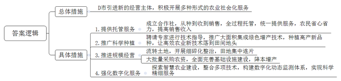
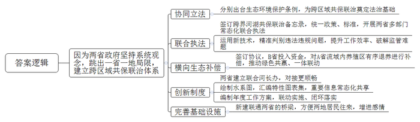
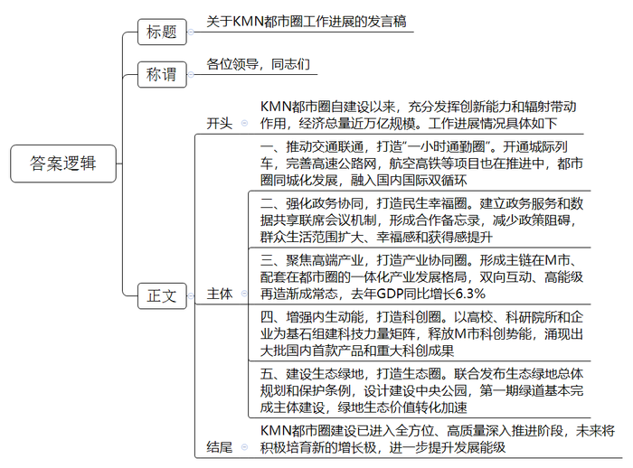
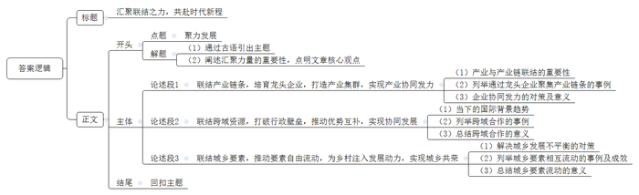

# 2025年公务员多省联考《申论》题（山西省市卷）

> 候选采集稿。参考答案及解析来自粉笔页面，不代表官方答案或真实高分答卷；来源使用许可与原卷对应关系仍需人工核实。

## 给定材料

### 材料 material-3774c228e312591d

又是一年小麦收割的时节。“搁几年前，大中午也得下地干活，忙得团团转。”D市大有村的村民老刘说，“如今松快多了，从种到收再到销售，全过程托管，省心又省力。”老刘每天送完孙子去上学，就到村里的股份经济合作社打工。在老刘看来，合作社真是帮他解决了大问题。

老刘是当地种庄稼有名的“老把式”，自家的田地他都坚持自己耕种，后来随着年龄越来越大，儿女也都在外地打工，他逐渐感到有些力不从心了。“年轻人纷纷去城里打拼，村里种地的人越来越少。”村党支部叶书记说，“当时，连老刘这种愿意种地的人都坚持不下去了。”

D市推广农业社会化服务的东风吹到了大有村。“为了有效破解我市农村农业发展的难题，我们引进了新的经营主体，积极开展多种形式的农业社会化服务。”D市农业农村局韩局长介绍。在村支部的推动下，大有村很快成立了股份经济合作社，向村民提供农业生产托管服务。当年春耕开始前，就有69户村民与合作社签订合同，托管土地1.5万余亩。“不瞒你们，一开始我是反对的。”老刘有些不好意思，“我种了这么多年的地，他们能有我种得好吗？”为了动员老刘，叶书记开出条件：带地入社，还可以在合作社当农机手。老刘依然没松口。到了秋收，老刘发现，自己种的地和合作社的托管地紧挨着，收成却大不相同，托管地玉米每亩多收了50斤，大豆每亩多收了20斤。原来，除了提供托管服务，为农户统一供应农资农具、耕种及病虫害防治等服务外，合作社还聘请了省农业大学教授进行技术指导，大力推广一喷多防、水肥一体、智慧农机等大面积集成绿色增产技术，让高效农业新技术落到了田间地头。“比我们靠老经验好多了！”老刘说。第二年春耕前，不用人劝，老刘早早来到合作社，交钱、签单，把土地全部托管。至此，大有村实现整村托管。

D市农田长期分散种植经营，东一块、西一块，田埂沟渠不但浪费耕地，也妨碍大规模机械化作业。“土地流转给合作社后，合作社开展细碎化整治工作，把一块一块的田地集中连片。”韩局长说，这不仅提高了土地利用率，也为开展大规模机械化工作奠定了基础。在大有村，全村粮食生产由农户单家独户种植变为全村范围内集中连片规模种植。昔日的小田块被连片开阔的大田所替代，田块成方，沟渠成网，一望无际的金黄色麦田里，一台台无人驾驶的联合收割机正来回穿梭，构成一幅生机勃勃的乡村画面。合作社共流转土地3000余亩，其中通过整合边角零碎土地，为村集体新增耕地资源约200亩，不仅实现了“小田”变“大田”，每年还可为村集体增收20余万元。“利用这些新增加的收入，村里办起了小麦加工厂。”叶书记说，“以往农村产业链比较短，从小麦身上赚到的钱不多，现在有了小麦加工厂，就可以赚更多的钱了。”

“看，今年的小麦麦粒多饱满！”D市某种植专业合作社社长老沈站在麦田里，把麦穗放在手里搓碎，又轻轻吹净麦皮，一把泛着清香的麦粒呈现在他的掌心。“今年种的是最新品种，通过科学种植，亩产可以达到1400斤，比去年平均亩产量多出了近两百斤！”老沈的语气里透露着欣喜，“过去农户买种子，价格一直谈不下来。但我们是大批量购买，哪怕是新品种，价格也能优惠很多。不光是种子，农药、农具等农资，合作社去谈都能便宜。”在老沈看来，有了规模优势，农业生产的成本远远低于分散种植。就拿浇水来说，小麦返青、拔节、灌浆三个关键时期，要是都浇足水了，一亩就能多收两三百斤麦子。但浇一亩地一次得花100元左右，很多老百姓会少浇甚至“看天吃饭”。合作社把土地集中连片后，全面铺开改闸改水、水管铺设等基础设施建设，采取数字监控等科技手段，按需及时浇水，实现了每亩种植成本降低13%、粮食增产11%。

“丰收了也不愁不好卖。”老沈说，“以往农民自己去卖小麦，在市场上没有议价权，卖不上价格不说，还要额外付运输费、劳务费，我们合作社与一家农业产业化龙头企业合作，他们统一上门收购，每斤小麦还多卖5分钱。”

借助数字化时代浪潮推动农业社会化服务迈上新台阶，D市正在行动。“我市强化全域数字化服务，积极探索智慧农业建设，整合卫星遥感、北斗导航、多光谱分析、物联网、气象监测等技术，构建集采集、分析、预警、决策于一体的数字化动态监测体系，使社会化服务更加科学和精细。”韩局长表示。农业社会化服务让小农户也能搭上现代农业的快车，为推进乡村全面振兴注入了强劲动能。

### 材料 material-d163e8312cae84c9

向南河上，波光潋滟、水天一色，乘船顺流而下，宛若穿行画中。谁能想到，这条美丽的河流曾经黑臭熏城，鱼虾难存。向南河贯通A、B两省多个行政区域，河流两岸开发强度高，生态环境容量有限，资源能源消耗量大，结构性污染突出，生态环境跨域性特征明显，无论是大气治理还是水环境治理，都不是某一方所能单独承担的。

如何做好生态环境跨域治理？“必须坚持系统观念，跳出一省一地的局限，建立跨区域的共保联治体系。”A省人大常委会委员季主任表示。A、B两省人大常委会协同立法，分别出台向南河生态环境保护条例，为跨区域的共保联治奠定了法治基础。

“要想彻底治好向南河，单靠哪一段使劲儿都不灵，只有在‘联动’上做文章，才能真正解决污染。”向南河沿岸某市生态环境保护综合行政执法大队唐队长说。向南河分属A、B两省管辖，过去因河道治理政策不同步、标准不统一，沿线企业跨省非法倾倒固体废弃物问题一直得不到有效解决。

这个“老大难”问题，现在终于“破题”：两省政府已经签订跨界河湖共保联治备忘录，统一政策、统一标准，开展两省水上公安、水务等部门常态化联合执法。两省联合执法队运用遥感影像和无人机遥测、移动采集系统等新技术手段，对生态违法违规问题精准判别，有效提升两省共保联治的工作效率，有效破解向南河流域广、监管工作量大的难题。“条件具备了，不管违法行为发生在哪边，我们都能迅速开展协同打击。”唐队长说。

今年，两省还签订了横向生态补偿协议。根据协议，B省以水生态产品量化补偿方式投入3000多万元，对A省向南河流域范围内青虾养殖区实施有序退养进行补偿。这项跨界合作，形成了上下游政府、周边农户、两地企业绿色共赢格局，横向生态补偿机制进一步推动了两地一体联动。

“我们上个月下发了一批两省跨界河流协同处置问题清单，不到一个月，两地就报送了整改方案。”设在A省省级河长办的两省联合河长办公室内，老谭正在逐一核实上月交办的处置问题清单整改方案。老谭是来自B省的一位县级河长，是B省派往A省的第三批两省联合河长办工作人员之一。为什么两省要建立联合河长办？“这由我们两省的地理位置和河流特性决定。”老谭介绍，向南河贯穿两省，两省互为上下游，同在左右岸，山脉相连、水系同源，过去在跨界河流管护中，一直存在因行政壁垒导致的信息不畅、责任不清、目标不统一等问题，尤其是遇到跨省治理问题，基层政府解决不了，只能层层上报，一级一级协调解决，费时久，效率低。制度创新是共保联治的重要保障，A、B两省多次会商，决定成立两省联合河长办公室来解决跨省涉河问题。如此一来，在统筹解决跨省涉河问题时，对接更加顺畅，共保联治的效率也提高了。过去，信息共享是跨界河流治理的一大难题。联合河长办建立后，双方汇总涉河信息联合绘制了跨界河流水系图，汇编了跨界河流特性图表集，将重要信息纳入“一张图”管理，实现常态化共享。“联合河长办按年度编制工作方案，下发给两省相关部门、各级河长办。”老谭说，一个方案管两地，共同编制、联动实施、闭环落实，干什么、怎么干，变得一目了然。在整治过程中，A省梁化镇与B省江市镇在河上新建了一座桥，两地居民亲如一家，往来更方便了。“共保联治，两地受益。现在，河水绿了，河床宽了，河堤稳了，两岸种草坪、栽绿植、修步道，居民的生活环境大大改善了。”老谭感慨道，“过去，向南河是分界线，把两地划分开来；现在，向南河是联结带，把两地结合起来。”

### 材料 material-68ef094a2335826f

每天早上7点，家住M市的倪女士都会乘坐城际铁路，到同一都市圈的K市上班。“40分钟就能到。”倪女士说，“每班列车间隔只有几分钟，非常方便。”近年来，为深入落实协同发展战略，S省积极推动现代化KMN都市圈高质量发展。目前，KMN都市圈充分发挥了经济发展优势区域的创新能力和辐射带动作用，经济总量接近万亿元规模。某知名高科技公司先后在KMN都市圈内的三个城市设立园区。“我们开车走高速公路，从M市到这些园区不用一个小时。”公司总裁杨总说。随着城际列车的开通和高速公路网的完善，KMN都市圈“一小时通勤圈”正在成型。改善“微循环”，促进都市圈同城化发展；贯通“主动脉”，融入国内国际双循环。建设都市圈内主要城市机场直联快联通道，打造国际航空客货运“双枢纽”；推进高铁项目，加快构建四通八达的高铁网……

近年来，KMN都市圈的市民惊喜地发现：公积金、医保和户籍等事项都能在城市政务服务数字平台和实体大厅“跨域通办”；都市圈内公立医疗机构全面实现就医“一卡通”；M市名校开始向K、N市延伸，三市义务教育学校师资开展交流轮岗试点……随着都市圈一体化程度不断加深，缩短的是时空距离，扩大的是生活范围；减少的是政策阻碍，提升的是群众幸福感与获得感。“省政府确定K、M、N三个城市共同建设都市圈，牵头组织三市成立了都市圈建设办公室，建立了政务服务和数据共享联席会议机制，形成了合作备忘录，协调推进一体化工作。”KMN都市圈建设办公室吴主任介绍，都市圈建设有“破”有“联”，只有城市破除自身单一的圈子，彼此高度协同，才能使KMN都市圈真正成为民生幸福圈。

位于N市开发区的一家电子电路股份有限公司的车间内，一套套自动化生产设备开足马力；车间外，一批批液晶面板、5G通讯等产品正等待交货。这家公司原来在M市，后来为了与N市其他电子材料企业形成产业配套，就搬迁到N市，有效推动了当地电子信息产业供应链优化升级。与此同时，N市电子信息产业还直接为M市的大型光电面板企业、汽车制造企业提供产品配套，有效补强了M市光电显示产业链条，实现KMN都市圈的圈内循环。

“我们签订了都市圈产业协同发展合作协议，并且每年举办市长联席会议，规划都市圈的产业发展。”M市张市长说。根据合作协议，KMN都市圈聚焦光电子信息、生命健康、高端装备等产业，推动优势产业协同联动，提升中心城市M市的经济密度，促进M市一般制造业向周边的K、N市有序转移，逐步形成主链在M市、配套在都市圈的一体化产业发展格局。在KMN都市圈，双向互动、高能级再造渐成常态，产业链上“你中有我、我中有你”的格局有效激活了各城市资源禀赋优势。去年，KMN都市圈GDP同比增长6.3%，占全省GDP近60%，产业链韧性和竞争力有效提升。

M市有众多高校和科研机构，科创资源丰富。“都市圈的产业定位决定了我们必须紧紧抓住科学技术这个第一竞争力。”张市长说。怎样有效释放M市的科创势能，增强都市圈的内生动能？N市在M市成立离岸科创中心，N市企业纷纷正式签约入驻。“成立离岸科创中心，有利于企业就近利用M市的人才和科创资源。”N市一家工艺有限公司执行董事闫先生说，企业深入对接M市的广电创意产业园、省美术学院等资源，更好地在数字文化产业、文化科技融合、新材料开发与应用等领域发力。K市积极搭建科创平台，鼓励企业建立研发机构和博士后工作站，吸引科技人才，加快科技创新和成果转化。目前，K市与M市14所高校院所开展合作，在研科技合作重点项目达99个，创历史新高……靠过去、引进来，科技同兴，产业同旺，都市圈也是科创圈。KMN都市圈以高校、科研院所和企业为基石组建科技力量矩阵，近年涌现出一大批国内首款产品及国家急需的重大科技创新成果，有力带动了都市圈的蓬勃发展。

“生态环境是高质量发展的核心目标之一，是衡量区域现代化进程的重要标尺。”张市长说。KMN都市圈中心地带有一块总面积500多平方公里的生态绿地，它不仅是地理版图上的一抹绿，更是KMN都市圈的“绿肺”。三市联合发布都市圈生态绿地总体规划和保护条例，保护这块绿地不受城市化进程的“蚕食”。去年，三市共同委托一家设计研究院制定《生态绿地中央公园总体设计》。目前，第一期的绿道已基本完成主体建设，原始的山林土路变身健身绿道，沿线还建有科普、诗词、地方文化等多个不同风格、主题的“驿站”，成为了三市居民休闲游玩的好去处。绿地的生态价值转化正在加速，在KMN都市圈内，一幅人与自然和谐共生的现代化图景正在铺展开来。“现在K、M、N三市协同发展已进入全方位、高质量深入推进阶段，KMN都市圈将积极培育新的增长极，进一步提升发展能级。”吴主任说。

## 题目

### 第 1 题

**根据给定资料**1**，****请概括****D市“****让****小农户搭上现代化农业快车****”****的主要措施****。****（****15分****）**

关联材料：material-3774c228e312591d

作答要求：

要求：全面、准确、有条理，不超过250字。

### 第 2 题

**“****给定资料**2**”****中提到****“****过去，向南河是分界线，****把两地划分开来****；****现在，向南河是联结带，把两地结合起来。****”****请****分****析为什么向南****河****能从分界线****变****成联结带****。****（****20分****）**

关联材料：material-d163e8312cae84c9

作答要求：

要求：分析全面，条理清晰，不超过300字。

### 第 3 题

**省政府拟召开****KMN都市****圈****阶段性建设成果报告会****，****吴主任将在会上汇报工作进展情况****，****请根据****“****给定资料**3**”****，****为吴主任撰写一份发言稿****。****（****25分****）**

关联材料：material-68ef094a2335826f

作答要求：

要求：

（1）紧扣资料，内容全面；

（2）逻辑清晰，语言流畅；

（3）不超过500字。

### 第 4 题

**请对划线句子****“在当今这个充满活力的时代，我们要善于汇聚各种力量形成合力，联结好当下，就能畅通奔向未来的路”进行深入思考，参考给定资料，联系实际，自选角度，自拟题目，写一篇文章。（40分）**

关联材料：material-3774c228e312591d

作答要求：

要求：

（1）观点明确，见解深刻；

（2）内容充实，结构完整；

（3）思路清晰，语言流畅；

（4）1000-1200字。

## 答案与解析

第 1 题

**参考答案（粉笔题库参考内容）**

D市引进新的经营主体，积极开展多种形式的农业社会化服务。

1.提供托管服务。成立合作社，从种到收到销售，全过程托管，统一提供服务，农民省心省力，提高销售收入。

2.推广科学种植。聘请专家进行技术指导，推广大面积集成绿色增产技术，种植高产新品种，让高效农业新技术落到田间地头。

3.推进规模经营。流转土地，开展细碎化整治，田地集中连片；大批量采购农资，全面完善基础设施建设，降本增产。

4.强化数字化服务。探索智慧农业建设，整合多项技术，构建数字化动态监测体系，实现科学精细服务。

**解析**

**参考答案说明：**本参考答案采用“总-分”的逻辑结构。先介绍了D市推广农业社会化服务的总体措施，然后再分别从“提供托管服务”“推广科学种植”“推进规模经营”和“强化数字化服务”四个方面，对具体措施内容进行了分条撰写。各条要点之间在内容上是并列关系，没有交叉。

**考点**：考点概括措施类

**来源**：来源2025年公务员多省联考《申论》题（山西省市卷）

粉笔申论页面对本题只提供「解析视频」入口，该入口是会员推广位，页面无视频地址与文字解析。

第 2 题

**参考答案（粉笔题库参考内容）**

因为两省政府坚持系统观念，跳出一省一地局限，建立跨区域共保联治体系。1.协同立法。分别出台生态环境保护条例，为跨区域共保联治奠定法治基础。2.联合执法。签订跨界河湖共保联治备忘录，统一政策、标准，开展两省多部门常态化联合执法；运用新技术，精准判别违法违规问题，提升工作效率、破解监管难题。3.横向生态补偿。签订协议，B省投入资金，对A省流域内养殖区有序退养进行补偿，推动绿色共赢、一体联动。4.创新制度。两省建立联合河长办，对接更顺畅；绘制水系图，汇编特性图表集，重要信息常态化共享；编制年度工作方案，联动实施、闭环落实。5.完善基础设施。新建联通两省的桥梁，方便两地居民往来，增进感情。

**解析**

**参考答案说明：**本参考答案呈“总-分”结构，首句先介绍了向南河变成联结带的总体原因，接着从“协同立法”“联合执法”“横向生态补偿”“创新制度”“完善基础设施”五个方面进行了分条撰写。各条要点之间在内容上相互并列，没有交叉。

**考点**：考点原因类

**来源**：来源2025年公务员多省联考《申论》题（山西省市卷）

粉笔申论页面对本题只提供「解析视频」入口，该入口是会员推广位，页面无视频地址与文字解析。

第 3 题

**参考答案（粉笔题库参考内容）**

关于KMN都市圈工作进展的发言稿

各位领导，同志们：

KMN都市圈自建设以来，充分发挥创新能力和辐射带动作用，经济总量近万亿规模。工作进展情况具体如下：

一、推动交通联通，打造“一小时通勤圈”。开通城际列车，完善高速公路网，航空高铁等项目也在推进中，都市圈同城化发展，融入国内国际双循环。二、强化政务协同，打造民生幸福圈。建立政务服务和数据共享联席会议机制，形成合作备忘录，减少政策阻碍，群众生活范围扩大、幸福感和获得感提升。三、聚焦高端产业，打造产业协同圈。形成主链在M市、配套在都市圈的一体化产业发展格局，双向互动、高能级再造渐成常态，去年GDP同比增长6.3%。四、增强内生动能，打造科创圈。以高校、科研院所和企业为基石组建科技力量矩阵，释放M市科创势能，涌现出大批国内首款产品和重大科创成果。五、建设生态绿地，打造生态圈。联合发布生态绿地总体规划和保护条例，设计建设中央公园，第一期绿道基本完成主体建设，绿地生态价值转化加速。

KMN都市圈建设已进入全方位、高质量深入推进阶段，未来将积极培育新的增长极，进一步提升发展能级。

**解析**

**参考答案说明：**（1）格式方面，本参考答案写到了“标题+称谓+正文”两个部分。（2）正文部分，从内容上来看，本参考答案的开头部分先介绍了KMN都市圈的整体建设成果；接着，主体从“推动交通联通，打造‘一小时通勤圈’”“强化政务协同，打造民生幸福圈”“聚焦高端产业，打造产业协同圈”“增强内生动能，打造科创圈”“建设生态绿地，打造生态圈”五个方面介绍了KMN都市圈的具体建设经验；最后，结尾部分进行了简要总结与展望。从形式来看，本参考答案做到了分段、分条撰写，整体上条理较为清晰。

**考点**：考点总结类

**来源**：来源2025年公务员多省联考《申论》题（山西省市卷）

粉笔申论页面对本题只提供「解析视频」入口，该入口是会员推广位，页面无视频地址与文字解析。

第 4 题

**参考答案（粉笔题库参考内容）**

**汇聚联结之力，共赴时代新程**

“积力之所举，则无不胜也；众智之所为，则无不成也。”在当今充满活力的时代，汇聚各种力量形成合力，已成为推动社会进步与发展的关键。联结当下各方资源，畅通奔向未来的路，这不仅是一种发展智慧，更是时代赋予我们的使命。

**联结产业链条，培育龙头企业，打造产业集群，实现产业协同发力。**产业是经济发展的基石，而产业链的紧密联结与协同共生，则是驱动产业持续创新、突破发展瓶颈的核心引擎。以深圳的电子信息产业为例，华为、腾讯等龙头企业凭借强大的研发实力和市场影响力，吸引上下游众多中小企业集聚，形成了涵盖芯片设计、软件开发等完整的产业链条。这不仅仅是企业的简单扎堆，而是通过市场机制与政策引导，形成了专业化分工精细、本地化配套齐全、创新链条完整的产业生态体系。在激烈的市场竞争中，各企业协同发力，共同抵御风险，推动了产业在全球占据领先地位，成为城市经济发展的重要支柱。

**联结跨域资源，打破行政壁垒，推动优势互补，实现协同发展。**在经济全球化与区域一体化深入发展的大背景下，加强区域合作、促进要素高效配置，不仅是提升整体竞争力的内在需要，更是构建新发展格局的必然选择。长江三角洲地区便是实践的典范。上海作为经济中心，拥有强大的金融、科技与人才资源；江苏制造业基础雄厚；浙江民营经济活跃。三地打破行政壁垒，加强区域合作，通过产业转移、技术共享、人才流动等方式，实现优势互补，形成了一体化发展的强大合力。这种深度的跨域合作，促进了区域内部经济的强劲增长与结构升级，提升了长三角整体在全球资源配置中的能级与影响力。

**联结城乡要素，推动要素自由流动，为乡村注入发展动力，实现城乡共荣。**城乡发展不平衡是我国面临的重要问题，联结城乡要素是解决这一问题的有效途径。随着城乡融合发展不断深化，城市资本、技术、人才等要素加速向乡村集聚，催生了乡村旅游、特色农业、精品民宿等新业态。这些新业态不仅盘活了乡村闲置资源，更带动农民增收致富，为乡村振兴注入了强劲动能。同时，乡村的绿水青山、优质农产品、传统文化等资源也为城市居民提供了高品质的生态产品和文化体验，满足了城市居民日益增长的多元化需求。城乡要素的自由流动，使乡村焕发出新的活力，城市也获得了更广阔的发展腹地，实现了城乡的共同繁荣。

“孤举者难起，众行者易趋。”在时代的浪潮中，我们唯有联结各方力量，形成强大合力，才能在发展的道路上披荆斩棘，实现国泰民安的美好愿景。

**解析**

**文章分析**

**汇聚联结之力，共赴时代新程**

【**标题的优点：**首先，范文的标题突出了“聚力发展”这一主题。其次，形式上，文字简洁明快，不拖沓。】

（1）“积力之所举，则无不胜也；众智之所为，则无不成也。”（2）在当今充满活力的时代，汇聚各种力量形成合力，已成为推动社会进步与发展的关键。联结当下各方资源，畅通奔向未来的路，这不仅是一种发展智慧，更是时代赋予我们的使命。

【**开头的优点：**★内容方面：范文的开头是紧扣“聚力发展”这一主题展开的。首先，开头点出主题，做到了主题明确。其次，对“聚力发展”这一主题进行了分析阐述：（1）通过古语引出主题；（2）阐述汇聚力量的重要性，点明文章核心观点。★文字表达方面：使用了“不仅……更……”的关联词，使语言表达有逻辑性。】

**联结产业链条，培育龙头企业，打造产业集群，实现产业协同发力。**（1）产业是经济发展的基石，而产业链的紧密联结与协同共生，则是驱动产业持续创新、突破发展瓶颈的核心引擎。（2）以深圳的电子信息产业为例，华为、腾讯等龙头企业凭借强大的研发实力和市场影响力，吸引上下游众多中小企业集聚，形成了涵盖芯片设计、软件开发等完整的产业链条。（3）这不仅仅是企业的简单扎堆，而是通过市场机制与政策引导，形成了专业化分工精细、本地化配套齐全、创新链条完整的产业生态体系。在激烈的市场竞争中，各企业协同发力，共同抵御风险，推动了产业在全球占据领先地位，成为城市经济发展的重要支柱。

【**论述段****1的优点：**★观点句：范文的观点句是紧扣“聚力发展”这一文章主题提出的。形式上，它在段首处直接写出，位置突出，容易发现。内容上，关键词突出，内容要点明确，可以明显看出它是从“联结产业链”这个角度入手。★论述内容：（1）首先指出产业与产业链联结的重要性；（2）其次列举通过龙头企业聚集产业链条的事例；（3）最后总结企业协同发力的对策及意义。注意：以上三个方面的内容都是紧扣“联结产业链条，培育龙头企业，打造产业集群，实现产业协同发力”这个观点句进行分析论述的，论述的针对性强，内容层次丰富。最后，在论述方法上主要采用了讲道理与举例子结合，做到了丰富多样。】

**联结跨域资源，打破行政壁垒，推动优势互补，实现协同发展。**（1）在经济全球化与区域一体化深入发展的大背景下，加强区域合作、促进要素高效配置，不仅是提升整体竞争力的内在需要，更是构建新发展格局的必然选择。（2）长江三角洲地区便是实践的典范。上海作为经济中心，拥有强大的金融、科技与人才资源；江苏制造业基础雄厚；浙江民营经济活跃。三地打破行政壁垒，加强区域合作，通过产业转移、技术共享、人才流动等方式，实现优势互补，形成了一体化发展的强大合力。（3）这种深度的跨域合作，促进了区域内部经济的强劲增长与结构升级，提升了长三角整体在全球资源配置中的能级与影响力。

【**论述段****2****的优点：**★观点句：范文的观点句是紧扣“聚力发展”这一文章主题提出的。形式上，它在段首处直接写出，位置突出，容易发现。内容上，关键词突出，内容要点明确，可以明显看出它是从“联结区域”这个角度入手。★论述内容：（1）首先指出当下的国际背景趋势；（2）其次列举跨域合作的事例；（3）最后总结跨域合作的意义。注意：以上三个方面的内容都是紧扣“联结跨域资源，打破行政壁垒，推动优势互补，实现协同发展”这个观点句进行分析论述的，论述的针对性强，内容层次丰富。最后，在论述方法上主要采用了讲道理与举例子结合，做到了丰富多样。】

**联结城乡要素，推动要素自由流动，为乡村注入发展动力，实现城乡共荣。**（1）城乡发展不平衡是我国面临的重要问题，联结城乡要素是解决这一问题的有效途径。（2）随着城乡融合发展不断深化，城市资本、技术、人才等要素加速向乡村集聚，催生了乡村旅游、特色农业、精品民宿等新业态。这些新业态不仅盘活了乡村闲置资源，更带动农民增收致富，为乡村振兴注入了强劲动能。同时，乡村的绿水青山、优质农产品、传统文化等资源也为城市居民提供了高品质的生态产品和文化体验，满足了城市居民日益增长的多元化需求。（3）城乡要素的自由流动，使乡村焕发出新的活力，城市也获得了更广阔的发展腹地，实现了城乡的共同繁荣。

【**论述段****3****的优点：**★观点句：范文的观点句是紧扣“聚力发展”这一文章主题提出的。形式上，它在段首处直接写出，位置突出，容易发现。内容上，关键词突出，内容要点明确，可以明显看出它是从“联结城乡”这个角度入手。★论述内容：（1）首先指出解决城乡发展不平衡的对策；（2）其次列举城乡要素相互流动的事例及成效；（3）最后总结城乡要素流动的意义。注意：以上三个方面的内容都是紧扣“联结城乡要素，推动要素自由流动，为乡村注入发展动力，实现城乡共荣”这个观点句进行分析论述的，论述的针对性强，内容层次丰富。最后，在论述方法上主要采用了讲道理的方式，论述清晰透彻。】

【**论述段之间的关系：**★内容的内在逻辑：范文的论述段之间是依照并列的逻辑展开的。论述段1先写了“联结产业链条，培育龙头企业，打造产业集群，实现产业协同发力”，论述段2接着写了“联结跨域资源，打破行政壁垒，推动优势互补，实现协同发展”，论述段3最后写了“联结城乡要素，推动要素自由流动，为乡村注入发展动力，实现城乡共荣”。这三个论述段分别从“联结产业链”“联结区域”“联结城乡”展开，相互并列，逻辑清晰。】

“孤举者难起，众行者易趋。”在时代的浪潮中，我们唯有联结各方力量，形成强大合力，才能在发展的道路上披荆斩棘，实现国泰民安的美好愿景。

【**结尾的优点：**范文的结尾回扣了“聚力发展”这个主题，并且进行了总结呼吁。】

**考点**：考点文章写作题

**来源**：来源2025年公务员多省联考《申论》题（山西省市卷）

粉笔申论页面对本题只提供「解析视频」入口，该入口是会员推广位，页面无视频地址与文字解析。

