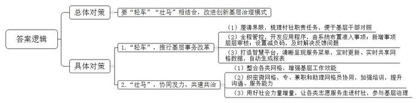
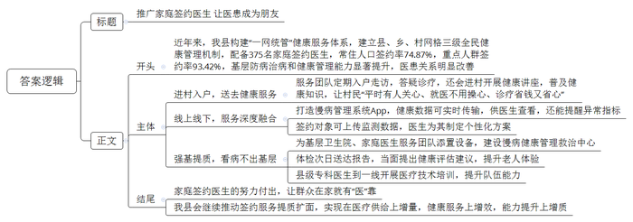

# 2025年公务员多省联考《申论》题（山西县乡卷）

<!-- gwy:overview:start -->
> **山西 · 2025 · 申论 · 县乡卷** ｜ 4 题 · 图片 4 处 · 答案随题折叠

导航：[题目](#题目)
<!-- gwy:overview:end -->

> 候选采集稿。参考答案及解析来自粉笔页面，不代表官方答案或真实高分答卷；来源使用许可与原卷对应关系仍需人工核实。

## 给定材料

### 材料 material-8e3e8cbe468a78c9

原先，F市安信街道成潭社区党群服务中心的门口处、走廊里、墙壁上全是牌子和制度。“我们现在是大变样了，牌子只留三块，上墙制度更简洁，流程更清晰，服务得到了全面整合升级。”社区党委钟书记说。

发生变化的不仅是成潭社区一家。去年3月以来，为了破解基层治理“小马拉大车”难题，F市市委市政府统一部署，相关部门牵头治理，推动了基层减负热潮。短短半年，当地已出现不少新转变。如今在F市的村社一级，上墙事项已从59家单位的40项内容，缩减到9家12项。

“一直以来，由于种种原因，在条线部门向下分配工作的过程中，村社这一基层终端经常面临的是被层层‘转嫁’的任务。”F市委社会工作部姜部长坦言。对此，F市探索推行“准入基层事、基层准确办”的基层事务改革，着力破解职责边界不清、准入不严、监管不力等难题。

要落实改革，第一步就是厘清界限。按照相关法律法规和上级要求，F市对村社的职责进行梳理，便于基层干部迅速、清晰地对照自身职责。与此同时，哪些制度能上墙，哪些证明可盖章，F市也对此进行了全面细致的梳理与明确。

职责任务明晰后，如何放得下、管得住，关键还看怎么抓全程管控。F市的办法是依靠数字化，在基层智治综合应用小程序中设置“事务准入”模块，要求准入事项必须通过该系统布置到村社。如此一来，流转全程监测，便于实时跟进。对职责之外需新增的事项，则必须层层过审，方可以临时任务的形式交办。对于过去一些不符合基层职能事项或需要群众来回跑腿的问题，现在扫一扫“减负码”就能立即反馈，及时得到解决。基层负担轻，群众奔波少，干部们纷纷拍手叫好，形象地称之为“车子变轻，续航更久”。

要“轻车”更要“壮马”，基层减负才能“减”出成效、“减”出发展。通过协同发力、共建共治，实现基层治理力量从“单兵种”到“集团军”的转变，是破解基层“小马拉大车”问题的根本方法。

“我们按照‘多网合一、一网多能’的原则，整合民政、城管、市场监管、卫生健康等各类网格，让各类业务运行在同一张网格上，有效增强了基层工作效能。”F市成副市长说，通过织密织牢6750个微网格，F市形成了专职、兼职和助理网格员的工作架构。“沟通是所有入户探访工作的基础。”在江尚街道社会服务工作站内，党工委姚书记正在给F市新聘的街道网格员培训，内容包括网格工作职责、服务意识与沟通技巧、情绪与压力管理等。“现在我感觉工作内容更清晰了，完成任务更有信心了！”参加培训的网格员小柳说。

“单靠现有力量是不够的，还得融合多方共同发力。”姜部长说。引导用好“两新”组织、志愿者队伍这些增量，使志愿服务走进村社主阵地，多渠道、多层次地参与基层治理，已成为F市各部门的一种共识。从去年3月起，F市健全完善驻地单位党组织和在职党员“双报到、双服务、双包联、双评价”机制，让各类社会力量成为基层治理的盟友，同时，统筹“两代表一委员”阵地、社会组织、志愿者队伍等，打造社会组织之家，推动各级包联干部、联建单位等治理力量向网格汇集，实现“一网统筹、多元集聚”，让多方力量协同发力，为基层治理更添动力。

打开电脑，花滨社区党委万书记点击智慧社区平台上的居民服务菜单，各类居民业务办理、社区报表、开具证明等事项便清晰呈现。依托“一键报表”“一键证明”等模块，社区已基本实现了报表自动生成。“以往巡查走访、社区信息归集是个麻烦事儿，不同类别数据需要反复收集。现在有了智慧社区平台，只要基础数据定时更新，再也不用花功夫通过各类小程序上传数据了。”万书记介绍。目前，F市已通过智慧社区平台，实现各社区网格数据实时共享，各类基层报表真正做到“一次输入、定期维护、实时调阅”。数据打通了，基层干部有更多的时间走近老百姓，服务群众的道路更顺畅了。

“我们将继续按照‘轻车’‘壮马’相结合的原则，持续改进和创新基层治理模式，不断适应新时代发展需求，努力绘就共建共治共享的基层治理新画卷。”成副市长说。

### 材料 material-6796b0fe06c5eedb

近日，为加快构建农业绿色发展新格局，H县农业农村局召开了一场关于农用地膜科学使用、回收的座谈会，听取各方的意见建议。以下是座谈会的主要发言记录：

县农科所专家：农用地膜使用，关系到生态环境保护，关系到粮食安全和群众的身体健康。但从我们县的情况来看，农民们对地膜使用认识有误区，盲目地多用、滥用，导致地膜污染没有得到有效治理。土壤中残留的地膜不仅给耕翻土地等田间管理带来不便，还极大地破坏了土壤的耕层结构。防治多方农膜污染需要切实做到减量、回收、替代。

D镇驻村干部：我们镇有一些地方，地膜被遗弃在农田边上，没有人捡拾回收。有的农民对废膜危害认识不足，清理回收积极性不高；还有的农民不了解地膜回收的方法，就只是将农田里的地膜简单焚烧了事，燃烧过程中产生的化学残留物又被农机翻整埋入田里，这其实不只会污染农田，更损害了本地的农业生态环境。其实镇里很重视农用地膜的使用与回收，但目前县里各部门分工不够清晰，管理不够到位，单靠我们镇自己的力量很难做到标本兼治。

县农业环境保护监测站工作人员：不按规定使用、回收农用地膜是违法行为。国家在大力推广应用全生物可降解地膜、加厚高强度地膜，但不少农民觉得价格太高，还在购买使用那些厚度低于0.01毫米的非标地膜。我们监测到县里农田中地膜残留量已经达到了每亩3到5公斤，而且每年都有新的地膜沉积在农田中，这种趋势仍在继续。如果这个问题没有得到有效治理，农田污染将越来越严重。

某废品收购站负责人：地膜回收是一个难题。说实话，我们不爱收地膜，现在农民们用的地膜好多都不标准，即便是标准地膜，膜里含有大量泥土、农作物残渣，处理起来不仅耗费水电，人工成本也高，根本不划算。想让农民们处理好地膜再送过来，但跟他们沟通这个也挺麻烦。如果政府能出台政策，补贴一下地膜回收，这样可能会好一点。

某地膜回收企业负责人：我们处理一吨废弃标准地膜的成本接近2000元，回收的产品能卖300到500元。从2023年开始，企业每回收一吨废弃地膜，当地政府补贴2000元。但是，我们专门做过测算，非标膜去除杂质后，每吨能用来回收的原料最终只有460公斤，平均每吨的处理成本要4500多元。而我们现在回收来的大部分都是非标膜，即便有政府补贴，我们也得赔钱。

Q镇农民：厚一点的地膜效果好，没危害，但比较贵，实在用不起。薄地膜的效果差点，质量也差，但也能用。我们也知道碎地膜留在田里有危害，但要把埋在土里的残膜刨干净只能靠人工，平均每亩地要多花80元。把地膜送去回收没有钱赚，还得费好大的功夫，不划算。

M镇某种植大户：我现在都是使用强度高、耐候期长、易回收的地膜，这种地膜使土壤的增温、保墒、出苗性更好，而且能更好地抑制膜下杂草的生长，挺好用的，但确实成本会增加一些。前阵子，我到外市去参观，他们那边政府出台了地膜科学使用补贴政策，通过“以奖代补”和政府补贴的方式，推广使用优质地膜，据说效果不错，大家积极性挺高的。

Q镇某村主任：这几年，县里很重视废弃农膜回收，也出台了一些鼓励政策，但我觉得政策和资金支持得还不够，县、乡、村没有设立固定的废弃农膜回收点，靠自发回收不行，要统筹做好地膜回收利用工作。

L乡农技服务站站长：我们的农技人员费尽口舌，跟农户们宣传科学使用、回收地膜的好处，奈何人家农资店的诱惑更大，除了便宜，还能返利。我看，主要是生产销售非标地膜的太猖獗了，县里有关部门要严格监管，打击与引导并重。这样，我们干起工作来，才会更加顺利。

县市场监管局执法队队长：2023年以来，我们定期开展相关执法检查，但日常监管还存在欠缺和短板。部分企业和商户对此认识不足，认为法不责众，导致违规使用非标地膜的情况屡禁不绝。接下来，我们会进一步联合有关部门，常态化开展日常监管工作，加大全流程执法力度，严禁非标地膜入市下田。

M镇副镇长：要标本兼治解决农用地膜使用、回收存在的问题，我们希望县里坚持“一盘棋”思想，统筹规划，系统推进，让各部门、企业、农户都行动起来，打通地膜生产、销售、使用、回收等各个环节，形成一个完整的链条。可以先搞试点、作示范，以点带面，逐步形成规模，推动农用地膜科学使用、回收全覆盖，构建起绿色安全的农田生态环境。

### 材料 material-4957ae9cdfdb9435

夜晚，穿上白大褂，背上医药箱，骑上摩托车，沿着山路赶往村民家中……这是Z县桃源乡卫生院院长、家庭签约医生黄大夫的日常。“白天村民要干农活，所以我们经常晚上上门。山村开车不方便，我专门买了辆摩托车。”她表示，上门看诊，可以让村民特别是老人们“平时有人关心、就医不用操心、诊疗省钱又省心”，自己辛苦点也值得。

从卫生院出发，驱车沿着蜿蜒的山路前行，到长河村需要一个多小时。这样的路，黄大夫每个月都要走上好几回。“这里比较偏远，交通不便，村民们外出看病很麻烦。尤其是子女在外地的老人，等亲属回来再送诊容易错过治疗时机。”她说。在桃源乡卫生院，签约家庭医生的人数为7786人，其中1540名是老人。从2022年开始，黄大夫和家庭签约医生服务团队定期入户走访，至今已为7921人次送去健康服务。每次进村，除了答疑诊疗，他们还开展健康讲座，普及健康知识。

Z县外出人口8万余人，农村留守老人多，全县有124个建制村，70多个偏远自然村，群众看病难问题长期存在。近年来，Z县统筹优质医疗资源、网格化管理资源，构建“一网统管”健康服务体系，建立“分级统筹、双线并进、网格兜底”的县、乡、村网格三级全民健康管理机制。目前，Z县像黄大夫这样的家庭签约医生有375名，全县常住人口家庭医生签约率74.87%、重点人群签约率93.42%，基层防病治病和健康管理能力得到了显著提升。

“今天门诊27人，转入患者14人，血糖监测人数9人……”黄大夫正在查看Z县慢病管理系统App显示的实时数据。她介绍，家庭医生为村民测量的血压、血糖数据会实时传输到App，医生不仅能查看当日慢性病分层分级整体情况，例如高血压高危、中危、低危人数等，还能收到患者指标异常的提醒。在App上，签约对象可以上传自我监测数据，对自己进行健康管理，县级专科医生、乡（镇）村全科医生可以为签约对象制定个性化服务方案，实现了线上和线下服务深度融合。

家庭医生上门次数多了，与村民感情越发好了，关系也更亲近了。“有一天，我接到电话说上溪村吴奶奶突然晕倒了，就立即赶过去。当晚下着小雨，山路泥泞，一到村口，车轮就陷进沟里，我只好丢下车，走到吴奶奶家。”等黄大夫诊疗结束，回头找车，发现村民们早已把车抬了出来。“很感动，觉得大家就像一家人一样，不是亲人胜似亲人。”

长河村村民老蔡是个爆脾气，讲话很冲。他说，自己以前基本不看病，迫不得已去医院了，还很容易和医生吵架。“现在，他们就像我的朋友一样，定期上门检查，还帮我建立了电子健康档案，每次检查结果，手机上就能看。”身体一有不舒服，老蔡就会通过手机App向家庭医生咨询问诊。“自从有了家庭医生，看病省钱了，配药省心了，就医方便了，我也更加理解医生的不容易了。大家伙儿都对他们竖起了大拇指。”

过去，Z县基层卫生院冷清、设施落后、运营困难的局面普遍存在。近年来，Z县为基层卫生院添置了彩超、化验等医疗设备，为家庭医生服务团队配备了智能血压仪、血糖仪，并投资770余万元建起了集日常随访、筛查、诊断、管理、转诊等功能于一体的慢病健康管理救治中心。以前给65岁以上老人体检，由于没有及时反馈，老人们感受不到体检的重要性。从2022年开始，家庭签约医生服务团队提供了当天体检、次日送达报告，并当面提出健康评估建议的服务，老人们的体验明显提升，尤其是在了解了自己的身体状况后，联系家庭医生咨询、就医频率慢慢提高。同时，Z县总医院积极推动优质医疗资源下沉，县级专科医生经常到一线卫生院巡诊并开展医疗技术培训，群众到基层卫生院的就诊率迅速上升。

老林是一名老村医，他对这几年的变化很有感触。“以前，我们当村医，村民不信任，收入不稳定，还要靠种茶叶和锥栗维持生计。现在，村民小病不往外跑了，我们的收入也增加了、稳定了，我可以安心当医生了。”他感慨地说，村民留在基层看病多了，卫生院不闲置了，上级医院的压力也减轻了。

繁琐而辛苦，是许多家庭签约医生的真实写照，日复一日的坚持中，凝结着他们的心血与付出。Z县正全力推动家庭医生签约服务提质扩面，努力实现在医疗供给上增量，健康服务上增效，能力提升上增质，让群众在家就有“医”靠。

## 题目

### 第 1 题

**根据****“给定资料**1**”，请你谈谈F市在破解基层治理“小马拉大车”难题方面有哪些值得推广的经验。（15分）**

关联材料：材料 material-8e3e8cbe468a78c9

作答要求：

要求：全面、准确、有条理。不超过250字。

第 1 题 · 答案与解析

**参考答案（粉笔题库参考内容）**

要“轻车”“壮马”相结合，改进创新基层治理模式。1.“轻车”，推行基层事务改革。（1）厘清界限，梳理村社职责任务，便于基层干部对照。（2）全程管控，开发应用程序，由系统布置准入事项；新增事项层层审核；设置减负码，及时解决反馈问题。（3）打造智慧平台，清晰呈现服务菜单，定时更新、实时共享网格数据，自动生成报表。2.“壮马”，协同发力、共建共治。（1）整合各类网格，增强基层工作效能。（2）织密微网格，专、兼职和助理网格员协同，加强培训，提升沟通、服务能力。（3）用好社会力量增量，让各类志愿服务走进村社，参与基层治理。

**解析**

**参考答案说明**：本参考答案是“总-分”结构，首先在总体上给出宏观对策，接着从“‘轻车’，推行基层事务改革”“‘壮马’，协同发力、共建共治”两个具体角度展开，各条答案要点之间在内容上相互并列，没有交叉。

**考点**：考点经验启示类

**来源**：来源2025年公务员多省联考《申论》题（山西县乡卷）

粉笔申论页面对本题只提供「解析视频」入口，该入口是会员推广位，页面无视频地址与文字解析。

### 第 2 题

**请根据****“给定资料**2**”，梳理当前H县在农用地膜使用回收方面存在的问题，并提出改进建议。（20分）**

关联材料：材料 material-6796b0fe06c5eedb

作答要求：

要求：

（1）问题梳理全面、准确、有条理；

（2）所提建议有针对性、切实可行；

（3）层次分明，有逻辑性；

（4）不超过400字。

第 2 题 · 答案与解析

**参考答案（粉笔题库参考内容）**

问题：1.使用不规范。农民认识有误区，盲目多用、滥用地膜；标准地膜价格高，农民购买使用非标地膜。2.回收难度大。农户对残膜危害认知不足，不了解回收方法，且缺少经济激励，随意遗弃、焚烧地膜；废弃地膜处理成本高，回收企业不盈利，回收意愿低；县乡村没有固定回收点。3.监管有漏洞。职能部门分工不清，管理不到位，未形成合力；日常监管存在短板，企业和商户认识不足，生产销售非标地膜。

对策：1.规范地膜使用。加强农技指导，推动地膜适量使用；出台地膜科学使用补贴政策，以奖代补、提供购膜补贴，推广使用优质地膜。2.完善回收体系。开展宣传教育活动，普及地膜污染危害，组织学习地膜回收知识；加大回收补贴力度，提升农民、企业回收积极性；在县乡村设立固定回收点，积极推动回收工作。3.全面加强监管。多部门联合，常态化开展日常监管工作，加大全流程执法力度，打击与引导并重，严禁非标地膜入市下田。

**解析**

**参考答案说明：**（1）本参考答案从“问题”“对策”两部分进行展开，其中，问题又从“使用不规范”“回收难度大”“监管有漏洞”三个方面展开；“对策”则与之对应，分别从“规范地膜使用”“完善回收体系”“全面加强监管”三个方面进行了分条撰写。各条要点之间在内容上是并列关系，没有交叉。

**考点**：考点提出对策类

**来源**：来源2025年公务员多省联考《申论》题（山西县乡卷）

粉笔申论页面对本题只提供「解析视频」入口，该入口是会员推广位，页面无视频地址与文字解析。

### 第 3 题

**假如你是县卫健局的工作人员，请根据****“给定资料**3**”，以“让医患成朋友”为主题写一篇宣传稿，介绍Z县家庭签约医生制度的推广情况。（25分）**

关联材料：材料 material-4957ae9cdfdb9435

作答要求：

要求：

（1）紧扣资料，内容全面；

（2）逻辑清晰，表述准确；

（3）不超过450字。

第 3 题 · 答案与解析

**参考答案（粉笔题库参考内容）**

推广家庭签约医生 让医患成为朋友

近年来，我县构建“一网统管”健康服务体系，建立县、乡、村网格三级全民健康管理机制，配备375名家庭签约医生，常住人口签约率74.87%，重点人群签约率93.42%，基层防病治病和健康管理能力显著提升，医患关系明显改善。

进村入户，送去健康服务。服务团队定期入户走访，答疑诊疗，还会进村开展健康讲座，普及健康知识，让村民“平时有人关心、就医不用操心、诊疗省钱又省心”。

线上线下，服务深度融合。打造慢病管理系统App，健康数据可实时传输，供医生查看，还能提醒异常指标；签约对象可上传监测数据，医生为其制定个性化方案。

强基提质，看病不出基层。为基层卫生院、家庭医生服务团队添置设备，建设慢病健康管理救治中心；体检次日送达报告，当面提出健康评估建议，提升老人体验；县级专科医生到一线开展医疗技术培训，提升队伍能力。

家庭签约医生的努力付出，让群众在家就有“医”靠。我县会继续推动签约服务提质扩面，实现在医疗供给上增量，健康服务上增效，能力提升上增质。

**解析**

**参考答案说明**：（1）格式方面，本题没有明确的宣传对象和使用场景，无需撰写称谓和落款。本参考答案写到了“标题”“正文”两个部分。（2）正文部分，一方面从内容上来看，围绕“让医患成朋友”这一主题，本参考答案的开头先写到了“家庭签约医生制度的基本情况、背景等”；主体部分从“进村入户，送去健康服务”“线上线下，服务深度融合”“强基提质，看病不出基层”三个方面给出了具体做法和效果；结尾部分进行总结、展望。另一方面，形式上，本参考答案做到了分段、分条撰写，整体上条理较为清晰。

**考点**：考点宣传类

**来源**：来源2025年公务员多省联考《申论》题（山西县乡卷）

粉笔申论页面对本题只提供「解析视频」入口，该入口是会员推广位，页面无视频地址与文字解析。

### 第 4 题

**“给定资料**4**”中画线部分提到“一面逐新，一面念旧，在新与旧的交融中不断发展，迎来新生”。请深入系统思考这句话，参考给定资料，联系乡村发展的实际，自选角度，自拟题目，写一篇文章。（40分）**

关联材料：材料 material-8e3e8cbe468a78c9

作答要求：

要求：

（1）观点明确，见解深刻；

（2）内容全面，结构完整；

（3）思路清晰，语言流畅；

（4）总字数1000～1200字。

第 4 题 · 答案与解析

**参考答案（粉笔题库参考内容）**

**旧韵赋能乡村，新态引领振兴**

枯藤攀附黛瓦，老树守望阡陌，昏鸦掠过斜阳是记忆中的乡村，而现实的乡村却是传统与现代的二重奏，天上无人机飞翔过麦田、精密的光纤在青石板下蜿蜒、地上新农人架起云台在老樟树旁讲着新农村……乡村的发展在新旧交织中焕然一新、蓬勃向上。这幅新旧共生的美学图景，正在演绎乡村发展的辩证法。

**乡村发展****的念旧****是要****保留乡村文化记忆****，守住文化之根****。**“念旧”并非简单的复古或守旧，而是守护记忆中的烟火气，留住植根于心底的乡愁，赓续根脉相融的文化血脉。传统村落中的建筑形制、农事节气、手工技艺等文化要素构成独特的符号系统，这些符号承载着人类与自然对话的集体记忆，是烟火气与乡愁的实质载体。新时代的乡村建设，要修旧如旧，保留乡村的原样原貌，让建筑肌理成为可触摸的文化基因图谱，也要建立非遗传承人培育机制，让传统有传承，让文化有声音，更要留住炊烟袅袅生活图景，惟其如此，方能让乡村在发展中留住本真模样，让乡愁记忆永续流淌在时代长河。

旧是新生的土壤，是发展的基石，是前行的源泉。“念旧”并非沉湎往昔，而是为“逐新”蓄力，让岁月沉淀在春风里萌发新芽，化腐朽为神奇。

**乡村发展****的逐新****是要****创新驱动****，探索乡村发展新路径。**“逐新”是突破传统发展模式，依托自身资源禀赋，用新思维发展新业态、新模式，实现乡村发展的凤凰涅槃。江西婺源篁岭村打造“晒秋”IP，“晒”出丰收之美；贵州丹寨县将苗族蜡染技艺与现代设计结合，在米兰碰撞出自信的火花；江苏兴化千垛菜花景区打造“农业观光+民宿经济+电商销售”产业链，展现产业融合的智慧……乡村文化的创新发展，让乡村走出了自己的路。新时代的乡村创新发展，需要构建“政策引导+市场运作+科技赋能+文化激活”的创新生态系统，实现乡村的“产业增值、生态增值、文化增值、人才增值”，走可持续发展之路。

**乡村发展****要****把握好新旧的辩证关系，****坚持****守正与创新相结合****。**朱熹在注解儒家典籍时所阐发的“常则守经，变则行权” 的思想，诠释了守正与创新的辩证关系。乡村建设中，古村落的保护性开发、传统技艺的现代化转型，都是这种智慧的生动实践，借助新旧迭代，实现质的飞跃。浙江安吉余村保留千年竹编工艺、古民居群落等传统文化基因，引入生态旅游、数字农业等新兴产业，既守住了绿水青山，又创造出新型经济模式。但某些地区在城镇化进程中采取“破旧立新”的策略，拆除明清建筑群改建商业综合体，导致历史文脉断裂，游客量不增反降。一味破旧立新如断流之水，单纯因循守旧如无根之木，唯有守正创新，才能开辟新发展。

乡村的发展之道，当以守正为立世根基，以创新为前行罗盘，让传统智慧与现代精神在历史长河中交相辉映。

**解析**

**文章分析**

**旧韵赋能乡村，新态引领振兴**

【**标题的优点：**首先，范文的标题突出了“乡村发展”这一主题。其次，形式上，文字简洁明快，不拖沓。】

（1）枯藤攀附黛瓦，老树守望阡陌，昏鸦掠过斜阳是记忆中的乡村，而现实的乡村却是传统与现代的二重奏，天上无人机飞翔过麦田、精密的光纤在青石板下蜿蜒、地上新农人架起云台在老樟树旁讲着新农村……（2）乡村的发展在新旧交织中焕然一新、蓬勃向上。这幅新旧共生的美学图景，正在演绎乡村发展的辩证法。

【**开头的优点：**★内容方面：范文的开头是紧扣“乡村发展”这一主题展开的。首先，开头点出主题，做到了主题明确。其次，对“乡村发展”这一主题进行了分析阐述：（1）列举了记忆中和现实中乡村的具体情形；（2）指出乡村发展要新旧交织，引出文章核心观点。★文字表达方面：长短句配合使用，使语言表达有节奏感。】

**乡村发展的念旧是要保留乡村文化记忆，守住文化之根。**（1）“念旧”并非简单的复古或守旧，而是守护记忆中的烟火气，留住植根于心底的乡愁，赓续根脉相融的文化血脉。（2）传统村落中的建筑形制、农事节气、手工技艺等文化要素构成独特的符号系统，这些符号承载着人类与自然对话的集体记忆，是烟火气与乡愁的实质载体。（3）新时代的乡村建设，要修旧如旧，保留乡村的原样原貌，让建筑肌理成为可触摸的文化基因图谱，也要建立非遗传承人培育机制，让传统有传承，让文化有声音，更要留住炊烟袅袅生活图景，惟其如此，方能让乡村在发展中留住本真模样，让乡愁记忆永续流淌在时代长河。

【**论述段****1的优点：**★观点句：范文的观点句是紧扣“乡村发展”这一文章主题提出的。形式上，它在段首处直接写出，位置突出，容易发现。内容上，关键词突出，内容要点明确，可以明显看出它是从“念旧”这个角度入手，指出了乡村发展“念旧”的内涵。★论述内容：（1）首先指出“念旧”的含义；（2）其次阐述传统村落“念旧”的具体体现；（3）最后指出现代乡村建设如何“念旧”的对策及意义。注意：以上三个方面的内容都是紧扣“乡村发展的念旧是要保留乡村文化记忆，守住文化之根”这个观点句进行分析论述的，论述的针对性强，内容层次丰富。最后，在论述方法上主要采用了讲道理的方式，论述深刻有力。】

旧是新生的土壤，是发展的基石，是前行的源泉。“念旧”并非沉湎往昔，而是为“逐新”蓄力，让岁月沉淀在春风里萌发新芽，化腐朽为神奇。

【**过渡段的优点：**范文过渡段分析了“念旧”对“逐新”的意义，此外，还要注意过渡段末尾的“‘念旧’并非沉湎往昔，而是为‘逐新’蓄力，让岁月沉淀在春风里萌发新芽，化腐朽为神奇”是用来引起下文的过渡句。】

**乡村发展的逐新是要创新驱动，探索乡村发展新路径。**（1）“逐新”是突破传统发展模式，依托自身资源禀赋，用新思维发展新业态、新模式，实现乡村发展的凤凰涅槃。（2）江西婺源篁岭村打造“晒秋”IP，“晒”出丰收之美；贵州丹寨县将苗族蜡染技艺与现代设计结合，在米兰碰撞出自信的火花；江苏兴化千垛菜花景区打造“农业观光+民宿经济+电商销售”产业链，展现产业融合的智慧……乡村文化的创新发展，让乡村走出了自己的路。（3）新时代的乡村创新发展，需要构建“政策引导+市场运作+科技赋能+文化激活”的创新生态系统，实现乡村的“产业增值、生态增值、文化增值、人才增值”，走可持续发展之路。

【**论述段****2****的优点：**★观点句：范文的观点句是紧扣“乡村发展”这一文章主题提出的。形式上，它在段首处直接写出，位置突出，容易发现。内容上，关键词突出，内容要点明确，可以明显看出它是从“逐新”这个角度入手，指出了乡村发展“逐新”的内涵。★论述内容：（1）首先指出“逐新”的含义；（2）其次列举乡村发展“逐新”的事例；（3）最后指出乡村发展如何“逐新”的对策。注意：以上三个方面的内容都是紧扣“乡村发展的逐新是要创新驱动，探索乡村发展新路径”这个观点句进行分析论述的，论述的针对性强，内容层次丰富。最后，在论述方法上主要采用了讲道理和举例子相结合，论述丰富多样。】

**乡村发展要把握好新旧的辩证关系，坚持守正与创新相结合。**（1）朱熹在注解儒家典籍时所阐发的“常则守经，变则行权”的思想，诠释了守正与创新的辩证关系。（2）乡村建设中，古村落的保护性开发、传统技艺的现代化转型，都是这种智慧的生动实践，借助新旧迭代，实现质的飞跃。（3）浙江安吉余村保留千年竹编工艺、古民居群落等传统文化基因，引入生态旅游、数字农业等新兴产业，既守住了绿水青山，又创造出新型经济模式。但某些地区在城镇化进程中采取“破旧立新”的策略，拆除明清建筑群改建商业综合体，导致历史文脉断裂，游客量不增反降。一味破旧立新如断流之水，单纯因循守旧如无根之木，唯有守正创新，才能开辟新发展。

【**论述段****3****的优点：**★观点句：范文的观点句是紧扣“乡村发展”这一文章主题提出的。形式上，它在段首处直接写出，位置突出，容易发现。内容上，关键词突出，内容要点明确，可以明显看出它是从“关系”这个角度入手，指出了乡村发展“念旧”和“逐新”的辩证关系。★论述内容：（1）首先引用古语引出新旧的辩证关系；（2）其次指出新旧的辩证关系在乡村建设中的体现；（3）最后从正反两方面列举把握新旧辩证关系的事例。注意：以上三个方面的内容都是紧扣“乡村发展要把握好新旧的辩证关系，坚持守正与创新相结合”这个观点句进行分析论述的，论述的针对性强，内容层次丰富。最后，在论述方法上主要采用了讲道理和举例子相结合，论述丰富多样。】

【**论述段之间的关系：**★内容的内在逻辑：范文的论述段之间是依照“并列”的逻辑展开的。论述段1先写了乡村发展“念旧”的内涵，论述段2接着写了乡村发展“逐新”的内涵，论述段3最后写了乡村发展“念旧”与“逐新”的关系。三个论述段相互并列，逻辑清晰。】

乡村的发展之道，当以守正为立世根基，以创新为前行罗盘，让传统智慧与现代精神在历史长河中交相辉映。

【**结尾的优点：**范文的结尾回扣了“乡村发展”这个主题，并且进行了总结提升。】

**考点**：考点文章写作题

**来源**：来源2025年公务员多省联考《申论》题（山西县乡卷）

粉笔申论页面对本题只提供「解析视频」入口，该入口是会员推广位，页面无视频地址与文字解析。

