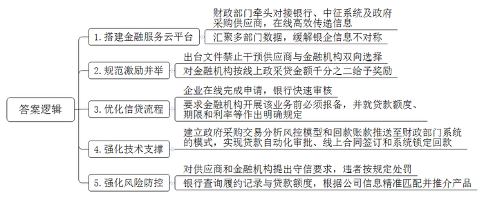
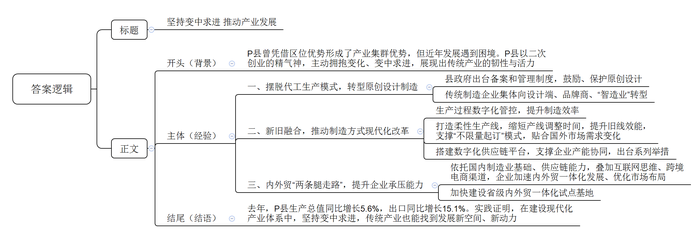
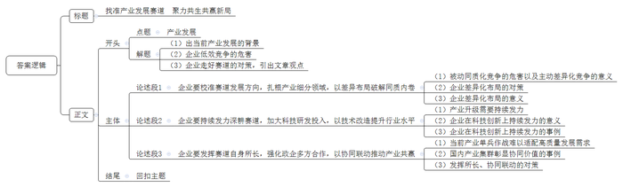

# 2026年公务员多省联考《申论》题（山西县乡卷）

<!-- gwy:overview:start -->
> **山西 · 2026 · 申论 · 县乡卷** ｜ 4 题 · 图片 4 处 · 答案随题折叠

导航：[题目](#题目) · [材料 1](#材料-1)
<!-- gwy:overview:end -->

> 候选采集稿。参考答案及解析来自粉笔页面，不代表官方答案或真实高分答卷；来源使用许可与原卷对应关系仍需人工核实。

## 给定材料

### 材料 1

“没想到不用担保和抵押，只凭政府采购合同就很快拿到了贷款，利率还比普通商业贷款低。”文西科技有限公司陈总感慨。当时，公司通过“政采贷”成功获得了42万元融资，解决了项目启动资金短缺的燃眉之急。

“政采贷”，即政府采购合同融资，是指中小微企业凭借政府采购合同向指定的金融机构申请融资，并享受更优惠便捷贷款的政策。通过“政采贷”，F省将政府采购合同的信用价值转化为融资凭证，有效破解了中小微企业“钱从哪里来”的难题。

文西科技有限公司是一家从事科技服务的民营企业。2024年初，公司中标了C市某劳务采购项目，项目金额50余万元。“当时我们公司成立不到3年，前期投入比较大，还有一定的资金缺口。”陈总介绍。2024年3月，C市财政局电话告知文西公司“政采贷”政策后，公司登录F省金融服务云平台，直接用政府采购合同向所在地的工行某支行申请了贷款，在2个工作日后就收到了银行发放的贷款，利率低至3.35%。

近年来，F省依托金融服务云平台，由各市县（区）财政部门牵头，通过对接银行、中征系统及众多政府采购供应商，积极推进“政采贷”业务，实现了中标公告、采购合同和融资需求的在线高效传递。“云平台上还汇聚了市场监管、税务、人社等多部门的数据，切实缓解了银企信息不对称的难题，实现了‘让数据多跑路、跑通路’。”F省财政厅政府采购处连处长介绍。

“中标以后就有五六家银行打来电话问需不需要贷款。有的银行可以全程线上操作，有的承诺优惠利率，有的审批通过后1天就能放款。几家银行的手续都特别简便。”F省灿光家私有限公司温经理说。为进一步规范并激励全省金融机构开展“政采贷”业务，2024年，省财政厅会同人民银行F省分行出台相关文件，要求任何单位和个人不得干预供应商选择金融机构及金融产品，不得干预金融机构向供应商提供贷款。同时，省级财政对金融机构按照当年发放的线上“政采贷”金额的千分之二给予奖励。2025年1至8月，F省8家金融机构发放贷款33亿元，获得奖补资金共计660.5万元。

“现在企业只要通过云平台中的‘政采贷’申办模块上传中标通知书和采购合同，选择合作银行，就能完成申请。我们在后台可以获取到平台中的企业证照和历史交易数据，收到申请后就能快速进行审核。”某银行F省分行齐行长介绍。F省要求金融机构在开展“政采贷”业务前必须向同级财政部门和人民银行报备，并对金融机构就贷款额度、期限和利率等都作出了明确规定。“根据上级要求，我行推出‘政采贷’零抵押、零担保，目前的贷款利率较当期一年期LPR（贷款市场报价利率）低30个基点。同时，我行将授信审批的时间由要求的不超过5个工作日缩短至不超过3个工作日，申请提交到放款时间由要求的不超过10个工作日缩短至不超过7个工作日。我行还通过引入大数据辅助审批，有效减少了人工审批成本。”齐行长说。

为了让政策更好落地，F省建立了政府采购交易分析风控模型和回款账款直接推送至财政部门预算管理一体化系统的模式，为贷款自动化审批、线上合同签订和系统锁定回款提供了有力技术支撑。“一方面，我们实现了各级平台入口统一、省市县信息全域覆盖，让‘政采贷’业务做到了推送信息、锁定回款账户、申请贷款、预授信、审批放款和贷后风控的全流程线上闭环操作，对于没有及时归还贷款或者金融机构存在违规行为的，我们会及时进行风险提示；另一方面，我们打通了金融服务云平台和监管平台的数据壁垒，保证监管部门可以第一时间查看‘政采贷’和保函数据。”金融服务云平台建设小组汪组长表示。

省财政厅也对供应商和金融机构同步提出了守信要求。如果供应商以弄虚作假等方式获取融资，或无故不按规定及时履约的，金融机构可以解除融资协议，并按协议约定追究违约责任。如果金融机构发布不实信息、虚假宣传或违背服务承诺开展融资，将由相关部门责令限期改正，若情节严重，将终止融资业务合作资格。

“目前我们开展业务的要求是客户必须在最近2年内有正常履约记录，贷款额度不能超过客户持有采购合同金额的70%。”某银行网点信贷经理小贾说，“金融服务云平台会及时滚动近期政府采购中标且未进行贷款业务的公司信息，我们会根据标的金额、近三年内公司是否申请过‘政采贷’和公司的经营状况等信息精准匹配我们的产品并进行推介。”

### 材料 2

随着乡村振兴战略的实施和城乡经济的融合，传统的农业生产和农村生活方式正在逐渐转变，农村职业经理人、民宿管家等新兴职业不断涌现。为进一步了解乡村新职业的发展状况及乡村振兴实施成果，S市开展了“乡村有我·共话未来”乡村新职业代表交流座谈会。以下是座谈会的部分发言记录。

农村职业经理人李先生：转眼间，我在这个岗位上已经干了五年。这些年，我带着团队和乡亲们一块儿干了许多事。我们开展了对土地、农作物和销售市场的调研；从农科院采购了新型种子，并采用间作模式；引进了水肥一体化管理系统、植保无人机等先进设备；上线了小程序，定期在各个平台直播销售……这五年的辛苦让我们的钱袋子鼓了，大家越干越有劲，规模也越做越大，但是规模的扩大意味着机械化自动化要求的提高。政府虽然有专项补贴，可就算是一台最普通的联合收割机，对村民的负担还是比较高。而且村里的道路狭窄，很多地方还是沙石路，连机器的运输都是问题。村民们大多都没有经过培训，也看不懂说明书，使用农机时遇到了问题只能自己瞎琢磨，光靠我们村想解决实在是有点难。

民宿管家王女士：民宿不仅仅是一个提供住宿的地方，它更像是传承乡村文化的一个窗口，让游客们真正体验到乡村的魅力，感受来自乡村的宁静与美好。所以，我用三年的时间打造了“田园居”。每天，我会确认采购清单，早餐前带着客人体验点心的古法制作流程，早餐后组织客人到村子周边赶大集。下午则会组织乡村体验官活动，带他们到村子里参观遗迹遗址，或者安排客人参与拓印、彩绘等文创体验活动。晚上，民宿还有一个固定项目“围炉夜话”。客人们围坐在茶炉边谈天说地，有的称赞我们村历史底蕴深厚，村俗文化独特；有的说我们村是“酒香也怕巷子深”，来之前完全没想到这里会这么美；有的建议我可以开直播，或者邀请一些旅游博主来打响知名度；还有的说我们村路窄灯暗，很多石板路还崎岖不平，到了晚上出门容易摔跤，还找不到方向。客人们的建议都很实在，给了我很多启发。

乡村CEO赵先生：我们团队在入驻时进行了详尽的乡村资源调查，从土壤成分到气候条件，从历史文化到民俗风情，无一不细细考量。从调研结果来看，村里的资源是很丰富的。最后综合考虑，团队制定了“绿色生态+文化旅游”的双轮驱动发展策略。在农业发展方面，我们采取了生态循环的养殖模式，引入了智能化立体养殖技术，但投资大、周期长、回报慢，这使得我们难以获得充足的银行信贷支持，本想搭建的智慧农业系统也因为缺乏后续资金而暂停，要是能得到更有力的金融扶持就好了。在文旅宣传方面，我们通过挖掘乡村文化内涵，设计了一系列特色文旅活动，如采摘园、民俗体验课、“我的一亩田”认领等，但人气一直平平。后来发现主要是因为我们缺乏新媒体运营能力，过分依赖传统广告渠道进行宣传，引流效果就比较一般。后续我们想和县融媒体平台合作，请他们的专业运营人员来授课，开展一些联合宣传，让更多人能看到我们的好活动。

农产品电商运营师张女士：我自小在田间地头长大，对家乡的一草一木都充满了深厚的感情。大学毕业后，我选择回到家乡，利用所学的电子商务知识，帮助乡亲们开网店、做直播，教他们用手机拍摄农产品的照片、写产品描述、申请相关资质、做线上推广，让大家的农产品都能及时地卖出去、卖个好价钱。现在乡亲们的直播热情很高，但是到了晚上直播的高峰期，村里的网络就会变得不稳定，一卡顿大家都急得不行。此外，村里目前只有我一个人熟悉电子商务，实在是分身乏术。我试着邀请过几位大学时代的挚友和我一起到村里创业，结果却不尽如人意。他们有的觉得人生地不熟，对创业没有信心；有的认为村里给的创业启动资金不够，不敢冒险；还有的担心医疗、教育这些配套设施跟不上，未来的发展机会也有限。要解决这些问题，光靠我们的力量肯定是不够的，希望政府也能想想办法。

### 材料 3

走进P县中国服装城，熙熙攘攘的批发客商穿梭其间，店员们忙着开单、打包货品发往全国乃至世界各地。不产羽绒，却产出全国一半以上羽绒服；不产皮革，却成为全国三大箱包生产基地之一……P县“无中生有”，主动拥抱变化、变中求进，在变革中呈现“繁星满天”，发展成为中国服装制造名城、中国跨国服装采购产业基地、中国旅行箱包之都，展现出传统产业在建设现代化产业体系中的韧性与活力。

20世纪80年代，P县凭借区位优势兴起第一批服装、箱包加工厂，此后快速形成产业集群优势。“那时OEM（代工生产）订单接到手软。”P县杜县长说，“直到近些年，受贸易环境、用工成本、原料价格等因素影响，订单量经常不太稳定。苦等订单是没有出路的，必须拿出二次创业的精气神。”P县大量企业开始在门槛更高的细分行业寻找机会，尤其是向ODM（原创设计制造）进军。

“我想从中国传统文化中汲取灵感，融入羽绒服设计。”P县青年设计师沈先生带着自己原创的高级时装羽绒服品牌闯进了米兰时装周。“我们做过统计，2016年市场内具有原创设计的款式不超过200款，而2023年原创设计款式超过2万款。”P县中国服装城负责人介绍，为了鼓励、保护原创设计，县里出台了严格的备案和管理制度。另一家箱包公司负责人董女士说：“原创设计紧跟现代化趋势、紧扣市场化需求，让中国制造、中国智造的优势更加凸显，我们与十多个知名IP打造联名款箱包，站稳了中高端市场。”从单纯的生产商向设计端、品牌商、“智造业”转型，已经成为传统制造企业的共识。目前P县企业设计研发投入占年销售额比重达到5%。

在一家服装企业中控室内，工序进度以及各车间产品完成数、计划达成率等实时呈现在大屏上。“影响服装企业生产效率的因素中，至少有30%是因为工序之间的无效等待和质量问题引起的返工。”P县服装行业协会崔会长介绍，当前，主流消费群体和电商平台、直播带货等新兴分销渠道对制造效率提出了更高要求，对企业而言，“效率就是生命”更加凸显，数字赋能转型升级是大势所趋。

“我们就是要在县域范围内形成产业集中、专业化极强，同时又具有明显本地特色的区域性产业群体。县里的箱包工业基础是很好的，现在要做的是转型升级，推动制造方式的现代化改革。这并不意味着另起炉灶，而是新旧融合，让传统制造插上现代化翅膀。”杜县长介绍。“我们打造了一条柔性生产线，从制造一种产品切换到另一种产品，产线调整时间只需半个小时。”P县箱包有限公司童经理说，“这很好地支撑了‘不限量起订’模式，让我们在适应小批量、个性化定制需求方面尽显优势，实现了旧有生产线的能效再提升。”

几年前，P县邱先生自创的羽绒服品牌受到欧美消费者热捧，销量跻身某海外购物平台服装畅销榜，甚至成为女式羽绒服“销冠”。“从大批量到‘小快灵’，服装外贸有新机会。”邱先生说，近些年国外市场消费能力、消费习惯等都有变化，中国企业贴合需求、小批量生产、快速迭代的能力更加凸显，这为P县新兴服装企业带来了竞争优势。

P县箱包产业数字化供应链平台在支撑企业产能协同中发挥了重要作用：大公司接到订单可以在平台发包，中小企业在线抢单，当地一大批箱包厂因此在细分环节找到了发展空间。近年来，P县还通过建设工业互联网平台、制定传统产业定制化转型实施意见等举措，驱动传统制造业生产方式变革。

依托国内强大的制造业基础、供应链能力，叠加互联网思维、跨境电商渠道，近些年P县企业内外贸一体化发展、市场布局优化明显加速。P县箱包有限公司不仅将海外客户从欧洲拓展到南美，还积极瞄准国内消费群体。“我们建立了500平方米的网络直播基地，线上线下协同打开国内销售市场。”公司负责人说，外贸、内贸“两条腿走路”，让企业承压能力更强。

立足当地特色传统产业，P县加快建设省级内外贸一体化试点基地，目前当地的省级内外贸一体化“领跑者”企业、一体化产业基地、高质量发展项目等数量均居全省前列。去年，P县实现生产总值555.08亿元，同比增长5.6%。同期，P县实现货物贸易进出口417.35亿元，其中出口273.19亿元，增长15.1%。

“传统与现代之间并没有断裂，而是连续的更新迭代。”杜县长表示，当地传统产业转型升级经受住市场检验、展现出韧性与活力，这表明在建设现代化产业体系中，变中求进的传统产业也能找到发展新空间、新动力。

### 材料 4

H市的锦纶产业起步早，2021年产品已涵盖工业丝类、纺织机械类、民用丝类等六大系列，400多个品种，远销190多个国家和地区，其中工业丝产销量和出口量均占全国的40%……成绩单虽已足够亮眼，但与H市“构建锦纶现代化产业体系”的发展蓝图还有差距。

“2021年全市锦纶工贸企业中，规上企业占比不足一成，营收超亿元企业不到20家。关键设备和技术受制于人，高附加值的深加工环节需要依托东部发达省份完成，产业增值收益分配处于被动地位。”H市王副市长告诉记者，2022年市政府出台《H市锦纶产业高质量发展专项行动方案》，根据规划，H市聚焦发展新质生产力，以延链强链补链为抓手精准招商，推动锦纶产业转型升级。

从东部发达省份引进的锦荣公司于2023年入驻H市纺织产业园。走进公司的智能制造试点车间，只见一台台设备在自动高速运转，机械手无声抓取丝饼，传送带和运输车无缝衔接，工业相机精准识别，一旁的智慧大屏上，丝饼的状态统计一目了然。“我们通过自主研发的信息化控制系统和实时监测平台，实现了生产全流程自动化管理，节省近40%的人工，还装配了最新型丝饼质量外观检测系统，质检准确率提升至99%。”公司林经理介绍。

“今年我们公司刚被市里确定为高精密纺织机械制造产业链‘链主’企业，采用我们公司最新研发的纺织设备建成的锦纶生产线，可实现单位能耗降低25%-30%。”同属H市引进企业的利申公司孙总经理自豪地说，“我们这条生产线是由公司科研团队原创设计，生产设备数字化改造自主率达到100%。公司自2024年构建起‘互联网+锦纶’数字新生态后，打通了采购、生产、物流、核算等全业务流程，效率提高近6倍。”

“过去H市锦纶企业的主营业务基本相似，产品缺少核心专利，附加值偏低，只能拼成本、打价格战，行业陷入低水平、同质化的竞争。近两年，受几家引进企业影响，他们都加大了科技投入，同时更新设备，产品迭代速度明显加快。”市工业和信息化局鲍科长介绍，H市按照应用场景对锦纶产业进行重新分类，每个细分领域培育2至3家链主企业，初步形成“产业龙头+单项冠军+专精特新”优质企业雁阵集群。

然而产业转型升级之路并非一帆风顺。“我们当然明白科技很重要，但智能改造需要投入大量技术、资金和人才，我们的抗风险能力又弱，当初不是‘不想转’，而是‘不敢转’‘不会转’。”H市最早成立的锦纶企业华扬公司蔡总经理向记者解释，“智改数转是系统工程，要从一根丝闯出一条路，不能光靠企业单打独斗，形成合力才有出路。”

“企业的难处我们都记在心上，去年起，市政府批准每年划拨专项资金支持企业申报工业互联网创新发展项目，同时引导中小企业将研发设计、生产制造等核心业务能力向云平台迁移，打造‘数字化智慧工厂’。”市科技局朱局长说，“要转变‘资源内卷式’的增长方式，关键在于以科技创新带动产业发展。当前我局正努力推进企业与本省重点科研院校成立校企联合创新中心，在新型锦纶、再生锦纶纤维等领域开展合作，鼓励进行产品差异化开发，拓展下游市场应用领域，实现锦纶行业高质量发展。”

在H市鹤尚公司生产车间，工程师小彭正带着工人检修车间房顶上的光伏发电设备。“政府提供了资金补贴，我们只用很低的成本就铺上了光伏发电板，现在车间内各种设备以及办公用电全部由它提供，一年能节省电费开销180多万元，成本低了，我们的腰包就厚了。”小彭笑着说，“三个月前，我们还进行了废水、固体废弃物及大气污染物处理的技术改造升级，市里安排了专家过来实地勘察、指导改造，现在我们也是绿色工厂了。”“纺织工业不仅是重要的民生产业，也是环境敏感型产业，通过科技创新降低锦纶对石化资源依赖，能显著减少生产过程带来的环境污染。”市环保局沈主任告诉记者，“打造产业绿色竞争力，引导行业开展绿色‘内卷’，才能让产业发展行稳致远。”

2025年H市锦纶产业营业收入增长13.4%，规上企业增加至156家，共有专精特新中小企业22家、高新技术企业11家，产业持续集聚，不断释放出发展新动能。<u><u>“一个产业就像一条赛道，不同企业在赛道上前行，即使赛道相同也不意味着只能横冲直撞、搞内卷式竞争。要走好自己的路，关键是校准方向、持续发力、发挥所长，从而互相促进，共生共赢。”</u></u>H市高质量发展研究院邹研究员说。

## 题目

### 第 1 题

**根据“给定资料1”，请你对F省推动“政采贷”政策落实落地的主要措施进行概括。（15分）**

关联材料：材料 1

作答要求：

要求：全面、准确、有条理。不超过300字。

第 1 题 · 答案与解析

**参考答案（粉笔题库参考内容）**

1.搭建金融服务云平台。财政部门牵头对接银行、中征系统及政府采购供应商，在线高效传递信息；汇聚多部门数据，缓解银企信息不对称。

2.规范激励并举。出台文件禁止干预供应商与金融机构双向选择；对金融机构按线上政采贷金额千分之二给予奖励。

3.优化信贷流程。企业在线完成申请，银行快速审核；要求金融机构开展该业务前必须报备，并就贷款额度、期限和利率等作出明确规定。

4.强化技术支撑。建立政府采购交易分析风控模型和回款账款推送至财政部门系统的模式，实现贷款自动化审批、线上合同签订和系统锁定回款。

5.强化风险防控。对供应商和金融机构提出守信要求，违者按规定处罚；银行查询履约记录与贷款额度，根据公司信息精准匹配并推介产品。

**解析**

**参考答案说明：**本参考答案从“搭建金融服务云平台”“规范激励并举”“优化信贷流程”“强化技术支撑”“强化风险防控”等五个方面进行了分条撰写。各条答案要点之间在内容上相互并列，没有交叉。

**考点**：概括措施类

**来源**：2026年公务员多省联考《申论》题（山西县乡卷）

### 第 2 题

**“给定资料2”反映了S市部分乡村新职业代表在工作中遇到的一些问题，请你对这些问题进行梳理，并提出解决建议。（20分）**

关联材料：材料 2

作答要求：

要求：

（1）问题梳理全面、准确；

（2）所提建议有针对性、切实可行；

（3）层次分明，逻辑清晰；

（4）不超过400字。

第 2 题 · 答案与解析

**参考答案（粉笔题库参考内容）**

问题：1.资金压力大。村民购买农机专项补贴力度小；农业项目难获得银行信贷支持。2.基础设施差。道路狭窄、未硬化，路面崎岖，路灯昏暗，没有路牌；高峰期网络不稳定。3.宣传营销弱。文旅项目知名度低；新媒体运营能力不足，依赖传统广告渠道，引流效果差。4.人才引育难。缺少农机使用培训；缺少电商人才；创业启动资金不够，医疗教育等配套设施不足，制约电商人才引进。

对策：1.强化资金保障。提高农机购置补贴标准，降低农民购买负担；金融机构推出农业信贷产品，放宽授信条件，助力农业项目落地。2.完善基础设施。推进村内道路拓宽、硬化、修缮，实施村落亮化工程，设置路标；升级乡村网络基站，保障高峰期网络通畅。3.加强文旅宣传。开展乡村文旅直播，邀请旅游博主宣传；县融媒体平台派专业运营人员授课，开展联合宣传。4.人才引育并举。开展农机操作、电商技能培训，培养本地人才；加大创业启动资金扶持力度，完善教育医疗等配套，吸引专业人才。

**解析**

**参考答案说明：**本参考答案整体分为“问题”和“对策”两个部分，其中“问题”部分从“资金压力大”“基础设施差”“宣传营销弱”“人才引育难”这四个方面展开，“对策”部分从“强化资金保障”“完善基础设施”“加强文旅宣传”“人才引育并举”四个方面展开，且所提对策与问题相对应。各条答案要点之间在内容上相互并列，没有交叉。

**考点**：提出对策类

**来源**：2026年公务员多省联考《申论》题（山西县乡卷）

### 第 3 题

**市里将举办传统产业转型升级经验交流会，P县杜县长将以“坚持变中求进 推动产业发展”为题目作会议发言。请你根据“给定资料3”，为杜县长拟写一份发言提纲。（25分）**

关联材料：材料 3

作答要求：

要求：

（1）紧扣资料，内容全面；

（2）条理清晰，语言准确；

（3）不超过450字。

第 3 题 · 答案与解析

**参考答案（粉笔题库参考内容）**

坚持变中求进 推动产业发展

背景：P县曾凭借区位优势形成了产业集群优势，但近年发展遇到困境。P县以二次创业的精气神，主动拥抱变化、变中求进，展现出传统产业的韧性与活力。

经验：一、摆脱代工生产模式，转型原创设计制造。县政府出台备案和管理制度，鼓励、保护原创设计；传统制造企业集体向设计端、品牌商、“智造业”转型。二、新旧融合，推动制造方式现代化改革。生产过程数字化管控，提升制造效率；打造柔性生产线，缩短产线调整时间，提升旧线效能，支撑“不限量起订”模式，贴合国外市场需求变化；搭建数字化供应链平台，支撑企业产能协同，出台系列举措。三、内外贸“两条腿走路”，提升企业承压能力。依托国内制造业基础、供应链能力，叠加互联网思维、跨境电商渠道，企业加速内外贸一体化发展、优化市场布局；加快建设省级内外贸一体化试点基地。

结语：去年，P县生产总值同比增长5.6%，出口同比增长15.1%。实践证明，在建设现代化产业体系中，坚持变中求进，传统产业也能找到发展新空间、新动力！

**解析**

**参考答案说明：**（1）格式方面，本参考答案写到了“标题”“正文”两个部分。（2）正文部分，一方面从内容上来看，围绕“P县传统产业转型升级”这一主题，本参考答案的开头先写到了“P县传统产业的相关背景”；主体部分从“摆脱代工生产模式，转型原创设计制造”“新旧融合，推动制造方式现代化改革”“内外贸‘两条腿走路’，提升企业承压能力”等三个方面给出了具体的建设措施。最后，结尾对建设成效进行了总结并展望未来。另一方面，形式上，本参考答案做到了分段、分条撰写，整体上条理颇为清晰。

**考点**：总结类

**来源**：2026年公务员多省联考《申论》题（山西县乡卷）

### 第 4 题

**“给定资料4”中提到“一个产业就像一条赛道，不同企业在赛道上前行，即使赛道相同也不意味着只能横冲直撞、搞内卷式竞争。要走好自己的路，关键是校准方向、持续发力、发挥所长，从而互相促进，共生共赢。”请你以“赛道”为话题，参考给定资料，联系实际，自选角度，自拟题目，写一篇文章。（40分）**

关联材料：材料 1、材料 2、材料 3、材料 4

作答要求：

要求：

（1）观点明确，见解深刻；

（2）参考给定资料，但不拘泥于给定资料；

（3）思路清晰，语言流畅；

（4）字数1000-1200字。

第 4 题 · 答案与解析

**参考答案（粉笔题库参考内容）**

**找准产业发展赛道** **聚力共生共赢新局**

当前，我国制造业正处于转型升级的关键期，产业底盘不断夯实，但同质化扎堆、低端比拼等“内卷式”竞争问题也日益凸显。产业发展如同赛道竞速，同一赛道之上，企业若只顾低效缠斗，只会陷入存量争夺的恶性循环。跳出困局，关键在于企业要校准方向、持续发力、发挥所长，以差异布局避免正面消耗，以科技攻坚提升竞争层次，以协同联动拓宽发展空间，方能在同场竞技中各骋所长、共生共赢。

**企业要校准赛道发展方向，扎根产业细分领域，以差异布局破解同质内卷。**《孙子兵法》有云：“善战者，致人而不致于人。”被动卷入同质化比拼，终将受制于人、利润尽薄；主动选择差异化赛道，方能掌握竞争主动权。面对激烈竞争，企业不应追求规模扩张的“广度”，而应深耕细分市场的“深度”。因此，企业当立足自身禀赋，找准差异化切口，将人才、资金、技术等有限资源集中投向最具比较优势的环节，在细分领域做到极致，以局部压倒性优势构筑竞争壁垒。当每家企业都在自己擅长的“窄域”中精耕细作、互不挤占，同质化内卷便不攻自破，产业发展自会呈现各展所长、百花齐放的良性局面。

**企业要持续发力深耕赛道，加大科技研发投入，以技术改造提升行业水平。**产业升级不是一蹴而就的速决战，而是久久为功、日积月累的持久战。唯有坚持创新驱动发展、持续加码科技投入，在日复一日的技术攻坚中沉淀优势、突破瓶颈，方能实现从量变到质变的跨越式突破。大疆深耕无人机赛道，依托长期技术攻坚，稳居全球无人机行业领军地位；DeepSeek聚焦人工智能赛道，依托领先的算力优化技术，赋能千行百业数字化转型；宁德时代扎根动力电池赛道，凭借完善的研发体系，崛起为全球新能源标杆企业……企业要以恒久之功深耕科创，持续推进技术改造与创新突破，带动全行业发展水平整体跃升。

**企业要发挥赛道自身所长，强化政企多方合作，以协同联动推动产业共赢。**现代化产业赛道链条完整、分工精细，单一主体的单兵作战模式早已难以适配高质量发展需求。国内产业集群发展实践早已充分彰显协同价值：深圳聚力打造电子信息产业集群，上下游聚链成势、抱团发展；杭州深耕视觉智能产业集群，一批标志性项目新动能不断释放；长三角构筑储能高新产业集群，依托产学研融合实现迭代升级。企业应主动深化产业链上下游协作，互通资源、互补优势，凝聚集群发展合力；政府需主动担当作为，搭建产业合作、科研转化平台，积极推动产学研深度融合，以多方协同之力助推产业共生共荣。

产业转型升级之路，绝非内卷博弈的短道竞速，而是聚力革新、提质增效的长远征程。唯有明确发展方向，坚守科创攻坚，深化多方联动，方能构筑产业良性发展新生态，持续释放高质量发展强劲动能。

**文章分析**

**找准产业发展赛道** **聚力共生共赢新局**

【**标题的优点：**首先，标题中含有主题词，使文章主题更突出、清晰；其次，形式上采用对称式结构，使标题更加完整、饱满。】

（1）<u><u>当前</u></u>，<u><u>我国制造业正处于转型升级的关键期</u></u>，产业底盘不断夯实，但同质化扎堆、低端比拼等“内卷式”竞争<u><u>问题也日益凸显</u></u>。（2）产业发展如同赛道竞速，同一赛道之上，<u><u>企业若只顾低效缠斗</u></u>，<u><u>只会陷入存量争夺的恶性循环</u></u>。（3）跳出困局，<u><u>关键在于企业要校准方向</u></u>、<u><u>持续发力</u></u>、<u><u>发挥所长</u></u>，以差异布局避免正面消耗，以科技攻坚提升竞争层次，以协同联动拓宽发展空间，<u><u>方能在同场竞技中各骋所长</u></u>、<u><u>共生共赢</u></u>。

【**开头的优点：**★内容方面：范文的开头是紧扣“产业发展”这一主题展开的。首先，开头点出主题，做到了主题明确。其次，对“产业发展”这一主题进行了分析阐述：（1）指出当前产业发展的背景；（2）阐述企业低效竞争的危害；（3）指出企业走好赛道的对策，引出文章观点。★文字表达方面：长短句配合使用，使语言表达有逻辑性。】

**企业要校准赛道发展方向，扎根产业细分领域，以差异布局破解同质内卷。**（1）《孙子兵法》有云：“善战者，致人而不致于人。”<u><u>被动卷入同质化比拼</u></u>，<u><u>终将受制于人</u></u>、<u><u>利润尽薄</u></u>；<u><u>主动选择差异化赛道</u></u>，<u><u>方能掌握竞争主动权</u></u>。（2）<u><u>面对激烈竞争</u></u>，<u><u>企业</u></u>不应追求规模扩张的“广度”，而<u><u>应深耕细分市场的</u></u>“<u><u>深度</u></u>”。因此，企业当<u><u>立足自身禀赋</u></u>，<u><u>找准差异化切口</u></u>，<u><u>将</u></u>人才、资金、技术等<u><u>有限资源集中投向最具比较优势的环节</u></u>，<u><u>在细分领域做到极致</u></u>，<u><u>以局部压倒性优势构筑竞争壁垒</u></u>。（3）当每家企业都在自己擅长的“窄域”中精耕细作、互不挤占，<u><u>同质化内卷便不攻自破</u></u>，<u><u>产业发展自会呈现</u></u>各展所长、百花齐放的<u><u>良性局面</u></u>。

【**论述段1的优点：**★观点句：范文的观点句是紧扣“产业发展”这一文章主题提出的。形式上，它在段首处直接写出，位置突出，容易发现。内容上，关键词突出，内容要点明确，可以明显看出它是从“校准方向，差异布局产业”这个角度展开论述。★论述内容：（1）指出被动同质化竞争的危害以及主动差异化竞争的意义；（2）阐述企业差异化布局的对策；（3）指出企业差异化布局的意义。注意：以上三个方面的内容都是紧扣“企业要校准赛道发展方向，扎根产业细分领域，以差异布局破解同质内卷”这个观点句进行分析论述的，论述的针对性强，内容层次丰富。在论述方法上主要采用了讲道理的方式，论述清晰透彻。】

**企业要持续发力深耕赛道，加大科技研发投入，以技术改造提升行业水平。**（1）<u><u>产业升级</u></u>不是一蹴而就的速决战，而<u><u>是久久为功</u></u>、<u><u>日积月累的持久战</u></u>。（2）<u><u>唯有坚持创新驱动发展</u></u>、<u><u>持续加码科技投入</u></u>，在日复一日的技术攻坚中沉淀优势、突破瓶颈，<u><u>方能实现从量变到质变的跨越式突破</u></u>。（3）<u><u>大疆</u></u>深耕无人机赛道，依托长期技术攻坚，稳居全球无人机行业领军地位；<u><u>DeepSeek</u></u>聚焦人工智能赛道，依托领先的算力优化技术，赋能千行百业数字化转型；<u><u>宁德时代</u></u>扎根动力电池赛道，凭借完善的研发体系，崛起为全球新能源标杆企业……企业要以恒久之功深耕科创，<u><u>持续推进技术改造与创新突破</u></u>，<u><u>带动全行业发展水平整体跃升</u></u>。

【**论述段2的优点：**★观点句：范文的观点句是紧扣“产业发展”这一文章主题提出的。形式上，它在段首处直接写出，位置突出，容易发现。内容上，关键词突出，内容要点明确，可以明显看出它是从“持续发力，技术创新提升行业水平”这个角度展开论述。★论述内容：（1）强调产业升级需要持续发力；（2）阐述企业在科技创新上持续发力的意义；（3）列举企业在科技创新上持续发力的事例。注意：以上三个方面的内容都是紧扣“企业要持续发力深耕赛道，加大科技研发投入，以技术改造提升行业水平”这个观点句进行分析论述的，论述的针对性强，内容层次丰富。在论述方法上采用了讲道理和举例子相结合的方式，论述充实有力。】

**企业要发挥赛道自身所长，强化政企多方合作，以协同联动推动产业共赢。**（1）现代化产业赛道链条完整、分工精细，<u><u>单一主体的单兵作战模式早已难以适配高质量发展需求</u></u>。（2）<u><u>国内产业集群发展实践早已充分彰显协同价值</u></u>：<u><u>深圳聚力打造电子信息产业集群</u></u>，上下游聚链成势、抱团发展；<u><u>杭州深耕视觉智能产业集群</u></u>，一批标志性项目新动能不断释放；<u><u>长三角构筑储能高新产业集群</u></u>，依托产学研融合实现迭代升级。（3）<u><u>企业应</u></u>主动深化产业链上下游协作，互通资源、互补优势，凝聚集群发展合力；<u><u>政府需</u></u>主动担当作为，搭建产业合作、科研转化平台，积极推动产学研深度融合，<u><u>以多方协同之力助推产业共生共荣</u></u>。

【**论述段3的优点：**★观点句：范文的观点句是紧扣“产业发展”这一文章主题提出的。形式上，它在段首处直接写出，位置突出，容易发现。内容上，关键词突出，内容要点明确，可以明显看出它是从“发挥所长，协同联动推动产业共赢”这个角度展开论述。★论述内容：（1）强调当前产业单兵作战难以适配高质量发展需求；（2）列举国内产业集群彰显协同价值的事例；（3）从企业和政府两个角度，指出发挥所长、协同联动的对策。注意：以上三个方面的内容都是紧扣“企业要发挥赛道自身所长，强化政企多方合作，以协同联动推动产业共赢”这个观点句进行分析论述的，论述的针对性强，内容层次丰富。在论述方法上主要采用了讲道理和举例子相结合的方式，论述充实深刻。】

【**论述段之间的关系：**★内容的内在逻辑：范文的论述段之间是依照并列的逻辑展开的。论述段1先写了“企业要校准赛道发展方向，扎根产业细分领域，以差异布局破解同质内卷”，论述段2接着写了“企业要持续发力深耕赛道，加大科技研发投入，以技术改造提升行业水平”，论述段3最后写了“企业要发挥赛道自身所长，强化政企多方合作，以协同联动推动产业共赢”。这三个论述段分别从“校准方向”“持续发力”“发挥所长”三个方向展开，整体论述思路清晰。】

产业转型升级之路，绝非内卷博弈的短道竞速，而是聚力革新、提质增效的长远征程。唯有明确发展方向，坚守科创攻坚，深化多方联动，方能构筑产业良性发展新生态，持续释放高质量发展强劲动能。

【**结尾的优点：**范文的结尾回扣了“产业发展”这个主题，并且进行了总结提升。】

**解析状态：unknown（来源未提供）**

**考点**：文章写作题

**来源**：2026年公务员多省联考《申论》题（山西县乡卷）

