# 2008年广东省公务员录用考试《行测》题

<!-- gwy:overview:start -->
> **广东 · 2008 · 行测 · 统考** ｜ 100 题 · 图片 60 处 · 答案随题折叠

| 题型模块 | 题量 | 题号 |
| --- | ---: | ---: |
| 数理能力 | 15 | 1–15 |
| 言语理解与表达 | 30 | 16–45 |
| 判断推理 | 30 | 46–75 |
| 常识判断 | 10 | 76–85 |
| 资料分析 | 15 | 86–100 |
| **合计** | **100** | |

导航：[题型与作答说明](#题型与作答说明) · [题目](#题目) · [材料 1](#材料-1)
<!-- gwy:overview:end -->

> 候选采集稿。参考答案及解析来自粉笔页面，不代表官方答案或真实高分答卷；来源使用许可与原卷对应关系仍需人工核实。

## 题型与作答说明

数理能力

（15题）

本部分包括数字推理与数学运算两种类型的试题。

言语理解与表达

（30题）

本部分包括逻辑填空与阅读理解两种类型的试题。

判断推理

（30题）

本部分包括类比推理、图形推理与演绎推理三种类型的题目。注意，正确的答案应与所给的陈述相符合，不需要任何附加说明即可以从陈述中直接推出。

常识判断

（10题）

根据题目要求，在四个选项中选出一个最恰当的答案。

资料分析

（15题）

针对下列文字、表或图回答问题。你应根据资料提供的信息进行分析、比较、计算、处理。

## 题目

### 第 1 题

1，2，6，16，44，（  ）

A. 66

B. 84

C. 88

D. 120

第 1 题 · 答案与解析

**参考答案（粉笔题库参考内容）**

D

**解析**

每一项等于前两项的和乘以2。

具体为：，16=(2+6)×2，44=(6+16)×2，则未知项=(16+44)×2=120。

故正确答案为D。

**来源**：2008年广东省公务员录用考试《行测》题第1题

### 第 2 题

2，3，6，8，8，4，（  ）

A. 2

B. 3

C. 4

D. 5

第 2 题 · 答案与解析

**参考答案（粉笔题库参考内容）**

A

**解析**

每一项等于前两项乘积的个位数。

具体为：2×3=6，3×6=18（18的个位是8），6×8=48（48的个位是8），8×8=64（64的个位是4），8×4=32（32的个位是2）。

故正确答案为A。

**来源**：2008年广东省公务员录用考试《行测》题第2题

### 第 3 题

2，1，5，7，17，（  ）

A. 26

B. 31

C. 32

D. 37

第 3 题 · 答案与解析

**参考答案（粉笔题库参考内容）**

B

**解析**

原数列为幂次修正数列。

原数列；

幂次项指数成等差数列；

修正项成周期数列；

则未知项为。

故正确答案为B。

**来源**：2008年广东省公务员录用考试《行测》题第3题

### 第 4 题

1/36，1/5，1，3，4，（  ）

A. 1

B. 5

C. 6

D. 8

第 4 题 · 答案与解析

**参考答案（粉笔题库参考内容）**

A

**解析**

原数列；

幂次数列。

故正确答案为A。

**来源**：2008年广东省公务员录用考试《行测》题第4题

### 第 5 题

A. 5

B. 17

C. 19

D. 47

第 5 题 · 答案与解析

**参考答案（粉笔题库参考内容）**

C

**解析**

以每一纵列为一组，，，7×3=13+8，6×4=16+8。

故正确答案为C。

**来源**：2008年广东省公务员录用考试《行测》题第5题

### 第 6 题

甲、乙二人同时从A地去B地，甲每分钟行60米，乙每分钟行90米，乙到达B地后立即返回，并与甲相遇，相遇时，甲还需行3分钟才能到达B地，问A、B两地相距多少米：

A. 1350米

B. 1080米

C. 900米

D. 720米

第 6 题 · 答案与解析

**参考答案（粉笔题库参考内容）**

C

**解析**

解析1：

相遇时，甲离B地的距离为米，乙比甲多走了米。设出发后经历t分钟甲、乙相遇，相遇时甲走了60t米，乙走了90t米，则根据题意可得90t－60t＝360，t＝12分钟，A、B两地相距60×(12＋3)＝900米。

解析2：

相遇时，甲离B地的距离为米。设A、B两地相距S米，这样乙从A到相遇地点需分钟，甲从A到相遇地点需要分钟，时间相同，即：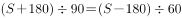，解得S＝900米。

故正确答案为C。

**考点**：相遇追及

**来源**：2008年广东省公务员录用考试《行测》题第6题

### 第 7 题

某人工作一年的报酬是18000元和一台全自动洗衣机，他干了7个月，得到9500元和一台全自动洗衣机，问这台洗衣机值多少元：

A. 8500元

B. 2400元

C. 2000元

D. 1700元

第 7 题 · 答案与解析

**参考答案（粉笔题库参考内容）**

B

**解析**

设洗衣机的价值是x元，每个月的工资是相等的，则有，x＝2400。

故正确答案为B。

**考点**：和差倍比问题

**来源**：2008年广东省公务员录用考试《行测》题第7题

### 第 8 题

的个位数是几：

A. 3

B. 5

C. 7

D. 9

第 8 题 · 答案与解析

**参考答案（粉笔题库参考内容）**

C

**解析**

2的幂次项个位数以2、4、8、6循环，4次一个周期；

3的幂次项个位数以3、9、7、1循环，4次一个周期；

2008恰好被4整除，个位数为6+1=7。

故正确答案为C。

**来源**：2008年广东省公务员录用考试《行测》题第8题

### 第 9 题

两年前甲的年龄是乙的两倍，五年前乙的年龄是丙的三分之一，丙今年11岁，问今年甲多少岁：

A. 12

B. 10

C. 7

D. 5

第 9 题 · 答案与解析

**参考答案（粉笔题库参考内容）**

A

**解析**

由题目可知，丙五年前11－5＝6岁，乙五年前1/3×6=2岁，乙两年前2＋3＝5岁，甲两年前2×5=10岁，则甲今年10＋2＝12岁。

故正确答案为A。

**考点**：年龄问题

**来源**：2008年广东省公务员录用考试《行测》题第9题

### 第 10 题

要折叠一批纸飞机，若甲单独折叠要半个小时完成，乙单独折叠需要45分钟完成。若两人一起折，需要多少分钟完成：

A. 10

B. 15

C. 16

D. 18

第 10 题 · 答案与解析

**参考答案（粉笔题库参考内容）**

D

**解析**

设工作量为1，甲每分钟完成工作量的1/30，乙每分钟完成工作量的1/45，故两人合作需分钟。

故正确答案为D。

**考点**：给完工时间型

**来源**：2008年广东省公务员录用考试《行测》题第10题

### 第 11 题

若一个边长为20厘米的正方体表面挖一个边长为10厘米的正方体洞，大正方体的表面积增加了多少平方厘米：

A. 100

B. 400

C. 600

D. 800

第 11 题 · 答案与解析

**参考答案（粉笔题库参考内容）**

B

**解析**

根据题意，挖掉1个正方体洞，增加了4个等大的正方形面，故大正方体的表面积增加平方厘米。

故正确答案为B。

**考点**：几何公式类-立体图形

**来源**：2008年广东省公务员录用考试《行测》题第11题

### 第 12 题

一杯糖水，第一次加入一定量的水后，糖水的含糖百分比变为15%；第二次又加入同样多的水，糖水的含糖百分变比为12%；第三次再加入同样多的水，糖水的含糖百分比将变为多少：

A. 8%

B. 9%

C. 10%

D. 11%

第 12 题 · 答案与解析

**参考答案（粉笔题库参考内容）**

C

**解析**

等量加水的过程中，溶液的量发生变化，溶质保持不变。直接赋值溶质为60，可得，因此糖水浓度变为10%。

故正确答案为C。

**来源**：2008年广东省公务员录用考试《行测》题第12题

### 第 13 题

有3个企业共订阅300份《经济周刊》杂志，每个企业最少订99份，最多订101份，问一共有多少种不同的订法：

A. 6

B. 7

C. 8

D. 9

第 13 题 · 答案与解析

**参考答案（粉笔题库参考内容）**

B

**解析**

根据题意要求，可知分发报纸的情况有两种（1）100、100、100；（2）99、100、101。前者方法数为1，后者方法数为A_3^3=6。综上共有6+1=7种方法。

故正确答案为B。

**考点**：基础排列组合

**来源**：2008年广东省公务员录用考试《行测》题第13题

### 第 14 题

某单位有60名运动员参加运动会开幕式，他们着装白色或黑色上衣，黑色或蓝色裤子。其中有12人穿白上衣蓝裤子，有34人穿黑裤子，29人穿黑上衣，那么穿黑上衣黑裤子的有多少人：

A. 12

B. 14

C. 15

D. 19

第 14 题 · 答案与解析

**参考答案（粉笔题库参考内容）**

C

**解析**

解析1：

穿白色上衣的有60－29＝31人，其中穿白上衣黑裤子的有31－12＝19人，穿黑上衣黑裤子的有34－19＝15人。

解析2：

设白上衣黑裤子有a人，黑上衣黑裤子有b人，黑上衣蓝裤子有c人，根据题意有a＋b＋c＝60－12，a＋b＝34，b＋c＝29，则b＝34＋29－(60－12)＝15人。

故正确答案为C。

**考点**：两集合

**来源**：2008年广东省公务员录用考试《行测》题第14题

### 第 15 题

某年级有4个班，不算甲班其余三个班的总人数是131人；不算丁班其余三个班的总人数是134人；乙、丙两班的总人数比甲、丁两班的总人数少1人，问这四个班共有多少人：

A. 177

B. 176

C. 266

D. 265

第 15 题 · 答案与解析

**参考答案（粉笔题库参考内容）**

A

**解析**

设甲班a人，乙班b人，丙班c人，丁班d人，则b＋c＋d＝131，a＋b＋c＝134，b＋c＋1＝a＋d，解得a＋b＋c＋d＝177人。

故正确答案为A。

**考点**：和差倍比问题

**来源**：2008年广东省公务员录用考试《行测》题第15题

### 第 16 题

俄罗斯近年来数次切断对邻国的天然气供应，在欧盟国家引起不小的＿＿＿，认为欧盟的能源安全随时可能要受到威胁。

A. 震动

B. 震惊

C. 恐惧

D. 麻烦

第 16 题 · 答案与解析

**参考答案（粉笔题库参考内容）**

A

**解析**

本题是考查实词的侧重点不同。

“恐惧”是主动词，惧怕的意思。“引起”“恐惧”搭配不当，排除C项；而“麻烦”是繁琐，费事的意思，会让句子产生歧义，排除D项；“震惊”没有体现出“震动”之后的效果，排除B项；“震动”指让人心理感到不平静，“震惊”是令人震动与惊异，词义程度比“震动”重。

结合语境，空格后面紧接着的是“认为欧盟的能源安全随时可能要受到威胁”，只是一种可能性，并没有真正受到威胁，因此“震动”比“震惊”更恰当。

故正确答案为A。

**考点**：实词填空、词的辨析-搭配对象、词的辨析-程度轻重

**来源**：2008年广东省公务员录用考试《行测》题第16题

### 第 17 题

面对人大代表的依法＿＿＿，有些部门的负责人虽然还不能圆满答复，但都表现出虚心接受，认真反思的态度。

A. 质疑

B. 质问

C. 质对

D. 质询

第 17 题 · 答案与解析

**参考答案（粉笔题库参考内容）**

D

**解析**

本题是考查近义实词侧重点的不同。

A项“质疑”，着重的是怀疑；

B项“质问”，带有贬义色彩；

C项“质对”是对质，对证的意思；

D项“质询”，则是议员在议会期间，就政府的施政方针、行政措施以及其他事项，向政府首脑或高级官员提出质疑或询问并要求答复的活动。人大代表对有关部门进行询问属于行政方面的活动，“质询”最合适。

故正确答案为D。

**考点**：实词填空、词的辨析-词义侧重

**来源**：2008年广东省公务员录用考试《行测》题第17题

### 第 18 题

会后，代表委员们纷纷就政府工作报告发表看法，一致认为报告充分体现了解放思想和科学发展观，听了以后十分令人＿＿＿。

A. 兴奋

B. 高兴

C. 激动

D. 振奋

第 18 题 · 答案与解析

**参考答案（粉笔题库参考内容）**

D

**解析**

本题考查的是实词侧重点不同。

A项兴奋：奋起，激动，控制不住自己的感情，高兴到极点；

B项高兴：愉快而兴奋，带着愉快的情绪去做某件事；

C项激动：由于受到刺激而感情冲动；

D项振奋：精神奋发，奋起，精神振奋。根据文段表述“政府工作报告”、“解放思想和科学发展观”最为恰当的应该是“令人振奋”，即使人振作发奋。

故正确答案为D。

**考点**：实词填空、词的辨析-词义侧重

**来源**：2008年广东省公务员录用考试《行测》题第18题

### 第 19 题

毋庸＿＿＿，中华民族优秀的民族文化是人类历史上的一笔宝贵财富。

A. 置疑

B. 怀疑

C. 多疑

D. 质疑

第 19 题 · 答案与解析

**参考答案（粉笔题库参考内容）**

A

**解析**

本题考查的是近义词的侧重点不同。

A项置疑：表示怀疑，多用于否定，表示很肯定地否定，积极意义较明显；

B项怀疑：心中存疑，词义较为中性；

C项多疑：表示疑惑，疑心重，含贬义；

D项质疑：心有所疑，提出以求得解答。

本题是关于优秀民族文化的内容，更侧重积极意义较明显的内容。是要表示很肯定地否定，所以选用“置疑”更为准确。

故正确答案为A。

**考点**：实词填空、词的辨析-词义侧重

**来源**：2008年广东省公务员录用考试《行测》题第19题

### 第 20 题

他的父亲是一名指挥家，或许因为＿＿＿，孩提时的小刘便对乐器演奏显现出很高的天赋。

填入画横线部分最恰当的一项是：

A. 耳闻目睹

B. 耳提面命

C. 耳熟能详

D. 耳濡目染

第 20 题 · 答案与解析

**参考答案（粉笔题库参考内容）**

D

**解析**

文段体现小刘因父亲是指挥家，孩提时便在不知不觉中受到父亲影响，因此对乐器演奏显现出很高的天赋。D项“耳濡目染”形容听得多了，见得多了，自然而然受到影响，符合文意，当选。

A项“耳闻目睹”指亲耳听到，亲眼看，仅强调“接触过相关事物”，体现不出受到影响之意，排除；

B项“耳提面命”形容教诲殷勤恳切，侧重于教导，排除；

C项“耳熟能详”指听得多了，能够说得很清楚、很详细，侧重于复述，排除。

故正确答案为D。

**考点**：关联关系-因果关系、成语填空、词的辨析-词义侧重

**来源**：2008年广东省公务员录用考试《行测》题第20题

### 第 21 题

当浮力大于物体所受的重力时，物体上浮，＿＿＿，物体下沉。

A. 反之

B. 相反

C. 否则

D. 反而

第 21 题 · 答案与解析

**参考答案（粉笔题库参考内容）**

A

**解析**

本题是考查近义词虚词辨析填空。

“相反”、“反而”、“否则”、“反之”都有相对立的意思，但“相反”、“反而”、“否则”都不能单用，从词语中不能体现反对的对象，而“反之”说明反对的是“之”指代的内容。材料中“之”指代的是“当浮力大于物体所受的重力时，物体上浮”的情况，表述清楚、准确。如用“相反”、“反而”、“否则”，都会造成指代不明。

故正确答案为A。

**来源**：2008年广东省公务员录用考试《行测》题第21题

### 第 22 题

到底转产什么得赶紧定下来，作为厂长，办事更要＿＿＿，否则就会失去大好时机。

A. 果敢

B. 果断

C. 干练

D. 稳妥

第 22 题 · 答案与解析

**参考答案（粉笔题库参考内容）**

B

**解析**

本题主要考查词义侧重点的不同。

A项果敢：当机立断，敢作敢为；

B项果断：有决断，不犹豫；

C项干练：精明，有才干和经验；

D项稳妥：稳当。

果断的侧重点是做决定不犹豫。从材料中“得赶紧定下来”和“否则就会失去大好时机”的内容，我们就可以确定厂长的办事应该要有决断，不犹豫，也就是要“果断”。

故正确答案为B。

**考点**：实词填空、对应关系-前后呼应、词的辨析-词义侧重

**来源**：2008年广东省公务员录用考试《行测》题第22题

### 第 23 题

这些＿＿＿党纪国法的人已经堕落为社会的蠢虫，人民的罪人，面临的将是严肃的法律＿＿＿，怎么还会异想天开地要求保留党籍呢？

A. 违反 制裁

B. 违犯 惩罚

C. 违犯 制裁

D. 违反 惩罚

第 23 题 · 答案与解析

**参考答案（粉笔题库参考内容）**

C

**解析**

该题考查近义实词的程度辨析和语境搭配。

违反：不遵守，不符合（法规、规程等）。违犯：违背和触犯（法律等）。“违犯”的程度更重。由“党纪国法”可知，第一空应填“违犯”，排除A、D两项。

制裁：用强力管束并处罚。惩罚：严厉地处罚。 “制裁”与“惩罚”相比，“制裁”为法律专业用语，而且“制裁”在程度上也要重于“惩罚”。所以第二个空应填“制裁”更为准确，排除B项。

故正确答案为C。

**考点**：实词填空、词的辨析-程度轻重

**来源**：2008年广东省公务员录用考试《行测》题第23题

### 第 24 题

改革开放以来，中国农学会＿＿＿“献身、创新、求实、协作”的宗旨，始终不渝地坚持以推动农业科技进步、促进农村发展为己任，大力开展学术交流和科技普及，积极＿＿＿和举荐人才，为提高广大农民科技素质、加快农业科技进步作出了重要贡献。

A. 继承 出谋划策

B. 继承 建言献策

C. 秉承 建言献策

D. 秉承 出谋划策

第 24 题 · 答案与解析

**参考答案（粉笔题库参考内容）**

C

**解析**

此题考查实词和成语的近义辨析和语境搭配。实词强调搭配的不同，成语强调的是庄重场合和一般场合的态度色彩。

“秉承”一般用于抽象的事物，如秉承宗旨、秉承遗愿、秉承旨意等。“继承”一般用于具体的事物。该题搭配的是“宗旨”，用“秉承”更为准确，故排除A、B两项。

“建言献策”一般用于在大的场合和大事情上献谋献策，要比“出谋划策”正式和庄重。所以该题应该是“秉承”宗旨，积极的“建言献策”，故排除D项。

故正确答案为C。

**考点**：混搭填空、词的辨析-词义侧重

**来源**：2008年广东省公务员录用考试《行测》题第24题

### 第 25 题

将选项中的词语依次填入下列横线中最恰当的一组是：
①人人都有心中最值得＿＿＿和喜欢的地方，或许是城市小巷，或许是山林大川，总会有个地方值得你去向往。
②他不顾刺骨的寒冷跳进河中，救上三名落水儿童，全体师生都在＿＿＿他英勇救人的事迹。

A. 留念 传诵

B. 留念 传颂

C. 留恋 传诵

D. 留恋 传颂

第 25 题 · 答案与解析

**参考答案（粉笔题库参考内容）**

D

**解析**

第一空，通过“和”可知，该空与“喜欢”构成并列关系，同时要与“地方”搭配，表达每个人心中都有一个非常喜欢和怀念的地方。对比选项，“留念”指留作纪念，多用于临别馈赠，与“地方"搭配不当，排除A、B两项。“留恋”指不忍舍弃或离开，与“地方”搭配恰当，且符合文意，保留C项和D项。

第二空，与“英勇救人的事迹”搭配。对比选项，“传诵”指辗转传布诵读，与“英勇救人的事迹”搭配不当，排除C项。“传颂”指辗转传布颂扬，与“英勇救人的事迹”搭配恰当，D项当选。

故正确答案为D。

**考点**：关联词-并列、实词填空、词的辨析-搭配对象、词的辨析-词义侧重

**来源**：2008年广东省公务员录用考试《行测》题第25题

### 第 26 题

尽管，严格按照科学的思维方式进行行政决策可以减少失误，达到精确，但是，决策毕竟是人的行动，人并不是像机器那样按照规律运行、按照规律生产产品。
这段文字意在告诉我们：

A. 行政决策过程中人的主观因素是不可忽视的

B. 人的主观性常常是造成决策失误的主要原因

C. 作为行政决策的主体，人需要规范自己的行为

D. 科学的思维方式是实现行政决策科学化的前提

第 26 题 · 答案与解析

**参考答案（粉笔题库参考内容）**

A

**解析**

根据提问可知该题为中心理解题。

根据文中转折词“但是”可知，重点在其后面的内容“决策毕竟是人的行动，人并不是像机器那样按照规律运行，按照规律生产产品”，决策的精准度其实和人的主观因素有关。

因此，结合选项应该选择A。

文中“严格按照科学的思维方式进行行政决策可以减少失误，达到精确”，只是讲主观性可以减少失误，因此B项错误，排除；文段中讲到“人并不是像机器那样按照规律运行”说明人是不可能像机器一样“规律”，因此C项表述不准确，排除；根据关联词“尽管······但是”可知，尽管科学的思维可以减少失误，但是人不能像机器一样“规律”，因此D项错误，排除。

故正确答案为A。

**考点**：关联词-转折

**来源**：2008年广东省公务员录用考试《行测》题第26题

### 第 27 题

中国传统文化中的内容，体现了当今全人类的普遍价值观念，极富现代意蕴。这些内容，既是民族的，又是全人类的；既是传统的，又是现代的。我们把这些内容用国际社会容易理解的形式对外传播，比较容易得到认同，从而有助于提升中华文化的国际影响力和亲和力，提升我们国家在国际社会中的软实力。同时，这也有助于在全世界塑造我们国家的文明、友好、开放、包容的形象。

这段话主要谈论的是（    ）。

A. 中国文化的国际影响力

B. 提升我国软实力的途径

C. 中国传统文化的现代价值

D. 弘扬中国传统文化的意义

第 27 题 · 答案与解析

**参考答案（粉笔题库参考内容）**

D

**解析**

文段开篇引出“中国传统文化”的话题，并说明其内容对当今社会的作用和价值，然后通过“有助于······，也有助于······”的并列结构，从两方面指出弘扬中国传统文化的积极效果。故文段旨在强调传播中国传统文化的重要意义，D项“弘扬中国传统文化的意义”，为做法加效果的表述，能够对文段进行全面概括，当选。

A项，文段主要介绍的是“中国传统文化”，选项为“中国文化”，属于偷换概念，且“国际影响力”属于传播中国传统文化的意义的一方面，片面表述，排除；

B项，文段讨论的核心话题为“中国传统文化”，该项偏离文段核心话题，且“提升文化软实力”是传播中国传统文化的意义之一，片面表述，排除；

C项，“中国传统文化的现代价值”对应首句，属于话题引入，非重点，排除。

故正确答案为D。

【出处】中国论文网——《中国传统文化中的生态意识》

**考点**：分述句特征-其他

**来源**：2008年广东省公务员录用考试《行测》题第27题

### 第 28 题

中国人传统的生活方式是子孙满堂，这点很令美国老年人羡慕，儒家文化提倡“父母在，不远游”，贫困地区的父母更是把生男孩当作自己养老的保障。而美国人则认为，培养孩子是一种社会责任而不是自我“牺牲”，孩子的回报不是反哺父母，而是努力使自己成才，尽管美国有较为完善的社会福利制度来保障老年人的日常生活，但老年人在情感上与后代缺少交流，他们感到无助、孤独，长期与家人分开，享受不到天伦之乐。
这段话主要谈论的是：

A. 美国人羡慕中国人的生活方式

B. 中国的社会福利制度尚不完善

C. 中国老年人存在情感上的无助、孤独等现象

D. 中美两国老人的晚景截然不同，是中美文化差异使然

第 28 题 · 答案与解析

**参考答案（粉笔题库参考内容）**

D

**解析**

根据提问知该题属于中心理解题。

材料首先讲到美国老年人羡慕中国的子孙满堂，继而比较中西文化在教育孩子的差异，即“儒家文化提倡‘父母在，不远游’，贫困地区的父母更是把生男孩当作自己养老的保障。而美国人则认为，培养孩子是一种社会责任而不是自我‘牺牲’，孩子的回报并不是反哺父母，而是努力使自己成才”证明中美两国老人的晚景截然不同，是中美文化使然，即中美的比较。

因此，结合选项应该选择D。

A选项错在“羡慕”未抓住文章重点，而是分析各自的社会文化原因，B、C两项也没谈到文化差异。

故正确答案为D。

**考点**：关联词-并列

**来源**：2008年广东省公务员录用考试《行测》题第28题

### 第 29 题

亚洲的困境在于——破坏环境的力量正是创造经济奇迹的动力，经济增长意味着更多产量、更多工作、更多餐桌上的食物，但是也意味着更多的烟雾被排放，更多的树木被砍伐，更多化学物质倾入河流。

这段话意在说明：

A. 亚洲的经济发展与环境问题存在冲突

B. 环境问题制约着亚洲经济的长期发展

C. 绿色产业将成为亚洲经济发展的新动力

D. 亚洲的经济发展以资源的过度消耗为代价

第 29 题 · 答案与解析

**参考答案（粉笔题库参考内容）**

A

**解析**

根据提问“意在”和材料知此题属于中心理解题。

文中提到的“经济增长意味着更多产量、更多工作、更多餐桌上的食物，但是也意味着更多的烟雾被排放，更多的树木被砍伐，更多化学物质倾入河流。”注意转折词“但”，引导前后相反的两者关系。说明亚洲的经济在追求增长的同时，付出了牺牲环境的代价，故经济增长与环境问题存在冲突。

因此，结合选项应该选择A。

B项“长期发展”、C项“新动力”材料中都没有提到，排除；D项中的过度消耗在题干中只能看到“砍伐树木”，而没有包括“烟雾排放”“倾倒化学物质”，并不能全面代表经济发展所付出的代价，表达的并不准确，排除。

故正确答案为A。

**考点**：关联词-转折

**来源**：2008年广东省公务员录用考试《行测》题第29题

### 第 30 题

自然界中，物种间的相互依赖给相关物种带来许多好处。但是当其中一个物种受到灾害影响时也会影响相关物种。因此，依赖昆虫授粉的植物可能会因为授粉昆虫被杀虫剂杀伤而数量减少，面临灭亡。
这段话主要说明：

A. 物种间的相互依赖的负面效应

B. 动植物间的相互依赖的事实

C. 灾害间接导致物种灭绝的过程

D. 人类行为在自然界中引发的后果

第 30 题 · 答案与解析

**参考答案（粉笔题库参考内容）**

A

**解析**

据提问知本题属于中心理解题。

B选项只是说明动植物间的依赖，比较片面，予以排除；C选项存在明显错误，文中并未提到过物种灭绝的过程；题中主要讲的是一个物种受到灾害影响也会影响相关的物种，而人类行为不是主要说明对象，排除D选项。

故正确答案为A。

**考点**：关联词-因果

**来源**：2008年广东省公务员录用考试《行测》题第30题

### 第 31 题

任何事物的发展都是一个不断完善的过程，国家的发展也是如此。在发展的道路上不存在没有问题的国家。如果仅仅因为问题没有爆发，就不采取任何有针对性的防范措施，那么矛盾就会越积越多，问题的“能量储备”也会越来越大，一旦爆发就是灾难性的。
这段文字意在强调：

A. 没有一个国家的发展能避免出现问题

B. 国家发展是不断发现和解决问题的过程

C. 采取有效的防范措施以防止问题的爆发

D. 加强对群众心理情绪的积极疏导和化解

第 31 题 · 答案与解析

**参考答案（粉笔题库参考内容）**

C

**解析**

据提问“意在”表明该题为中心理解题。

这段文字主要强调的重点在“不能因为问题没有爆发就不采取针对性的防范措施，那么矛盾就会越积越多，问题的‘能量储备’也会越来越大，一旦爆发就是灾难性的”，由此可知文段意在强调：想要防止问题的爆发一定要采取有效的防范措施。

因此，结合选项应该选择C。

根据“在发展的道路上不存在没有问题的国家”可知，A项表述正确，但不是文段的重点，因此排除；文中提到的是“任何事物的发展都是一个不断完善的过程，国家的发展也是如此”，选项B中的“发现和解决问题的过程”在文中并没有突显，故排除。D项文中并未提及，属于无中生有，排除。

故正确答案为C。

**考点**：关联词-对策

**来源**：2008年广东省公务员录用考试《行测》题第31题

### 第 32 题

如果一直往上看的话，就会觉得一直在下面；如果一直向下看的话，就会觉得一直在上面；如果一直觉得在后面，肯定是一直在向前看。目光决定不了位置，但位置却永远因为目光而存在。关键是，即使我们处于一个确定的位置，目光却仍然可以投往任何一个方向。
符合这段文字的寓意的是：

A. 即便现在处于逆境，我们也应当积极面对未来

B. 我们应当树立远大目标来鼓励自己并为之付出努力

C. 我们应当切实地认识自己，不要为虚无的幻想所牵绊

D. 不论是何时、何地、何种情况，我们都应当独立地进行思考

第 32 题 · 答案与解析

**参考答案（粉笔题库参考内容）**

A

**解析**

材料开篇运用三个并列的句子告诉我们目光的方向不同可以影响人对于位置的感知判断。随后通过转折词强调虽然目光对于位置所在起不了决定性作用，但永远不可忽视。最后使用程度词“关键是”再次强调，位置虽是确定的，但更需要关注的是目光应投向哪个方向，即如何看待境遇的问题。对应A项，即便处境不顺，也应善用目光，积极面对。

B项，文段并未提及“远大目标”，脱离文段重点内容，排除；

C项，脱离文段主题词“目光”，且“虚无的幻想”无中生有，排除；

D项，“独立地思考”无中生有，排除。

故正确答案为A。

**考点**：分述句特征-引入铺垫

**来源**：2008年广东省公务员录用考试《行测》题第32题

### 第 33 题

艺术是民众创造的，离不开民众的生活。而在民众的社会生活中，经济因素又是一个非常重要的因子。我们很难想象，离开了经济因素，民众的社会生活将会是什么样子。我们同样也很难想象，没有民众经济生活参与的艺术，将如何能得到发展。具体到戏曲而言，它在宋代形成，除了有各种因素以外，还和宋代的演艺市场日益商品化有密切关系。可以说，这是戏曲赖以形成、生存和发展的重要原因。
最后一句话中的“这”指的是：

A. 民众的社会生活

B. 民众的艺术生活

C. 民众的经济生活

D. 戏曲艺术的大众化

第 33 题 · 答案与解析

**参考答案（粉笔题库参考内容）**

C

**解析**

据提问此题是考查词句理解的词语指代。

锁定“这”出处，其实指示代词，根据就近原则，可知指代的是文中提到“具体到戏曲而言，它在宋代形成，除了有各种因素以外，还和宋代的演艺市场日益商品化有密切关系”，“宋代的演艺市场日益商品化”即民众的经济生活。

因此，结合选项应该选择C。材料开头的第一句也可进一步验证C项正确。

故正确答案为C。

**考点**：代词

**来源**：2008年广东省公务员录用考试《行测》题第33题

### 第 34 题

怀旧是人的一种挥之不去的情愫。怀旧之所以在经过岁月淘洗之后历久弥新，并非由于它本身具有多大的魅力，而是旧事能给回忆的人以沉思的素材，使人们于曾经历过或正在经历的某种或剧烈或断裂的变动过程中，触发生活的感悟，或是从中汲取生活的动力。
最符合这段文字内容的是：

A. 怀旧是一种情感，具有一定的心理功效

B. 对过去事件的回忆是人的最基本的情感

C. 怀旧的对象是引起生活发生剧烈变化的事件

D. 怀旧的原因在于旧事对人具有特定的积极作用

第 34 题 · 答案与解析

**参考答案（粉笔题库参考内容）**

D

**解析**

据提问此题属于中心理解题。

文中含有转折词“而是”，所以重点在“而是”之后的“旧事能给回忆的人以深思的素材，使人们于曾经历过或正在经历的某种或剧烈或断裂的变动过程中，触发生活的感悟，或是从中汲取生活的动力”，概括其意，说的就是文中开篇所说的“怀旧是成为人的一种挥之不去的情愫”的原因及其积极的影响。

因此，结合选项应该选择D。

而A、B、C三个选项文中并未提及，故排除。

故正确答案为D。

**考点**：关联词-转折

**来源**：2008年广东省公务员录用考试《行测》题第34题

### 第 35 题

古代帝国的政治集权虽然是它的力量所在，可也是它的弱点所在。它凭借军事暴力和贸易中的垄断优势来保证经济资源从边缘流向中心，却因为官僚机构吸收利润过多而造成社会虚弱。当帝国的统治成本过高以至于无法支撑帝国的统治时，衰败便不可避免了。
这段话论述了：

A. 古代帝国的政治与经济如何相互影响

B. 集权政治如何在古代帝国的演变中发挥作用

C. 高额的统治成本是古代帝国灭亡的根本原因

D. 古代帝国的官僚机构在经济资源分配中的消极作用

第 35 题 · 答案与解析

**参考答案（粉笔题库参考内容）**

B

**解析**

据提问知此题是中心理解题。

文段开篇谈到“政治集权”，之后谈及它的影响，可见“政治集权”是文段的主题词，因此，对应B项。

C项所说的“根本原因”文段并未提及，无中生有，排除；D项中官僚机构与经济资源分配的作用也无法从题中推出，排除；A项说政治与经济的影响只是对中间两句话的片面说明，排除。

故正确答案为B。

**考点**：主题词

**来源**：2008年广东省公务员录用考试《行测》题第35题

### 第 36 题

所谓的“现代化”，是用高新科技去保存一个民族最珍贵、最重要的东西，而不是适得其反地将过去连根拔起，慌忙移植一个外国的东西。所有对文化的保存都不是单纯为了缅怀过去，恰恰是为了未来，因为没有过去的人必然失去未来。
这段文字主要是在强调：

A. 未来的发展离不开民族文化的重塑

B. 运用高新科技保存民族文化的意义

C. 保存文化对民族未来发展的价值

D. 民族文化应如何面对多元文化的冲击

第 36 题 · 答案与解析

**参考答案（粉笔题库参考内容）**

C

**解析**

根据问题可知该题为中心理解题。

主旨句是“所有对文化的保存都不是单纯为了缅怀过去，恰恰是为了未来，因为没有过去的人必然失去未来”，材料以现代化为切入，先谈及现代化是一种保存而非剔除，再谈文化保护对未来的价值。

因此，结合选项应该选择C。

A项是文化的重塑，不符合题意；而B项变换主题，强调高科技也不符合题意；D项文中并未提及文化冲击，均排除。

故正确答案为C。

**考点**：分述句特征-引入铺垫

**来源**：2008年广东省公务员录用考试《行测》题第36题

### 第 37 题

古车上的篷盖有的用席篷，有的用麻布之类制作，顶上比较陡，到篷边上挑起而成为曲线。这样的好处，一是可以不挡住乘车人的视线，二是可以使顶篷上的雨水排得更远。.
这段话的主要内容是：

A. 介绍古车篷盖的材料及特点

B. 介绍古车篷盖的形状与功效

C. 说明古车篷盖在设计上非常注重实用性

D. 说明古车篷盖在设计上兼顾实用与审美

第 37 题 · 答案与解析

**参考答案（粉笔题库参考内容）**

B

**解析**

据提问知该题属于中心理解题。

材料属于分分结构，前半部分文中提到的是形状，后半部分谈到的是功能。题中主要意思是对篷盖形状以及功能做出介绍，并没有做出任何说明性的结论。

因此，结合选项应该选择B。

A选项中古车篷盖的特点并未提及；C、D均属于说明性结论，故排除。

故正确答案为B。

**考点**：关联词-并列

**来源**：2008年广东省公务员录用考试《行测》题第37题

### 第 38 题

我国的矿产资源利用方式还比较粗放，一些地方采富弃贫、一矿多开、大矿小开的现象较为普遍。我国矿产资源总回收率和共伴生矿产资源综合利用率分别为30%和35%左右，比国外先进水平低20个百分点。大中型矿山中，几乎没有开展综合利用的矿山占43%。随着矿产资源开发强度进一步加大，矿山环境保护与恢复治理难度将越来越大。
这段话主要强调我国矿产资源应：

A. 加快转变矿产资源利用方式

B. 加强矿山环境保护和恢复治理

C. 下大力气提高矿产资源开发强度

D. 严厉制止矿产开发中的浪费行为

第 38 题 · 答案与解析

**参考答案（粉笔题库参考内容）**

A

**解析**

据提问该题是中心理解题。

全文采用的是分分分的结构。从文章中可以看出，我国矿产资源的利用方式比较粗放，导致矿产资源综合利用率偏低，因此，文章强调的是转变矿产资源利用方式。

因此，结合选项应该选择A。

题目中要求找到强调矿产资源的内容，B、C、D选项都是A选项的一个方面。

故正确答案为A。

**考点**：关联词-并列

**来源**：2008年广东省公务员录用考试《行测》题第38题

### 第 39 题

影视剧翻拍从来都是既讨巧又惹骂——利用经典多年来积累下的人气口碑，至少在吆喝声上就比原创剧占了便宜，但它们也必须面对老观众挑剔的目光。
这段话主要谈论影视剧翻拍：

A. 可能遇到的难题

B. 必须应对的处境

C. 有利和不利的条件

D. 不同于原创剧的特点

第 39 题 · 答案与解析

**参考答案（粉笔题库参考内容）**

C

**解析**

据提问知该题是中心理解题。

破折号表示解释说明作用，构成了总分结构。文中首先讲到影视剧翻拍的有利条件，即“利用经典多年来积下的人气口碑，至少在吆喝声上就比原创剧占了便宜”，然后又讲了它的不利条件“它们也必须面对老观众挑剔的目光”。所以本文主要讲的是影视剧翻拍的有利和不利的条件。

故正确答案为C。

**考点**：分述句特征-其他

**来源**：2008年广东省公务员录用考试《行测》题第39题

### 第 40 题

已经没有多少人注意到瓶装饮用水的“真实身份”了。在商业部制定的软饮料分类国家标准中，瓶装饮用水是作为“饮料”一类定义的，其中包括了“饮用天然矿泉水、饮用纯净水和其他饮用水”。现在几乎没人把它当作饮料。它并非像形形色色的碳酸饮料那样可以选择，在人们看来，它们是一个整体，是城市日常生活饮用水源的组成部分——可供选择的，无非是品牌。
这段话表达的主要观点是：

A. 对瓶装饮用水的定义需要修订

B. 市场上瓶装饮用水的品种太少

C. 各种品牌的瓶装饮用水差别甚微

D. 喝瓶装饮用水已是极其自然的事

第 40 题 · 答案与解析

**参考答案（粉笔题库参考内容）**

A

**解析**

据提问知此题是中心理解题。

材料构成总分结构，第一句“已经没有多少人注意到瓶装饮用水的‘真实身份’了”是文段的关键句，后面的内容都是围绕瓶装饮用水的“真实身份”展开论述，说明关于瓶装饮用水的定义又是模糊的，并没有准确的定义。

因此，结合选项应该选择A。

文中并未提及瓶装饮用水的品牌差别以及普及状况等事情，B、C、D三项都属于无中生有，因此排除。

故正确答案为A。

**考点**：关联词-对策

**来源**：2008年广东省公务员录用考试《行测》题第40题

### 第 41 题

当小机器人“金字塔漫游者”吃力地沿着长约64米的“南通道”独自向上攀爬时，这段90分钟的孤独之旅显得格外漫长，一如这昏暗的甬道本身的寿命。“人畏惧时间,而时间畏惧金字塔”这句阿拉伯谚语的真意，在此刻突显无疑。
这段话意在强调：

A. 小机器人的攀爬过程非常缓慢

B. 金字塔“南通道”路况很糟糕

C. 阿拉伯人充分了解金字塔的特点

D. 小机器人攀爬的金字塔历史悠久

第 41 题 · 答案与解析

**参考答案（粉笔题库参考内容）**

D

**解析**

据提问知本题属于中心理解题。

通过小机器人对金字塔“南通道”的攀爬与“人畏惧时间，而时间畏惧金字塔”这句阿拉伯谚语，可知材料重点是谈及“时间”问题，引申理解是说明金字塔的历史悠久。

因此，结合选项应该选择D。

A、C项并没有表达出这层意思。B项明显错误，文中并未表明路况的糟糕。

故正确答案为D。

**考点**：主题词

**来源**：2008年广东省公务员录用考试《行测》题第41题

### 第 42 题

原本生长于三峡地区的野生猕猴桃，于上世纪初被带到新西兰培育。如今这种被命名为“奇异果”的水果，每年给新西兰带来3亿美元收益。“出口”到中国后，每公斤售价50元。
这段文字主要告诉我们：

A. 中国没有很好开发野生猕猴桃的价值

B. 新西兰的环境更适合野生猕猴桃生长

C. “奇异果”的价值优于野生猕猴桃

D. 野生猕猴桃具有极高的市场价值

第 42 题 · 答案与解析

**参考答案（粉笔题库参考内容）**

A

**解析**

根据提问“告诉”一词可知此题是中心理解题。

本题意在说明中国的野生猕猴桃的价值没有很好被开发，而被新西兰引入并开发产生高价值后，重新高额“出口”到中国，来给他们获取利益。

因此，结合选项应该选择A。

关于新西兰环境与中国环境哪个更适合野生猕猴桃的生长，题中并没有说明，B项排除；“奇异果”就是野生猕猴桃，C项排除；D项较片面，题中也并没有提及到。B、C、D项都不是合理引申。

故正确答案为A。

**考点**：分述句特征-引入铺垫

**来源**：2008年广东省公务员录用考试《行测》题第42题

### 第 43 题

劳动密集型出口始于沿海地区，现在已经开始向内陆扩散，而沿海地区以及内陆的一些城市开始了产业升级。世界经济的发展符合雁行模式，即较高技术的产业不断由较发达国家向较不发达国家转移。中国经济的发展也符合雁行模式，产业发展正在形成由沿海向内地的梯度转移。在可以预见的未来，这一模式还将持续下去。
这段文字主要说明了：

A. 内陆地区亟须加快产业升级

B. 沿海地区的发展已经走到了尽头

C. 中国经济的发展模式与世界一致

D. 沿海地区应减少劳动密集型产业份额

第 43 题 · 答案与解析

**参考答案（粉笔题库参考内容）**

C

**解析**

本题属于中心理解题。

C选项是对材料的概括，谈及的是中国经济的发展模式，正确。

A选项在题干中没有提到；B选项明显错误，题干中并未提到沿海地区的发展已经走到尽头；题干中说劳动密集型出口开始向内陆扩散，并没有说要减少劳动密集型产业份额，所以D选项排除。

故正确答案为C。

**考点**：关联词-并列

**来源**：2008年广东省公务员录用考试《行测》题第43题

### 第 44 题

社会保障体系建设的目标，即到2020年人人不同程度地享有社会保障。社会保障体系的底线是，要防止任何人由于生活困难陷入绝望的境地，要消除他们的生存危机和生存恐惧。只要有一个人因为生活困难而绝望了，那么这个保障的网络就是有漏洞的。
这段文字主要阐述社会保障体系建设的：

A. 原则

B. 期限

C. 目标

D. 意义

第 44 题 · 答案与解析

**参考答案（粉笔题库参考内容）**

C

**解析**

本题属于中心理解题。

文段属于总分结构。文段中第一句话已经告诉我们是“社会保障体系建设的目标······”，文后都是对这一目标的阐述。

故正确答案为C。

**考点**：分述句特征-其他

**来源**：2008年广东省公务员录用考试《行测》题第44题

### 第 45 题

近年来，各种搞笑、轻浮的网络语言大规模地侵入了传统汉语的领地，影响大有不断壮大之势。对待网络语言，虽然学界和社会上还有很多不同的声音，但可以肯定的是，如果缺乏及时合理的鉴别和引导，任其自流，无疑将会消解传统汉语的诗意和韵味，割裂汉语的文化传承脉络，同时也将使国家语言文字的严肃性和规范性受到挑战，使其陷入游戏和随意改写的危险中。
这段文字旨在说明：

A. 应该对网络语言进行及时合理的鉴别和引导

B. 传统汉语的地位岌岌可危

C. 网络语言的诗意和韵味远不如传统汉语

D. 网络语言对传统汉语形成了一定的冲击

第 45 题 · 答案与解析

**参考答案（粉笔题库参考内容）**

A

**解析**

据提问知此题是中心理解题。

选项中是对网络语言进行分析，找到原文中的出处为“如果缺乏及时合理的鉴别和引导，任其自流，无疑将会消解传统汉语的诗意和韵味，割裂汉语的文化传承脉络，同时也将使国家语言文字的严肃性和规范性受到挑战，使其陷入游戏和随意改写的危险中。”说明应该对网络语言进行及时合理的鉴别和引导。

因此，结合选项应该选择A。

B、C、D选项均属于具体原因表现，并未引申，存在三推一的关系。

故正确答案为A。

**考点**：关联词-对策

**来源**：2008年广东省公务员录用考试《行测》题第45题

### 第 46 题

报纸：新闻

A. 电影：电影院

B. 报刊亭：报纸

C. 杂志：广告

D. 信封：信纸

第 46 题 · 答案与解析

**参考答案（粉笔题库参考内容）**

C

**解析**

第一步：判断题干词语间逻辑关系。

报纸是新闻的载体，二者是载体的对应关系。

第二步：判断选项词语间逻辑关系。

A项：电影在电影院中播放，二者不是载体的对应关系，排除；

B项：报纸在报刊亭贩卖，二者不是载体的对应关系，排除；

C项：杂志是广告的载体，二者是载体的对应关系，当选；

D项：信封和信纸是配套关系，二者不是载体的对应关系，排除。

故正确答案为C。

**考点**：逻辑关系-对应关系

**来源**：2008年广东省公务员录用考试《行测》题第46题

### 第 47 题

酒：杯

A. 饭：桶

B. 水：井

C. 菜：筐

D. 汤：碗

第 47 题 · 答案与解析

**参考答案（粉笔题库参考内容）**

D

**解析**

第一步：判断题干词语间逻辑关系。

题干两词是对应关系，且酒为液体，杯为容器。

第二步：判断选项词语间逻辑关系。

与题干相同的逻辑关系即为D，并且杯和碗都属于容器，酒和汤都属于液体。

故正确答案为D。

**考点**：逻辑关系-对应关系

**来源**：2008年广东省公务员录用考试《行测》题第47题

### 第 48 题

军官：上校

A. 教师：教授

B. 警察：狱警

C. 工人：经理

D. 白酒：红酒

第 48 题 · 答案与解析

**参考答案（粉笔题库参考内容）**

A

**解析**

第一步：判断题干词语间逻辑关系。

题干两词是包容关系，上校是军官的一种，并且上校是一种级别上的称呼。

第二步：判断选项词语间逻辑关系。

与题干相同的逻辑关系即为A。上校和教授分别是军官和教师的一种，排除C和D，比较AB，狱警是警察不同性质的分类，是警察的一种，但是狱警没有对应级别，A中的教授是一种级别上的称呼，A比B更好。

故正确答案为A。

**考点**：逻辑关系-包容关系

**来源**：2008年广东省公务员录用考试《行测》题第48题

### 第 49 题

鼓掌：握手

A. 胆怯：心细

B. 登高：看清

C. 写字：洗脸

D. 奔腾：奔驰

第 49 题 · 答案与解析

**参考答案（粉笔题库参考内容）**

C

**解析**

第一步：判断题干词语间逻辑关系。

题干两词是对应关系，且鼓掌和握手都是用手完成。

第二步，判断选项词语间逻辑关系。

与题干相同的逻辑关系即为C，且写字和洗脸也都是用手完成。

故正确答案为C。

**考点**：逻辑关系-对应关系

**来源**：2008年广东省公务员录用考试《行测》题第49题

### 第 50 题

生命：童年

A. 蛾：蛹

B. 太阳：日出

C. 足球赛：决赛

D. 故事：情节

第 50 题 · 答案与解析

**参考答案（粉笔题库参考内容）**

C

**解析**

第一步：判断题干词语间逻辑关系。

生命和童年是组成关系。生命由少年、童年、青年、中年、老年等阶段组成，而且要注意到，童年并不是生命必须包含的，因为很不幸有一些婴儿过早夭折。

第二步：判断选项词语间逻辑关系。

A项：蛾和蛹是对应关系，二者指的是同一个生物的先后生命形式，蛾是成虫阶段，蛹是幼虫向成虫过渡阶段，与题干逻辑关系不一致，排除；

B项：太阳和日出是对应关系，只有太阳从地平面升起的过程，才能称之为日出，与题干逻辑关系不一致，排除；

C项：足球赛和决赛是组成关系，足球赛由预选赛、小组赛、半决赛、决赛等阶段组成，而且决赛也不是足球赛所必须包含的，因为最终参加决赛的只能是两个球队，而且还有友谊赛、联赛这样的没有决赛的赛事类型，与题干逻辑关系一致，保留；

D项：故事和情节是组成关系，情节是故事的组成部分。但是C与题干都是不同阶段的组成关系，显然比D好。

故正确答案为C。

**考点**：逻辑关系-包容关系

**来源**：2009年黑龙江省公务员录用考试《行测》题（A、B类）第67题

### 第 51 题

中医：号脉

A. 西医：手术

B. 电脑：打字

C. 画家：染料

D. 调查：取样

第 51 题 · 答案与解析

**参考答案（粉笔题库参考内容）**

D

**解析**

第一步：判断题干词语间逻辑关系。

中医通过号脉了解病人情况。

第二步：判断选项词语间逻辑关系。

A项：西医通过手术治疗，而非了解病人情况，与题干逻辑关系不一致，排除；

B项：人们可以用电脑打字，与题干逻辑关系不一致，排除；

C项：染料是画家使用的工具，与题干逻辑关系不一致，排除；

D项：调查通过取样了解情况，与题干逻辑关系一致，当选。

故正确答案为D。

**考点**：逻辑关系-对应关系

**来源**：2009年黑龙江省公务员录用考试《行测》题（A、B类）第66题

### 第 52 题

压强：面积

A. 距离：速度

B. 产量：质量

C. 电流：电压

D. 效率：时间

第 52 题 · 答案与解析

**参考答案（粉笔题库参考内容）**

D

**解析**

第一步：判断题干物理量间的关系。

物体不变，面积越大，压强越小，压强与面积成反比。

第二步：判断选项各物理量间正反比关系。

D项中相同工作下，时间越长则效率越低，成反比。而其他三项两物理量间都成正比。

故正确答案为D。

**考点**：逻辑关系-对应关系

**来源**：2008年广东省公务员录用考试《行测》题第52题

### 第 53 题

（  ）对于“奋不顾身”相当于“见利忘义”对于（  ）

A. 大公无私——德高望重

B. 见义勇为——损人利己

C. 壮志凌云——贪生怕死

D. 斤斤计较——舍己为人

第 53 题 · 答案与解析

**参考答案（粉笔题库参考内容）**

B

**解析**

将选项逐一代入题干，判断题干词语间逻辑关系。

A项：大公无私指的是从集体利益出发，毫无个人打算；奋不顾身指的是勇往直前，不考虑个人安危，二者无明显逻辑关系；见利忘义指的是见到有利可图就不顾道义；德高望重指的是指有很高的威望，二者无明显逻辑关系，排除；

B项：见义勇为指的是看到正义的事便勇敢地去做，与奋不顾身构成近义词关系；损人利己指的是损害别人，使自己得到好处，与见利忘义构成近义词关系，前后逻辑关系一致，当选；

C项：壮志凌云指的是理想宏远伟大，与奋不顾身无明显逻辑关系；贪生怕死是指对敌作战猥琐不前，与见利忘义无明显逻辑关系，排除；

D项：斤斤计较指的是对无关紧要的事过分计较，与奋不顾身无明显逻辑关系；舍己为人指的是舍弃自己的利益去帮助别人，与见利忘义构成反义词关系，前后逻辑关系不一致，排除。

故正确答案为B。

**考点**：逻辑关系-全同关系

**来源**：2008年广东省公务员录用考试《行测》题第53题

### 第 54 题

（  ）对于“闭月羞花”相当于“玉树临风”对于（  ）。

A. 才貌双全——惊才风逸

B. 宛如天仙——婀娜多姿

C. 沉鱼落雁——风流倜傥

D. 风华正茂——雄心壮志

第 54 题 · 答案与解析

**参考答案（粉笔题库参考内容）**

C

**解析**

第一步：将选项代入题干，判断题干词语间的逻辑关系。

题干词语是全同关系，为近义词。

第二步：判断选项词语间的逻辑关系。

C项中，“沉鱼落雁”，“闭月羞花”是近义词，在古代用来形容女子很漂亮；“玉树临风”，“风流倜傥”是近义词，形容古代男子很英俊。

故正确答案为C。

**考点**：逻辑关系-全同关系

**来源**：2008年广东省公务员录用考试《行测》题第54题

### 第 55 题

（  ）对于“虚心使人进步，骄傲使人落后”相当于“有志者事竟成”对于（  ）。

A. 皇天不负有心人——失败是成功之母

B. 吃一堑，长一智——打破砂锅问到底

C. 先天下之忧而忧，后天下之乐而乐——世界上怕就怕“认真”二字

D. 满招损，谦受益——天下无难事，只怕有心人

第 55 题 · 答案与解析

**参考答案（粉笔题库参考内容）**

D

**解析**

第一步：把选项逐一代入题干，判断句子间逻辑关系。

题干中的句子属于对应关系。

第二步：判断选项谚语中的逻辑关系。

D项中，“满招损，谦受益”与“虚心使人进步，骄傲使人落后”都是劝导人要谦虚，“天下无难事，只怕有心人”与“有志者事竟成”都是鼓励人要树立和坚持自己的信念，不断努力。

故正确答案为D。

**考点**：逻辑关系-对应关系

**来源**：2008年广东省公务员录用考试《行测》题第55题

### 第 56 题

从所给四个选项中，选择最合适的一个填入问号处，使之呈现一定的规律性：

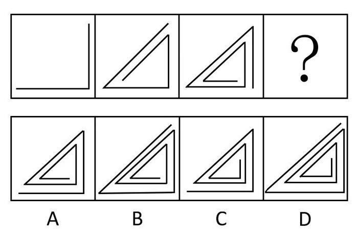

A. A

B. B

C. C

D. D

第 56 题 · 答案与解析

**参考答案（粉笔题库参考内容）**

C

**解析**

元素组成不同，且无明显属性规律，考虑数量规律。观察发现，题干图形的直线数依次增加，且后一幅图均由前一幅图的首尾各加一条直线得到，只有C项符合。

故正确答案为C。

**考点**：数量规律-线

**来源**：2008年广东省公务员录用考试《行测》题第56题

### 第 57 题

从所给四个选项中，选择最合适的一个填入问号处，使之呈现一定的规律性：

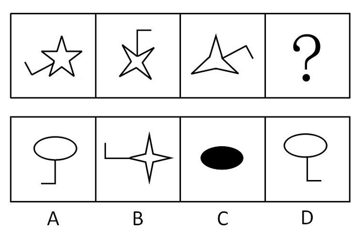

A. A

B. B

C. C

D. D

第 57 题 · 答案与解析

**参考答案（粉笔题库参考内容）**

A

**解析**

元素组成相同，考查位置规律。前三个图形分别是五角星、四角星、三角星，数量依次递减，同时，折线依次顺时针旋转。

故正确答案为A。

**考点**：位置规律-旋转

**来源**：2008年广东省公务员录用考试《行测》题第57题

### 第 58 题

从所给四个选项中，选择最合适的一个填入问号处，使之呈现一定的规律性：

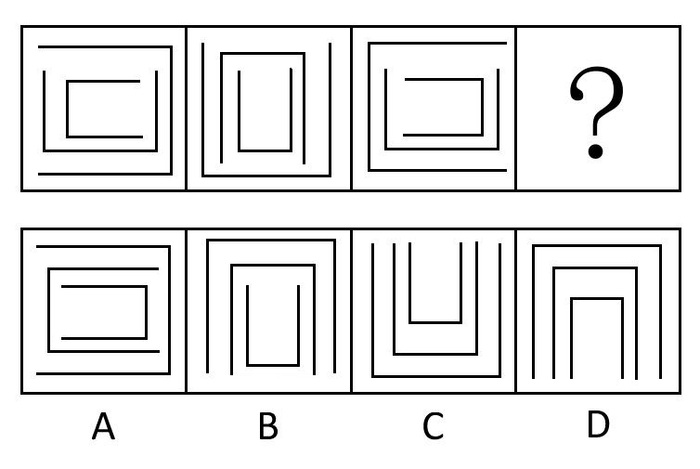

A. A

B. B

C. C

D. D

第 58 题 · 答案与解析

**参考答案（粉笔题库参考内容）**

D

**解析**

元素组成相同，考查位置规律。最里面的小框按每次90°逆时针旋转，中框每次按180°旋转，大框每次按顺时针90°旋转。

故正确答案为D。

**考点**：位置规律-旋转

**来源**：2008年广东省公务员录用考试《行测》题第58题

### 第 59 题

从所给四个选项中，选择最合适的一个填入问号处，使之呈现一定的规律性：

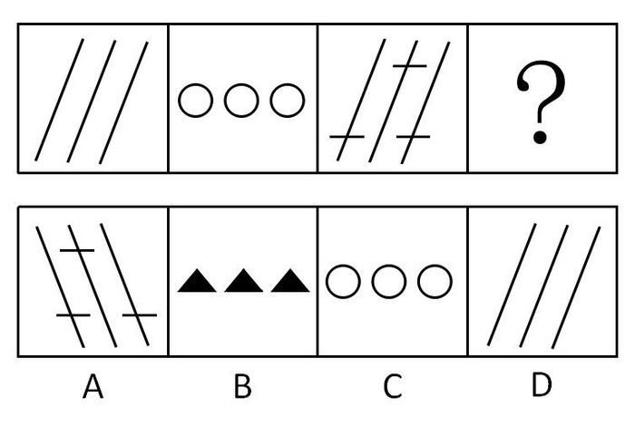

A. A

B. B

C. C

D. D

第 59 题 · 答案与解析

**参考答案（粉笔题库参考内容）**

B

**解析**

考查位置规律。按照图形倾斜方向，第一个图是斜，第二个是横，第三个是斜，第四个是横，并且元素种类不重复。

故正确答案为B。

**来源**：2008年广东省公务员录用考试《行测》题第59题

### 第 60 题

从所给四个选项中，选择最合适的一个填入问号处，使之呈现一定的规律性：

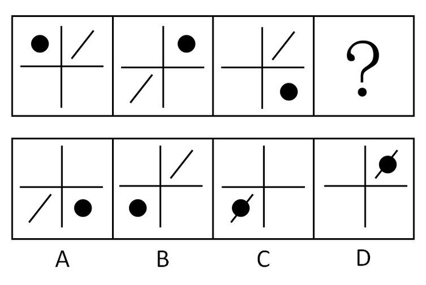

A. A

B. B

C. C

D. D

第 60 题 · 答案与解析

**参考答案（粉笔题库参考内容）**

C

**解析**

元素组成相同，考查位置规律。小黑点顺时针平移一格，小斜线顺时针平移两格。

故正确答案为C。

**考点**：位置规律-平移

**来源**：2008年广东省公务员录用考试《行测》题第60题

### 第 61 题

右边的哪个盒子不能由左边给定的图形做成？

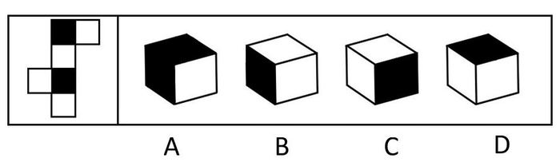

A. A

B. B

C. C

D. D

第 61 题 · 答案与解析

**参考答案（粉笔题库参考内容）**

A

**解析**

本题为空间重构六面体。题干展开图中两个黑色阴影面位于同列，且中间间隔一个面，为相对面，因此，在立体图形中，两个面不能同时出现，而A项中两个黑色阴影面同时出现。

本题为选非题，故正确答案为A。

**考点**：空间类-空间重构-六面体

**来源**：2008年广东省公务员录用考试《行测》题第61题

### 第 62 题

右边的哪个盒子不能由左边给定的图形做成？

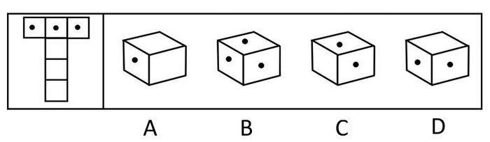

A. A

B. B

C. C

D. D

第 62 题 · 答案与解析

**参考答案（粉笔题库参考内容）**

B

**解析**

三个黑点面中，必有两个是相对面，不能同时看到，B项中的三个点同时看到了，错误。

本题为选非题，故正确答案为B。

**考点**：空间类-空间重构-六面体

**来源**：2008年广东省公务员录用考试《行测》题第62题

### 第 63 题

右边的哪个盒子不能由左边给定的图形做成？

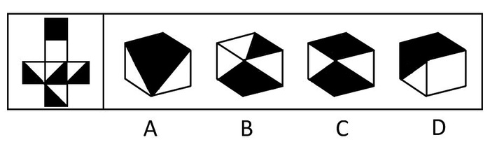

A. A

B. B

C. C

D. D

第 63 题 · 答案与解析

**参考答案（粉笔题库参考内容）**

C

**解析**

本题考查空间-折纸盒。当出现两个黑色的直角三角形的直角边相邻时，只能是原图最左边和最下面的两个面相邻，出现在顶面的应该是原图中位于中间那一列第三行的面，不是全黑的面。C选项是不正确的。

本题为选非题，故正确答案为C。

**考点**：空间类-空间重构-六面体

**来源**：2008年广东省公务员录用考试《行测》题第63题

### 第 64 题

从所给四个选项中，选择最合适的一个填入问号处，使之呈现一定的规律性：

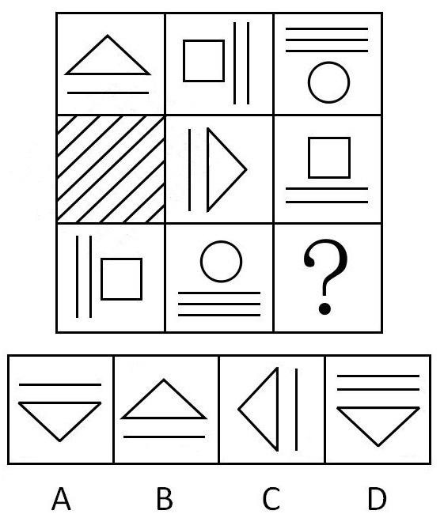

A. A

B. B

C. C

D. D

第 64 题 · 答案与解析

**参考答案（粉笔题库参考内容）**

C

**解析**

元素组成相同，考查元素的遍历和位置规律。各行中元素组成相同，因此应选择带有一个三角形和一条直线的图形，此外，任意两个相邻图形中的直线都是通过旋转90°可得。

故正确答案为C。

**考点**：位置规律-旋转、样式规律-遍历

**来源**：2008年广东省公务员录用考试《行测》题第64题

### 第 65 题

从所给四个选项中，选择最合适的一个填入问号处，使之呈现一定的规律性：

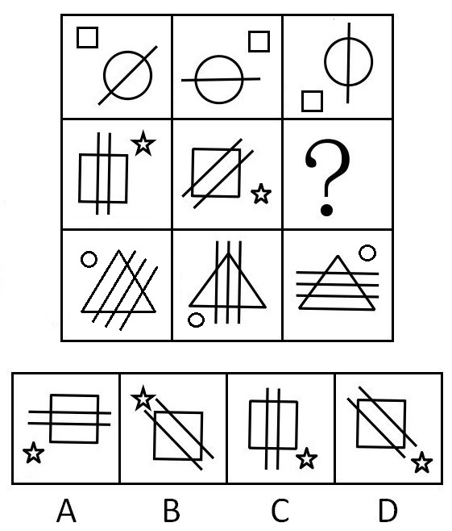

A. A

B. B

C. C

D. D

第 65 题 · 答案与解析

**参考答案（粉笔题库参考内容）**

B

**解析**

元素组成相同，考查位置规律。第一行的横线顺时针旋转45度，90度，且第一行的小方块按顺时针方向移动1个角，2个角，第二行的五角星也应按顺时针方向移动1个角，2个角 ，双直线顺时针旋转45度，90度，那么应该是B。

故正确答案为B。

**考点**：位置规律-综合

**来源**：2008年广东省公务员录用考试《行测》题第65题

### 第 66 题

在向南方雪灾受灾地区的捐款活动中，某慈善组织收到一笔10000元的匿名捐款，该组织经过调查，发现是甲、乙、丙、丁四个人当中的某一个捐的。慈善组织成员对他们进行求证时，发现他们的说法相互矛盾：
甲说：对不起，这钱不是我捐的
乙说：我估计这钱肯定是丁捐的
丙说：乙的收入最高，肯定是乙捐的
丁说：乙的说法没有任何根据
假定四人中只有一个说了真话，那么到底谁是真正的捐款者呢？

A. 甲

B. 乙

C. 丙

D. 丁

第 66 题 · 答案与解析

**参考答案（粉笔题库参考内容）**

A

**解析**

第一步：找突破口。

本题突破口为乙和丁之间的说法矛盾，两人的话必有一真和一假。

第二步：看其他人的话。

四人中只有一个人说了真话，所以甲和丙说的都是假话，由甲的话“这钱不是我捐的”是假话，推知这钱是甲捐的。

故正确答案为A。

**考点**：只有一真/一假

**来源**：2008年广东省公务员录用考试《行测》题第66题

### 第 67 题

有一则报道说：那些认为动物园安全管理措施已十分齐备的人，面对下面的新闻报道应当清醒了。昨天，一名男子掉入猴山中，幸而管理人员及时赶到，驱散猴群，将该名男子送往医院抢救，才没酿成严重后果。因此，应进一步健全动物园的安全措施。
以下哪项最有效地反驳上述报道的观点：

A. 据报道，该男子是具有自杀倾向的抑郁症患者

B. 男子落入猴山是极其偶然的事件，该动物园已有十年未发生此类事件

C. 该动物园已经建立突发事件应急处理体系，管理人员具有快速反应能力

D. 该动物园的安全设施已通过有关部门的验收，目前仍处于安全状态之下

第 67 题 · 答案与解析

**参考答案（粉笔题库参考内容）**

A

**解析**

第一步：找到论点和论据。

本题论点是要进一步健全动物园的安全措施才能避免报道中的事情再次发生。论据为一名男子掉入猴山中。

第二步：判断削弱方式。

本题题干论点和论据不存在直接因果关系，需要削弱论证，使论点和论据间不搭桥。

第三步：逐一判断选项的作用。

A项“男子是具有自杀倾向的抑郁症患者”说明男子掉入猴山是由于自身原因，跟动物园的安全措施无关，切断论点和论据之间的关系，削弱论证；

B项十年来动物园未出现类似事件，与动物园的安全措施无关；

C项说的是管理人员的反应能力强，与动物园的安全措施无关；

D项动物园的安全设施通过验收，不能说明动物园的安全措施没有问题。

B、C、D都属于无关选项。

故正确答案为A。

**考点**：拆桥

**来源**：2008年广东省公务员录用考试《行测》题第67题

### 第 68 题

有学者在对一些成功的女性秘书调查研究表明，女性秘书具有强烈的现代意识和敏锐的现代眼光，而且她们具有娴熟的公关技巧。正是因为她们具有上述两大优点，使她们在社会舞台上扮演着当之无愧的重要角色，她们在化解矛盾、排除难局等方面有着极其出色的表现。据此，该学者得出结论，领导者用女性秘书要比用男性秘书好。
以下哪项最能削弱上述论证：

A. 女性秘书也有一些显而易见的缺点

B. 个别的调查结果不能得出普遍的结论

C. 合格的秘书不仅要具有强烈的现代意识和娴熟的公关技巧，还有一些更重要的素质

D. 据一项对男秘书的调查结果显示，男性秘书也同样具有强烈的现代意识和娴熟的公关技巧

第 68 题 · 答案与解析

**参考答案（粉笔题库参考内容）**

D

**解析**

第一步：找到论点和论据。

本题的论点是领导者用女性秘书要比用男性秘书好，论据是女秘书具有两大优点。

第二步：逐一判断选项的作用。

A项女秘书也有一些显而易见的缺点，但这些缺点不一定很重要；

B、C都不能直接说明女秘书不比男秘书好，属于无关选项；

D项说明男秘书同样具有女秘书所有的两大优点，因此领导者用女性秘书不一定会比用男性秘书好，D直接削弱题干。

故正确答案为D。

**考点**：拆桥

**来源**：2008年广东省公务员录用考试《行测》题第68题

### 第 69 题

有关统计结果表明，就冠心病的发病率看，发达国家将近是发展中国家的三倍。有人认为这归咎于发达国家中人们的高脂肪、高蛋白、高热量的食物摄入。相对来说，发展中国家较少有人具备生这种“富贵病”的条件。其实，这种看法很难成立。因为它忽略了这样一个事实：目前发达国家的人均寿命高于70岁，而发展中国家则不到50岁。
以下哪项最能加强上述反驳：

A. 统计资料显示，冠心病相对集中在中老年阶段，即50岁以上

B. 一般地说，一个人的寿命越长，在其有生之年患有某种疾病的概率越高

C. 相对于发展中国家来说，发达国家的人们具有较高的防治冠心病的常识和较好的医疗条件

D. 发展中国家人们的高脂肪、高蛋白、高热量食物的摄入量，无论是总量还是人均量，都在逐年增长

第 69 题 · 答案与解析

**参考答案（粉笔题库参考内容）**

A

**解析**

第一步：找到论点和论据。

本题论点是发达国家比发展中国家冠心病的发病率高。论据是发达国家的人均寿命高于70岁，而发展中国家则不到50岁。

第二步：逐一判断选项的作用 。

A项在论据中的人均寿命和论点中的冠心病之间建立联系，由于冠心病相对集中在50岁以上年龄层的人，而发达国家人均寿命高于70岁，发展中国家则不到50岁，因此发达国家冠心病发病率远高于发展中国家，A项加强论据的说服力，正确；

B项只笼统地说患有某种疾病的概率随寿命增加而增加，没有说明冠心病与寿命的关系，加强论据的力度远不如A项；

C项发达国家拥有更好的防治冠心病的常识和较好的医疗条件，话题不一致，题干中谈论的是高血压的患病率问题，预防知识，好的医疗条件，和发病率都无关，属于无关选项；

D项中发展中国家三高食品的摄入量逐年增加，都跟寿命高导致冠心病发病率高无关，属于无关选项。

故正确答案为A。

**考点**：搭桥

**来源**：2008年广东省公务员录用考试《行测》题第69题

### 第 70 题

去年以来，包括广州在内的全国多个主要城市的房地产价格出现不同幅度的增长，有些城市甚至创出近期新高。这也是自去年国家出台一系列调控措施后，房地产价格再次出现上涨。这也使社会舆论再次就经济是否过热展开了争论。在此背景下，有人认为，国家去年出台的宏观调控措施未达到预期效果。
以下哪项能最有力地反驳上述结论：

A. 如果国家不出台一系列宏观调控措施，房地产价格可能上升得更高

B. 国家去年出台的调控措施对房价的影响需要一个过程，不可能取得立竿见影的效果

C. 从有关部门近期对房地产供求关系的调研情况来看，今年上半年，房地产供应数量有所下降

D. 国家已对房地产价格放开，既然房地产价格主要受市场供求关系影响，宏观调控不可能出台国家规定价格

第 70 题 · 答案与解析

**参考答案（粉笔题库参考内容）**

A

**解析**

第一步：找到论点和论据。

本题论点是国家去年出台的宏观调控措施未达到预期效果。论据是去年以来，包括广州在内的全国多个主要城市的房地产价格出现不同幅度的增长，有些城市甚至创出近期新高。

第二步：逐一判断选项的作用。

A中“如果国家不出台一系列宏观调控措施，房地产价格可能上升得更高”，说明虽然房地产价格有所上升但是国家去年出台的宏观调控措施还是取得了效果，A削弱论证；

B说明调控措施是否有效果还不知道，无法削弱论点；C说房地产的供应数量跟国家宏观调控是否起作用无关；D实际上承认了国家对房地产价格的影响是有限的，加强论点。

故正确答案为A。

**考点**：削弱论点

**来源**：2008年广东省公务员录用考试《行测》题第70题

### 第 71 题

近几十年来，人们发明了各种各样的药物来毒杀老鼠。可是人们发现，在一些老鼠经常出入的地方放置老鼠药的方法越来越没有效果，无论人们将药物添加到对于老鼠来说多么美味的食物之中，老鼠都会对这些送来的“美味”置之不理。根据这一现象，得到的可能解释是：老鼠的嗅觉异常灵敏，它们能够从任何复杂的气味中辨别出对它们有害的物质。
下面哪项能最强有力地表明上文中最后一个解释是错误的：

A. 老鼠很少去那些曾经放置过老鼠药的地方活动

B. 老鼠在进食前对任何食物进行取样并品尝其中是否含有有毒物质

C. 科学家经过一系列实验，证明有的老鼠对于一些药物已经产生了抗药性

D. 将没有添加任何药物的粮食放在先前放置过药物的地方，老鼠也不会去动这些食物

第 71 题 · 答案与解析

**参考答案（粉笔题库参考内容）**

D

**解析**

第一步：找到论点和论据。

本题的论点是老鼠的嗅觉异常灵敏，它们能从任何复杂的气味中辨别出对它们有害的物质。论据是在一些老鼠经常出入的地方放置老鼠药的方法越来越没有效果，无论人们将药物添加到对于老鼠来说多么美味的食物之中，老鼠都会对这些送来的“美味”置之不理。

第二步：逐一判断选项的作用。

本题为类比削弱。两组对象分别是没有添加任何药物的粮食和添加过药物的粮食，其他条件均相同。实验结果是老鼠不会去动没有添加过药物的粮食，也不会动添加过药物的粮食。

A项中“活动地点”与老鼠的嗅觉无关，A错误；

B项只能说明老鼠能辨别有毒物质，但不能说明老鼠的嗅觉灵敏，B错误；

C项中“抗药性”与老鼠的嗅觉无关，C错误；

D项“将没有添加任何药物的粮食放在先前放置过药物的地方，老鼠也不会去动这些食物”说明老鼠并不能辨别出无毒的食物，D最能削弱题干结论。

故正确答案选D。

**考点**：削弱论点

**来源**：2008年广东省公务员录用考试《行测》题第71题

### 第 72 题

近年来，为避免煤矿安全事故的发生，很多煤矿主都加强了对安全生产的重视程度。公开资料显示：2000年以前，中国煤矿事故每年死亡上万人。从2000年开始，每年事故死亡人数开始控制在7000人以下，2003年事故死亡人数为6434人；2004年死亡6027人；2005年死亡5986人；2006年全国煤矿共发生事故死亡4746人。由此我们得出结论，只要煤矿主对安全生产给予足够的重视，就能有效地遏制矿难事故的发生。
以下哪项最能削弱上述结论：

A. 近年来，煤矿主对安全生产的设施建设、资金投入、宣传教育等管理手段并没有真正落到实处

B. 近年来，煤矿安全引起有关部门的高度重视，国家对安全生产的资金投入不断加大

C. 近年来，国家强行关闭了大量没有安全保障的非法小煤矿

D. 近年来，一些地质条件好、安全性高的煤矿先后开工

第 72 题 · 答案与解析

**参考答案（粉笔题库参考内容）**

C

**解析**

第一步：找到论点和论据。

本题论点为只要煤矿主对安全生产给予足够的重视，就能有效地遏制矿难事故的发生，论据为很多煤矿主都加强了对安全生产的重视程度，以及2000年到2006年的矿难死亡人数数据。

第二步：判断削弱方式。

论点和论据间有直接因果关系，需削弱论点。

第三步：逐一判断选项的作用。

A属于无关选项，煤矿主对安全生产的管理手段是否落到实处，跟矿场主是否重视安全生产是两个概念；

C项说明煤矿事故大幅减少是由于国家强行关闭了大量没有安全保障的非法小煤矿，而不是煤矿主对安全生产给予足够的重视，直接否定论点中的原因；

B项说的是国家对安全生产的投入，D项说的是安全性高的煤矿开工，B、D两个选项都跟煤矿主重视安全生产无关，属于无关选项。

故正确答案为C。

**考点**：他因削弱

**来源**：2008年广东省公务员录用考试《行测》题第72题

### 第 73 题

去年，广州市出台了《对城市绿化工程施工的验收规范》，其中对漂浮类水生植物凤眼莲和浮萍的种植适宜水深不设限制，这意味着来自南美洲的外来物种——凤眼莲可全方位用于该城市的水体绿化工程。根据以上信息，现有三个命题：
Ⅰ.未来几年，该市水体绿化工程将大量种植凤眼莲和浮萍
Ⅱ.未来几年，该市与南美洲的凤眼莲贸易将急剧增加
Ⅲ.该市对种植凤眼莲和浮萍的水域深度没作具体要求
以下选项中，哪项一定为真：

A. Ⅰ、Ⅱ和Ⅲ

B. 只有Ⅱ和Ⅲ

C. 只有Ⅰ和Ⅱ

D. 只有Ⅲ

第 73 题 · 答案与解析

**参考答案（粉笔题库参考内容）**

D

**解析**

第一步：抓住每句话中的对象及其关系。

第一句：对漂浮类水生植物凤眼莲和浮萍的种植适宜水深不设限制。

第二句：凤眼莲可全方位用于该城市的水体绿化工程。

第二步：逐一翻译选项并判断选项的正确。

Ⅰ、Ⅱ两项都是没有确凿证据的猜测或想象，Ⅲ是对第一句的同语转述，在逻辑上是同一命题的完全重复，必然真。

故正确答案为D。

**考点**：日常结论

**来源**：2008年广东省公务员录用考试《行测》题第73题

### 第 74 题

根据最近一项调查显示，近年来在某市外资企业高收入(指合法收入为年薪12万元以上)人群中，外国留学归来的人(简称“海归派”)数占60％以上，这充分说明国内大学毕业的人(简称“本土派”)在该市外资企业中获得高工资极为困难。
以下哪项如果为真，最能加强上述结论：

A. 在该市外资企业中，“本土派”人数占40％

B. 在该市外资企业中，“本土派”人数超过50％

C. 在该市就业的人群中，“海归派”仅为“本土派”的10％

D. 在该市就业的人群中，“海归派”与“本土派”的人数比例约为6:4

第 74 题 · 答案与解析

**参考答案（粉笔题库参考内容）**

B

**解析**

第一步：找到论点和论据。

本题论点是国内大学毕业的人在该市外资企业中获得高工资极为困难。论据是高收入人群中，外国留学归来的人数占60％以上。

第二步：判断加强方式。

论点强调本土派获高薪极为困难，论据强调海归派高收入占全市外资企业总人数60％。所以论点和论据间不存在明显因果关系，需加强论证。

第三步：逐一判断选项的作用。

选项A中，本土派人数占40％，而高薪也占40％（海归派占60％），二者比例相当，因此并不能说本土派获高薪困难，A错误；

选项B中，本土派人数超过50％，而获得高薪的却不超过40％（海归派占60％），充分证明本土派获高薪人数占外资总人数比例不高，B正确；

选项C、D中“该市就业人群”与题干中“外资就业人群”不符，二者没有可比性，C、D错误。

故正确答案为B。

**考点**：搭桥

**来源**：2008年广东省公务员录用考试《行测》题第74题

### 第 75 题

为适应产业结构调整升级的需要，某企业计划裁员10％，并将四个污染严重的车间进行停产。这四个车间的人数正好占该企业总人数的10％。计划实施后，上述四个车间停产，整个企业实际减员5％。此过程中，该企业内部人员有所调整，但整个企业只有减员，没有增员。根据以上信息，现有三个命题：
Ⅰ.上述计划实施后，有的车间调入新成员
Ⅱ.上述计划实施后，没有一个车间调入的新成员的总数超出企业原来总人数的5％
Ⅲ.上述计划实施后，被撤销的车间中的留任人员，不超过该企业原来总人数的5％
以下哪项一定为真：

A. Ⅰ、Ⅱ和Ⅲ

B. 只有Ⅰ和Ⅱ

C. 只有Ⅱ和Ⅲ

D. 只有Ⅰ

第 75 题 · 答案与解析

**参考答案（粉笔题库参考内容）**

D

**解析**

第一步：抓住每句话中的对象及其关系。

第一句：说明企业计划裁员10％，将四个污染严重的车间进行停产；

第二句：说明四个车间的人数正好占该企业总人数的10％；

第三句：整个企业实际减员5％；

第四句：整个企业只有减员，没有增员。

第二步：判断整体关系。

四个车间的人数是总人数的10％，但实际裁员只裁了5％，则必然有5％的人没有岗位，有的车间肯定会调入新的成员，而且可能把5％的成员同时调入一个车间。

第三步：逐一判断选项的作用。

Ⅰ项有的车间会调入新成员，正确。Ⅱ项不能确定，如果把5％的成员同时调入一个车间，以及车间之间相互调换人员，则该车间有调入的新成员总数超过企业原来总人数的5%。裁员可以不从被撤销的车间中的人员中选择，则Ⅲ不正确。

故正确答案为D。

**考点**：日常结论

**来源**：2008年广东省公务员录用考试《行测》题第75题

### 第 76 题

陈皮是药食同源的宝贵原料之一，其最显著的药效是化痰止咳，疏通心脑血管，降血压等。请问，陈皮是以哪种水果的表皮为原料的：

A. 柚子

B. 橙子

C. 橘子

D. 桃子

第 76 题 · 答案与解析

**参考答案（粉笔题库参考内容）**

C

**解析**

陈皮，别名橘皮，为芸香科植物橘及其栽培变种的干燥成熟果皮。

故正确答案为C。

**考点**：生活常识

**来源**：2008年广东省公务员录用考试《行测》题第76题

### 第 77 题

一般来说，在发生通货膨胀时，靠固定工资生活的人：

A. 生活水平会下降

B. 生活水平会提高

C. 没有变化

D. 幸福感会增强

第 77 题 · 答案与解析

**参考答案（粉笔题库参考内容）**

A

**解析**

通货膨胀指在货币流通的条件下，纸币的发行量超过了流通中实际需要的数量，多余的部分继续在流通中流转，导致货币贬值而引起的一段时间内物价持续而普遍上涨的现象。通货膨胀时，靠固定工资生活的人由于工资不变，生活水平随物价上涨而下降。

故正确答案为A。

**考点**：宏观经济与调控政策

**来源**：2012年深圳市公务员录用考试《行测》题（上半年）第7题

### 第 78 题

传统的白色粉笔，其主要成分是：

A. 石灰石

B. 石膏

C. 生石灰

D. 熟石灰

第 78 题 · 答案与解析

**参考答案（粉笔题库参考内容）**

B

**解析**

白色粉笔是用石膏制成的，其主要成分是硫酸钙。

故正确答案为B。

**考点**：生活常识

**来源**：2008年广东省公务员录用考试《行测》题第78题

### 第 79 题

对于热水瓶爆裂造成的烫伤，下列紧急处理正确的一项是：

A. 立即脱去被开水浸湿的衣裤或鞋袜

B. 立即用纱布包裹冰块凉敷烫伤处

C. 立即用约20℃左右的凉水冲洗

D. 擦干烫伤皮肤用紫药水或红汞涂擦

第 79 题 · 答案与解析

**参考答案（粉笔题库参考内容）**

C

**解析**

烫伤后应立即用20℃左右的凉水冲洗。等冷却后才可小心地将贴身衣服脱去，以免撕破烫伤后形成的水泡。凉水冲洗的目的是止痛、减少渗出和肿胀，从而避免或减少水泡的形成。用冰块凉敷，会产生冻伤。烫伤后切忌用紫药水或红汞涂擦，以免影响观察烫伤后创面的变化。

故正确答案为C。

**考点**：生物常识

**来源**：2008年广东省公务员录用考试《行测》题第79题

### 第 80 题

病人在医院里做检查常使用的“CT”技术，其术语是指：

A. 脑电图检查

B. 计算机断层扫描

C. 放射断层摄影

D. 磁共振显影

第 80 题 · 答案与解析

**参考答案（粉笔题库参考内容）**

B

**解析**

CT(Computed Tomography)是电子计算机X射线断层扫描技术的简称。

故正确答案为B。

**考点**：生物常识

**来源**：2008年广东省公务员录用考试《行测》题第80题

### 第 81 题

我国的三峡、三门峡水电站分别位于：

A. 广东 陕西

B. 湖北 陕西

C. 四川 甘肃

D. 湖北 河南

第 81 题 · 答案与解析

**参考答案（粉笔题库参考内容）**

D

**解析**

三峡水电站在湖北省宜昌市的长江干流上，三门峡水电站在河南省三门峡市黄河中游下段的干流上。

故正确答案为D。

**考点**：中国地理

**来源**：2008年广东省公务员录用考试《行测》题第81题

### 第 82 题

中医中药是中华民族和世界文化的宝贵遗产，是几千年来中华民族同疾病作斗争的伟大成就。我国最早的中医学专著是：

A. 《黄帝内经》

B. 《伤寒论》

C. 《金匮要略》

D. 《温病条辨》

第 82 题 · 答案与解析

**参考答案（粉笔题库参考内容）**

A

**解析**

《黄帝内经》分《灵枢》、《素问》两部分，为古代医家托轩辕黄帝名之作，为医家、医学理论家联合创作，一般认为成书于春秋战国时期，是中国传统医学四大经典著作之一(《黄帝内经》、《难经》、《伤寒杂病论》、《神农本草经》)，是我国医学宝库中现存成书最早的一部中医学专著。

故正确答案为A。

本题相关知识点：

1、《伤寒论》，是一部阐述外感及其杂病治疗规律的专著，东汉末年张仲景撰于公元200-205。

2、东汉张仲景著述的《金匮要略》是中医经典古籍之一，撰于3世纪初。作者原撰《伤寒杂病论》十六卷中的“杂病”部分，经晋王叔和整理后，其古传本之一名《金匮玉函要略方》，后北宋校正医书局林艺等人根据当时所存的蠹简文字重予编校，取其中以杂病为主的内容，改名《金匮要略方论》。

3、《温病条辨》此书为温病学的重要代表著作之一，共六卷，系清·吴瑭撰，嘉庆三年(1798)完成，前后花了六年时间。

**考点**：文化常识

**来源**：2008年广东省公务员录用考试《行测》题第82题

### 第 83 题

在商店里，大部分商品都是尾数价格，如一双皮鞋的价格是298元，而不是300元，请问商店根据什么这样定价：

A. 价格法

B. 行业规定

C. 经营者偏好

D. 消费者心理

第 83 题 · 答案与解析

**参考答案（粉笔题库参考内容）**

D

**解析**

这种定价方法给消费者带来不同价位区间的感觉，比如298元的商品是200多的商品，而标价300元的商品则给人感觉贵很多，尽管只差2元。商店通过把握消费者心理卖出更多商品。

故正确答案为D。

**考点**：微观经济

**来源**：2008年广东省公务员录用考试《行测》题第83题

### 第 84 题

贝多芬的交响曲中被称为“命运交响曲”的是：

A. 第三交响曲

B. 第五交响曲

C. 第六交响曲

D. 第九交响曲

第 84 题 · 答案与解析

**参考答案（粉笔题库参考内容）**

B

**解析**

C小调第五交响曲，作品67号，又名命运交响曲，德国作曲家路德维希·凡·贝多芬最为著名的作品之一，完成于1807年末至1808年初。此曲声望之高，演出次数之多，可谓交响曲之冠。

故正确答案为B。

**考点**：文化常识

**来源**：2008年广东省公务员录用考试《行测》题第84题

### 第 85 题

北京时间2008年1月5日20：00，小强在广州给在古巴哈瓦那(哈瓦那在南美洲，与北京时差为-13小时)出差的父亲打电话，语言表达准确的一项是：

A. 爸爸，晚上好。注意防寒。

B. 爸爸，早上好。注意防暑。

C. 爸爸，晚上好。注意防暑。

D. 爸爸，早上好。注意防寒。

第 85 题 · 答案与解析

**参考答案（粉笔题库参考内容）**

B

**解析**

哈瓦那是西五区，北京是东八区，两者时差相差13个小时，则中国是晚上，古巴是早上。哈瓦那的纬度为北纬23°08′，非常接近北回归线，属热带，1月5日的哈瓦那应该是最冷的时候，但仍然天气炎热。所以“注意防暑”是正确的。

故正确答案为B。

**考点**：自然地理

**来源**：2008年广东省公务员录用考试《行测》题第85题

## 材料 1

“十五”以来，广东省的产业集群发展迅速，特色产业基地已成为广东省经济持续高速增长的新亮点。据统计，2006年广东省特色产业基地工业总产值达4930亿元，约占全省工业总产值的10%；基地的高新技术产品产值1650亿元，占全省高新技术产品产值的11%。全省特色产业基地的经济增长幅度，明显高于当地经济增长的平均幅度。2006年，广东省特色产业基地的工业总产值，比2005年增长20.3%。与此同时，各特色产业基地占当地经济总量的比重逐步加大，有些基地已占到当地工业总产值的30%以上。如湛江海洋特色产业基地的工业总产值，2006年已占湛江市工业总产值的33%；阳江五金刀具特色产业基地2006年工业总产值占了全市工业总产值的31%；云浮禽畜生物制品特色产业基地2006年工业总产值占当地工业总产值的38.5%；国家级肇庆金属新材料产业基地，有高新技术企业19家，占全市高新企业总数的17.7%，基地工业产业总值占全市工业总产值近20%。

### 第 86 题

2005年广东省特色产业基地的工业总产值是多少：

A. 4930亿元

B. 4098亿元

C. 3929亿元

D. 2145亿元

第 86 题 · 答案与解析

**参考答案（粉笔题库参考内容）**

B

**解析**

利用估算法，2006年广东省特色产业基地工业总产值达4930亿元，比2005年增长20.3%，所以2005年广东省特色产业基地工业总产值为亿元，估算数值接近且大于真实值。

故正确答案为B。

**考点**：基期计算、文字资料

**来源**：2008年广东省公务员录用考试《行测》题第86题

### 第 87 题

2006年广东省特色产业基地的高新技术产品产值约占特色产业基地工业总产值的比重是多少：

A. 38.5%

B. 33.5%

C. 30%

D. 20.3%

第 87 题 · 答案与解析

**参考答案（粉笔题库参考内容）**

B

**解析**

利用估算法，广东省特色产业基地的高新技术产品产值1650亿元，广东省特色产业基地工业总产值达4930亿元，其比重是，估算值接近且小于真实值。

故正确答案为B。

**考点**：文字资料、现期比重

**来源**：2008年广东省公务员录用考试《行测》题第87题

### 第 88 题

根据上述材料，2006年特色产业基地占当地工业总产值比重最高的是：

A. 湛江海洋特色产业基地

B. 阳江五金刀具特色基地

C. 云浮禽畜生物制品特色产业基地

D. 肇庆金属新材料产业基地

第 88 题 · 答案与解析

**参考答案（粉笔题库参考内容）**

C

**解析**

各项2006年特色产业基地占当地工业总产值比重依次为：33%、31%、38.5%、20%，故比重最高的是云浮禽畜生物制品特色产业基地。

故正确答案为C。

**考点**：文字资料、直接找数

**来源**：2008年广东省公务员录用考试《行测》题第88题

### 第 89 题

2006年，广东省高新技术产品产值占全省工业总产值的比重约是多少：

A. 38.5%

B. 32.9%

C. 30.4%

D. 20.3%

第 89 题 · 答案与解析

**参考答案（粉笔题库参考内容）**

C

**解析**

广东省高新技术产品产值为，全省工业总产值为，其比重为，与C项接近。

故正确答案为C。

**考点**：文字资料、现期比重

**来源**：2008年广东省公务员录用考试《行测》题第89题

### 第 90 题

根据所给资料，下列说法正确的是：

A. 2006年，肇庆市高新技术企业总数19家

B. 2006年，阳江五金刀具厂产值占阳江市工业总产值的31%

C. 2006年，云浮禽畜生物制品特色产业基地总产值占该市总产值的38.5%

D. 2006年，湛江海洋特色产业基地的工业总产值占该市生产总值的比重小于33%

第 90 题 · 答案与解析

**参考答案（粉笔题库参考内容）**

D

**解析**

A项错误，2006年，有高新技术企业总数19家的是肇庆金属新材料产业基地，不是整个肇庆市，混淆了“肇庆金属新材料产业基地”与“肇庆市”的概念；

B项错误，占阳江市工业总产值的31%的是阳江五金刀具特色产业基地工业总产值，不是阳江五金刀具厂产值，混淆了“阳江五金刀具特色产业基地工业总产值”与“阳江五金刀具厂产值”的概念；

C项错误，2006年云浮禽畜生物制品特色产业基地工业总产值占当地工业总产值的38.5%，混淆了“当地工业总产值”与“当地总产值”的概念；

D项正确，湛江海洋特色产业基地的工业总产值占湛江市工业总产值的33%，其比重必然大于湛江海洋特色产业基地的工业总产值与该市的生产总值的比重，故湛江海洋特色产业基地的工业总产值占该市生产总值的比重小于33%。

故正确答案为D。

**考点**：文字资料、综合分析

**来源**：2008年广东省公务员录用考试《行测》题第90题

## 材料 2

根据下表完成以下各题

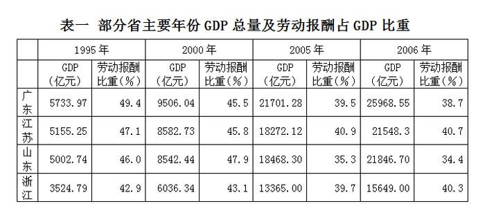

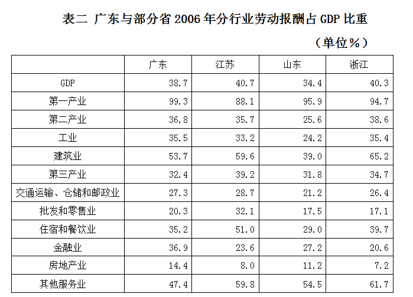

### 第 91 题

根据所给资料，可以得出2006年劳动报酬占全省GDP比重最大的是：

A. 广东

B. 江苏

C. 山东

D. 浙江

第 91 题 · 答案与解析

**参考答案（粉笔题库参考内容）**

B

**解析**

根据图表可知，各省2006年劳动报酬占全省的GDP比重分别为38.7%、40.7%、34.4%、40.3%，其中江苏的数值最大。

故正确答案为B。

**考点**：排序类、统计表

**来源**：2008年广东省公务员录用考试《行测》题第91题

### 第 92 题

1995-2006年间，工资总额增幅最快的省份是：

A. 广东

B. 江苏

C. 山东

D. 浙江

第 92 题 · 答案与解析

**参考答案（粉笔题库参考内容）**

D

**解析**

广东工资总额增幅为；

江苏工资总额增幅为；

山东工资总额增幅为；

浙江工资总额增幅为。

可化简为比较、、、的大小。化简后四个分数的量级相当，依次直除可得首位数字为3、3、2、4，故浙江工资总额增幅最大。

故正确答案为D。

**考点**：一般增长率、统计表

**来源**：2008年广东省公务员录用考试《行测》题第92题

### 第 93 题

2006年广东省第三产业劳动报酬占GDP比重比江苏省少多少：

A. 6.8个百分点

B. 2.3个百分点

C. 2个百分点

D. 1.6个百分点

第 93 题 · 答案与解析

**参考答案（粉笔题库参考内容）**

A

**解析**

2006年广东省第三产业劳动报酬占GDP比重为32.4%，江苏省第三产业劳动报酬占GDP比重为39.2%，广东省比江苏省少39.2%－32.4%＝6.8%。

故正确答案为A。

**考点**：简单加减计算、统计表

**来源**：2008年广东省公务员录用考试《行测》题第93题

### 第 94 题

粤、鲁、苏、浙四省份比较，下列说法正确的是：

A. 广东建筑业从业者人均劳动报酬高于山东同行

B. 四省份从事第一产业的劳动者报酬比从事其它行业的人员高

C. 与其它行业相比，房地产业从业人员工资最低

D. 广东省金融业劳动报酬占GDP比重比山东省高

第 94 题 · 答案与解析

**参考答案（粉笔题库参考内容）**

D

**解析**

题干中没有给出各行业的从业人数，故不能比较各省各行业从业者劳动报酬，故A、B、C三项错误；广东省金融业劳动报酬占GDP比重为36.9%，山东省金融业劳动报酬占GDP比重为27.2%，广东省高于山东省。

故正确答案为D。

**考点**：统计表、综合分析

**来源**：2008年广东省公务员录用考试《行测》题第94题

### 第 95 题

根据所给资料，下列表述不正确的是：

A. 1995年以来，各省GDP总量呈上升趋势

B. 与上年相比，2006年GDP增加最快的省份是江苏省

C. 2006年，各省第一产业劳动报酬占GDP比重远高于其它行业

D. 总体来说，1995年以来，各省劳动报酬占GDP比重呈下降趋势

第 95 题 · 答案与解析

**参考答案（粉笔题库参考内容）**

B

**解析**

A项：根据图表，1995年以来，各省GDP总量呈上升趋势，正确；

B项：广东增长率=；江苏增长率=；山东增长率=；浙江增长率=。则2006年GDP增加最快的省份是广东省，而非江苏省，错误；

C项： 2006年各省第一产业劳动报酬占GDP比重高于其它行业，正确；

D项：虽然2000年山东省的劳动报酬占GDP比重较1995年上升，但整体仍为下降趋势，正确。

本题为选非题，故正确答案为B。

**考点**：统计表、综合分析

**来源**：2008年广东省公务员录用考试《行测》题第95题

## 材料 3

根据下列图表，完成以下各题

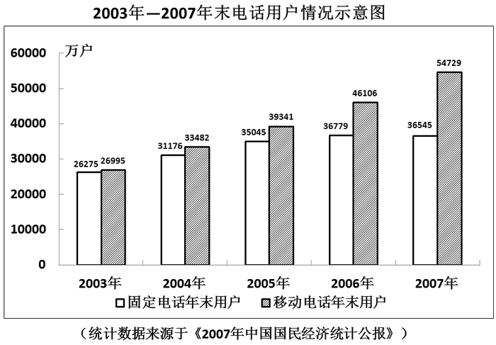

### 第 96 题

2003年至2007年间，我国固定电话用户与移动电话用户数量最接近的年份是：

A. 2003年

B. 2004年

C. 2005年

D. 2006年

第 96 题 · 答案与解析

**参考答案（粉笔题库参考内容）**

A

**解析**

直接看图或用直尺垂直于条形做比较，得出2003年固定电话用户与移动电话用户的条形距离最小，故2003年固定电话用户与移动电话用户数量最接近。

故正确答案为A。

**考点**：增长量比较、统计图

**来源**：2008年广东省公务员录用考试《行测》题第96题

### 第 97 题

根据上图，年末移动电话用户数增幅最大的年份是哪一年：

A. 2004年

B. 2005年

C. 2006年

D. 2007年

第 97 题 · 答案与解析

**参考答案（粉笔题库参考内容）**

A

**解析**

2004年末移动电话增幅是，2005年末移动电话增幅是，2006年末移动电话增幅是，2007年末移动电话增幅是，可简化为比较6487/26995，5859/33482，6765/39341，8623/46106，四个分数量级相当，依次直除可得首位数字为2，1，1，1。6487/26995数值最大，故年末移动电话用户数增幅最大的年份是2004年。

故正确答案为A。

**考点**：一般增长率、统计图

**来源**：2008年广东省公务员录用考试《行测》题第97题

### 第 98 题

若按2007年的固定电话增长率保持不变，预计到2008年年末全国固定电话用户数是多少：

A. 36779万户

B. 36545万户

C. 36311万户

D. 36312万户

第 98 题 · 答案与解析

**参考答案（粉笔题库参考内容）**

D

**解析**

由图可知，2007年固定电话的增长率为负增长，可以排除A，B两项；

2007年固定电话用户数减少了36779－36545＝234万户。为保持增长率不变，2008年减少的用户数必须少于234万户，则2008年年末全国固定电话用户数在36545万户至36311万户之间。

故正确答案为D。

**考点**：现期计算、统计图

**来源**：2008年广东省公务员录用考试《行测》题第98题

### 第 99 题

根据所给材料，下列表述正确的一项是：

A. 2004年末我国固定电话用户数占电话用户总数的1/3

B. 2005年末我国固定电话用户增幅比移动电话用户增幅低约5个百分点

C. 2006年末我国固定电话用户增幅与移动电话用户增幅相当

D. 2007年末我国电话用户总数约是2003年末用户总数的两倍

第 99 题 · 答案与解析

**参考答案（粉笔题库参考内容）**

B

**解析**

A项错误，观察图表发现，2004年末我国固定电话用户数与移动电话用户数近似，因此2004年末我国固定电话用户数不可能占电话用户总数的1/3；

B项正确，2005年末我国固定电话用户增幅为：，2005年末移动电话增幅为：，；

C项错误，2006年末我国固定电话用户增幅为：，2006年末移动电话增幅为：，简化为比较1734/35045与6765/39341数值是否相当，显然这两个数值相差较大；

D项错误，2007年末我国电话用户总数是54729＋36545＝91274万户，2003年末我国电话用户总数是26275＋26995＝53270万户。

故正确答案为B。

**考点**：统计图、综合分析

**来源**：2008年广东省公务员录用考试《行测》题第99题

### 第 100 题

根据所给资料，下列推断不正确的一项是：

A. 2004年以来，我国移动电话用户年新增量均高于固定电话用户年新增量

B. 预计到2010年，移动电话用户数将大大高于固定电话用户量

C. 2003年以来，我国固定电话用户数呈逐年减少的趋势

D. 2006年，我国固定电话用户数达历史最高水平

第 100 题 · 答案与解析

**参考答案（粉笔题库参考内容）**

C

**解析**

A项正确，使用直尺垂直于条形做比较，可观察到每年移动电话用户增加的条形图都高于固定电话用户；

B项正确，观察图表，移动电话用户的增长率明显高于固定电话用户，且移动电话用户的数量一直大于固定电话用户，故可推断到2010年移动电话用户数将大大高于固定电话用户量；

C项错误，观察图表，2003~2006年，固定电话用户数逐年增多，到2007年才开始减少；

D项正确，观察图表，2003~2006年，固定电话用户数逐年增多，到2007年开始减少，则2006年为固定电话用户数历史最高水平。

本题为选非题，故正确答案为C。

**考点**：统计图、综合分析

**来源**：2008年广东省公务员录用考试《行测》题第100题

