# 2009年广东省公务员录用考试《行测》题

<!-- gwy:overview:start -->
> **广东 · 2009 · 行测 · 统考** ｜ 100 题 · 图片 134 处 · 答案随题折叠

| 题型模块 | 题量 | 题号 |
| --- | ---: | ---: |
| 数量关系 | 15 | 1–15 |
| 言语理解与表达 | 30 | 16–45 |
| 判断推理 | 30 | 46–75 |
| 常识判断 | 10 | 76–85 |
| 资料分析 | 15 | 86–100 |
| **合计** | **100** | |

导航：[题型与作答说明](#题型与作答说明) · [题目](#题目) · [材料 1](#材料-1)
<!-- gwy:overview:end -->

> 候选采集稿。参考答案及解析来自粉笔页面，不代表官方答案或真实高分答卷；来源使用许可与原卷对应关系仍需人工核实。

## 题型与作答说明

数量关系

（15题）

本部分包括数字推理与数学运算两种类型的试题。

言语理解与表达

（30题）

本部分包括逻辑填空与阅读理解两种类型的题目。

判断推理

（30题）

本部分包括类比推理、图形推理与逻辑判断三种类型的题目。

常识判断

（10题）

根据题目要求，在四个选项中选出一个最恰当的答案。

资料分析

（15题）

针对下列文字、表或图回答问题。你应根据资料提供的信息进行分析、比较、计算、处理。

## 题目

### 第 1 题

1，2，0，3，－1，4，（  ）

A. －2

B. 0

C. 5

D. 6

第 1 题 · 答案与解析

**参考答案（粉笔题库参考内容）**

A

**解析**

方法一：观察题干项数较多，优先考虑多重数列。奇数项、偶数项交叉分组。奇数项：1、0、-1、（    ），是公差为-1的等差数列，所求项为-1+(-1)=-2；偶数项：2、3、4，是公差为1等差数列。

方法二：题干数列无单调性，尝试作和。相邻两项两两相加后得新数列：3、2、3、2、3、（    ），是周期为3、2的循环数列，所求项为2-4=-2。

故正确答案为A。

**来源**：2010年黑龙江省公务员录用考试《行测》题第36题

### 第 2 题

168，183，195，210，（    ）

A. 213

B. 222

C. 223

D. 225

第 2 题 · 答案与解析

**参考答案（粉笔题库参考内容）**

A

**解析**

题干数列及选项位数较多，考虑数位间的机械划分。观察发现：168+1+6+8=183，即第一项+百位数字+十位数字+个位数字=第二项。以此规律验证其他项，183+1+8+3=195，195+1+9+5=210，符合规律。因此所求项为210+2+1+0=213。

故正确答案为A。

**来源**：2010年黑龙江省公务员录用考试《行测》题第37题

### 第 3 题

38，  24，  62，  12，  74，  28，（    ）

A. 74

B. 75

C. 80

D. 102

第 3 题 · 答案与解析

**参考答案（粉笔题库参考内容）**

D

**解析**

数列项数较多，优先考虑多重数列，先交叉找规律。交叉后得到，奇数项数列：38，62，74，（    ），后项-前项依次为：24，12，观察发现，恰好为原数列的偶数项（24，12，28），则下一项差值应为28，故所求项=74+28=102。

故正确答案为D。

**来源**：2009年广东省公务员录用考试《行测》题第3题

### 第 4 题

4，  5，  8，  10，  16，  19，  32，（  ）

A. 35

B. 36

C. 37

D. 38

第 4 题 · 答案与解析

**参考答案（粉笔题库参考内容）**

B

**解析**

数列项数较多，优先考虑多重数列。原数列两两分组：（4，5）、（8，10）、（16，19）、（32，？），组内后项-前项可得：1，2，3，（    ），构成公差为1的等差数列，则下一项为4，故所求项=32+4=36。

故正确答案为B。

**来源**：2009年广东省公务员录用考试《行测》题第4题

### 第 5 题

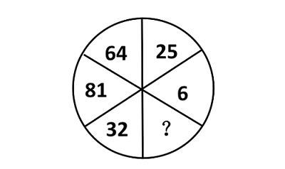

A. 1

B. 16

C. 36

D. 49

第 5 题 · 答案与解析

**参考答案（粉笔题库参考内容）**

A

**解析**

数列各项均为幂次数，优先考虑幂次规律。观察发现，题干数字分别为，，，，，若所求项为起点，则应为；若所求项为终点，则应为，二者对应答案一致。

故正确答案为A。

**来源**：2009年广东省公务员录用考试《行测》题第5题

### 第 6 题

旅行社对120人的调查显示，喜欢爬山的与不喜欢爬山的人数比为5：3；喜欢游泳的与不喜欢游泳的人数比为7：5；两种活动都喜欢的有43人。对这两种活动都不喜欢的人数是：

A. 18

B. 27

C. 28

D. 32

第 6 题 · 答案与解析

**参考答案（粉笔题库参考内容）**

A

**解析**

根据题意可知，喜欢爬山的人数占总人数的比例为，有；喜欢游泳的人数占总人数的比例为，有。设两种活动都不喜欢的人数为x，根据两集合容斥原理公式：，可得：75+70-43=120-x，解得：x=18。

故正确答案为A。

**考点**：两集合

**来源**：2009年广东省公务员录用考试《行测》题第6题

### 第 7 题

地铁检修车沿地铁线路匀速前进，每6分钟有一列地铁从后面追上，每2分钟有一列地铁迎面开来。假设两个方向的发车间隔和列车速度相同，则发车间隔是：

A. 2分钟

B. 3分钟

C. 4分钟

D. 5分钟

第 7 题 · 答案与解析

**参考答案（粉笔题库参考内容）**

B

**解析**

方法一：

根据公式，发车时间间隔，，其中每分钟就遇到迎面开来的一列地铁，每隔分钟有一列地铁从后面超过该检修车。已知每6分钟有一列地铁从后面追上，每2分钟有一列地铁迎面开来，则发车时间间隔分钟。

方法二：

设两列地铁间的距离为1，地铁速度为，检修车速度为，根据追及公式，，则；根据相遇公式，，则，整理可得：······①，······②，则可得地铁速度为，因此发车间隔时间为分钟。

故正确答案为B。

**考点**：相遇追及

**来源**：2009年广东省公务员录用考试《行测》题第7题

### 第 8 题

甲、乙、丙、丁四人，其中每三个人的岁数之和分别是55、58、62、65。这四个人中年龄最小的是：

A. 7岁

B. 10岁

C. 15岁

D. 18岁

第 8 题 · 答案与解析

**参考答案（粉笔题库参考内容）**

C

**解析**

假设四人年龄满足甲&lt;乙&lt;丙&lt;丁，根据题意可知：甲+乙+丙=55······①，甲+乙+丁=58······②，甲+丙+丁=62······③，乙+丙+丁=65······④。由①+②+③+④可得：3(甲+乙+丙+丁)=55+58+62+65=240，因此(甲+乙+丙+丁)=80······⑤，⑤-④可得：(甲+乙+丙+丁)-(乙+丙+丁)=甲=80-65=15，四个人中年龄最小的是15岁。

故正确答案为C。

**考点**：年龄问题

**来源**：2009年广东省公务员录用考试《行测》题第8题

### 第 9 题

一道多项选择题有A、B、C、D、E五个备选项，要求从中选出2个或2个以上的选项作为唯一正确的选项。如果全凭猜测，猜对这道题的概率是：

A. 1/15

B. 1/21

C. 1/26

D. 1/31

第 9 题 · 答案与解析

**参考答案（粉笔题库参考内容）**

C

**解析**

根据题意可知，唯一正确的选项只能有1种。总的情况数即为猜测正确的情况，包含多种情况：

①若猜测正确答案为2个选项：则有种情况；

②若猜测正确答案为3个选项：则有种情况；

③若猜测正确答案为4个选项：则有种情况；

④若猜测正确答案为5个选项：则有种情况。

根据公式：概率。

故正确答案为C。

**考点**：给情况求概率

**来源**：2009年广东省公务员录用考试《行测》题第9题

### 第 10 题

地上放着一个每一面上都有一个数的六面体箱子，对面两个数的和均为27，甲能看到顶面和两个侧面，这三个面上的数字之和是35；乙能看到顶面和另外两个侧面，且这三个面上的数字和为47。箱子贴地一面的数字是：

A. 14

B. 13

C. 12

D. 11

第 10 题 · 答案与解析

**参考答案（粉笔题库参考内容）**

B

**解析**

根据题干条件，甲能看到顶面和两个侧面，这三个面上的数字之和是35；乙能看到顶面和另外两个侧面，这三个面上的数字和为47。若将甲与乙看到的面合在一起，则实际共看到2个相同的顶面与4个不同的侧面。因每组对面两个数的和均为27，而四个不同的侧面恰为两组对面，则其数字之和为，因此顶面的数字为（35+47-54）÷2=14，底面数字为27-14=13。

故正确答案为B。

**考点**：和差倍比问题

**来源**：2009年广东省公务员录用考试《行测》题第10题

### 第 11 题

市场上买2斤榴莲的价钱可以买6斤苹果，买6斤橙子的价钱可以买3斤榴莲。买苹果、橙子、菠萝各1斤的价钱可以买1斤榴莲。买1斤榴莲的价钱可以买菠萝：

A. 2斤

B. 3斤

C. 5斤

D. 6斤

第 11 题 · 答案与解析

**参考答案（粉笔题库参考内容）**

D

**解析**

根据题意，可将榴莲、苹果、橙子的单价分别赋值为6元/斤、2元/斤、3元/斤，则菠萝的单价=6-2-3=1元/斤，因此买1斤榴莲的价钱元，可买菠萝的数量斤。

故正确答案为D。

**考点**：和差倍比问题

**来源**：2009年广东省公务员录用考试《行测》题第11题

### 第 12 题

某单位有52人投票，从甲、乙、丙三人中选出一名先进工作者。在计票过程中的某时刻，甲得17票，乙得16票，丙得11票，如果规定得票比其他两人都多的候选人才能当选。那么甲要确保当选，最少要再得票：

A. 1张

B. 2张

C. 3张

D. 4张

第 12 题 · 答案与解析

**参考答案（粉笔题库参考内容）**

D

**解析**

方法一：整体考虑，乙对甲威胁最大，甲乙共可以分52-11=41张选票，当甲乙均得到20张选票时，甲仍然保证不了能当选，必须再得到剩下的1张才能当选，所以还需要21-17=4张选票。

方法二：还剩下52-17-16-11=8张票。乙对甲威胁最大，甲如果要确保当选，则考虑最差情况，剩下的票只由甲、乙分配，则甲至少要再拿张选票才能保证当选。

故正确答案为D。

**考点**：最不利构造

**来源**：2009年广东省公务员录用考试《行测》题第12题

### 第 13 题

某矿井发生透水事故，且矿井内每分钟涌出的水量相等，救援人员调来抽水机抽水，如果用2台抽水机抽水，预计40分钟可抽完；如果用4台同样的抽水机，16分钟可抽完。为赢得救援时间，要在10分钟内抽完矿井内的水，那么至少需要抽水机：

A. 5台

B. 6台

C. 7台

D. 8台

第 13 题 · 答案与解析

**参考答案（粉笔题库参考内容）**

B

**解析**

设1台抽水机每分钟抽水为1，矿井每分钟涌出的水量为x，矿井原有水量为y。则根据“2台抽水机抽水，预计40分钟可抽完”，可得：；根据“用4台同样的抽水机，16分钟可抽完”，可得：。联立两式，解得：，。因此设在10分钟内抽完矿井内的水需要抽水机的数量为z台，则，解得z=6，即需要6台抽水机。

故正确答案为B。

**来源**：2009年广东省公务员录用考试《行测》题第13题

### 第 14 题

父亲与两个儿子的年龄和为84岁，12年后父亲的年龄等于两个儿子的年龄之和，请问父亲现在多少岁：

A. 24

B. 36

C. 48

D. 60

第 14 题 · 答案与解析

**参考答案（粉笔题库参考内容）**

C

**解析**

设现在父亲为m岁，两个儿子共n岁，则可得如下：m+n=84，，解得m=48，n=36，即现在父亲为48岁。

故正确答案为C。

**考点**：年龄问题

**来源**：2009年广东省公务员录用考试《行测》题第14题

### 第 15 题

教室里有若干学生，走了10名女生后，男生人数是女生的2倍，又走了9名男生后，女生人数是男生的5倍，问最初教室里有多少人？

A. 15

B. 20

C. 25

D. 30

第 15 题 · 答案与解析

**参考答案（粉笔题库参考内容）**

C

**解析**

方法一：假设教室里最初有a名女生，有b名男生，那么根据条件：走了10名女生后，男生人数是女生的2倍，可列出方程式：2(a-10)=b；又走了9名男生后，女生人数是男生的5倍可知：a-10=5(b-9)；联立可得a=15，b=10，所以最初教室里人数=15+10=25人。

方法二：走了10名女生后，女生:男生=1:2=5:10；又走了9名男生后，女生:男生=5:1，可见男生刚好减少9份，每份1人，则走了9名男生后，男生人数为1人，女生人数为5人，故原有男生10人，女生10+5=15人，所以最初教室里人数=10+15=25人。

方法三：根据题干：走了10名女生后，男生人数是女生的2倍。即男：女=2:1，此时全班总人数是2+1=3的整数倍。因此可得最初教室人数减去10之后是3的整数倍，结合选项代入排除，只有C项满足此条件。

故正确答案为C。

**考点**：和差倍比问题

**来源**：2009年广东省公务员录用考试《行测》题第15题

### 第 16 题

他并不富裕，但还＿＿＿＿＿照顾比他自己更穷的亲戚。

A. 救济

B. 周济

C. 周恤

D. 赞助

第 16 题 · 答案与解析

**参考答案（粉笔题库参考内容）**

B

**解析**

本题考查近义实词对象搭配的辨析与填空。

根据题干可知，该空与后面的“照顾”是并列关系，故找到“照顾”的近义词即可。“周济”指给予贫困者财物支援；“救济”指用钱物救助灾民和其他生活贫困的人，多指国家或社会团体有组织的救援行动；“周恤”有周济、体恤之意；“赞助”指支持帮助，现多指经济上的帮助，多指帮助某人完成一项事业或活动。

因此，结合选项应该选择B。

由词义和适用对象可知，“救济”、“赞助”不合句意，排除A、D两项；C项为干扰项，“周恤”比“周济”多了怜悯之意，而从“富裕”、“穷”来看，这里主要指的是经济物质上的帮助，而不是精神上的怜悯，因此选“周济”更恰当。

故正确答案为B。

**考点**：关联关系-转折关系、实词填空、词的辨析-搭配对象、词的辨析-词义侧重

**来源**：2009年广东省公务员录用考试《行测》题第16题

### 第 17 题

人生是一个容器，可这个容器的容量实在是非常＿＿＿＿。愁苦和畏惧多了，欢乐与＿＿＿＿就少了。

A. 庞大 胆量

B. 可观 轻松

C. 有限 勇气

D. 莫测 勇敢

第 17 题 · 答案与解析

**参考答案（粉笔题库参考内容）**

C

**解析**

本题考查实词语境最佳选择。

第一空中，根据第二句中的“······多了，······就少了”可知“人生”这个容器的容量是有限的，“庞大”、“可观”、“莫测”显然均与句义不合。

第二空中，“欢乐”对应“愁苦”，第二个括号内填入的词语应该与“畏惧”相对应，四个选项中只有“勇气”最符合句意。

故正确答案为C。

**考点**：关联关系-并列关系、实词填空、对应关系-前后呼应

**来源**：2009年广东省公务员录用考试《行测》题第17题

### 第 18 题

究竟国家与个人对个人的医疗健康应分别承担多大比例，是一个＿＿＿＿选择问题，而不是政府可以任意决定的事项。要让民众有机会参与这一重大财政决策，透过人大的审议机制，将自己的意愿＿＿＿＿到长期的财政安排中。

A. 公共 体现

B. 公众 融合

C. 大众 反映

D. 集体 表达

第 18 题 · 答案与解析

**参考答案（粉笔题库参考内容）**

A

**解析**

第一空，搭配“选择问题”，且根据文意可知，横线处应体现对个人医疗健康承担的比例问题而言，需要政府和个人共同商议来确定，不能只偏听某一方的意见之意。A项“公共”指属于社会的、公有公用的，且公共选择是一个固定术语，D项“集体”指许多人合起来的有组织的整体，均符合文意，保留。B项“公众”指社会上大多数的人、C项“大众”指群众、民众，均为名词词性，与 “选择问题”搭配不当，排除。

第二空，根据“要让民众有机会参与这一重大财政决策，透过人大的审议机制，将自己的意愿（ ）到长期的财政安排中”可知，横线处需体现把民众意愿在长期财政安排中呈现出来之意。A项“体现”指某种性质或现象通过某一事物具体表现出来，符合文意，当选。D项“表达”多搭配“观点、诉求”， “表达”一般不接“到······中”搭配不当，排除。

故正确答案为A。

【文段出处】爱思想《秋风：应当重建医疗福利制度》

**考点**：实词填空、对应关系-前后呼应、词的辨析-搭配对象

**来源**：2009年广东省公务员录用考试《行测》题第18题

### 第 19 题

煤炭与石油、天然气相比价格低廉，以同等发热量计算，目前石油价格是煤炭的5倍，天然气价格是煤炭的3倍，所以，在石油价格居高不下的背景下，煤炭价格必然＿＿＿＿＿＿。

填入划横线部分最恰当的一项是：

A. 水涨船高

B. 相形见绌

C. 如影随形

D. 随波逐流

第 19 题 · 答案与解析

**参考答案（粉笔题库参考内容）**

A

**解析**

第一空，由“所以”引导结论，前文指出，在同等发热量下石油价格是煤炭的5倍、天然气是煤炭的3倍，说明煤炭相对价格最低。在石油价格居高不下的背景下，其替代需求会向煤炭转移，从而推动煤炭价格上升。A项“水涨船高”比喻事物随着它所凭借的基础的提高而提高，符合煤炭价格随石油价格上涨而上涨的语境，当选。

B项“相形见绌”指和同类事物相比显出不足，C项“如影随形”比喻两个人关系亲密，常在一起，D项“随波逐流”比喻没有坚定的立场，缺乏判断是非的能力，只能随着别人走，均与价格变动趋势的逻辑不符，排除。

故正确答案为A。

**考点**：关联关系-因果关系、成语填空

**来源**：2009年广东省公务员录用考试《行测》题第19题

### 第 20 题

构成中华文明的各支源流各有其成长、壮大、迁徙、融合的历史。把各支主要源流的历史给予相对充分的阐发，更能表现中华民族万流入海的历史＿＿＿＿。

A. 事实

B. 潮流

C. 趋势

D. 进程

第 20 题 · 答案与解析

**参考答案（粉笔题库参考内容）**

C

**解析**

根据文意可知，横线处应体现构成中华文明的各支源流有其发展过程，把各支源流历史充分阐发能表现中华民族万流入海的情况之意。C项“趋势”指事物发展的动向，这里中华民族万流入海体现的是一种发展的动向，符合文意，当选。

A项“事实”指事情的真实情况，“万流入海”强调的是一种动向而非单纯的事实，与文意不符，排除；B项“潮流”指社会上的一种趋势，多形容某一时期的社会发展大势，与各支源流逐步融合汇聚的长期历史走向的语境不符，排除；D项“进程”指事物发展变化或进行的过程，文段强调的是源流汇聚的最终走向这一结果，而非具体过程，与文意不符，排除。

故正确答案为C。

**考点**：实词填空、对应关系-前后呼应

**来源**：2009年广东省公务员录用考试《行测》题第20题

### 第 21 题

“进去，只留下脚印；出来，只带走照片”，这句话看似简单，但却包含了一个重要的道理，它直观地提示我们，依托生态发展旅游，必须＿＿＿＿自然规律，＿＿＿＿保护生态环境。

A. 遵循 注重

B. 遵照 强调

C. 遵守 注意

D. 尊重 重点

第 21 题 · 答案与解析

**参考答案（粉笔题库参考内容）**

A

**解析**

本题考查实词词义侧重的辨析与填空。

本题的突破点在第一空，“遵守”是指按照规定行动，遵守规定或制度，侧重点在“守”；“遵循”表示遵照，依规律行事，多指对规律性的东西；“尊重”通常只是停留在思想意识上并没有付诸行动；“遵照”是指依照、按照，遵照指示。由后文的“自然规律”可知，横线处填“遵循”最恰当。

第二空中，“注意”指把意志或者关注点放在某个方面；“注重”指的是重视，语义色彩比“注意”更浓。从文意看出，是要重视保护生态环境，而不单是关注保护生态环境。

故正确答案为A。

**考点**：实词填空、对应关系-前后呼应、词的辨析-词义侧重

**来源**：2009年广东省公务员录用考试《行测》题第21题

### 第 22 题

风水在古代其实包含有很深的科学成分，“依山而建，傍水而居”、“面南背北，坐北朝南”几千年流传下来，若非其有着极强的＿＿＿＿价值，到今天也不至于被建筑商和民间如此＿＿＿＿。

A. 实用 推崇

B. 应用 尊宠

C. 科学 重视

D. 美学 提倡

第 22 题 · 答案与解析

**参考答案（粉笔题库参考内容）**

A

**解析**

第一空中，题干主要谈的是“风水”的科学性，不涉及美学范畴，故可首先排除D项。建筑商和民间之所以一直沿用“风水”，并不是因为它有科学价值，而是基于其对现实生活的实际应用价值，由此排除C项。

第二空中，“尊宠”意为尊重宠幸，与文意不符，排除B项。

故正确答案为A。

**考点**：实词填空、对应关系-前后呼应、词的辨析-词义侧重

**来源**：2009年广东省公务员录用考试《行测》题第22题

### 第 23 题

文化经典，是一个民族文化＿＿＿＿的集中体现。经过千百年的＿＿＿＿，文化经典世代相传而广受赞誉，足以说明其深厚的价值和无可替代的作用。

A. 精要 积淀

B. 精髓 锤炼

C. 精要 历练

D. 精髓 沉淀

第 23 题 · 答案与解析

**参考答案（粉笔题库参考内容）**

B

**解析**

此题考查实词辨析。第一空，“精要”是指关键的要点，“精髓”指事物最好的、最重要的部分。根据语境，第一个空格处填入“精髓”更为恰当。

第二空，“锤炼”与“沉淀”之间较难区分。“锤炼”有不断修正、完善的含义，强调“取其精华，去其糟粕”的过程；“沉淀”是指把溶液中不易溶解的物质沉到溶液底层，是一个自然的过程。“文化经典”作为文化的集大成者，是经过不断地修正完善而出现的，显然，横线处选择“锤炼”更合语境。

故正确答案为B。

**考点**：实词填空、词的辨析-词义侧重

**来源**：2009年广东省公务员录用考试《行测》题第23题

### 第 24 题

现在的标准化考试几乎都变成了考试组织方和应考方斗智斗勇的博弈游戏。考试的主办方＿＿＿＿＿＿用一个个小陷阱＿＿＿＿考生做错，考生则尽可能地搜集陷阱模式，境界是眼睛一扫题目，就知道对方腰里别的是什么暗器。

A. 千方百计 引诱

B. 处心积虑 希望

C. 费尽心机 导致

D. 殚精竭虑 迫使

第 24 题 · 答案与解析

**参考答案（粉笔题库参考内容）**

A

**解析**

本题考查成语和实词的混搭填空。

第一空考查成语，由于题干中看不出作者对考试主办方出题时为难考生这种做法的态度，所以选择中性词“千方百计”最为恰当。“千方百计”是指想尽一切办法，用尽各种计谋，为中性词；“殚精竭虑”形容用尽精力，费尽心思，为褒义词；“费尽心机”是指用尽心思，用尽办法，含贬义；“处心积虑”是指心里计划思考已久，多含贬义。

第二空考查词语的搭配，由前文的“小陷阱”可知，考生是被陷阱迷惑、诱导以致犯错的，选项中只有“引诱”最合句意。

故正确答案为A。

**考点**：混搭填空、词的辨析-感情色彩

**来源**：2009年广东省公务员录用考试《行测》题第24题

### 第 25 题

在许多犹太人家里，当小孩稍微懂事时，大人就会翻开一本书，涂一点蜂蜜在上面，叫小孩子去舔，其用意＿＿＿＿＿＿：读书是＿＿＿＿的。

A. 显而易见 快乐

B. 毋庸置疑 幸福

C. 不言自明 纯真

D. 不言而喻 甜蜜

第 25 题 · 答案与解析

**参考答案（粉笔题库参考内容）**

D

**解析**

本题考查成语与实词的混搭填空。

第一空考查成语，“不言而喻”形容道理或用意是很浅显的，不用说出来，别人就能够知道。该成语填入括号内，符合材料语境。

第二空考查词语搭配，本题的突破口在于第二个空格。由题干可知，句中是用蜂蜜的“甜”与读书的“甜蜜”相类比，且前后呼应。因此，空格内填入“甜蜜”最合语境。“快乐”、“幸福”虽然也能用来形容读书，但是未能与句中涂蜂蜜的做法相联系；“纯真”可以用来形容小孩，但不能用来形容读书。因此，可以确定答案为D。

故正确答案为D。

**考点**：对应关系-前后呼应、混搭填空

**来源**：2009年广东省公务员录用考试《行测》题第25题

### 第 26 题

随着社会文明程度的提高，女性的才能在传媒、大学、科研和金融等高度理性的行业，不仅获得了更大的展示空间，而且也帮助她们创造了越来越多的骄人业绩。当然，妻子和母亲的角色，仍然限制着女性潜能的发挥。因此，一个成功的女性背后往往是她那旁人难以体会的艰辛。

这段文字主要表述的是：

A. 伴随着社会文明程度的提高，女性职业化水平也越来越高

B. 女性更适合从事传媒、大学、科研和金融等高度理性的行业

C. 随着职业化的提高，女性要在事业上成功需要付出更多的努力

D. 若没有妻子和母亲的角色限制，女性潜能将得到更大的发挥

第 26 题 · 答案与解析

**参考答案（粉笔题库参考内容）**

C

**解析**

根据总结关系词“因此”可知，材料的语意重点应是其后的内容，即女性要在事业上取得成功需要付出旁人难以体会的努力。

因此，C项表述最合文意。

A项表述片面；B、D项内容在材料中并未体现。

故正确答案为C。

**考点**：关联词-因果

**来源**：2009年广东省公务员录用考试《行测》题第26题

### 第 27 题

中国改革之难，最难的不是发现问题并提出对策，而是改革必须考虑13亿人口的根本利益和长远利益。避免引起社会动荡，避免激化矛盾，既积极又稳妥，是中国改革开放30年始终坚持的信念，也是一路渡险难、克难题的制胜法宝。

根据以上文字，下列表述正确的是：

A. 避免引起社会动荡，避免激化矛盾是当前改革中最关键的问题

B. 保持社会稳定、兼顾最广大群众利益是中国改革最棘手的问题

C. 中国在改革中必须要考虑人口众多这一现实问题

D. 兼顾发展与稳定的关系是中国改革开放取得成功的法宝

第 27 题 · 答案与解析

**参考答案（粉笔题库参考内容）**

D

**解析**

由材料第二句话“既积极又稳妥，是中国改革开放……克难题的制胜法宝”可以推断出避免引起社会动荡，保持社会稳定，处理好改革与发展的关系是改革开放取得成功的原因，因此D项表述符合文意。

A项中，“当前”与“最关键”错误，无法从材料中推断出来；B项中，“保持社会稳定、兼顾最广大群众利益”是解决问题的方法，而非“最棘手的问题”；C项中，“人口众多”表述不当，改革开放必须考虑的是人民的根本利益和长远利益，其重点不在于人口的数量。

故正确答案为D。

**考点**：细节判断题

**来源**：2009年广东省公务员录用考试《行测》题第27题

### 第 28 题

戏剧和书法篆刻家使用的繁体字等小众文化产品，正面临阵地锐减、影响下降的处境。这样的表现，从技术层面说，并无大的问题，因为实用主义统治的时代，那些已经不甚实用的东西，可以退出技术的范畴，但是，从文化产品的延续性而言，那些被动辄几千年中国文明史检验了的文化，它绝不能不为人知，也不能只由书法家、戏剧家等专门人士扛着，如果最后的结果即是这样，那么终会曲终人散，留下一段段文化悲剧。

下列属于文中“文化悲剧”的是：

A. 大量历史文物流失海外

B. 繁体字被简体字取而代之

C. 多种民间曲艺面临失传困境

D. 少数民族生活被现代生活同化

第 28 题 · 答案与解析

**参考答案（粉笔题库参考内容）**

C

**解析**

根据“从文化产品的延续性……它绝不能不为人知，也不能只由书法家、戏剧家等专门人士扛着，如果最后的结果即是这样，那么终会曲终人散，留下一段段文化悲剧”这句话可知，所谓“文化悲剧”是指那些小众文化产品只有专业人士扛着，不为大众所知，也就是面临失传。

因此，符合这一表述内涵的只有C项，“多种民间曲艺面临失传困境”也是仅由专业的曲艺表演家所了解，而大众对此却越来越不熟知所造成的后果。

A项说的是文物流失海外，不符合“文化悲剧”的内涵；B、D项意思大致相同，均属于以前保留的不同样式被现代方式所取代或者同化，而并非“失传”之意，予以排除。

故正确答案为C。

**考点**：实词

**来源**：2009年广东省公务员录用考试《行测》题第28题

### 第 29 题

领导带领机关干部扫大街，从官员和机关的角度看，这当然是好事，可以拉近与民众的距离，显示出领导干部勤政为民。但是，从干部的个人权利讲，义务劳动不是不可以，但不能是行政命令的驱使；从环卫部门的角度来看，如果干部常态化扫街确有必要，反映出的可能是两个方面的问题，要么环卫工人的数量不够，人手短缺；要么是环卫工人不好好干活，工作留下了很多死角。

下列表述最能概括上述文字内容的是：

A. 领导干部带头扫街、参加义务劳动是对个人权利的侵犯

B. 领导干部带头扫街能激发环卫部门工作人员的工作积极性

C. 领导干部带头扫街可以拉近与民众的距离，促进干群关系和谐

D. 领导干部带头扫街，很可能会造成民众的误解，达不到理想效果

第 29 题 · 答案与解析

**参考答案（粉笔题库参考内容）**

D

**解析**

由提问标志词“概括”可知，本题为中心理解题。

根据转折关系词“但是”可知，作者对领导干部带头扫街持怀疑态度。材料中从干部个人权利和环卫部门的角度，分析了“领导带领机关干部扫大街”可能会产生的问题，这些问题有可能使民众产生误解，无法拉近干部与民众之间的距离。

因此，D项表述最合文意。

A项以偏概全；B、C项表述与文意相违背，予以排除。

故正确答案为D。

**考点**：关联词-并列、关联词-转折

**来源**：2010年黑龙江省公务员录用考试《行测》题第13题

### 第 30 题

1912年，在埃及的一次考古挖掘中，考古学家波哈特发现了公元前十四世纪埃及皇后奈菲尔提蒂的半身像并运回国。根据美国《时代》周刊刊登的最新发现文件，波哈特当年在半身像的归属问题上，故意误导了埃及政府。为了能够留住珍贵的半身像，他让埃及官员在灰暗的灯光下查看文物，还对半身像的结构做了文章。埃及古迹最高委员会已反复要求德国将文物归还，至少它暂时回到埃及故土。

根据上文可以推断，考古学家波哈特是：

A. 德国人

B. 埃及人

C. 美国人

D. 英国人

第 30 题 · 答案与解析

**参考答案（粉笔题库参考内容）**

A

**解析**

材料第一句话中提到考古学家将半身像“运回国”，结尾谈到“埃及古迹最高委员会已反复要求德国将文物归还”，前后对应，可知波哈特是德国人。

C项为干扰项，材料中只是提到美国《时代》周刊的最新发现文件，不能因此而断定波哈特是美国人。

故正确答案为A。

**考点**：细节判断题

**来源**：2009年广东省公务员录用考试《行测》题第30题

### 第 31 题

山水园林城市目前来讲是人类理想的居住环境。为什么山水这么重要呢?因为人的本性里面有对自然亲和的一面。人本来来自于自然，本来就是动物，天然地具有自然性。我们长期居住在钢筋水泥里面，就好像孩子失去了母亲，一旦回归了自然，我们就得到了心里的安慰，就好像孩子找到了母亲一样。

根据上述文字，山水园林城市目前之所以是人类理想的居住环境，是因为：

A. 人类依恋母亲的自然属性

B. 人类依赖自然的动物属性

C. 城市居民对乡村生活的怀念

D. 城市居民对自然生活的向往

第 31 题 · 答案与解析

**参考答案（粉笔题库参考内容）**

B

**解析**

由提问方式可以判断出本题为细节判断题。

材料中明确地对“为什么”作出了回答，“因为人的本性里面有对自然亲和的一面。人本来来自于自然，本来就是动物，天然地具有自然性”。

因此，四个选项中，只有B选项表述最为准确。

A项错误，因为材料是将自然比为“母亲”，人依恋自然是源自动物属性；C、D两项偷换概念，材料中说的是“山水园林城市”，并不能将其等同于“乡村生活”或者“自然生活”。

故正确答案为B。

**考点**：细节判断题

**来源**：2009年广东省公务员录用考试《行测》题第31题

### 第 32 题

如果说“家电下乡”给了家电企业开拓农村消费市场的机遇，那么，“进城”则更能为企业创造更好的销售业绩。因为在城市里，居民更容易接受新的生活和消费方式。假如“家电进城”也得到政府的相关政策支持和补贴的话，企业应当有理由在城镇市场上发掘出新的消费潜力，客观上让城市低收入和失业居民也得到家电产品消费的实惠。

下列符合作者观点的一项是：

A. “家电下乡”可能给企业带来良好的销售业绩

B. 城市低收入和失业居民更需要政策支持和补贴

C. 政府应该支持企业的“家电进城”，大力推广新产品

D. 和农村市场比较，城镇消费市场同样具有挖掘的潜力

第 32 题 · 答案与解析

**参考答案（粉笔题库参考内容）**

D

**解析**

材料首句通过递进结构给出作者观点：“家电进城”会有比“下乡”更具有潜力。后文对作者的观点进行解释说明，由此可以得出城镇和农村同样具有消费潜力。因此，结合选项应该选择D项。材料主要论述的是“家电进城”而非“下乡”，A项并非作者的观点；B、C两项无法从材料中得知，排除。

故正确答案为D。

**考点**：分述句特征-其他

**来源**：2009年广东省公务员录用考试《行测》题第32题

### 第 33 题

要让人民更多地了解司法，参与司法，不仅要让人民知道实体的结论，而且要让人民知道程序并参与到程序中来，形成实体性的结论。让权力在阳光下运行，要求司法权对自我进行约束和限制，更要求公民的参与意识、参与行为如同阳光一样令滥用的权力无处容身。

根据上述文字，人民参与司法，关键是：

A. 要增强公民参与司法的意识

B. 要让人民知道实体的结论

C. 要让人民知道司法程序并参与其中

D. 要加强司法权的自我约束和限制

第 33 题 · 答案与解析

**参考答案（粉笔题库参考内容）**

C

**解析**

由“不仅要让人民知道实体的结论，而且要让人民知道程序并参与到程序中来”可知，递进后为重点内容，意在强调公民要知道程序并且参与其中，这是公民参与司法的关键，C项正确。

A、B、D三项均不是关键所在，排除。

故正确答案为C。

**考点**：分述句特征-其他

**来源**：2009年广东省公务员录用考试《行测》题第33题

### 第 34 题

生态农业的生产以资源的永续利用和生态环境保护为重要前提，根据生物与环境相协调适应、物种优化组合、能量物质高效率运转、输入输出平衡等原理，运用系统工程方法，依靠现代科学技术和社会经济信息的输入来组织生产。通过食物链网络化、农业废弃物资源化，充分发挥资源潜力和物种多样性优势，建立良性物质循环体系，促进农业持续稳定地发展，实现经济、社会、生态效益的统一。

根据以上文字，下列说法错误的是：

A. 生态农业是一种知识密集型的现代农业体系，是农业发展的新型模式

B. 生态农业能把分散的、局部的单项农业技术综合集成起来形成集约优势

C. 生态农业是以生态经济系统原理为指导建立起来的综合性农业体系

D. 生态农业是兼顾资源、环境、效率、效益的一种现代农业生产模式

第 34 题 · 答案与解析

**参考答案（粉笔题库参考内容）**

B

**解析**

A项，根据文段“依靠现代科学技术和社会经济信息的输入来组织生产”可知，表述正确；

B项，“把分散的、局部的单项农业技术综合集成起来形成集约优势”无中生有，表述错误；

C项，根据文段“生态农业的生产以资源的永续利用和生态环境保护为重要前提”可知，表述正确；

D项，根据文段“建立良性物质循环体系，促进农业持续稳定地发展，实现经济、社会、生态效益的统一”可知，表述正确。

本题为选非题，故正确答案为B。

**考点**：细节判断题

**来源**：2010年黑龙江省公务员录用考试《行测》题第15题

### 第 35 题

干部精神状态如何，或大或小地影响到老百姓的生活和福祉。如果每个人都振作起来，就会把各方面的工作干得更好，就可能使社会多增加一些就业岗位；就可能使农民收入增加；就可能使贫困地区的中小学多增加几张课桌。

这段话的中心论点是：

A. 干部精神状态的好坏，直接决定着老百姓生活质量的高低

B. 农民生活水平的提高，与领导干部的带头模范作用分不开

C. 如果每个人都振作起来，就可能增加就业岗位

D. 干部作风和干劲是推动我们各项事业发展进程的领导力量

第 35 题 · 答案与解析

**参考答案（粉笔题库参考内容）**

D

**解析**

根据提问标志词“中心论点”可知本题为中心理解题。

第一句话“干部精神状态影响老百姓的生活和福祉”是本段文字的中心论点，之后的文字从“工作质量”，“就业岗位”，“农民收入”和“贫困地区教学物资”这几个方面论证了如果精神状态好，充满干劲，那么对各项事业都有积极作用。所以D项正确。

A项中“直接决定”太绝对，文段中只说明是“影响”；B项“领导干部的带头模范作用”不是文段讨论的内容；C项只是论证部分的一个方面。

故正确答案为D。

**考点**：分述句特征-多角度论述

**来源**：2010年黑龙江省公务员录用考试《行测》题第16题

### 第 36 题

知识的本质是发现，只有在自由的环境中，人们才会有更多发现的可能。因此，知识分子在本质上也不是熟知现成结论的人，知识分子要发掘未知事物，提示假相背后的真相。教育的目的，就是培养学生发现和创造知识的能力，教育如果停留在向学生强行灌输标准答案和“真理”上，根本就是反教育的。

这段话的主题是：

A. 知识的本质

B. 知识分子的本质

C. 创造力的培养

D. 教育的目的

第 36 题 · 答案与解析

**参考答案（粉笔题库参考内容）**

B

**解析**

文段首先指出知识的本质，然后通过“因此”得出结论，知识分子的本质是要发掘未知事物，然后指出教育的目的，就是培养学生发现和创造知识的能力，属于对前文结论的补充说明，所以文段的重点在于突出知识分子的本质，对应B项。

A项，“知识的本质”对应结论之前内容，非重点，排除；

C、D两项，均属于后文补充说明部分，非重点，且“创造力的培养”是教育的目的之一，表述片面，排除。

故正确答案为B。

【文段出处】《知识分子的品质——黄卧云》

**考点**：关联词-因果

**来源**：2009年广东省公务员录用考试《行测》题第36题

### 第 37 题

近几年来，政府通过各类手段，促使产业结构升级，促进经济的可持续发展。但是，经济转型政策在短期内对经济增长带来的负面影响显而易见。受限制的行业在较短时期内会因政策的压力故而缓慢增长。同时，受扶植政策不到位、市场培育滞后、技术开发存在瓶颈等因素影响，新的产业成长将较为缓慢，无法对冲前者带来的负面影响。

这段文字结尾处的“前者”是指：

A. 政府各种促使产业结构升级的政策

B. 政策在短期内对经济增长的负面影响

C. 受限制的行业在短时期内增长缓慢

D. 政策、市场、技术开发瓶颈等因素

第 37 题 · 答案与解析

**参考答案（粉笔题库参考内容）**

C

**解析**

根据提问方式可判断出本题为词句理解题。

阅读可知，在经济转型政策下存在“受限制的行业”和受扶植的“新的产业”，材料分别论述了二者受到的影响。前者会受到经济转型政策的负影响增长缓慢，而后者的增长又不能弥补“受限制的行业增长缓慢对整个经济增长的影响”。

因此，结合选项应该选择C。

A、B、D三项均表述错误。

故正确答案为C。

**考点**：实词

**来源**：2009年广东省公务员录用考试《行测》题第37题

### 第 38 题

作为企业，即使是国有垄断企业，它也要追求利润。然而，从“高价买进，低价卖出”这种做法上来看，我国的石油政策显然存在严重缺陷。国有石油企业不管是“高价买进”还是“低价卖出”，它的利益都毫发未损，甚至还从中获得了更多。唯一受损的，是国内经济和国家的利益。

这段文字主要在强调：

A. 政府应该关注国有垄断企业的盈利状况

B. 国家应该养活对国有石油企业的补贴

C. 我国的石油政策存在战略性缺陷

D. 国有石油企业在以牺牲国家利益来获利

第 38 题 · 答案与解析

**参考答案（粉笔题库参考内容）**

C

**解析**

第一步：分析文段

本题属于中心理解题。文段首先介绍企业要追求利润，后通过关联词“然而”进行转折，指出我国石油政策存在缺陷，并对这种缺陷及其带来的后果进行了说明。可知，文段的主要强调转折后的内容，即“我国石油政策存在缺陷”。结合选项，C项是对文段主旨的同义表达，当选。

第二步：分析选项

A项，文段没有提到“政府”、“盈利”，属于无中生有，故排除。

B项，文段没有提到“补贴”，属于无中生有，故排除。

D项，文段并没有指出“国有石油企业的‘利益没有受损，甚至还获得更多’与国家利益‘受损’”之间存在因果关系，属于强加因果，故排除。

第三步：再次标注答案

故正确答案为C。

**考点**：关联词-转折

**来源**：2009年广东省公务员录用考试《行测》题第38题

### 第 39 题

精神与物质，是人类生活不可或缺的两翼，此起而彼伏，相辅而相生，这也是自然界的平衡规律。物质产品极大丰裕之时，人们对文化和精神的要求恰恰也就少了。反之，民族危亡，国难当头，《黄河》之声震天响起!特大地震，轰然袭来，泪光中的诗篇和歌吟，让多少人心潮澎湃，挺起脊梁擦干眼泪！经济萧条不振，恰恰需要给人以文化的心灵鸡汤！

这段话的中心论点是：

A. 经济环境的坎坷与挫折，正好为文化产品提供了难得的创作素材

B. 人类生活中，物质产品越丰富，精神需要恰恰会越少

C. 往往在民族危亡、国难当头的时候，总会有经典文化作品产生

D. 社会危难之时，人们更需要文艺作品、文化产品的安抚与激励

第 39 题 · 答案与解析

**参考答案（粉笔题库参考内容）**

D

**解析**

根据提问标志词“中心论点”可知本题为中心理解题。

材料在首句指出物质和精神存在此起彼伏又相辅相生的关系，后半部分主要是提到客观环境变得恶劣时，人们更需要精神力量的支持。

因此，D选项表述符合文意。

A、C项在材料中并未体现出来；B项表述绝对化，材料中是说“物质产品极大丰裕之时，人们对文化和精神的要求恰恰也就少了”，而不是物质产品“越”丰富，精神需要就“越少”。

故正确答案为D。

**考点**：分述句特征-引入铺垫

**来源**：2009年广东省公务员录用考试《行测》题第39题

### 第 40 题

公众对茅盾文学奖的关注表明，我们对原来意义上的文学已不熟悉，所以迫切地需要这样的奖项来让大家接触文学。这其实和每年我们对诺贝尔文学奖的关注相类似，这种关注正是说明，我们对于文学的现状和作品越来越陌生。

这段文字意在说明：

A. 公众对原来意义上的文学已不熟悉

B. 公众对茅盾文学奖的关注前所未有

C. 公众对于每年诺贝尔文学奖的关注度高

D. 我们对于文学的现状和作品缺乏了解

第 40 题 · 答案与解析

**参考答案（粉笔题库参考内容）**

D

**解析**

根据提问方式“意在”可知，本题为中心理解题。

通过“我们对原来意义上的文学已不熟悉”、“我们对于文学的现状和作品越来越陌生”这两句话可以推断出，作者认为我们对文学的现状和作品缺乏了解，因此D项表述正确。

A项为干扰项，与A相比，D项表述得更为全面具体；B、C两项无法从材料中推断出来。

故正确答案为D。

**来源**：2009年广东省公务员录用考试《行测》题第40题

### 第 41 题

就目前房地产市场成交量增加的现象，有分析认为，中国地产引擎可能重新启动。果真如此的话，这将在外需出现困境的背景下引领中国经济走出低谷。对比1986年日本的情况，如果政府引导得当，中国经济将可能因为地产业的重新启动而率先走出困局。当然，基于美国当年的经验，经济重新启动可能是一个相对漫长的过程。

根据上述文字，下列表述正确的一项是：

A. 成交量的提升给地产市场甚至中国经济带来了回暖希望

B. 随着地产业的重新启动和振兴，中国经济将率先走出低谷

C. 地产业能否重新成为国民经济的支柱，取决于政府的引导

D. 如果地产业能重新启动，中国经济走出困境则需较长时间

第 41 题 · 答案与解析

**参考答案（粉笔题库参考内容）**

A

**解析**

材料主要针对“目前房地产市场成交量增加的现象”的影响进行分析，指出其回暖可能对中国地产业及中国经济产生重大影响。

因此，A选项表述符合文意。

B项表述片面，中国经济率先走出困局的前提是政府引导得当；C项在材料中没有体现出来，予以排除；D项表述绝对化，与文意不符。

故正确答案为A。

**考点**：细节判断题

**来源**：2009年广东省公务员录用考试《行测》题第41题

### 第 42 题

科学发展观是指导发展的科学理论，是应对危机的有力武器。要运用科学发展观寻找应对之策，坚持走科学发展之路，渡过难关。要进一步深化学习，加深对科学发展观精神实质和现实指导意义的理解，切实增强贯彻落实科学发展观的自觉性，要科学分析形势，增强必胜信心，把国际金融危机带来的压力转化为推动科学发展的动力，从实际出发创造性地贯彻落实中央“保增长、扩内需、调结构”的方针政策，着力解决经济运行中的突出问题，把国际金融危机带来的损失降低到最低程度。

这段文字着重强调的是：

A. 要进一步深化学习，加深对科学发展观精神实质和现实指导意义的理解

B. 要以科学发展观为指导，应对国际金融危机给我国经济社会带来的挑战

C. 要增强信心，把国际金融危机带来的压力转化为推动科学发展观的动力

D. 要从实际出发创造性地贯彻落实中央“保增长、扩内需、调结构”的方针政策

第 42 题 · 答案与解析

**参考答案（粉笔题库参考内容）**

B

**解析**

材料首先指出“科学发展观是应对危机的有力武器”，接下来引出对策，即文段重点所在，应该运用这种“武器”来应对国际金融危机。B项表述符合文意。

其他三项均未抓住“应对金融危机”这一关键概念，排除。

故正确答案为B。

**考点**：主题词、关联词-对策

**来源**：2009年广东省公务员录用考试《行测》题第42题

### 第 43 题

博弈论在外行人看来只是一大堆数学公式，好在博弈论关心的是日常经济生活问题，所以不能不食人间烟火。其实，这一理论是从棋弈，扑克和战争等带来竞赛、对抗和决策性质的问题中借用的术语，听上去有点玄奥，实际上却具有重要的现实意义。

对上述文字概括最恰当的一项：

A. 博弈论看似玄奥，其实它源于日常游戏并具有重要的现实意义

B. 作为数学的一个分支，博弈论涉及的领域主要是日常经济生活问题

C. 博弈论在许多外行人看来只是一大堆数学公式，但实际上并不深奥

D. 博弈论能用生动、易懂的游戏语言解释经济社会中的许多现实问题

第 43 题 · 答案与解析

**参考答案（粉笔题库参考内容）**

A

**解析**

由提问标志词“概括”可知本题为中心理解题。

根据转折关系词“其实”可以判断出，整个材料的语意重点是其后的内容，即这一理论看似玄妙，实际上有重要的现实意义。A选项表述最为准确。

B项表述错误，博弈论只是一大堆数学公式，并不是数学的分支；C项不是文段重点内容；D项表述明显错误，与文意不符。

故正确答案为A。

**考点**：关联词-转折

**来源**：2009年广东省公务员录用考试《行测》题第43题

### 第 44 题

春天的气息唤醒了慵懒的细胞，满目的烂漫引导我们向往着花开四季，锦绣的人生与桃花的惊艳给了我们感官与精神的双重慰藉。我想，也许每个人的内心深处都保留着这么一丝天马行空的浪漫，每个女人都曾经将自己化身为那个自由的洛丽塔女孩，家是我们思想的延伸，装点其中便有了主人思维的精髓，内心的渴望。在这里，我们有了这样的“艳遇”。

如果上述文字是一段广告语，那么它最适合于：

A. 花卉展销

B. 家具推介

C. 房屋销售

D. 旅游宣传

第 44 题 · 答案与解析

**参考答案（粉笔题库参考内容）**

B

**解析**

材料第一句极富抒情地创造了美的意境，引起我们内心装点家的渴望，材料最后两句起过渡作用，点明装点家可以拥有美好的“艳遇”。

因此，结合选项应该选择B。作为广告语必然是关于家具推介的。

其他三项都没有抓住材料最后“家是我们思想的延伸，装点其中便有了主人思维的精髓，内心的渴望”的意思，予以排除。

故正确答案为B。

**考点**：特殊问法

**来源**：2009年广东省公务员录用考试《行测》题第44题

### 第 45 题

不管哪种鸟，营巢都是一项十分浩大而艰巨的“工程”。在城楼、寺庙等建筑物上营巢的楼燕，需要到远处的河泥滩上衔取泥土、草棍等，然后一点一点地堆砌成碗状的巢，足足需一周时间。而金丝燕，用纯粹的唾液建巢，但同样要付出含辛茹苦的劳动。这种巢窝加工之后，就是我国自古闻名于世的珍贵补品——燕窝。

这段文字表述的主要内容是：

A. 我国自古闻名于世的珍贵补品——燕窝的来历

B. 燕子有在城楼、寺庙等建筑物上筑巢的习性

C. 楼燕与金丝燕在生理特征及筑巢方式上的不同

D. 鸟类艰辛的筑巢过程如同人类实施一项浩大的工程

第 45 题 · 答案与解析

**参考答案（粉笔题库参考内容）**

D

**解析**

根据提问标志词“主要内容”可以判断出本题为中心理解题。

阅读可知，材料整体上为总—分结构。材料首句提出观点“鸟类筑巢是一项浩大而艰巨的工程”，接下来用楼燕和金丝燕的例子来进行解释说明。

因此，选项中只有D项表述最符合文意。

其他三项都属于对观点进行解释说明的“分”的部分，而非材料的语意重点，予以排除。

故正确答案为D。

**考点**：分述句特征-举例子

**来源**：2009年广东省公务员录用考试《行测》题第45题

### 第 46 题

聪明∶愚蠢

A. 男人∶女人

B. 黑色∶白色

C. 墨镜∶光明

D. 财富∶贫困

第 46 题 · 答案与解析

**参考答案（粉笔题库参考内容）**

B

**解析**

第一步：判断题干词语间逻辑关系。

聪明和愚蠢是并列关系中反对关系。（注：将题干看成反义关系，本题无答案）。

第二步：判断选项词语间逻辑关系。

A项：男人和女人是并列关系中矛盾关系，与题干逻辑关系不一致，排除；

B项：黑色和白色是并列关系中反对关系，与题干逻辑关系一致，当选；

C项：墨镜和光明不是并列关系中反对关系，与题干逻辑关系不一致，排除；

D项：财富和贫困不是并列关系中反对关系，与题干逻辑关系不一致，排除。

故正确答案为B。

**考点**：逻辑关系-并列关系

**来源**：2009年广东省公务员录用考试《行测》题第46题

### 第 47 题

摩擦∶燃烧

A. 骄傲∶落后

B. 阴天∶下雨

C. 鸡鸣∶天亮

D. 比赛∶冠军

第 47 题 · 答案与解析

**参考答案（粉笔题库参考内容）**

A

**解析**

第一步：判断题干词语间逻辑关系。

摩擦可能会导致燃烧，二者为或然因果关系。

第二步：判断选项词语间逻辑关系。

A项：骄傲可能会导致落后，二者为或然因果关系，与题干逻辑关系一致，当选；

B项：阴天的时候可以下雨，也可以不下雨；下雨的时候可以是阴天，也可以是晴天，二者是交叉关系，与题干逻辑关系不一致，排除；

C项：鸡鸣和天亮没有明显的逻辑关系，与题干逻辑关系不一致，排除；

D项：比赛中获得第一名的是冠军，二者为对应关系，不是因果关系，与题干逻辑关系不一致，排除。

故正确答案为A。

**考点**：逻辑关系-对应关系

**来源**：2009年广东省公务员录用考试《行测》题第47题

### 第 48 题

节俭∶吝啬

A. 好斗∶进取

B. 关注∶疏忽

C. 宽容∶放任

D. 机敏∶精明

第 48 题 · 答案与解析

**参考答案（粉笔题库参考内容）**

C

**解析**

第一步：判断题干词语间逻辑关系。

题干两词是近义词，且前词是褒义词，后词是贬义词。

第二步：判断选项词语间逻辑关系。

与题干相同逻辑关系的即为C；

A中“好斗”和“进取”也是一对感情色彩相反的近义词，但前词是贬义词，后词是褒义词，与题干逻辑关系不一致，因此A项错；

B中“关注”和“疏忽”是一对反义词，与题干逻辑关系不一致，因此B项错；

D中“机敏”和“精明”是近义词，但感情色彩相同，与题干逻辑关系不一致，因此D项错。

故正确答案为C。

**考点**：语义-其他

**来源**：2009年广东省公务员录用考试《行测》题第48题

### 第 49 题

高山∶陆地

A. 波浪∶海洋

B. 暴雨∶雷电

C. 白云∶蓝天

D. 电能∶电网

第 49 题 · 答案与解析

**参考答案（粉笔题库参考内容）**

A

**解析**

第一步：判断题干词语间逻辑关系。

高山和陆地是包含关系，高山是陆地上的一种地质形态，高山是陆地经过地壳运动的抬升和隆起而形成的。

第二步：判断选项词语间逻辑关系。

A项，波浪和海洋是包含关系，波浪是海洋的一部分，是海洋运动形成的，与题干逻辑关系一致，当选；

B项，暴雨和雷电是并列关系。暴雨和雷电都是自然现象，雷电是在对流旺盛的积雨云中发展而来的，紧接着伴随的就是暴雨等极端天气，与题干逻辑关系不一致，排除；

C项，白云和蓝天是并列关系，与题干逻辑关系不一致，排除；

D项，电能和电网是对应关系。电网是指发电和用电的设施和设备的统称，而电能是一种能源，电能主要通过电网产生、输送和使用，二者不是一个范畴领域的概念，与题干逻辑关系不一致，排除。

故正确答案为A。

**考点**：逻辑关系-包容关系

**来源**：2009年广东省公务员录用考试《行测》题第49题

### 第 50 题

堤坝∶洪水

A. 水∶火

B. 抑制∶情感

C. 军人∶战争

D. 食物∶饥饿

第 50 题 · 答案与解析

**参考答案（粉笔题库参考内容）**

D

**解析**

第一步：判断题干词语间逻辑关系。

题干两词是对应关系，且前者与后者是作用与被作用的对应关系，“堤坝”用来阻拦“洪水”。

第二步：判断选项词语间逻辑关系。

与题干相同逻辑关系的即为D，D中“食物”用来解除“饥饿”；A是反对关系；B和C虽是对应关系，但均不符合作用与被作用的对应关系。

故正确答案为D。

**考点**：逻辑关系-对应关系

**来源**：2009年广东省公务员录用考试《行测》题第50题

### 第 51 题

外科医生∶X光片

A. 木匠∶围底

B. 老师∶黑板

C. 业务员∶合同

D. 作家∶作稿

第 51 题 · 答案与解析

**参考答案（粉笔题库参考内容）**

B

**解析**

第一步：判断题干词语间逻辑关系。

题干两词是对应关系，且是使用者与工具的一一对应关系。

第二步：判断选项词语间逻辑关系。

与题干相同逻辑关系的即为B；A不存在明显逻辑关系；C不是一一对应关系；D中“作家”对应的应为“笔”。

故正确答案为B。

**考点**：逻辑关系-对应关系

**来源**：2009年广东省公务员录用考试《行测》题第51题

### 第 52 题

汽油∶汽车

A. 食物∶肠胃

B. 水∶喝

C. 太阳∶阳光

D. 风∶风筝

第 52 题 · 答案与解析

**参考答案（粉笔题库参考内容）**

D

**解析**

第一步：判断题干词语间逻辑关系。

题干两词是对应关系，且是被依属和依属的对应关系，汽油是汽车发挥功能所必需的燃料。

第二步：判断选项词语间逻辑关系。

与题干相同逻辑关系的即为D，风是风筝飞上天空所必需的条件；A和B中是对应关系，但不是被依属和依属的对应关系，因此A和B均错；C是包容关系。

故正确答案为D。

**考点**：逻辑关系-对应关系

**来源**：2009年广东省公务员录用考试《行测》题第52题

### 第 53 题

谦虚∶品德

A. 绑架∶犯罪

B. 足球∶比赛

C. 火车∶交通

D. 书信∶沟通

第 53 题 · 答案与解析

**参考答案（粉笔题库参考内容）**

A

**解析**

第一步：判断题干词语间逻辑关系。

题干两词是包容关系，且是包容中的种属关系。

第二步：判断选项词语间逻辑关系。

与题干相同逻辑关系的即为A；

B中“足球”与“比赛”是对应关系，“足球”与“球”才是包容关系，与题干逻辑关系不一致，排除；

C中“火车”与“交通”是对应关系，“火车”与“交通工具”才是包容关系，与题干逻辑关系不一致，排除；

D中“书信”与“沟通”是对应关系，“书信”与“沟通方式”才是包容关系，与题干逻辑关系不一致，排除。

故正确答案为A。

**考点**：逻辑关系-包容关系

**来源**：2009年广东省公务员录用考试《行测》题第53题

### 第 54 题

国家∶政府∶公务员

A. 军营∶司令部∶司令

B. 公司∶董事会∶职员

C. 法庭∶审判∶审判员

D. 学校∶教师∶学生

第 54 题 · 答案与解析

**参考答案（粉笔题库参考内容）**

A

**解析**

第一步：判断题干词语间逻辑关系。

题干中的三词两两之间为包容关系，且是包容中的组成关系。

第二步：判断选项词语间逻辑关系。

与题干相同逻辑关系的即为A；

B中“董事会”和“职员”不是包容关系，与题干逻辑关系不一致，因此B错；

C中“审判”和“审判员”是对应关系，与题干逻辑关系不一致，因此C错；

D中“教师”和“学生”不是包容关系，与题干逻辑关系不一致，因此D错。

故正确答案为A。

**考点**：逻辑关系-包容关系

**来源**：2009年广东省公务员录用考试《行测》题第54题

### 第 55 题

“自圆其说”相对于（  ）相当于“镇定自若”相对于（  ）。

A. 百口难辩 措手不及

B. 破绽百出 惊慌失措

C. 自食其果 手足无措

D. 自顾不暇 束手无策

第 55 题 · 答案与解析

**参考答案（粉笔题库参考内容）**

B

**解析**

逐一代入选项。

A项：“自圆其说”意思是使自己的论断或谎话没有破绽，“百口难辩”意思是即使有一百张嘴也辩白不清，形容不管怎样辩白也说不清楚，二者之间没有明显的逻辑关系。“镇定自若”意思是面对灾难时冷静的表现，“措手不及”意思是临时来不及应付，二者为反义词。前后逻辑关系不一致，排除；

B项：“自圆其说”意思是使自己的论断或谎话没有破绽，“破绽百出”意思是说话做事漏洞非常多，二者为反义词。“镇定自若”意思是面对灾难时冷静的表现，“惊慌失措”意思是由于惊慌，一下子不知怎么办才好，二者为反义词。前后逻辑关系一致，当选；

C项：“自圆其说”意思是使自己的论断或谎话没有破绽，“自食其果”意思是自己做了坏事，自己受到损害或惩罚，二者之间没有明显的逻辑关系。“镇定自若”意思是面对灾难时冷静的表现，“手足无措”意思是举动慌乱或没有办法应付，二者为反义词。前后逻辑关系不一致，排除；

D项：“自圆其说”意思是使自己的论断或谎话没有破绽，“自顾不暇”意思是光顾自己还来不及，指没有力量再照顾别人，二者之间没有明显的逻辑关系。“镇定自若”意思是面对灾难时冷静的表现，“束手无策”意思是遇到问题，就像手被捆住一样，一点办法也没有，二者为反义词。前后逻辑关系不一致，排除。

故正确答案为B。

**考点**：语义关系-反义关系

**来源**：2009年广东省公务员录用考试《行测》题第55题

### 第 56 题

从所给四个选项中，选择最合适的一个填入问号处，使之呈现一定的规律性：

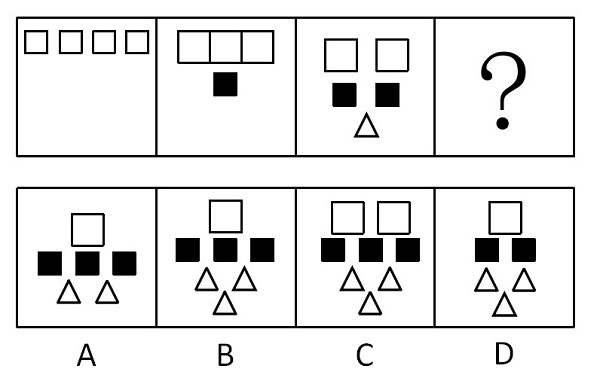

A. A

B. B

C. C

D. D

第 56 题 · 答案与解析

**参考答案（粉笔题库参考内容）**

A

**解析**

已知图形呈现的规律是白色正方形逐个递减，黑色正方形和三角形逐个递增，因此第四个图形中白色正方形、黑色正方形和三角形的个数应分别为：1、3和2。观察选项，符合规律的只有A项。

故正确答案为A。

**考点**：数量规律-素

**来源**：2009年广东省公务员录用考试《行测》题第56题

### 第 57 题

从所给四个选项中，选择最合适的一个填入问号处，使之呈现一定的规律性：

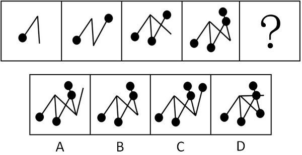

A. A

B. B

C. C

D. D

第 57 题 · 答案与解析

**参考答案（粉笔题库参考内容）**

D

**解析**

解析1：元素组成相似，但无明显样式规律，考虑相邻比较。图1到图2多了1根直线和1个黑点，图2到图3也多了1根直线和1个黑点，图3到图4也满足此规律，据此排除A项、B项。再观察发现，图1、图3和图5均有一条直线的一端均没有连接任何线条和黑点，且这根线依次逆时针转45°，正确答案为D。

解析2：元素组成相似，无明显样式规律，考虑相邻比较。图1到图2多了1根直线和1个黑点，图2到图3也多了1根直线和1个黑点，图3到图4也满足此规律，据此排除A项、B项。再观察发现，题干每幅图形均有一根直线没有和黑点连着，只有C项满足，故正确答案为C。

本题有两种规律，但结合线的位置考察更贴近命题人的出题思维，故粉笔倾向正确答案为D。

故正确答案为D。

**考点**：数量规律-复合

**来源**：2009年广东省公务员录用考试《行测》题第57题

### 第 58 题

从所给四个选项中，选择最合适的一个填入问号处，使之呈现一定的规律性：

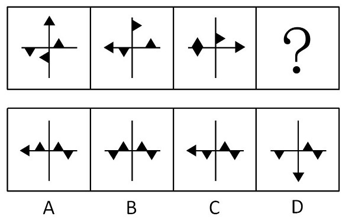

A. A

B. B

C. C

D. D

第 58 题 · 答案与解析

**参考答案（粉笔题库参考内容）**

A

**解析**

将已知图形中横线和竖线划分成20个位置（如下图所示），通过已知图形发现规律为：前一个图形中每个黑色三角形按照20个位置依次移动一格得到下一个图形，且在移动过程中黑色三角形始终有一边紧贴横线或竖线（4、9、14、19这四个端点位置除外），因此能够分析到只有A选项中图形符合。

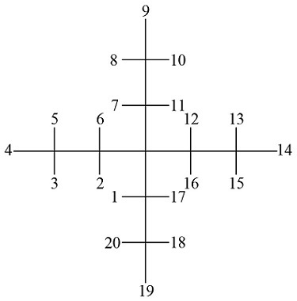

故正确答案为A。

**考点**：位置规律-平移

**来源**：2009年广东省公务员录用考试《行测》题第58题

### 第 59 题

从所给四个选项中，选择最合适的一个填入问号处，使之呈现一定的规律性：

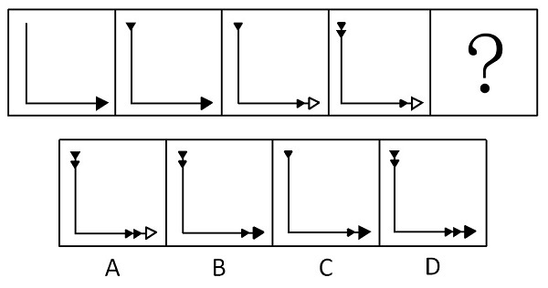

A. A

B. B

C. C

D. D

第 59 题 · 答案与解析

**参考答案（粉笔题库参考内容）**

D

**解析**

元素组成相似，数量不同，考数数。

已知图形中，第一、二个图形中，大三角形为黑色，第三、四个图形中，大三角形为白色，依此规律，第五个图形的大三角形应该为黑色，B、C、D三项符合。再观察小三角形，四个图形中，小三角形的数量从左到右依次递增，分别为0个、1个、2个、3个，依次规律，第五个图形中，小三角的数量应有4个，只有D项符合。

故正确答案为D。

**考点**：数量规律-素

**来源**：2009年广东省公务员录用考试《行测》题第59题

### 第 60 题

从所给四个选项中，选择最合适的一个填入问号处，使之呈现一定的规律性：

A. A

B. B

C. C

D. D

第 60 题 · 答案与解析

**参考答案（粉笔题库参考内容）**

B

**解析**

已知图形均为轴对称图形，通过分析，只有B项中图形是轴对称图形。

故正确答案为B。

**考点**：属性规律-对称性

**来源**：2009年广东省公务员录用考试《行测》题第60题

### 第 61 题

从所给四个选项中，选择最合适的一个填入问号处，使之呈现一定的规律性：

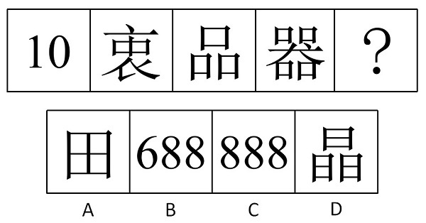

A. A

B. B

C. C

D. D

第 61 题 · 答案与解析

**参考答案（粉笔题库参考内容）**

B

**解析**

本题为数面（封闭空间）。

已知图形的面数分别为1、2、3、4，因此下一个图形的面数应该为5，通过分析，选项中的面的数量分别是4、5、6、6 。只有B项中图形的面数为5。

故正确答案为B。

**考点**：数量规律-面、文字/字母/数字类

**来源**：2009年广东省公务员录用考试《行测》题第61题

### 第 62 题

下列选项和题目中给出的是同一个盒子的是：

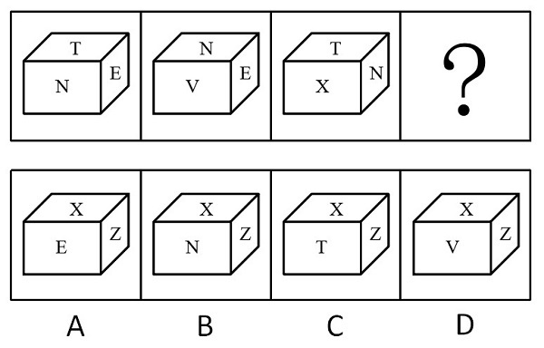

A. A

B. B

C. C

D. D

第 62 题 · 答案与解析

**参考答案（粉笔题库参考内容）**

C

**解析**

该盒子有T、N、E、V、X、Z共六个面。由已知的三个图形可知，N和T、E、V、X四个面是相邻面，因此N和Z为相对面；由已知的第一个和第三个图形可知，T和N、E、X三个面是相邻面，因此T和V或Z为相对面，又知N和Z为相对面，故T和V为相对面，从而可知E和X为相对面。

根据“相对面不能同时出现”做题。

A项中E和X为相对面且同时出现，因此A项错误；

B项中N和Z为相对面且同时出现，因此B项错误；

D项中三个面顺时针应为X、V、Z，但是选项为X、Z、V，因此D项错误。

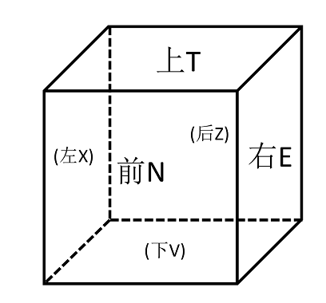

故正确答案为C。

**考点**：空间类-空间重构-六面体

**来源**：2009年广东省公务员录用考试《行测》题第62题

### 第 63 题

右边的盒子不能由左边给定的图形做成的一个是：

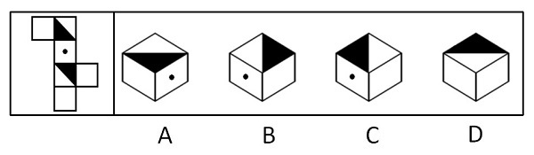

A. A

B. B

C. C

D. D

第 63 题 · 答案与解析

**参考答案（粉笔题库参考内容）**

B

**解析**

通过已知图形发现，有黑点的面和有半黑三角形的面为相邻面，当同时出现在立体图中时，黑点始终应该与半黑三角形的边接近。

通过分析，只有B项中图形，当有黑点的面和有半黑三角形的面同时出现时，黑点不是与半黑三角形的边接近，而是与半白三角形的边接近，因此B错。

本题为选非题，故正确答案为B。

**考点**：空间类-空间重构-六面体

**来源**：2009年广东省公务员录用考试《行测》题第63题

### 第 64 题

从所给四个选项中，选择最合适的一个填入问号处，使之呈现一定的规律性：

A. A

B. B

C. C

D. D

第 64 题 · 答案与解析

**参考答案（粉笔题库参考内容）**

A

**解析**

本题为元素换算。通过观察前两行图形发现，黑白球总数基本呈现增加的趋势，假设第一行图1＋图2＝图3，可以发现：1个黑球＝2个白球。每一行图形中的黑球全部替换成白球，统计白球个数，发现第二行也能满足图1＋图2＝图3。因此，假设成立。通过分析，只有A项中图形符合规律。

故正确答案为A。

**考点**：数量规律-素

**来源**：2009年广东省公务员录用考试《行测》题第64题

### 第 65 题

从所给四个选项中，选择最合适的一个填入问号处，使之呈现一定的规律性：

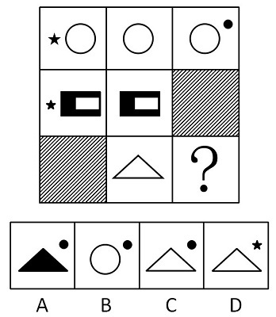

A. A

B. B

C. C

D. D

第 65 题 · 答案与解析

**参考答案（粉笔题库参考内容）**

C

**解析**

元素组成相似，元素周遍。

从已知图形每一行来看，第一行都有大白色圆圈，第二行都有大黑色中空的矩形（全阴影的是没有图形，除外），第三行应该都有大白色三角形（全阴影的是没有图形，除外）。

从已知图形每一列来看，第一列都有小黑色五角星（全阴影的是没有图形，除外），第二列都没有小图形，第三列应该都有小黑色圆圈（全阴影的是没有图形，除外），综上可知，符合规律的只有C项中的图形。

故正确答案为C。

**考点**：数量规律-素、样式规律-遍历

**来源**：2009年广东省公务员录用考试《行测》题第65题

### 第 66 题

在某次交通整治民意代表座谈会的代表中，一个是黑龙江人，两个是北方人，一个是广东人，有两个人只负责客运业务，三个人只从事货物运输。

如果以上的介绍涉及了该次座谈会的所有代表，则参加这次座谈会的代表：

A. 最少可能是3人，最多可能是8人

B. 最少可能是5人，最多可能是8人

C. 最少可能是5人，最多可能是9人

D. 最少可能是3人，最多可能是9人

第 66 题 · 答案与解析

**参考答案（粉笔题库参考内容）**

B

**解析**

第一步：分析题干中的概念间的包含关系。

题干中“北方人”包含“黑龙江人”。

第二步：分析并得出相应结论。

2个北方人包含1个黑龙江人，与1个广东人是反对关系，又知2个人只做货客运业务，3个人只从事货物运输，即做生意的共5人。因此最少的人数是当2个北方人同时包含黑龙江人和做客运业务的2个人，另外3个从事货物运输的人中包含1个广东人时，因此最少人数为：2＋3＝5；最多的人数是当只有2个北方人中包含1个黑龙江人，其他的均不相互包含时，因此最多人数为：2＋1＋2＋3＝8。

故正确答案为B。

**考点**：日常结论

**来源**：2009年广东省公务员录用考试《行测》题第66题

### 第 67 题

甲、乙、丙三人，他们的职业有律师，医生和教师。已知：

（1）丙的收入比教师高；

（2）甲的收入和医生不同；

（3）医生的收入比乙少。

请根据上述情况，判断甲、乙、丙分别是什么职业：

A. 甲是律师，乙是教师，丙是医生

B. 甲是教师，乙是医生，丙是律师

C. 甲是教师，乙是律师，丙是医生

D. 甲是律师，乙是医生，丙是教师

第 67 题 · 答案与解析

**参考答案（粉笔题库参考内容）**

C

**解析**

第一步：分析题干条件。

（1）丙的收入比教师高；

（2）甲的收入和医生不同；

（3）医生的收入比乙少。

第二步：根据题干条件进行推理。

条件中“医生”出现的次数最多，从“医生”入手开始推。

根据条件（2）和（3）可知，甲、乙都不是医生，所以只能丙是医生。

再根据题干条件可知，丙的收入比乙少，且丙的收入比教师高，因此，乙不是教师，只能甲是教师。

根据收入由低到高从左往右进行排列，如下表所示。

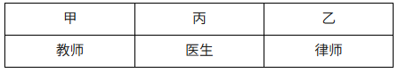

故正确答案为C。

**考点**：从最大信息开始推

**来源**：2009年广东省公务员录用考试《行测》题第67题

### 第 68 题

某地政府规定本地区最低工资标准是每月不低于800元人民币。有人认为，800元的最低工资标准很容易达到，而劳动部门却认为，800元的最低工资标准虽然不太高，但执行起来也不是那么容易，所以这种认为能达到标准的观点是不对的。

如果劳动部门的评论为真，以下必为事实的一项是：

A. 多数企业员工工资都能达到800元以上，少数在800元以下

B. 工人工资有些在800元以上，有些在800元以下

C. 肯定有些工人的工资达不到800元的最低工资标准

D. 多数企业的工人工资达不到800元的最低工资标准

第 68 题 · 答案与解析

**参考答案（粉笔题库参考内容）**

C

**解析**

第一步：抓住题干主要信息。

第一点说明某地政府规定本地区最低工资标准是每月不低于800元人民币，第二点说明有人认为800元的最低工资标准很容易达到，第三点说明劳动部门却认为800元的最低工资标准虽然不太高，但执行起来也不是那么容易，这种认为能达到标准的观点是不对的，第四点说明劳动部门的评论为真。

第二步：分析题干信息，并结合选项得出答案。

A中多数企业员工能达到800元，少数在800元以下，“多数”和“少数”并不能推出，因此A中说法不一定为事实；

B中工人工资有些在800元以上，有些在800元以下，“有些在800元以上”并不能推出，因此B中说法不一定为事实；

C中肯定有些工人的工资达不到800元，由劳动部门的评论为真可以推出，因此C中说法一定为事实；

D中多数企业的工人工资达不到800元的最低工资标准，“多数”并不能推出，因此D中说法不一定为事实。

故正确答案为C。

**考点**：日常结论

**来源**：2009年广东省公务员录用考试《行测》题第68题

### 第 69 题

某银行规定，它的下属营业网点，如果年存款额超过50亿元，其员工可获得年度金质奖。年终统计显示，该银行所属的20个营业网点，其中16个年存款额超过50亿元，其余的不足20亿元。该银行又规定，只有年存款额超过20亿元的网点，员工才能获得年度银质奖。

如果上述断定都是真的，那么以下关于该银行的断定也一定为真的是：

（1）要想得年度金质奖，必须得年度银质奖

（2）要想得年度银质奖，必须得年度金质奖

（3）该银行的大多数雇员都得了年度金质奖

A. 仅（2）

B. （1）和（2）

C. （1）和（3）

D. （1）、（2）和（3）

第 69 题 · 答案与解析

**参考答案（粉笔题库参考内容）**

A

**解析**

第一步：翻译题干。

① 年存款额超过50亿元→获得年度金质奖；

② 获得年度银质奖→年存款额超过20亿元。

第二步：逐一分析结论。

（1）翻译为：获得年度金质奖→获得年度银质奖，属于对条件①的肯后，得不出确定性结论，错误；

（2）翻译为：获得年度银质奖→获得年度金质奖，根据条件②获得年度银质奖→年存款额超过20亿元，可知获得年度银质奖必须20亿以上，而该银行20个营业网点，其中16个年存款额超过50亿元，其余的不足20亿元，说明该银行20亿以上的均是超过50亿元的，可得：该银行年存款额超过20亿元→年存款额超过50亿元，再根据条件①年存款额超过50亿元→获得年度金质奖，从而得出：获得年度银质奖→获得年度金质奖，正确；

（3）“银行的雇员”与“下属网点的员工”所指范畴不同，错误。

综上，只有（2）正确。

故正确答案为A。

**考点**：常规翻译

**来源**：2009年广东省公务员录用考试《行测》题第69题

### 第 70 题

病人往往不理解在看病时，即使是小毛病也被要求做很多项检查，从而导致花费过高。而事实上如果医生不对病人进行详细检查，就有可能遗漏某些严重的问题，医生很难精确地判断他们究竟应当细致到什么程度。所以，对病人来说，当他们感到没有病时，去做医疗检查一般来说是不明智的。

以下最严重地削弱了上述论证的一项是：

A. 在某些重要疾病的早期阶段，尽管病人并未感到身体不适，医生却能通过仪器的帮助观察到症状

B. 在收入减少的情况下，医生们一直在压缩他们做医疗检查的时间

C. 缺乏医学专业知识的病人无法判断医生做检查时究竟细致到何种程度是适宜的

D. 有经验的医生在做医疗检查时能细致到恰到好处

第 70 题 · 答案与解析

**参考答案（粉笔题库参考内容）**

A

**解析**

第一步：找到论点和论据。

本题论点是对病人来说，当他们感到没有病时，去做医疗检查一般来说是不明智的，论据是病人往往不理解在看病时，即使是小毛病也被要求做很多项检查，从而导致花费过高。

第二步：判断削弱方式。

本题论点与论据间存在因果关系，所以需削弱论点。

第三步：逐一判断选项的作用。

A中说能在疾病的早期阶段通过仪器的帮助观察到症状，说明了检查的好处，直接削弱论点；

B中医疗检查的时间，C中病人无法判断检查细致程度，D中仅是指有经验的医生，均与是否做检查无直接关系，属无关选项。

故正确答案为A。

**考点**：削弱论点

**来源**：2009年广东省公务员录用考试《行测》题第70题

### 第 71 题

经济学家认为政府对能源利用方面的管制是多余的，市场完全可以自行调节能源的供需矛盾。如果能源真的紧张，那么反映在市场上，能源价格自然会上涨，而能源价格的上涨，一方面会因为使用成本提高而使得人们减少对能源的使用，另一方面因为利润增加使得能源供应商增加供给。

以下哪项如果为真，能有力地对上述论断提出质疑？

A. 能源价格上涨后，人们会更多地使用节能产品

B. 由于难以忍受能源价格的上涨造成的生活成本的增加，人们会抗议政府在能源管理方面无所作为

C. 能源价格降低后会刺激人们使用更多的能源

D. 人们对能源的需求缺乏弹性

第 71 题 · 答案与解析

**参考答案（粉笔题库参考内容）**

D

**解析**

第一步：找出论点和论据。

论点：政府对能源利用方面的管制是多余的，市场完全可以自行调节能源的供需矛盾。

论据：如果能源真的紧张，那么反映在市场上，能源价格自然会上涨，而能源价格的上涨，一方面会因为使用成本提高而使得人们减少对能源的使用，另一方面因为利润增加使得能源供应商增加供给。

第二步：判断削弱方式。

本题论点与论据间存在因果关系，所以需削弱论点。

第三步：逐一判断选项的作用。

A项中能源价格上涨使得人们更多地使用节能产品，这是市场调节的结果，加强论点；

B项中抗议政府在能源管理方面无所作为与管制是多余的无关，属无关项；

C项中能源价格降低后使得人们使用更多的能源也是市场调节的结果，加强论点；

D项指出人们对能源的需求缺乏弹性，必然会导致市场失灵，即市场不能通过自身运行来调节能源的供需矛盾，因此有力地反驳了题干的论据，从而直接削弱论点。

故正确答案为D。

**考点**：削弱论据

**来源**：2009年广东省公务员录用考试《行测》题第71题

### 第 72 题

研究人员通过基因操作，使实验鼠体内能够代谢葡萄糖和脂肪酸，但不能代谢醋酸，然后比较这些实验鼠和正常实验鼠在喂给饵料和绝食48小时的情况下，身体状态有何不同。结果发现，在被迫长时间绝食的状态下，不能代谢醋酸的实验鼠体温和耐力明显降低。醋酸是生命体内基本物质，而实验鼠身体构造又与人体非常接近。

由此推出：

A. 醋酸在其维持人体能量供应中起着至关重要的作用

B. 醋酸可以作为人体一种不会提升血糖值的能量源

C. 代谢产生的三磷酸腺苷是生命活动的能量源泉

D. 在持久运动时，脂肪酸和酮体是ATP的主要来源

第 72 题 · 答案与解析

**参考答案（粉笔题库参考内容）**

A

**解析**

第一步：抓住每句话中的对象。

第一句说明实验中用到的两种实验鼠：通过基因操作后的实验鼠和正常实验鼠，第二句说明在被迫长时间绝食的状态下，不能代谢醋酸的实验鼠体温和耐力明显降低，第三句说明醋酸是生命体内基本物质，实验鼠身体构造与人体非常接近。

第二步：判断整体关系。

由第一步中第二句的实验结果可知醋酸对极度饥饿的实验鼠维持生命活动所需能量十分重要，即答案为A。

第三步：逐一判断选项的作用。

B中通过题干无法断定醋酸作为能量源时会不会提升血糖值，因此B项无法推出；

C中的三磷酸腺苷和D中脂肪酸和酮体是ATP的主要来源，均与题干醋酸无直接关系，都是无关选项，因此均无法推出。

故正确答案为A。

**考点**：日常结论

**来源**：2009年广东省公务员录用考试《行测》题第72题

### 第 73 题

近几年，为治理城镇污水，污水处理厂的建设不断升温。大规模上马污水处理厂，的确能在短期内实现城镇生活污水COD的减排。但是，一些地方城镇生活污水经过鱼塘和天然湿地的生态净化，COD浓度也能大幅度降低。

由此推出：

A. 单一的集中治理模式不符合环境保护自身的规律

B. 治污就是要付出消耗能量和资金的代价的

C. 减排手段应因地制宜，多种方式相结合

D. 为治污而治污，不能将节能与减排结合好

第 73 题 · 答案与解析

**参考答案（粉笔题库参考内容）**

C

**解析**

第一步：抓住每句话中的主要信息。

第一句说明污水处理厂因治理城镇污水越来越多，第二句说明污水处理厂能够降低生活污水COD，第三句说明鱼塘和天然湿地的生态净化也能够降低生活污水COD。

第二步：判断整体关系。

污水处理厂人工处理与鱼塘和天然湿地生态净化都能够降低生活污水COD，即答案为C。

第三步：逐一判断选项的作用。

A、B、D中都忽略了题干“但是”后面鱼塘和天然湿地的生态净化的描述，因此A、B、D均错。

故正确答案为C。

**考点**：日常结论

**来源**：2009年广东省公务员录用考试《行测》题第73题

### 第 74 题

H市的交通管理部门表示，和去年相比，今年我市市区的道路通行有明显改善。该部门负责人认为，这是由于我市聘用了大量的交通协管员。

以下哪项最不能削弱该负责人的结论：

A. 今年初，H市专门召开会议对交通问题进行认真研究和整理

B. 许多专家认为，聘用大量的交通协管员的成本巨大，得不偿失

C. 今年初，H市市区的道路新建扩建工程刚刚结束

D. 今年H市对驶入市区的车辆进行了严格的限制，许多大货车、外地车在交通“高峰”时期不能进入市区

第 74 题 · 答案与解析

**参考答案（粉笔题库参考内容）**

B

**解析**

第一步：找到论点和论据。

论点：由于我市聘用了大量的交通协管员，今年我市市区的道路通行有明显改善。

论据：无。

本题只有论点，无论据，削弱优先考虑削弱论点，但论点为明显的因果关系，削弱还可以考虑因果倒置与他因削弱。

第二步：逐一分析选项。

A项：指出H市专门召开会议对交通问题进行认真研究和整理，提出了一个可能使市区的道路通行有明显改善的另外的原因，属于他因削弱，排除；

B项：选项中提到的成本与道路通行改善无关，属于无关选项，无法削弱，当选；

C项：指出H市市区的道路新建扩建工程刚刚结束，提出了一个可能使市区的道路通行有明显改善的另外的原因，属于他因削弱，排除；

D项：指出H市对驶入市区的车辆进行了严格的限制，提出了一个可能使市区的道路通行有明显改善的另外的原因，属于他因削弱，排除。

本题为选非题，故正确答案为B。

**考点**：削弱选非题

**来源**：2018年福建省选调生考试《行政职业能力测验》第83题

### 第 75 题

在接受测谎器测验时，只要服用少量某种常用镇静剂，就可使人在说谎时不被察觉。因为由测谎器测出的心理压力反应可以通过药物抑制，而不会产生显著的副作用。由此推之，这种药物对降低日常生活中的心理压力也会很有效。

此段话的假设前提是：

A. 镇静剂对于治疗心理压力有效

B. 对于心理压力反应的抑制增加了主观的心理压力

C. 由测谎器测出的心理压力与日常生活的心理压力相似

D. 在测谎器测验中说谎的人经常显示出心理压力的迹象

第 75 题 · 答案与解析

**参考答案（粉笔题库参考内容）**

C

**解析**

第一步：找到论点和论据。

本题论点是镇静剂对降低日常生活中的心理压力也会很有效，论据是由测谎器测出的心理压力反应可以通过药物抑制，而不会产生显著的副作用。

第二步：判断加强方式。

论点强调日常生活中的心理压力，论据强调测谎器测出的心理压力，所以论点与论据间不存在明显因果关系，所以需加强论证，在论点和论据间搭桥。

第三步：逐一判断选项的作用。

C项即在测谎器测出的心理压力与日常生活的心理压力间搭桥，可以加强；

A、B、D三项均与日常生活中的心理压力无直接关系，属无关选项。

故正确答案为C。

**考点**：搭桥

**来源**：2009年上海市公务员录用考试《行测》题第74题

### 第 76 题

大雁在飞翔时的队形，有时是“一”字形，有时是“人”字形。影响它们飞翔时队形变化的主要因素是：

A. 大雁数量

B. 飞行方向

C. 地磁线角度

D. 风向的变化

第 76 题 · 答案与解析

**参考答案（粉笔题库参考内容）**

D

**解析**

大雁飞行时常常排成“人”字形或斜“一”字形，是因为这样编队有利于大雁在长途迁飞时节省体力消耗。鸟类飞行时，翅膀尖端会产生一股向前流动的气流，叫做“尾涡”。后面的鸟利用前面的“尾涡”，飞行时要省力得多。雁群飞行时所排列的队形，正是出于对“尾涡”气流的利用。大雁越多，飞起来就越省力气。“雁阵”由有经验的“头雁”带领，加速飞行时，队伍排成“人”字形，一旦减速，队伍又由“人”字形换成“一”字长蛇形，而大雁的加速或减速飞行会受风向变化影响。

故正确答案为D。

**考点**：自然地理

**来源**：2009年吉林省公务员录用考试《行测》题（甲级）第76题

### 第 77 题

高气压中心附近的高空气流会向低空流动，空气在下降过程中温度会上升。所以，高气压中心附近的天气一般是：

A. 晴天

B. 阴天

C. 强风

D. 雷雨

第 77 题 · 答案与解析

**参考答案（粉笔题库参考内容）**

A

**解析**

高气压指的是同一高度上，中心气压高于四周气压的大气涡旋。由于气压高，高气压中心附近的高空气流会向低空流动；因为地面附近温度较高，气流在下降过程中被不断加温，空气温度上升，空气中的凝结物随之蒸发消散，不利于云雨的形成，所以高气压中心附近的天气一般是晴天。

故正确答案为A。

**本题相关知识点：**

与高气压相对的是低气压，低气压中心附近的地区往往是阴雨天，这是因为低气压中心由于气压低，四周压力较高地方的空气都会流到低压中心来，使该地区的空气上升，上升的空气温度会降低，空气中的水汽凝结，形成阴雨天。

**考点**：自然地理

**来源**：2009年广东省公务员录用考试《行测》题第77题

### 第 78 题

我们通常说的晕车和晕船，是因为体内平衡感受器受到了刺激，使人感到眩晕和不适，这个平衡感受器位于：

A. 心脏

B. 小脑

C. 胃

D. 耳朵

第 78 题 · 答案与解析

**参考答案（粉笔题库参考内容）**

D

**解析**

内耳前庭器是人体平衡感受器。晕车和晕船正是因为人体内耳平衡感受器受到过度运动刺激引起的，前庭器官产生过量生物电，影响神经中枢而出现冒冷汗、恶心、呕吐、头晕等症状群。

故正确答案为D。

**本题相关知识点：**

晕车的人能够开车却不能乘车，这种情况也跟内耳前庭感受器有关。因为晕动病主要是人体前庭神经系统受到超限刺激引起，故前庭神经系统的兴奋度的高低是关键。前庭神经系统属于低级中枢，它受大脑皮层高级中枢影响，高级中枢对低级中枢有抑制作用。当晕车的人开车时，精神处于高度集中状态，大脑皮层高级中枢高度兴奋对前庭系统产生抑制作用，自然就不会晕车了；而以乘客身份乘车时，则不具有这种效应。

**考点**：生活常识

**来源**：2009年吉林省公务员录用考试《行测》题（甲级）第80题

### 第 79 题

2008年，“三鹿”奶粉因添加三聚氰胺被有关部门查处，并引起社会广泛关注，奶粉中添加三聚氰胺的直接目的是：

A. 增加奶粉中蛋白质的含量

B. 增加奶粉的营养成分

C. 提高奶粉中的含氮量

D. 提高奶粉中微量元素含量

第 79 题 · 答案与解析

**参考答案（粉笔题库参考内容）**

C

**解析**

牛奶有营养主要是因为牛奶中含有蛋白质，而现在测定蛋白质的方法不是直接测牛奶中蛋白质的含量，而是通过测定氮元素的含量来间接测定蛋白质的含量（牛奶中只有蛋白质含氮元素）。三聚氰胺氮含量较高，因此奶粉中添加三聚氰胺会提高奶粉中的含氮量，使得检测蛋白质的结果偏高。

故正确答案为C。

**本题相关知识点：**

这道题从时事入手，考查2008年的热门事件“三鹿”奶粉事件。2012年的食品安全问题也很多，如毒胶囊事件中，某些药厂用工业明胶为原料制造药物胶囊，导致药物中出现铬等重金属超标问题。

**考点**：生活常识

**来源**：2009年广东省公务员录用考试《行测》题第79题

### 第 80 题

熬骨头汤时，为提高骨头中钙质的溶解度，可加入少量：

A. 盐

B. 酱油

C. 醋

D. 料酒

第 80 题 · 答案与解析

**参考答案（粉笔题库参考内容）**

C

**解析**

骨头中的钙质以碳酸钙微溶物形式存在，偏碱性，加入显酸性的醋之后，醋中的醋酸根比较容易跟钙离子结合，产生醋酸钙，使骨头中的钙离子分离出来，提高钙质的溶解度，使骨头汤的营养价值更高，且便于被人体吸收。

故正确答案为C。

**本题相关知识点：**

料酒是指专门用于烹饪调味的酒，家庭烹饪一般用料酒。料酒的主要作用是去腥、增香。料酒能去腥是因为料酒中含有酒精，烹调中加点料酒，鱼、虾、蟹中起腥味的胺类物质就溶于料酒的酒精中，在加热时随酒精一起挥发掉，达到去腥的目的。另外料酒中含有氨基酸，在烹调中能与食盐结合，生成氨基酸钠盐，从而使鱼、肉的滋味变得更加鲜美。

**考点**：生活常识

**来源**：2009年吉林省公务员录用考试《行测》题（甲级）第85题

### 第 81 题

引起潮起潮落的主要原因是：

A. 月亮

B. 太阳

C. 海风

D. 季节

第 81 题 · 答案与解析

**参考答案（粉笔题库参考内容）**

A

**解析**

虽然引起潮起潮落的引潮力（或称起潮力）既有来自太阳的引力，也有来自月球的引力，但这种引力不是太阳和月球的绝对引力，而是被吸引物体所受到的引力和地心所受到的引力之差。根据万有引力定律，引潮力和引潮天体的质量成正比，和该天体到地球的距离的立方成反比。因为太阳的质量是月球质量的27023369倍，而日地间的平均距离是月地间平均距离的389倍，所以月球的引潮力是太阳的引潮力的2.17倍。打个比喻，如果某地潮水最高时有10米高，差不多7米是月球造成的，太阳的贡献只有3米，其他行星不足0.6毫米。因此，潮起潮落现象，确实主要由月球引起。

故正确答案为 A。

**本题相关知识点：**

由于月球在一个太阴月内绕地球公转一周，所以月球、太阳与地球的相对位置在一个太阴月内会发生一次周期性的变化，产生潮汐的一月不等现象，即潮汐的月变化。

每逢农历初一(朔)、十五(望)，太阳、月球和地球三个天体基本成一直线。这时太阳引潮力最大程度地加强了月球引潮力，使海水涨得最高、落得最低，潮差最大，称为“大潮”。

每逢农历初八(上弦)、廿三(下弦)，太阳、月球和地球三个天体的位置近似成直角分布。这时太阳引潮力最大程度地削弱了月球的引潮力，使海水涨得不高，落得不低，潮差最小，称为“小潮”。

**考点**：自然地理

**来源**：2009年广东省公务员录用考试《行测》题第81题

### 第 82 题

我们把海螺壳扣在耳朵上，可以听到像海潮一样的声音，其实这是：

A. 风吹进海螺壳的声音

B. 颅内血液流动的声音

C. 海螺运动发出的声音

D. 外界的杂音

第 82 题 · 答案与解析

**参考答案（粉笔题库参考内容）**

B

**解析**

海螺壳本不会发声，听到的主要是耳朵里血液流动的声音。在海螺壳里能听见声音，主要是因为共振。根据物理学原理，如果来自海螺壳以外的振动或声音的频率与海螺壳内腔固有的频率相同，就会发生共振，共振把声音放大。当我们把海螺壳扣在耳朵上时，血液流动与海螺壳内腔发生共振，血液流动的声音就被放大，被我们听到。其实，不光是海螺壳，我们把一个纸盒或空的热水瓶扣在耳边，同样也能听到这种共鸣声，声源主要是血液流动的声音。

故正确答案为B。

**考点**：生活常识

**来源**：2009年广东省公务员录用考试《行测》题第82题

### 第 83 题

人们通常把知识分子家庭称作“书香门第”，这里的“书香”原意指的是：

A. 书中夹香草发出的香味

B. 书籍的油墨味

C. 书纸自然发出的清香

D. 读书人的自称

第 83 题 · 答案与解析

**参考答案（粉笔题库参考内容）**

A

**解析**

古时的读书人家为了防止书籍被虫蛀，会在书中放一种名为芸香草的植物，因为这种植物有特异的香气，蛀虫闻到这种味道会远离。在放置了芸香草之后，翻阅书籍时，会有一股香气扑面而来，“书香”的概念由此而得。

故正确答案为A。

**本题相关知识点：**

书香门第，也写作“书香门户”，指世代都是读书人的家庭。

**考点**：文化常识

**来源**：2009年广东省公务员录用考试《行测》题第83题

### 第 84 题

刷牙可以保持牙齿健康和口气清新，牙膏的主要原料是：

A. 摩擦剂

B. 保湿剂

C. 泡沫剂

D. 香味剂

第 84 题 · 答案与解析

**参考答案（粉笔题库参考内容）**

A

**解析**

牙膏的主要成分一般有摩擦剂、保湿剂、泡沫剂、粘合剂、调味剂和一些其它添加成分，其中含量最多的是摩擦剂。摩擦剂有一定的摩擦作用，能够增加牙刷和牙齿间的摩擦，让牙菌斑、软垢和食物残渣比较容易被刷下来。

故正确答案为A。

**本题相关知识点：**

牙膏中的保湿剂主要用于保持牙膏呈可自由挤出的浆状，防止牙膏管口开启后因干硬受阻塞。

泡沫剂则有助于除去粘在牙齿上的污物，最常用的是十二烷基酸钠，它除了有较好的洁净作用外，还有灭菌作用，并且与摩擦剂有较好的相容性。

香味剂能使牙膏具有各种香型，能使刷牙者感到爽口舒适，并有助于减轻口臭。

**考点**：生活常识

**来源**：2009年吉林省公务员录用考试《行测》题（甲级）第83题

### 第 85 题

去年下半年以来，一场始发于西方国家的金融危机席卷全球，这场危机对我国经济也产生了影响，下列情形最有可能是直接受国际金融危机影响的是：

A. 某大型外贸型玩具加工厂由于用工短缺，不得已减少国外订单数量

B. 吴老板经营的小型豆制品加工厂由于资金短缺，无法得到银行贷款而倒闭

C. 由于市场对钢材需求的增加，某钢厂预计今年上半年的销售额将出现上涨

D. 因为出口订单缩水，某服装生产企业裁员35%，并拟降低管理层年薪

第 85 题 · 答案与解析

**参考答案（粉笔题库参考内容）**

D

**解析**

A选项是由于“用工短缺”而造成经营出现问题；

B选项是由于“资金短缺”而倒闭；

C选项是由于市场原材料需求增加而造成销售额上涨；

D选项“出口订单缩水”最直接的原因是进口国受国际金融危机影响，国内需求下降，进口货物变少。符合题意。

故正确答案为D。

**考点**：国际经济及组织

**来源**：2009年广东省公务员录用考试《行测》题第85题

## 材料 1

根据下列资料，回答问题。

        据初步测算，2006年广东完成生产总值25968.55亿元，比上年增长14.1%，经济总量继续列全国第一位置。其中，第一产业增长3.8%，第二产业增长16.9%，第三产业增长12.2%。与此同时，鲁、苏、浙、沪也稳定协调发展，其中山东、江苏赶超步伐不减，增速分别高广东0.6个和0.8个百分点。山东完成生产总值21846.71亿元，增长14.7%；江苏完成生产总值21548.36亿元，增长14.9%；浙江生产总值为15649亿元，增长13.6%，分别列全国第二到第四位；上海完成生产总值10297亿元，增长12.0%。在四省一市中，广东经济增长速度居中间。

        广东规模以上工业完成增加值10718.57亿元，低于山东工业增加值（11122.76亿元），高于江苏工业增加值（10015.12亿元），鲁、粤、苏分列前三位。浙江工业增加值5655.05亿元，上海工业增加值4456.04亿元。广东工业增长18.3%，增速低于山东（23.6%）、江苏（21.4%），高于浙江（17.1%）和上海（13.4%）。

        广东工业经济效益有所提高，规模以上工业实现利润1958.34亿元，增长24.8%；山东实现利润2633.97亿元，增长21.7%；江苏实现利润1901.83亿元，增长37.4%；浙江实现利润1324.55亿元，增长20.6%；上海实现利润1086.7亿元，增长15.7%。

        广东固定资产投资稳定增长，完成全社会固定资产投资8116.89亿元，增长16.7%；其中，城镇以上固定资产投资6552.58亿元，增长11.2%。山东城镇以上固定资产投资8714.86亿元，增长19.8%。江苏城镇以上固定资产投资7473.69亿元，增长20.2%。浙江城镇以上固定资产投资5428.03亿元，增长13.4%，上海城镇以上固定资产投资总额3497.48亿元，增长9.8%。广东城镇以上固定资产投资落后于江苏和山东，列总量第三位。

        广东房地产开发投资保持理性，全年完成房地产开发投资1834.34亿元，增长22.4%。江苏房地产投资1901.01亿元，增长23.0%。山东房地产开发投资1178.71亿元，增长21.0%。浙江房地产开发投资1572.79亿元，增长8.0%。上海房地产开发投资1275.59亿元，增长2.3%。广东房地产开发投资总量低于江苏，增速较高。

### 第 86 题

2005年山东省城镇以上固定资产投资为多少亿元：

A. 2633.79

B. 21846.71

C. 7274.51

D. 6955.35

第 86 题 · 答案与解析

**参考答案（粉笔题库参考内容）**

C

**解析**

根据题干“2005年,······城镇以上固定资产投资······”，结合材料时间是2006年，可判定本题为基期计算问题。定位文字材料第四段可知：（2006年）山东城镇以上固定资产投资8714.86亿元，增长19.8%，根据公式：基期量，则2005年山东省城镇以上固定资产投资亿元，与C项最接近。

故正确答案为C。

**考点**：基期计算、文字资料

**来源**：2009年广东省公务员录用考试《行测》题第86题

### 第 87 题

2006年广东省工业增速排在第几位：

A. 二

B. 三

C. 四

D. 五

第 87 题 · 答案与解析

**参考答案（粉笔题库参考内容）**

B

**解析**

从文中的第二段的最后一句话：“广东工业增长 (18.3%)，增速低于山东(23.6%) 、江苏 (21.4%)，高于浙江(17.1%)和上海(13.4%)”可知，2006年广东工业产值增速高于上海和浙江，排在第三位。

故正确答案为B。

**考点**：文字资料、直接找数

**来源**：2009年广东省公务员录用考试《行测》题第87题

### 第 88 题

2005年广东省生产总值位列第一，高于第三位多少亿元：

A. 6552.58

B. 2633.97

C. 3575.36

D. 4005.46

第 88 题 · 答案与解析

**参考答案（粉笔题库参考内容）**

D

**解析**

根据题干“2005年······高于······多少亿元”，结合材料时间为2006年，可判定本题为基期和差问题。定位文字材料第一段：2006年广东完成生产总值25968.55亿元，比上年增长14.1%；山东完成生产总值21846.71亿元，增长14.7%；江苏完成生产总值21548.36亿元，增长14.9%；浙江生产总值为15649亿元，增长13.6%；上海完成生产总值10297亿元，增长12.0%。根据公式：基期量则可得，2005年：广东完成生产总值山东完成生产总值江苏完成生产总值浙江完成生产总值上海完成生产总值，故排在第三位的是江苏，则所求，与D项最接近。

故正确答案为D。

**考点**：基期和差、文字资料

**来源**：2009年广东省公务员录用考试《行测》题第88题

### 第 89 题

2006年广东省房地产投资占全社会固定资产投资比重比2005年：

A. 增加了约1个百分点

B. 降低了约1个百分点

C. 增加了约1.5个百分点

D. 降低了约1.5个百分点

第 89 题 · 答案与解析

**参考答案（粉笔题库参考内容）**

A

**解析**

根据题干“2006年······占······的比重比2005年”，结合选项为增加/降低······个百分点，可判定本题为两期比重计算问题。定位文字材料第四段、第五段可得，广东······完成全社会固定资产投资8116.89亿元（B），增长16.7%（b），广东······全年完成房地产开发投资1834.34亿元（A），增长22.4%（a）。代入两期比重差计算公式，即增加了约1个百分点。

故正确答案为A。

**考点**：两期比重、文字资料

**来源**：2009年广东省公务员录用考试《行测》题第89题

### 第 90 题

下列说法正确的是：

A. 2006年广东省规模以上工业实现利润为全国首位

B. 2006年广东省生产总值增速位列全国第二

C. 2005年广东省全社会固定资产投资6955.35亿元

D. 2005年山东省房地产开发投资为1178.71亿元

第 90 题 · 答案与解析

**参考答案（粉笔题库参考内容）**

C

**解析**

A项：定位文字材料第三段，可得（2006年）广东规模以上工业实现利润1958.34亿元，山东实现利润2633.97亿元，则山东实现利润高于广东，故2006年广东省规模以上工业实现利润并非为全国首位，错误；

B项：材料未提及全国其它省市的生产总值增速，故无法得出广东省在全国的排名，错误；

C项：定位文字材料第四段，可得（2006年）广东完成全社会固定资产投资8116.89亿元，增长16.7%，根据公式：基期量，则2005年广东省全社会固定资产投资亿元，正确；

D项：定位文字材料第五段，可得（2006年）山东房地产开发投资1178.71亿元，增长21.0%，根据公式：基期量，则2005年山东省房地产开发投资亿元，错误。

故正确答案为C。

**考点**：文字资料、综合分析

**来源**：2009年广东省公务员录用考试《行测》题第90题

## 材料 2

根据下表完成以下各题

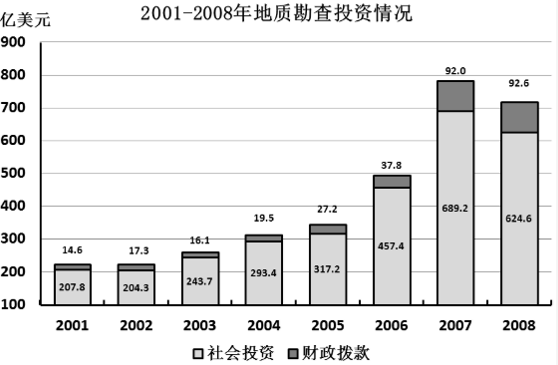

### 第 91 题

下列年份中，财政拨款用于地质勘查投资的增长幅度最大的是：

A. 2002年

B. 2004年

C. 2005年

D. 2008年

第 91 题 · 答案与解析

**参考答案（粉笔题库参考内容）**

C

**解析**

根据题干“下列年份中，······增长幅度最大的是”，可判定本题为一般增长率的比较问题。定位图形材料可分别得出不同年份财政拨款用于地质勘查的投资额，根据公式：增长率，2002年、2004年、2005年、2008年财政拨款用于地质勘查投资的增长率比较如下：

2002年：；

2004年：；

2005年：；

2008年：。

比较可得，增长幅度最大的是2005年。

故正确答案为C。

**考点**：一般增长率、统计图

**来源**：2009年广东省公务员录用考试《行测》题第91题

### 第 92 题

若按照2005年的增长率来计算，2009年的社会投资用于地质勘查投资的资金约是：

A. 675亿美元

B. 765亿美元

C. 640亿美元

D. 456亿美元

第 92 题 · 答案与解析

**参考答案（粉笔题库参考内容）**

A

**解析**

根据题干“若按照2005年的增长率来计算，2009年······约是”，可判定本题为现期计算问题。定位图形材料：2005年社会投资用于地质勘查投资的资金为317.2亿美元，2004年为293.4亿美元。根据公式：增长率，可得2005年社会投资用于地质勘查投资的增长率。其次根据公式：现期量，可得2009年的社会投资用于地质勘查投资的资金亿美元。

故正确答案为A。

**考点**：现期计算、统计图

**来源**：2009年广东省公务员录用考试《行测》题第92题

### 第 93 题

用于地质勘查投资的资金最多的一年比最少的一年多出：

A. 152%

B. 225%

C. 252%

D. 352%

第 93 题 · 答案与解析

**参考答案（粉笔题库参考内容）**

C

**解析**

根据题干“······最多的一年比最少的一年多出”，结合选项为百分数，可判定本题为一般增长率问题。定位图形材料可得：用于地质勘查投资的资金最多的一年是2007年，最少的一年是2002年，根据公式：增长率，可得所求，与C项最接近。

故正确答案为C。

**考点**：一般增长率、统计图

**来源**：2009年广东省公务员录用考试《行测》题第93题

### 第 94 题

2001-2008年，社会投资用于地质勘查投资的资金平均每年约增加多少亿美元：

A. 52.1

B. 59.5

C. 72.9

D. 416.8

第 94 题 · 答案与解析

**参考答案（粉笔题库参考内容）**

B

**解析**

根据题干“2001-2008年，······平均每年约增加多少亿美元”，可判定本题为年均增长量计算问题。定位图形材料可得：2001年，社会投资用于地质勘查投资的资金为207.8亿美元，2008年为624.6亿美元。根据公式：年均增长量，可得2001-2008年社会投资用于地质勘查投资的资金，平均每年增加亿美元，与B项最接近。

故正确答案为B。

**考点**：年均增长量、统计图

**来源**：2009年广东省公务员录用考试《行测》题第94题

### 第 95 题

下列说法正确的是：

A. 这八年来，财政拨款用于地质勘查投资的资金逐年上升

B. 与2003年相比，2007年社会投资用于地质勘查投资的比重增加了

C. 社会投资用于地质勘查投资的增长幅度从2001-2007年一直高于财政拨款的增长幅度

D. 2004年财政拨款用于地质勘查投资比2002年增长了约12.7%

第 95 题 · 答案与解析

**参考答案（粉笔题库参考内容）**

D

**解析**

A项：定位图形材料，可得2001-2008年财政拨款用于地质勘查投资的资金在2003年出现下降，并非逐年上升，错误；

B项：定位图形材料，可得2003年和2007年社会投资用于地质勘查投资额情况，则2003年社会投资用于地质勘查投资的比重，2007年社会投资用于地质勘查投资的比重；故与2003年相比，2007年社会投资用于地质勘查投资的比重降低，并非增加，错误；

C项：定位图形材料，可得2002年社会投资用于地质勘查的投资额（204.3亿美元）低于2001年（207.8亿美元），故其增长率为负值；而2002年财政拨款用于地质勘查的投资额（17.3亿美元）高于2001年（14.6亿美元），其增长率为正值。故2002年社会投资用于地质勘查投资的增长幅度低于财政拨款的增长幅度，并非一直高于，错误；

D项：定位图形材料，可得2004年财政拨款用于地质勘查的投资额为19.5亿美元，2002年为17.3亿美元，则2004年财政拨款用于地质勘查投资相比2002年的增长率，正确。

故正确答案为D。

**考点**：统计图、综合分析

**来源**：2009年广东省公务员录用考试《行测》题第95题

## 材料 3

根据下列图表，完成以下各题。

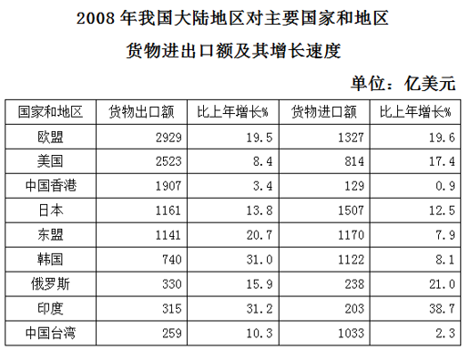

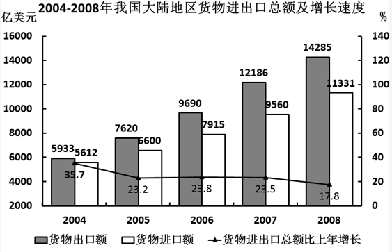

### 第 96 题

2007年我国大陆地区对美国的货物进出口总额为：

A. 2523亿美元

B. 3337亿美元

C. 3021亿美元

D. 814亿美元

第 96 题 · 答案与解析

**参考答案（粉笔题库参考内容）**

C

**解析**

根据题干“2007年我国大陆地区对美国的货物进出口总额为······”，结合时间为2008年，可判定本题为基期和差问题。定位表格材料可得，“2008年，大陆地区对美国的货物出口额为2523亿美元，比上年增长8.4%；2008年，大陆地区对美国的货物进口额为814亿美元，比上年增长17.4%。根据公式：基期量，则2007年大陆地区对美国的货物进出口总额亿美元，与C项最接近。

故正确答案为C。

**考点**：基期和差、综合资料

**来源**：2009年广东省公务员录用考试《行测》题第96题

### 第 97 题

2008年对主要国家和地区货物进出口贸易逆差额（进口额－出口额）最大的国家（地区）是：

A. 欧盟

B. 美国

C. 韩国

D. 中国台湾

第 97 题 · 答案与解析

**参考答案（粉笔题库参考内容）**

D

**解析**

定位表格材料，可得2008年我国大陆地区对欧盟、美国的货物进出口状况均为贸易顺差（出口额＞进口额），对韩国货物进出口额分别为1122亿美元和740亿美元，对中国台湾货物进出口额分别为1033亿美元和259亿美元。则2008年我国大陆地区对韩国货物进出口贸易逆差额亿美元；对中国台湾货物进出口贸易逆差额亿美元，因此2008年对中国台湾的货物进出口贸易逆差额最大。

故正确答案为D。

**考点**：简单加减计算、综合资料

**来源**：2009年广东省公务员录用考试《行测》题第97题

### 第 98 题

2007年对东盟的进口额占当年进口额的比重约是：

A. 7.7%

B. 11.3%

C. 23%

D. 34%

第 98 题 · 答案与解析

**参考答案（粉笔题库参考内容）**

B

**解析**

根据题干“2007年······占······的比重约是”，结合材料时间为2008年，可判定本题为基期比重问题。定位表格材料，可得2008年我国大陆地区对东盟的进口额为1170亿美元，比上年增长7.9%；定位图形材料，可得2007年我国大陆地区货物进口额为9560亿美元。根据基期比重，则2007年对东盟的进口额占当年进口额的比重为，与B项最接近。

故正确答案为B。

**考点**：基期比重、综合资料

**来源**：2009年广东省公务员录用考试《行测》题第98题

### 第 99 题

与2004年相比，2008年货物进出口总额的增长幅度约为：

A. 121.9%

B. 21.9%

C. 221.9%

D. 45%

第 99 题 · 答案与解析

**参考答案（粉笔题库参考内容）**

A

**解析**

根据题干“与2004年相比，2008年······的增长幅度约为”，结合选项为百分数，可判定本题为一般增长率的计算问题。定位图形材料可得：2008年货物出口额为14285亿美元，货物进口额为11331亿美元；2004年货物出口额为5933亿美元，货物进口额为5612亿美元。根据公式：，则所求，与A项最接近。

故正确答案为A。

**考点**：一般增长率、综合资料

**来源**：2009年广东省公务员录用考试《行测》题第99题

### 第 100 题

下列说法中，不正确的是：

A. 与上年相比，我国大陆地区对外进出口总额的增加额在2007年达到最大

B. 与上年相比，2008年我国大陆地区对主要国家和地区货物进出口总额增长率都超过10%

C. 2008年，我国大陆地区对主要国家和地区货物出口额总共约为11305亿美元

D. 2004-2008年，我国大陆地区的进口额和出口额都呈现出上升趋势

第 100 题 · 答案与解析

**参考答案（粉笔题库参考内容）**

B

**解析**

A项：定位图形材料，根据“进出口总额=出口额+进口额”可得：2004年进出口总额=5933+5612=11545亿美元，2005年=7620+6600=14220亿美元，2006年=9690+7915=17605亿美元，2007年=12186+9560=21746亿美元，2008年=14285+11331=25616亿美元。已知2004年进出口额的同比增长率35.7%，结合公式：增长量，2004年进出口额增长量亿美元。根据公式：增长量=现期量-基期量，2005年的增长量=14220-11545=2675亿美元，2006年的增长量=17605-14220=3385亿美元，2007年的增长量=21746-17605=4141亿美元，2008年的增长量=25616-21746=3870亿美元。故对外进出口总额的增加额在2007年达到最大，正确；

B项：定位表格材料，与上年相比，2008年我国大陆地区对中国香港的货物进、出口额增长率都没有超过10%，故对其进出口总额的增长率不超过10%，错误；

C项：定位表格材料，2008年我国大陆地区对主要国家和地区货物出口总额=2929+2523+1907+1161+1141+740+330+315+259=11305亿美元，正确；

D项：定位图形材料，2004~2008年，我国大陆地区的进口额和出口额都呈现出上升趋势，正确；

本题为选非题，故正确答案为B。

**考点**：综合分析、综合资料

**来源**：2009年广东省公务员录用考试《行测》题第100题

