# 2010年广东省公务员录用考试《行测》题

<!-- gwy:overview:start -->
> **广东 · 2010 · 行测 · 统考** ｜ 84 题 · 图片 121 处 · 答案随题折叠

| 题型模块 | 题量 | 题号 |
| --- | ---: | ---: |
| 数量关系 | 11 | 1–11 |
| 言语理解与表达 | 19 | 12–30 |
| 判断推理 | 29 | 31–59 |
| 常识判断 | 10 | 60–69 |
| 资料分析 | 15 | 70–84 |
| **合计** | **84** | |

导航：[题型与作答说明](#题型与作答说明) · [题目](#题目) · [材料 1](#材料-1)
<!-- gwy:overview:end -->

> 候选采集稿。参考答案及解析来自粉笔页面，不代表官方答案或真实高分答卷；来源使用许可与原卷对应关系仍需人工核实。

## 题型与作答说明

数量关系

（11题）

本部分包括数字推理与数学运算两种类型的试题。

言语理解与表达

（19题）

根据题目要求，在四个选项中选出一个正确答案。

判断推理

（29题）

本部分包括类比推理、图形推理与逻辑判断三种类型的试题。

常识判断

（10题）

根据题目要求，在四个选项中选出一个最恰当的答案。

资料分析

（15题）

针对一段资料一般有1～5个问题，根据资料所提供的信息进行分析、比较、计算，从四个备选答案中选出符合题意的答案。

## 题目

### 第 1 题

，1/6，，，（    ）。

A. 

B. 

C. 

D. 

第 1 题 · 答案与解析

**参考答案（粉笔题库参考内容）**

D

**解析**

数列均为分数，考虑分数数列。观察分子分母非单调变化，考虑反约分。原式数列可转化为：，，，，（    ）。观察发现，分子部分均为幂次数，分别为：，，，，（    ）。下一项应为；分母部分虑幂次修正数列，分别为：，，，，（    ）。则下一项应为，故所求项为。

故正确答案为D。

**来源**：2010年深圳市公务员录用考试《行测》题第1题

### 第 2 题

3，4，12，18，44，（    ）。

A. 44

B. 56

C. 78

D. 79

第 2 题 · 答案与解析

**参考答案（粉笔题库参考内容）**

C

**解析**

观察数列无明显规律，优先考虑多级数列，作差无规律，考虑作和。两两相加得到新数列为：7，16，30，62，（    ）；无明显特征，再次作和得到新数列为：23，46，92，（    ），可知该数列为公比为2的等比数列，则新数列下一项应为，故原数列所求项应为184-62-44=78。

故正确答案为C。

**来源**：2010年深圳市公务员录用考试《行测》题第2题

### 第 3 题

4，5，15，6，7，35，8，9，（    ）。

A. 27

B. 15

C. 72

D. 63

第 3 题 · 答案与解析

**参考答案（粉笔题库参考内容）**

D

**解析**

观察数列特征，项数较多，考虑多重数列。交叉无规律，考虑分组。原数列三三分组后发现：，，存在规律为：，故所求项为。

故正确答案为D。

**来源**：2010年深圳市公务员录用考试《行测》题第3题

### 第 4 题

1526，4769，2154，5397，（    ）。

A. 2317

B. 1545

C. 1469

D. 5213

第 4 题 · 答案与解析

**参考答案（粉笔题库参考内容）**

C

**解析**

观察数列，发现题干数列均为4位数，考虑机械划分。观察发现，5+2=1+6，7+6=4+9，1+5=2+4，3+9=5+7，找到规律：每项的千位数字与个位数字之和等于百位数字与十位数字之和。结合选项发现，只有C项：4+6=1+9符合此规律。

故正确答案为C。

**来源**：2010年深圳市公务员录用考试《行测》题第4题

### 第 5 题

有一些信件，把它们平均分成三份后还剩2封，将其中两份平均三等分还多出2封，问这些信件至少有多少封：

A. 20

B. 26

C. 23

D. 29

第 5 题 · 答案与解析

**参考答案（粉笔题库参考内容）**

C

**解析**

由题意可知，信件数量减2应为3的倍数且其商的2倍减2也为3的倍数，因此可直接代入选项，从小到大代入为：

代入A项：，整数，排除；

代入C项：，，当选。

注：问至少，C项已满足条件，无需验证B、D两项。

故正确答案为C。

**考点**：和差倍比问题

**来源**：2010年深圳市公务员录用考试《行测》题第5题

### 第 6 题

报社将一定的奖金分发给征文活动获奖者，其中一等奖金是二等的2倍，二等奖金是三等的1.5倍，如果一、二、三等奖金各评选两人，那么一等奖获得者将得2400元奖金；如果一等奖只评选一人，二、三等奖各评选两人，那么一等奖的奖金是：

A. 2800元

B. 3000元

C. 3300元

D. 4500元

第 6 题 · 答案与解析

**参考答案（粉笔题库参考内容）**

C

**解析**

根据题意设三等奖金为x，则二等奖金为1.5x，一等奖金为3x=2400，解得x=800元，可知总奖金=2(x+1.5x+3x)=8800元，现在令三等奖金为y，则二等奖金为1.5y，一等奖金为3y，由题干可知3y+2(y+1.5y)=8800，解得y=1100元，则此时一等奖的奖金是3300元。

故正确答案为C。

**考点**：和差倍比问题

**来源**：2010年深圳市公务员录用考试《行测》题第6题

### 第 7 题

公司某部门80%的员工有本科以上学历，70%有销售经验，60%在生产一线工作过。该部门既有本科以上学历，又有销售经历，还在生产一线工作过的员工至少占员工的：

A. 20%

B. 15%

C. 10%

D. 5%

第 7 题 · 答案与解析

**参考答案（粉笔题库参考内容）**

C

**解析**

方法一：设只满足一项的占比为x，满足两项的占比为y，满足三项的占比为z，则：

x+2y+3z=80%+70%+60%=210%······①，

x+y+z=100%······②；

联立①②可得：z-x=10%，即z=x+10%。要想满足三项的人尽可能少，那满足一项的人就要尽可能的少，故x最少为0，则z=10%。故该部门既有本科以上学历，又有销售经历，还在生产一线工作过的员工至少占员工的10%。

方法二：根据题干，同时满足“既是本科以上学历又有销售经验还在生产一线工作过且要求至少”，可判定题型为多集合反向构造：

第一步反向：赋值总人数为100，则不满足条件的人数分别为：本科及以下的有100-80=20，无销售经验的有100-70=30，没在生产一线工作过的有100-60=40；

第二步加和：不满足三项条件的人数最多为20+30+40=90；

第三步作差：则满足三项条件的人数至少有100-90=10，即占比为。

故正确答案为C。

**考点**：三集合、非典型最值问题

**来源**：2010年深圳市公务员录用考试《行测》题第7题

### 第 8 题

有20名工人修筑一段公路，计划15天完成。动工3天后抽出5人去其他工地，其余人继续修路。如果每人工作效率相同且不变，那么修完这段公路实际用：

A. 19天

B. 18天

C. 17天

D. 16天

第 8 题 · 答案与解析

**参考答案（粉笔题库参考内容）**

A

**解析**

方法1：

由题意设每人每天的效率为1，则总工程量为。第一阶段3天20人共完成工作量为，第二阶段工作量为300-60=240，剩余15人每天完成工作量为15，还需天，则总共需3+16=19天。

方法2：

由题意设每人每天的效率为1，则总工程量为。去其他工地的5人12天共完成工作量为，需要剩余的15人工作天完成，则修完这条公路总共需要15+4=19天。

故正确答案为A。

**考点**：给效率比例型

**来源**：2010年深圳市公务员录用考试《行测》题第8题

### 第 9 题

办公室有甲、乙、丙、丁4位同志，甲比乙大5岁，丙比丁大2岁。丁三年前参加工作，当时22岁。他们四人现在的年龄之和为127岁。那么乙现在的年龄是：

A. 25岁

B. 27岁

C. 35岁

D. 40岁

第 9 题 · 答案与解析

**参考答案（粉笔题库参考内容）**

C

**解析**

依题意可知，丁现在为25岁，丙现在为27岁，设乙现在为x岁，则甲为x+5岁，可得方程：x+5+x+25+27=127，解得x=35。

故正确答案为C。

**考点**：年龄问题

**来源**：2011年广东省公务员录用考试《行测》题第14题

### 第 10 题

某公司100名员工对甲、乙两名经理进行满意度评议，对甲满意的人数占全体参加评议的，对乙满意的人数比甲的人数多6人，对甲乙都不满意的占都满意人数的1/3多2人，则对甲乙都满意的人数是：

A. 36

B. 26

C. 48

D. 42

第 10 题 · 答案与解析

**参考答案（粉笔题库参考内容）**

D

**解析**

设对甲、乙都满意的人数为x。由题意可知，对甲满意的人数为人，对乙满意的人数为60+6=66人，对甲、乙都不满意的人数为人。根据两集合容斥原理的公式：总数-都不，代入数据得：，解得x=42。

故正确答案为D。

**考点**：两集合

**来源**：2010年深圳市公务员录用考试《行测》题第10题

### 第 11 题

小张到文具店采购办公用品，买了红黑两种笔共66支。红笔定价为5元，黑笔定价为9元，由于买的数量较多，商店给予优惠，红笔打八五折，黑笔打八折，最后支付的金额比核定价少18%，那么他买了红笔：

A. 36支

B. 34支

C. 32支

D. 30支

第 11 题 · 答案与解析

**参考答案（粉笔题库参考内容）**

A

**解析**

方法一：

根据题意设买红笔x支，黑笔y支，由题意得：x+y=66，，解得x=36。

方法二：

根据题意设买红笔x支，黑笔y支，总价打折1-18%=82%，即八二折。根据线段法距离与量成反比可得：，解得，又x+y=66，解得x=36。

故正确答案为A。

**考点**：和差倍比问题、经济利润问题

**来源**：2010年深圳市公务员录用考试《行测》题第11题

### 第 12 题

在1994年广岛亚运会之前，历届亚运会均在首都城市举行，之后已有四个非首都城市成功取得了亚运会的主办权，这＿＿＿亚运会的开放和多元化。填入画横线部分最恰当的一项是：

A. 展现

B. 表现

C. 实现

D. 体现

第 12 题 · 答案与解析

**参考答案（粉笔题库参考内容）**

D

**解析**

材料说的是，四个非首都城市取得亚运会主办权的特例，显示出了亚运会的特征——开放和多元化。

D项“体现”是指某种性质或现象在某一事物上具体表现出来，强调的是由个别显示一般，具有特指意义，放在此处符合语境，当选；

A项“展现”指显示出，展示，通常搭配“魅力”“形象”，与“开放和多元化”搭配不当，排除；

B项“表现”是指表示出来，显现出来，强调的是由内向外，显现出人的思想、精神或事物的内在意义等，与文意不符，排除；

C项“实现”是使目标、计划成为现实，常与“梦想”“愿望”等搭配。与“开放和多元化”搭配不当，排除。

故正确答案为D。

**考点**：实词填空、对应关系-前后呼应、词的辨析-搭配对象

**来源**：2010年深圳市公务员录用考试《行测》题第12题

### 第 13 题

人民富起来了，但如果教育不能及时跟上，伦理道德的＿＿＿＿，会成为新的社会问题。填入画横线部分最恰当的一项是：

A. 沦丧

B. 失范

C. 缺失

D. 丧失

第 13 题 · 答案与解析

**参考答案（粉笔题库参考内容）**

B

**解析**

文段的意思是教育落后会导致“伦理道德”失去规范和标准，B项“失范”指丧失规范，违背规范，符合文意，当选。

文段并不是说因为教育落后，伦理道德就会因此消失，所以“缺失”和“丧失”都不符合文意，且程度过重，排除C、D两项；A项“沦丧”是迷惑项，从常规搭配上看，常用的词汇中有“道德沦丧”，但“伦理”不能搭配“沦丧”，且程度过重，排除。

故正确答案为B。

**考点**：实词填空、对应关系-前后呼应、词的辨析-搭配对象、词的辨析-程度轻重

**来源**：2010年深圳市公务员录用考试《行测》题第13题

### 第 14 题

为履行我国在哥本哈根会议上向国际社会做出的减排＿＿＿＿，能源管理部门正在积极采取措施。填入画横线部分最恰当的一项是：

A. 承诺

B. 诺言

C. 宣言

D. 倡议

第 14 题 · 答案与解析

**参考答案（粉笔题库参考内容）**

A

**解析**

此题为实词填空题。

“承诺”是指对某项事务答应照办，与“履行”搭配恰当，符合文意。

“诺言”可以与“履行”搭配，但一般用于非正式场合，与题干中的场合“哥本哈根会议”和对象“国际社会”搭配不当；“宣言”“倡议”均不能与“履行”搭配。

故正确答案为A。

**考点**：实词填空、词的辨析-搭配对象

**来源**：2010年深圳市公务员录用考试《行测》题第14题

### 第 15 题

除夕夜，高耸入云的海心塔不时更换它＿＿＿的“晚礼服”，以梦幻般的整体变色效果为虎年新春增添了一道独特的风景。填入画横线部分最恰当的一项是：

A. 靓丽

B. 壮丽

C. 华丽

D. 艳丽

第 15 题 · 答案与解析

**参考答案（粉笔题库参考内容）**

C

**解析**

此题为实词填空题。

这句话主要描写除夕夜，高耸入云的海心塔在灯光的照耀下色彩不断变幻，就像穿着不同的晚礼服一样，主要强调海心塔美丽而光彩的景象。

因此，结合选项应该选择C。“华丽”是美丽而有光彩。所以用“华丽”来形容最合适。

“靓丽”是指漂亮、美丽，多用于形容年轻女性；“壮丽”是指雄壮美丽，多用来修饰山川、图景、场面等；“艳丽”形容鲜艳美丽，侧重于“艳”，与语境不符，并且与“华丽”相比缺少了光彩华美的意境，所以“华丽”更符合语境，不选“艳丽”。

故正确答案为C。

**考点**：实词填空、对应关系-前后呼应、词的辨析-搭配对象

**来源**：2010年深圳市公务员录用考试《行测》题第15题

### 第 16 题

虽然有人担心去年经济复苏是建立在投资泡沫上的海市蜃楼，但是也有人认为中国基建和城市规划方面的政策具有较强的＿＿＿，并将为新一轮的经济增长奠定基础。填入画横线部分最恰当的一项是：

A. 战略性

B. 可行性

C. 前瞻性

D. 导向性

第 16 题 · 答案与解析

**参考答案（粉笔题库参考内容）**

C

**解析**

根据后文“将为新一轮的经济增长奠定基础”可知，说的是人们对未来中国经济发展的思考。C项“前瞻性”是超前性、预见性，指某种策略在制定的时候就预计到了它将产生的影响，符合文意。

A项“战略性”是对总体有关键的或方向性的指导意义；B项“可行性”是指可以实行的可能性；D项“导向性”是使事情向某个方面发展的特性。这三个词都不符合“未来”的语境，均排除。

故正确答案为C。

**考点**：实词填空、对应关系-前后呼应

**来源**：2010年深圳市公务员录用考试《行测》题第16题

### 第 17 题

美国是当今全球化进程的主要＿＿＿，全球化因此被深深打上美国的烙印。许多的人开始思考这样的问题，即全球化除了可以通过资本主义和美国方式推进外，是否还存在其他方式？填入画横线部分最恰当的一项是：

A. 引领者

B. 推动者

C. 主导者

D. 倡导者

第 17 题 · 答案与解析

**参考答案（粉笔题库参考内容）**

B

**解析**

解决此题的关键在于与前后文的搭配。“进程”是事物变化或进行的过程，不能被“引领”或“倡导”，排除A、D两项。再由后文“除了通过美国方式推进外”中的“推进”一词可知，美国在全球化进程中担任的是“推动者”的角色，排除C项。

故正确答案为B。

**考点**：实词填空、对应关系-前后呼应、词的辨析-搭配对象

**来源**：2010年深圳市公务员录用考试《行测》题第17题

### 第 18 题

创意产业的核心要素是创意人才和文化资源，这两个要素都具有＿＿＿的地方个性特色，因此世界各国创意产业的发展具有＿＿＿地域差异。依次填入画横线部分最恰当的一项是：

A. 鲜明 明显

B. 浓郁 明显

C. 浓郁 明确

D. 鲜明 明确

第 18 题 · 答案与解析

**参考答案（粉笔题库参考内容）**

A

**解析**

第一空，搭配“特色”，A、D两项“鲜明”指分明而确定，一点也不含糊，如主题鲜明、对比鲜明、鲜明的特色、鲜明的立场等，与“特色”搭配恰当，保留。B、C两项“浓郁”指香气浓烈的样子，一般指色彩、情感、气氛等，如浓郁的生活气息、春意浓郁、色调浓郁、感情浓郁，与“特色”搭配不当，排除。

第二空，横线处搭配“地域差异”，A项“明显”指清楚地显露出来，容易让人看出或感觉到，与“地域差异”搭配恰当，保留。D项“明确”指清晰明白而且确定不移，如目的明确、分工明确，与“地域差异”搭配不当，排除。

故正确答案为A。

**考点**：关联关系-因果关系、实词填空、词的辨析-搭配对象、词的辨析-词义侧重

**来源**：2010年深圳市公务员录用考试《行测》题第18题

### 第 19 题

就行为特征而言，新生代农民工受教育程度和职业期望值更高，融入城市并转换身份的＿＿＿更强，消费＿＿＿更为开放，对自身权益＿＿＿更加注重。依次填入画横线部分最恰当的一项是：

A. 意愿 观念 维护

B. 意愿 方式 维护

C. 心愿 观念 保护

D. 心愿 方式 保护

第 19 题 · 答案与解析

**参考答案（粉笔题库参考内容）**

A

**解析**

此题为实词填空题。

先看第一空，“意愿”与“心愿”都含有愿望的意思，但“意愿”一般用强弱来形容，“心愿”一般用大小来形容，由后文的“更强”可知此处应选“意愿”，所以排除C、D两项，在A、B两项中寻找答案。

再看第二空，“观念”与“方式”都可以与“消费”搭配，但是要与后面的开放搭配，表示思想层面的“观念”更符合句意。所以排除B项，应选A项。

第三空“维护权益”为固定搭配，印证A项确实正确。

故正确答案为A。

**考点**：实词填空、对应关系-前后呼应、词的辨析-搭配对象

**来源**：2010年深圳市公务员录用考试《行测》题第19题

### 第 20 题

别看王老师日常穿着不修边幅，他其实是很有＿＿＿＿的人，而且在授课时语言＿＿＿＿，不带冗余，是一位深受学生欢迎的老师。依次填入画横线部分最恰当的一项是：

A. 品位 简捷

B. 品位 简洁

C. 品味 简捷

D. 品味 简洁

第 20 题 · 答案与解析

**参考答案（粉笔题库参考内容）**

B

**解析**

第一空，根据“其实”表转折可知，横线处词语应与“日常穿着不修边幅”语义相反，强调王老师内在具有较高的修养或格调。A、B两项“品位”指档次、格调，可以用于形容人的内在修养，保留。C、D两项“品味”指品尝、鉴赏，与文意不符，排除。

第二空，搭配“语言”，根据“不带冗余”可知，横线处应体现语言简明扼要、没有多余内容之意。B项“简洁”指（说话、行文等）简明扼要，没有多余的话，符合文意，当选。A项“简捷”指简便、简单直截，但侧重于方式、路径的直截了当，与语言内容的“冗余与否”无关，排除。

故正确答案为B。

**考点**：关联关系-转折关系、实词填空、词的辨析-词义侧重

**来源**：2010年深圳市公务员录用考试《行测》题第20题

### 第 21 题

为了进一步增加农民收入，国家发改委提出四项措施，其中包括＿＿＿主要农产品价格，＿＿＿农业补贴力度，＿＿＿新的收入增长点，采取有力措施促进农民工就业等。

依次填入画横线部分最恰当的一项是：

A. 提高 加大 培育

B. 提升 加强 增加

C. 提升 加大 培育

D. 提高 加强 增加

第 21 题 · 答案与解析

**参考答案（粉笔题库参考内容）**

A

**解析**

本题从第三空入手，搭配“新的收入增长点”，“培育”指培养幼小生物，使其发育成长，与“新的收入增长点”搭配得当，保留。“增加”指在原有事物基础上进行数量或程度的添加，与“新的收入增长点”搭配不当，排除B、D两项。

第一空，与“价格”搭配，A项“提高”指使位置、程度、水平、数量、质量等方面比原来高，与“价格”搭配恰当，保留。C项“提升”指提高，一般搭配抽象的事物，如品质、水平等，与“价格”搭配不当，排除。

第二空代入验证。与“力度”搭配，A项“加大”指增加，扩大，与“力度”搭配得当，当选。

故正确答案为A。

**考点**：实词填空、对应关系-前后呼应、词的辨析-搭配对象

**来源**：2010年深圳市公务员录用考试《行测》题第21题

### 第 22 题

公益性岗位是由政府出资扶持，社会力量筹集资金，以安置大龄就业困难群体为主，符合社会公共利益的管理、服务类岗位。以“4050”人员为主的“北京市文明乘车监督员”群体，他们在下岗中经历了自我同一性的解构，产生了自我认同危机与焦虑。然而，在文明乘车监督员这个公益性岗位中，他们逐渐地摆脱自我认同危机，在新的社会角色扮演中获得了新的群体归属、新的自我价值，在自我意义的追寻中，重新建构了自我，获得自我认同和社会认同。

这段话主要强调：

A. 公益性岗位的定义

B. 北京文明乘车监督员自我重塑

C. 公益性岗位从业者的主要心理特征

D. 公益性岗位有助于从业者的自我认同与重塑

第 22 题 · 答案与解析

**参考答案（粉笔题库参考内容）**

D

**解析**

材料首先概括了公益性岗位的定义。接着提到北京文明乘车监督员在下岗中产生了自我认同危机与焦虑，然后用转折词“然而”表示北京文明乘车监督员在这个公益性岗位中逐渐摆脱了危机，获得了自我重塑。

结合选项可知，文段的中心句对应D项。A项为首句的表述，非重点，排除；B项“北京文明乘车监督员”为例子的表述，非重点，排除；C项没有体现出公益性岗位的作用，偏离重点，排除。

故正确答案为D。

**考点**：关联词-转折

**来源**：2010年深圳市公务员录用考试《行测》题第22题

### 第 23 题

领导干部读书学习也应该有这三种境界：首先，要有“望尽天涯路”那样志存高远的追求，有耐得住“昨夜西风凋碧树”的清冷和“独上高楼”的寂寞，静下心来通读苦读；其次，要勤奋努力，刻苦钻研，舍得付出，百折不挠，下真功夫、苦功夫、细功夫，即使是“衣带渐宽”也“终不悔”，“人憔悴”也心甘情愿；再次，要坚持独立思考，学用结合，学有所悟，用有所得，要在学习和实践中“众里寻他千百度”，最终“蓦然回首”，在“灯火阑珊处”领悟真谛。

下列表述最能概括上述文字内容的是：

A. 读书要有明确的目标和坚持的恒心

B. 读书要和实践相结合

C. 读书要讲究方法和技巧

D. 要爱看书、勤读书和善读书

第 23 题 · 答案与解析

**参考答案（粉笔题库参考内容）**

D

**解析**

本题属于中心理解题。文段讲了读书的三种境界：首先，要有追求，并要耐得住清冷与寂寞，能静下心来通读苦读；其次，要勤奋努力、刻苦钻研；再次，要讲究方法和技巧。D项全面地概括了所有境界，“爱读书、勤读书、善读书”分别对应原文描述的三种境界。

A、B、C三项都只是三种境界中的某一种，故排除。

故正确答案为D。

【文段出处】《习近平谈读书：领导干部普遍应当读三个方面的书》

**考点**：关联词-并列

**来源**：2010年深圳市公务员录用考试《行测》题第23题

### 第 24 题

研究源，是为了流。研究远古，是为了现实。创造物可以过时，创造的哲理不会过时。只要找到了中华先贤创造中华文明的认识论与方法论，只要找到了中华先贤提出问题与解答问题的方法，完全可以在先贤的基础上创造出新的辉煌。换言之，可以在先贤的基础上解答西方文化不能解答的问题。

这段文字意在强调的是：

A. 研究先贤智慧，发展现代文明

B. 我们可以在先贤的基础上，创造出新的文化

C. 中华先贤的文化可以解答西方文化不能解答的问题

D. 创造物可以过时，创造的哲理不会过时

第 24 题 · 答案与解析

**参考答案（粉笔题库参考内容）**

A

**解析**

文段首先通过“研究源，是为了流。研究远古，是为了现实。创造物可以过时，创造的哲理不会过时”的对比，引出文段的重点，即“只要找到中华先贤······完全可以在先贤的基础上创造出新的辉煌”，最后“换言之”后面引导的内容就是对前面观点的同义表述。故文段的重点就是强调研究先贤智慧，发展现代文明，对应A项。

B项“创造出新的文化”与原文表达不一致，文段表述为“创造新的辉煌”，排除；C项，文段强调的是“在先贤的基础上”，并非中华先贤文化就可以解决问题，排除；D项是文段引子的内容，不是重点，排除。

故正确答案为A。

**考点**：关联词-因果

**来源**：2010年深圳市公务员录用考试《行测》题第24题

### 第 25 题

尽管通胀预期与现实的通胀还不是一回事，它通过不断积累可以促使通胀发生，而且通胀预期带来的行为将加剧通胀的压力。如果不加以正确管理、引导和化解的话，它都可能被积累放大，形成通胀恐慌，最终导致通胀“实现”。

根据这段文字，“通胀预期”与“通胀”的关系是：

A. 通胀预期将最终导致通胀

B. 通胀预期可能导致通胀

C. 通胀预期是通胀的前奏

D. 通胀预期带来的行为将加剧通胀

第 25 题 · 答案与解析

**参考答案（粉笔题库参考内容）**

B

**解析**

材料说的是“它通过不断积累可以促使通胀发生”，“可以”一词表述比较温和，所以B项“可能”表述正确，当选。

A项“将最终导致”、C项“是······前奏”表述过于绝对，排除；原文说的是通胀预期带来的行为会加剧通胀的“压力”，而非真正的通胀，D项表述错误，排除。

故正确答案为B。

**考点**：细节判断题

**来源**：2010年深圳市公务员录用考试《行测》题第25题

### 第 26 题

每个人都希望自己的工作水平和能力能有所长进。但实际上总有一些人，确实就停留在一个水平上没有任何进步，甚至退步。安于现状，今天和昨天没有什么不同，明天也不会有什么新的打算。这种心态让一些人做什么事情都提不起劲来。能不能长进，怎样能长进，需要每一个职场中人认真思考。激情地投入工作与麻木而呆滞地工作，是完全不同的两个天地。

这段话的主旨是：

A. 在职场中要充满激情地工作

B. 态度决定“高度”

C. 职场中人应对未来有计划

D. 每个人都应该提高自己的工作水平和能力

第 26 题 · 答案与解析

**参考答案（粉笔题库参考内容）**

B

**解析**

据提问知此题为中心理解题。

材料中提到“这种心态让一些人做什么事情都提不起劲来”，可见作者强调的是心态的重要性。“激情地投入工作”与“麻木而呆滞地工作”是两种不同的工作态度，而这两种态度产生的是“完全不同的两个天地”，即一个人的态度决定了他的发展高度。

因此，结合选项应该选择B。

A项表述片面，材料重点在于激情工作和麻木工作的对比，而非只是对激情工作的提倡；材料中提到的是工作的态度，而非“计划”，所以不选C项；D项“提高工作水平和能力”不是材料论述的主要内容。

故正确答案为B。

**考点**：分述句特征-引入铺垫

**来源**：2010年深圳市公务员录用考试《行测》题第26题

### 第 27 题

数字技术的发展，为文化遗产的保护提供了全新的高科技手段。各个国家纷纷推出相关的措施和计划。然而，数字技术毕竟只是技术手段，最终不可能代替人类的智慧和精神。如果没有正确的理念加以引导，它可能堕落成“数字陷阱”。虚拟性有可能让一种文化变成一种“真实的”幻境，同时也会使那些不具传播强势的文化样式受到来自“文化单极化”的挤压，从而在“马太效应”中更加速其消亡。

下列符合作者观点的一项是：

A. 只要有正确的理念加以引导，数字技术就可以为文化遗产提供很好的保护

B. 正确理念的引领是把数字技术应用于文化遗产保护领域的前提

C. 数字技术的虚拟性对强势文化有利，而对弱势文化不利

D. 数字技术会导致文化遗产保护领域中“马太效应”的出现

第 27 题 · 答案与解析

**参考答案（粉笔题库参考内容）**

B

**解析**

据提问知此题为细节判断题。

根据材料“如果没有正确的理念加以引导，它可能堕落成数字陷阱”可以推出B项正确。

材料强调了正确理念引导对数字技术应用的重要性，但由此并不能推出满足了这一条件，数字技术就可以为文化遗产提供很好的保护，A项把必要条件当充分条件，排除；材料提到“马太效应”主要强调的是数字技术会加速弱势文化消亡这一属性，其对强势文化的影响材料未涉及，故C项的“对强势文化有利”属主观臆测，排除；D项“马太效应”并不是数字技术产生后才出现的，只是数字技术的产生使其表现得更突出，排除。

故正确答案为B。

**考点**：细节判断题

**来源**：2010年深圳市公务员录用考试《行测》题第27题

### 第 28 题

随着全球能源、环境以及气候变化等问题日益突出，空间太阳能引起了美国等国家的兴趣。长期来看，空间太阳能不但能够使人类减少对有限的化石能的依赖，也可作为使用的一种途径，并且空间太阳能还将带来空间利用和探索的新时代。

最能反映上述问题主旨的一项是：

A. 空间太阳能引起了美国等国家的兴趣

B. 空间太阳能的开发利用具有重要意义

C. 空间太阳能可以解决当前全球的能源问题

D. 空间太阳能将给宇航工业带来革命性的影响

第 28 题 · 答案与解析

**参考答案（粉笔题库参考内容）**

B

**解析**

据提问知此题为中心理解题。

材料首先由全球能源、环境以及气候变化等问题日益突出的背景引出空间太阳能这一论述主题，然后用“不但······也······并且”引导的句子具体阐述了这一技术研究的价值，即这一技术的开发利用具有很重要的意义。

因此，结合选项应该选择B。

A项美国等国家对这一技术的态度不是材料的重点，排除；C、D两项分别涉及了空间太阳能技术在能源和宇航工业方面的影响，不够全面，且C项“解决”的表述过于绝对，排除。

故正确答案为B。

**考点**：分述句特征-引入铺垫

**来源**：2010年深圳市公务员录用考试《行测》题第28题

### 第 29 题

美国语言学家哈里森教授说：“想象一下，如果无缘无故地，鲸要灭绝了，或者金字塔要倒塌了，亚马逊森林被砍伐，人们会非常气愤，并且想尽办法去阻止，因为那些是人类共同的遗产， 是肉眼可见的。语言是更加古老、复杂精细的人类财富。 每种语言都是一个结构独特的思想世界，反映了一种独特的人类存在方式。每种语言都有无限的表达可能性，无限的搭配可能性，它们的词汇、发音系统和语法，以精妙的结构组合起来，比我们手建的任何建筑更伟大。 ”

教授的这段话意在强调：

A. 要保护和挽救那些将要消亡的语言

B. 语言和生态环境一样，是人类的共同的财产

C. 语言是比鲸类、金字塔和亚马逊森林更宝贵的人类财富

D. 语言比任何建筑都更值得保护

第 29 题 · 答案与解析

**参考答案（粉笔题库参考内容）**

A

**解析**

文段开头引用美国语言学家的话，由人们对濒危动物、不可再生的自然文化资源这些肉眼可见的人类遗产的保护，引出对语言的保护这一话题。通过对语言特点的分析，高度评价了语言作为人类财富的价值，意在提醒人们重视对语言的保护，对应A项。

B、C两项没有突出对语言的保护这一核心话题，均排除；D项，文段没有对比语言与建筑哪个更值得保护，且“任何”表述过于绝对，排除。

故正确答案为A。

**考点**：主题词

**来源**：2010年深圳市公务员录用考试《行测》题第29题

### 第 30 题

近期国际农产品价格有所上涨，国内粮价也受到冲击，但国内农产品市场相对封闭，其供求基本上仍处于强力可控之中，农产品价格的稳定，决定了CPI的相对稳定。不过，警惕性不能放松，一旦国内农产品价格涨起来，进而引发连锁反应，前几年由农产品价格上涨引发的通胀可能会重现。

这段文字主要在强调：

A. 国内的农产品价格稳定

B. 要保持国内农产品价格的稳定

C. 国际农产品价格的上涨冲击了国内农产品价格

D. 前几年由农产品价格上涨引发的通胀可能会重现

第 30 题 · 答案与解析

**参考答案（粉笔题库参考内容）**

B

**解析**

据提问知此题为中心理解题。

材料前半部分讲述国内农产品市场因相对封闭，受国际农产品价格上涨的影响不太明显，基本处于价格相对稳定的状态。后半部分用转折词“不过”引出材料重点，即虽然现在相对稳定，但是绝对不能放松警惕，并且说明了一旦放松警惕，可能会重现由于农产品价格上涨导致的通胀。所以材料明显主要强调的是要保持农产品价格的稳定。

因此，结合选项应该选择B。

A、C、D三项都是对材料内容的片面表述，不是材料要表达的主要内容。

故正确答案为B。

**考点**：关联词-转折

**来源**：2010年深圳市公务员录用考试《行测》题第30题

### 第 31 题

敏感：脱敏

A. 自卑：鼓励

B. 肥胖：减肥

C. 正确：修正

D. 求助：帮助

第 31 题 · 答案与解析

**参考答案（粉笔题库参考内容）**

B

**解析**

第一步：判断词语之间逻辑关系。

题干两词是对应关系，且是一一对应关系，都是医学上用语，后者是针对前者所采用的治疗措施，脱敏可以帮助治疗敏感的人。

第二步：判断选项词语之间逻辑关系。

A项中鼓励不能作为治疗措施，不符合题干逻辑；

B项减肥可以帮助治疗肥胖的人，两词也是医学上用语，符合题干逻辑；

C项正确对于修正和D项求助对于帮助没有明显逻辑关系，均不是医学用语，不符合题干逻辑。

故正确答案为B。

**考点**：逻辑关系-对应关系

**来源**：2010年深圳市公务员录用考试《行测》题第31题

### 第 32 题

积极：谦卑

A. 努力：低调

B. 强壮：孱弱

C. 躁狂：抑郁

D. 乐观：含蓄

第 32 题 · 答案与解析

**参考答案（粉笔题库参考内容）**

A

**解析**

第一步：判断题干词语间的逻辑关系。

积极和谦卑都是指一个人做人做事的态度。

第二步：判断选项词语间的逻辑关系。

A项：努力和低调都是指一个人做人做事的态度，与题干逻辑关系一致，当选。

B项：强壮和孱弱多形容身材，不是做人做事的态度，与题干逻辑关系不一致，排除；

C项：躁狂和抑郁多指一个人的情绪，不是做人做事的态度，与题干逻辑关系不一致，排除；

D项：乐观可以形容一个人做人做事的态度，但含蓄指表达得委婉，耐人寻味，而非一个人做人的态度，与题干逻辑关系不一致，排除。

故正确答案为A。

**考点**：逻辑关系-并列关系

**来源**：2010年深圳市公务员录用考试《行测》题第32题

### 第 33 题

坚持：突破

A. 学习：发展

B. 赞同：争论

C. 继承：创新

D. 团结：竞争

第 33 题 · 答案与解析

**参考答案（粉笔题库参考内容）**

A

**解析**

第一步：判断题干词语间逻辑关系。

因为坚持，所以获得突破，前者是原因，后者是结果，题干两词是因果关系。

第二步：判断选项词语间逻辑关系。

A项：因为学习，所以获得发展，二者是因果关系，与题干逻辑关系一致，当选；

B项：赞同就不会有争论，二者不是因果关系，与题干逻辑不一致，排除；

C项：继承不会引发创新，二者不是因果关系，与题干逻辑不一致，排除；

D项：团结不会引发竞争，二者不是因果关系，与题干逻辑不一致，排除。

故正确答案为A。

**考点**：逻辑关系-对应关系

**来源**：2010年深圳市公务员录用考试《行测》题第33题

### 第 34 题

表扬：恭维

A. 肯定：认可

B. 相信：迷信

C. 请教：求教

D. 激动：生气

第 34 题 · 答案与解析

**参考答案（粉笔题库参考内容）**

B

**解析**

第一步：判断题干词语间逻辑关系。

表扬与恭维都是表示说好话，表扬是指对好人、好事公开称赞，是一个褒义词；恭维意指出于讨好对方的目的而去称赞、颂扬，是贬义词。

第二步：判断选项词语间逻辑关系。

A项，认可不是贬义词，与题干逻辑关系不一致，排除；

B项，相信与迷信都是说要信任，相信是褒义词，迷信专指人对事物盲目的相信、不理解的相信，是贬义词，与题干逻辑关系一致，当选；

C项，求教不是贬义词，与题干逻辑关系不一致，排除；

D项，激动和生气均是中性词，与题干逻辑关系不一致，排除。

故正确答案为B。

**考点**：语义-其他

**来源**：2010年深圳市公务员录用考试《行测》题第34题

### 第 35 题

选择：抉择

A. 爱好：嗜好

B. 决定：决策

C. 按时：准时

D. 参加：参与

第 35 题 · 答案与解析

**参考答案（粉笔题库参考内容）**

B

**解析**

第一步：判断题干词语间的逻辑关系。

题干两词是词义相近，且抉择用于较正式的场合或书面。

第二步：判断选项词语间的逻辑关系。

A项：“爱好”和“嗜好”词义相近，但“嗜好”多用于贬义，且不是在正式场合或书面时的使用，与题干逻辑关系不一致，排除；

B项：“决定”和“决策”词义相近，且“决策”用于较正式的场合或书面，与题干逻辑关系一致，当选；

C项：“按时”和“准时”词义相近，但“准时”不是在正式场合或书面时的使用，与题干逻辑关系不一致，排除；

D项：“参加”和“参与”词义相近，但“参与”不是在正式场合或书面时的使用，与题干逻辑关系不一致，排除。

故正确答案为B。

**考点**：语义-其他

**来源**：2010年深圳市公务员录用考试《行测》题第35题

### 第 36 题

围湖造田：饮鸩止渴

A. 卧薪尝胆：学以致用

B. 忍辱偷生：削足适履

C. 兢兢业业：刻苦奋进

D. 山穷水尽：柳暗花明

第 36 题 · 答案与解析

**参考答案（粉笔题库参考内容）**

B

**解析**

第一步：判断题干词语间逻辑关系。

围湖造田是指将湖泊的浅水草滩由人工围垦成为农田的一种活动，“围湖”是“造田”的方式，饮鸩止渴比喻用错误的办法来解决眼前的困难而不顾严重后果，“饮鸩”是“止渴”的方式。

第二步：判断选项词语间逻辑关系。

A项：卧薪尝胆是指睡觉睡在柴草上，吃饭睡觉都尝一尝苦胆。“卧薪”和“尝胆”是并列关系，与题干逻辑关系不一致，排除；

B项：忍辱偷生是指忍受屈辱，苟且活命，“忍辱”是“偷生”的方式，削足适履比喻不合理的牵就凑合或不顾具体条件，生搬硬套，“削足”是“适履”的方式，与题干逻辑关系一致，当选；

C项：兢兢业业形容做事小心谨慎，认真踏实，“兢兢”和“业业”是并列关系，与题干逻辑关系不一致，排除；

D项：山穷水尽意思是山和水都到了尽头，“山穷”和“水尽”是并列关系，与题干逻辑关系不一致，排除。

故正确答案为B。

**考点**：拆分思维、逻辑关系-对应关系

**来源**：2010年深圳市公务员录用考试《行测》题第36题

### 第 37 题

剑拔弩张：偃旗息鼓

A. 刚愎自用：从善如流

B. 怨天尤人：唉声叹气

C. 举国同庆：万人空巷

D. 风起云涌：审时度势

第 37 题 · 答案与解析

**参考答案（粉笔题库参考内容）**

A

**解析**

第一步：判断题干词语间逻辑关系。

剑拔弩张形容气势逼人，或形势紧张，一触即发，偃旗息鼓比喻事情终止或声势减弱，二者是反义关系。

第二步：判断选项词语间逻辑关系。

A项：刚愎自用形容一个人过分自信，完全听取不了别人的意见，十分固执，从善如流形容能迅速地接受别人的好意见，二者是反义关系，与题干逻辑关系一致，当选；

B项：怨天尤人指遇到挫折或出了问题，一味抱怨天，责怪别人，唉声叹气一般指因伤感郁闷或悲痛而发出的比较短促的叹息声音，二者不是反义关系，与题干逻辑关系不一致，排除；

C项：举国同庆指全国一同欢庆，万人空巷指家家户户的人都从巷里出来了，多形容庆祝、欢迎等盛况，二者词义相近，为近义关系，与题干逻辑关系不一致，排除；

D项：风起云涌比喻新事物相继兴起，声势很盛，审时度势形容观察分析时势，估计情况的变化，二者没有明显的逻辑关系，与题干逻辑关系不一致，排除。

故正确答案为A。

**考点**：语义关系-反义关系

**来源**：2010年深圳市公务员录用考试《行测》题第37题

### 第 38 题

绳锯木断：水滴石穿

A. 暴殄天物：丧尽天良

B. 眼疾手快：兵强马壮

C. 积劳成疾：因噎废食

D. 人浮于事：人满为患

第 38 题 · 答案与解析

**参考答案（粉笔题库参考内容）**

C

**解析**

第一步：判断题干词语间逻辑关系。

绳锯木断是指用绳当锯子，也能把木头锯断。水滴石穿是指水一直向下滴，时间长了能把石头滴穿。二者都可以用来比喻坚持不懈，为近义关系，但是选项没有近义词，考虑构词结构，“绳锯”是“木断”的原因，“水滴”是“石穿”的原因。

第二步：判断选项词语间逻辑关系。

A项：暴殄天物原指残害灭绝天生万物，后指任意糟蹋东西、不知爱惜，丧尽天良指没良心，二者不是近义关系，且“暴殄”和“天物”，“丧尽”和“天良”之间不构成因果关系，与题干逻辑关系不一致，排除；

B项：眼疾手快形容做事机灵、机警、敏捷，兵强马壮形容军队实力强，富有战斗力，二者不是近义关系，且“眼疾”和“手快”是并列关系，不构成因果关系，与题干逻辑关系不一致，排除；

C项：积劳成疾指因长期过度劳累而得病。“积劳”是“成疾”的原因；因噎废食因为有人吃饭噎住了，索性连饭也不吃了。“噎”是“废食”的原因，与题干逻辑关系一致，当选；

D项：人浮于事原指人的才德高过所得俸禄的等级，后指工作中人员过多或人多事少，人满为患指因人多造成了困难，二者不是近义关系，且“人浮”和“于事”之间不构成因果关系，与题干逻辑关系不一致，排除。

故正确答案为C。

**考点**：拆分思维、逻辑关系-对应关系

**来源**：2010年深圳市公务员录用考试《行测》题第38题

### 第 39 题

不想当将军的士兵不是好士兵

A. 常在河边走，哪能不湿鞋

B. 巧妇难为无米之炊

C. 万事俱备，只欠东风

D. 吃得苦中苦，方为人上人

第 39 题 · 答案与解析

**参考答案（粉笔题库参考内容）**

D

**解析**

第一步：判断题干逻辑关系。

题干体现了必要条件关系，“想当将军的士兵”是“好士兵”的必要条件。

第二步：判断选项词语之间逻辑关系。

A项“常在河边走”是“湿鞋”的充分条件；

B项、C项没有明显的逻辑关系；

D项“吃得苦中苦”是“为人上人”的必要条件，符合题干逻辑。

故正确答案为D。

**考点**：逻辑关系-对应关系

**来源**：2010年深圳市公务员录用考试《行测》题第39题

### 第 40 题

不入虎穴，焉得虎子

A. 股市有风险，入市须谨慎

B. 要想人不知，除非己莫为

C. 台上一分钟，台下十年功

D. 无风不起浪

第 40 题 · 答案与解析

**参考答案（粉笔题库参考内容）**

D

**解析**

第一步：判断题干词语间的逻辑关系。

翻译题干可知：－入虎穴→得虎子，根据逆否规则，得虎子→入虎穴。

第二步：判断选项词语间的逻辑关系。

A项：股市有风险→入市须谨慎，与题干顺序不一致，排除；

B项：人不知→己莫为，己为→人知，与题干顺序不一致，排除；

C项：台上一分钟→台下十年功，与题干顺序不一致，排除；

D项：－有风→起浪，根据逆否规则，起浪→有风，与题干顺序一致，当选。

故正确答案为D。

**考点**：逻辑关系-对应关系

**来源**：2010年深圳市公务员录用考试《行测》题第40题

### 第 41 题

请从所给的四个选项中，选择最合适的一个填入问号处，使之呈现一定的规律性：

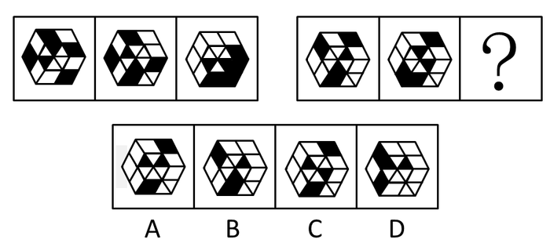

A. A

B. B

C. C

D. D

第 41 题 · 答案与解析

**参考答案（粉笔题库参考内容）**

D

**解析**

元素组成相同，优先考虑位置规律。通过观察发现，题干图形外圈均为四边形，内圈均为三角形，因此图形可分为内外圈找规律。再次观察发现，内圈黑色图形每次逆时针平移一格，据此规律可排除B、C两项。分析外圈黑块的位置平移，并未找到规律，因此可考虑黑白运算，第一组图形的黑白元素规律是黑+黑=白，黑+白=黑，白+白=白，白+黑=黑。据此排除A项。

故正确答案为D。

**考点**：位置规律-旋转、样式规律-黑白运算

**来源**：2010年深圳市公务员录用考试《行测》题第41题

### 第 42 题

从所给四个选项中，选择最合适的一个填入问号处，使之呈现一定的规律性：

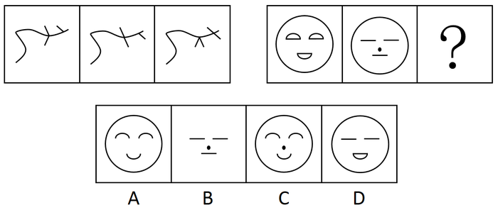

A. A

B. B

C. C

D. D

第 42 题 · 答案与解析

**参考答案（粉笔题库参考内容）**

C

**解析**

第一组图形，最长的曲线不变，短线之间去同存异；第二组图形，最外的圈（最长曲线）保持不变，其他部分去同存异得到C项。

故正确答案为C。

**考点**：样式规律-加减同异

**来源**：2010年深圳市公务员录用考试《行测》题第42题

### 第 43 题

从所给四个选项中，选择最合适的一个填入问号处，使之呈现一定的规律性：

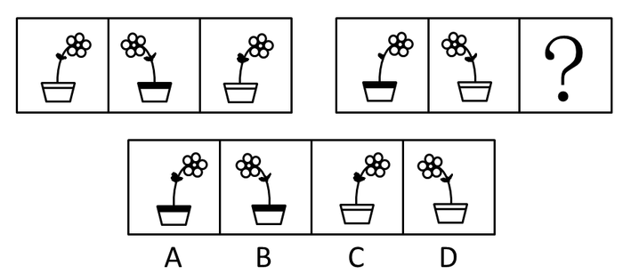

A. A

B. B

C. C

D. D

第 43 题 · 答案与解析

**参考答案（粉笔题库参考内容）**

C

**解析**

元素组成相似，优先考虑样式规律。观察发现，第一组出现的图形在第二组图形中重复出现，考虑遍历规律。第一组图形相邻的两个图形花朵朝向相反，且三个花盆中有一个是黑色线条，两个白色线条。第二组图形的？处图形花朵朝向应是右边，排除B、D两项；又因为已经有一个黑色线条花盆，未知图形花盆应是白色线条，排除A项。

故正确答案为C。

**考点**：样式规律-遍历

**来源**：2010年深圳市公务员录用考试《行测》题第43题

### 第 44 题

从所给四个选项中，选择最合适的一个填入问号处，使之呈现一定的规律性：

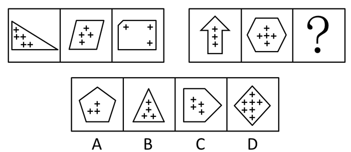

A. A

B. B

C. C

D. D

第 44 题 · 答案与解析

**参考答案（粉笔题库参考内容）**

C

**解析**

图形都是内外两部分组成，分开数，第一组图形各个边数呈现等差，3、4、5 。 各个“+”数量是5、4、3。第二组前两个图形各个边数是7、6 ，各个“+”数量是3、5，那么根据第一组规律，可以得出选项外边数应该是5，内部元素为4，只有C项符合题意。

故正确答案为C。

**考点**：数量规律-素、数量规律-线

**来源**：2010年深圳市公务员录用考试《行测》题第44题

### 第 45 题

从所给四个选项中，选择最合适的一个填入问号处，使之呈现一定的规律性：

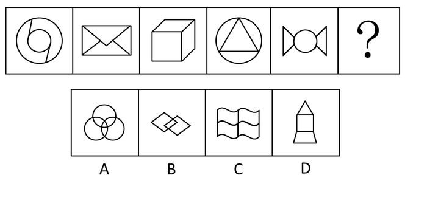

A. A

B. B

C. C

D. D

第 45 题 · 答案与解析

**参考答案（粉笔题库参考内容）**

C

**解析**

元素组成凌乱，考数数。

题干各个图形中封闭空间分别是3、4、3、4、3，所以下一个图形封闭空间应为4。

A项有7个封闭空间；

B项有3个封闭空间；

C项有4个封闭空间；

D项有3个封闭空间。

故正确答案为C。

**考点**：数量规律-面

**来源**：2010年深圳市公务员录用考试《行测》题第45题

### 第 46 题

从所给四个选项中，选择最合适的一个填入问号处，使之呈现一定的规律性：

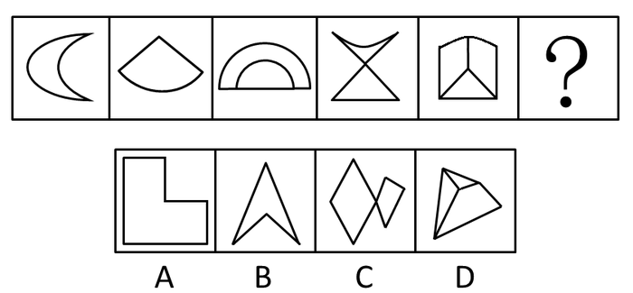

A. A

B. B

C. C

D. D

第 46 题 · 答案与解析

**参考答案（粉笔题库参考内容）**

C

**解析**

元素组成不同，优先考虑属性规律，题干图形比较规整，优先考虑对称性，题干均为轴对称图形，选项中的轴对称图形不止一个，无法选出唯一答案，继续寻找规律。再次观察题干图形发现，出现了明显的线与线相交叉的图形，优先考虑点数量，题干交点数分别为2、3、4、5、6，那么接下来交点应该为7，选项中交点个数分别是6、4、7、5。

故正确答案为C。

**考点**：数量规律-点

**来源**：2010年深圳市公务员录用考试《行测》题第46题

### 第 47 题

从所给的四个选项中，选择最合适的一个填入问号处，使之呈现一定的规律性：

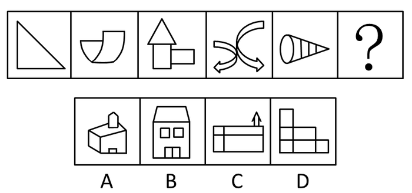

A. A

B. B

C. C

D. D

第 47 题 · 答案与解析

**参考答案（粉笔题库参考内容）**

D

**解析**

元素组成凌乱，考数数。

已知图形封闭空间个数分别是1、2、3、4、5，下一个图形封闭空间个数应为6，排除A、C两项；

观察发现，各个封闭空间是互不包容的，排除B项。D项符合题意。

故正确答案为D。

**考点**：数量规律-复合

**来源**：2010年深圳市公务员录用考试《行测》题第47题

### 第 48 题

从所给的四个选项中，选择最合适的一个填入问号处，使之呈现一定的规律性：

A. A

B. B

C. C

D. D

第 48 题 · 答案与解析

**参考答案（粉笔题库参考内容）**

C

**解析**

元素组成相同，考查位置规律。

正六边形分割的每个三角形内的元素先按逆时针方向在三个顶角处依次轮转，之后三角形按逆时针方向旋转。

故正确答案为C。

**考点**：位置规律-综合

**来源**：2010年深圳市公务员录用考试《行测》题第48题

### 第 49 题

从所给四个选项中，选择最合适的一个填入问号处，使之呈现一定的规律性：

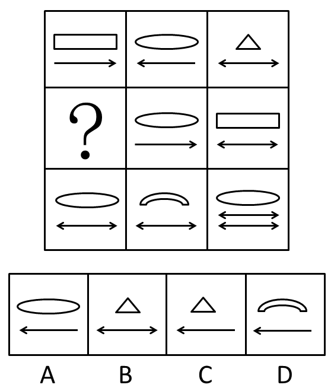

A. A

B. B

C. C

D. D

第 49 题 · 答案与解析

**参考答案（粉笔题库参考内容）**

C

**解析**

元素组成相似，元素周遍。

第一组图形中有四边形、椭圆、三角形，单向箭头和双向箭头，其中单向箭头方向相反。

第三组图中椭圆出现两次，只有双向箭头。

经分析，第二组图形应满足第一组的规律，未知图形箭头应是单向且向左，椭圆、四边形已经出现，因此未知图形箭头上的图形应是三角形。

故正确答案为C。

**考点**：样式规律-遍历

**来源**：2010年深圳市公务员录用考试《行测》题第49题

### 第 50 题

从所给四个选项中，选择最合适的一个填入问号处，使之呈现一定的规律性：

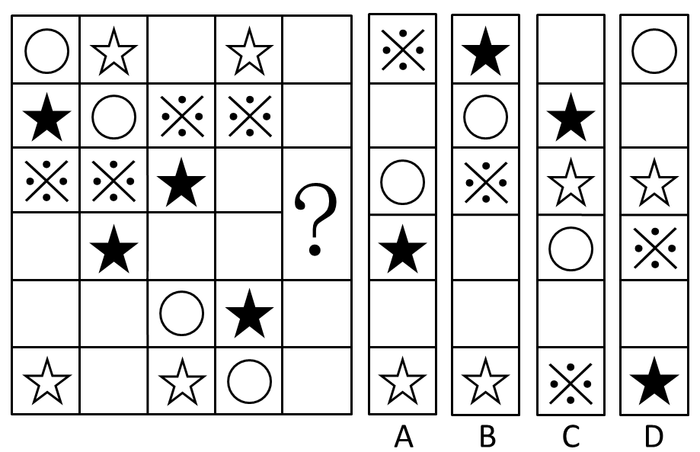

A. A

B. B

C. C

D. D

第 50 题 · 答案与解析

**参考答案（粉笔题库参考内容）**

A

**解析**

每列元素组成相同，优先考虑位置规律。观察图中黑色五角星发现，按照列依次向下平移2格或向上平移1格，其中第一列到第二列向下移动2格，第二列到第三列向上移动1格，第三列到第四列向下移动2格，那么下一列应是向上移动1格。只有A项符合此规律。

故正确答案为A。

**考点**：位置规律-平移

**来源**：2010年深圳市公务员录用考试《行测》题第50题

### 第 51 题

为维护外出务工人员的合法权益，甲地劳动部门为外出务工人员“量身定制”了务工维权卡，把劳动者的权利和义务、劳动纠纷解决的步骤、咨询电话等内容编印在卡上，利用春节期间发放到外出务工人员手中。一旦务工人员的合法权益受到侵害，就可凭务工维权卡高效便捷地到务工所在地的劳动部门申诉解决。

以下最有助于务工维权卡取得实效的一项是：

A. 乙地劳动部门的类似举措已经取得成功

B. 该项举措得到甲地劳动部门领导的大力支持

C. 甲地劳动部门与务工人员所在地的劳动部门有长期的合作关系

D. 务工人员所在地的劳动部门为持有务工维权卡的务工人员无偿提供全方位服务

第 51 题 · 答案与解析

**参考答案（粉笔题库参考内容）**

D

**解析**

第一步：找到论点和论据。

论点是外出务工人员可凭甲地劳动部门为外出务工人员“量身定制”的务工维权卡，高效便捷地到务工所在地的劳动部门维权。没有明显的论据。

第二步：判断加强。

只有论点，没有论据，需要加强论点。

第三步：逐一判断选项的作用。

A项“乙地劳动部门的类似举措已经取得成功”和甲地的情况无关，不能说明有助于甲地务工维权卡取得实效；

B项“领导的大力支持”和C项“有长期的合作关系”可以对务工维权有一定的支持作用，但不能直接推出可以保障务工维权卡取得实效；

D项说明所在地的劳动部门无偿为持卡人员提供全方位服务，直接说明了可以通过务工维权卡维护外出务工人员的合法权益，最有助于务工维权卡取得实效。

故正确答案为D。

**考点**：补充论据

**来源**：2010年深圳市公务员录用考试《行测》题第51题

### 第 52 题

去年某地大力招商引资，吸引国内外投资23亿元，国民生产总值增长两个百分点。今年有人提出如果吸引到50亿元的国内外投资，该地的国民生产总值将可以增长四个百分点，对此有人反对，认为即使能够吸引到50亿元的资金，这一愿望也未必能实现。

以下能够支持反对者意见的是：

①去年国民生产总值增长两个百分点主要得益于国际经济形势的好转

②该地今年很难吸引到50亿元的国内外投资

③该地不具备支持国民生产总值增长四个百分点的重工业基础

A. ①和②

B. ①和③

C. ②和③

D. ①、②、③

第 52 题 · 答案与解析

**参考答案（粉笔题库参考内容）**

B

**解析**

第一步：找到论点和论据。

论点是即使能够吸引到50亿元的资金，该地的国民生产总值将可以增长四个百分点这一愿望也未必能实现。论据是去年某地大力招商引资，吸引国内外投资23亿元，国民生产总值增长两个百分点。

第二步：逐一判断选项的作用。

①说明增长不是靠资金，而是得益于国际经济形势的好转，所以①支持反对者意见；

②讨论的是能不能吸引资金，而不是国民生产总值增长四个百分点这一愿望能否实现，所以②不能支持反对者意见；

③说明不具备增长基础，那么增长愿望不可能实现，所以③支持反对者意见。只有②不能支持反对者的意见。

故正确答案为B。

**考点**：补充论据

**来源**：2010年深圳市公务员录用考试《行测》题第52题

### 第 53 题

近来西方舆论界存在一种观点认为中国经济高速发展，除污染了地球环境外，还成了国际上石油等能源价格的暴涨的原因。

以下最能反驳西方舆论界的观点的是：

A. 石油输出国组织的石油产量近年来不断下降

B. 去年中国经济依然高速发展，但是国际上石油等能源价格比往年低

C. 西方发达国家的生产生活方式造成了国际上石油等能源价格的暴涨

D. 汽车业的高速发展以及汽车的普及造成了国际上石油等能源价格的暴涨

第 53 题 · 答案与解析

**参考答案（粉笔题库参考内容）**

B

**解析**

第一步：找出论点和论据。

论点：中国经济高速发展，除污染了地球环境外，还成了国际上石油等能源价格的暴涨的原因。

论据：无。

本题只有论点，无论据，削弱优先考虑削弱论点，但论点为明显的因果关系，削弱还可以考虑因果倒置与他因削弱。

第二步：逐一判断选项。

A项：石油产量近年不断下降，并没有提及价格，与论点无直接关系，属无关项，排除；

B项：去年中国经济依然高速发展，但是国际上石油等能源价格比往年低，即中国经济高速发展但能源价格并没有暴涨，以事实直接否定题干论点，保留；

C项：西方发达国家的生产生活方式造成了国际上石油等能源价格的暴涨，是他因削弱，一定程度上削弱了论点，保留；

D项：汽车业的高速发展以及汽车的普及造成了国际上石油等能源价格的暴涨，是他因削弱，一定程度上削弱了论点，保留。

比较B、C、D三项，B项削弱论点的力度大于C、D两项的他因削弱。

故正确答案为B。

**考点**：削弱论点

**来源**：2010年深圳市公务员录用考试《行测》题第53题

### 第 54 题

很多人反对焚烧垃圾，他们认为垃圾焚烧会污染环境。一位环境专家在接受媒体采访时说：“垃圾焚烧会产生有害气体，但与垃圾污染本身相比，危害要小得多。通过引进国际先进技术，垃圾焚烧的污染排放能够符合国家有关标准，不会对环境造成太大影响，是可以接受的。”

以下最能反驳这位专家观点的一项是：

A. 垃圾焚烧不仅仅污染焚烧地的环境，也会污染周边的环境

B. 目前尚不存在成熟的垃圾焚烧技术

C. 垃圾焚烧比垃圾本身对环境的危害还要大

D. 即使符合国家标准的垃圾焚烧污染排放，如长期存在，仍将对环境造成较大污染

第 54 题 · 答案与解析

**参考答案（粉笔题库参考内容）**

D

**解析**

第一步：找出论点和论据。

论点：垃圾焚烧是可以接受的。

论据：垃圾焚烧会产生有害气体，但与垃圾污染本身相比，危害要小得多。通过引进国际先进技术，垃圾焚烧的污染排放能够符合国家有关标准，不会对环境造成太大影响。

第二步：逐一分析选项。

A项：说明垃圾焚烧会污染环境，这个污染到底是多大，是否是可以接受的，并不明确，排除；

B项：“目前尚不存在成熟的垃圾焚烧技术”与论据“通过引进国际先进技术”相矛盾，属于削弱论据，能削弱，先保留；

C项：“垃圾焚烧比垃圾本身对环境的危害还要大”直接削弱了题干论据“垃圾焚烧会产生有害气体，但与垃圾污染本身相比，危害要小得多”，属于削弱论据，能削弱，先保留；

D项：“长期存在，仍将对环境造成较大污染”对专家观点有削弱作用，属于削弱论点，且力度比B、C两项削弱论据强，当选。

故正确答案为D。

**考点**：削弱论点

**来源**：2010年深圳市公务员录用考试《行测》题第54题

### 第 55 题

据调查，某地90%以上有过迷路经历的司机都没有安装车载卫星导航系统。这表明，车载卫星导航系统能有效防止司机迷路。

以下最能削弱上述论证的一项是：

A. 很多老司机没有安装车载卫星导航系统，很少迷路

B. 车载卫星导航系统的使用效果不理想，对防止迷路没有多大作用

C. 当地目前只有不足10%的汽车安装了车载卫星导航系统

D. 安装了车载卫星导航系统的司机，90%以上经常使用

第 55 题 · 答案与解析

**参考答案（粉笔题库参考内容）**

C

**解析**

第一步：找出论点和论据。

论点：车载卫星导航系统能有效防止司机迷路。

论据：某地90%以上有过迷路经历的司机都没有安装车载卫星导航系统。

本题论点说的是“车载卫星导航系统”能有效防止“司机迷路”，论据用的是有过“迷路经历”但没有安装“车载卫星导航系统”的司机数据，二者话题不一致，且提问方式为“削弱论证”，可优先考虑拆桥，即证明论据中的数据不足以推出论点。

第二步：逐一判断选项。

A项：很多老司机没有安装车载卫星导航系统，很少迷路，不代表导航无效，不能削弱，排除；

B项：指出车载卫星导航系统的使用效果不理想，则不能有效防止司机迷路，削弱论点，保留；

C项：“不足10%”的汽车“安装了”车载卫星导航系统，说明在所有的司机中安装导航系统的数量很少，而论据指出“90%以上”人员都“没有安装”车载导航系统，说明“90%以上有过迷路经历的司机都没有安装车载卫星导航系统”是一个正常的比例，即无法通过论据中的数据证明车载卫星导航系统能有效防止司机迷路，拆桥项，保留；

D项：经常使用间接说明导航有效，加强了论点，不能削弱，排除。

对比B、C两项，一般情况下削弱论点的力度是非常强的，但本题较为特殊，首先本题提问为“削弱论证”，针对的是题干中的论证（论点与论据之间的关系），那么拆桥的作用要优于削弱论点，其次本题论据为数据，从数据的角度进行拆桥较为符合常见命题人的思路，故C项优于B项。

故正确答案为C。

**考点**：拆桥

**来源**：2010年深圳市公务员录用考试《行测》题第55题

### 第 56 题

为了鼓励孩子在学校取得好成绩，许多家长这样教育孩子：“在学校里从来都是以学习成绩论优劣。你要么成绩好，要么成绩差。在老师的眼里，你要么是好学生，要么是差学生。由于所有学习成绩好的学生在老师眼里都是好学生，所以每个学习差的学生在老师眼里都是差学生。”

为使家长的论证成立，以下假设必须成立的一项是：

A. 在学校里，学习成绩不是评价学生优劣的唯一指标

B. 老师具有区分好学生和差学生的能力

C. 在老师眼里，学习成绩好的学生未必是好学生

D. 在老师眼里，好学生就是学习成绩好

第 56 题 · 答案与解析

**参考答案（粉笔题库参考内容）**

D

**解析**

第一步：翻译题干。

条件：好学生/差学生，学习成绩好→好学生。

结论：学习差→差学生。

第二步：逐一判断选项。

A项，“学习成绩不是评价学生优劣的唯一指标”与家长的教育观念相矛盾，不能使家长的论证成立；

B项，“老师具有区分好学生和差学生的能力”并不能说明学习差的学生都是差学生，根据B项推不出家长的论证；

C项，“学习成绩好的学生未必是好学生”与题干“所有学习成绩好的学生在老师眼里都是好学生”矛盾，学习成绩好→好学生；

D项，“好学生就是学习成绩好”，即-差学生→—学习差，是题干结论的逆否命题，可以使得家长的论证成立。

故正确答案为D。

**考点**：常规翻译

**来源**：2010年深圳市公务员录用考试《行测》题第56题

### 第 57 题

如果在橙子开花季节持续干旱，橙子产量将会受到影响，今年某地在橙子开花季节出现旱情，因此有人担心橙子价格会上涨，从而使得该地橙汁饮料厂的生产成本提高。

以下最能削弱上述论证的一项是：

A. 今年橙汁饮料的价格是历年最低的

B. 该地的旱情并没有预计的严重

C. 今年该地扩大了橙子的种植面积

D. 该地橙汁饮料厂的原料供应大多来自外地

第 57 题 · 答案与解析

**参考答案（粉笔题库参考内容）**

D

**解析**

第一步：找出论点和论据。

论点是有人担心橙子价格会上涨，从而使得该地橙汁饮料厂的生产成本提高。论据是如果在橙子开花季节持续干旱，橙子产量将会受到影响。

第二步：逐一判断选项。

A项，说明今年橙汁饮料的价格最低，并不能说明该地橙汁饮料厂的生产成本不会提高，不能削弱，排除；

B项，“该地的旱情并没有预计的严重”说明旱情对价格也有一些影响，是加强项，排除；

C项，虽然“今年该地扩大了橙子的种植面积”，但是在橙子开花季节持续干旱，橙子产量仍将会受到影响，是无关项，排除；

D项，证明了该地橙汁饮料厂生产成本与本地橙子价格无关，可以削弱，当选。

故正确答案为D。

**考点**：拆桥

**来源**：2010年深圳市公务员录用考试《行测》题第57题

### 第 58 题

质检部门对ABCDE五种不同品牌的32寸平板电视机进行检测，发现：A的耗电量低于B，B的耗电量不比C高，D的耗电量不如E低，E的耗电量不如B低，其中两种品牌电视机的耗电量是相同的。以下论述肯定与以上事实不符的一项是（    ）。

A. B和C的耗电量相同

B. A和C的耗电量相同

C. A的耗电量低于D

D. E的耗电量不如C高

第 58 题 · 答案与解析

**参考答案（粉笔题库参考内容）**

B

**解析**

第一步：抓住题干主要信息。

根据题意可知，，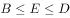。

第二步：根据题干信息进行推导。

A项，根据可知，B和C的耗电量可能相同，该项说法可能正确。

B项，根据可知，A的耗电量一定小于C的耗电量，即两者不可能相同，该项说法肯定不正确。

C项，根据，可知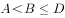，那么A的耗电量一定低于D，该项说法正确。

D项，根据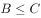，可知，C和E的大小无法确定，可能存在E的耗电量不如C高，该项说法可能正确。

第三步：再次标注答案

本题为选非题，故正确答案为B。

**考点**：日常结论

**来源**：2010年深圳市公务员录用考试《行测》题第58题

### 第 59 题

物理学家霍金认为：“地球生命被某一灾难消灭的危险正以前所未有的速度与日俱增，如突如其来的全球变暖、核战争、基因病毒或其他危险。”霍金在此基础上认为地球越来越不适合人类居住，并提出“太空移民”的观点。

以下最能质疑霍金观点的一项是：

A. 绝大多数星球的环境不适合人类生存

B. 人类面临的危险通过人类的共同努力能够得到解决

C. 地球处于其生命年龄的幼年时期

D. 地球所拥有的适合居住的表面区域太小，抵御毁灭性灾难的能力差

第 59 题 · 答案与解析

**参考答案（粉笔题库参考内容）**

B

**解析**

第一步：找出论点和论据。

论点：霍金认为地球越来越不适合人类居住，并提出“太空移民”的观点。

论据：霍金认为地球生命被某一灾难消灭的危险正以前所未有的速度与日俱增，如突如其来的全球变暖、核战争、基因病毒或其他危险。

第二步：逐一判断选项。

A项，绝大多数不适合，不代表都不适合，无法削弱，排除；

B项，指出通过人类的共同努力能够解决人类所面临的危机，这样就否认了移民的必要性，削弱了论据，当选；

C项，“地球处于其生命年龄的幼年时期”与题干无关，属于无关项，，无法削弱，排除；

D项，加强了论点，无法削弱，排除。

故正确答案为B。

**考点**：削弱论点

**来源**：2010年深圳市公务员录用考试《行测》题第59题

### 第 60 题

为实现垃圾分类回收，许多公共场所的垃圾箱已分为“可回收”和“不可回收”两类，下列几种垃圾，应放入“不可回收”标志垃圾箱的是：

1玻璃瓶     2易拉罐     3果皮     4菜叶     5无毒塑料制品     6纸质包装袋     7剩饭菜

A. 3 4 6

B. 3 4 7

C. 2 3 6

D. 2 4 6

第 60 题 · 答案与解析

**参考答案（粉笔题库参考内容）**

B

**解析**

根据《城市生活垃圾分类及其评价标准》的行业标准，可回收物是指适宜回收循环使用和资源利用的废物，不可回收物指除可回收垃圾之外的垃圾，常见的有在自然条件下易分解的垃圾，如果皮、菜叶、剩菜剩饭、花草树枝树叶等。

故正确答案为B。

**本题相关知识点：**

可回收物主要包括：

1、纸类：未严重玷污的文字用纸、包装用纸和其他纸制品等。如报纸、各种包装纸、办公用纸、广告纸片、纸盒等；

2、塑料：废容器塑料、包装塑料等塑料制品。比如各种塑料袋、塑料瓶、泡沫塑料、一次性塑料餐盒餐具、硬塑料等；

3、金属：各种类别的废金属物品。如易拉罐、铁皮罐头盒、铅皮牙膏皮、废电池等；

4、玻璃：有色和无色废玻璃制品；

5、织物：旧纺织衣物和纺织制品。

**考点**：生活常识

**来源**：2010年深圳市公务员录用考试《行测》题第60题

### 第 61 题

古人对于我国姓氏的来历有如下阐述：“氏于国，则齐鲁秦吴；氏于谥，则文武成宜······氏于事，则巫乙匠淘。”

由此可以推断，王、侯、公孙等姓氏应源自：

A. 族号

B. 邑名

C. 官名

D. 爵号

第 61 题 · 答案与解析

**参考答案（粉笔题库参考内容）**

D

**解析**

解答本题时，关键要了解，王、侯、公孙等姓氏属于爵号。

古代爵位分为王、公、侯、子、男。至于公孙，有一说法是它出自春秋时各国诸侯的后裔，也是以爵号为氏。春秋时，各国诸侯不论爵位大小，多喜欢称公。按照周朝制度，国君一般由嫡长子继位，继位前称为太子，其他的儿子便称为公子，公子的儿子则称公孙。他们的后代便有不少人以公孙为姓。

故正确答案为D。

**本题相关知识点：**

以邑名氏。邑即采邑，是帝王及各诸侯国国君分予同姓或异姓卿大夫的封地。其后代或生活在这些采邑中的人有的便继之为氏。如晋国大夫毕万采地为魏，后世子孙以魏为氏；曲沃桓叔之子公子万封于韩，以韩为氏。来自各种地名的姓氏有鲁、齐、秦、晋、楚、燕、陈、卫、西门、南宫、欧阳等。

以族号为氏。如唐就是尧的号，尧的一部分后代便姓唐，此外还有虞、夏、商、周等。

以官名为氏的有相、宰、尉、上官、太史、少正、司马、司徒、司空、司寇等。

**考点**：文化常识

**来源**：2010年深圳市公务员录用考试《行测》题第61题

### 第 62 题

一般人进入高海拔地区后会出现头晕、气喘、易疲劳等症状，即高原反应。然而，一些竞技体育项目的运动员却在比赛前专门到高海拔地区进行强化训练，其主要原因是：

A. 高海拔地区空气清新，有利于运动员身体健康

B. 高海拔地区气压较低，有利于运动员强化训练

C. 高海拔地区环境恶劣，在这种环境下训练能够磨炼运动员的意志

D. 高海拔地区空气稀薄，在这种环境下训练可以增强运动员的心肺功能

第 62 题 · 答案与解析

**参考答案（粉笔题库参考内容）**

D

**解析**

高海拔地区空气稀薄，气压较低。空气越稀薄，气压越低，单位体积空气内氧分子越少，运动员每一次呼吸要想获得正常的氧气就需要扩大呼吸量，这种训练可以增加肺活量。当运动员回到平原地区参加比赛时，扩大的肺活量可以使每一次呼吸获得更多的氧气，增强运动的能量。

故正确答案为D。

**考点**：生活常识

**来源**：2010年深圳市公务员录用考试《行测》题第62题

### 第 63 题

下列事件中最早突破时间与空间限制，实现了信息的保存和传送的是：

A. 电话、电视的发明

B. 信息技术的普及与应用

C. 甲骨文的出现

D. 印刷术的发明

第 63 题 · 答案与解析

**参考答案（粉笔题库参考内容）**

C

**解析**

我们现在所说的甲骨文，主要指殷墟甲骨文，又称为“殷墟文字”、“殷契”，是殷商时代刻在龟甲兽骨上的文字。19世纪末年，甲骨文在殷代都城遗址（今河南安阳小屯）被发现。这些甲骨文从古代保存至今，显然是跨越了时间和空间的限制，此外，人们能从甲骨文上了解到其中记载的信息，所以甲骨文本身是实现了信息的保存和传送。

故正确答案为C。

**考点**：科技理论与成就

**来源**：2010年深圳市公务员录用考试《行测》题第63题

### 第 64 题

风形成的直接原因是：

A. 空气上升与下降的对流运动

B. 水平方向上气压的差异

C. 不同区域气温的差异

D. 垂直方向上空气密度的差异

第 64 题 · 答案与解析

**参考答案（粉笔题库参考内容）**

B

**解析**

风的形成是空气水平流动的结果。由于各地气温分布不均匀，引起各地的气压分布不均匀，同一水平线上，在气压高的地方空气所受的压力大，在气压低的地方空气所受的压力小，于是空气就从气压高的地方流向气压低的地方，大气的这种水平运动形成了风。

故正确答案为B。

**考点**：自然地理

**来源**：2010年深圳市公务员录用考试《行测》题第64题

### 第 65 题

“低碳生活”就是指尽量减少日常生活所消耗的能量，从而间接降低二氧化碳排放量的一种生活理念，下列不属于低碳生活理念的一项是：

A. 超市采用玻璃门冰柜，缩短顾客购物时打开冰柜门的时间

B. 优先选用公共交通出行，减少驾车次数

C. 尽量减少传真机、打印机和复印机等办公设备的使用量

D. 公共场所禁止吸烟，餐馆、咖啡厅设立吸烟区

第 65 题 · 答案与解析

**参考答案（粉笔题库参考内容）**

D

**解析**

公共场所禁止吸烟，在餐馆、咖啡厅设立吸烟区，目的是为了控制烟草危害，保障大众身心健康，维护公共场所无烟环境，并非为了降低二氧化碳排放量。

本题为选非题，故正确答案为D。

**考点**：生活常识

**来源**：2010年深圳市公务员录用考试《行测》题第65题

### 第 66 题

2008年美国爆发金融危机后出现以下经济现象：1. 消费下降，消费品进口减少；2. 失业增加，居民收入降低；3. 融资困难，企业倒闭增多，这些现象会引发其他国家的经济金融危机，其主要路径是：

A. 2-1-3

B. 3-2-1

C. 3-1-2

D. 1-3-2

第 66 题 · 答案与解析

**参考答案（粉笔题库参考内容）**

B

**解析**

金融危机爆发，首先出现的现象是融资困难，企业倒闭增多，企业一倒闭，失业的人数就增加，居民的收入也随之降低，收入减少导致的直接结果是减少消费，消费品进口也随之减少。

故正确答案为B。

**考点**：国际经济及组织

**来源**：2010年深圳市公务员录用考试《行测》题第66题

### 第 67 题

下列生活现象用分子的相关知识解释不正确的是：

A. 湿衣服晾干表明分子在不断地运动

B. 葡萄酿成酒表明分子的种类发生了变化

C. 酒精溶于水表明分子间有空隙

D. 充足气的自行车内胎在烈日下爆裂，表明分子的体积随温度升高而增大

第 67 题 · 答案与解析

**参考答案（粉笔题库参考内容）**

D

**解析**

炎热的夏天自行车胎容易爆裂，是因为夏天温度高，分子运动加快，分子间的间隔变大，从而使胎内气压增大，导致车胎爆裂，所以D项的解释不正确。

本题为选非题，故正确答案为D。

**考点**：物理常识

**来源**：2010年深圳市公务员录用考试《行测》题第67题

### 第 68 题

“春雨惊春清谷天，夏满芒夏暑相连，秋处露秋寒霜降，冬雪雪冬小大寒。”节气对于指导农业生产具有很强的科学性。

下列反映阳历六月初节气的农谚是：

A. 立夏桑果像樱桃

B. 小满养蚕又种田

C. 芒种玉秧放庭前

D. 夏至稻花如白练

第 68 题 · 答案与解析

**参考答案（粉笔题库参考内容）**

C

**解析**

这道题考查考生对节气的掌握程度。

解答本题时，需要考生了解哪个节气出现在六月初。题干引号内的内容是二十四节气口诀，其中“夏满芒夏暑相连”中的第一个“夏”指的是“立夏”，第二个“夏”指的是“夏至”，夏至一般在每年的6月20、21或22日，每个节气的间隔时间为十五天，这样推断，出现在六月初的节气是芒种，正确答案选C。

A选项“立夏”是阳历五月初；

B选项“小满”是阳历五月底；

D选项“夏至”是阳历六月中下旬。

故正确答案为C。

**考点**：自然地理

**来源**：2010年深圳市公务员录用考试《行测》题第68题

### 第 69 题

马铃薯、草莓、芝麻和菜花这些常见农产品，所对应的植物器官依次是：

A. 根-种子-果实-茎

B. 茎-种子-种子-花

C. 根-花-果实-叶

D. 茎-果实-种子-花

第 69 题 · 答案与解析

**参考答案（粉笔题库参考内容）**

D

**解析**

马铃薯是块茎类作物，埋在地下的茎部含有大量的淀粉，可以为食用者提供丰富的营养能源。草莓是由花托膨大形成的果实。芝麻是我国主要油料作物之一，食用部分为种子。菜花食用部分是洁白、短缩、肥嫩的花蕾、花枝、花轴等聚合而成的花球。

故正确答案为D。

**考点**：生物常识

**来源**：2010年深圳市公务员录用考试《行测》题第69题

## 材料 1

根据下列资料，完成各题。

        2004年，广东省委省政府首次提出珠江三角与山区及东西两翼共建产业转移工业园，截至2009年4月，广东全省已认定产业转移园32个，14个欠发达地市已至少有一个产业转移园，至2008年底，广东省29个产业转移园已投入开发资金111.38亿元，入园项目（含意向）973个。总投资1156亿元，已动工建设项目611个，投资额542.2亿元。园区已投入生产的企业2008年实现工业总产值302.66亿元，实现利税27.72亿元。分别是2007年的4.67倍和5.33倍。园区用工约16.42万人，其中吸纳本地劳动力9.96万人，占60.7%。

        从皮鞋和陶瓷这两个劳动密集型，附加值相对低的行业看，今年广东的产业布局得到优化，从皮鞋行业看，珠三角地区规模以上皮鞋企业的工业产值占全省的比重从2003年的98.2%下降到2008年的86.2%，下降了12个百分点；其中广州下降幅度很大，从31.5%下降到14.4%。而珠江三角地区外围的清远皮鞋生产大幅度增加，从0.9%上升到11.7%；梅州，潮汕，揭阳则从无到有，三市2008年的皮鞋产值比重为0.7%。从陶瓷行业看，珠三角地区规模以上陶瓷企业的工业产值占全省的比重从2003年的66.4%下降到2008年的51.4%，下降了15个百分点；其中广州陶瓷产值所占比重从7.2%下降至2.3%。佛山从48.8%下降至35.1%，下降了13.7个百分点，下降幅度最大，而珠江三角地区外围的清远陶瓷生产增加较快，比重从1.1%上升到5.7%；梅州从28.9%上升到43.7%，增加幅度最大。

### 第 70 题

2007年广东省产业转移工业园实现工业总产值为多少亿元：

A. 64.8

B. 62.5

C. 60.7

D. 57.6

第 70 题 · 答案与解析

**参考答案（粉笔题库参考内容）**

A

**解析**

根据题干“2007年······多少亿元”，结合材料时间为2008年，且给出2008年与2007年倍数关系，可判定本题为比值计算问题。定位文字材料第一段可得，2008年广东省产业转移工业园实现工业总产值302.66亿元，是2007年的4.67倍。则2007年广东省产业转移工业园实现工业总产值为亿元。

故正确答案为A。

**考点**：基期计算、文字资料

**来源**：2010年深圳市公务员录用考试《行测》题第70题

### 第 71 题

截至2008年底，广东省产业转移工业园已动工建设项目的个数占入园项目总数的比重以及已投资占总投资额的比重分别是：

A. 62.8%，46.9%

B. 62.8%，52.7%

C. 60.9%，46.9%

D. 60.9%，52.7%

第 71 题 · 答案与解析

**参考答案（粉笔题库参考内容）**

A

**解析**

根据题干“截至2008年底······占······的比重分别是”，结合材料时间为2008年，可判定本题为现期比重问题。定位文字材料第一段可得，2008年底，广东省产业转移工业园已动工建设项目611个，入园项目973个；总投资1156亿元，已投资额542.2亿元。根据公式：比重，可知所求比重分别为；，满足选项为A项。

故正确答案为A。

**考点**：文字资料、现期比重

**来源**：2010年深圳市公务员录用考试《行测》题第71题

### 第 72 题

根据材料，以下判断正确的是：

A. 2003年至2008年间，广东珠三角以外地区规模以上陶瓷企业的工业产值占全省的比重上升了12个百分点

B. 2003年至2008年间，潮汕规模以上的陶瓷企业的工业产值下降了13.7%

C. 2003年至2008年间，清远皮鞋企业工业产值占全国比重增幅远大于该市陶瓷企业

D. 2003年至2008年间，清远规模以上皮鞋企业的工业产值增加10.8个百分点

第 72 题 · 答案与解析

**参考答案（粉笔题库参考内容）**

D

**解析**

A项：定位材料最后一段，2003年广东珠三角地区占全省的比重为66.4%，因此对应的2003年广东珠三角以外地区占全省的比重为33.6%，2008年广东珠三角地区占全省的比重为51.4%，因此对应的2008年广东珠三角以外地区占全省的比重为48.6%，48.6%-33.6%=15%，因此比重上升了15个百分点，错误；

B项：材料当中未提及有关潮汕规模以上的陶瓷企业工业产值的比重，错误；

C项：材料当中通篇比重都是以广东省作为基量，与选项中提及的全国比重对象不符，错误；

D项：2003-2008年，清远规模以上皮鞋企业工业产值提高了11.7%-0.9%=10.8%，正确。

故正确答案为D。

**考点**：文字资料、综合分析

**来源**：2010年深圳市公务员录用考试《行测》题第72题

### 第 73 题

根据资料，下列各项正确的是：

A. 截至2009年4月，珠三角各市都建有不止一个产业转移工业园

B. 截至2008年底，广东省29个产业转移园总投资111.38亿元

C. 产业转移工业园承接的都是劳动密集型、附加值相对较低的行业

D. 2008年广东省产业转移工业园区吸纳的劳动力多为本地人

第 73 题 · 答案与解析

**参考答案（粉笔题库参考内容）**

D

**解析**

A项，定位文字材料第一段可得，截至2009年4月，广东全省已认定产业转移园32个，14个欠发达地市已至少有一个产业转移园，并未提到每个城市的情况，错误；

B项，定位文字材料第一段可得，至2008年底，广东省29个产业转移园已投入开发资金111.38亿元，并不是总投资，错误；

C项，定位文字材料第二段可得，材料只是以皮鞋和陶瓷这两个劳动密集型、附加值相对低的行业来举例子，并不代表承接的都是劳动密集型、附加值相对低的行业，错误；

D项，定位文字材料第一段可得，2008年园区用工约16.42万人，其中吸纳本地劳动力9.96万人，占60.7%，超过50%，因此吸纳的劳动力多为本地人，正确。

故正确答案为D。

**考点**：文字资料、综合分析

**来源**：2010年深圳市公务员录用考试《行测》题第73题

### 第 74 题

根据资料，下列各项无法确定的是：

A. 2008年，潮州陶瓷企业工业产值远大于该市皮鞋企业

B. 2008年，广东省产业转移工业园区吸纳的外地劳动力约为6.46万人

C. 广东14个欠发达地市都有产业转移工业园

D. 2008年广州规模以上皮鞋企业的工业产值比清远同类企业的工业产值高

第 74 题 · 答案与解析

**参考答案（粉笔题库参考内容）**

A

**解析**

A项，定位文字材料可得，材料并没有潮州陶瓷企业与皮鞋企业相关数据，故无法确定，错误；

B项，定位文字材料第一段可得，园区用工约16.42万人，其中吸纳本地劳动力9.96万人。可知吸纳外地劳动力约为16.42-9.96=6.46万人，正确；

C项，定位文字材料第一段可得，2009年4月，14个欠发达地市已至少有一个产业转移园，正确；

D项，定位文字材料第二段可得，2008年广州规模以上的皮鞋企业的工业产值占全省的14.4%，清远规模以上的皮鞋企业的工业产值占全省的11.7%。可知14.4%＞11.7%，正确。

本题为选非题，故正确答案为A。

**考点**：文字资料、综合分析

**来源**：2010年深圳市公务员录用考试《行测》题第74题

## 材料 2

根据下列资料和图形，完成各题。

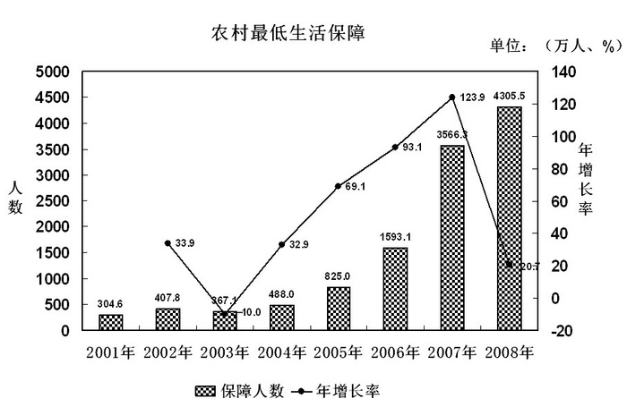

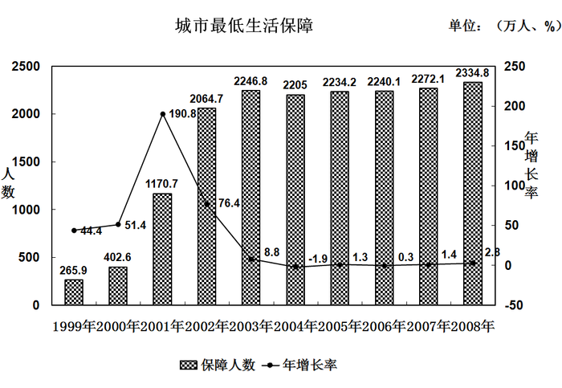

        2008年各级财政共支出城市低保资金393.4亿元，比上年增长41.8%，保障了2330多万城镇贫困人口的基本生活。得到最低生活保障人员中：在职人员82.2万人，占总人数的3.5%，灵活就业人员381.7万人，占总人数的16.4%，老年人316.7万人，占总人数的13.6%，登记失业人员564.3万人，占总人数的24.3%，未登记失业人员402.2万人，占总人数的17.2%。在校生358.1万人，占总人数的15.3%，其他未成年人229.6万人，占总人数的9.8%。2008年农村最低生活保障制度在全国范围内普遍建立，农村低保正在应保尽保的目标迈进。全年共发放农村最低生活保障资金228.7亿元。比上年增长109.6%。

### 第 75 题

2008年农村最低生活保障人数比2001年将近翻了多少番：

A. 15

B. 14

C. 5

D. 4

第 75 题 · 答案与解析

**参考答案（粉笔题库参考内容）**

D

**解析**

根据题干“2008年······比2001年将近翻了多少番”，可判定本题为比值计算问题。定位图1材料可得，2001年农村最低生活保障人数为304.6万人，2008年农村最低生活保障人数为4305.5万人。则2008年农村最低生活保障人数是2001年的倍，接近，因此翻了4番。

故正确答案为D。

**考点**：比值计算、综合资料

**来源**：2010年深圳市公务员录用考试《行测》题第75题

### 第 76 题

下列时段中，农村居民最低生活保障人数年增长率变化幅度最大的是：

A. 2002年至2003年

B. 2003年至2004年

C. 2004年至2005年

D. 2005年至2006年

第 76 题 · 答案与解析

**参考答案（粉笔题库参考内容）**

A

**解析**

根据题干“······增长率变化幅度最大的是”，可判定本题为一般增长率比较问题。定位图1材料可得：2002年-2006年增速分别为33.9%、-10.0%、32.9%、69.1%、93.1%。由此可知增长率变化幅度分别为：

2002-2003年：33.9%-(-10.0%)=43.9%；

2003-2004年：32.9%-(-10.0%)=42.9%；

2004-2005年：69.1%-32.9%=36.2%；

2005-2006年：93.1%-69.1%=24%。

故农村居民最低生活保障人数年增长率变化幅度最大的是2002至2003年。

故正确答案为A。

**考点**：一般增长率、综合资料

**来源**：2010年深圳市公务员录用考试《行测》题第76题

### 第 77 题

2008年全国城市最低生活保障月人均保障水平为：

A. 140.41元

B. 146.65元

C. 1684.94元

D. 1759.81元

第 77 题 · 答案与解析

**参考答案（粉笔题库参考内容）**

A

**解析**

根据题干“2008年······月人均保障水平为······”，结合材料时间为2008年，可判定本题为现期平均数问题。定位图2材料可得，2008年全国城市最低生活保障人数为2334.8万人；定位文字材料可得，2008年各级财政共支出城市低保资金393.4亿元。根据公式：人均保障水平，代入数据得：元/人，与A项最接近。

故正确答案为A。

**考点**：现期平均数、综合资料

**来源**：2010年深圳市公务员录用考试《行测》题第77题

### 第 78 题

关于我国城市居民的低保状况，下列说法中不正确的是：

A. 2008年，我国城市居民中最低生活保障人员中的失业人员比重超过了40%

B. 2008年，在城市最低生活保障人员中，失业人员约为就业人员的两倍

C. 2008年，有316.7万城市老年人得到最低生活保障，占城市老年人总数的13.6%

D. 1999年至2008年间，城市居民得到最低生活保障的人数没有实现逐年增长

第 78 题 · 答案与解析

**参考答案（粉笔题库参考内容）**

C

**解析**

A项：定位文字材料可得，我国城市居民最低生活保障人员中登记失业人员占总人数的24.3%，未登记失业人员占总人数的17.2%。可知共占总人数的24.3+17.2%=41.5%，超过40%，正确；

B项：定位文字材料可得，我国城市居民最低生活保障人员中在职人员82.2万人，灵活就业人员381.7万人，登记失业人员564.3万人，未登记失业人员402.2万人。则倍，正确；

C项：定位文字材料可得，我国城市居民最低生活保障人员中老年人316.7万人，占总人数的13.6%。指占城市居民最低生活保障总人数，不是老年人总数，错误；

D项：定位图2材料可得，2004年城市居民最低生活保障人数年增长率为-1.9%，人数减少，不是逐年增长，正确。

本题为选非题，故正确答案为C。

**考点**：综合分析、综合资料

**来源**：2010年深圳市公务员录用考试《行测》题第78题

### 第 79 题

根据上图，下列说法正确的是：

A. 2001年至2008年，城市居民最低生活保障人数的增长速度高于农村居民最低生活保障人数的增长速度

B. 2008年城市居民最低生活保障人数多于农村居民最低生活保障人数

C. 2001年至2008年，农村居民中最低生活保障人数逐年递增

D. 农村居民最低生活保障人数于2007年超过了城市居民最低生活保障人数

第 79 题 · 答案与解析

**参考答案（粉笔题库参考内容）**

D

**解析**

A项：定位图形材料可得，2001年至2008年城市居民最低生活保障人数的增长速度低于农村居民最低生活保障人数的增长速度，错误；

B项：定位图形材料可得，2008年城市居民最低生活保障人数为2334.8万人，农村居民最低生活保障人数为4305.5万人，城市居民最低生活保障人数低于农村居民最低生活保障人数，错误；

C项：定位图1材料可得，2003年农村居民最低生活保障人数增长率为-10.0%，人数减少，不是逐年递增，错误；

D项：定位图形材料可得，2007年农村居民中最低生活保障人数为3566.3万人，城市居民中最低生活保障人数为2272.1万人。农村最低生活保障人数首次超过了城市最低生活保障人数，正确。

故正确答案为D。

**考点**：综合分析、综合资料

**来源**：2010年深圳市公务员录用考试《行测》题第79题

## 材料 3

根据下列表格，完成各题。

某省环境统计公报（2004-2008年）

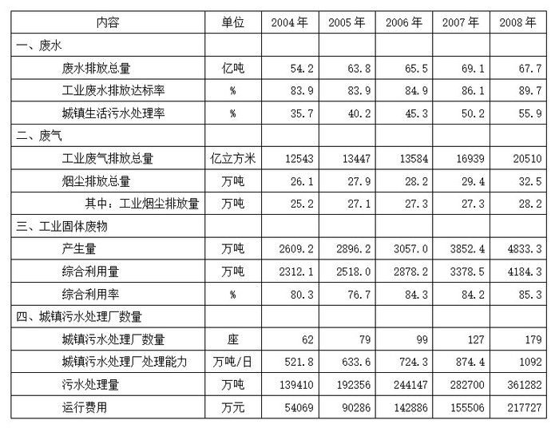

### 第 80 题

2008年工业固体废物综合利用量大约是2004年的：

A. 1.7倍

B. 2倍

C. 2.3倍

D. 2.6倍

第 80 题 · 答案与解析

**参考答案（粉笔题库参考内容）**

A

**解析**

根据题干“2008年······是2004年的······”结合选项问的是多少倍，可判定本题为比值计算问题。定位表格材料可得，2008年工业固体废物综合利用量是4184.3万吨，2004年工业固体废物综合利用量是2312.1万吨。可知2008年工业固体废物综合利用量是2004年的，与A项最接近。

故正确答案为A。

**考点**：比值计算、统计表

**来源**：2010年深圳市公务员录用考试《行测》题第80题

### 第 81 题

与前一年相比，工业废水排放达标率增幅最大的年份是：

A. 2005年

B. 2006年

C. 2007年

D. 2008年

第 81 题 · 答案与解析

**参考答案（粉笔题库参考内容）**

D

**解析**

根据题干“······增幅最大的年份是······”，可判定本题为一般增长率比较问题。定位表格材料可得，2004-2008年工业废水排放达标率分别为83.9%、83.9%、84.9%、86.1%、89.7%。则2005-2008年工业废水排放达标率增幅分别为：

2005年：；

2006年：；

2007年：；

2008年：。

故工业废水排放达标率增幅最大的是2008年。

故正确答案为D。

**考点**：一般增长率、统计表

**来源**：2010年深圳市公务员录用考试《行测》题第81题

### 第 82 题

工业烟尘排放量占烟尘排放总量的比重最低的年份是：

A. 2005年

B. 2006年

C. 2007年

D. 2008年

第 82 题 · 答案与解析

**参考答案（粉笔题库参考内容）**

D

**解析**

根据题干“······占······比重······”，可判定本题为现期比重问题。定位表格可得四个年份的工业烟尘排放量和烟尘排放总量，根据，则2005年、2006年、2007年、2008年工业烟尘排放量占烟尘排放总量的比重分别为：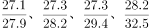。根据分子相同，分母小的分数值大可知：，排除B项。直除比较，、、。所以工业烟尘排放量占烟尘排放总量的比重最低的年份是2008年。

故正确答案为D。

**考点**：现期比重、统计表

**来源**：2010年深圳市公务员录用考试《行测》题第82题

### 第 83 题

根据上表，下列说法不正确的是：

A. 工业废气排放总量较上一年增幅最大的年份是2005年

B. 工业固体废物的利用率未实现逐年上升

C. 2008年城镇污水处理厂处理能力约是2004年的两倍

D. 2004至2008年，城镇生活污水处理率增长速度高于工业废水排放达标率

第 83 题 · 答案与解析

**参考答案（粉笔题库参考内容）**

A

**解析**

A项：定位表格，可得2004-2008年各年度的工业废气排放总量，则根据增长率，可得2005年、2006年、2007年、2008年增幅分别为、、、。观察可得，四个分数分母相差不大，而2005年和2006年的分子明显小于2007年和2008年，由此可得2005年和2006年的增幅小于2007年和2008年。故2005年的增幅不是最大的，错误；

B项：定位表格，可得2004年工业固体废物的综合利用率是80.3%，而2005年是76.7%，未实现逐年上升，正确；

C项：定位表格，2008年城镇污水处理厂处理能力为1092万吨/日，2004年为521.8万吨/日，2008年城镇污水处理厂处理能力是2004年的倍，正确；

D项：定位表格，可得2004年城镇生活污水处理率及工业废水排放达标率分别为35.7%和83.9%，2008年为55.9%和89.7%，根据，比较增长率大小即可直接比较现期量/基期量部分，即2004年至2008年城镇生活污水处理率增长速度为，工业废水排放达标率增长速度为。前者大于后者，正确。

本题为选非题，故正确答案为A。

**考点**：统计表、综合分析

**来源**：2010年深圳市公务员录用考试《行测》题第83题

### 第 84 题

关于城镇污水集中处理情况，下列表述正确的是：

A. 根据2004至2008年间城镇污水处理厂数量的平均增长速度，预计2010年将超过200座

B. 2008年污水处理的单位成本比2007年有所降低

C. 2008年城镇污水处理厂平均处理能力比2007年有所提高

D. 2004年城镇污水处理厂平均运行费用最高

第 84 题 · 答案与解析

**参考答案（粉笔题库参考内容）**

A

**解析**

A项：定位表格可知，城镇污水处理厂数量在2004年为62座，2008年为179座。根据年均增长率公式：（n为年份差），代入公式可得：。故2010年城镇污水处理厂数量为：，正确。

B项：定位表格可知，2008年、2007年污水处理量分别为361282万吨、282700万吨，运行费用分别为217727万元、155506万元，则2008年污水处理的单位成本为元/吨，2007年为元/吨，前者大于后者，故2008年污水处理的单位成本比2007年高，错误。

C项：定位表格可知，2008年、2007年城镇污水处理能力分别为1092万吨/日、874.4万吨/日，城镇污水处理厂数量分别为179座、127座，根据平均数，则2008年平均处理能力为，2007年为，前者小于后者，因此2008年城镇污水处理厂平均处理能力比2007年有所降低，错误。

D项：定位表格可知，2004年、2005年城镇污水处理厂运行费用分别为54069万元、90286万元，污水处理厂分别为62座、79座，则2004年污水处理厂平均运行费用为万元/座，2005年为万元/座，因此2004年城镇污水处理厂平均费用不是最高的，错误。

故正确答案为A。

**考点**：统计表、综合分析

**来源**：2010年深圳市公务员录用考试《行测》题第84题

