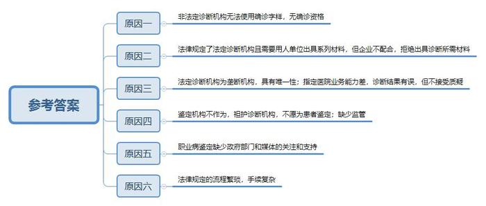

# 2011年广东省公考《申论》题

<!-- gwy:overview:start -->
> **广东 · 2011 · 申论 · 统考** ｜ 3 题 · 图片 1 处 · 答案随题折叠

导航：[题目](#题目) · [材料 1](#材料-1)
<!-- gwy:overview:end -->

> 候选采集稿。参考答案及解析来自粉笔页面，不代表官方答案或真实高分答卷；来源使用许可与原卷对应关系仍需人工核实。

## 给定材料

### 材料 1

随着工业革命的发展，职业病开始受到人们的关注。工业革命初期，与机器生产物品和过程相关的职业病及传染病流行。到了20世纪，世界各地合成生产了许多有机化合物，包括农药、医药、石油化工产品等，出现了多种急、慢性化学中毒和职业性肿瘤等新问题。随之，许多发达国家又兴起了以原子能、高分子化合物和电子计算机为标志的第三次工业革命。不仅X射线、原子能、高频、微波、红外线等技术，还有其他新原料、新化学物质和高科技等被应用于生产，随之出现劳动方式的变化，带来了新的职业卫生问题。

所谓职业病，在我国是指企业、事业单位和个体经济组织的劳动者在职业活动中，因接触粉尘、放射性物质和其他有毒、有害物质等因素而引起的疾病。《中华人民共和国职业病防治法》规定，职业病必须具备四个条件：1.患病主体是企业、事业单位或个体经济组织的劳动者；2.必须是在从事职业活动的过程中产生的；3.必须是因接触粉尘、放射性物质和其他有毒、有害物质等职业病危害因素引起的；4.必须是国家公布的职业病分类和目录所列的职业病。

### 材料 2

目前，我国从煤炭、冶金、化工、建筑等传统工业，到汽车制造、医药、计算机、生物工程等30多个新兴产业都不同程度存在职业病危害，估计有2亿劳动者在从事劳动的过程中不同程度遭受职业病危害。新中国成立至2009年底，全国已累计报告职业病七十二万多例。仅2009年，全国报告职业病病例数较上一年就增加了31.9％。我国已进入职业病高发期和矛盾凸显期，防治工作形势十分严峻和紧迫。

我国职业病名单规定的职业病涉及粉尘、职业肿瘤、职业传染病等10大类115种，职业病危害因素分类目录确定的工业生产中常见职业病危害因素达133种。我国各类企业中，中小企业占90％以上，吸纳了大量劳动力，特别是农村劳动力。农民工家庭因职业病致贫、返贫的现象在一些地区大量存在，职业病危害问题已经成为影响社会和谐的公共卫生问题和社会问题。职业病危害也突出地反映在中小企业，尤其是一些个体私营企业中。

北京义联劳动法援助与研究中心开展的职业病调查报告显示，职业病患者中最大的群体为尘肺病患者（占70.2％）。其次为职业中毒群体（占19.1％），主要为苯中毒、镉中毒、铅中毒。尘肺病和有些化学中毒等慢性职业病潜伏期较长，一旦发病往往难以治疗，病死率高。以尘肺病为例，潜伏期可长达数年甚至十多年，尘肺病患者肺部已经发生纤维化，无法再复原，只能采取治疗措施延缓病情进展。而慢性苯中毒会对脊髓产生不可逆的损害，严重时将导致再生障碍性贫血，甚至白血病。近年来在一些地方屡屡发生的尘肺病、正己烷中毒、三氯甲烷中毒、二氯乙烷中毒、镉中毒等群发性职业病事件造成了恶劣的社会影响。

义联的调查报告还显示，职业病患者从开始生病，到身体出现病征，经历的时间一般为6年。其中在3年内就出现病征的达到32.3％。据统计，煤矿企业的采掘工人患病率达到13.1％。也正是因为如此高的患病率，使得职业病案例常以群体形式爆发。2010年5月华北某市关闭煤矿后，该地区检查确诊为职业病的人数超过500人。河北张家口某矿山企业矽肺病案中，涉及职业病患者119人。而义联关注的力奇珠宝首饰制造厂职业病工人索赔案中，矽肺患者人数也高达76人。

### 材料 3

近年来，随着IT、生物医药、微电子等高新技术产业的飞速发展，职业病危害因素也不再局限于传统的粉尘、重金属范畴，而是出现了噪声、微波、电磁辐射等多元化趋势。专家表示，电磁辐射如果超过安全标准可能影响人们的心血管系统，表现为心悸、失眠、心搏血量减少、白细胞减少、免疫功能下降等。如果装有心脏起搏器的病人处于高电磁辐射的环境中，就会影响心脏起搏器的正常使用。而长期面对电脑视屏或是手机视屏，还可能对人们的视力带来不良影响。由于眼睛对电磁辐射很敏感，过高的电磁辐射污染会引起视力下降、白内障等。

根据卫生部、世界卫生组织、国际非电离辐射防护委员会等权威部门提供的详实数据，电磁辐射对11大类职业人群存在潜在危害。这些行业包括：普遍使用计算机网络和机群的金融证券行业、IT行业，电磁波强度很大的电力和通信行业、民航、铁路，采用高频理疗设备的医疗行业，大量使用仪器仪表设备的科研行业等，现代化办公设备相当普及的白领和金领人士也难逃电磁辐射。卫生部日前透露，我国职业病种类已经由1957年的14种扩大到现在的115种，50年增加了7倍。而且由于职业病更新速度加快，电脑综合症等层出不穷的新职业病还没有纳入法定职业病范围。

50年来广东的职业病疾病谱发生了巨大变化：上世纪60年代初，广东职业病主要是稻田皮炎，70年代是有机磷农药中毒，当时该病病死率很高。80年代职业病以尘肺为主，90年代后主要是尘肺病与中毒。之后，主要是尘肺、中毒、噪音及震动引起的职业病。从1998年以来，广东新发现了17种职业病，其中9种在国内首次发现。这17种中有两种是新发现的职业病，包括铬鼻病和职业性甲醇中毒。这两种职业病虽然在国家的职业病目录中，但是在国内目前还很少见。近年来高新技术产业的迅速发展带来的新兴职业病在广东地区也有较突出的表现。

### 材料 4

2008年10月至2009年7月，位于A市工业园区的联建（中国）科技有限公司（以下简称联建科技）开始在其供货商美国苹果公司的建议下使用价钱更便宜、清洁效果更好的正己烷替代酒精等清洗剂进行擦拭显示屏作业。正己烷是一种化学溶剂，它的挥发速度比酒精快，擦拭玻璃的效果也比酒精好，但是具有一定的毒性，会通过呼吸道、皮肤等途径进入人体，长期接触可导致人体出现头痛、头晕、乏力、四肢麻木等慢性中毒症状，严重的会损害周边神经系统，并延至脊髓，导致肌肉萎缩、瘫痪，甚至死亡。

2010年2月下旬，联建科技百余名员工正己烷中毒，当时数据显示，在整个“正己烷中毒事件”中，直接或间接涉及2742名员工，共有134人受影响。联建科技一位负责人承认，使用正己烷来代替酒精擦拭显示屏，主要是因为正己烷比酒精挥发速度快。如果按照酒精挥发速度只有正己烷的1/4计算，使用酒精擦拭一个月的产量仅75万~90万个，比使用正己烷少生产225万~270万个。

联建科技监管部门A市工业园区安监局称，联建科技于2008年9月进行了职业危害申报，但并未申报使用正己烷。2008年10月，公司在大量使用正己烷后，也始终未向园区安监局作变更申报。因此，至2009年7月底，园区安监、卫生部门未将该公司作业场所正己烷浓度监督监测纳入年度计划中。直至事发后调查组在对生产现场的空气进行抽样检测后发现，挥发性极强的正己烷在空气中堆积，严重超过了国家规定的安全标准，员工们在没有有效防护的情况下工作，时间一长，整个车间内的许多员工慢性中毒。A市工业园区安全生产监督管理局认为，正是联建科技违规、违法使用有毒化学溶剂，忽视现场的职业危害防治与员工的防护，造成了这起中毒事故。

### 材料 5

2010年3月，一份源自国家煤矿安全监察局、中华全国总工会、中国职业安全健康协会的《煤矿职业危害防治调研技术报告》（以下简称《报告》）预测，“按全国煤矿265万接尘人员、尘肺病现患率为7.72％、死亡率为3.24％测算，每年我国仅煤炭尘肺病患者的死亡人数至少6000人，这个数字还不包括地方和乡镇煤矿。”

《报告》显示，煤矿井下粉尘浓度严重超标。1983年至2008年，煤尘最高浓度范围198~3420毫克/立方米，超过国家标准49.5~855倍；平均浓度范围7.6~60毫克/立方米，超标1.9~15倍。虽然2000年后趋于稳定，但仍超过国家职业卫生标准1.9~4.9倍。“煤矿粉尘浓度超标，煤矿工人职业健康体检率低、漏检率高；非国有重点煤矿，特别是乡镇煤矿职业健康工作基本处于空白……在这样的企业里工作，煤矿职业遭遇尘肺病是在劫难逃。”调研组的一位成员说。

绝大部分地方国有煤矿和乡镇煤矿职业病防治主体责任和管理职能没有落实，没有开展职业危害防治工作。参与调研的中国职业安全健康协会负责人表示，大多数煤矿企业对职业卫生工作不重视，仅以煤矿企业集团为例，92.9％的企业未制定职业危害防治工作规划，85.7％的企业未将职业卫生工作纳入企业的管理，企业领导的管理不到位。

与此同时，调研还发现，57.1％的企业签订劳动合同时未履行告知义务，使职工对所从事工作产生的职业危害知之甚少，缺乏自我防护意识，不能正确使用个体防护用品和使用防降尘设施。绝大部分企业对职业病防治的法规和相关知识的宣传、培训、教育力度不够。

粉尘是煤矿企业作业现场存在的主要职业危害，但许多企业对粉尘日常监测不规范。7.1％的煤炭企业集团没有进行日常监测。90％以上煤矿虽然进行了日常监测，但其中有三分之一使用仪器不当，不能真实反映作业场所粉尘危害情况。许多企业为自身利益，只重视岗前体检和离岗体检，在岗职工的平均体检率为60.8%，最低为32.2％，退休职工体检率更低，64.3％的煤炭集团没按照规定对退休工人进行体检。此外，企业普遍存在职业病诊断漏诊的问题，平均漏诊率为3.72％，漏诊率最高达20％。

### 材料 6

今年28岁的张海超原本有一个温暖的家庭，夫妻恩爱，女儿乖巧。但生活从2007年8月开始转变，这年，他感觉身体不适，还有咳嗽、胸闷症状，一直以感冒治疗。10月份，张海超到郑州市第六人民医院拍胸片检查，显示双肺有阴影，但不能确诊病情。意识到病情严重的张海超到河南省人民医院、郑州大学第一附属医院、河南胸科医院等省会各大医院就诊，几家医院均告诉他患上了“尘肺”，并建议到职业病医院进一步诊治。

“尘肺”对张海超而言不亚于晴天霹雳，常年在耐火厂打工的他对这个病有所耳闻，知道是一种难治的职业病。“从2004年8月到2007年10月，我在郑州振东耐磨材料有限公司打工，车间里有很多粉尘。”张海超说，被医院诊断为“尘肺”后，他就怀疑是在公司打工期间得的这个病。

郑州振东耐磨材料有限公司（以下简称为振东公司）位于张海超家不远处的新密市曲梁乡境内，以生产耐火砖为主。张海超在该公司打工期间，历经杂工、破碎、压力机三个工种，这三个工种都会接触到粉尘。

为了确诊，2009年1月，张海超到了北京，随后的近一个月，他先后在北京协和医院、中国煤炭总医院、北京朝阳医院、北京大学第三附属医院等医院就诊，得出的结论也为“尘肺病”。但是，张海超就诊的上述各大医院，因为不是法定的职业病诊断机构，这些医院在出具的诊断结论中只能用“疑似尘肺”和“不排除尘肺”等表述。但可以肯定的是，因为做了肺切片检查，上述医院均排除了肺结核和癌变的可能。

按照《职业病防治法》的有关规定，职业病的诊断要由当地依法承担职业病诊断的医疗机构进行，且前提是要用人单位出具职业史、既往史、职业健康监护档案复印件、职业健康检查结果、工作场所历年职业病危害因素检测、评价资料等多种证明。

张海超从北京回来后，就去了具备资格的郑州市职业病防治所就诊，但由于振东公司拒绝出具诊断所需材料，张海超并没有如愿。随后，在历经了多次上访甚至和振东公司发生冲突后，由新密市领导和信访局协调，张海超才得以在2009年5月12日去郑州市职业病防治所进行诊断。在此过程中张海超也了解到，早在2007年1月振东公司为职工安排的体检中，他的肺已经出现了问题，体检医院新密市防疫站曾下过复查通知，但他本人却一直没有收到。张海超认为企业私自扣押复查通知，影响了自己的早期治疗。对此，振东公司一位负责人承认复查通知书确实未送达张海超本人，解释的原因是：“当时单位办公楼搬迁，场面比较乱，把复查通知弄丢了。”

2009年5月25日，张海超得到了郑州市职业病防治所的诊断结果，让他难以接受的是，诊断结果不是尘肺病，建议按照肺结核进行治疗。张海超无法接受这一诊断结果，他把多家医院的诊断结果拿给郑州市职业病防治所的医生，但没有得到认同。按照现行法律法规，郑州市职业病防治所的诊断才是具有效力的，负责协调的新密市信访局和用人单位振东公司也只认同郑州市职业病防治所的诊断结果，因此张海超索赔又遇到了困难。

根据现行的法律规定，张海超如对郑州市职业病防治所的诊断结论不服，还可以申请鉴定以及再鉴定，申请对象是当地的市级以及省级卫生行政部门，由后者组织职业病诊断鉴定委员会进行鉴定。然而，2009年6月9日上午，当他带着鉴定需要的六七千块钱（向别人借的），还有申请材料，去郑州市职业病鉴定委员会申请鉴定，工作人员却劝他说郑州市职业病防治所不可能误诊，让鉴定机构推翻原来的结论是不好办的。听到这样的劝说，张海超对于鉴定失去了信心，直接去了郑州大学第一附属医院要求医生为其做开胸验肺手术。

手术前大夫就告知张海超通过胸片就能判断是尘肺，再动手术没有必要，也很危险。但张海超仍旧强烈要求医院为他做手术。术后的肺检结果为：“肺组织内大量组织细胞聚集伴炭木沉积并多灶性纤维化”。2009年7月1日，张海超因为支付不了医疗费不得不出院，郑州大学第一附属医院出院记录上写着“尘肺合并感染”的诊断。于是，农民工张海超为了维权而“开胸验肺”的新闻就这样发生了。

“开胸验肺”事件被曝光之后，中央以及各省市多家媒体关注、报道此事，全国总工会也派来工作人员对此事进行了调查，卫生部、河南省卫生厅对此事高度关注。“张海超事件”还引起了新密市党委、政府的重视，并表示“将尽快给当事人一个满意答复”。之后，张海超的维权道路似乎顺畅了许多。

2009年7月15日，郑州市职业病防治所通知张海超可以复诊，而且复诊时不需企业提供证明。7月27日，郑州市“张海超事件”协调处理工作领导小组负责人称，经职业病防治专家就张海超职业史、现有能收集到的影像学资料和追踪到的多家医疗机构就诊内容进行了缜密科学的诊断复诊，诊断其患有尘肺病。

2009年9月16日，张海超获得郑州振东耐磨材料有限公司各种赔偿共计615000元。

从索赔时间上看，张海超从知道病情到获得赔偿经历了2年多时间，而按规定程序完成索赔过程的时间要长得多。同为振东公司工人的张喜才2006年11月即被诊断为尘肺二期，但还没有走完整个工伤认定程序，就已经去世了。依据《职业病调研报告》中所列的繁琐工伤处理程序，比如申请索赔的全部法律程序共19个，正常走完可达1149天，也就是3年多时间，如果再加上确认劳动关系和职业病鉴定所需的时间，最长将达1701天，也就是4年半多时间，但是现实中所需要的时间远远超出了理论上可计算的时间。就诊断鉴定环节而言，在提出诊断申请的患者中，48％的人曾经因为材料不齐全而被职业病诊断机构拒绝受理过。这其中，因为缺少劳动合同、职业史证明而被拒绝的共达到83％。

### 材料 7

我国《职业病防治法》规定，劳动者被诊断患有职业病，用人单位参加工伤社会保险的，其医疗和生活保障主要由工伤保险基金支付。依据该条规定，尘肺病患者赵先生获得了赔偿，但对结果不满意。赵先生患病前月薪5000元，患病后根据当地的规定只获得了133596元的一次性赔偿。如果按月领取，累积到60岁其领取到的赔偿总额应为76万余元，而且如果不选择领取一次性待遇，他的工伤保险关系不会被注销，还可以报销其后续的医疗费用。但可惜的是，他在领取赔偿金时，相关部门并未告知其可以选择按月领取，甚至告诉他，如果不及时领取一次性待遇，以后可能一分钱也拿不到。

对于珠宝厂工人小罗来说，赵先生的获赔已令人羡慕。小罗在某珠宝厂打工时患上尘肺病，并获得了劳保部门认可的职业病诊断证明，确认为矽肺三期，且被认定为工伤。由于小罗打工10年来，从未与公司签订劳动合同，公司也没给他买过工伤保险，因此无法获得赔偿。他所在的地区，这种情况很普遍。一项针对职业病工人的调查显示，仅有46.8％的职业病工人由其所在单位购买了工伤保险。

小罗无法获取工伤赔偿，无奈之下只好继续与工厂协商，要求给予其他补助，但最终没有如愿以偿。按规定，企业应当从生产成本中列支职业病防治经费。以四川某煤业公司为例，每年投入预防和治疗职业病的基金超过100万元。该公司对长期从事采掘业患尘肺病的13名职工全面安排肺灌洗。二、三期以上尘肺进行住院和门诊治疗，除享受国家社保定期伤残津贴外，该公司分别每月增发80元、120元补助。但是，像该公司这种做法的是少数，大部分企业为了降低生产成本，减少了对职业病防治工作的投入，甚至没有设立该项经费。

同样难以获得赔偿的还有老冯。老冯是最早一批来自四川的珠宝工人。2000年工厂组织体检，老板说他有肺结核。回老家休养2年后，咳嗽、胸闷越来越厉害，去成都的医院检查，才知道是矽肺，并且已到二期。于是老冯拿着诊断结果向工厂索赔，工厂拒绝赔偿。根据当地一则新规定，职工离开职业病发生单位2年内被诊断、鉴定为患职业病的，其在被诊断、鉴定为职业病之日起1年内提出工伤认定申请，劳动保障行政部门应当受理并作出工伤认定，由工伤保险基金或用人单位支付相关待遇费用。但是有人认为，这个规定貌似保护了职业病工人，实际上是会产生维权障碍。老冯说，职业病潜伏期长，很多不止2年，现在工厂的态度让他感到很无助。

据调查，在职业病五至十级患者中，34.4％被用人单位非法解除了劳动关系。对于他们来说，这无疑是雪上加霜，因为按照法律规定，他们不享受工伤保险基金支付的每月伤残津贴，无法按月从单位领取到伤残津贴或者工资，但他们仍然需要持续不断的治疗。一旦病情恶化，职业病患者仍难逃晚景凄凉、家贫人亡的结局。

### 材料 8

在美国，没有由政府专门设立的职业病鉴定机构，法律规定对职业病的诊断可以由任何普通执业医生甚至家庭医生进行。健全的医院保险和行政司法制度成为确保劳动者权益的关键。美国通过立法把职业病的诊断和治疗纳入了劳动者医疗保险体系，同时接受政府劳动部门及司法部门的监督和仲裁。

德国拥有相当完备的社会福利保险制度，职业病的预防、认定和赔偿也被纳入法定强制保险体系管理。德国《意外事故保险法》规定，职业病原则上按照工伤赔偿。负责赔偿的是面向私企员工的各家同业工伤事故保险联合会和为公共事业职工设立的意外事故保险。职业病认定的主要依据为《职业病条例》，有些疾病尽管未被《职业病条例》列出或并不满足该条例规定的条件，亦可被意外事故承保单位认定为职业病，称为“类职业病”。

巴西职工所患疾病是否被认定为职业病，在2007年以前必须由社保部门专门指定的鉴定医师出示证明。但2007年4月开始执行的一项法律简化了认定程序。凡是“重复性劳动损伤”或由有毒物质造成的呼吸道疾病等，都自动被认定为职业病，以更好地保障患上职业病的劳动者的权利，并规定劳动者所在企业必须证明他们为职业提供的工作条件不会造成某类疾病。

国外发达国家经过200多年的努力，工伤事故已经得到有效遏制，职业安全问题已得到较好解决，职业卫生已经成为这一领域的重点工作，越来越走向高度专业化，逐步形成了防治职业健康伤害的三位一体（工程技术、个体防护和精细管理）的综合格局。例如美国，依据《职业安全与卫生法》在国家层面上成立了3个永久性机构：职业安全与卫生监察局、职业安全与卫生复审委员会、职业安全与卫生研究所。针对最危险的工作场所和伤害率与职业病发生率高的企业，实施3种不同的监管计划：加强执行计划、特别工地关注计划、国家重点计划。欧洲、日本等国家也纷纷仿效美国的做法形成了本国的职业病监管体系。

### 材料 9

《国家职业病防治规划（2009—2015）》为我国职业病防治工作制定了详细的发展目标。到2015年，新发尘肺病病例年均增长率由现在的8.5％下降到5％以内，基本控制重大急性职业病危害事故的发生，硫化氢、一氧化碳、氯气等主要急性职业中毒事故较2008年下降20％，主要慢性职业中毒得到有效控制，基本消除急性职业性放射性疾病。存在职业病危害的用人单位负责人、劳动者职业卫生培训率达到90％以上，用人单位职业病危害项目申报率达到80％以上，工作场所职业病危害告知率和警示标识设置率达到90％以上，工作场所职业病危害因素监测率达到70％以上，粉尘、毒物、放射性物质等主要危害因素监测合格率达到80％以上。职业病防治监督覆盖率比2008年提高20％以上，严重职业病危害案件查处达到100％。监管网络不断健全，监管能力不断提高，对中小企业的监管得到加强。劳动者工伤保险覆盖率达到90％以上，职业病患者得到及时救治，各项权益得到有效保障。

2011年3月6日，全国总工会副主席张鸣起在十一届全国人大四次会议记者会上透露，《中华人民共和国职业病防治法》的修改已经列入了全国人大今年的工作计划，职工罹患职业病后，诊断难、鉴定难、赔偿难等问题将在修改当中给予解决。张鸣起认为，要减少职业病的侵害，目前除了需要修改法律、完善规定外，更重要的是将此前法律法规、规章和政策落实到位。

卫生部部长陈竺在2011年全国卫生系统食品安全与卫生监督工作会上说，卫生部正在研究“十二五”期间将食品安全、职业病防治、饮用水安全领域内的若干重大公共卫生问题纳入国家重大公共卫生服务项目。陈竺说，卫生部已将食品污染物监测、职业病防治的一些工作列入了深化医改项目，由中央财政给予支持。他同时表示，拟将食品安全、职业病防治、饮用水安全也纳入基本公共卫生服务均等化项目。

## 题目

### 第 1 题

**请根据材料1～3，用不超过300字的篇幅，概括出我国现阶段职业病发病的特点。（30分）**

关联材料：材料 1、材料 2、材料 3

作答要求：概括准确，条理清晰，语言流畅。

第 1 题 · 答案与解析

**参考答案（粉笔题库参考内容）**

我国现在已进入职业病高发期和矛盾凸显期，具体发病特点有：

职业病涉及行业多，危害人数多；

职业病发病集中在中小企业；

职业病发病集中在尘肺病和职业中毒群体；

职业病发病潜伏期长，难以治疗，病死率高；

职业病发病具有群体性爆发的特点；

职业病的危害因素呈多元化趋势，出现新型职业病，但法律滞后。

**解析**

这是一道概括题，考察考生阅读理解能力。概括对象为“特点”，属于一类特定信息。考生首先要明确“特点”的意思。根据现代汉语词典，特点就是指“特殊或特出之处”。结合题干要求，明确特点的限定语有“我国现阶段职业病发病”，因此，判断信息点是否属于特殊点，可以有横向、纵向两个维度，横向维度是职业病与其他病症发病和我国职业病与外国职业病发病的不同点，纵向维度是现阶段的职业病较以往的职业病而言有什么不同的地方。

解答概括题，考生需要仔细阅读题目指定的材料，检索题目规定的信息点，查找出相关信息点。阅读时，考生需要特别注意具有高度概括的抽象性表述，引用作为答案。比如材料二提到的“职业病潜伏期较长，一旦发病往往难以治疗，病死率高”，这句话本身具有概括性，考生只需要简单去掉一些连词、副词即可作为答案。

**来源**：2011年广东省公考《申论》题

### 第 2 题

**请根据材料6，用不超过200字的篇幅，分析说明“张海超事件”中职业病诊断鉴定难的主要原因。（20分）**

关联材料：材料 6

作答要求：分析全面，思路清晰，语言流畅。

第 2 题 · 答案与解析

**参考答案（粉笔题库参考内容）**

一、非法定诊断机构无法使用确诊字样，无确诊资格；

二、法律规定了法定诊断机构且需要用人单位出具系列材料，但企业不配合，拒绝出具诊断所需材料；

三、法定诊断机构为垄断机构，具有唯一性；指定医院业务能力差，诊断结果有误，但不接受质疑；

四、鉴定机构不作为，袒护诊断机构，不愿为患者鉴定；缺少监管；

五、职业病鉴定缺少政府部门和媒体的关注和支持；

六、法律规定的流程繁琐，手续复杂。

**解析**

> 粉笔页面在本题只提供参考答案与「考点 / 来源」，没有单独的文字解析。

**考点**：综合题

**来源**：2011年广东省公考《申论》题

### 第 3 题

**请针对材料所反映的问题（仅限所给的材料），以“加强我国职业病防治工作”为题，写一篇800字左右的策论文章。（50分）**

关联材料：材料 1、材料 2、材料 3、材料 4、材料 5、材料 6、材料 7、材料 8、材料 9

作答要求：结构完整、条理清晰、行文流畅，措施全面、针对性强、具有可操作性。

第 3 题 · 答案与解析

**参考答案（粉笔题库参考内容）**

加强我国职业病防治工作

近来年，随着经济高速的发展，职业病开始受到人们的关注。我国目前已进入职业病高发期和矛盾凸显期，而在职业病预防、鉴定以及索赔等方面都存在许多不足。我国职业病的种类越来越多，损害大量劳动者的生命健康，影响企业的正常生产活动，防治工作形势十分严峻和紧迫。

职业病防治不足的成因众多，究其主要者：一是工业化进程快，出现职业病的行业多，防治难度加大；二是对职业病认定、鉴定的法律法规不完善，导致诊断、鉴定难，得不到及时的治疗；三是单位对职业病的防治意识不高，对职业病的法规宣传不足，且员工对职业病以及工作产生的职业危害知之甚少，缺乏自我防护意识。

所谓“民为贵，社稷次之”，面对职业病来势汹汹，我们不能坐以待毙，建议采取以下措施来加强职业病的防治工作。

第一，进一步完善职业病标准及鉴定的法律法规。一是更新职业病健康标准，使之不断与时俱进；二是完善合法的职业病鉴定机构，防止鉴定机构的垄断现象出现，并进行有效的监管，对于诊断鉴定机构出现违法违规的现象，必须依法从严处理。

第二，不断健全监管网络，提高监管能力，加强对中小企业职业病防治工作责任与管理的监管。明确规定企业与职工签订劳动合同时需要告知职业病的危害，增强职工的自我保护意识。对于违反职业病防治法律的企业，需要从严明确法律责任。

第三，加大防治的投入，引导企业对职业病防治法律法规的宣传、培训、教育，增加企业对职业病危害的重视，提升职工预防职业病的认识与技能。只有广大劳动者防治意识、能力获得提升，才能切实有效的直接从一线防治职业病。

第四，简化职业病鉴定程序，规范职业病索赔程序，使职业病能够得到及时治疗。我国现行诊断索赔程序之繁琐、耗时之旷久，已经到了不得不改的地步。病人被程序拖死的现象不时出现，政府应该删繁就简，修订、简化诊断、索赔的程序，使劳动者免受拖延之苦。

第五，借鉴国外职业病防治经验以及不断总结自身职业防治经验，进一步完善职业病防治体系。如健全医保制度与行政司法制度，做好专业化职业病防治工作，建立完整的职业病防治体系。

古人说，病来如山倒，病去如抽丝。面对职业病的汹汹来势，我们也不能急于求成、操之过急，应该开出一副用药合理、搭配恰当的药方，对症下药，因势利导，缓急相济，逐步完善国家防治制度，提高人民防治能力，最终抽尽丝、剥开茧，直抵核心，切实完善我国职业病防治体系，保障广大劳动人民的职业卫生安全。

**解析**

这是一道文章写作题，根据题目要求可以看出这篇文章要求重点写解决问题的对策，有的教材又把这种文章为“策论文”。这个题目重点考察考生的文字表达能力与解决问题的能力。

依据题目规定，考生要重点撰写怎样加强我国的职业病防治工作。这种文章，我们可以按照提出问题——分析问题——解决问题的思路撰写，并且由于题目要求“结构完整、条理清晰”，因此，上述写作思路的三个步骤必须完备，不能有缺漏。同时，三个步骤结构脉络必须清晰，方便阅卷者检阅。其次，题目要求“根据材料，仅限材料，措施全面”，因此，考生在写作时，不必过多提及材料之外的人事物，需穷尽材料中的措施，即紧密围绕材料展开关于对策的论述。再者，题目要求“针对性强、具有可操作性”，考生就不能根据背诵一些模板来写作，如此则丢失材料，失去了针对性，分数必然低下。

对于这篇文章，第一步需要说明我国职业病现在存在的问题是什么？有哪些表现形式？会带来那些危害？接着，要分析这些问题产生的原因是什么？最后，针对这些问题和原因能提出哪些有针对性的可操作的对策措施，这一步是文章的重点，必须详细说明有哪些对策，达到进一步完善职业病防治工作的目的。考生在穷尽材料中的对策之后，需要对这些零散的对策进行归类，每一类写一个自然段，并且，在段首用一句概括性的语言予以说明。自然段的内容用材料的对策充实即可。

**来源**：2011年广东省公考《申论》题

