# 2011年广东省公务员录用考试《行测》题

<!-- gwy:overview:start -->
> **广东 · 2011 · 行测 · 统考** ｜ 100 题 · 图片 13 处 · 答案随题折叠

| 题型模块 | 题量 | 题号 |
| --- | ---: | ---: |
| 数量关系 | 15 | 1–15 |
| 言语理解与表达 | 30 | 16–45 |
| 判断推理 | 30 | 46–75 |
| 常识判断 | 10 | 76–85 |
| 资料分析 | 15 | 86–100 |
| **合计** | **100** | |

导航：[题型与作答说明](#题型与作答说明) · [题目](#题目) · [材料 1](#材料-1)
<!-- gwy:overview:end -->

> 候选采集稿。参考答案及解析来自粉笔页面，不代表官方答案或真实高分答卷；来源使用许可与原卷对应关系仍需人工核实。

## 题型与作答说明

数量关系

（15题）

在这部分试题中，每道题呈现一段表现数字关系的文字，要求你迅速、准确的计算出答案。

言语理解与表达

（30题）

本部分包含表达与理解两方面的内容，请根据题目要求，在四个选项中选出一个最恰当的答案

判断推理

（30题）

本部分包含图形推理、 类比推理和逻辑判断三个部分，根据要求选出符合要求的一项。

常识判断

（10题）

根据题目要求，在四个选项中选出一个最恰当的答案。

资料分析

（15题）

所给出的图、表、文字或综合资料均有若干个问题要你回答，请根据材料提供的信息进行分析、比较、计算和判断处理。

## 题目

### 第 1 题

2，2√7，3√13，20，（   ）。

A. 7√7

B. 28

C. 5√15

D. 35

第 1 题 · 答案与解析

**参考答案（粉笔题库参考内容）**

D

**解析**

该数列同时出现根式和整数，一般的处理方式是同时变为带有根号或变为整数数列。原数列可化为1√4，2√7，3√13，4√25，根号外数字为等差数列，则下一项整数部分应为5，根号内数字4，7，13，25作差之后为3，6，12，为等比数列，故下一项根号内数字应为24+25=49，结合整数部分，所求项为5√49 = 35。

故正确答案为D。

**来源**：2011年广东省公务员录用考试《行测》题第1题

### 第 2 题

3，5，5，6，6.5，（    ）。

A. 6.25

B. 6.5

C. 7.25

D. 7.5

第 2 题 · 答案与解析

**参考答案（粉笔题库参考内容）**

C

**解析**

该数列的变化趋势是增大的，C、D答案的概率较大，变化趋势比较小，通过试探发现前两项的和的一半再加1刚好等于第三项，因此，数列的通项公式为(A_n + A_(n+1)) ÷ 2 + 1 = A_(n+2)，即(3+5) ÷ 2 + 1 = 5，(5 + 5) ÷ 2 + 1 = 6，(5+6)÷2+1 = 6.5，故下一项为(6+6.5) ÷ 2 + 1 = 7.25。

故正确答案为C。

**来源**：2011年广东省公务员录用考试《行测》题第2题

### 第 3 题

30，15，1002，57，（    ）。

A. 78

B. 77

C. 68

D. 67

第 3 题 · 答案与解析

**参考答案（粉笔题库参考内容）**

A

**解析**

观察此数列各数字特点，可发现题干中的数字都能被3整除，故本题考查的是数列中每项除以3后所得到的余数所成规律这个考点。选项中四个数只有A项78能被3整除。

故正确答案为A。

**来源**：2011年广东省公务员录用考试《行测》题第3题

### 第 4 题

1，9，7，4，8，5，（    ），11。

A. 3

B. 4

C. 5

D. 6

第 4 题 · 答案与解析

**参考答案（粉笔题库参考内容）**

A

**解析**

数列第一项加最后一项等于第二项加倒数第二项，依此类推，1+11=9+(3)=7+5=4+8，因此括号处应为3。

故正确答案为A。

**来源**：2011年广东省公务员录用考试《行测》题第4题

### 第 5 题

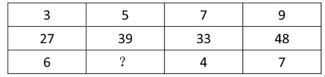

A. 3

B. 5

C. 8

D. 10

第 5 题 · 答案与解析

**参考答案（粉笔题库参考内容）**

C

**解析**

十二宫格作为广东省考查数字推理的常考数列，观察每列各数字特点，可发现中间的数字都能被上、下两个数字的和整除，第一列= (3 + 6) × 3 = 27，第三列(7+4)×3=33，第四列(9 + 7) × 3 = 48，由此可得每一列第二个数字=（第一个数字+第三个数字）×3，故第二列39=(5+?)×3，观察选项可知，只有C项符合，5+8=13，39是13的3倍。

故正确答案为C。

**来源**：2011年广东省公务员录用考试《行测》题第5题

### 第 6 题

一个人从家到公司，当他走到路程的一半的时候，速度下降了10%，问：他走完全程所用时间的前半段和后半段所走的路程比是：

A. 10∶9

B. 21∶19

C. 11∶9

D. 22∶18

第 6 题 · 答案与解析

**参考答案（粉笔题库参考内容）**

B

**解析**

本题考查了基本行程问题中的比例行程问题。路程一定，速度与时间成反比，令开始的速度为10，后来的速度则为9。前半段路程等于后半段路程，则令前半段路程用时9，后半段路程用时10，即前半段路程=后半段路程=90。那么，总共用时为10+9=19，一半时间是9.5。前半段时间走过的路程为10×9+9×0.5=94.5，后半段时间的路程为180-94.5=85.5。路程比为94.5:85.5=21:19。

故正确答案为B。

**考点**：普通行程

**来源**：2011年广东省公务员录用考试《行测》题第6题

### 第 7 题

一个图书馆里有科技书和文学书两种类型，首先拿走25本科技书，剩下的文学书占剩下书的4/7，又拿走42本文学书，剩下的科技书占所剩书的5/7，问：最开始文学书占总共书的几分之几：

A. 3/7

B. 6/13

C. 1/3

D. 2/7

第 7 题 · 答案与解析

**参考答案（粉笔题库参考内容）**

B

**解析**

设一共有x本书，依题意有(x−25)×3/7= (x − 25 − 42) × 5/7，解得x=130，则最开始文学书有(130 − 25) × 4/7 = 60本, 故最开始文学书占总共书的6/13。

故正确答案为B。

**考点**：和差倍比问题

**来源**：2011年广东省公务员录用考试《行测》题第7题

### 第 8 题

三位运动员跨台阶，台阶总数在100-150级之间，第一位运动员每次跨3级台阶，最后一步还剩2级台阶。第二位运动员每次跨4级台阶，最后一步还剩3级台阶。第三位运动员每次跨5级台阶，最后一步还剩4级台阶。则这些台阶总共有多少级：

A. 119

B. 121

C. 129

D. 131

第 8 题 · 答案与解析

**参考答案（粉笔题库参考内容）**

A

**解析**

解法一：

余数问题口诀：差同减差，除数的最小公倍数作周期。3、4、5的最小公倍数为60，差为1，又因为该数取值范围为100~150，故该数为60×2−1 = 119。

解法二：

采用代入法，根据答案分别减2、3、4后分别被3、4、5整除的只有119符合。

故正确答案为A。

**来源**：2011年广东省公务员录用考试《行测》题第8题

### 第 9 题

两人参加竞赛，甲做错了总数的1/3，乙做错了6道题，两人都做错了总数的1/5，两人都做对的题有多少道？

A. 5

B. 6

C. 7

D. 8

第 9 题 · 答案与解析

**参考答案（粉笔题库参考内容）**

C

**解析**

设总题量为x道，则甲做错了x/3道题，甲乙都答错了x/5道题。再设甲乙都答对的题为y道。根据两集合容斥公式，可得方程x/3 + 6 − x/5 = x − y，化简得：y = 13x/15 − 6，因为都做对的题目数为整数，则13x/15为整数，那么x必须是15的整数倍，y+6是13的倍数，结合答案选项，只有当y=7时满足。

故正确答案为C。

**考点**：两集合

**来源**：2011年广东省公务员录用考试《行测》题第9题

### 第 10 题

一个产品生产线分为a、b、c三段，每个人每小时分别完成10、5、6件，现在总人数为71人，要使得完成的件数最多，71人的安排分别是：

A. 14∶28∶29

B. 15∶31∶25

C. 16∶32∶23

D. 17∶33∶21

第 10 题 · 答案与解析

**参考答案（粉笔题库参考内容）**

B

**解析**

已知，每个人每小时分别完成10、5、6件，在第b第c段的效率比为5:6，人数比6:5，答案中后两个数之比最接近6:5的是B项（注意：a、b、c各一件为完整的一件产品）。

故正确答案为B。

**考点**：统筹规划问题

**来源**：2011年广东省公务员录用考试《行测》题第10题

### 第 11 题

A和B两个码头分别位于一条河的上下游，甲船从A码头到B码头需要4天，从B码头返回A码头需要6天；乙船在静水中速度是甲船的一半。乙船从B码头到A码头需要多少天：

A. 48/7

B. 55/7

C. 12

D. 16

第 11 题 · 答案与解析

**参考答案（粉笔题库参考内容）**

D

**解析**

已知：顺流速度=船速+水速；逆流速度=船速-水速，船速=(顺流速度+逆流速度)÷2；水速=(顺流速度-逆流速度)÷2，令甲船顺流的速度为6，逆流的速度为4，则水速为1，船速为5。A和B之间的距离为24，则乙船的速度为2.5，其逆流速度为1.5，乙船从B码头到A码头需要24÷1.5=16天。

故正确答案为D。

**考点**：流水行船

**来源**：2011年广东省公务员录用考试《行测》题第11题

### 第 12 题

某展览馆计划4月上旬接待5个单位来参观，其中2个单位人数较多，分别连续参观3天和2天，其他单位只参观1天，且每天最多只接待1个单位。参观的时间安排共多少种：

A. 30

B. 120

C. 2520

D. 30240

第 12 题 · 答案与解析

**参考答案（粉笔题库参考内容）**

C

**解析**

4月上旬共有10天，把连续参观3天和2天分别看成1个整体（捆绑），内部安排是固定的，加上其他5天，则相当于7天时间安排5个单位来参观，方法数为A_7^5 = 2520种。

故正确答案为C。

**考点**：基础排列组合

**来源**：2011年广东省公务员录用考试《行测》题第12题

### 第 13 题

由20名工人修筑一段公路，计划15天完成。动工3天后抽出5人去其他工地，其余人继续修路。如果每人工作效率不变，那么修完这段公路实际用：

A. 19天

B. 18天

C. 17天

D. 16天

第 13 题 · 答案与解析

**参考答案（粉笔题库参考内容）**

A

**解析**

解法一：

设每名工人工作效率为1，修完这段公路实际用了x天，可得方程：20 × 15 = 20 × 3 + 15(x − 3)，解得x=19。

解法二：

工作量 = 效率×时间，在工作总量不变的情况下，效率和时间成反比。抽出5人前后效率之比为20:15=4:3，所以前后所需时间之比为3:4，按原来速度做完剩下工程需15-3=12天，则现在所需时间为12 × 4/3 = 16，所以共需3+16=19天。

故正确答案为A。

**考点**：给效率比例型

**来源**：2011年广东省公务员录用考试《行测》题第13题

### 第 14 题

办公室有甲、乙、丙、丁4位同志，甲比乙大5岁，丙比丁大2岁。丁三年前参加工作，当时22岁。他们四人现在的年龄之和为127岁。那么乙现在的年龄是：

A. 25岁

B. 27岁

C. 35岁

D. 40岁

第 14 题 · 答案与解析

**参考答案（粉笔题库参考内容）**

C

**解析**

依题意可知，丁现在为25岁，丙现在为27岁，设乙现在为x岁，则甲为x+5岁，可得方程：x+5+x+25+27=127，解得x=35。

故正确答案为C。

**考点**：年龄问题

**来源**：2011年广东省公务员录用考试《行测》题第14题

### 第 15 题

某公司100名员工对甲、乙两名经理进行满意度评议，对甲满意的人数占全体参加评议的3/5，对乙满意的人数比甲的人数多6人，对甲、乙都不满意的占都满意人数的1/3还多2人，则对甲、乙都满意的人数是：

A. 36人

B. 26人

C. 48人

D. 42人

第 15 题 · 答案与解析

**参考答案（粉笔题库参考内容）**

D

**解析**

设对甲、乙都满意的人数为x人，根据两集合容斥原理公式，可得方程：100 × 3/5 + (100 × 3/5 + 6) - x= 100-(x/3+2)，解得x=42。

故正确答案为D。

**考点**：两集合

**来源**：2011年广东省公务员录用考试《行测》题第15题

### 第 16 题

人们的审美（    ）和文化消费方式在变，群众文化的“文化力量”正在被重新打量。社会的文化民生、文化平等因公益文化、共享文化而提速，群众自办文化逐步发展。
在空格处选填最恰当的字是：

A. 情趣

B. 情致

C. 情怀

D. 情调

第 16 题 · 答案与解析

**参考答案（粉笔题库参考内容）**

A

**解析**

“情趣”指志趣，即志向或情调趣味，有高雅，低俗之分。与人们变化中的审美相搭配，因此A项正确。B项“情致”指有一定价值和理性的情趣、情感，只指好的方面；C项“情怀”指含有某种感情的心境，而不是一种认知；D项“情调”指情意，情味，侧重事物自然流露出的意境。均不能与“审美”搭配，排除。

故正确答案为A。

**考点**：实词填空、词的辨析-搭配对象

**来源**：2011年广东省公务员录用考试《行测》题第16题

### 第 17 题

当前，我国高校存在着明显的区域分布（    ）现象。无论是高校总量，还是重点大学数量、一般高校数量、民办高校数量，各个省区之间存在着较大差异。
在空格处选填最恰当的字是：

A. 不均衡

B. 不平衡

C. 不公平

D. 不平均

第 17 题 · 答案与解析

**参考答案（粉笔题库参考内容）**

A

**解析**

“不均衡”：这里指在布局上不等量。与“分布”和后文中的“无论是高校总量，还是重点大学数量······各省区之间存在着较大差异”相搭配。因此A项正确。

B项“不平衡”：对立的各方面在数量或质量上不相等，但原文中“无论是高校总量，还是重点大学数量······”这些不构成对立面，排除；C项“不公平”：不公正，侧重态度，不合文意，排除；D项“不平均”：不均匀，有多少和轻重之分，“平均”侧重把一个事物等分成几份，在文中与“分布”搭配不恰当，排除。

故正确答案为A。

**考点**：实词填空、对应关系-前后呼应、词的辨析-搭配对象

**来源**：2011年广东省公务员录用考试《行测》题第17题

### 第 18 题

法律的生命力在于（    ），如果不遵守，再好的法律也是（    ）。
在空格处选填最恰当的字是：

A. 实行 一纸空文

B. 施行 一纸空文

C. 实行 纸上谈兵

D. 施行 纸上谈兵

第 18 题 · 答案与解析

**参考答案（粉笔题库参考内容）**

B

**解析**

第一空，“实行”指用行动来实现（纲领、政策、计划等），所适用对象较抽象，如“实行改革”。“施行”则表示按照某种方式或办法去做，其适用对象较为具体。另外，“施行”还可指法令规章等公布后从某时起发生效力。本题是指法律的实施，故选择“施行”，排除A、C项。

第二空，“一纸空文”可用来形容法律不被遵守则毫无用处，“纸上谈兵”的主语应为人。“一纸空文”：只是写在纸上没有兑现或不能兑现的东西。“纸上谈兵”：在纸面上谈论打仗，比喻空谈理论，不能解决实际问题，也比喻空谈不能成为现实。排除D项。

故正确答案为B。

**考点**：对应关系-前后呼应、混搭填空、词的辨析-词义侧重

**来源**：2011年广东省公务员录用考试《行测》题第18题

### 第 19 题

（    ）一夜之间，南国一个贫穷破败的小渔村，（    ）变成绚丽的大都市。
在空格处选填最恰当的字是：

A. 好像 骤然

B. 仿佛 忽然

C. 似乎 突然

D. 犹如 猛然

第 19 题 · 答案与解析

**参考答案（粉笔题库参考内容）**

B

**解析**

“仿佛”：似乎、好像，这里用“仿佛一夜之间”来形容发展迅速。“忽然”：指动作、行为的发生或情况的变化来得迅速又出乎意料。正好对应前文中的“一夜之间”。因此B项正确。

通过第一空排除C、D选项，“似乎”表示一种主观猜测。“犹如”只能用作比喻词。

通过第二空排除A选项，“骤然”指事情来得很突然，没有任何的征兆，一下子就发生了，没有任何准备。但文中并没有侧重于这种毫无准备的突然性。

故正确答案为B。

**考点**：实词填空、词的辨析-词义侧重

**来源**：2011年广东省公务员录用考试《行测》题第19题

### 第 20 题

文化哲学已成为当代哲学领域的显学，（    ）已经超越哲学领域，（    ）政治、文学、艺术、教育以及经济学等领域产生了较为深远的影响。
在空格处选填最恰当的字是：

A. 甚至 对

B. 并且 在

C. 乃至 在

D. 而且 对

第 20 题 · 答案与解析

**参考答案（粉笔题库参考内容）**

A

**解析**

本题可从第二空入手，“在”与后文搭配不恰当，如用“在”，应表述为“在政治领域有影响”而非“产生影响”，排除B、C两项。

第一空，前面是“已经成为”，空格后面是“已经超越”，因此第一空需要填入表示递进关系的关联词，根据原文中的“超越”及“深远的影响”可知文段表意较重，故“甚至”更为恰当，排除D项。

故正确答案为A。

**来源**：2011年广东省公务员录用考试《行测》题第20题

### 第 21 题

领导干部应该深入群众，和群众打成一片，真正\_\_\_\_\_\_民情。
填入划横线部分最恰当的一项是：

A. 体察

B. 体恤

C. 体贴

D. 体验

第 21 题 · 答案与解析

**参考答案（粉笔题库参考内容）**

A

**解析**

“领导干部应该深入群众，和群众打成一片”说明领导干部是真的关心老百姓的疾苦，体会老百姓的生活，了解民情。只有“体察”有体会和观察的意思。

“体察”：指体会和观察。“体恤”：设身处地为人着想，给予同情，照顾。“体验”：在实践中认识事物；亲身经历。“体贴”：对别人的心理或境况进行了解并予以关心和照料。

故正确答案为A。

**考点**：实词填空、对应关系-前后呼应

**来源**：2011年广东省公务员录用考试《行测》题第21题

### 第 22 题

由于身体的原因，他不得不（   ）了这家公司的宴请，虽然他很想去。

填入划横线部分最恰当的一项是：

A. 推脱

B. 推卸

C. 推托

D. 答应

第 22 题 · 答案与解析

**参考答案（粉笔题库参考内容）**

C

**解析**

他由于身体原因，委婉地拒绝参加这家公司的宴请。

推脱：推卸开脱，通常搭配责任、义务等。

推卸：将应该承担的责任，找理由或借口转移，不负责任，不肯承担责任。

推托：这个词用于委婉地拒绝他人，对象多为别人请求的事情。

答应：同意，应允。

故正确答案为C。

**考点**：关联关系-因果关系、实词填空、词的辨析-词义侧重

**来源**：2011年广东省公务员录用考试《行测》题第22题

### 第 23 题

一个人应该从多方面加强自己的道德修养，但首先要做到的是（   ）端正。

填入划横线部分最恰当的一项是：

A. 品行

B. 品性

C. 态度

D. 品格

第 23 题 · 答案与解析

**参考答案（粉笔题库参考内容）**

A

**解析**

文段强调的是要加强自身的道德修养，且与“端正”搭配，“品行”指的是人品德性，可以与“端正”构成搭配。“品性”侧重品质性格，不能与“端正”构成搭配，排除B。“态度”是个体对特定对象（人、观念、情感或者事件等）所持有的稳定的心理倾向，材料中并没有特定对象，排除C。“品格”也与“端正”搭配不当，排除D。

故正确答案为A。

**考点**：实词填空、对应关系-前后呼应、词的辨析-搭配对象

**来源**：2011年广东省公务员录用考试《行测》题第23题

### 第 24 题

回顾几十年的改革（   ），他感慨良多。

填入划横线部分最恰当的一项是：

A. 里程

B. 过程

C. 路程

D. 历程

第 24 题 · 答案与解析

**参考答案（粉笔题库参考内容）**

D

**解析**

回顾几十年的改革的事件，让他感慨比较多，他感慨比较多的是改革中发生的事，而不是改革过程的本身，“历程”表示经历的过程。

“里程”：行程；“过程”：事物发展所经过的程序、阶段；“路程”：具体的或抽象的所走的路；“历程”：经历的过程。

故正确答案为D。

**考点**：实词填空、对应关系-前后呼应

**来源**：2011年广东省公务员录用考试《行测》题第24题

### 第 25 题

时间怀有一种公平的道义，对它所拿去的，它会给我们别的补偿。它夺去了我们肢体精神的灵活，却给予我们安静和安详。
对这段话理解正确的一项是：

A. 无所谓浪费时间

B. 耽误的时间可以得到补偿

C. 不具有灵活肢体精神的人能获得安宁

D. 晚年的宁静可以使青春活力的消失得到补偿

第 25 题 · 答案与解析

**参考答案（粉笔题库参考内容）**

D

**解析**

通过对原文分析可知，从“肢体和精神的灵活”到“安静和安详”的变化过程对应的正是我们由青少年到老年的成长过程，也就是说晚年的安静和安详可以弥补消失的年轻活力。对照选项发现，D项符合题意，当选。

A项与原文不符，排除；B项表述错误，不是“时间”得到补偿，排除；C项曲解了文意,文中提到的“它夺去了我们肢体精神的灵活，却给予我们安静和安详”，排除。

故正确答案为D。

**考点**：细节判断题

**来源**：2011年广东省公务员录用考试《行测》题第25题

### 第 26 题

职业技术教育的任务是为社会各种产业培养劳动力。学生接受完职业技术教育后就直接进入劳动队伍，因此职业技术教育和市场经济有较直接的关系，它应该根据市场经济发展和需要调剂专业设置、课程计划和培养方式等。当然，也有诸如师范、卫生、艺术、体育等专业与市场经济没有直接联系，它们应该根据社会发展的需要，而不仅仅根据市场的需要来规划和发展。
对这段话理解正确的一项是：

A. 市场经济规律决定着职业技术教育的发展

B. 发展职业技术教育，首先应强调社会发展的需要

C. 师范、卫生、艺术、体育等个别专业与市场经济没有联系

D. 职业技术教育中的多数专业应根据市场的需求而调整、发展

第 26 题 · 答案与解析

**参考答案（粉笔题库参考内容）**

D

**解析**

阅读文段可知，无论职业教育的专业是否与市场经济有关，都应该考虑市场的需求来规划。 对照选项发现，只有D项符合题意。

A项原文最后一句话指出“应该根据社会发展的需要，而不仅仅根据市场的需要来规划和发展”，可见市场不是决定因素，排除；B项原文没有提到是先强调市场还是先关注社会发展的需要，排除；C项原文说有些专业与市场经济没有直接联系，而不是没有任何联系，排除。

故正确答案为D。

**考点**：细节判断题

**来源**：2011年广东省公务员录用考试《行测》题第26题

### 第 27 题

许多文人雅士通过为自己的书房命名来言志寄情。梁启超的书房命名为“饮冰室”，语出《庄子·人间世》，形容内心忧愁焦灼，欲饮冰镇之。
从“饮冰室”的斋名中可以体现出：

A. 室主对国家前途的关切和忧虑

B. 室主过人的才华和机敏

C. 室主失望和消极的人生态度

D. 室主对庄周的敬仰之情

第 27 题 · 答案与解析

**参考答案（粉笔题库参考内容）**

A

**解析**

“饮冰室”位于文段的第二句，意思是形容“内心忧愁焦灼，欲饮冰镇之”。联系梁启超所处的时代背景和我们对梁启超的了解，容易想到他内心忧愁焦灼的原因应该是出于忧国忧民。

对照选项发现，只有A项符合题意。

B、D两项均不符合文意，排除；C项文中未提到，文中提到“内心忧愁焦灼”指的是作者忧国忧民的一种爱国情怀，故排除C项。

故正确答案为A。

**考点**：实词

**来源**：2011年广东省公务员录用考试《行测》题第27题

### 第 28 题

人面呢？颜色比那纸制的小玩意儿好而且活动，带着生气。可是你褒奖他的时候，他虽是高兴，脸上却装出很不愿意的样子，你指责他的时候，他虽是懊恼，脸上却偏要显示出勇于纳言的颜色。

这段话认为，纸面具与人面最大的不同是：

A. 它并不具有人面的欺骗性

B. 它经不住人们的褒奖或指责

C. 它显现出更鲜明的人性特征

D. 它没有人面那种生动的色泽

第 28 题 · 答案与解析

**参考答案（粉笔题库参考内容）**

A

**解析**

通过分析原文可以得出人面和纸面具的本质不同是人面的表现可以隐藏内心的真实想法，与真实想法截然不同，而纸面具是完全一样的。对照选项A项符合题意。

原文并没有提到纸面具经受不住人的褒奖与指责，排除B项；C项与原文意思不符，排除；D项原文未提及，排除。

故正确答案为A。

**考点**：关联词-转折、特殊问法

**来源**：2011年广东省公务员录用考试《行测》题第28题

### 第 29 题

尽管新儒家学者无一例外地夸大了儒家哲学的精神义理在现代社会中可能产生的作用和影响，因而是需要否定和批判的；但此种影响的实际存在倒确实是毋庸置疑的。
这段话中的“此种影响”是指：

A. 儒家哲学的精神义理可能对社会发生的影响

B. 对儒家哲学作用的夸大所造成的影响

C. 新儒家学者对人类社会发展的影响

D. 儒家哲学在过去产生过的实际影响

第 29 题 · 答案与解析

**参考答案（粉笔题库参考内容）**

A

**解析**

“此种影响”在文段最后一句，指前文提到的内容，即：“新儒家学者无一例外地夸大了儒家哲学的精神义理在现代社会中可能产生的作用和影响，因而是需要否定和批判的”，也就是说新儒家学者虽然夸大了某种影响，但此种影响确实存在，并对社会产生了一些影响。

对照选项发现，只有A项符合题意。

B项，文段并未提及夸大造成了哪些影响；C项，文中提到的是儒家哲学的精神义理，而不是新儒家学者对人类社会发展的影响；D项，文中没有提到。

故正确答案为A。

**考点**：代词

**来源**：2019年1月天津市定向招录选调生考试综合能力测试试卷（精选）第17题

### 第 30 题

高新技术企业的工资制度需要改革。应该允许企业在积累增长大于消费增长、劳动生产力的增长大于工资总额增长的前提下，自主确定职工工资标准和企业内部分配办法。国家可以通过调节个人收入所得税管理这些企业。

这段话主要支持了这样一种观点，即在高新技术企业的工资改革中：

A. 个人所得应不断提高

B. 应确定职工工资标准和企业分配办法

C. 企业对职工工资标准应有一定自主权

D. 劳动生产力的增长将大于工资总额的增长

第 30 题 · 答案与解析

**参考答案（粉笔题库参考内容）**

C

**解析**

文段围绕高新技术企业的工资改革问题展开讨论，并给出了解决问题的对策，即企业自主确定职工工资标准和企业内部分配办法，国家通过调节个人收入所得税管理企业，文段的重点为对策的表述，C项为其同义替换，正确。

A项原文没有提及，而且根据常识判断，个人所得不可能无限增多，排除；B项表意不明，原文是说企业自主确定职工工资标准，排除；D项“劳动生产力的增长将大于工资总额的增长”，在原文中，这是文段的背景阐述，非重点，排除。

故正确答案为C。

**考点**：关联词-对策

**来源**：2011年广东省公务员录用考试《行测》题第30题

### 第 31 题

不少新建、扩建企业没有在投资中按比例安排相应的自有流动资金，有的企业甚至靠挪用流动资金来盲目争上新的项目；历年清产核资中发生的损失也有一部分用企业自有流动资金冲减；一些企业甚至挪用资金炒房地产、炒股票等。此外，物价的上涨也吃掉了一部分资金。

这段话主要支持了这样一种观点，即：

A. 盲目争上项目造成了企业流动资金的不足

B. 在不少企业中存在着自有流动资金紧张的现象

C. 多数企业只能依靠银行来解决流动资金问题

D. 企业自有流动资金数量逐年下降是正常趋势

第 31 题 · 答案与解析

**参考答案（粉笔题库参考内容）**

B

**解析**

文中通过并列列举了企业挪用流动资金竞争新项目、历年清产核资中自有流动资金冲减、挪用资金炒房地产、炒股票及物价上涨吃掉资金等现象，共同说明了很多情况都造成了企业流动资金不足的现象，对应B项。

A项，表述片面，排除；C项，文段未涉及银行的问题，排除；D项，流动资金下降是正常趋势，但文中未涉及，排除。

故正确答案为B。

**考点**：关联词-并列

**来源**：2011年广东省公务员录用考试《行测》题第31题

### 第 32 题

下列没有语病的一项是：

A. 有没有坚定的意志，是一个人在事业上能够取得成功的关键

B. 我们的很多部门，特别是部门的负责同志，是否把消防安全放在应有的重要位置，决定着他们在安全工作中的态度和做法

C. 当前，除了要协调城乡发展，加强农村基础设施建设之外，提高农村劳动力素质，也是能否建设好社会主义新农村的一条重要途径

D. 电子工业能否迅速发展，并广泛渗透到各行各业中去，关键在于造就一批专业技术人才

第 32 题 · 答案与解析

**参考答案（粉笔题库参考内容）**

B

**解析**

本题考查病句辨析的能力。

A项“有没有意志”对应“是成功的关键”属于两面对一面，应去掉“有没有”或改成“能否成功”；C项“提高农村劳动力素质”对应“能否是······重要途径”，属于一面对两面，应去掉“能否”；D项“能否发展”对应“关键”，属于两面对一面，应去掉“能否”。

B项语义通顺，没有语病。

故正确答案为B。

**来源**：2011年广东省公务员录用考试《行测》题第32题

### 第 33 题

思维是借助语言材料并以语言为载体而进行的。

这句话主要支持了这样一种观点，即：

A. 只有借助语言才能实现文化传承

B. 有了语言才能进行完整的思维活动

C. 语言是社会群体意识的引导工具

D. 语言是人类文明的重要标志之一

第 33 题 · 答案与解析

**参考答案（粉笔题库参考内容）**

B

**解析**

第一步，读文段找到主旨句。

通过阅读这个文段，归纳出本段的主旨是语言是思维借助的载体。

第二步，选择与主旨含义相同的选项。

A项本文未提到“文化传承”，排除；B项语言是思维借助的载体，即有了语言才能进行思维，正确；C项本文未提到“社会群体意识”，排除；D项本文未提到“人类文明”，排除。

故正确答案为B。

**考点**：主题词

**来源**：2011年广东省公务员录用考试《行测》题第33题

### 第 34 题

每个人最大的成长空间在其最强的优势领域，一个人才的奇迹都是在最合适自己的岗位上和最能发挥自己优势的领域中创造出来的。使用人才应当唯器是适，用其所长，各得其宜。
这段话的主旨是：

A. 要重视和培养人才

B. 人才使用应尽其所能

C. 人才的成长空间在其优势领域

D. 人才使用应各得其所

第 34 题 · 答案与解析

**参考答案（粉笔题库参考内容）**

D

**解析**

文段开篇指出人的成长空间在其优势领域，接着说明人才的奇迹都是在适合岗位和优势领域创造的，随后通过“应当”提出对策，强调使用人才要“唯器是适，用其所长，各得其宜”，即根据个人的不同才能安排适宜的领域或岗位，文段重点在对策句，对应D项。

A项，“重视和培养人才”文段并未提及，无中生有，排除；

B项，“尽其所能”强调发挥全部能力，而文段强调根据人才特点合理安排适宜的领域或岗位，偏离文段核心，排除；

C项，对应文段首句，为引出话题部分，非文段重点，排除。

故正确答案为D。

**考点**：关联词-对策

**来源**：2011年广东省公务员录用考试《行测》题第34题

### 第 35 题

有了正确路线就必须贯彻始终；不管遇到什么样的国际国内风浪，除非大规模外敌入侵，否则就不要改变。
这段话的意思是在强调：

A. 不管遇到什么情况，都必须把正确路线贯彻始终

B. 只有在遇到国际国内风浪的特殊情况下才能改变路线

C. 如果遇到大规模外敌入侵，正确路线就应作出调整和改变

D. 只要不是遇到极意外的情况，正确路线都要贯彻始终

第 35 题 · 答案与解析

**参考答案（粉笔题库参考内容）**

D

**解析**

第一步，读文段找到主旨句。

阅读文段，归纳概括出文段的主旨是要全面贯彻正确路线，只有在大规模外敌入侵时，才会改变。

第二步，选择与主旨含义相同的选项。

A项文中提到“大规模外敌入侵”的时候就要改变路线，并非始终贯彻，排除；B项文中提到“不管遇到什么样的国际国内风浪，除非大规模外敌入侵，否则就不要改变”，排除；C项运用的是假设条件关系，而非文段所运用的必要条件，排除；D项为主旨的同义替换，正确。

故正确答案为D。

**考点**：关联词-并列

**来源**：2011年广东省公务员录用考试《行测》题第35题

### 第 36 题

《大秦帝国》、《汉武大帝》、《雍正王朝》······一部部歌颂盛世之治的文艺作品引来无数目光，然而，那些极尽繁华的书写却难掩历史叙事的思想缺失。从政治文化视野看，“盛世情结”叙事往往过分认同人治文化与功利立场。
这段文字意在说明：

A. 历史叙事作品缺乏思想

B. “盛世情结”作品的价值局限

C. 文艺作品应该抛开功利立场

D. 歌颂盛世的作品需重新审视

第 36 题 · 答案与解析

**参考答案（粉笔题库参考内容）**

B

**解析**

文段首先列举歌颂盛世之治的文艺作品受到关注的现象，随后通过转折词“然而”引出重点，指出这些作品存在思想缺失，“盛世情结”叙事往往过分认同人治文化与功利立场，故文段重点强调歌颂盛世之治的文艺作品的局限性，对应B项。

A、C两项，缺少主题词“歌颂盛世之治的文艺作品”，偏离文段核心，排除；

D项，“重新审视”无中生有，排除。

故正确答案为B。

【文段出处】新浪财经《历史文艺“盛世情结”的价值局限》

**考点**：主题词、关联词-转折

**来源**：2011年广东省公务员录用考试《行测》题第36题

### 第 37 题

不论动机多么伟大，不论出于多么善良的心地，想要改变一个人，哪怕只是改变一个孩子，都是徒然的，如果他并不能理解这种改变。
这段话的意思是说：

A. 人是很难改变的，无论他怎样努力

B. 没有善良的动机就不能使人改变

C. 孩子和成人一样不容易改变

D. 只有当人自己想改变时他才会改变

第 37 题 · 答案与解析

**参考答案（粉笔题库参考内容）**

D

**解析**

第一步，读文段找到主旨句。

文段的主要意思是无论动机怎样，想要改变一个人的前提条件是这个人要理解这种改变，想要改变，他才会改变。

第二步，选择与主旨含义相同的选项。

A项过于绝对，排除；B项即使有善良的动机，但是不能理解改变，人也不能改变，排除；C项文段论述的重点不在于孩子和成人，而在于人对改变的理解，排除；D项为主旨的同义替换，正确。

故正确答案为D。

**考点**：关联词-对策

**来源**：2011年广东省公务员录用考试《行测》题第37题

### 第 38 题

在南美洲安第斯高原海拔4000多米人迹罕至的地方，生长着一种花，名叫普雅花，花期只有两个月，花开之时极为绚丽。然而，谁会想到，为了两个月的花期，它竟然等了100年。100年中，它只是静静伫立在高原上，栉风沐雨，用叶子采集太阳的光辉，用根汲取大地的养料······就这样默默等待着，等待着100年后生命绽放的惊天一刻，等待着攀登者身心俱疲时的眼前一亮。
以下最适合做上文题目的一项是：

A. 美丽的坚持

B. 沉默的力量

C. 百年的等待

D. 迟到的辉煌

第 38 题 · 答案与解析

**参考答案（粉笔题库参考内容）**

A

**解析**

过程是等待了百年，最后的结果是迎来了美丽绽放的一刻，说明这百年的等待是一种为了美丽而付出的坚持，因此选择A项。

B、D两项的标题侧重点错误，排除；此题容易错选C项，但C项只谈到了等待，未体现出更深层次的意义。

故正确答案为A。

**考点**：标题填入题

**来源**：2011年广东省公务员录用考试《行测》题第38题

### 第 39 题

门窗都为木质，有的粗糙一些，有的很精致，尤其是窗子，雕成各种图案，有菱形、圆形、方形，还有其它各种变形，各具特色。
从这段话中可以看出：

A. 有的门粗糙一些，但窗子都很精致。

B. 门是粗糙的，窗子是精致的。

C. 门很粗糙，但有些窗子很精致。

D. 门和窗都有粗糙的。

第 39 题 · 答案与解析

**参考答案（粉笔题库参考内容）**

D

**解析**

这个文段的主要内容是介绍了门窗的材质，形状等。

A项扩大范围，文段强调的是“有的很精致”，而非全部，排除；B和C两项也是扩大范围，从“门窗都为木质，有的粗糙一些，有的很精致”可以看出门并非都粗糙，排除；从文中“门窗都为木质，有的粗糙一些”得出D项正确。

故正确答案为D。

**考点**：细节判断题

**来源**：2011年广东省公务员录用考试《行测》题第39题

### 第 40 题

按重复钮时，录像机的多功能显示屏上将出现“R”标记，放像将开始，当磁带到达录像部分的终点时，将自动倒带到起始点，然后重新开始放像。该过程将反复进行。从这段话中可知，
当按录像机重复钮时：

A. 磁带将自动倒回到起始点，然后开始放像

B. 磁带将从头至尾反复运转

C. 磁带将开始放像，直到放至磁带终点，倒回重放

D. 磁带将开始放像，放至录像节目的终点，倒回重放

第 40 题 · 答案与解析

**参考答案（粉笔题库参考内容）**

D

**解析**

通过阅读文段可知“当按重复按钮时，放像将开始，当到达录像部分的终点时将自动倒带到起始点，然后重新开始放像”，即“磁带将开始放像，放至录像节目的终点，倒回重放”，D项正确。

A项，当按录像机按重复钮时，放像将开始，而不是倒回到起始点，排除；B项，表述不够明确，排除。C项，偷换概念，文段为“当磁带到达录像部分的终点时，将自动倒带到起始点”，排除。

故正确答案为D。

**考点**：细节判断题

**来源**：2011年广东省公务员录用考试《行测》题第40题

### 第 41 题

并非所有的新兴产业都具有战略性，某些新兴产业发展到一定阶段才可能成为战略产业。战略性新兴产业就是具备战略产业部分条件且将来可能成长为战略产业的新兴产业。与其他产业相比，战略性新兴产业具有超强的渗透、扩散作用，既能提升其他产业的技术水平和市场竞争力，也能支撑和拉动国民财富的长期增长，其发展主要由重大科技创新推动。

根据这段文字，下列表述正确的是：

A. 新兴产业发展到一定阶段就可以成为战略产业

B. 与战略性新兴产业相比，其他产业不具有渗透、扩散作用

C. 战略产业是由新兴产业发展起来的

D. 战略性新兴产业对其他产业发展具有促进作用

第 41 题 · 答案与解析

**参考答案（粉笔题库参考内容）**

D

**解析**

A项错误，文中是说“某些新兴产业发展到一定阶段才可能成为战略产业”，只是可能而并非“就可以”，排除。

B项错误，文中只说“战略性新兴产业具有超强的渗透、扩散作用”，至于其他产业具不具备渗透、扩散作用，并没有提及，排除。

C项错误，文中并没有谈及战略产业与新兴产业之间的关系，属于无中生有，排除。

D项正确，原文最后一句话“战略性新兴产业既能提升其他产业的技术水平和市场竞争力，也能支撑和拉动国民财富的长期增长”，当选。

故正确答案为D。

**考点**：细节判断题

**来源**：2011年广东省公务员录用考试《行测》题第41题

### 第 42 题

随着新的传播技术的出现，新的传播媒介也应运而生，网络媒体的影响力日益扩大，对传统媒体带来越来越严峻的挑战。手机媒体由于发展时间短、相关技术瓶颈尚需突破，目前尚未找到合理的商业模式，但是手机由于具有巨量的用户群，必将在不远的未来迎来黄金发展期，进一步颠覆传媒业市场格局。
这段文字的主要内容是：

A. 网络媒体颠覆传媒业市场格局

B. 手机媒体颠覆传媒业市场格局

C. 手机媒体发展面临的技术瓶颈

D. 手机媒体的现状与未来

第 42 题 · 答案与解析

**参考答案（粉笔题库参考内容）**

D

**解析**

文段开头介绍新的传播媒介会给传统媒体带来冲击，随后引出“手机媒体”这一文段重点论述的话题，介绍了手机媒体虽然目前尚未找到合理的商业模式，但在不远的将来会迎来黄金发展期，D项为中心的同义替换。

A项属于无中生有，文段重点并非讲述网络媒体，排除；B项中手机媒体颠覆传媒业市场格局只是作者对未来的预测，表述过于绝对且片面，排除；C项只是转折之前的内容，非重点，排除。

故正确答案为D。

**考点**：关联词-转折

**来源**：2011年广东省公务员录用考试《行测》题第42题

### 第 43 题

民生问题的发生源自人的正常需要难以被满足，而人的需要的满足必须有一定的资源、工具、手段和方式。在给定的社会历史条件下，人们用来解决民生问题的这些资源、工具、手段和方式都是特定的，是不以人的愿望为转移的。如果条件不具备，人们的民生需求就无法得到满足，由此产生的民生问题在给定的社会历史时期内就难以得到解决。
这段文字的中心论点是：

A. 民生问题的发生源自人的正当需要难以被满足

B. 人的需要的满足是不以人的愿望为转移的

C. 民生问题的解决受社会历史条件的限制

D. 民生问题需要特定的资源、工具、手段和方式来解决

第 43 题 · 答案与解析

**参考答案（粉笔题库参考内容）**

C

**解析**

第一步，读文段找到主旨句。

文段开头指出“人的需要的满足必须有一定的资源、工具、手段和方式”，而在历史条件下，这些手段和方法是不以人的愿望为转移的。因此文段重点讨论的是历史条件的制约作用。最后一句话是反面论证，“如果条件不具备”会出现什么情况，反过来证明了文段重点讨论的是历史条件的重要性。

第二步，选择与主旨含义相同的选项。

A项只是民生问题产生的根源，非中心论点，排除；B项主体错误，文段论述主体为民生问题，而非人的需要，排除；C项为主旨的同义替换，当选；D项只是表面的手段和方法，不是根本的制约条件，排除。

故正确答案为C。

**考点**：主题词

**来源**：2011年广东省公务员录用考试《行测》题第43题

### 第 44 题

面对具有威胁性的突发事件，恐慌心理是人们进行自我保护的本能反应。但是，过度的恐慌反应，常常会导致比事件危害本身更为严重的消极后果。经验显示，在突发性公共事件中，许多损失可能不是事件本身造成的，而是由于人们的过度恐慌导致的。
这段文字意在强调：

A. 产生恐慌心理是人们在突发事件中的正常反应

B. 在突发性公共事件中，人们的损失往往是自己造成的

C. 突发事件发生时，人们其实不必慌张

D. 面对突发事件，人们应尽量保持稳定的心态

第 44 题 · 答案与解析

**参考答案（粉笔题库参考内容）**

D

**解析**

第一步，读文段找到主旨句。

本段文字的重点在转折词“但是”之后，“过度的恐慌反应，常常会导致比事件危害本身更为严重的消极后果。”接下来“经验显示”引出的是具体的例子，解释或者补充说明作者所强调的重点。

第二步，在主旨句的基础上适当延伸得到答案。

A项只是转折前一分句的复述，排除；B项过度推断，文中只说了“过度的恐慌反应”可能造成更严重的后果，并不能推出损失往往都是人们自己造成的，排除；C项也属于错误推断，在突发事件面前恐慌是人的本能反应，只要不过度，作者并没有否定这种心理反应，排除；既然过度恐慌常会导致严重的消极后果，那么作者的言外之意就是呼吁大家在突发事件中应该保持镇定，即人们应尽量保持稳定的心态，D项正确。

故正确答案为D。

**考点**：关联词-转折

**来源**：2011年广东省公务员录用考试《行测》题第44题

### 第 45 题

英国的心理学家对一个占星学院中3000多名大学生进行性格测试，发现受访者性格竟然与其所在星座代表的性格非常相似；而在之后的针对2000名从未接触过星座学说的小学生的测试中，心理学家发现受访者的性格与星座并没有太大联系。

根据这段文字，我们可以得出的结论是：

A. 知识结构决定人的性格

B. 心理暗示影响人的性格

C. 星座学说没有价值

D. 小学生比大学生更诚实

第 45 题 · 答案与解析

**参考答案（粉笔题库参考内容）**

B

**解析**

第一步，读文段找到主旨句。

通过对大学生和小学生的对比分析结果可看出，受访者性格是否与星座直接存在联系取决于受访者对星座知识是否有足够的了解。

第二步，在主旨句的基础上适当延伸得到答案。

A项“决定”一词过于绝对，排除；B项，占星学院的大学生受到心理暗示的影响，而小学生未接触过星座学说，不存在任何心理暗示，即心理暗示影响人的性格，正确；C项和D项属于无关选项，文段并未讨论星座学的价值，也无从体现小学生和大学生哪个群体更诚实，均排除。

故正确答案为B。

**考点**：关联词-并列

**来源**：2011年广东省公务员录用考试《行测》题第45题

### 第 46 题

从所给四个选项中，选择最合适的一个填入问号处，使之呈现一定的规律性：

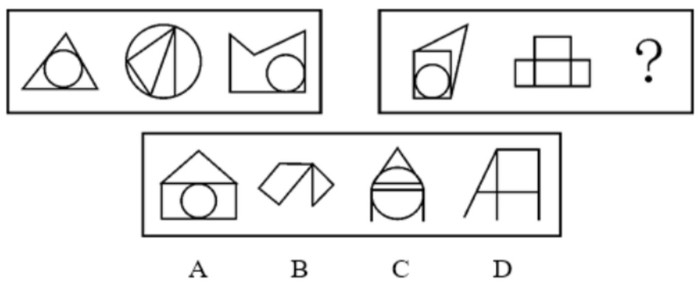

A. A

B. B

C. C

D. D

第 46 题 · 答案与解析

**参考答案（粉笔题库参考内容）**

A

**解析**

观察第一组的三个图形，发现每一个图形中都有共同元素圆形。观察第二组中的图形，发现都有共同元素矩形，排除BC。第二组第二个图形中有‘日’字，考虑一笔画。观察发现，第一组图形中所有图形均能一笔画成，第二组已知图形也都是一笔画，AD比较，A是一笔画图形。

故正确答案为A。

**考点**：数量规律-素、数量规律-线

**来源**：2011年广东省公务员录用考试《行测》题第46题

### 第 47 题

请从所给的四个选项中，选择最合适的一项填在问号处，使之呈现一定的规律性。

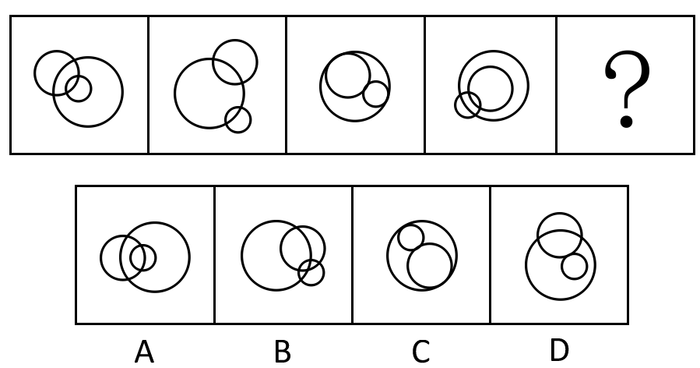

A. A

B. B

C. C

D. D

第 47 题 · 答案与解析

**参考答案（粉笔题库参考内容）**

A

**解析**

题干图形元素组成不同，且属性无规律，考虑数量规律。观察发现题干封闭面比较明显，可以考虑数面，面数量为：5、5、4、5，无明显规律；再进一步观察题干中存在线与线相交，考虑数点，点数量为：4、4、3、4，因此选择一个面数量为5，点数量为4的，只有A项符合。

故正确答案为A。

**考点**：数量规律-点、数量规律-面

**来源**：2011年广东省公务员录用考试《行测》题第47题

### 第 48 题

从所给四个选项中，选择最合适的一个填入问号处，使之呈现一定的规律性：

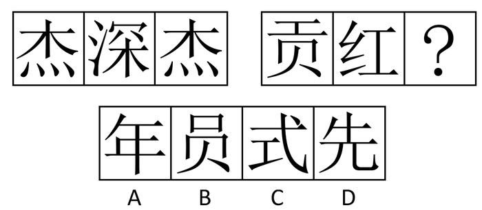

A. A

B. B

C. C

D. D

第 48 题 · 答案与解析

**参考答案（粉笔题库参考内容）**

C

**解析**

本题属于汉字类考题，由于字的笔画都比较繁琐，所以我们不考虑笔画数。通过对这几个汉字的外在形状分析可以发现左边三个汉字均含有共同元素“木”，题干右边的两个汉字含有共同元素“工”，选项中只有C项包含“工”。

故正确答案为C。

**考点**：数量规律-素、文字/字母/数字类、样式规律-遍历

**来源**：2011年广东省公务员录用考试《行测》题第48题

### 第 49 题

请从所给的四个选项中，选择最合适的一个填入问号处，使之呈现一定的规律性：

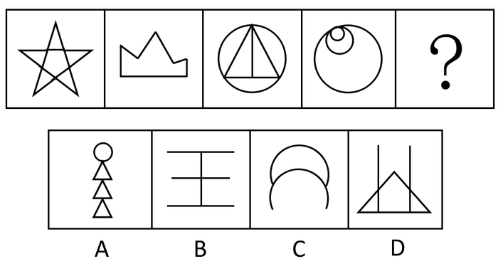

A. A

B. B

C. C

D. D

第 49 题 · 答案与解析

**参考答案（粉笔题库参考内容）**

A

**解析**

元素组成相对凌乱，考虑笔画。

所有图形均能一笔画成，故问号处图形应选一个能够一笔画成的图形，如果一个图形中含有0个或2个奇点，那么这个图形就可以一笔成形。符合条件的只有A选项。

故正确答案为A。

**考点**：数量规律-线

**来源**：2011年广东省公务员录用考试《行测》题第49题

### 第 50 题

从所给的四个选项中，选择最合适的一个填入问号处，使之呈现一定的规律性：

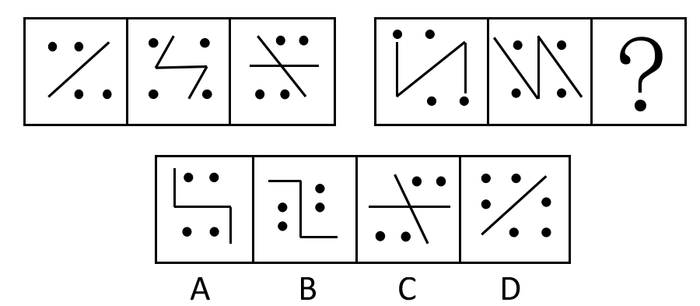

A. A

B. B

C. C

D. D

第 50 题 · 答案与解析

**参考答案（粉笔题库参考内容）**

C

**解析**

观察题干中给出的图形，可以发现每个图形都由黑点和线条组成。先观察黑点的数量，题干所给的五个图形均只有四个小黑点，故首先排除D项。再看黑点的排列位置，可以发现第一幅图和第四幅图相同，第二幅图和第五幅图相同，因此问号处图形的黑点的排列方式应与第三幅图相同，故排除A、B两项，此时可以锁定答案为C项。再观察线条规律，每组图前两个图都是一笔就可以画成，而第三个图需要两笔画成，C项也符合规律。

故正确答案为C。

**考点**：数量规律-素、数量规律-线

**来源**：2014年吉林省政法干警考试《行政职业能力测验》题第75题

### 第 51 题

从所给四个选项中，选择最合适的一个，使之呈现一定的规律性：

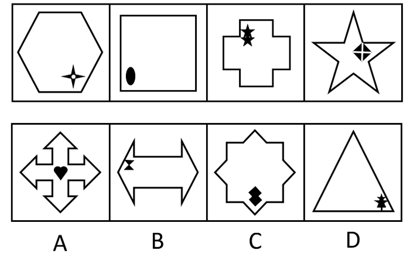

A. A

B. B

C. C

D. D

第 51 题 · 答案与解析

**参考答案（粉笔题库参考内容）**

D

**解析**

此题图形内元素按逆时针方向分别位于右下、左下、左上、右上四个位置，第五个图形中的元素应位于右下，只有D项位于右下。

故正确答案为D。

**考点**：位置规律-平移

**来源**：2011年广东省公务员录用考试《行测》题第51题

### 第 52 题

从所给四个选项中，选择最合适的一个，使之呈现一定的规律性：

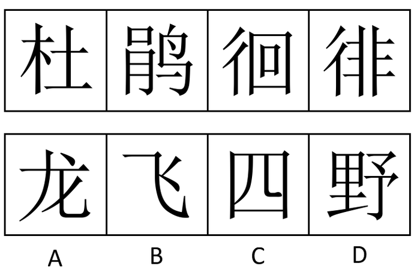

A. A

B. B

C. C

D. D

第 52 题 · 答案与解析

**参考答案（粉笔题库参考内容）**

D

**解析**

前四个字都是左右结构，选项前三个均为单独结构，只有D项是左右结构。

故正确答案为D。

**考点**：文字/字母/数字类

**来源**：2011年广东省公务员录用考试《行测》题第52题

### 第 53 题

从所给四个选项中，选择最合适的一个，使之呈现一定的规律性：

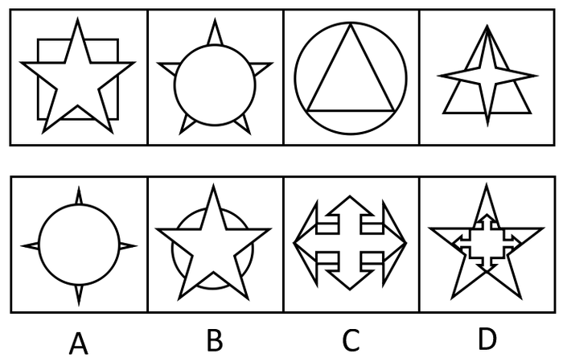

A. A

B. B

C. C

D. D

第 53 题 · 答案与解析

**参考答案（粉笔题库参考内容）**

A

**解析**

前四个图依次是五角星叠放在正方形之上，圆形叠放在五角星之上，三角形叠放在圆形之上，四角星叠放在三角形之上，以此类推，第五个图应该是某个图形叠放在四角星之上，只有A项为四角星在下面。

故正确答案为A。

**考点**：特殊规律-图形间关系

**来源**：2011年广东省公务员录用考试《行测》题第53题

### 第 54 题

从所给四个选项中，选择最合适的一个，使之呈现一定的规律性：

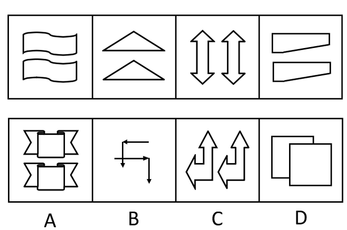

A. A

B. B

C. C

D. D

第 54 题 · 答案与解析

**参考答案（粉笔题库参考内容）**

C

**解析**

观察发现，题干图形均为两个面且形状完全相同，并且这两个面均为分开的两个部分，只有C项符合。

故正确答案为C。

**考点**：数量规律-素、数量规律-面

**来源**：2011年广东省公务员录用考试《行测》题第54题

### 第 55 题

从所给四个选项中，选择最合适的一个，使之呈现一定的规律性：

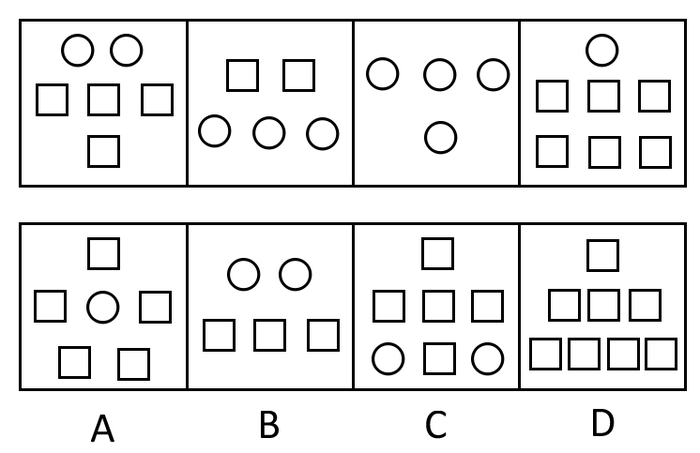

A. A

B. B

C. C

D. D

第 55 题 · 答案与解析

**参考答案（粉笔题库参考内容）**

D

**解析**

左边图形中1个小圆相当于2个小正方形，通过换算，左边每格中均为8个小正方形，选项分别为7，7，9，8个，只有D项符合。

故正确答案为D。

**考点**：数量规律-素

**来源**：2011年广东省公务员录用考试《行测》题第55题

### 第 56 题

森林∶植被

A. 沙漠∶陆地

B. 水库∶河流

C. 白云∶蓝天

D. 黑洞∶臭氧

第 56 题 · 答案与解析

**参考答案（粉笔题库参考内容）**

A

**解析**

第一步：判断题干词语间逻辑关系。

此题考查包容关系，即“森林”是一种“植被”类型。

第二步：判断选项词语间逻辑关系。

A项“沙漠”是一种“陆地”类型，为包容关系；

B、C、D项出现的词语都只是在描述不同的两个事物，是并列关系。

故正确答案为A。

**考点**：逻辑关系-包容关系

**来源**：2011年广东省公务员录用考试《行测》题第56题

### 第 57 题

接触∶触摸

A. 飘摇∶摇动

B. 推进∶进展

C. 科学∶学习

D. 起飞∶飞翔

第 57 题 · 答案与解析

**参考答案（粉笔题库参考内容）**

D

**解析**

第一步：判断题干词语间逻辑关系。

“触摸”之前必须“接触”，即“触摸”与“接触”之间是必要条件关系。

第二步：判断选项词语间逻辑关系。

A项：“飘摇”即为“摇动”，二者为近义词，与题干逻辑关系不一致，排除；

B项：“推进”和“进展”都是指事物向前发展，二者为近义词，与题干逻辑关系不一致，排除；

C项：“学习”“科学”为动宾结构，二者不是必要条件关系，与题干逻辑关系不一致，排除；

D项：“飞翔”之前必须“起飞”，即“飞翔”与“起飞”之间也是必要条件关系，与题干逻辑关系一致，当选。

故正确答案为D。

**考点**：逻辑关系-对应关系

**来源**：2011年广东省公务员录用考试《行测》题第57题

### 第 58 题

精致∶粗糙

A. 黑色∶白色

B. 富裕∶贫穷

C. 清晨∶傍晚

D. 旺盛∶衰老

第 58 题 · 答案与解析

**参考答案（粉笔题库参考内容）**

B

**解析**

第一步：判断题干词语间逻辑关系。

本题题干所给的两组词语“精致”和“粗糙”是一对反义词，且词性都是形容词。

第二步：判断选项词语间逻辑关系。

A、C两项均有名词词性。

B项符合。

本题容易误选D，“旺盛”和“衰老”看上去像是一对反义词，但是二者词性并不相同。“旺盛”是形容词，通常用于抽象事物，如生命力、精力；而“衰老”则既是形容词，又是名词，通常用于具体事物，如人的衰老、细胞的衰老等。

故正确答案为B。

**考点**：语义关系-反义关系

**来源**：2011年广东省公务员录用考试《行测》题第58题

### 第 59 题

子女∶孝顺

A. 家长∶管教

B. 夏天∶火热

C. 军队∶战争

D. 法律∶公正

第 59 题 · 答案与解析

**参考答案（粉笔题库参考内容）**

D

**解析**

第一步：判断题干词语间逻辑关系。

本题是对属性关系的考查，可以通过造句的方法直接解题，“孝顺”是“子女”应有的品质。

第二步：判断选项词语间逻辑关系。

A项，“家长”虽然要“管教”孩子，但“管教”并不是“家长”应有的品质。

B项，“火热”与“夏天”之间并没有必然的联系。

C项，“军队”与“战争”之间也没有必然的联系。

D项，“公正”是“法律”应有的品质。

故正确答案为D。

**考点**：逻辑关系-对应关系

**来源**：2011年广东省公务员录用考试《行测》题第59题

### 第 60 题

广告：电视

A. 食物：餐桌

B. 工作：生活

C. 知识：书本

D. 产品：企业

第 60 题 · 答案与解析

**参考答案（粉笔题库参考内容）**

C

**解析**

第一步：判断题干词语间逻辑关系。

“电视”是“广告”的一种载体，为对应关系。

第二步：判断选项词语间逻辑关系。

A项，“食物”与“餐桌”之间没有必然的联系，排除；

B项，“工作”与“生活”是并列关系，排除；

C项，“书本”是“知识”的一种载体，为对应关系，正确；

D项，我们可以说，“企业”生产“产品”，但不可以说“企业”是“产品”的载体，排除。

故正确答案为C。

**考点**：逻辑关系-对应关系

**来源**：2011年广东省公务员录用考试《行测》题第60题

### 第 61 题

欢天喜地∶兴高采烈

A. 天造地设∶鬼斧神工

B. 和颜悦色∶百依百顺

C. 七零八落∶七上八下

D. 生龙活虎∶虎背熊腰

第 61 题 · 答案与解析

**参考答案（粉笔题库参考内容）**

A

**解析**

第一步：判断题干词语间逻辑关系。

“欢天喜地”形容非常高兴；“兴高采烈”表示人兴致高。这两个词是一组近义词。

第二步：判断选项词语间逻辑关系。

A项： “天造地设”和“鬼斧神工”也是一组近义词，与题干逻辑关系一致，当选；

B项：“和颜悦色”的近义词是和蔼可亲，而不是“百依百顺”，与题干逻辑关系不一致，排除；

C项：“七零八落”的近义词是支离破碎，而不是“七上八下”，与题干逻辑关系不一致，排除；

D项：“生龙活虎”形容人活泼矫健，富有生气，它的近义词是“朝气蓬勃”，而不是“虎背熊腰”，与题干逻辑关系不一致，排除。

故正确答案为A。

**考点**：语义关系-近义关系

**来源**：2011年广东省公务员录用考试《行测》题第61题

### 第 62 题

坚持不懈∶半途而废

A. 异口同声∶众说纷纭

B. 春风拂面∶寒风凛冽

C. 提纲挈领∶优柔寡断

D. 万象更新∶因循守旧

第 62 题 · 答案与解析

**参考答案（粉笔题库参考内容）**

A

**解析**

第一步：判断题干词语间逻辑关系。

题干给出的两个成语“坚持不懈”和“半途而废”是一组反义成语。

第二步：判断选项词语间逻辑关系。

A项：“异口同声”和“众说纷纭”也是一组反义成语，符合题干逻辑关系；

B 项：两个成语均为形容词且不是反义关系，“寒风凛冽”的反义词应为“烈日炎炎”；

C项：“提纲挈领”形容抓住重点，“优柔寡断”是指不能果断做决定，并非一组反义成语；

D项：“万象更新”描述的是一种状态，“因循守旧”是指一种思想，并非一组反义成语。

故正确答案为A。

**考点**：语义关系-反义关系

**来源**：2011年广东省公务员录用考试《行测》题第62题

### 第 63 题

受人滴水之恩，必当涌泉相报

A. 山无棱，天地合，才敢与君绝

B. 千里之行，始于足下

C. 不到黄河心不死

D. 人无远虑，必有近忧

第 63 题 · 答案与解析

**参考答案（粉笔题库参考内容）**

D

**解析**

第一步：判断题干词语间逻辑关系。

 “受人滴水之恩”是“必当涌泉相报”的充分条件，即如果受人滴水之恩，那就一定要涌泉相报，二者为充分条件对应关系。

第二步：判断选项词语间逻辑关系。

A项：“山无棱，天地合”是“才敢与君绝”的必要条件，与题干逻辑关系不一致，排除；

B项：“始于足下”是“千里之行”的必要条件，与题干逻辑关系不一致，排除；

C项：“到黄河”是“心死”的必要条件，与题干逻辑关系不一致，排除；

D项：如果一个人“没有远虑”，那就一定“会有近忧”，二者为充分条件对应关系，与题干逻辑关系一致，当选。

故正确答案为D。

**考点**：逻辑关系-对应关系

**来源**：2011年广东省公务员录用考试《行测》题第63题

### 第 64 题

欲盖弥彰∶此地无银三百两

A. 弄巧成拙∶偷鸡不成蚀把米

B. 背道而驰∶牛不喝水强按头

C. 自顾不暇∶拆东墙补西墙

D. 妄自尊大∶王婆卖瓜自卖自夸

第 64 题 · 答案与解析

**参考答案（粉笔题库参考内容）**

A

**解析**

第一步：判断题干词语间逻辑关系。

“欲盖弥彰”和“此地无银三百两”表达的意思相同，都是指想要隐瞒掩饰，结果反而暴露出来。

第二步：判断选项词语间逻辑关系。

A项，“弄巧成拙”和“偷鸡不成蚀把米”表达的意思也相同，都是想做一件事没做好反而把其他的事情也搞砸了，当选；

B项，“牛不喝水强按头”的近义词是“强人所难”，排除；

C项，“拆东墙补西墙”的近义词是“拆东补西”，排除；

D项，“王婆卖瓜自卖自夸”的近义词是“自吹自擂”，排除。

故正确答案为A。

**考点**：语义关系-近义关系

**来源**：2011年广东省公务员录用考试《行测》题第64题

### 第 65 题

仓廪实而知礼节

A. 知耻而后勇

B. 树欲静而风不止

C. 置之死地而后生

D. 不到长城非好汉

第 65 题 · 答案与解析

**参考答案（粉笔题库参考内容）**

A

**解析**

第一步：判断题干词语间逻辑关系。

只有仓廪实才能知礼节，二者是必要条件关系。

第二步：判断选项词语间逻辑关系。

A项，只有知道耻辱才能发挥出力量和勇气，与题干逻辑关系一致，当选；

B项，树想安静风却不停止，是转折关系，与题干逻辑关系不一致，排除；

C项和D项都是充分条件关系，与题干逻辑关系不一致，均排除。

故正确答案为A。

**考点**：逻辑关系-对应关系

**来源**：2011年广东省公务员录用考试《行测》题第65题

### 第 66 题

应该清醒地认识到，目前房地产市场最大的矛盾不是供需之间的矛盾，而是百姓囊中羞涩与房价不断上涨之间的矛盾。而这一问题产生的根源就在于房子被当作奇货可居、有利可图的商品，被房地产商和手有余钱的业主一而再再而三地热炒。于是我们看到一些房地产商宁愿把房子成片闲置也不愿平价或降价出售；某些富有的业主拥有两三套，甚至十数套房产，而大量炒房团也应运而生。以下最能加强上述结论的是：

A. 经济学家近来十分关注炒房对房价上涨的影响作用

B. 在一些内陆地区，未发生炒房现象，房价比较平稳

C. 在一些经济发达的地区，炒房现象虽不突出，但房价仍然居高不下

D. 一些地区拟对拥有多套房者开征土地使用税，可以有效地抑制虚假的住房需求

第 66 题 · 答案与解析

**参考答案（粉笔题库参考内容）**

B

**解析**

第一步：找到论点论据。

论点：房价不断上涨是由于房子被房地产商和手有余钱的业主热炒。

论据：房地产商宁愿把房子成片闲置也不愿平价或降价出售；富有的业主拥有许多套房产。

第二步：注意分析选项。

A项：经济学家是否关注炒房对房价上涨的影响作用与题干无关，为无关选项；

B项：没有炒房现象的地区房价比较平稳，举例加强论点；

C项：炒房现象不突出的地区房价仍然居高不下说明房价高的原因不是因为炒房引起的，削弱论点；

D项：开征土地使用税抑制虚假的住房需求没有涉及房价，与题干无关，为无关选项；

故正确答案为B。

**考点**：加强-实验类、补充论据

**来源**：2011年广东省公务员录用考试《行测》题第66题

### 第 67 题

体育馆如果在同一天既开放乒乓球室又开放羽毛球室的话，那么这一天也一定开放网球室。该体育馆星期三不开放网球室。高同学只有当开放乒乓球室的时候才去体育馆。

如果上述情况都是属实的，那么以下选项正确的是：

A. 星期三高同学不会去体育馆

B. 高同学不会在同一天既去学校体育馆的乒乓球室又去羽毛球室

C. 如果体育馆在星期三开放羽毛球室，那么这一天一定不开放乒乓球室

D. 体育馆在星期三不开放羽毛球室

第 67 题 · 答案与解析

**参考答案（粉笔题库参考内容）**

C

**解析**

第一步：翻译题干，利用充分必要条件。

第一句：开放乒乓球室 且 开放羽毛球室→开放网球室；第二句：星期三：-开放网球室，该句为事实信息，即已经成立的事实；第三句：高同学去体育馆→开放乒乓球室。

第二步：从事实信息开始推导，得到结论。

由第二句中事实信息“星期三：-开放网球室”和第一句中“开放乒乓球室 且 开放羽毛球室→开放网球室”利用逆否规则得到“星期三：-（开放乒乓球室 且 开放羽毛球室）”，利用摩根规则再得到“星期三：（-开放乒乓球室） 或 （-开放羽毛球室）”。

第三步：逐一翻译选项并判断选项是否正确。

A项：根据星期三：-开放网球室，不能推知高同学是不是去体育馆，无法推出，排除；

B项：高同学仅知道去体育馆→开放乒乓球室，无法推出任何结论，无法推出，排除；

C项：翻译为星期三：开放羽毛球室→—开放乒乓球室。由第二步得到结论“星期三：（-开放乒乓球室） 或 （-开放羽毛球室）”，通过选言命题的规则，可得到必定有开放羽毛球室→—开放乒乓球室，可以推出，当选；

D项：翻译为星期三：-开放羽毛球室。由第二步只能得到“星期三：（-开放乒乓球室） 或 （-开放羽毛球室）”，无法得到“星期三：-开放乒乓球室”，无法推出，排除。

故正确答案为C。

**考点**：常规翻译

**来源**：2011年广东省公务员录用考试《行测》题第67题

### 第 68 题

某人得了心脏病，做手术会改善他的身体状况，但这种手术是有风险的。研究人员让第一组测试者分别给这位患者提建议，请他们在如下的手术成功率中做选择：10%、30%、50%、70%、90%。测试结果表明：成功率在 50% 时可以接受手术，风险率为 50%。接着，研究人员找另一组测试者先经过小组讨论再给患者提出建议，小组讨论的结果是有 30% 的成功率就可以动手术，风险率为 70%。

最能解释这一现象的是：

A. 群体决策集思广益、博采众长，因而应该比个人决策更为合理、有效

B. 群体决策容易出现责任分摊等现象，因而往往比个人决策更趋于冒险

C. 个人在做出决策时比较谨慎、保守，因而个人决策往往阻碍事业的发展

D. 个人要对自己做出的决策负责，因而个人决策比群体决策更具有可信性

第 68 题 · 答案与解析

**参考答案（粉笔题库参考内容）**

B

**解析**

第一步：找到题干矛盾现象。

题干矛盾现象是两组对象分别是第一组测试者和另一组测试者，其他条件均相同，唯一的不同是另一组测试者建议前先经过小组讨论，第一组没有，实验结果是第一组建议成功率在50%时可以接受手术，风险率为50%，另一组建议有30%的成功率就可以动手术，风险率为70%，说明小组讨论起了作用。

第二步：逐一分析选项。

题干中手术是从成功率和风险率两方面来看的，因而不存在哪个决定有效、可信的问题，因此A、D两项均错误，无法解释题干现象，排除；

B项中从对风险率的比较上可以看出说法更为合理，能够很好解释题干中的现象，当选；

C项中“个人决策往往阻碍事业的发展”说法太过绝对且与题干不符，因此C项错误，排除。

故正确答案为B。

**考点**：原因解释

**来源**：2011年广东省公务员录用考试《行测》题第68题

### 第 69 题

为贯彻落实节能减排的政策，某国政府调整了该国的汽车消费税，对排量2.0升以上的汽车提高消费税。受消费税调整影响，大排量轿车的购车成本将会有所增加。因此，人们普遍认为，以往备受冷落的2.0升以下的小排量汽车将迎来销售的热潮。以下不是上述分析中隐含的假定的选项是：

A. 计划购买2.0升以下小排量汽车的消费者数量不会缩减

B. 原本生产排量2.0升以上汽车的厂家转产2.0升以下小排量汽车

C. 2.0升以下小排量汽车的性价比提高，吸引原本没有购车计划的消费者

D. 原计划购买排量2.0升以上汽车的消费者转而购买2.0升以下的小排量汽车

第 69 题 · 答案与解析

**参考答案（粉笔题库参考内容）**

B

**解析**

第一步：找到论点和论据。

论点：以往备受冷落的2.0升以下的小排量汽车将迎来销售的热潮。

论据：为贯彻落实节能减排的政策，某国政府调整了该国的汽车消费税，对排量2.0升以上的汽车提高消费税。受消费税调整影响，大排量轿车的购车成本将会有所增加。

第二步：逐一分析选项。

B项不是题干论点成立需要的前提，用否定代入法验证，如果原本生产排量2.0升以上汽车的厂家不转产2.0升以下小排量汽车，那么我们依然可以得到结论，即以往备受冷落的2.0升以下的小排量汽车将迎来销售的热潮。所以，B选项并不是题干论点成立的前提。因此，本题答案为B项。

如果把A、C、D这三项否定了，那么得不出论点。因此，这三个选项是题干论点需要的前提。

本题为选非题，故正确答案为B。

**考点**：加强选非题

**来源**：2011年广东省公务员录用考试《行测》题第69题

### 第 70 题

一项调查结果显示，即使普通人的后代付出与成功人士的后代同样的努力，其成功的几率也仅为后者的一半。由此可以得出结论，成功与否主要取决于遗传因素。

最能反驳以上观点的一项是：

A. 成功人士的后代往往比普通人的后代更加努力

B. 许多成功人士的后代在事业上毫无建树

C. 成功人士后代较普通人后代有更好的成长环境

D. 很多所谓的成功人士出身于普通的家庭

第 70 题 · 答案与解析

**参考答案（粉笔题库参考内容）**

C

**解析**

第一步：找到论点和论据。

本题的论点是“成功与否主要取决于遗传因素”。论据是“普通人的后代付出与成功人士的后代同样的努力，其成功的几率也仅为后者的一半”。

第二步：判断削弱方式。

论点说遗传因素，论据说普通人的后代和成功人士的后代成功率的关系，论点和论据间因果关系不强，所以削弱论证。

第三步：逐一判断选项的作用。

A项中“成功人士的后代往往比普通人的后代更加努力”说明成功的原因是建立在不同的努力程度上的，题干是在相同努力程度下的比较，所以不能说明任何结论，属无关选项；

B项中“许多成功人士的后代”和D项中“很多所谓的成功人士出身于普通的家庭”只是提出了“许多”，“很多”，在题干中总人数基数和具体几率数值并不能明确的情况下，B、D两项均不能起到削弱作用；

C项中“成功人士后代较普通人后代有更好的成长环境”说明在同样努力情况下，成功的因素是成长环境而不是遗传，C项正确。

故正确答案为C。

**考点**：他因削弱

**来源**：2011年广东省公务员录用考试《行测》题第70题

### 第 71 题

合理、精简的机构设置使得甲县卫生局的工作效率非常高，甲县卫生局的部门结构与乙县卫生局十分相似。因此乙县的卫生局工作效率也会很高。下列最能反驳上述结论的是：

A. 乙县卫生局的部门结构未必与甲县的相同

B. 两县卫生局的工作人员数量有较大的差异

C. 工作流程的设置对工作效率有重要影响

D. 甲县卫生局的不同部门的工作效率有高有低

第 71 题 · 答案与解析

**参考答案（粉笔题库参考内容）**

C

**解析**

第一步：分析题干，找到论点和论据。

论点：乙县的卫生局工作效率也会很高。

论据：合理、精简的机构设置使得甲县卫生局的工作效率非常高，甲县卫生局的部门结构与乙县卫生局十分相似。

第二步：逐一分析选项。

A项：“乙县卫生局的部门结构未必与甲县的相同”，题干论据中已经说明二者“相似”表示存在不同，排除；

B项：“两县卫生局的工作人员数量有较大的差异”，题干中论据说的是二者的机构设置、部门结构，而非工作人员数量，主题不一致，排除；

C项：工作效率高不仅是因为机构设置合理、精简，还有工作流程设置方面的因素，属于他因削弱，否定论点，当选；

D项：“甲县卫生局的不同部门的工作效率有高有低”与本题讨论的主题不一致，排除。

故正确答案为C。

**考点**：他因削弱

**来源**：2011年广东省公务员录用考试《行测》题第71题

### 第 72 题

红红、丹丹、阳阳、珍珍和慧慧是同一家公司的同事，因工作的需要，她们不能同时出席公司举办的新产品发布会。她们的出席情况是：

（1）只有红红出席，丹丹、阳阳和珍珍才都出席；

（2）红红不能出席；

（3）如果丹丹不出席，阳阳也不出席；

（4）如果阳阳不出席，慧慧也不出席；

（5）已经决定慧慧出席发布会。

根据上述情况，可以推出：

A. 丹丹出席发布会，阳阳和珍珍不出席发布会

B. 珍珍出席发布会，丹丹和阳阳不出席发布会

C. 阳阳和珍珍出席发布会，丹丹不出席发布会

D. 丹丹和阳阳出席发布会，珍珍不出席发布会

第 72 题 · 答案与解析

**参考答案（粉笔题库参考内容）**

D

**解析**

第一步：翻译题干，利用充分必要条件。

第一句：-（红红 且 丹丹 且 阳阳 且 珍珍 且 慧慧），该句为事实信息，即已经成立的事实；（1）丹丹 且 阳阳 且 珍珍→红红，（2）-红红，该句为事实信息，即已经成立的事实，（3）-丹丹→—阳阳，（4）-阳阳→—慧慧，（5）慧慧，该句为事实信息，即已经成立的事实。

第二步：从事实信息开始推导，得到结论。

由（4）中“-阳阳→—慧慧”和（5）中事实信息“慧慧”利用逆否规则得到阳阳，又知（3）中“-丹丹→—阳阳”，利用逆否规则再得到丹丹，由此可得丹丹 且 阳阳。

由（1）中“丹丹 且 阳阳 且 珍珍→红红”和（2）中事实信息“-红红”利用逆否规则得到-（丹丹 且 阳阳 且 珍珍），利用摩根规则再得到（-丹丹） 或 （-阳阳） 或 （-珍珍），又知上面推导得到的结论丹丹 且 阳阳，通过选言命题的规则，可得到必定有-珍珍。

综上，可以得到（-红红） 且 丹丹 且 阳阳 且 （-珍珍） 且 慧慧，即红红和珍珍不出席，丹丹、阳阳和慧慧均出席。通过分析，只有D项说法符合。

故正确答案为D。

**考点**：常规翻译

**来源**：2011年广东省公务员录用考试《行测》题第72题

### 第 73 题

某市政府出台该市《关于推进城乡社会救助体系建设的意见》，意见指出，推进城乡社会救助体系建设的基本原则之一是实施积极的就业扶持政策，促进困难群众就业。

以下各项做法中符合这一原则的是：

A. 该市人事局规定，在每年开发的公益性就业岗位中，优先安置低保、特困和零就业家庭等特殊困难群体的未就业高校毕业生

B. 该市教育局对义务教育阶段的城乡困难家庭子女，免除其杂费、书本费，并对寄宿生的生活费给予补助

C. 该市司法局规定，对发生劳动争议的困难家庭的当事人提供诉讼、非诉讼代理以及法律咨询、代书等免费法律服务，依法维护他们的合法权益

D. 该市中小企业发展局、工商局联合作出规定，对近3年毕业的大中专学生，允许以普通合伙的方式，试办承担无限责任的居民服务类、科技服务类企业，核发资金数额为1元、带有“公司”字样的营业执照

第 73 题 · 答案与解析

**参考答案（粉笔题库参考内容）**

A

**解析**

第一步：找出定义关键词。

“推进城乡社会救助体系建设的基本原则之一是实施积极的就业扶持政策，促进困难群众就业”。

第二步：逐一分析选项。

A项，优先安置低保、特困和零就业家庭等特殊困难群体的未就业高校毕业生，是在实施积极的就业扶持政策，正确；

B、C、D三项，分别是市教育局给予补助，市司法局提供免费法律服务，市中小企业发展局、工商局鼓励大中专学生创业，并不是就业扶持政策，均排除。

故正确答案为A。

**考点**：单定义-其他句式

**来源**：2011年广东省公务员录用考试《行测》题第73题

### 第 74 题

某省发布地质灾害防治方案，方案指出，全省各地区、各有关部门要结合实际情况，因地制宜，突出重点，迅速组织开展地质灾害隐患巡查排查工作，特别要逐一排查城镇乡村等人口密集区和江河流域、交通干线、重要设施等重点区域的地质灾害隐患，不留死角。

下列各项做法中属于贯彻执行该方案中这一要求的是：

A. 甲县气象局预测，该年度极端天气较历年偏多，局部暴雨、冰雹等强对流天气将频繁发生，容易造成崩塌、滑坡、泥石流、地面塌陷、地裂缝等地质灾害

B. 乙县充分发挥基层党组织和干部群众的作用，建立汛期值班等制度，并把防灾避险、监测预警的任务具体落实到城镇、乡村、学校、医院、企业等单位及相关责任人员

C. 丙县要求全县各乡、村自查自纠，发现该县某处煤矿采空区地面塌陷，危及尚未拆迁的居民房屋和公共设施以及铁路运行安全

D. 丁县建有大型水库，因而该县水利部门认真做好水库周边和河道两侧的地质灾害防治工作，严防地质灾害危及水库和河道安全及引发次生灾害

第 74 题 · 答案与解析

**参考答案（粉笔题库参考内容）**

C

**解析**

第一步：找出题干中的关键句。

本题关键句为“迅速组织开展地质灾害隐患巡查排查工作”。

第二步：逐一分析并判断选项是否正确。

本题重点是巡查排查地质灾害隐患。

A项中是预测不是巡查排查，因此A项错误，排除；

B项中是预防洪涝灾害不是地质灾害，因此B项错误，排除；

C项中正是巡查排查地质灾害隐患，因此C项正确，当选；

D项中是做好地质灾害防治工作而不是排查隐患，是强干扰项，因此D项错误，排除。

故正确答案为C。

**考点**：方式目的

**来源**：2011年广东省公务员录用考试《行测》题第74题

### 第 75 题

某市为做好全市政府系统政务督促检查，实现政务督查工作科学化、制度化、规范化、程序化，明确规定政务督查工作的主要任务是：

（1）上级和本级政府及政府各部门重大决策、重大工作部署的贯彻落实情况；

（2）上级和本级政府及政府各部门下发的重要文件的贯彻落实情况；

（3）本级政府及政府各部门重要会议决定事项的贯彻落实情况；

（4）上级机关和本级党委转来的批办件、督查件的落实情况；

（5）上级和本级政府领导批办件和交办事项的落实情况。

根据上述规定，下列各项中属于该市所辖某区政府督查工作的任务的是：

A. 市长亲自交办的该区贫困儿童洋洋减免学费事项的落实情况

B. 市政府召开的净化中小学校园周边环境会议决定的贯彻落实情况

C. 该区东湖社区开展的洁净社区——消灭非法小广告行动落实情况

D. 市委下发全市党员进一步深入学习科学发展观重要文件的落实情况

第 75 题 · 答案与解析

**参考答案（粉笔题库参考内容）**

A

**解析**

第一步：找出题干五个主要任务中的关键词。

（1）中关键词为“上级和本级政府及政府各部门”、“重大决策、重大工作部署”。

（2）中关键词为“上级和本级政府及政府各部门”、“下发的重要文件”。

（3）中关键词为“本级政府及政府各部门”、“重要会议决定事项”。

（4）中关键词为“上级机关和本级党委”、“转来的批办件、督查件”。

（5）中关键词为“上级和本级政府领导”、“批办件和交办事项”。

第二步：逐一分析选项。

A项中符合（5）的关键词，上级政府领导交办事项，因此A项正确，当选；

B项中“市政府”不符合（3）的“本级政府”，因此B项错误，排除；

C项中只是社区活动，不属于全市政府系统政务，因此C项错误，排除；

D项中“市委”不符合（2）“政府各部门”，因此D项错误，排除。

故正确答案为A。

**考点**：主客体

**来源**：2011年广东省公务员录用考试《行测》题第75题

### 第 76 题

描写过年习俗的古诗“千门万户曈曈日，总把新桃换旧符”中，“新桃”指的是：

A. 新鲜的桃子

B. 桃色的新衣

C. 桃木制作的新门神

D. 绘有寿桃的新年画

第 76 题 · 答案与解析

**参考答案（粉笔题库参考内容）**

C

**解析**

古人在辞旧迎新之日，常用画有门神或题着门神名字（神荼、郁垒）的桃木板挂在大门旁，用以驱鬼辟邪，称作“桃符”。故“新桃”指的是用桃木制作的新门神。

故正确答案为C。

**考点**：中国历史

**来源**：2011年广东省公务员录用考试《行测》题第76题

### 第 77 题

干支纪年法始于东汉，下列采用了干支纪年法的一项是：

A. 贞观之治

B. 黄道吉日

C. 辛丑条约

D. 安史之乱

第 77 题 · 答案与解析

**参考答案（粉笔题库参考内容）**

C

**解析**

干支纪年是中国古代的一种纪年法。即以甲、乙、丙、丁、戊、己、庚、辛、壬、癸十天干和子、丑、寅、卯、辰、巳、午、未、申、酉、戌、亥十二地支按照顺序组合起来纪年。如甲子、乙丑等，经过六十年又回到甲子。周而复始，循环不已。

A项，“贞观”是唐太宗的年号，故采用的是年号纪年法；

B项，所谓“黄道吉日”是根据太阳在黄道上运行的位置推算出来的，并没有采用干支纪年法；

C项中的“辛丑”正是指的农历辛丑年，属于干支纪年法；

D项，“安史之乱”指的是唐玄宗天宝末年，节度使安禄山和史思明发动的叛乱，“安”“史”是姓名，不是纪年法。

故正确答案为C。

**考点**：文化常识

**来源**：2011年广东省公务员录用考试《行测》题第77题

### 第 78 题

下列自然现象的产生与人类排放大气污染物无关的是：

A. 阴霾天气

B. 臭氧层空洞

C. 酸雨

D. 雷电

第 78 题 · 答案与解析

**参考答案（粉笔题库参考内容）**

D

**解析**

A项正确，气象学上把大气中悬浮的大量微小尘粒、烟粒或盐粒的集合体，使空气浑浊，水平能见度降低到10km以下的一种天气现象称为阴霾天气。汽车尾气、煤燃烧排放物中含有能够对大气造成污染的颗粒物，可造成阴霾天气，故阴霾天气与大气污染物有关。这与排放污染物有关。

B项正确，臭氧层空洞主要是由于平流层内超音速飞机排放大量的NO，以及人类大量生产与使用的氯氟烃化合物（氟利昂）等引起的，NO与氟利昂都是大气污染物。

C项正确，酸雨主要是由于人类向大气中大量排放二氧化硫、氮氧化物等酸性气体引起的。

D项错误，雷电是自然现象，与大气污染物无关。

本题为选非题，故正确答案为D。

**考点**：自然地理

**来源**：2011年广东省公务员录用考试《行测》题第78题

### 第 79 题

在中国东部沿海部分地区，“用工荒”现象已出现多年。每年春节过后，几乎所有的劳动密集型企业都在为工人的事儿犯愁，甚至出现了中西部和东部争夺普通劳务工人的新现象。而另一方面，大学生在找工作的过程中却面临“就业难”的窘境。出现上述矛盾现象的原因是：

A. 企业的薪酬没有达到大学生期望值

B. 近几年，我国大量工人通过劳务输出到海外工作

C. 大学生的就业要求与劳动密集型企业提供的工作岗位不相符

D. 很多年轻人选择自主创业，而非外出打工

第 79 题 · 答案与解析

**参考答案（粉笔题库参考内容）**

C

**解析**

题干中反映的是当前我国存在严峻的结构性失业问题。

结构性失业是指由于经济结构的变动，劳动力供给和需求在职业、技能、产业、地区分布等方面的不适应所引起的失业。其显著特点是职位空缺与失业并存，一方面存在着大量失业劳动者，另一方面一些行业的工作岗位空缺，找不到适合的劳动者。题干中所述情况是由就业观念滞后所造成的结构性失业，具体表现为劳动者的就业意愿、对就业岗位的预期与实际所能提供的就业岗位不一致而造成失业。

故正确答案为C。

**考点**：宏观经济与调控政策

**来源**：2011年广东省公务员录用考试《行测》题第79题

### 第 80 题

在城市中，高层建筑越来越多，一旦发生火灾，以下做法不正确的是：

A. 穿过充满烟气的楼道时，尽量降低头部的高度

B. 沿墙壁逃生寻找出口

C. 将鼻尖靠近墙角或在阶梯角落换气

D. 迅速乘坐电梯撤离

第 80 题 · 答案与解析

**参考答案（粉笔题库参考内容）**

D

**解析**

在火灾发生时不能使用一般的电梯逃生，原因在于：（1）发生火灾时，可导致停电，使电梯在中途停止运行，并且电梯极易形成“烟囱效应”，人在电梯里随时会被浓烟毒气呛伤而窒息；（2）普通电梯没有安全的防火功能，封闭的结构极易成为逃生的障碍。

故正确答案为D。

**考点**：生活常识

**来源**：2011年广东省公务员录用考试《行测》题第80题

### 第 81 题

《论语》中孔子教我们最好的交友原则：“益者三友。友直，友谅，友多闻，益矣。”其中“友谅”是指：

A. 能听取他人意见的朋友

B. 能帮助自己的朋友

C. 诚实守信的朋友

D. 知识广博的朋友

第 81 题 · 答案与解析

**参考答案（粉笔题库参考内容）**

C

**解析**

《益者三友，损者三友》选自《论语·第十六章·季氏篇》。《论语》是孔子的主要弟子及其再传弟子记载关于孔子及其弟子言行的一部书，是首创语录体。儒家（在春秋战国时期与墨家对立）创始人孔子的政治思想核心是“仁”“礼”和“中庸”。“直”，指正直；“谅”，《说文解字》的解释是“信也”，即诚实守信；“多闻”，指见识广博。

故正确答案为C。

**考点**：文学常识

**来源**：2011年广东省公务员录用考试《行测》题第81题

### 第 82 题

北回归线是太阳在北半球能够直射到的离赤道最远的位置。当太阳的直射点位于北回归线时，以下说法正确的是：

A. 是一年中北半球最热的时候

B. 是一年中北半球白昼最长的时候

C. 是北半球夏天开始的时间

D. 是北半球昼夜温差最大的时间

第 82 题 · 答案与解析

**参考答案（粉笔题库参考内容）**

B

**解析**

A选项错误，夏至这天虽然白昼最长，太阳角度最高，但并不是一年中天气最热的时候。因为大气层的保温作用，接近地表的热量，这时还在继续积蓄，并没有达到最多的时候。因此北半球最热的时候经常出现在7、8月份，而不是夏至日；

B选项正确，当太阳直射点位于北回归线的时候，正是中国农历的夏至日，这一天是北半球白昼最长的一天；

C选项错误，北半球夏天开始的时间是立夏，而不是夏至日；

D选项错误，白露节气才是北半球昼夜温差最大的时间。根据生活常识，夏季应该是昼夜温差小，而不是昼夜温差大。

故正确答案为B。

**考点**：自然地理

**来源**：2011年广东省公务员录用考试《行测》题第82题

### 第 83 题

为确保血液质量和减少献血者在献血过程中的不良反应，献血者在献血前一天和献血的当天，需注意一些事项。据此，下列不正确的一项是：

A. 要保持献血前一晚的良好睡眠，献血前也不要空腹

B. 献血前不要吃高脂肪食物，但要吃高蛋白食物

C. 献血前两天如有感冒、发烧、咳嗽等应暂缓献血

D. 应该阅读一些献血宣传资料，以减轻和解除思想负担

第 83 题 · 答案与解析

**参考答案（粉笔题库参考内容）**

B

**解析**

献血前一天晚上不要饮食过饱，献血的前两餐不要吃肉、鱼、蛋、牛奶、豆制品及油腻食物。要吃一些清淡饮食，以防止血液浑浊，影响血液质量。

B项说法不正确。

本题要求选错误的。

故正确答案为B。

**考点**：生物常识

**来源**：2011年广东省公务员录用考试《行测》题第83题

### 第 84 题

一些动物能够敏锐地感知天气的变化。如果蜘蛛张网、补网，可能会出现的天气状况是：

A. 下雨

B. 刮风

C. 晴天

D. 阴天

第 84 题 · 答案与解析

**参考答案（粉笔题库参考内容）**

C

**解析**

俗话说：“蜘蛛结网，久雨必晴。”蜘蛛靠张网捕虫生活。刮风下雨天气，往往会毁坏蛛网，同时阴雨天气空气潮湿，蛛网粘性差，往往不易捉到小虫。所以在风雨到来之前，蜘蛛便躲避到比较安全的地方。当风止雨停，天气将要转晴时，才又出来补网和张网，以便捕食小虫。因此，蜘蛛补网、张网预示天气将向晴好方面转变。

故正确答案为C。

**考点**：生活常识

**来源**：2011年广东省公务员录用考试《行测》题第84题

### 第 85 题

西汉初年，经济凋敝，农民大量流亡，城市物价高涨，商人投机囤货。新建立的西汉政权国库空虚，财政困难。汉高祖刘邦为应对这一危机，所采取的措施是：

（1）士兵罢归家乡，并分配土地（2）均分田地，打压贵族（3）严刑罚，重法制（4）对商人加倍征收赋税，禁止商人衣丝、为官（5）重新建立税赋制度，加大税收力度

A. （1）（4）

B. （1）（2）（3）

C. （2）（4）（5）

D. （3）（4）

第 85 题 · 答案与解析

**参考答案（粉笔题库参考内容）**

A

**解析**

楚汉之际四年多的战乱中，生产受到严重破坏，社会经济凋敝。面对这种残破局面，汉高祖刘邦采取了以下重要的措施：①兵士罢归家乡，按照爵级高低，也就是军功大小，给予田宅。②命令在战乱中聚保山泽的人各归本土，恢复故爵、田宅。③因饥饿自卖为奴婢的人，一律免为庶人。④抑制商人，不许他们衣丝、操兵器、乘车骑马，不许他们做官，加倍征收他们的税赋，以限制商人对农民的兼并。⑤减轻田租，十五税一。由此可知，（1）（4）正确。由②知，并未打压贵族，（2）错误。由⑤知，（5）错误。汉初时，统治者轻徭薄赋慎刑，提倡“无为而治”，故（3）错。

故正确答案为A。

**考点**：中国历史

**来源**：2011年广东省公务员录用考试《行测》题第85题

## 材料 1

根据下列资料，回答问题

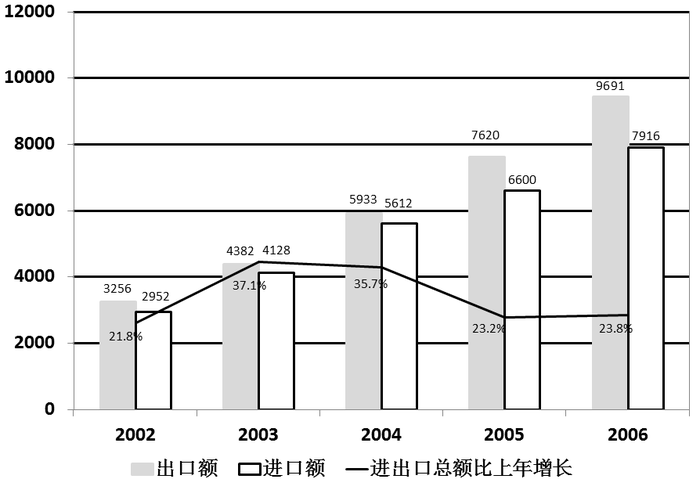

### 第 86 题

2002-2005年，我国的贸易顺差额（出口—进口）最小的年份是：

A. 2002年

B. 2003年

C. 2004年

D. 2005年

第 86 题 · 答案与解析

**参考答案（粉笔题库参考内容）**

B

**解析**

根据上图可直接排除2004、2005两年，直接比较剩下的两个选项即可，2002年的贸易顺差额= 3256 − 2952 = 300^+，2003年= 4382 − 4128 = 250^+。

故正确答案为B。

**考点**：简单加减计算、统计图

**来源**：2011年广东省公务员录用考试《行测》题第86题

### 第 87 题

2006年，我国的出口额约比上年增长：

A. 27.2%

B. 23.8%

C. 23.2%

D. 19.9%

第 87 题 · 答案与解析

**参考答案（粉笔题库参考内容）**

A

**解析**

根据上图可知2006年出口额的年增长率=(9691−7620)/7620=2071/7620≈ 21/76 ＞ 21/84 = 25%。

故正确答案为A。

**考点**：一般增长率、统计图

**来源**：2011年广东省公务员录用考试《行测》题第87题

### 第 88 题

2003—2006年的进口额年增长率超过25%的年份有几个：

A. 1

B. 2

C. 3

D. 4

第 88 题 · 答案与解析

**参考答案（粉笔题库参考内容）**

B

**解析**

解法一：

根据上图可知：

2003年进口额= 4128 ＞ 3000 × 125% ＞ 2952 × 125%。

2004年进口额=5612＞4200×125%＞4128×125%。

2005年进口额= 6600 ＜ 5600 × 125% ＜ 5612 × 125%。

2006年进口额= 7916 ＜ 6600 × 125% = 8250。

年增长率超过25%的年份为2003年、2004年，共2个年份。

解法二：

通过直尺度量可以发现连续五年的进口额几乎成一条直线，说明每年的增长量基本不变，增长量不变，则增长率会越来越小，挑选中间的开始计算。2004年增长率(5612 - 4128)/4128 ≈ 15/41 ≈ 3/8 ＞ 1/4 = 25%，同时猜测2003年的增长率大于25%。后面的2006年增长率猜测也难以大于25%。所以只有2003年和2004年大于25%。

故正确答案为B。

**考点**：一般增长率、统计图

**来源**：2011年广东省公务员录用考试《行测》题第88题

### 第 89 题

与上年相比，进出口总额的年增长率最高的年份的进出口额为：

A. 17607亿美元

B. 14220亿美元

C. 8510亿美元

D. 5208亿美元

第 89 题 · 答案与解析

**参考答案（粉笔题库参考内容）**

C

**解析**

根据上图可知进出口总额增长率最高的是2003年，进出口总额= 4382 + 4128 ≈ 8500亿美元。C项最为接近。

故正确答案为C。

**考点**：简单加减计算、统计图

**来源**：2011年广东省公务员录用考试《行测》题第89题

### 第 90 题

下列说法不正确的是：

A. 2003—2006年，我国出口额与上年相比的增量都超过1000亿美元

B. 2003—2006年，我国进出口总额呈上涨状态

C. 2004—2006年，我国贸易顺差是逐年上升趋势

D. 2001年，我国的出口额约为2673亿美元

第 90 题 · 答案与解析

**参考答案（粉笔题库参考内容）**

D

**解析**

A项，定位图形材料可得，2003年-2006年每年出口额的增长量分别为4382-3256，5933-4382，7620-5933，9691-7620，都大于1000亿美元，正确。

B项，定位图形材料可得，2003年-2006年，每年的进口额和出口额都大于上一年，因此进出口总额一定大于上一年，呈上涨状态，正确。

C项，定位图形材料可得，2004年-2006年，每年中两个柱子长短的差距越大越大，即贸易顺差是逐年上升趋势，正确。

D项，定位图形材料可得，材料没有2001年出口额的信息，且没有办法利用2002年的数据计算，错误。

本题为选非题，故正确答案为D。

**考点**：统计图、综合分析

**来源**：2011年广东省公务员录用考试《行测》题第90题

## 材料 2

苏、浙、粤、闽、鲁五省主要农产品产量统计表单位：万吨

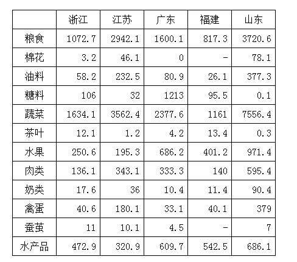

|  | 浙江 | 江苏 | 广东 | 福建 | 山东 |
| --- | ---: | ---: | ---: | ---: | ---: |
| 粮食 | 1072.7 | 2942.1 | 1600.1 | 817.3 | 3720.6 |
| 棉花 | 3.2 | 46.1 | 0 | − | 78.1 |
| 油料 | 58.2 | 232.5 | 80.9 | 26.1 | 377.3 |
| 糖料 | 106 | 32 | 1213 | 95.5 | 0.1 |
| 蔬菜 | 1634.1 | 3562.4 | 2377.6 | 1161 | 7556.4 |
| 茶叶 | 12.1 | 1.2 | 4.2 | 13.4 | 0.3 |
| 水果 | 250.6 | 195.3 | 686.2 | 401.2 | 971.4 |
| 肉类 | 136.1 | 343.1 | 333.3 | 140 | 595.4 |
| 奶类 | 17.6 | 36 | 10.4 | 11.4 | 90.4 |
| 禽蛋 | 40.6 | 180.1 | 33.1 | 40.1 | 379 |
| 蚕茧 | 11 | 10.1 | 4.5 | − | 7 |
| 水产品 | 472.9 | 320.9 | 609.7 | 542.5 | 686.1 |

### 第 91 题

哪省的粮食产量最多：

A. 广东省

B. 江苏省

C. 福建省

D. 山东省

第 91 题 · 答案与解析

**参考答案（粉笔题库参考内容）**

D

**解析**

由表格第一行可以看出，广东省的粮食产量为1600.1万吨 ，江苏省的粮食产量为2942.1万吨 ，福建省的粮食产量为817.3万吨 ，山东省的粮食产量为3720.6万吨 ，山东省粮食产量最高。

故正确答案为D。

**考点**：直接找数、统计表

**来源**：2011年广东省公务员录用考试《行测》题第91题

### 第 92 题

福建省的糖料产量在这五省中居第几：

A. 3

B. 4

C. 5

D. 6

第 92 题 · 答案与解析

**参考答案（粉笔题库参考内容）**

A

**解析**

由表格第四行可以看出，福建省的糖料产量为95.5万吨 ，95.5&lt;106&lt;1213，排在第三位。

故正确答案为A。

**考点**：排序类、统计表

**来源**：2011年广东省公务员录用考试《行测》题第92题

### 第 93 题

蔬菜产量最多的省份与蔬菜产量最少的省份的蔬菜产量之比为多少：

A. 6.5

B. 4.6

C. 3.2

D. 5.6

第 93 题 · 答案与解析

**参考答案（粉笔题库参考内容）**

A

**解析**

由表格第五行可以看出，蔬菜产量最多的省份为山东，达到7556.4万吨，最少的为福建，仅为1161万吨，两者之比为7556.4/1161 ≈ 76/12 ≈ 6.3或者是直除首位商6即可。

故正确答案为A。

**考点**：现期倍数、统计表

**来源**：2011年广东省公务员录用考试《行测》题第93题

### 第 94 题

广东省有几项农产品在这五个省中排在第一：

A. 1

B. 2

C. 3

D. 4

第 94 题 · 答案与解析

**参考答案（粉笔题库参考内容）**

A

**解析**

由表格可以看出，广东省只有糖料的产量排第一。

故正确答案为A。

**考点**：直接找数、统计表

**来源**：2011年广东省公务员录用考试《行测》题第94题

### 第 95 题

广东省不出产什么农产品：

A. 粮食

B. 油料

C. 棉花

D. 糖料

第 95 题 · 答案与解析

**参考答案（粉笔题库参考内容）**

C

**解析**

由表格第二行可以看出，广东省棉花产量为0。

故正确答案为C。

**考点**：直接找数、统计表

**来源**：2011年广东省公务员录用考试《行测》题第95题

## 材料 3

1949年以来，我国人力资本存量形成受到两次大的破坏和冲断。第一次是反右，大跃进经济崩溃期间，在校生数由1960年的10963万人，下降到1962年的7480万人，其中中专生由222万人下降到54万人；第二次是“文革”动乱期间，估计有70--80万人未能受到大学教育，超过1亿中小学生受到质量很低的教育，几百万知识分子无法工作和科研。全国12岁以上人口平均文化程度由1964年的2.34年仅上升到1982年的4.61年，不足小学毕业程度。请根据上述资料回答下列第（1）----（5）题：

### 第 96 题

1962年，我国在校生数多少人：

A. 10963万人

B. 7480万人

C. 222万人

D. 54万人

第 96 题 · 答案与解析

**参考答案（粉笔题库参考内容）**

B

**解析**

由“在校生数由1960年的10963万人，下降到1962年的7480万人”可知，1962年，我国在校生数为7480万人。

故正确答案为B。

**考点**：文字资料、直接找数

**来源**：2011年广东省公务员录用考试《行测》题第96题

### 第 97 题

1960年，我国在校中专生有多少人：

A. 10963万人

B. 7840万人

C. 222万人

D. 54万人

第 97 题 · 答案与解析

**参考答案（粉笔题库参考内容）**

C

**解析**

由“中专生由222万人下降到54万人”可知，1960年，我国在校中专生数为222万人。

故正确答案为C。

**考点**：文字资料、直接找数

**来源**：2011年广东省公务员录用考试《行测》题第97题

### 第 98 题

1960年到1962年间，我国在校中专生下降了多少人：

A. 222万人

B. 54万人

C. 168万人

D. 276万人

第 98 题 · 答案与解析

**参考答案（粉笔题库参考内容）**

C

**解析**

由“中专生由222万人下降到54万人”可知， 1960年到1962年间，我国在校中专生下降了222-54=168万人。

故正确答案为C。

**考点**：文字资料、简单加减计算

**来源**：2011年广东省公务员录用考试《行测》题第98题

### 第 99 题

1982年，我国12岁以上人口平均文化程度是多少：

A. 2.34年

B. 4.61年

C. 小学毕业程度

D. 无法确定

第 99 题 · 答案与解析

**参考答案（粉笔题库参考内容）**

B

**解析**

由“全国12岁以上人口平均文化程度由1964年的2.34年仅上升到1982年的4.61年”可知，1982年，我国12岁以上人口平均文化程度是4.61年。

故正确答案为B。

**考点**：文字资料、直接找数

**来源**：2011年广东省公务员录用考试《行测》题第99题

### 第 100 题

有多少人由于"文革"未能受到大学教育：

A. 168万人

B. 70~80万人

C. 几百万人

D. 无法确定

第 100 题 · 答案与解析

**参考答案（粉笔题库参考内容）**

B

**解析**

由“‘文革’动乱期间，估计有70~80万人未能受到大学教育”可知，有70~80万人由于“文革”未能受到大学教育。

故正确答案为B。

**考点**：文字资料、直接找数

**来源**：2011年广东省公务员录用考试《行测》题第100题

