# 2012年广东省公务员录用考试《行测》题

<!-- gwy:overview:start -->
> **广东 · 2012 · 行测 · 统考** ｜ 100 题 · 图片 17 处 · 答案随题折叠

| 题型模块 | 题量 | 题号 |
| --- | ---: | ---: |
| 数量关系 | 15 | 1–15 |
| 言语理解与表达 | 30 | 16–45 |
| 判断推理 | 31 | 46–76 |
| 常识判断 | 9 | 77–85 |
| 资料分析 | 15 | 86–100 |
| **合计** | **100** | |

导航：[题型与作答说明](#题型与作答说明) · [题目](#题目) · [材料 1](#材料-1)
<!-- gwy:overview:end -->

> 候选采集稿。参考答案及解析来自粉笔页面，不代表官方答案或真实高分答卷；来源使用许可与原卷对应关系仍需人工核实。

## 题型与作答说明

数量关系

（15题）

本部分包括数字推理与数学运算两种类型的试题。

言语理解与表达

（30题）

根据题目要求，在四个选项中选出一个正确答案。

判断推理

（31题）

本部分包括类比推理、图形推理与逻辑判断三种类型的题目。

常识判断

（9题）

根据题目要求，在四个选项中选出一个最恰当的答案。

资料分析

（15题）

针对下列文字、图或表回答问题。你应根据资料提供的信息进行分析、比较、计算和处理。

## 题目

### 第 1 题

0，1，3，9，33，（    ）

A. 147

B. 150

C. 153

D. 156

第 1 题 · 答案与解析

**参考答案（粉笔题库参考内容）**

C

**解析**

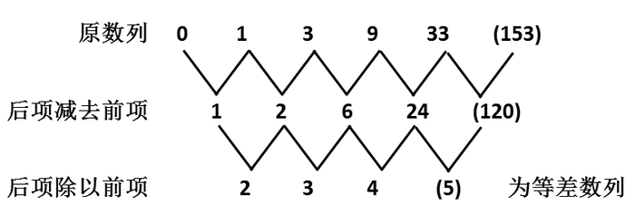

故正确答案为C。

**来源**：2012年广东省公务员录用考试《行测》题第1题

### 第 2 题

12，9，18，33，96，21，（    ），（    ）

A. 39，3

B. 12，24

C. 26，27

D. 36，51

第 2 题 · 答案与解析

**参考答案（粉笔题库参考内容）**

D

**解析**

数列项数较多，优先考虑多重数列。交叉看，奇数项数列为： 12、18、96、（    ），均为3的偶数倍，则第一个括号为3的偶数倍，排除A、C两项；偶数项数列为：9、33、21、（    ），均为3的奇数倍，则第二个括号为3的奇数倍，排除B项。

故正确答案为D。

**来源**：2012年广东省公务员录用考试《行测》题第2题

### 第 3 题

3672，5458，9016，7450，（    ）

A. 3578

B. 6473

C. 9894

D. 4785

第 3 题 · 答案与解析

**参考答案（粉笔题库参考内容）**

C

**解析**

观察数列中的每个四位数中的四个数字，可发现四个数按照奇偶间隔排列呈“奇偶奇偶”规律，只有C项符合此规律。

故正确答案为C。

**来源**：2012年广东省公务员录用考试《行测》题第3题

### 第 4 题

2，2，8，－1，－2，5，1，1，2，－1，1，(     )

A. －2

B. －1

C. 1

D. 2

第 4 题 · 答案与解析

**参考答案（粉笔题库参考内容）**

D

**解析**

原数列三三分组：[2,2,8] [−1,−2,5] [1,1,2] [−1,1,(  )]

观察前三组可得如下：2^2 + 2^2 = 8，(-1)^2+(-2)^2=5，1^2 + 1^2 = 2，每组前两个数的平方和等于第三个数；

则可得所求项为(−1)^2 + 1^2 = 2。

故正确答案为D。

**来源**：2012年广东省公务员录用考试《行测》题第4题

### 第 5 题

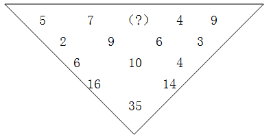

A. 12

B. 13

C. 14

D. 15

第 5 题 · 答案与解析

**参考答案（粉笔题库参考内容）**

A

**解析**

第一行相邻两个数字求和后减10得到第二行数字，第二行相邻两个数字求和后减5得到第三行数字，第三行相邻两个数字求和得到第四行数字，第四行数字求和后加5得到第五行数字。故图形数阵中所求项＝10+9-7=12。

故正确答案为A。

**来源**：2012年广东省公务员录用考试《行测》题第5题

### 第 6 题

某企业为全体员工定制工作服，请服装公司的裁缝量体裁衣。裁缝每小时为52名男员工和35名女员工量尺寸。几小时后，刚好量完所有女员工的尺寸，这时还有24名男员工没量。若男员工与女员工的人数比为11:7，则该企业共有多少名员工：

A. 720

B. 810

C. 900

D. 1080

第 6 题 · 答案与解析

**参考答案（粉笔题库参考内容）**

A

**解析**

由于该企业男女员工人数之比为11:7，据此可知若裁缝每小时能为55名男员工和35名女员工量尺寸，则相同的时间后，男女员工能够恰好量完。而实际每小时只能量52名男员工，且量完女员工时还剩24名男员工，这说明测量时间为24 ÷ (55 − 52) = 8小时。因此该企业员工数为8 × (55 + 35) = 720。

故正确答案为A。

**考点**：和差倍比问题

**来源**：2012年广东省公务员录用考试《行测》题第6题

### 第 7 题

某市举办经济建设成就展，计划在六月上旬组织5个单位参观，其中一个单位由于人数较多，需要连续参观2天，其他4个单位只需参观1天。若每天最多只能安排一个单位参观，则参观的时间安排共有多少种：

A. 630

B. 700

C. 15120

D. 16800

第 7 题 · 答案与解析

**参考答案（粉笔题库参考内容）**

C

**解析**

1个上旬有10天，先选取连续的两天给人数较多的这个单位，10天里选连续的两天有9种情况。再从剩下的8天里选取4天给剩下的4个单位，有A_8^4种情况。分步相乘，因此安排方法一共有：9×A_8^4= 15120种。

故正确答案为C。

**考点**：基础排列组合

**来源**：2012年广东省公务员录用考试《行测》题第7题

### 第 8 题

甲公司的一分厂制造了10台机床，二分厂制造了8台。乙公司向甲公司购买6台机床，丙公司向甲公司购买12台机床。每台机床的运费因运输距离的不同而有差异，具体情况如下表所示。乙、丙两公司购买机床的运费总和最低为多少元：

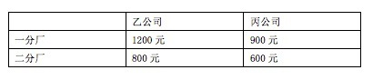

A. 12000

B. 13500

C. 15000

D. 16000

第 8 题 · 答案与解析

**参考答案（粉笔题库参考内容）**

C

**解析**

乙、丙公司从一分厂购买机床的价格分别为1200、900元，乙、丙公司从二分厂购买机床的价格分别为800、600元，乙、丙公司在一、二分厂的购买价格相差400、300元，为了使乙、丙两个公司的运费最低，二分厂的机床都应该运至乙公司，乙丙最低运费为：6 × 800 + 2 × 600 + (12 − 2) × 900= 4800 + 1200 + 9000 = 15000元（乙公司买二分厂的6台机床，丙公司购买二分厂剩余的2台机床和一分厂的10台机床），故购买机床的最低运费为15000元。

故正确答案为C。

**考点**：统筹规划问题

**来源**：2012年广东省公务员录用考试《行测》题第8题

### 第 9 题

甲、乙二人在环湖小路上匀速步行，且绕行方向不变。19时，甲从A点、乙从B点同时出发相向而行。19时25分，两人相遇；19时45分，甲到达B点；20时5分，两人再次相遇。乙环湖一周需要多少分钟：

A. 72

B. 81

C. 90

D. 100

第 9 题 · 答案与解析

**参考答案（粉笔题库参考内容）**

C

**解析**

两人第一次相遇用时25分钟，甲到达B点用时20分钟，乙走同样的路程用时25分钟，故甲、乙两人速度之比为5:4，从第一次相遇到第二次相遇用时40分钟，两人总路程是环湖一周，设乙的速度为4x，则总路程为(5x+4x)×40 = 360x，乙环湖一周需要360x÷4x=90分钟。

故正确答案为C。

**考点**：相遇追及

**来源**：2012年广东省公务员录用考试《行测》题第9题

### 第 10 题

有绿、白两种颜色且尺寸相同的正方形瓷砖共400块，将这些瓷砖铺在一块正方形的地面上：最外面的一周用绿色瓷砖铺，从外往里数的第二周用白色瓷砖铺，第三周用绿色瓷砖，第四周用白色瓷砖……这样依次交替铺下去，恰好将所有瓷砖用完。这块正方形地面上的绿色瓷砖共有多少块：

A. 180

B. 196

C. 210

D. 220

第 10 题 · 答案与解析

**参考答案（粉笔题库参考内容）**

D

**解析**

由瓷砖总数为400块可知，该正方形边长为20块瓷砖，最外层一圈为20×4－4＝76块瓷砖，根据相邻两层差8块瓷砖可知两层绿色瓷砖之间差16块瓷砖，故绿色瓷砖的数量依次为：60，44，28，12。总数为76＋60＋44＋28＋12＝44×5＝220块。

故正确答案为D。

**考点**：数列问题

**来源**：2012年广东省公务员录用考试《行测》题第10题

### 第 11 题

小张的手表和闹钟走时都不准，手表比标准时间每9小时快3分钟，闹钟比标准时间每6小时慢5分钟。一天，小张发现手表指示9点27分钟，闹钟刚好指示9点41分，那么至少要经过多少小时，手表和闹钟才能指示同一时刻：

A. 6

B. 9

C. 12

D. 15

第 11 题 · 答案与解析

**参考答案（粉笔题库参考内容）**

C

**解析**

手表比标准时间每3个小时快1分钟，闹钟比标准时间每6个小时慢5分钟，闹钟比手表快9点41分-9点27分=14分钟。设经过n小时二者指示同一时刻。则可得5 × n/6 + 1 × n/3 = 14，解得n=12小时。

故正确答案为C。

**考点**：非典型最值问题

**来源**：2012年广东省公务员录用考试《行测》题第11题

### 第 12 题

某单位举办趣味体育比赛，共组织了甲、乙、丙、丁4个队，比赛共5项，每项第一名得3分，第二名得2分，第三名得1分，第四名不得分。已知甲队获得了3次第一名，乙队获得了3次第二名，那么得分最少的队的分数不可能超过多少分：

A. 5

B. 6

C. 7

D. 8

第 12 题 · 答案与解析

**参考答案（粉笔题库参考内容）**

C

**解析**

5项比赛总分为(3+2+1)×5 = 30分。甲得9分，已超过平均分，为使最后一名得分最多，应让甲的分尽量少，为9分，剩余30－9＝21分，平均分为7，则最后一名最多可得7分，即其他三队都是7分，甲是9分。

故正确答案为C。

**考点**：构造数列

**来源**：2012年广东省公务员录用考试《行测》题第12题

### 第 13 题

一列火车出发1小时后因故障停车0.5小时，然后以原速度的3/4行驶，到达目的地晚点1.5小时，若出发1小时后又行驶120公里再停车0.5小时，然后同样以原速度的3/4行驶，则到达目的地晚点1小时，从起点到目的地的距离为：

A. 240

B. 300

C. 320

D. 360

第 13 题 · 答案与解析

**参考答案（粉笔题库参考内容）**

C

**解析**

方法一：除去停车的0.5小时，列车在第一次时晚点了1小时，是由于后面减速造成的。根据比例关系：当路程一定，速度与时间成反比，后面速度变为原来的3/4，则需要的时间变为原来的4/3，因此多了1小时。所以原速走完后面这段需要3小时，减速走完需要4小时，则列车走完全程需要4小时。同样除去停车的0.5小时，第二次由于减速晚点了0.5小时，同理，不减速走完这段需1.5小时，因此走完120公里列车需要4－1－1.5＝1.5小时，所以火车时速为120÷1.5＝80千米/小时，全程为80×4＝320千米。

方法二：分析题意可知，如果不停车，那么第一种情况晚点1小时，第二种情况晚点0.5小时，因此在第二种情况下，以3/4速度行驶的路程为第一种情况的一半，即在第一种情况下的减速行驶路程为240公里。路程一定，速度与时间成反比，速度比为4∶3，时间比为3∶4，所以原时间为3小时，原速度为240÷3＝80千米/小时。进而可以得到原速行驶的总时间为1＋3＝4小时，两地距离为4×80＝320千米。

故正确答案为C。

**考点**：普通行程

**来源**：2012年广东省公务员录用考试《行测》题第13题

### 第 14 题

某公司举办年终晚宴，每桌安排7名普通员工与3名管理人员，到最后2桌时，由于管理人员安排完，便全部安排了普通员工，结果还差2个人才能刚好坐满，已知该公司普通员工人数是管理人员的3倍，则该公司有管理人员：

A. 24

B. 27

C. 33

D. 36

第 14 题 · 答案与解析

**参考答案（粉笔题库参考内容）**

B

**解析**

设有管理人员的共有x桌，则管理人员共有3x人，从而普通员工共有9x人，则有9x＝7x＋18，解得x＝9，所以管理人员共有27人。

故正确答案为B。

**考点**：和差倍比问题

**来源**：2012年广东省公务员录用考试《行测》题第14题

### 第 15 题

某天，林伯的水果摊三种水果的价格分别为：苹果6元/斤，芒果5元/斤，香蕉3元/斤。当天，苹果与芒果的销售量之比为4：3，芒果与香蕉的销售量之比为2：11，卖香蕉比卖苹果多收入102元，林伯这天共销售三种水果多少斤：

A. 75

B. 94

C. 141

D. 165

第 15 题 · 答案与解析

**参考答案（粉笔题库参考内容）**

B

**解析**

将两个比例合并：苹果与芒果的销售量之比为8:6，芒果与香蕉的销售量之比为6:33。故苹果、芒果、香蕉的销售量之比为8:6:33。

故设三者的销售量分别为8x、6x、33x，从而有3 × 33x − 6 × 8x = 102，解得x=2。故共销售水果(8+6+33)×2=94斤。

故正确答案为B。

**考点**：和差倍比问题

**来源**：2012年广东省公务员录用考试《行测》题第15题

### 第 16 题

目前人们对企业社会责任的认识依旧比较\_\_\_\_\_\_，看不到自己行为造成的后果。

填入画横线部分最恰当的一项是：

A. 浮浅

B. 肤浅

C. 浅薄

D. 浅显

第 16 题 · 答案与解析

**参考答案（粉笔题库参考内容）**

B

**解析**

搭配“认识”，A项“浮浅”指浮在表面，不切实际，常用于人的态度、作风等，重点指人态度浮躁、思想浅薄、缺乏修养，C项“浅薄”多指人的学识、修养等不深厚，很浅显，均与“认识”搭配不当，排除；D项“浅显”指简单明了，容易懂，文段强调“看不到行为造成的后果”，并未提及是否简单易懂，排除。

故正确答案为B。

**考点**：实词填空、词的辨析-搭配对象、词的辨析-词义侧重

**来源**：2012年广东省公务员录用考试《行测》题第16题

### 第 17 题

政府要进一步完善能力管理体制，建立公平竞争的市场机制，＿＿国际竞争力量，拥有自主知识产权和著名品牌的跨国能源企业集团。

填入横线处最恰当的一项是：

A. 催生

B. 催促

C. 催化

D. 催发

第 17 题 · 答案与解析

**参考答案（粉笔题库参考内容）**

A

**解析**

A项“催生”有使事物的产生和变化加快的意思，侧重从无到有的过程，据题干可知，政府进一步完善能力管理体制是为了产生国际竞争力量，符合文意，当选；

B项“催促”的意思是使赶快行动，不能与“国际竞争力量”搭配，排除；

C项“催化”的意思是促使化学反应的速率发生改变，不符合文意，排除；

D项“催发”的意思是催促发生，不符合文意，排除。

故正确答案为A。

**考点**：实词填空、词的辨析-搭配对象、词的辨析-词义侧重

**来源**：2012年广东省公务员录用考试《行测》题第17题

### 第 18 题

黄岩岛是我国的固有领土，我国对黄岩岛拥有＿＿＿＿＿的自主权。

A. 理所应当

B. 毋庸置疑

C. 天经地义

D. 无可争辩

第 18 题 · 答案与解析

**参考答案（粉笔题库参考内容）**

D

**解析**

本题考查近义成语辨析的能力。

A项“理所应当”指按道理应当这样；C项“天经地义”指非常正确、不容质疑的道理，也指理所当然的、不容怀疑的；但是“主权”通常不用“理所应当”“天经地义”来修饰，均排除。

B项“毋庸置疑”指不必怀疑，根本没有怀疑的余地；D项“无可争辩”指没有什么可争辩的，表示确定无疑；两项都可以与“主权”搭配，而且“无可争辩”比“毋庸置疑”语气更重一些，更能确定我国是黄岩岛的主权拥有者，D项当选。

故正确答案为D。

**考点**：成语填空、词的辨析-搭配对象、词的辨析-程度轻重

**来源**：2012年广东省公务员录用考试《行测》题第18题

### 第 19 题

建设社会主义核心价值体系，关键是要提高干部的党性修养，＿＿＿＿是要坚定广大干部的社会主义信念和共产主义理想。

A. 首当其冲

B. 重中之重

C. 千方百计

D. 归根结底

第 19 题 · 答案与解析

**参考答案（粉笔题库参考内容）**

D

**解析**

据题干可知，文段想表达“坚定广大干部的社会主义信念和共产主义理想”是“建设社会主义核心价值体系”的根本所在，D项“归根结底”指归到根子上，从根本上说，当选。A项“首当其冲”比喻最先受到攻击或遭到灾难，不符合文意，排除；B项“重中之重”指重点中的重点，与“关键”一词重复，排除；C项“千方百计”指想尽一切办法，用尽各种计谋，文段并无此意，排除。

故正确答案为D。

**考点**：对应关系-前后呼应、成语填空

**来源**：2012年广东省公务员录用考试《行测》题第19题

### 第 20 题

在各种利益的＿＿＿＿＿下，一批＿＿＿＿＿的企业家把目光盯在了高科技产业上，看准了就一掷千金。

A. 驱动 深谋远虑

B. 诱惑 深谋远虑

C. 驱动 深思熟虑

D. 诱惑 深思熟虑

第 20 题 · 答案与解析

**参考答案（粉笔题库参考内容）**

A

**解析**

本题考查近义实词和成语辨析的能力。

第一空考查实词，“驱动”的意思是①施加外力，使动起来；②驱使，推动；“诱惑”的意思是：①使用手段，使人认识模糊而做坏事；②吸引，招引；“驱动”比“诱惑”更加侧重“受到吸引去做某事”，据题干可知，企业家为了获得利益而投资高科技产业，所以“驱动”更适合。

第二空考查成语，“深谋远虑”指周密的计划，往长远考虑；“深思熟虑”指反复地深入细致地思索考虑；据题干可知，企业家看准高科技产业是因为考虑长远，所以“深谋远虑”更合适。

故正确答案为A。

**考点**：对应关系-前后呼应、混搭填空、词的辨析-词义侧重

**来源**：2012年广东省公务员录用考试《行测》题第20题

### 第 21 题

医学家们＿＿＿药补、食补＿＿＿的中医理论研制新药，以缓解风湿病人的症状，减轻他们的痛苦。

A. 应用 齐头并进

B. 采用 齐头并进

C. 应用 双管齐下

D. 采用 双管齐下

第 21 题 · 答案与解析

**参考答案（粉笔题库参考内容）**

C

**解析**

此题考查实词与成语混搭填空。

第一空考查实词，“应用”常与理论、技术等搭配；“采用”常与方法等搭配。此处应选“应用”，排除B、D两项。

第二空考查成语，“齐头并进”指几个事情或多方面同时进行或不分先后的同时进行；“双管齐下”比喻做一件事两个方面同时进行或两种方法同时使用，“双管齐下”所包含的两种方法同时使用的意思，与文段中药补、食补兼顾的中医理论更相符。

故正确答案为C。

**考点**：对应关系-前后呼应、混搭填空、词的辨析-搭配对象

**来源**：2012年广东省公务员录用考试《行测》题第21题

### 第 22 题

近段时间，多项房地产调控政策＿＿＿出台，表明国家＿＿＿房价过快增长的态度异常坚决。

A. 相继 抑制

B. 陆续 控制

C. 连续 调节

D. 接连 调控

第 22 题 · 答案与解析

**参考答案（粉笔题库参考内容）**

A

**解析**

考查语境搭配的近义实词辨析与填空。

第一空，“相继”是紧跟的意思；“陆续”表示前后相继，时断时续；“连续”指一个接一个，不间断；“接连”意为连续不断的。

结合语境，用“相继”更贴切，与文段中“态度异常坚决”相呼应。根据“房价增长过快”的“过”字，说明这不是一种好现象，应该“抑制”。

故正确答案为A。

**考点**：实词填空、对应关系-前后呼应

**来源**：2012年广东省公务员录用考试《行测》题第22题

### 第 23 题

在新型设备投入生产之前，我们反复＿＿＿了这种设备的＿＿＿，结果十分理想。

A. 实验 效能

B. 试验 性能

C. 探索 能效

D. 尝试 效果

第 23 题 · 答案与解析

**参考答案（粉笔题库参考内容）**

B

**解析**

第一空，搭配“新型设备”，根据前文“投入生产之前”可知，横线处所填词语应体现对未正式投入使用的新设备进行检验、测试的行为。A项“实验”指为检验某种科学理论或假设而进行某种操作或从事某种活动，多搭配理论、假设，与“设备”搭配不当，排除；B项“试验”指为察看某事的结果或某物的性能而从事某种活动，可搭配“设备”，且契合“生产前检验”的语境，保留；C项“探索”指多方寻求答案，解决疑问，侧重对未知事物的探究，而非对已有设备的检验，与文意不符，排除；D项“尝试”指试用，侧重初步体验，未体现生产前严谨的检验测试，程度过轻，排除。

第二空，代入验证。搭配“设备”，B项“性能”指器物所具有的性质和功能，“设备的性能”为固定搭配，且与前文“生产前测试设备”的语境相契合，当选。

故正确答案为B。

**考点**：实词填空、词的辨析-词义侧重

**来源**：2012年广东省公务员录用考试《行测》题第23题

### 第 24 题

史学不仅能＿＿＿人生修养、＿＿＿人生道路、＿＿＿人生真谛，而且它还是激发爱国情感的源泉。

依次填入画横线部分最恰当的一项是：

A. 提高 规划 领悟

B. 提升 规划 领会

C. 提高 计划 感受

D. 提升 计划 感悟

第 24 题 · 答案与解析

**参考答案（粉笔题库参考内容）**

A

**解析**

考查近义实词辨析与填空。

此题的切入口为第二空，“计划”是指工作或行动以前预先拟定的具体内容和步骤；而“规划”则是指比较全面的长远的发展计划。文段中“人生道路”是比较长远的，用“规划”恰当。

第三空中，“领悟”和“领会”都侧重于明白道理，但前者是主动的意识形态，后者是被动的意识形态；而“感受”和“感悟”都侧重于感情上的变化。文段中“人生真谛”是要人主动去“领悟”的，是各种真实道理的集合体。

第一空中，“提升”和“提高”是一对近义词，都是指在原来的基础上抬高了。但是它们还是有差别的，“提升”是呈直线上升的，速度比较快；而“提高”呈斜线上爬的，速度比较慢的。“人生修养”虽然短期内可以有一个提升，但是总体来看，修养变高是一个比较慢的过程，所以用“提高”。

故正确答案为A。

**考点**：实词填空、词的辨析-词义侧重

**来源**：2012年广东省公务员录用考试《行测》题第24题

### 第 25 题

从各级政府对“网络问政”的＿＿＿来看，这并非是一时的＿＿＿，而是＿＿＿地＿＿＿了党和政府探索扩大社会主义民主的决心。

A. 反映 权宜之计 真真切切 体现

B. 反映 缓兵之计 实实在在 反应

C. 反应 权宜之计 实实在在 反映

D. 反应 缓兵之计 真真切切 表现

第 25 题 · 答案与解析

**参考答案（粉笔题库参考内容）**

C

**解析**

考查语境搭配的实词与成语混搭填空。

第一空考查实词，“反应”多指事情所引起的意见、态度或行为；“反映”多指把情况等告诉上级或有关部门，也比喻把客观事物的实质表现出来。结合语境，用“反应”恰当，排除A、B两项。

第二空考查成语，“权宜之计”指为了应付某种情况而暂时采取的办法；“缓兵之计”意为延缓对方进攻的计策，指拖延时间，然后再想办法。根据文中“并非是一时的”，即不是暂时的，所以用“权宜之计”更符合语境。

故正确答案为C。

**考点**：对应关系-前后呼应、混搭填空、词的辨析-词义侧重

**来源**：2012年广东省公务员录用考试《行测》题第25题

### 第 26 题

随着物质生活水平的提高，人们对文化产品、文化服务表现出越来越高的要求。调查发现，59.3%的民众希望社区有群众文化活动场所，37.9%的民众期望能便捷地获取当地的公共文化信息。此外，能享受到农家书屋、乡镇综合文化站的文化资源(27.5%)、能在校园、社区、企业或农村享受到流动公共文化服务(22.7%)，也是人们较为普遍的诉求。

这段文字意在说明：

A. 人们的文化需求类型呈多元化的特征

B. 人们对文化表现出越来越多的要求

C. 应为群众提供丰富优质的文化产品和服务

D. 文化事业有着非常广阔的发展空间

第 26 题 · 答案与解析

**参考答案（粉笔题库参考内容）**

C

**解析**

本题为中心理解题。

文段开篇通过物质生活水平提高，引出人们现在对文化产品、文化服务具有较高的要求。后文通过一系列的调查进行举例说明。故文段为提出问题-分析问题的结构，旨在解决问题，即针对问题给出对策，应满足人们对于文化的高要求。对应C项“应为群众提供丰富优质的文化产品和服务”。

A项，“多元化”无中生有，且非对策表述，排除；

B项，“越来越多”偷换概念，文段表述为“越来越高”，且非对策表述，排除；

D项，“广阔的发展空间”无中生有，且非对策表述，排除。

故正确答案为C。

**考点**：关联词-对策

**来源**：2012年广东省公务员录用考试《行测》题第26题

### 第 27 题

数量超过2亿的农民工，为我国城市的发展注入了源源不断的动力，但同时这也意味着农业劳动力减少了2亿，而且减少的都是素质相对较高的农民。据相关部门统计，农村劳动力中，小学、初中文化程度占70%以上，随着农民外出就业规模不断扩大，务农劳动力整体素质还在不断下降，农村中剩余的农民对种植业生产过程中最常见的良种、化肥、农药的基本知识和技能，仅有1/3左右“知道一些”。

如果这段文字是一篇文章的引言，这篇文章最有可能谈论的是：

A. 用现代科学技术改造农业

B. 用现代物质条件装备农业

C. 用培养新型农民发展农业

D. 适当限制农村劳动力转移

第 27 题 · 答案与解析

**参考答案（粉笔题库参考内容）**

C

**解析**

本题为中心理解题。

做这道题首先应该抓住引言的主旨，然后再推出文章的主旨。阅读可知，引言的主题词是“农村劳动力”，主要说的是“农村劳动力转移到城市，导致农村务农劳动力素质下降”这一问题。文章引言应该起到提出问题的作用，由引言提出的问题可知，文章需要解决的问题是“如何提高务农劳动力的素质”，对应C项。

A、B两项的“现代科学技术”“现代物质条件”均为无中生有，排除；

D项的“限制”并不能从根本上解决劳动力素质低的问题，排除。

故正确答案为C。

**考点**：关联词-对策

**来源**：2012年广东省公务员录用考试《行测》题第27题

### 第 28 题

据第六次全国人口普查主要数据公报，中国城镇常住人口超过6.7亿，比欧盟27国的总人口还多。众多农村人口在较短的时间内涌到城市里，一方面为国家创造了巨额的财富，大大推进了二、三产业的发展；另一方面，城市发展和管理中的问题也集中表现出来，给城市管理带来了考验。

对这段文字概括最准确的是：

A. 快速城市化有利于经济的发展

B. 快速城市化有利有弊

C. 过快的城市化不利于社会稳定

D. 应全面看待城市化的快速发展

第 28 题 · 答案与解析

**参考答案（粉笔题库参考内容）**

B

**解析**

本题为中心理解题。

阅读可知，材料为“引用—评价”的结构，所以材料的语意重点在评价部分，评价阐述了农村人口在较短时间内涌入到城市里的利弊，B项与其语意一致，所以正确。

A、C两项太片面，排除；

D项太泛泛，不如B项准确，排除。

故正确答案为B。

**考点**：分述句特征-引入铺垫

**来源**：2012年广东省公务员录用考试《行测》题第28题

### 第 29 题

“人口抚养比”通常用百分比表示，用来说明每100名劳动年龄人口大致要负担多少名非劳动年龄人口。目前，一般将15岁至64岁的人群定义为劳动年龄人口，14岁以下和65岁以上的人群定义为非劳动年龄人口。据测算，我国的人口抚养比到2013年将降低到最低点，之后就会上升。

根据上述文字，对“人口抚养比”理解最准确的一项是：

A. “人口抚养比”的大小主要取决于非劳动年龄人口的数量

B. 劳动年龄人口的比重越高，“人口抚养比”则越高

C. “人口抚养比”是非劳动年龄人口与劳动年龄人口数之比

D. 劳动力供给越充分，“人口抚养比”则越高

第 29 题 · 答案与解析

**参考答案（粉笔题库参考内容）**

C

**解析**

由材料关键句“人口抚养比通常用百分比表示，用来说明每100名劳动年龄人口大致要负担多少名非劳动年龄人口”可知，人口抚养比= 非劳动年龄人口/劳动年龄人口 × 100%，所以C项正确。

A项错误，“人口抚养比”取决于“非劳动年龄人口”和“劳动年龄人口”之比，而不是“非劳动年龄人口的数量”；B、D两项错误，应改为“人口抚养比”则越低。

故正确答案为C。

**考点**：实词

**来源**：2012年广东省公务员录用考试《行测》题第29题

### 第 30 题

企业的每一项业务或者市场，都有着一个增长曲线：当企业向新业务转型时，反应在增长曲线上，就是从一个老曲线向新曲线的跳跃。随着市场的饱和、产品的成熟、竞争的加剧、新技术的涌现，企业的增长会放缓，企业的增长曲线会逐步拐到向下的轨迹。无论企业当前的业务多么旺盛，它都有衰败的时候。因此，企业保持旺盛生命力的关键在于：

A. 在业务衰败前发现新的业务增长点

B. 及时跨越增长曲线，向新增长曲线跳跃

C. 增长曲线拐到向下的轨迹时，向新业务转型

D. 准确把握增长曲线的运动轨迹

第 30 题 · 答案与解析

**参考答案（粉笔题库参考内容）**

B

**解析**

据提问知该题属于细节判断题。

阅读可知，如果企业衰败，企业的增长曲线就会下降；要让企业保持旺盛生命力，就应该避免增长曲线下滑，即在下滑前转向新的增长曲线，所以B项正确。

A、D两项只强调了“发现”、“准确把握”新的业务增长点，并没有提到“向新曲线的跳跃”，错误；C项，“增长曲线拐到向下的轨迹时”才向新业务转型就晚了，应该在向下之前就向新业务转型，错误。

故正确答案为B。

**考点**：细节判断题

**来源**：2012年广东省公务员录用考试《行测》题第30题

### 第 31 题

人类所创造的每一种文化都是一个动态的生命体，各种文化聚集在一起，形成各种不同的文化群落、文化圈、甚至类似食物链的文化链。他们互相关联成一张动态的生命之网，其作为人类文化整体的有机组成部分，都具有自身的价值，为维护整个人类文化的完整性而发挥着自己的作用。

这段文字主要表明：

A. 人类文化实质是一种动态的生命体

B. 人类文化的聚集类似于生态的系统

C. 人类文化本身就像一个生态系统

D. 人类文化相互关联组成动态网络

第 31 题 · 答案与解析

**参考答案（粉笔题库参考内容）**

D

**解析**

本题为中心理解题。

材料的主要意思是人类的每一种文化聚在一起形成不同的群落、文化圈、文化链，这些文化构成动态的网并发挥作用。D项完整概括了文意，正确。

A项“实质”，B、C两项“类似于”“像生态系统”过于空泛，在材料中并不能得出来。

故正确答案为D。

**考点**：分述句特征-引入铺垫

**来源**：2012年广东省公务员录用考试《行测》题第31题

### 第 32 题

丁磊养猪，柳传志卖水产，刘强东种大米······如今IT业精英们纷纷“带甲归田”，在继续做强信息产业的同时，大手腕投资农业。从最前沿的电子科技，到最传统的农耕养殖，旁人看来这风马牛不相及，但面对经营规模小、组织化程度低、科技实力弱的中国农业，IT界的骄子们“守望麦田”的背后，看中的是其未来发展潜力。

这段文字主要说明了：

A. 我国农业越来越受到人们的重视

B. IT业精英们的目光向农业转移

C. 我国农业产业发展面临新机遇

D. 我国农业有着美好的发展前景

第 32 题 · 答案与解析

**参考答案（粉笔题库参考内容）**

C

**解析**

根据提问可知此题为中心理解题。

文段指出IT精英们在继续做强信息产业的同时，纷纷大手笔投资农业，缘于其看中农业未来发展潜力。新的血液的注入，会给农业带来更多的发展空间，故这段文字主要说明的是我国农业产业发展面临新机遇，C项正确。

A项过分夸大，文段只讨论了“IT精英们”这一小部分的群体，并不能代表所有人；

B项理解错误，IT精英们是“继续做强信息产业的同时”，纷纷大手笔投资农业，并没有放弃做IT，所以“将目光向农业转移”是不正确的；

D项过度理解，“有潜力”并不代表“有着美好的发展前景”。

故正确答案为C。

**考点**：关联词-转折

**来源**：2012年广东省公务员录用考试《行测》题第32题

### 第 33 题

医学上认为，不论在哪个年龄段，超重者患高血压、心血管疾病以及Ⅱ型糖尿病的风险都会升高，这些疾病同时也是导致肾病的危险因素。研究人员曾对1830名6岁至14岁的日本儿童进行尿检，结果显示，27名儿童出现持续性蛋白尿、尿中红血球增多等肾病症状。经对比后发现，这些尿检异常儿童的身高体重指数（BMI）以及血压的收缩压（高压）明显高于尿检正常儿童。

通过这段文字可以看出：

A. 儿童须注意预防肾病发生

B. 体重超标是肾病发生的原因

C. 越来越多的肥胖儿童出现肾病

D. 儿童肥胖与肾病风险存在关联

第 33 题 · 答案与解析

**参考答案（粉笔题库参考内容）**

D

**解析**

文段首先提出“超重者存在肾病的风险会升高”，然后举例说明儿童也不例外。即“儿童肥胖与肾病风险存在关联”，D项正确。

A项在文中无从体现，应该是“注意预防肥胖”；

B项理解错误，文中只表明体重超标会使发生肾病的风险升高，并不是其发生的原因，即体重超标人不一定有肾病，但是肾病发生的几率会增大；

C项无中生有，且间接否定了文中“肥胖与肾病风险存在关联”这一观点。

故正确答案为D。

**考点**：分述句特征-引入铺垫

**来源**：2012年广东省公务员录用考试《行测》题第33题

### 第 34 题

数据显示，2010年中国市场上自主品牌汽车的占有率曾经达到45％，自主品牌狭义乘用车曾经在市场上达到了32.2％。2011年在全行业下降2.45％的情况下，自主品牌市场占有率进一步下降，其中自主品牌狭义乘用车下降到30.7％，自主品牌广义乘用车从45％下降到42％。今年以来，这一下滑势头并没有得到根本扭转，一季度的数据显示，自主品牌汽车的市场占有率进一步降低。

这段文字意在说明：

A. 自主品牌汽车市场占有率不断下降

B. 自主品牌汽车面临严峻挑战

C. 自主品牌汽车未来竞争将更加激烈

D. 自主品牌汽车机遇与挑战并存

第 34 题 · 答案与解析

**参考答案（粉笔题库参考内容）**

A

**解析**

阅读文段可知，文段属于分总结构，前面列举了一系列数字，后文是对其进行总结，故文段的中心是在说明“自主品牌汽车市场占有率不断下降”，即A项正确。

B项表述程度过重，文段只是说占有率下降，没有说面临严峻挑战，排除；C、D两项的“未来”、“机遇”等内容在文中没有体现。

故正确答案为A。

**考点**：分述句特征-数据资料

**来源**：2012年广东省公务员录用考试《行测》题第34题

### 第 35 题

通货膨胀的直接后果之一就是现金的购买力降低。一位俄罗斯的退休女科学家抱怨说，她和家人辛苦一辈子积累的钱存在银行里，原先够花几十年，可是通货膨胀使他们存的钱只够买一千克香肠。一个诚实的劳动者遭受如此不公正的损失，自然就会产生愤怒的心情，甚至触犯法律。当社会中这样想的人很多时，社会的道德水平将大大降低，社会的安定性就会被破坏。

这段文字的主要观点是：

A. 通货膨胀将会使诚实劳动者的利益受到很大的损害

B. 诚实的劳动者遭受不公正的损失就容易触犯法律

C. 通货膨胀会大大降低诚实劳动者的生活水平

D. 通货膨胀的一个严重后果是破坏社会的安定

第 35 题 · 答案与解析

**参考答案（粉笔题库参考内容）**

D

**解析**

据提问可知此题为中心理解题。

文段首先提出通货膨胀的直接后果，并举了一个典型的例子，然后分析因为这个直接后果可能会引起的间接后果——破坏社会的安定。

文段层层递进，所以想表达的主要观点在文末，即通货膨胀的一个严重后果是破坏社会的安定，D项正确。

A项的“很大”和B项的“就容易”一词有些绝对，且没有提及“破坏社会安定”这一严重后果，未把握重点；C项“大大降低······生活水平”无中生有。

故正确答案为D。

**考点**：分述句特征-举例子

**来源**：2012年广东省公务员录用考试《行测》题第35题

### 第 36 题

研究人员发现，无论人们是否进行剧烈运动，轻度脱水都会给人们带来负面影响。与男性相比，女性更容易受轻度脱水的影响：她们的认知能力尽管不会出现明显波动，但会觉得所面对的问题变得更难。同时，她们还会感到头疼、疲劳、无法集中精力。对男性而言，轻度脱水同样会让他们感觉疲劳、紧张、焦虑，并难以应对智力问题。

这段文字的主要观点是：

A. 轻度脱水产生的影响是负面的

B. 女性比男性更容易受脱水影响

C. 轻度脱水危害生理心理健康

D. 无论运动与否都要给身体补水

第 36 题 · 答案与解析

**参考答案（粉笔题库参考内容）**

D

**解析**

本题为中心理解题。

文段第一句提出不管运动与否，轻度脱水都是问题，后文分别分析脱水对于女性和男性的危害，故文段为提出问题-分析问题结构，文段强调的解决问题的对策即应该避免脱水，对应D项。

A、B、C三项均是问题的表述，与解决问题的对策相比，属于非重点内容，排除。

故正确答案为D。

**考点**：关联词-对策

**来源**：2012年广东省公务员录用考试《行测》题第36题

### 第 37 题

岁末年初，一场“泄密风波”突如其来，包括国内最大的程序员网站CSDN、天涯社区等数家知名网站的用户信息外泄，在网上曝光的用户信息条数过亿，被称为“中国互联网有史以来涉及面最广、规模最大、危害最深的泄密事件”。一时间，短信、电邮、网站弹窗纷纷发出警示，强烈建议用户修改密码，“今天你改密码了吗？”俨然成为网民之间的问候语。“谁来保护我的信息安全”成为公众的揪心之问。

这段文字主要说明了：

A. 网络上的个人信息安全问题须予以重视

B. 知名网站的信息安全状况不容乐观

C. 及时修改密码是保护网上信息安全的重要手段

D. 网民对网络信息安全问题普遍担忧

第 37 题 · 答案与解析

**参考答案（粉笔题库参考内容）**

A

**解析**

材料首先陈述著名网站用户信息外泄这一事件，最后一句再用“揪心”来说明网民对该事件的反映。所以材料围绕主题词“个人信息”论述。

B、C、D三项都没有提到主题词，排除。

故正确答案为A。

**考点**：主题词

**来源**：2012年广东省公务员录用考试《行测》题第37题

### 第 38 题

所谓压力测试，是指将整个金融机构或资产组合置于某一特定的（或假设的）极端市场情况下（如利率骤升100个基本点、某一货币突然贬值30%、股价暴跌20%等），测试其表现状况，看能否经受这些市场变量突变所带来的压力。银行压力测试就是通过测算银行在遇到假定的小概率事件情况下可能发生的损失，分析这些损失对银行盈利能力和资本金带来的负面影响。

根据这段文字，下列表述正确的是：

A. 压力测试主要关注极端情况下所发生的风险

B. 压力测试是一种以定量分析为主的风险分析方法

C. 压力测试有助于考察银行的抗风险能力和稳健性状况

D. 压力测试能有效避免或降低极端风险对银行带来的冲击

第 38 题 · 答案与解析

**参考答案（粉笔题库参考内容）**

C

**解析**

A项，表述错误，文段指出压力测试是将金融机构或资产组合置于极端市场情况下，测试其抗压表现，而非主要关注极端情况下所发生的风险，排除；

B项，“以定量分析为主”无中生有，排除；

C项，根据“银行压力测试就是通过测算银行在遇到假定的小概率事件情况下可能发生的损失，分析这些损失对银行盈利能力和资本金带来的负面影响”可知，表述正确，当选；

D项，文段未提及压力测试能“有效避免或降低极端风险对银行带来的冲击”，无中生有，排除。

故正确答案为C。

**考点**：细节判断题

**来源**：2012年广东省公务员录用考试《行测》题第38题

### 第 39 题

人类学家罗宾·邓巴提出的“社会脑假说”认为，灵长类动物在共同生活的过程中，个体需要与种族内的每个其他个体建立起某种长期的“社交关系”。而负责处理复杂与抽象思维的大脑新皮质在整个大脑中所占的比例越大，个体能处理的人际关系也就越多，于是平均种族就越庞大。人类的大脑新皮质大小有限，提供的认知能力只能使一个人维持与大约150人的稳定人际关系。

这段文字的主要观点是：

A. 150人是人类最常见也最稳定的群体规模

B. 大脑新皮质越大，动物的种群平均数量就越多

C. 人类的交友能力受大脑新皮质大小的限制

D. 人类大脑新皮质是灵长类动物中面积最大的

第 39 题 · 答案与解析

**参考答案（粉笔题库参考内容）**

C

**解析**

文段首先介绍罗宾·邓巴提出的“社会脑假说”，然后引出文段的重点，即尾句。意在表明人类大脑新皮质大小限制一个人能维持稳定人际关系的人数，对应C项。

A项，文中尾句表述为能“维持大约150人的稳定人际关系”并非表明150人是最常见、最稳定的群体规模，排除；

B项，表述为文段非重点部分内容且由原文可知是“大脑新皮质在整个大脑中所占的比例越大”而非“大脑新皮质越大”，排除；

D项，文段并未将人类与其他灵长类的大脑新皮质进行比较，排除。

故正确答案为C。

【文段出处】知乎《如何拥有一个更大的脑子？》

**考点**：分述句特征-引入铺垫

**来源**：2012年广东省公务员录用考试《行测》题第39题

### 第 40 题

传统的信息处理方式，通常是存储、处理与终端一体化运动，如同人们用水用电，过去是每家每户一口水井，就近建，水量有限，还经常闲置。云计算则把计算资源（服务器等）集中起来，形成“资源池”，好比建起自来水厂和管网，远程供水，人们可以随时取用，想用多少都能满足，同时避免“一户一井”的闲置和浪费。

根据这段文字，我们可以得出的结论是：

A. 云计算即将取代传统的信息交付和使用模式

B. 云计算能有效降低信息处理和使用的成本

C. 云计算有助于提高信息处理的效率

D. 云计算是对传统信息处理模式的突破

第 40 题 · 答案与解析

**参考答案（粉笔题库参考内容）**

D

**解析**

文段前半部分讲述了传统信息处理的方式和弊端，后半部分讲述了云计算的方式和优点，可有效避免传统信息处理的弊端，故文段重在强调云计算是对传统信息处理模式的突破，对应D项。

A项中“将取代”无法从材料中得知，无中生有，排除；

B项“降低成本”对应文段尾句的“避免浪费”，C项“提高效率”对应文段尾句“避免闲置”，均属于“云计算”的优势之一，表述片面，排除。

故正确答案为D。

【文段出处】《紧跟未来 中国云计算加速发展》

**考点**：关联词-转折

**来源**：2012年广东省公务员录用考试《行测》题第40题

### 第 41 题

上世纪90年代，柯达被公认为全球最有价值的五大品牌之一，据统计，柯达掌握着至少100项数字图像、影像专利。然而市场瞬息万变，巅峰之后，柯达难以挽回地开始走下坡路。当然，柯达也曾经尝试转型，比如它曾想将成功的商业模式复制到新拓展的药品和化学行业，但由于缺乏相关领域的技术和专长而宣告失败。与此同时，柯达不舍得放弃高利润率的胶卷业务而逐渐丢掉领先优势和创新的动力。

这段文字旨在说明：

A. 昔日的努力和成就是企业最宝贵的财富

B. 技术的不断创新和升级才是持续发展的保障

C. 某一行业成功的商业模式难以复制到其他行业

D. 企业的成功很难一劳永逸，市场优势往往昙花一现

第 41 题 · 答案与解析

**参考答案（粉笔题库参考内容）**

B

**解析**

文段通过柯达由盛而衰的经历，并通过转折提出柯达由于缺乏技术及创新动力导致失败，故文段的重点是在强调技术创新对企业的重要意义，B项正确。

A项与文意相悖；C、D两项均未指出“技术创新”这一主导柯达命运的关键要素。

故正确答案为B。

**考点**：关联词-转折

**来源**：2012年广东省公务员录用考试《行测》题第41题

### 第 42 题

“超级网银”全称是“网上支付跨行清算系统”，通过构建“一点接入、多点对接”的系统架构，实现“一站式”网上跨银行财务管理，是2009年研发的标准化跨银行网上金融服务产品，2010年8月30日正式上线。“超级网银”不仅能使用当前的网上银行服务，还可以跨行查询别的银行账户，甚至能跨行将其他银行账户内的钱汇入当前账户。

根据这段文字，“超级网银”的作用主要是：

A. 跨行转账和跨行账户实行管理

B. 统一身份验证和跨行账户管理

C. 跨行资金汇划和跨行资金归集

D. 统一直联平台和跨行资金汇划

第 42 题 · 答案与解析

**参考答案（粉笔题库参考内容）**

A

**解析**

文段最后一句话说明了“超级网银”的作用，从关联词“不仅······还······甚至······”可知，其主要作用是后两个——“跨行查询别的银行账户”和“跨行将其他银行账户内的钱汇入当前账户”，即跨行账户实行管理和跨行转账，A项正确。

B项“统一身份验证”无中生有；C项“跨行资金汇划和跨行资金归集”无中生有；D项“统一直联平台”无中生有，均排除。

故正确答案为A。

**考点**：细节判断题

**来源**：2012年广东省公务员录用考试《行测》题第42题

### 第 43 题

所谓好与差，实际上源于我们的衡量标准。每个孩子都有自己的特点，不能仅仅因为成绩不好就把其定位为“差生”。我们要培养的是具有真正正直、善良、真诚等美好品德的孩子，让他们拥有积极乐观的人生态度，懂得尊重自己、尊重他人，有自己的兴趣爱好，有责任心，有信心，宽容、大度，在别人需要帮助的时候会伸出援助之手。

根据这段文字，以下说法正确的是：

A. 对孩子品德、人生态度等方面的培养比成绩更加重要

B. 我们不应该将成绩作为衡量孩子好与差的唯一标准

C. 有着美好品德和积极人生态度的孩子才是好孩子

D. 品德与人生态度是评价孩子好与差的重要标准

第 43 题 · 答案与解析

**参考答案（粉笔题库参考内容）**

B

**解析**

据提问知此题是细节判断题。

根据文段“每个孩子都有自己的特点，不仅仅因为成绩不好就把其定位为‘差生’”可知，我们不应该将成绩作为衡量孩子好与差的唯一标准，B项正确。

A项理解错误，文段并没有将对孩子品德、人生态度的培养与成绩比较，只是说不能仅仅因为成绩差就定位为“差生”；C、D两项均无法从文段中得出。

故正确答案为B。

**考点**：细节判断题

**来源**：2012年广东省公务员录用考试《行测》题第43题

### 第 44 题

给红十字会抹黑的不是某个人，而是不够透明的运行机制。任何一个公益组织都需要建立在信任的基础上，失去了公众的信任，还有何公益可言？对爱心的亵渎，是对公信的最大的贬损。完善中国公益慈善机构的制度建设和规范管理，进一步加强资金的透明度，还有很长一段路要走，而质疑的种子一旦播下，很快就会生根，看来中国红十字会要重塑公信力，不是走个过场的调查审计所能办到的。

通过这段文字可以看出作者的意图是：

A. 指出红十字会正面临着严重的信任危机

B. 呼吁人们重新树立对红十字会的信心

C. 解释红十字会出现信任危机的原因

D. 呼吁红十字会等公益慈善机构规范管理

第 44 题 · 答案与解析

**参考答案（粉笔题库参考内容）**

A

**解析**

本题为中心理解题。

文段开篇用反问句指出红十字会失去了公众的信任，接着进行了详细说明，最后，用“看来”一词点明了文段中心，即红十字会想重建公众的信任难度较大，对应A项。

B项，无中生有，文段并未倡导公众应如何去做；C项，为第一句话的内容，不是文段重点；D项，为文段中间详细说明部分，且文段主要讨论的话题是红十字会而非公益慈善机构。

故正确答案为A。

**考点**：关联词-因果

**来源**：2012年广东省公务员录用考试《行测》题第44题

### 第 45 题

毋庸置疑，并非所有的新闻内容都能借助网络流行语传播，尤其是在政府的新闻宣传中，网络流行语的使用要更加理性、客观、审慎。一些网络流行语更多地停留在嘲讽、抱怨的层面，一定程度上发泄了个人或者青年群体对时代和社会现象的不满。如果政府在新闻宣传中引用这类网络流行语，不仅不利于引导青年合理表达诉求，而且无助于社会有序解决问题，可能会在更大程度上诱发群体情绪，导致社会的不和谐。

根据这段文字下列观点正确的是：

A. 一些网络流行语对社会现象的描述不够理性客观

B. 新闻报道中网络流行语的使用不利于社会的和谐

C. 政府的新闻宣传不应该使用网络流行语

D. 网络流行语有好有坏良莠不齐

第 45 题 · 答案与解析

**参考答案（粉笔题库参考内容）**

A

**解析**

A项，根据“一些网络流行语更多地停留在嘲讽、抱怨的层面，一定程度上发泄了个人或者青年群体对时代和社会现象的不满”可知，部分网络流行语看待社会现象不够理性客观，表述正确，当选；

B项，根据“如果政府在新闻宣传中引用这类网络流行语······可能会在更大程度上诱发群体情绪，导致社会的不和谐”可知，只有引用负面嘲讽类流行语才会不利于和谐，并非所有新闻报道使用网络流行语都有此后果，表述过于绝对，排除；

C项，根据“尤其是在政府的新闻宣传中，网络流行语的使用要更加理性、客观、审慎”可知，文段仅要求谨慎使用，而非完全不能使用，表述过于绝对，排除；

D项，文段只论述了部分负面网络流行语的弊端，并未提及存在优质、正面的网络流行语，无法得出“良莠不齐”的结论，排除。

故正确答案为A。

**考点**：细节判断题

**来源**：2012年广东省公务员录用考试《行测》题第45题

### 第 46 题

创意：革新

A. 心动：行为

B. 认识：能力

C. 理念：实践

D. 感受：反应

第 46 题 · 答案与解析

**参考答案（粉笔题库参考内容）**

C

**解析**

第一步：判断题干词语间逻辑关系。

题干两词是对应关系，“创意”指导“革新”。

第二步：判断选项词语间逻辑关系。

与题干逻辑相同的只有C项，“理念”指导“实践”。

A项中两词是包容关系，“心动”是一种抽象的“行为”，不符合题干对应关系；

B项中两词是包容关系，“认识”是一种“能力”，不符合题干对应关系；

D项中两词也是包容关系，“感受”是一种“反应”，不符合题干对应关系。

故正确答案为C。

**考点**：逻辑关系-对应关系

**来源**：2012年广东省公务员录用考试《行测》题第46题

### 第 47 题

希望：渴望

A. 夸耀：炫耀

B. 启发：启迪

C. 鼓动：煽动

D. 思考：思索

第 47 题 · 答案与解析

**参考答案（粉笔题库参考内容）**

D

**解析**

第一步：判断题干词语间逻辑关系。

题干两词是近义词，且都是褒义词，后者比前者程度更深。

第二步：判断选项词语间逻辑关系。

D项思索是思考的近义词，且比思考程度更深，符合题干逻辑；

A项炫耀是贬义词，不符合题干逻辑；

B项启发和启迪程度相同，不符合题干逻辑；

C项煽动是贬义词，不符合题干逻辑。

故正确答案为D。

**考点**：语义-其他

**来源**：2012年广东省公务员录用考试《行测》题第47题

### 第 48 题

眼镜：眼睛

A. 拐杖：腿脚

B. 口罩：口鼻

C. 帽子：脑袋

D. 手表：手腕

第 48 题 · 答案与解析

**参考答案（粉笔题库参考内容）**

A

**解析**

第一步：判断题干词语间逻辑关系。

题干两词是对应关系，“眼镜”对“眼睛”有辅助作用。

第二步：判断选项词语间逻辑关系。

与题干相同逻辑关系的即为A项，“拐杖”和“腿脚”是对应关系，且“拐杖”对“腿脚”有辅助作用。其他项第一个词语对第二个词语均没有辅助作用。

故正确答案为A。

**考点**：逻辑关系-对应关系

**来源**：2012年广东省公务员录用考试《行测》题第48题

### 第 49 题

骆驼：沙漠

A. 企鹅：南极

B. 鲸鱼：海洋

C. 熊猫：中国

D. 鸟类：天空

第 49 题 · 答案与解析

**参考答案（粉笔题库参考内容）**

B

**解析**

第一步：判断题干词语间逻辑关系。

题干两词属于对应关系，且是一一对应关系，后者是前者的生长环境。

第二步：判断选项词语间逻辑关系。

A项：南极是企鹅的生长地点，不是生长环境，与题干逻辑关系不一致，排除；

B项：鲸鱼生长在海洋，与题干逻辑关系一致，当选；

C项：中国是熊猫的生长地点，不是生长环境，与题干逻辑关系不一致，排除；

D项：天空不是鸟类唯一的生长环境，例如鸵鸟生长在荒漠和草原上，与题干逻辑关系不一致，排除。

故正确答案为B。

**考点**：逻辑关系-对应关系

**来源**：2012年广东省公务员录用考试《行测》题第49题

### 第 50 题

水至清则无鱼

A. 名不正言不顺

B. 胜不骄败不馁

C. 食不言寝不语

D. 高不成低不就

第 50 题 · 答案与解析

**参考答案（粉笔题库参考内容）**

A

**解析**

第一步：判断题干词语间逻辑关系。

题干中前半句和后半句是因果关系，“水清”是“无鱼”的原因。

第二步：判断选项词语间逻辑关系。

与题干相同逻辑关系的即为A项。

B、C、D项是并列关系。

故正确答案为A。

**考点**：拆分思维、逻辑关系-对应关系

**来源**：2012年广东省公务员录用考试《行测》题第50题

### 第 51 题

峰回路转：山穷水尽

A. 安居乐业：四海为家

B. 比比皆是：一成不变

C. 沉默寡言：豪言壮语

D. 囫囵吞枣：融会贯通

第 51 题 · 答案与解析

**参考答案（粉笔题库参考内容）**

D

**解析**

第一步：判断题干词语间逻辑关系。

题干两词为反义词，“峰回路转”与“山穷水尽”意思相对。

第二步：判断选项词语间逻辑关系。

与题干逻辑关系相同的只有D项，“囫囵吞枣”与“融会贯通”是反义词。

A、B、C三项中均不构成反义词关系。

故正确答案为D。

【成语积累】

A项中“安居乐业”的反义词应为“颠沛流离”或“流离失所”，而不是“四海为家”，“四海为家”形容人志在四方，而不是没有住所。

**考点**：语义关系-反义关系

**来源**：2012年广东省公务员录用考试《行测》题第51题

### 第 52 题

光盘：刻录：储存

A. 灯泡：通电：照明

B. 纸张：印刷：阅读

C. 卫星：发射：通信

D. 布料：裁剪：御寒

第 52 题 · 答案与解析

**参考答案（粉笔题库参考内容）**

A

**解析**

第一步：判断题干词语间逻辑关系。

 “光盘”通过“刻录”才能发挥“储存”的功能。且存储是光盘的主要功能，第一词和第二词为条件对应，第一词和第三词为功能对应。

第二步：判断选项词语间逻辑关系。

A项：“灯泡”通过“通电”才能实现“照明”的功能，且照明是灯泡的主要功能，第一词和第二词为条件对应，第一词和第三词为功能对应，与题干逻辑关系一致，当选；

B项：“纸张”虽可经“印刷”后用于“阅读”，但“阅读”的对象是印刷内容而非纸张本身，且纸张的基本功能是承载信息或书写，并非专为阅读而存在，与题干逻辑关系不一致，排除；

C项：“卫星”需“发射”才能运行，但发射是一种方式，并非通过该方式就能直接实现通讯的功能，与题干逻辑关系不一致，排除；

D项：“布料”需经过“裁剪”并进一步缝制成衣物，才能起到“御寒”作用；“御寒”属于成衣的功能，而非布料本身的直接用途，与题干逻辑关系不一致，排除。

故正确答案为A。

**考点**：逻辑关系-对应关系

**来源**：2012年广东省公务员录用考试《行测》题第52题

### 第 53 题

工作：休闲：旅游

A. 消费：节约：省电

B. 健康：生病：治疗

C. 下岗：就业：培训

D. 污染：环保：绿化

第 53 题 · 答案与解析

**参考答案（粉笔题库参考内容）**

D

**解析**

第一步：判断题干词语间逻辑关系。

题干三个词包含两重逻辑：“工作”和“休闲”是一种相对的关系，“旅游”是“休闲”的一种方式。

第二步：判断选项词语间逻辑关系。

A项中“节约”与“浪费”是一种相对的关系，并非“消费”，不符合题干逻辑关系，排除；

B项中“健康”与“生病”是一种相对的关系，但“治疗”是“生病”的解决方案，并非“生病”的一种方式，不符合题干逻辑关系，排除；

C项中“下岗”和“就业”是一种相对的关系，但“培训”是为了“就业”，也可以为了别的目的，比如企业内部的培训，是为了提高员工素质，并非一种“就业”的方式，不符合题干逻辑关系，排除；

D项中“污染”和“环保”是一种相对的关系，“绿化”是“环保”的一种方式，符合题干逻辑关系，当选。

故正确答案为D。

**考点**：逻辑关系-对应关系

**来源**：2012年广东省公务员录用考试《行测》题第53题

### 第 54 题

琴声：大珠小珠落玉盘

A. 气味：酒香不怕巷子深

B. 愁苦：一江春水向东流

C. 瀑布：飞流直下三千尺

D. 春雨：润物细无声

第 54 题 · 答案与解析

**参考答案（粉笔题库参考内容）**

B

**解析**

第一步：判断题干词语间逻辑关系。

题干两词为比喻象征关系，“大珠小珠落玉盘”是对“琴声”的一种形象的比喻。

第二步：判断选项词语间逻辑关系。

A项：“酒香不怕巷子深”是比喻好的事物不经过宣传也可以被别人知道，而不是指“气味”，不符合题干逻辑关系，排除；

B项：“一江春水向东流”出自李煜的词《虞美人》，前一句是“问君能有几多愁”，所以本句是对“愁苦”的一种形象的比喻，当选；

C项：“飞流直下三千尺”是对“瀑布”的一种直观的描述，并非比喻，不符合题干逻辑关系，排除；

D项：“润物细无声”是对“春雨”特性的一种描述，并非比喻，不符合题干逻辑关系，排除。

故正确答案为B。

**考点**：语义关系-比喻象征义

**来源**：2012年广东省公务员录用考试《行测》题第54题

### 第 55 题

一言既出驷马难追：吐口唾液是个钉

A. 进山不怕虎伤人，下海不怕龙卷身：吃得苦中苦方为人上人

B. 穷在街上无人问，富在深山有远亲：贫贱亲戚离富贵他人合

C. 话未说前先考虑，鸟未飞前先展翅：话到舌尖留半句事从理上让三分

D. 良药苦口利于病，忠言逆耳利于行：不听老人言吃亏在眼前

第 55 题 · 答案与解析

**参考答案（粉笔题库参考内容）**

B

**解析**

第一步：判断题干词语间逻辑关系。

题干中两词是同义词，“一言既出驷马难追”和“吐口唾液是个钉”都形容信守承诺。

第二步：判断选项词语间逻辑关系。

A项中前一项是形容勇敢，后一项形容通过不懈的坚持才能取得成功，前后不存在同义关系；

B项中，“穷在街上无人问，富在深山有远亲”和“贫贱亲戚离，富贵他人合”是同义词，都形容世态炎凉，嫌贫爱富；

C项中前一项形容做事要准备充分，后一项形容为人处世留分寸，知退让，前后不存在同义关系；

D项中前一项形容应该正确对待别人的意见和批评，后一项形容老人的经验丰富，他们的建议都要全盘接受。前后不存在同义关系。

故正确答案为B。

**考点**：逻辑关系-全同关系

**来源**：2012年广东省公务员录用考试《行测》题第55题

### 第 56 题

非物质文化遗产是指各种以非物质形态存在的与群众生活密切相关、世代相承的传统文化表现形式。

下列不属于非物质文化遗产的是：

A. 传统节庆礼仪

B. 传统民俗活动

C. 传统表演艺术

D. 传统手工艺品

第 56 题 · 答案与解析

**参考答案（粉笔题库参考内容）**

D

**解析**

非物质文化遗产包括口头传统、传统表演艺术、民俗活动和礼仪与节庆、有关自然界和宇宙的民间传统知识和实践、传统手工艺技能等以及与上述传统文化表现形式相关的文化空间。

A、B、C三项都属于非物质文化遗产；

D项有具体的表现形式，属于物质文化遗产。

本题为选非题，故正确答案为D。

**考点**：拆词

**来源**：2012年广东省公务员录用考试《行测》题第56题

### 第 57 题

从所给的四个选项中，选择最合适的一项填入问号处，使之呈现一定的规律性：

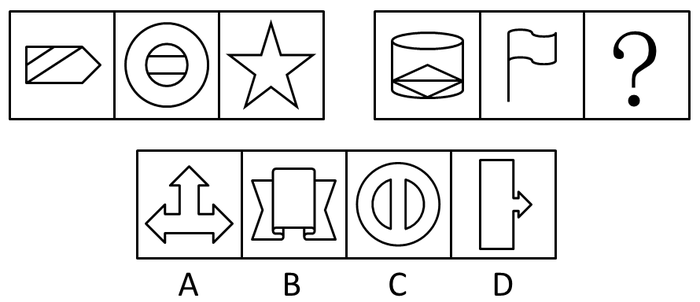

A. A

B. B

C. C

D. D

第 57 题 · 答案与解析

**参考答案（粉笔题库参考内容）**

C

**解析**

元素组成不同，无明显属性规律，考虑数量规律。观察发现，第一组图每幅图都有两条横线，第二组图前两幅图每幅图都有两条竖线，只有C项符合。

故正确答案为C。

**考点**：数量规律-线

**来源**：2012年广东省公务员录用考试《行测》题第57题

### 第 58 题

从所给的四个选项中，选择最合适的一个填入问号处，使之呈现一定的规律性：

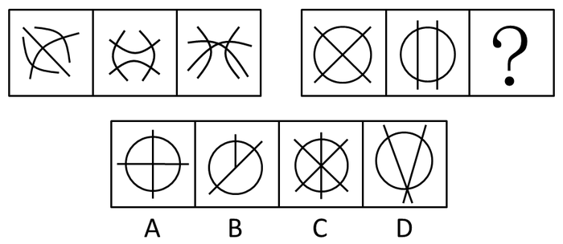

A. A

B. B

C. C

D. D

第 58 题 · 答案与解析

**参考答案（粉笔题库参考内容）**

D

**解析**

数交点的个数。

第一组图形交点的个数分别为3、4、5，第二组图形交点的个数分别为5、4、3，选项交点的个数依次为5、4、7、3。

故正确答案为D。

**考点**：数量规律-点

**来源**：2012年广东省公务员录用考试《行测》题第58题

### 第 59 题

从所给的四个选项中，选择最合适的一项填入问号处，使之呈现一定的规律性：

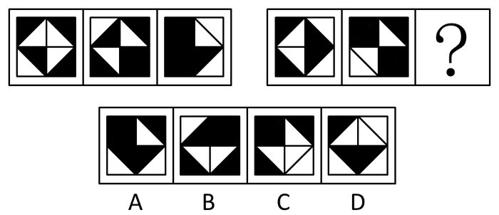

A. A

B. B

C. C

D. D

第 59 题 · 答案与解析

**参考答案（粉笔题库参考内容）**

B

**解析**

元素组成相似，元素黑白叠加。

前两个图形黑白叠加形成第三个图形。叠加规则为：黑＋白＝黑，白＋黑＝黑，黑＋黑＝白，白＋白＝白，只有B项符合规则。

故正确答案为B。

**考点**：样式规律-黑白运算

**来源**：2012年广东省公务员录用考试《行测》题第59题

### 第 60 题

从所给的四个选项中，选择最合适的一个填入问号处，使之呈现一定的规律性：

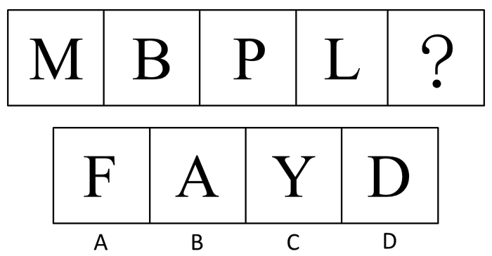

A. A

B. B

C. C

D. D

第 60 题 · 答案与解析

**参考答案（粉笔题库参考内容）**

D

**解析**

元素组成不同，且无明显属性规律，考虑数量规律。观察发现，题干中字母均为一笔画图形，故？处应选择一个一笔画图形，只有D项符合。

故正确答案为D。

**考点**：数量规律-线、文字/字母/数字类

**来源**：2012年广东省公务员录用考试《行测》题第60题

### 第 61 题

从所给的四个选项中，选择最合适的一项填入问号处，使之呈现一定的规律性：

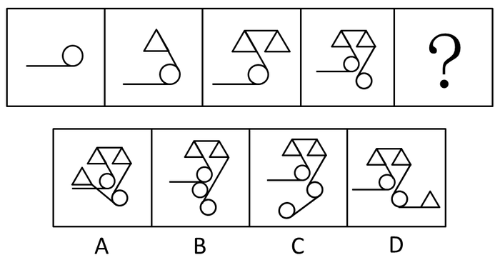

A. A

B. B

C. C

D. D

第 61 题 · 答案与解析

**参考答案（粉笔题库参考内容）**

D

**解析**

元素叠加和位置的综合考查。

题干中元素按照“圆—三角—三角—圆”的规律依次出现，故下一幅图应为“圆—三角—三角—圆—三角”排除B、C两项；另外题干中图形折线不存在交叉，以60度角的方向延伸，可排除A项。

故正确答案为D。

**来源**：2012年广东省公务员录用考试《行测》题第61题

### 第 62 题

从所给的四个选项中，选择最合适的一个填入问号处，使之呈现一定的规律性：

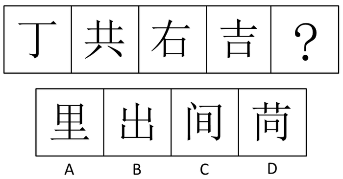

A. A

B. B

C. C

D. D

第 62 题 · 答案与解析

**参考答案（粉笔题库参考内容）**

A

**解析**

元素组成不同，且无明显属性规律，优先考虑数量规律。观察发现，题干图形中横线数量依次为1、2、3、4，依次递增，则？处图形应包含5条横线，只有A项符合。

故正确答案为A。

**考点**：数量规律-线、文字/字母/数字类

**来源**：2012年广东省公务员录用考试《行测》题第62题

### 第 63 题

从所给的四个选项中，选择最合适的一个填入问号处，使之呈现一定的规律性：

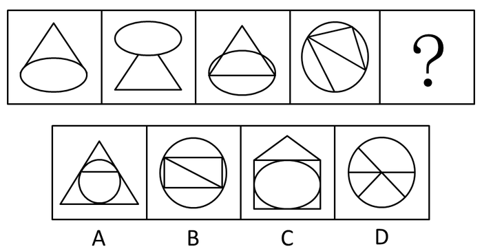

A. A

B. B

C. C

D. D

第 63 题 · 答案与解析

**参考答案（粉笔题库参考内容）**

D

**解析**

元素组成凌乱，本题考查的是元素中的角数量。

题目中的角数量分别为1，2，3，4。那么接下来的图形应该包含5个角，选项角数量依次为7，6，7，5。只有D项符合。

故正确答案为D。

**考点**：数量规律-角

**来源**：2012年广东省公务员录用考试《行测》题第63题

### 第 64 题

从所给的四个选项中，选择最合适的一个填入问号处，使之呈现一定的规律性：

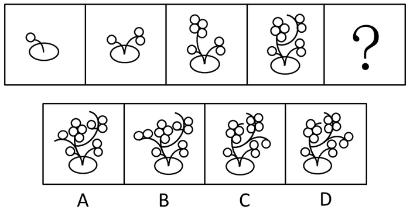

A. A

B. B

C. C

D. D

第 64 题 · 答案与解析

**参考答案（粉笔题库参考内容）**

D

**解析**

题干图形枝条数分别为1、2、3、4，依次递增，则下一幅图枝条数应为5，排除A、B两项；另外，每个图形中各个枝条的果实数分别为（1）、（1、2）、（1、2、4）、（1、2、4、2），每幅图都包含与上幅图相同的枝条，故下一幅图应为（1、2、4、2、4），排除C项。

故正确答案为D。

**考点**：数量规律-素

**来源**：2012年广东省公务员录用考试《行测》题第64题

### 第 65 题

从所给的四个选项中，选择最合适的一个填入问号处，使之呈现一定的规律性：

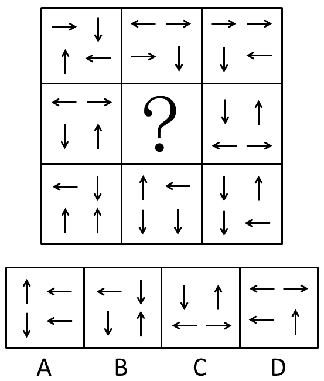

A. A

B. B

C. C

D. D

第 65 题 · 答案与解析

**参考答案（粉笔题库参考内容）**

A

**解析**

元素组成相似，优先考虑样式规律。题干图形由4个不同方向黑色箭头构成，且箭头排布框架轮廓相同，不同方向黑色箭头数量不同，优先考虑黑白运算。九宫格横向看无规律，考虑纵向看，观察第一列发现，运算规律为：上下箭头＋左右箭头＝上下箭头，左箭头＋右箭头＝左箭头，上箭头＋下箭头＝上箭头；经验证，第三列符合此规律；第二列应用此规律，只有A项符合条件。

故正确答案为A。

**考点**：样式规律-黑白运算

**来源**：2012年广东省公务员录用考试《行测》题第65题

### 第 66 题

从所给的四个选项中，选择最合适的一项填入问号处，使之呈现一定的规律性：

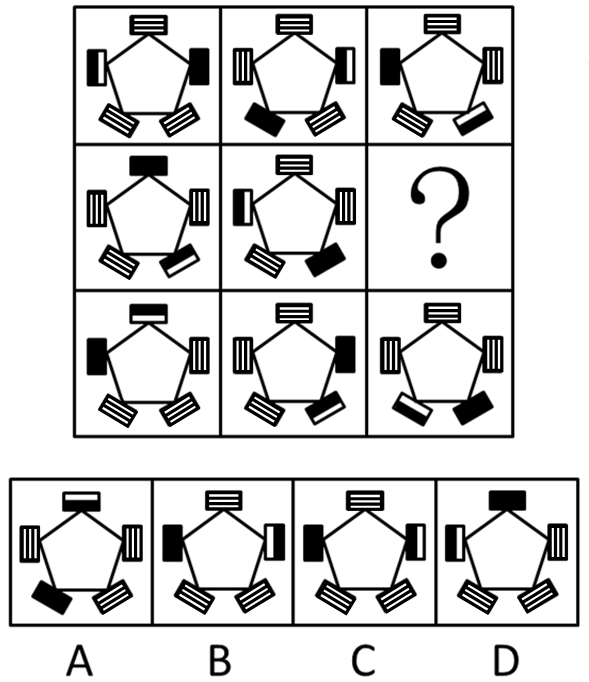

A. A

B. B

C. C

D. D

第 66 题 · 答案与解析

**参考答案（粉笔题库参考内容）**

A

**解析**

元素组成相同，看位置。

从每行来看，第一行第一幅图中的长方块都顺时针移动两个位置（即整个图形顺时针旋转144°）得到第二幅图，第二幅中的长方块都顺时针移动一个位置（即整个图形顺时针旋转72°）得到第三幅图。第二行和第三行的规律同第一行。因此第二行问号处的图形应是前一幅图形中的长方块都顺时针移动一个位置（即整个图形顺时针旋转72°）得到。只有A符合规律。

从每列来看，黑白相间图形逆时针依次移动两个位置 ，黑色图形逆时针移动一个位置，也可以得到正确答案A。但是按照行来看是整个图形一起移动，而按列看是局部的黑白相间的长方块和全黑的长方块在移动，因此看行的规律更严谨。

故正确答案为A。

**考点**：位置规律-平移

**来源**：2012年广东省公务员录用考试《行测》题第66题

### 第 67 题

十二五期间，我国进入社会主义建设为重点的新时期，社会主义建设的顺利进行离不开产业结构调整与民生问题的有效解决。要解决民生问题，需要在关系人民群众切身利益的领域加大财政投入，并创新社会管理模式。

这段文字可以推出：

A. 只要加大财政投入就能保证社会主义建设的顺利进行

B. 不创新社会管理模式就无法有效解决民生问题

C. 产业结构调整有利于创新社会管理模式

D. 加大财政投入是产业结构调整的基础

第 67 题 · 答案与解析

**参考答案（粉笔题库参考内容）**

B

**解析**

第一步：翻译题干。利用充分必要条件。

①社会主义建设的顺利进行→产业结构调整与民生问题的有效解决。

②解决民生问题→加大财政投入 且 创新社会管理模式。

第二步：逐一翻译选项并判断正确答案。利用逆否规则。

A项，加大财政投入→社会主义建设的顺利进行，题干没有说明加大财政投入和社会主义建设的顺利进行两者间关系，无法推出，错误；

B项，-创新社会管理模式→—解决民生问题，根据联言命题的真值表可知，联言命题的一个命题为假，整个联言命题就为假，因此可从“-创新社会管理模式”推出 “-（加大财政投入 且 创新社会管理模式）”，再根据逆否规则，从②可推出“-（加大财政投入 且 创新社会管理模式）→—解决民生问题”，三个推导关系连起来为“-创新社会管理模式→—（加大财政投入 且 创新社会管理模式）→—解决民生问题”，正确；

C项，题干没有说明产业结构调整和创新社会管理模式两者间的关系，无法推出，错误；

D项，产业结构调整→加大财政投入，同样题干没有说明这两者的关系，无法推出，错误。

故正确答案为B。

**考点**：常规翻译

**来源**：2012年广东省公务员录用考试《行测》题第67题

### 第 68 题

每逢开学，各大书店总有不少家长拿着老师开列的书单为孩子买辅导书，然而有时却不容易买到。尽管有些辅导书内容上大同小异，但不同的版本却往往让家长不放心，让老师不满意。其实，家长和老师们都有点庸人自扰了。辅导书是买给孩子用的，应该多和孩子商量，把选择权交给孩子。

上述论断的前提是：

A. 辅导书是教材的补充，是学生学习必备的参考资料

B. 对孩子发展的引导应从孩子自身的个性、能力出发

C. 老师和家长在购买辅导书时与孩子缺乏足够的交流

D. 孩子对自己的学习需求有较为清晰的认识

第 68 题 · 答案与解析

**参考答案（粉笔题库参考内容）**

D

**解析**

本题属于加强题型

第一步：分析题干，找出论点论据。

论点：辅导书是买给孩子用的，应该多和孩子商量，把选择权交给孩子。

论据：无。

第二步：逐一判断选项。

论点中提到把选择权交给孩子，只有孩子对自己的学习需求有较为清晰的认识，知道如何做出选择，把选择权交给孩子才有意义，D项当选。

A项说的是辅导书的作用，B项说的是如何引导孩子，C项说的是购买辅导书时缺乏交流，这些都无法支持是否应该把选择权交给孩子，属于无关选项。

故正确答案为D。

**考点**：必要条件

**来源**：2012年广东省公务员录用考试《行测》题第68题

### 第 69 题

电动汽车因为节能、环保，被誉为未来汽车发展的方向，许多国家都在大力发展电动汽车产业。然而，某国对此并不热衷，没有出台相关的产业扶持政策。

以下不能支持该国做法的一项是：

A. 石油产业是该国的支柱产业

B. 该国的电能较为紧张

C. 电动汽车技术已经成熟

D. 该国燃油发动机制造水平世界领先

第 69 题 · 答案与解析

**参考答案（粉笔题库参考内容）**

C

**解析**

第一步：找到论点和论据。

本题论点是该国对大力发展电动汽车产业不热衷，没有出台相关的产业扶持政策。没有明显论据。

第二步：逐一判断选项的作用。

A项：“石油产业是该国的支柱产业”，那么大力发展电动汽车会对该支柱产业产生冲击，导致该国经济出现问题，因此该项支持了题干中的做法；

B项：“该国的电能较为紧张”是制约发展电动汽车产业的原因，属加强论点；

C项：“电动汽车技术已经成熟”，说明应该大力发展电动汽车产业，削弱论点；

D项：“该国燃油发动机制造水平世界领先”，发展电动汽车产业的话，会对石油产业和燃油发动机制造商造成冲击，支持了该国不热衷发展电动汽车的做法，加强论点。

本题为选非题，故正确答案为C。

**考点**：加强选非题

**来源**：2012年广东省公务员录用考试《行测》题第69题

### 第 70 题

某公共服务部门发言人在接受记者采访时称，去年没有群众针对该部门的服务提起投诉，因此社会对于该部门去年的服务工作是满意的。

上述发言人的结论基于的假设是：

A. 该部门的投诉渠道不畅通，投诉信箱只是摆设

B. 如果接到群众投诉，该部门会进行整改

C. 群众只要对该部门的服务不满意，就会提起投诉

D. 上级对于该部门去年的服务工作十分满意

第 70 题 · 答案与解析

**参考答案（粉笔题库参考内容）**

C

**解析**

第一步：分析题干，找到论点和论据。

本题论点是社会对于该部门去年的服务工作是满意的，论据是去年没有群众针对该部门的服务提起投诉。

第二步：判断加强方式。

本题论点强调满意，论据强调没有提起投诉，所以论点和论据之间不存在明显的因果关系，需加强论证，在论点和论据间搭桥。

第三步：逐一判断选项的作用。

A项说该部门的投诉信箱只是摆设，不能有效地反映群众的态度，是削弱论证；

B项说如果接到投诉就会整改，这是对投诉的处理，属无关选项；

C项说只要对服务不满意，就会提起投诉，没有投诉，才能得出群众是满意的，在满意和没有投诉之间搭桥，是答案；

D项说的是上级对该部门服务的满意度，题干说的是群众对该部门是否满意，属无关选项。

故正确答案为C。

**考点**：搭桥

**来源**：2012年广东省公务员录用考试《行测》题第70题

### 第 71 题

宗教是弱势群体的避难所。这个观点无疑是对的。弱势群体确实更容易信仰宗教，以女性为例，在中国，妇女地位比以前有了很大提高，她们在学业、社会活动、人际交往等方面也越来越不弱于男性，因此，在中国，信仰宗教的女性并不多见，而在一些西方国家，很多女性是信仰宗教的，这正是因为她们的社会地位比中国女性的社会地位低。
以下最能削弱上述论断的一项是：

A. 一些国家女性的社会地位比中国女性的社会地位高

B. 信仰宗教与家庭教育以及社会历史传统有很大关系

C. 近些年中国信仰宗教的妇女人数有所增加

D. 中国人对宗教信仰的理解与西方人有很大差异

第 71 题 · 答案与解析

**参考答案（粉笔题库参考内容）**

B

**解析**

第一步：找出论点和论据。

论点：弱势群体更容易信仰宗教，宗教是弱势群体的避难所。

论据：以女性为例，在中国，妇女地位比以前有了很大提高，她们在学业、社会活动、人际交往等方面也越来越不弱于男性，因此，在中国，信仰宗教的女性并不多见，而在一些西方国家，很多女性是信仰宗教的，这正是因为她们的社会地位比中国女性的社会地位低。

本题论点和论据均在讨论“弱势群体（即社会地位较低的群体）”与“信仰宗教”之间的关系，二者话题一致，且论点中存在因果关系，削弱可以考虑削弱论点、因果倒置和他因削弱。

第二步：逐一分析选项。

A项：指出一些国家女性的社会地位比中国女性的社会地位高，讨论的是国内外女性社会地位高低的差异，而论点讨论的是社会地位高低是否影响宗教信仰，二者话题不一致，无法削弱，排除；

B项：指出信仰宗教与家庭教育以及社会历史传统有很大关系，说明影响宗教信仰的核心因素除了社会地位高低外，还有家庭教育、社会历史传统，他因削弱，可以削弱，当选；

C项：指出近些年中国信仰宗教的妇女人数有所增加，讨论的是信仰宗教人数的变化情况，而论点讨论的是社会地位高低是否影响宗教信仰，二者话题不一致，无法削弱，排除；

D项：指出中国人对宗教信仰的理解与西方人有很大差异，讨论的是国内对宗教信仰的理解差异，而论点讨论的是社会地位高低是否影响宗教信仰，二者话题不一致，无法削弱，排除。

故正确答案为B。

**考点**：他因削弱

**来源**：2012年广东省公务员录用考试《行测》题第71题

### 第 72 题

消费者声称在市场上买到的假鸡蛋，经鉴定均为过期变质蛋、孵化蛋等真鸡蛋，而非化工合成品。专家认为，依据现在的技术条件，要做出以假乱真的假鸡蛋成本很高，根本不可能牟利，因此市场上不可能有所谓的假鸡蛋。
以下无法削弱上述专家结论的一项是：

A. 以现在的技术水平完全能够做出以假乱真的假鸡蛋

B. 一些企业生产假鸡蛋用于工艺品或表演道具

C. 一些不法商贩掌握了降低假鸡蛋生产成本的技术

D. 即使假鸡蛋做不到以假乱真也能被一些粗心的人购买

第 72 题 · 答案与解析

**参考答案（粉笔题库参考内容）**

A

**解析**

第一步：找到论点和论据。

本题论点是市场上不可能有所谓的假鸡蛋，论据是依据现在的技术条件，要做出以假乱真的假鸡蛋成本很高，根本不可能牟利。

第二步：判断选项的作用。

A项指出可以做出以假乱真的假鸡蛋，没有提到成本，而题干的说法是成本高，并非做不出，必然不能削弱；

B项指出市场上存在假鸡蛋，直接削弱论点；

C项指出可以降低成本，因此可以牟利，有削弱作用；

D项指出市场上存在假鸡蛋，且可以牟利，直接削弱论点。

本题为选非题，故正确答案为A。

**考点**：削弱选非题

**来源**：2012年广东省公务员录用考试《行测》题第72题

### 第 73 题

在欧债危机日益恶化的形势下，欧洲以及其他地区和国家的央行可能会大量印刷钞票应对，由此会形成热钱新一轮的泛滥，届时将持续提高诸如房地产等不动产的价格，因此投资者现在应该继续买进房产。

以下无法削弱上述结论的一项是：

A. 为了本国经济的健康发展，许多国家将不会增发货币

B. 当前的房地产价格平稳，短期内不会有大的波动

C. 由于房地产市场泡沫严重，国家出台了一系列打击房地产投机的政策

D. 由于大量外来人口涌入城市，人们对于住房的刚性需求依然存在

第 73 题 · 答案与解析

**参考答案（粉笔题库参考内容）**

D

**解析**

第一步：找到论点和论据。

本题论点是投资者现在应该继续买进房产，论据是由于欧债危机，欧洲以及其他地区和国家的央行可能会大量印刷钞票应对，由此会形成热钱新一轮的泛滥，届时将持续提高诸如房地产等不动产的价格。

第二步：判断削弱方式。

本题论点和论据之间存在因果关系，所以需要削弱论点。

第三步：逐一判断选项的作用。

A项的许多国家将不会增发货币、B项的房地产价格平稳、C项的出台一系列打击房地产投机的政策均削弱论点；

D项人们对于住房的刚性需求依然存在，与房产价格是否增高无关，属无关选项。

本题为选非题，故正确答案为D。

**考点**：削弱选非题

**来源**：2012年广东省公务员录用考试《行测》题第73题

### 第 74 题

某市电视台推出了一个面向老年观众的养生节目，这个节目在试播时组织了许多老年人观看，获得一致好评，但在正式播出后，收视率非常不理想。

以下最能够解释上述矛盾现象的一项是：

A. 一些老年人认为节目内容对于养生作用不大

B. 节目的包装过于娱乐化，与老年人的需求不符

C. 看电视时间过长不利于老年人的身体健康

D. 节目播出时间较晚，此时大多数老年人已经休息

第 74 题 · 答案与解析

**参考答案（粉笔题库参考内容）**

D

**解析**

第一步：分析题干。

本题主要是说节目在试播时反应好，正式播出时收视率却不理想。要求进行解释。

第二步：逐一分析选项。

A项：“一些老年人”，无法说明整体状况，不构成解释，排除；

B项：“节目的包装过于娱乐化，与老年人的需求不符”，这与试播时获得一致好评矛盾，不能解释，排除；

C项：看电视时间过长的问题与该节目的关系没有谈到，不构成解释，排除；

D项：“节目播出时间过晚”，刚好解释了试播时获得好评，收视率却不理想的原因，当选。

故正确答案为D。

**考点**：原因解释

**来源**：2012年广东省公务员录用考试《行测》题第74题

### 第 75 题

一家刚开业的大型超市决定开展降价促销活动，部分商品售价甚至低于成本价，在这种情况下，销售量越大，超市的经济损失就越大。这一决定遭到很多超市员工反对，但超市经理依然坚持这一决定。

以下最能支持经理决定的一项是：

A. 薄利多销的方式有利于提高超市销售收入

B. 物美价廉的商品更容易受到消费者的欢迎

C. 扩大知名度对于新开业的超市至关重要

D. 许多超市在开业时都开展降价促销活动

第 75 题 · 答案与解析

**参考答案（粉笔题库参考内容）**

C

**解析**

本题属于加强题型。

第一步：找出论点论据。

本题要求找出支持经理决定的一项，经理的决定是开展降价促销活动，尽管部分商品售价甚至低于成本价，且销售量越大，超市的经济损失就越大。

第二步：逐一判断选项。

A项说的提高超市销售收入，而经理的决定可能会给超市带来一定的经济损失，无法支持经理的决定；

B项说的是物美价廉的商品，属于无关选项；

C项“扩大知名度对于新开业的超市至关重要”说明对新开业的超市来说，除了考虑经济收益问题，还要考虑知名度的问题，支持了经理的决定；

D项说的是别的超市开业时也开展降价促销活动，无法解释为什么经理在可能给超市带来经济损失的情况下还开展降价促销活动，属于无关选项。

故正确答案为C。

**考点**：补充论据

**来源**：2012年广东省公务员录用考试《行测》题第75题

### 第 76 题

有人主张，国家应当发行500元和1000元的大面额人民币，他认为目前的人民币最大面额偏小，在当前经济总量急剧增长的情况下，已经不能满足市场交易的需要。大面额人民币有许多好处：一是便于携带；二是提高流通效率；三是节约纸张。

以下最能够质疑该人主张的一项是：

A. 大面额人民币在日常小额消费使用时很不方便

B. 发行大面额人民币会给低收入人群带来挫折感

C. 大面额人民币丢失或被盗会给人们带来较大经济损失

D. 人们在大额交易时更习惯于用电子货币支付

第 76 题 · 答案与解析

**参考答案（粉笔题库参考内容）**

D

**解析**

本题属于削弱题型。

第一步：找出论点论据。

论点：国家应当发行大面额人民币。

论据：目前的人民币最大面额偏小，不能满足市场交易的需要。

第二步：逐一判断选项。

A项说的是大面额人民币在日常小额消费时使用不便，B项说的是大面额人民币给低收入人群造成的影响，C项说的是大面额人民币丢失或被盗会带来较大损失，这些都无法说明是否应当发行大面额人民币来满足市场交易的需要，属于无关选项；

D项人们在大额交易时更习惯于用电子货币支付，说明没有发行大额人民币的必要，直接削弱了论点，当选。

故正确答案为D。

**考点**：削弱论点

**来源**：2012年广东省公务员录用考试《行测》题第76题

### 第 77 题

自2011年9月1日起，个人所得税工资薪金所得扣除标准（即起征点）由2000元/月提高到3500元/月。

这一调整有利于：

A. 促进分配公平

B. 鼓励多劳多得

C. 增加税收收入

D. 扩大征税范围

第 77 题 · 答案与解析

**参考答案（粉笔题库参考内容）**

A

**解析**

调整个人所得税是缩小财富差距、促进分配公平的有力措施。

故正确答案为A。

**考点**：宏观经济与调控政策

**来源**：2012年广东省公务员录用考试《行测》题第77题

### 第 78 题

在现代社会中，信息技术广泛应用于工作生活的各个方面。

下列信息技术的应用中，主要属于信息获取的是：

A. 用播放软件欣赏音乐

B. 通过网络视频聊天

C. 发送电子邮件

D. 用扫描仪扫描文件

第 78 题 · 答案与解析

**参考答案（粉笔题库参考内容）**

D

**解析**

信息技术是指能够支持信息的获取、传递、加工、存储和呈现的一类技术。

A项是信息的呈现；

B、C两项主要是通过网络进行信息的传递；

D项属于信息获取。

故正确答案为D。

**考点**：科技理论与成就

**来源**：2012年广东省公务员录用考试《行测》题第78题

### 第 79 题

适当食用粗粮，增加纤维素的摄入有益人体健康。

下列有关纤维素的说法，错误的是：

A. 纤维素在胃肠中可被分解为葡萄糖，并被人体有效吸收

B. 食物中的纤维素能够使人产生饱腹感，有利于减肥

C. 纤维素能够吸附一些有害物质，有利于体内毒素的排除

D. 纤维素是一种天然有机高分子化合物，能够吸附大量水分

第 79 题 · 答案与解析

**参考答案（粉笔题库参考内容）**

A

**解析**

人类膳食中的纤维素主要含于蔬菜和粗加工的谷类中，不能被消化吸收，A项表述错误。

本题为选非题，故正确答案为A。

**考点**：生物常识

**来源**：2012年广东省公务员录用考试《行测》题第79题

### 第 80 题

当乘坐升降电梯上楼时，从电梯开始启动到最后停下来，身体所处的状态先后分别为：

A. 失重 正常 超重

B. 超重 正常 失重

C. 超重 失重 正常

D. 正常 超重 失重

第 80 题 · 答案与解析

**参考答案（粉笔题库参考内容）**

B

**解析**

电梯启动后，具有向上的加速度，此时人体所受到的支持力大于人体本身的重力，处于超重的状态，而后电梯匀速上升，人体处于正常状态，电梯即将停下来前，具有向下的加速度，这时人体所受到的支持力小于人体本身的重力，处于失重的状态，直到最后停下来。

故正确答案为B。

**考点**：物理常识

**来源**：2012年广东省公务员录用考试《行测》题第80题

### 第 81 题

人们在剧烈运动后会感到非常口渴，这时为补充水分、恢复体力，适量饮用下列哪种饮料更为合适：

A. 淡盐水

B. 白开水

C. 茶饮料

D. 碳酸饮料

第 81 题 · 答案与解析

**参考答案（粉笔题库参考内容）**

A

**解析**

人在剧烈运动过程中，身体通过排汗将大量热能及时散发掉，以保持体温的相对稳定。在机体大量排汗的同时，带走了不少无机盐，如钠、钾、镁等。这样势必引起机体疲乏无力，甚至肌肉痉挛或抽筋。因此，剧烈运动后，适当喝些淡盐水是必要的。

故正确答案为A。

**考点**：生活常识

**来源**：2012年广东省公务员录用考试《行测》题第81题

### 第 82 题

废旧电池是一种常见的污染物，是破坏生态环境的“杀手”。下列关于废旧电池的说法错误的是：

A. 废旧电池含有大量的重金属

B. 废旧电池无法回收再利用，应集中处理

C. 有害物质会从废旧电池中溢出，污染水和土壤

D. 废旧电池如果随意丢弃，其中的有害物质会通过各种媒介进入人体

第 82 题 · 答案与解析

**参考答案（粉笔题库参考内容）**

B

**解析**

A项，电池主要含铁、锌、锰等重金属元素，正确；

B项，从节约资源的角度来看，废旧电池中铁、锌、锰等重金属元素可回收利用。国际上通行的废旧电池处理方式大致有三种：固化深埋、存放于废矿井、回收利用。其中回收利用分为热处理、湿处理和真空热处理，错误；

C项，废旧电池含有微量的汞，汞是有毒的物质，可从电池中溢出，污染水和土壤，正确；

D项，废旧电池如果随意丢弃，其中的有害物质如汞元素会溢出，通过各种媒介如水等进入人体中，正确。

本题为选非题，故正确答案为B。

**考点**：化学常识

**来源**：2012年广东省公务员录用考试《行测》题第82题

### 第 83 题

小船匀速横渡一条河流，若船行驶到河中央时，水流速度突然变快，则：

A. 小船渡河时间减少

B. 小船渡河时间增加

C. 小船渡河时间不变

D. 小船无法到达对岸

第 83 题 · 答案与解析

**参考答案（粉笔题库参考内容）**

C

**解析**

小船在匀速横渡河流的时候在竖直方向上的速度（V）不会发生变化，到河对岸的距离（S）也不会变化，根据公式T=S/V，故时间（T）不会发生变化。这里值得注意的是，水流的快慢影响的只是小船在河流方向上的行驶距离，水流变快会加大这个距离，但是它并不影响过河的时间。

故正确答案为C。

**考点**：生活常识

**来源**：2012年广东省公务员录用考试《行测》题第83题

### 第 84 题

下列说法正确的一项是：

A. 大气中二氧化碳浓度的增加导致全球变暖，也不利于植物的光合作用

B. 树桩上年轮较稀疏的一边是南方，年轮较紧的一边是北方

C. 在寒冷的冬季用手直接触摸金属门把手会感觉很冷，这是因为门把手将寒气传递给了手掌

D. 日环食的出现是由于月球在太阳和地球之间时距地球较近，不能完全遮住太阳形成的

第 84 题 · 答案与解析

**参考答案（粉笔题库参考内容）**

B

**解析**

A项，大气中二氧化碳等气体能对地球反射出来的长波辐射具有高度的吸收性，能强烈吸收地面辐射中的红外线，也就是常说的“温室效应”，二氧化碳浓度增加会导致全球变暖；同时，植物的光合作用是将二氧化碳转化为有机物并释放出氧气，二氧化碳浓度的增加在一定程度上会促进光合作用，错误；

B项，在北半球（从应试角度看题干默认的是北半球）在树木生长过程中，树干朝南一面受阳光照射较多，形成层原始细胞分裂也较迅速，径向生长加快，结果茎干南面的年轮也较宽（稀疏）。而在茎干背阴朝北的一面，年轮则明显狭窄（紧密），正确；

C项，在寒冷的冬季，用手触摸门把手会感觉冷是因为手与门把的温差较大，错误；

D项，日环食的出现是因为月球在太阳和地球之间，但是距离地球较远，不能完全遮住太阳而形成的，错误。

故正确答案为B。

**考点**：其他

**来源**：2012年广东省公务员录用考试《行测》题第84题

### 第 85 题

下列说法错误的一项是：

A. 绿色食品是指安全无污染且富有营养的蔬菜水果

B. 人们空腹喝牛奶不利于营养成分的吸收

C. 香蕉是热带水果，不适宜放在冰箱中冷藏

D. 摄入过多食品添加剂会危害人体健康

第 85 题 · 答案与解析

**参考答案（粉笔题库参考内容）**

A

**解析**

A项，绿色食品不仅包括蔬菜水果，还包括畜禽及水产品等，错误；

B项，空腹喝牛奶，蛋白质会在缺少糖和脂肪的情况下被迫转为能量消耗，而不能起到它更大的营养作用，正确；

C项，香蕉是热带水果，最适宜储存温度是11-13摄氏度，不宜放在冰箱中冷藏，正确；

D项，食品添加剂，特别是化学合成的食品添加剂大都有一定的毒性，所以使用时要严格控制使用量，摄入过多会危害人体健康，正确。

本题为选非题，故正确答案为A。

**考点**：其他

**来源**：2012年广东省公务员录用考试《行测》题第85题

## 材料 1

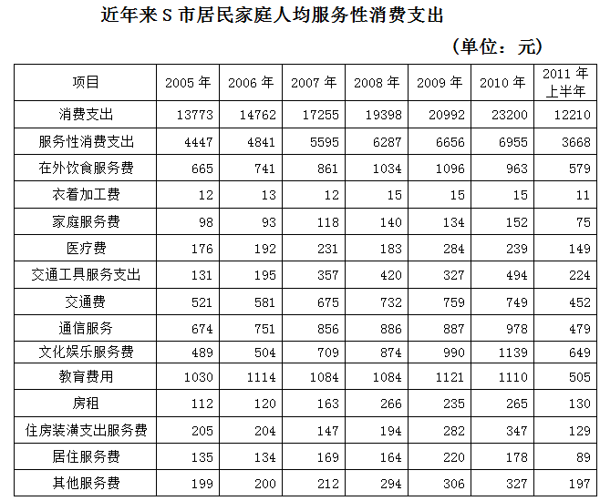

### 第 86 题

服务性消费支出占消费支出的比例最高的年份是哪年：

A. 2005

B. 2006

C. 2007

D. 2008

第 86 题 · 答案与解析

**参考答案（粉笔题库参考内容）**

B

**解析**

根据题干“······占······的比例最高”，可判定本题为比值比较问题。定位表格材料第一行，第二行和第三行可知：2005年服务性消费支出为4447元，消费支出为13773元；2006年服务性消费支出为4841元，消费支出为14762元；2007年服务性消费支出为5595元，消费支出为17255元；2008年服务性消费支出为6287元，消费支出为19398元；故2005-2008年服务性消费支出占消费支出比例分别为：4447/13773、4841/14762、5595/17255、6287/19398。分数很接近，选择直除，直除分别为0.322、0.327、0.324、0.324，2006年最高。

故正确答案为B。

**考点**：比值比较、统计表

**来源**：2012年广东省公务员录用考试《行测》题第86题

### 第 87 题

2010年与2005年相比，交通工具服务支出占服务性消费支出的比重提高了约：

A. 2%

B. 4%

C. 6%

D. 8%

第 87 题 · 答案与解析

**参考答案（粉笔题库参考内容）**

B

**解析**

根据题干“2010年与2005年相比······占······的比重提高”， 可判定本题为两期比重问题。定位表格材料可知：2005年和2010年交通工具服务支出费分别为131元和494元，服务性消费支出分别为4447元和6955元，故比重提高了494/6955-131/4447≈500/7000-135/4500≈0.071-0.03=4.1%，B项最接近。

故正确答案为B。

**考点**：两期比重、统计表

**来源**：2012年广东省公务员录用考试《行测》题第87题

### 第 88 题

如果2011年下半年各项服务性消费支出的数值与2011年上半年相同，则2011年较2005年增长率最大的一项服务性消费支出是：

A. 在外饮食服务费

B. 家庭服务费

C. 医疗费

D. 交通费

第 88 题 · 答案与解析

**参考答案（粉笔题库参考内容）**

A

**解析**

根据题干“2011年较2005年增长率最大的一项······”，可判定本题为一般增长率问题。定位表格材料可知：2011年，在外饮食服务费、家庭服务费、医疗费、交通费分别为579×2=1158、75×2=150、149×2=298、452×2=904，2005年上述各项服务费分别为665、98、176、521。由增长率 = (现期 − 基期)/基期可知：

在外饮食服务费增长率= (1158−665)/665 = 493/665 ≈ 500/670 ≈ 0.74、家庭服务费增长率= (150-98)/98 = 52/98 ＜ 0.6、医疗费增长率= (298 - 176)/176 = 122/176 ≈ 0.7、交通费增长率= (904-521)/521 = 383/521 ≈ 380/520= 19/26 ≈ 0.73，故在外饮食服务费的增长率最大。

故正确答案为A。

**考点**：一般增长率、统计表

**来源**：2012年广东省公务员录用考试《行测》题第88题

### 第 89 题

可由上表得出的一项是：

A. 2005年至2011年，消费支出逐年增长

B. 2005年至2010年，服务性消费支出均未达到消费支出的三分之一

C. 在外饮食服务费在2011年首次超过教育费用

D. 2010年的交通工具服务支出比2005年翻了两番

第 89 题 · 答案与解析

**参考答案（粉笔题库参考内容）**

B

**解析**

A项：定位表格，只给出2011年上半年的消费支出，未给2011年全年的消费支出，所以无法确定2011年的消费支出是否比上年增长，错误；

B项：定位表格，观察表格第2、3行，将服务性消费支出的数值乘以3，所得数值均小于消费支出，所以2005年至2010年服务性消费支出均未达到消费支出的三分之一，正确；

C项：定位表格，由于表格中只给出2011年上半年的各项消费支出，未给出2011年全年的各项消费支出，所以无法对2011年的各项消费数值进行比较，错误；

D项：定位表格，若2010年的交通工具服务支出比2005年翻了两番，则2010年的交通工具服务支出应为131×4=524元＞494元，错误。

故正确答案为B。

**考点**：统计表、综合分析

**来源**：2012年广东省公务员录用考试《行测》题第89题

### 第 90 题

下列说法不正确的是：

A. 2005年至2009年，教育费用占服务性消费支出的比重逐年下降

B. 2005年至2009年，在外饮食服务费占服务性消费支出的比重逐年上升

C. 2006年至2010年，通信服务费占服务性消费支出的比重逐年下降

D. 2006年至2010年，文化娱乐服务费占服务性消费支出的比重逐年上升

第 90 题 · 答案与解析

**参考答案（粉笔题库参考内容）**

C

**解析**

A项：定位表格，2005年至2009年，教育费用基本一致，服务性消费支出逐年上升，所以教育费用占服务性消费支出的比重逐年下降，正确；

B项：定位表格，2005年至2009年，在外饮食服务费同比增长率每年均高于服务性消费支出同比增长率，所以在外饮食服务费占服务性消费支出的比重逐年上升，正确；

C项：定位表格，2006年至2010年，通信服务费2010年增加明显，但服务性消费增加不明显，比重可能上升，进行验证：2009年通信服务费占服务性消费支出的比重= 887/6656 = 0.133，2010年通信服务费占服务性消费支出的比重= 978/6955 = 0.141，所以比重上升，非逐年下降，错误；

D项：定位表格，2006年至2010年，文化娱乐服务费同比增长率每年均高于服务性消费支出同比增长率，所以文化娱乐服务费占服务性消费支出的比重逐年上升，正确。

本题为选非题，故正确答案为C。

**考点**：统计表、综合分析

**来源**：2012年广东省公务员录用考试《行测》题第90题

## 材料 2

2011年，G省交通运输生产持续平稳增长。全年客运总量522002.45万人，比上年增长11.8%，增幅同比回落2.9个百分比。旅客周转总量3852.66亿人公里，比上年增长15.3%，增幅同比回落1.4个百分比。分运输方式看，铁路客运量和旅客周转量分别为17778.00万人和506.00亿人公里，比上年分别增长18.9%和10.9%；公路客运量和旅客周转量分别为493618.00万人和2082.68亿人公里，比上年分别增长11.6%和20.0%；水路客运量和旅客周转量分别为2591.00万人和9.63亿人公里；航空客运量和旅客周转量分别为8015.45万人和1254.35亿人公里，比上年分别增长5.1%和9.9%。

        全年货运总量234913.02万吨，比上年增长14.7%，增幅同比提高1.7个百分点。货物周转总量7105.95亿吨公里，比上年增长19.8%，增幅同比提高0.1个百分点，公路货运量和周转量增幅分别比上年提高4.7个和7个百分点，其他运输方式增幅较上年则呈现不同程度的回落：其中，航空和铁路回落幅度较大，主要是2010年航空新增两架货运专机和高铁投入运营后，比2009年增幅基数偏高所致。

### 第 91 题

2009年客运总量约为多少万人：

A. 407068

B. 428748

C. 455102

D. 479340

第 91 题 · 答案与解析

**参考答案（粉笔题库参考内容）**

A

**解析**

根据题干“2009年客运总量”结合材料时间2011年，可判定本题为间隔基期问题。定位材料第一段， 2011全年客运总量522002.45万人，比上年增长11.8%，增幅同比回落2.9个百分点，则2010年的增幅为11.8%＋2.9%＝14.7%。因此2009年的客运总量为522002.45/(1+11.8%)÷(1+14.7%)，结合选项截三位运算得：522/(1.12 × 1.15) ≈ 522/1.28，直除可知前两位是40，与A项最为接近。

故正确答案为A。

**考点**：文字资料、间隔基期

**来源**：2012年广东省公务员录用考试《行测》题第91题

### 第 92 题

2011年水路旅客周转量比上年增长约：

A. 13%

B. 17%

C. 21%

D. 25%

第 92 题 · 答案与解析

**参考答案（粉笔题库参考内容）**

B

**解析**

根据题干“······比上年增长”结合选项百分数，可判定本题为增长率计算问题。定位材料第一段，2011年旅客周转总量3852.66亿人公里，比上年增长15.3%，铁路旅客周转量为506.00亿人公里，比上年增长10.9%；公路旅客周转量为2082.68亿人公里，比上年增长20.0%；水路旅客周转量为9.63亿人公里；航空旅客周转量为1254.35亿人公里，比上年增长9.9%。

由于2010年水路旅客周转量=2010年旅客周转量-2010年铁路旅客周转量-2010年航空旅客周转量-2010年公路旅客周转量，故2010年旅客周转总量为3852.66/1.153 ≈ 3341.42亿人公里。

2010年铁路旅客周转量约为506/1.109 ≈ 456.27亿人公里；

2010年航空旅客周转量约为1254.35/1.099 ≈ 1141.36亿人公里；

2010年公路旅客周转量约为2082.68/1.2 ≈ 1735.57亿人公里。

则2010年水路旅客周转量为3341.42-456.27-1141.36-1735.57=8.22亿人公里。根据增长率 = (现期 − 基期)/基期，2011年水路旅客周转量的增长率为(9.63-8.22)/8.22=0.17=17%。

故正确答案为B。

**考点**：一般增长率、文字资料

**来源**：2012年广东省公务员录用考试《行测》题第92题

### 第 93 题

2010年铁路客运量占全年客运总量的比重约为：

A. 3%

B. 5%

C. 7%

D. 9%

第 93 题 · 答案与解析

**参考答案（粉笔题库参考内容）**

A

**解析**

根据题干“2010年······占······的比重”，结合材料时间2011年，可判定本题为基期比重问题。根据基期比重公式A/B×(1+b)/(1+a)，可得2010年铁路客运量占全年客运总量的比重为17778/522002.45×(1+11.8%)/(1+18.9%)，选项差距大，截两位运算，则 17778/522002.45×(1+11.8%)/(1+18.9%)≈ 18000/520000 × 11/12= 33/1040 ＜ 0.033，与A项最为接近。

故正确答案为A。

**考点**：基期比重、文字资料

**来源**：2012年广东省公务员录用考试《行测》题第93题

### 第 94 题

下列增长率由小到大排列正确的一项是：

A. 2010年货运总量的年增长率＜2011年公路客运量的年增长率＜2011年旅客周转总量的年增长率＜2010年货物周转总量的年增长率

B. 2011年公路客运量的年增长率＜2010年货运总量的年增长率＜2011年旅客周转总量的年增长率＜2010年货物周转总量的年增长率

C. 2011年旅客周转总量的年增长率＜2011年公路客运量的年增长率＜2010年货运总量的年增长率＜2010年货物周转总量的年增长率

D. 2010年货运总量的年增长率＜2010年货物周转总量的年增长率＜2011年旅客周转总量的年增长率＜2011年公路客运量的年增长率

第 94 题 · 答案与解析

**参考答案（粉笔题库参考内容）**

B

**解析**

定位材料第一段，2011年公路客运量年增长率11.6%，2011年旅客周转总量年增长率15.3%；定位材料第二段，2011年货运总量增长率14.7%，增幅同比提高1.7个百分点，则2010年货运总量的年增长率为14.7%－1.7%＝13%；定位材料第二段2011年货物周转量增长率19.8%，增幅同比提高了0.1个百分点，则2010年货物周转总量年增长率为19.8%－0.1%＝19.7%，故2011年公路客运量年增长率&lt;2010年货运总量年增长率&lt;2011年旅客周转总量年增长率&lt;2010年货物周转总量年增长率。

故正确答案为B。

**考点**：排序类、文字资料

**来源**：2012年广东省公务员录用考试《行测》题第94题

### 第 95 题

可由以上资料得出的一项是：

A. 货运总量较上年增长率在2010和2011两个年度均大于客运总量较上年增长率

B. 货运周转总量较上年增长率在2010和2011两个年度均大于旅客周转总量较上年增长

C. 2011年陆路运输（包括铁路和公路）客运总量是其他运输方式客运总量的50多倍

D. 除公路运输方式外，其他运输方式的2011年货运量均较2010年有不同程度的减少

第 95 题 · 答案与解析

**参考答案（粉笔题库参考内容）**

B

**解析**

A项：定位材料第一段，2011年客运总量增长率11.8%，增幅同比回落2.9个百分点，则2010年客运总量的增长率11.8%+2.9%=14.7%；定位材料第二段，2011年货运总量增长率为14.7%，增幅同比提高了1.7个百分点，则2010年货运总量增长率14.7%-1.7%=13%，比较可知2010年货运总量增长率小于客运总量增长率，错误；

B项：定位材料第二段，2011年货物周转总量增长率19.8%，增幅同比提高0.1个百分点，则2010年货物周转总量增长率19.8%-0.1%=19.7%；定位材料 第一段，旅客周转总量增长率15.3%，增幅同比回落1.4个百分点，则2010年旅客周转总量增长率15.3%+1.4%=16.7%，比较得知2010年和2011年货运周转总量的增长率均大于旅客周转总量，正确；

C项：定位材料第一段，铁路客运总量17778.00万人，公路客运总量493618.00万人，水路客运总量2591.00万人，航空客运总量8015.45万人，则铁路和公路客运量为17778.00+493618.00=511396万人；水路和航空客运量2591.00+8015.45=10606.45万人，511396/10606.45首位商不到5，错误；

D项：定位材料第二段：其他运输方式增幅回落是指增长幅度变小，但仍然为增长趋势，而不是降低，错误。

故正确答案为B。

**考点**：文字资料、综合分析

**来源**：2012年广东省公务员录用考试《行测》题第95题

## 材料 3

**全国艺术表演团体机构与人员情况图**

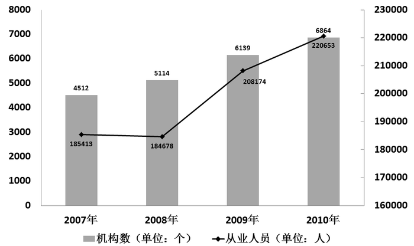

**全国艺术表演团体赴农村演出情况图**

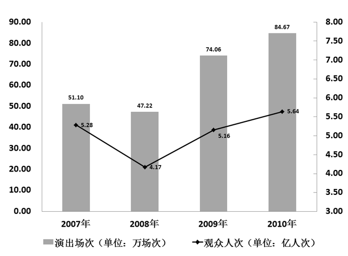

**2010年全国艺术表演团体分地区情况表**

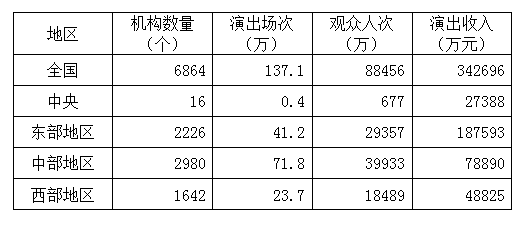

### 第 96 题

平均每场次农村演出的观众人数最少的年份是哪年：

A. 2007

B. 2008

C. 2009

D. 2010

第 96 题 · 答案与解析

**参考答案（粉笔题库参考内容）**

D

**解析**

根据题干“平均每······最少······”，可判定本题为现期平均数问题。定位第二个柱状图可知：

2007年平均每场次农村演出的观众人数= 5.28/51.10 ＞ 10%；

2008年平均每场次农村演出的观众人数= 4.17/47.22 = (8%)^+；

2009年平均每场次农村演出的观众人数= 5.16/74.06 = 6%^+；

2010年平均每场次农村演出的观众人数= 5.64/84.67 = 6%^+。

A、B两项排除，C项与D项比较，分子5.16到5.64的变化速度慢于分母74.06到84.67的变化速度，因此D项最小。

故正确答案为D。

**考点**：现期平均数、综合资料

**来源**：2012年广东省公务员录用考试《行测》题第96题

### 第 97 题

如果2011年从业人员人数年增长率与2010年相同，则2011年从业人员人数约为多少万：

A. 22.8

B. 23.4

C. 24.9

D. 25.7

第 97 题 · 答案与解析

**参考答案（粉笔题库参考内容）**

B

**解析**

根据题干“2011年从业人员人数”，结合材料时间2010年，可判定本题为现期计算问题。定位第一个柱状图，2009年与2010年从业人员分别为208174人、220653人。根据增长率 = 现期/基期 − 1，求得2010年增长率为220653/208174-1，则2011年人数为220653 × (1 + 220653/208174 − 1)= 220653 × 220653/208174，结合选项截三位运算，221 × 221/208 = 48841/208，直除前两位为23。

故正确答案为B。

**考点**：现期计算、综合资料

**来源**：2012年广东省公务员录用考试《行测》题第97题

### 第 98 题

2009年，平均每个表演团体机构农村演出的场次数约为多少次：

A. 8

B. 83

C. 121

D. 1170

第 98 题 · 答案与解析

**参考答案（粉笔题库参考内容）**

C

**解析**

根据题干“平均每······”，结合时间，可判断本题为现期平均数问题。定位第二个柱状图可知2009年演出场次为74.06万，定位第一个柱状图可知2009年机构数为6139。根据平均数公式可知题干所求= 740600/6139，结合选项，直除首位为1，观察量级，C项符合。

故正确答案为C。

**考点**：现期平均数、综合资料

**来源**：2012年广东省公务员录用考试《行测》题第98题

### 第 99 题

下列说法正确的是：

A. 2008年至2010年，从业人员数的增长率一直高于机构数的增长率

B. 2008年至2010年，农村演出场次的增长率一直低于观众人次的增长率

C. 2008年至2010年，平均每个机构的从业人员数逐年增加

D. 2008年至2010年，平均每场农村演出的观众人数逐年减少

第 99 题 · 答案与解析

**参考答案（粉笔题库参考内容）**

D

**解析**

A项：定位第一个柱状图可知，2008年从业人员数的增长率是负的，而2008年机构数的增长率是正的，错误；

B项：定位第二个柱状图可知，2008年农村演出场次的增长率 = (47.22 − 51.10)/51.10 = −3.88/51.1，2008年观众人次的增长率 = (4.17 − 5.28)/5.28 = − 1.11/5.28 = − 11.1/52.8，- 3.88/51.1 ＞ - 11.1/52.8，错误；

C项：定位第一个柱状图可知，2008年平均每个机构的从业人员数：184678/5114 = 36^+；2009年平均每个机构的从业人员数：208174/6139 = 33^+，错误；

D项，由第96题解析可知，2008年至2010年，平均每场农村演出的观众人数是逐年减少的，正确。

故正确答案为D。

**考点**：综合分析、综合资料

**来源**：2012年广东省公务员录用考试《行测》题第99题

### 第 100 题

下列说法错误的是：

A. 2010年，平均每场次演出的观众人次最多的地区是中部

B. 2010年，东部地区的机构数量接近全国的三分之一

C. 2010年，中部地区的演出场次比其他地区的总和还多

D. 2010年，每个机构的平均演出收入最少的地区是中部

第 100 题 · 答案与解析

**参考答案（粉笔题库参考内容）**

A

**解析**

A项：定位表格，平均每场次演出的观众人次分别为：中央 =677/0.4=67700/40≈1600+；东部=29357/41.2=700^+；中部=39933/71.8=500+；西部=18489/23.7≈700+。很明显，中央最高，错误；

B项：定位表格，2010年机构总数为6864个，其中东部地区2226个，机构总数的1/3为6864 × 1/3 = 2288，2226接近2288，正确；

C项：定位表格，中部地区演出场次为71.8万场，其他地区场次为137.1-71.8=65.3万场，中部地区高于其他地区总和，正确；

D项：定位表格，每个机构的平均演出收入分别为：中央= 27388/16 ≈ 1000+；东部= 187593/2226 ≈ 80+；中部= 78890/2980 ≈ 20+；西部= 48825/1642 ≈ 30。中部地区平均收入最少，正确。

本题为选非题，故正确答案为A。

**考点**：综合分析、综合资料

**来源**：2012年广东省公务员录用考试《行测》题第100题

