# 2013年广东省公务员录用考试《行测》题（一）

<!-- gwy:overview:start -->
> **广东 · 2013 · 行测 · 统考** ｜ 100 题 · 图片 13 处 · 答案随题折叠

| 题型模块 | 题量 | 题号 |
| --- | ---: | ---: |
| 数量关系 | 15 | 1–15 |
| 言语理解与表达 | 30 | 16–45 |
| 判断推理 | 30 | 46–75 |
| 常识判断 | 10 | 76–85 |
| 资料分析 | 15 | 86–100 |
| **合计** | **100** | |

导航：[题型与作答说明](#题型与作答说明) · [题目](#题目) · [材料 1](#材料-1)
<!-- gwy:overview:end -->

> 候选采集稿。参考答案及解析来自粉笔页面，不代表官方答案或真实高分答卷；来源使用许可与原卷对应关系仍需人工核实。

## 题型与作答说明

数量关系

（15题）

本部分包括数字推理和数学运算两种类型的试题。

言语理解与表达

（30题）

本部分包括选词填空和阅读理解两种类型的题目。

判断推理

（30题）

本部分包括类比推理、图形推理、演绎推理三种类型的题目。

常识判断

（10题）

根据题目要求，选择正确答案。

资料分析

（15题）

根据下列文字、表格或图形回答问题。你应根据资料提供的信息进行分析、比较、计算、处理。

## 题目

### 第 1 题

160，80，40，20，（  ）

A. 4

B. 6

C. 8

D. 10

第 1 题 · 答案与解析

**参考答案（粉笔题库参考内容）**

D

**解析**

原数列为等比数列，公比为0.5，所以未知项为20×0.5＝10。

故正确答案为D。

**来源**：2013年广东省公务员录用考试《行测》题（一）第1题

### 第 2 题

6，14，22，（  ），38，46

A. 30

B. 32

C. 34

D. 36

第 2 题 · 答案与解析

**参考答案（粉笔题库参考内容）**

A

**解析**

原数列递增，增长稳定，两两作差。可知原数列为等差数列，公差为8，所以未知项为22+8=38-8=30。

故正确答案为A。

**来源**：2013年广东省公务员录用考试《行测》题（一）第2题

### 第 3 题

1.8，3.6，7.2，14.4，（  ），57.6

A. 18.4

B. 22.6

C. 28.8

D. 34.4

第 3 题 · 答案与解析

**参考答案（粉笔题库参考内容）**

C

**解析**

题干数列变化较快，但不存在明显的平方数，原数列前后两两作商。可知原数列为等比数列，公比为2，所以未知项为14.4 × 2 = 57.6 ÷ 2 = 28.8。

故正确答案为C。

**来源**：2013年广东省公务员录用考试《行测》题（一）第3题

### 第 4 题

300，290，281，273，（ ），260

A. 270

B. 266

C. 264

D. 262

第 4 题 · 答案与解析

**参考答案（粉笔题库参考内容）**

B

**解析**

原数列前项减去后项得到新数列：10、9、8、(7)、(6)为等差数列，验证结果，273－7＝260＋6＝266。

故正确答案为B。

**来源**：2013年广东省公务员录用考试《行测》题（一）第4题

### 第 5 题

2，3，7，10，19，26，45，60，（ ）

A. 99

B. 105

C. 113

D. 127

第 5 题 · 答案与解析

**参考答案（粉笔题库参考内容）**

A

**解析**

原数列为多重数列。

奇数项：2、7、19、45、(    )，无明显规律，作差: 5、12、26、(    )为二倍递推修正数列，具体如下：5×2+2=12，12×2+2=26，修正项为2，26×2+2=54，故所求项为45+54=99；

偶数项：3、10、26、60，无明显规律，作差: 7、16、34为二倍递推修正数列，具体如下：7×2+2=16，16×2+2=34，修正项为2。

故正确答案为A。

**来源**：2013年广东省公务员录用考试《行测》题（一）第5题

### 第 6 题

一款手机打七折后价格为1050元，则该手机原价为（  ）元。

A. 1100

B. 1400

C. 1500

D. 2100

第 6 题 · 答案与解析

**参考答案（粉笔题库参考内容）**

C

**解析**

原价为1050÷70%＝1500。

故正确答案为C。

**考点**：和差倍比问题

**来源**：2013年广东省公务员录用考试《行测》题（一）第6题

### 第 7 题

某企业组织80名员工一起去划船，每条船乘客定员12人，则该企业最少需要租船多少条：

A. 7

B. 8

C. 9

D. 10

第 7 题 · 答案与解析

**参考答案（粉笔题库参考内容）**

A

**解析**

80÷12＝6……8，6条船不够，至少7条。

故正确答案为A。

**考点**：和差倍比问题

**来源**：2013年广东省公务员录用考试《行测》题（一）第7题

### 第 8 题

师傅每小时加工25个零件，徒弟每小时加工20个零件，按每天工作8小时计算，师傅一天加工的零件比徒弟多几个：

A. 10

B. 20

C. 40

D. 80

第 8 题 · 答案与解析

**参考答案（粉笔题库参考内容）**

C

**解析**

由题意可得，师傅一天加工的零件比徒弟多(25－20)×8＝40个。

故正确答案为C。

**考点**：给具体单位型

**来源**：2013年广东省公务员录用考试《行测》题（一）第8题

### 第 9 题

某企业有员工500人，其中60%的员工是男性，则该企业男员工比女员工多多少人：

A. 100

B. 200

C. 300

D. 400

第 9 题 · 答案与解析

**参考答案（粉笔题库参考内容）**

A

**解析**

由题意可得，男性比女性多500×60%－500×40%＝100人。

故正确答案为A。

**考点**：和差倍比问题

**来源**：2013年广东省公务员录用考试《行测》题（一）第9题

### 第 10 题

某服装店三月份男装和女装的总销售额为8000元，已知三月份女装销售了50件，每件售价100元，则三月份男装销售额为多少元：

A. 1000

B. 2000

C. 3000

D. 4000

第 10 题 · 答案与解析

**参考答案（粉笔题库参考内容）**

C

**解析**

由题意可得，三月份男装销售额为8000－50×100＝3000元。

故正确答案为C。

**考点**：和差倍比问题

**来源**：2013年广东省公务员录用考试《行测》题（一）第10题

### 第 11 题

某烟农晾晒一批重量为500斤的烟叶，晾晒期间有3天阴天，其余时间天气晴好，最后收获干烟叶约187斤。已知晴天时烟叶每天较前一天减重20%，阴天时每天较前一天减重10%。

则这批烟叶一共晾晒了多少天：

A. 5

B. 6

C. 7

D. 8

第 11 题 · 答案与解析

**参考答案（粉笔题库参考内容）**

B

**解析**

设一共晒了n天，则可得500 × 0.9^3 × 0.8^(n−3) = 187，n − 3 ≈ 3，n≈6。

故正确答案为B。

**考点**：和差倍比问题

**来源**：2013年广东省公务员录用考试《行测》题（一）第11题

### 第 12 题

有两堆材料需要搬运。工人先搬了第一堆材料的一半，然后分出3/5的人手去搬第二堆材料，其余工人继续搬第一堆。当第二堆材料刚好搬完时，第一堆材料还剩下10%没搬。

则第二堆材料的数量比第一堆少多少：

A. 40%

B. 50%

C. 55%

D. 60%

第 12 题 · 答案与解析

**参考答案（粉笔题库参考内容）**

A

**解析**

假定工人共计5人，两堆材料的量分别为A，B。根据题意可得(A/2-0.1A)/2=B/3，可得B＝0.6A，因此第二堆材料的数量比第一堆少40%。

故正确答案为A。

**考点**：和差倍比问题

**来源**：2013年广东省公务员录用考试《行测》题（一）第12题

### 第 13 题

某村村民经过集体投票民主选举村干部，5位村干部候选人中得票最高者将当选。经统计，本次选举有效选票一共395票，且当选者的得票数比其他4位候选人的平均得票数要多60票，则这名当选者一共获得多少票：

A. 62

B. 67

C. 122

D. 127

第 13 题 · 答案与解析

**参考答案（粉笔题库参考内容）**

D

**解析**

假定其他4位候选人的平均票数为M，则根据题意可得4M＋M＋60＝395，解得M＝67，因此当选者一共获得67＋60＝127票。

故正确答案为D。

**考点**：和差倍比问题

**来源**：2013年广东省公务员录用考试《行测》题（一）第13题

### 第 14 题

某单位购买了10台新电脑，计划分配给甲、乙、丙3个部门使用。已知每个部门都需要新电脑，且每个部门最多得到5台，那么电脑分配方法共有多少种：

A. 9

B. 12

C. 18

D. 27

第 14 题 · 答案与解析

**参考答案（粉笔题库参考内容）**

C

**解析**

方法一：先给每个部门分一台，此时每部门不超过五台的情况数可以通过枚举法一一列举：电脑的分配方案为4、3、0；4、2、1；3、3、1；3、2、2四种情况；四种情况的方法数分别为A_3^3、A_3^3、C_3^2、C_3^2。因此电脑分配方法共有6+6+3+3=18种。

方法二：先用插板法,不考虑超出五台的情况数为C_(10-1)^(3-1)，再分析超出五台的情况数:先将十台电脑中的五台进行捆绑，分配方法为一种，将捆绑的五台电脑分给三个部门，分配方法为C_3^1；剩下的五台电脑分给三个部门,每个部门至少一台，分配方法为C_(5-1)^(3-1)；所以不超出五台的分配方法为: C(10-1,3-1)−C(3,1)×C(5-1,3-1)=36-3×6\=18种。

故正确答案为C。

**考点**：同素分堆问题

**来源**：2013年广东省公务员录用考试《行测》题（一）第14题

### 第 15 题

某单位举办活动，需要制作8米长的横幅20条。用来制作横幅的原料有两种，一种每卷10米，售价10元；另一种每卷25米，售价23元。如果每卷原料截断后无法拼接，则该单位购买横幅原料最少需要花费多少元：

A. 146

B. 158

C. 161

D. 200

第 15 题 · 答案与解析

**参考答案（粉笔题库参考内容）**

B

**解析**

每卷10米的只能制作一条横幅，因此相当于单价为10元；每卷25米的只能制作三条条幅，因此相当于单价为23÷3＜10元。因此要制作20条横幅，购买方式为每卷25米的购买6卷，每卷10米的购买2卷，花费为23×6＋10×2＝158元。

故正确答案为B。

**考点**：统筹规划问题

**来源**：2013年广东省公务员录用考试《行测》题（一）第15题

### 第 16 题

要加快新型产业布局，就需要进一步结合广东资源和经济发展的现状，以科技创新去\_\_\_\_产业新优势。

填入画横线部分最恰当的一项是：

A. 构造

B. 构建

C. 建筑

D. 建造

第 16 题 · 答案与解析

**参考答案（粉笔题库参考内容）**

B

**解析**

本题考查实词的应用。

A、C、D三项多用于具体事物，“构建”是指全方位、多角度、深层次地建立，多用于抽象事物。

故正确答案为B。

**考点**：实词填空、词的辨析-搭配对象

**来源**：2013年广东省公务员录用考试《行测》题（一）第16题

### 第 17 题

随着时间的推移，新一代农民开始（  ）自己的打工生涯，并希望能融入城市，走出农民工这个身份模糊的地带。

填入括号中最恰当的一项是：

A. 计划

B. 谋划

C. 策划

D. 规划

第 17 题 · 答案与解析

**参考答案（粉笔题库参考内容）**

D

**解析**

要填入词语搭配“生涯”，“生涯”主要用于与工作有关的情况，强调持续性，D项“规划”就是指进行比较全面的、长远的发展计划，是对未来整体性、长期性问题的思考，二者搭配恰当，且“规划生涯”为常见搭配。A、C两项均无法体现“持续性”，没有D项搭配恰当，排除A、C两项；“谋划”指试图找到解决办法，文段没有此意，排除B。

故正确答案为D。

**考点**：实词填空、词的辨析-搭配对象

**来源**：2013年广东省公务员录用考试《行测》题（一）第17题

### 第 18 题

进一步（  ）地域特色，进行特色打造和品位提升是名镇名村创建工作的目的之一。

填入括号中最恰当的一项是：

A. 挖掘

B. 探索

C. 发掘

D. 摸索

第 18 题 · 答案与解析

**参考答案（粉笔题库参考内容）**

A

**解析**

本题考查实词的应用。

文段中“进一步”表程度上的递进，说明不是对未知领域，B项“探索”和D项“摸索”主要用于未知领域，因此排除B、D两项。对比A、C两项“挖掘”和“发掘”，“挖掘”意指深入开发，“发掘”比喻把难以或未曾发现的事物、道理揭示出来，前者更强调程度上的深入，对应“进一步”更恰当。

故正确答案为A。

**考点**：实词填空、对应关系-前后呼应、词的辨析-词义侧重

**来源**：2013年广东省公务员录用考试《行测》题（一）第18题

### 第 19 题

随着社会老龄化进入了第一高峰期，广大老年人精神文化生活方面的需求也进一步（  ）出来。

填入括号中最恰当的一项是：

A. 体现

B. 呈现

C. 表现

D. 凸显

第 19 题 · 答案与解析

**参考答案（粉笔题库参考内容）**

D

**解析**

句子中“进一步”表程度，四个选项中，“凸显”更强调程度，意指清楚地显露，一般指暴露待解决的问题，符合语境。

故正确答案为D。

**考点**：实词填空、对应关系-前后呼应、词的辨析-词义侧重

**来源**：2013年广东省公务员录用考试《行测》题（一）第19题

### 第 20 题

从成长经历来看，新生代农民工没有经历过父辈那样从农村到城市的变化过程，与城市同龄人更为（  ）。

填入括号中最恰当的一项是：

A. 趋同

B. 相同

C. 雷同

D. 同步

第 20 题 · 答案与解析

**参考答案（粉笔题库参考内容）**

A

**解析**

空格前“更为”说明强调程度更进一步，表现一种动态，四个选项中，只有“趋同”强调趋向性，代表一种动态，意指向着相同的方向发展，符合语境。

故正确答案为A。

**考点**：实词填空、词的辨析-词义侧重

**来源**：2013年广东省公务员录用考试《行测》题（一）第20题

### 第 21 题

保障粮食安全，确保主要农产品基本供给，是保持国民经济健康持续稳定（   ）的战略需要。

A. 运转

B. 运作

C. 运营

D. 运行

第 21 题 · 答案与解析

**参考答案（粉笔题库参考内容）**

D

**解析**

本题考查实词的应用。

“运转”一般搭配具体的机器，首先排除A；“运作”侧重于“操作”，多用于工作状态，“运营”侧重于“经营”，多用于企业管理，均不符合语境，排除B、C；“运行”侧重于在一个规定的范围内发展变化，符合语境。

故正确答案为D。

**考点**：实词填空、词的辨析-搭配对象、词的辨析-词义侧重

**来源**：2013年广东省公务员录用考试《行测》题（一）第21题

### 第 22 题

幸福村居是以村民主观幸福感为建设指向，以（  ）村民对村居生活满意度为目标，根据目前农村生产力发展水平，统筹规划，整合资源，全面建设“宜居、宜业、生态、文明、和谐、平安”的社会主义新农村。

填入括号中最恰当的一项是：

A. 解决

B. 提高

C. 缓解

D. 促进

第 22 题 · 答案与解析

**参考答案（粉笔题库参考内容）**

B

**解析**

本题考查实词的应用。

“满意度”表示满意的程度，是一个量化指标，只有提升和降低两个方向，根据语境，显然选择“提高”，直接排除A、C、D。

故正确答案为B。

**考点**：实词填空、词的辨析-搭配对象

**来源**：2013年广东省公务员录用考试《行测》题（一）第22题

### 第 23 题

农民工就业难题的破解是一个长期过程，不可能＿＿＿＿＿＿＿＿，需要政府、企业、社会组织以及农民工自己协同作战。

填入画横线部分最恰当的一项是：

A. 轻而易举

B. 易如反掌

C. 一蹴而就

D. 唾手可得

第 23 题 · 答案与解析

**参考答案（粉笔题库参考内容）**

C

**解析**

本题考查成语的应用。

空格前面出现“不可能”，说明空格上填入的词义应与“长期过程”相反，所以选择“一蹴而就”，意指事情轻而易举，一下子就成功。

故正确答案为C。

**考点**：对应关系-前后呼应、成语填空

**来源**：2013年广东省公务员录用考试《行测》题（一）第23题

### 第 24 题

对于身在大学校园的学子特别是来自农村的学子，他们＿＿＿＿＿＿＿＿城乡之间的巨大差异、区域之间不同乡村的鲜明对比，能深刻感受家乡亟须改变和发展的紧迫性。

填入画横线处最恰当的一项是：

A. 耳闻目睹

B. 耳濡目染

C. 潜移默化

D. 言之凿凿

第 24 题 · 答案与解析

**参考答案（粉笔题库参考内容）**

A

**解析**

文段意思是说大学校园中的农村学子能感受到城乡之间的巨大差异，“耳闻目睹”指亲耳听见，亲眼看见符合语境。故正确答案为A。

B选项“耳濡目染”比喻见得多听得多了之后，无形中受到影响。这里没有影响之意，故排除。C选项“潜移默化”指人的思想或性格受其他方面的感染而不知不觉地起了变化，文段没有变化之意，故排除。D选项“言之凿凿”指话说的有根有据，非常肯定。文段没有提到说话，不符合语境，故排除。

故正确答案为A。

（另解B、C、D三词一般均独立使用，后面不接宾语，用在文段搭配不当，故排除）

**考点**：对应关系-前后呼应、成语填空

**来源**：2013年广东省公务员录用考试《行测》题（一）第24题

### 第 25 题

一线农技人员是“三农”战线上（   ）的群体，或从事农业技术推广，或参与作物、畜禽的疫病防治，或指导农民种菜养鸡……他们长期（   ）基层，工作艰辛而琐碎。

依次括号中最恰当的一项是：

A. 不可或缺 扎根

B. 举足轻重 留守

C. 无足轻重 驻守

D. 不可多得 扎堆

第 25 题 · 答案与解析

**参考答案（粉笔题库参考内容）**

A

**解析**

本题考查成语和实词的应用。

“无足轻重”指无关紧要，显然不符合语境，首先排除C；

“扎堆”出自方言，多人聚拢在一块，亦有群体起哄干某事之意，含贬义，不符合语境，排除D；

“基层”一般与“扎根”搭配使用，而“留守”多指人事变动中仍在原岗位工作，二者相比，“扎根”更为恰当，排除B。

故正确答案为A。

**考点**：混搭填空、词的辨析-感情色彩、词的辨析-搭配对象

**来源**：2013年广东省公务员录用考试《行测》题（一）第25题

### 第 26 题

农村新型金融机构不能仅仅着眼于自身的经济效益，还应遵循国际银行业共同遵守的金融机构社会责任准则，以推动和谐农村建设为己任，正确履行资源配置功能，对社会发挥正的外部效应，实现自身利益和社会效益的双赢。

这段文字旨在说明：

A. 实现双赢是农村新型金融机构的目标

B. 农村新型金融机构应担负起社会责任

C. 和谐农村的建设依赖于农村新型金融机构

D. 国际银行业都在追寻自身的社会效益

第 26 题 · 答案与解析

**参考答案（粉笔题库参考内容）**

B

**解析**

本题为中心理解题。

文段为递进关系，用“不仅……还……”连接两个分句，重点落在后一个分句，农村新型金融机构不仅要注重自身效益，还应该担负起社会责任。

因此，结合选项应该选择B。

A为强干扰项，从“应”一词可以看出，实现双赢是文段中对农村新型金融机构的期望，文段没有从金融机构本身的角度提到金融机构的目标，故排除；

C、D都是对文段中“社会效益”的不同方面的过度延伸，既不全面，也不符合中心理解的选择要求，排除。

故正确答案为B。

**备注：**

本题为争议题。文段为递进关系，用“不仅……还……”连接两个分句，重点落在后一个分句，此处也可以将后一个分句主旨理解为“实现自身利益和社会利益双赢”。所以答案为A。望用户进行仔细甄别。

**考点**：关联词-对策

**来源**：2013年广东省公务员录用考试《行测》题（一）第26题

### 第 27 题

在灾难面前，生命是脆弱的。因此，对任何一个安全漏洞，我们都不能掉以轻心。城市管理者和建设者要定期检查、排除隐患，将安全置于城建规划最重要的位置，尽量将城市建设的每个环节都做到无懈可击。否则，安全“旧账”总有一天会加倍偿还。

对于文中的“旧账”理解最准确的是：

A. 城市建设的每个环节

B. 漏洞百出的市政设计

C. 光鲜亮丽的都市外表

D. 存在隐患的城建细节

第 27 题 · 答案与解析

**参考答案（粉笔题库参考内容）**

D

**解析**

本题考查词句理解。

B、C均属于无中生有，文段中没有涉及到，首先排除；比较A和D，文段主要讲城市建设中存在隐患，根据语境，A项涵盖范围过大，排除。

故正确答案为D。

**考点**：实词

**来源**：2013年广东省公务员录用考试《行测》题（一）第27题

### 第 28 题

抗生素是指用于治疗各种细菌感染或抑制致病微生物感染的药物。但是，滥用抗生素会造成致病菌的耐药性，因此要严格控制抗生素的使用。公众对抗生素的治疗作用有一定了解，但对其毒副作用了解比较少。大部分公众相信自己使用抗生素不会发生危险，并对抗生素产生依赖性。

上述文字主要说明了：

A. 大部分公众感冒后会选择使用抗生素

B. 公众对抗生素仍知之甚少，依赖性强

C. 抗生素能有效治疗各种细菌感染

D. 滥用抗生素会降低抗生素的疗效

第 28 题 · 答案与解析

**参考答案（粉笔题库参考内容）**

B

**解析**

本题为中心理解题。

根据第二句中转折词“但是”可知，后面为文段的重点，B表述与之一致。

因此，结合选项应该选择B。

A项属于无中生有，文段中没有涉及到感冒后公众是否会使用抗生素，首先排除；C项和D项仅就文段第一、二句进行了描述，过于片面，可排除。

故正确答案为B。

**考点**：关联词-转折

**来源**：2013年广东省公务员录用考试《行测》题（一）第28题

### 第 29 题

国家实施“农村义务教育学生营养改善计划”的目标，是有效改善农村少儿的营养状况和健康素质。由于各地的地理环境、食物资源、饮食习惯、传统民俗不同，要实现这一目标，就需要在对各地农村少儿健康和营养状况的实证研究基础上，因地制宜地提出合理的食物结构和改善计划。

这段文字主要说明了：

A. 农村少儿的营养需科学改善

B. 各地的营养改善方式存在差异

C. 营养改善目标是通过研究来确定的

D. 地域不同，营养改善的目标就不同

第 29 题 · 答案与解析

**参考答案（粉笔题库参考内容）**

A

**解析**

本题为中心理解题。文段先指出国家实施“农村义务教育学生营养改善计划”的目标是要改善农村少儿的营养状况和健康素质，其后指出由于各地具体情况的不同，要实现这一目标，就要在实证研究的基础上因地制宜提出改善计划。可见整个文段都在围绕改善农村少儿营养这一话题展开。结合选项可知，A项表述为文段重点的同义替换。

B、C、D三项均无“农村少儿”这一主题词，故排除。

故正确答案为A。

**考点**：主题词、关联词-对策

**来源**：2013年广东省公务员录用考试《行测》题（一）第29题

### 第 30 题

在一些基层单位，总会发生群众同干部“顶嘴”的现象，有的还因此造成了干群情绪对立。究其原因，主要是一些基层干部忽视了群众的“辩白心理”。心理学家认为，人们在受到他人的批评时，大都会本能地产生一种辩解意识，也就是“辩白心理”。即便是做了明显的、无可推卸的错事，有的人也会讲几条客观原因来为自己辩解，冲淡自己的过失所造成的不良影响。一般来讲，“辩白心理”主要有以下两种表现：一种是通过辩白说明问题，另一种是为了逃避责任。

根据上述文字，以下说法正确的是：

A. 群众之所以为自己“辩白”，是想让干部弄清真实情况

B. 基层干部对待群众的“辩白”，要区分不同情况，正确处理

C. 做错事却心存侥幸以求逃避责任的人容易产生“辩白心理”

D. 基层干部与群众发生纠纷是因为忽视群众的“辩白心理”

第 30 题 · 答案与解析

**参考答案（粉笔题库参考内容）**

B

**解析**

A项，根据“‘辩白心理’主要有以下两种表现：一种是通过辩白说明问题，另一种是为了逃避责任”可知，群众为自己“辩白”不只是想让干部弄清楚真实情况，还有可能是为了逃避责任，表述错误，排除；

B项，根据“‘辩白心理’主要有以下两种表现：一种是通过辩白说明问题，另一种是为了逃避责任”可知，群众辩白存在两种不同动机，干部需要区分情况应对，表述正确，当选；

C项，根据“人们在受到他人的批评时，大都会本能地产生一种辩解意识，也就是‘辩白心理’”可知，“辩白心理”是人们受到他人批评时本能产生的，并非做错事心存侥幸想逃避责任的人才容易产生，表述错误，排除；

D项，根据“在一些基层单位，总会发生群众同干部‘顶嘴’的现象······究其原因，主要是一些基层干部忽视了群众的‘辩白心理’”可知，这里强调的是“顶嘴”现象的原因，并非基层干部与群众发生纠纷的原因，偷换概念，排除。

故正确答案为B。

**考点**：细节判断题

**来源**：2013年广东省公务员录用考试《行测》题（一）第30题

### 第 31 题

自来水从水源地流入千家万户，要经过源水、净水、输水、用水4个环节。目前我国城镇供水总体安全，但仍面临不同程度的安全隐患。相关数据显示，中国城市供水管网老旧、漏损率超标严重，年漏损水达60亿立方米，同时造成水质在输送过程中下降。以屋顶水箱和地下水池为主的城市二次供水设施管理不到位，部分设施不能及时清洗消毒，导致水质合格率降低。有的质量较差的自来水管材，使用寿命不超过3年，如果施工质量再不达标，无疑是雪上加霜。

这段文字意在说明：

A. 城镇自来水供给存在安全隐患

B. 管网老化是影响水质的主要原因

C. 自来水供给缺乏有力的监管

D. 必须从4个环节上遏制水污染

第 31 题 · 答案与解析

**参考答案（粉笔题库参考内容）**

A

**解析**

文段为观点+解释说明的结构，开篇指出文段重点，即“目前我国城镇供水总体安全，但仍面临不同程度的安全隐患”。接下来，通过相关数据进一步解释说明城镇供水面临不同程度的安全隐患。由此分析可知，通篇都在围绕城镇供水存在安全隐患进行论述，故A项为此重点意思的同义替换。

B、C两项，“管网老化”、“缺乏有力的监管”均为解释说明文段内容，非重点，排除。D项属于无中生有，文段没有提到“遏制水污染”，排除。

故正确答案为A。

**考点**：关联词-转折、分述句特征-多角度论述、分述句特征-引入铺垫

**来源**：2013年广东省公务员录用考试《行测》题（一）第31题

### 第 32 题

近年来，随着城市化进程的加快，生活在一些大中城市的城中村及近郊的农民，因拆迁一次性拿到高额补偿款而一夜骤富，但新的问题也随之而来，一些人要么大肆挥霍，要么坐吃山空，几年下来，重返贫困，甚至比拆迁之前更为窘迫。毋庸置疑，暴富返贫与理财意识不强、管理能力不足有关。同时也提醒我们，在推进城市化过程中，如何让征地拆迁后的农民获得稳定的保障，制度设计需要更加细致、更科学。

作者通过这段文字意在强调：

A. 暴富返贫主要源于拆迁户们缺乏理财意识

B. 应提高拆迁户管理补偿款的能力以保值增值

C. 政府对于暴富返贫的现象需进行政策干预

D. 征地拆迁后的农民应获得稳定的保障

第 32 题 · 答案与解析

**参考答案（粉笔题库参考内容）**

C

**解析**

本题为中心理解题。

文段首句指出近年来存在农民拆迁暴富继而返贫的现象，然后用“毋庸置疑”引出了一个观点“暴富返贫与理财意识不强、管理能力不足有关”；然后指出，要解决这个问题就要进行更加细致科学的制度设计；言外之意，要达到这样的目的，需要政府进行主动干预（“制度设计”是政府的政策行为），引导拆迁户的行为。

因此，结合选项应该选择C。

A项仅就文段中“暴富返贫与理财意识不强、管理能力不足有关”进行转述，比较片面，同时也没有进行引申，排除；B项与C项相比，B项仅包括C项政策干预的一方面，过于片面，选择C更加恰当；D为干扰项，需要注意最后一句“如何让征地拆迁后的农民获得稳定的保障，制度设计需要更加细致、更科学”。可以发现，本身拆迁补偿的目的就是为了让征地拆迁的农民“获得稳定的保障”，文段中“暴富返贫”的现象是在让征地拆迁的农民“获得稳定的保障”的过程中出现的问题。换言之，“获得稳定的保障”是目的而非对策，“更加细致科学的制度设计”才是对策。

故正确答案为C。

**考点**：关联词-对策

**来源**：2013年广东省公务员录用考试《行测》题（一）第32题

### 第 33 题

中华文化在数千年的历史演变中之所以始终保持强劲的生命力，就在于中华文化既具有鲜明的民族特征，同时，善于吸收不同民族、不同国家、不同地区的相关文化因子，作为改善自身文化机制，培养文化能力的有机元素。这就是为什么古巴比伦文化、古印度文化相继消亡，而中华文化却历数千年经久不衰并不断创新继而创造新的文明奇迹的奥秘所在。

这段文字主要说明了：

A. 只有不断改善自身文化机制才能经久不衰

B. 中华文化始终保持强劲生命力的关键

C. 古巴比伦文化的消失源于缺乏鲜明的民族特征

D. 中华民族要善于吸收不同民族、国家和地区的相关文化

第 33 题 · 答案与解析

**参考答案（粉笔题库参考内容）**

B

**解析**

本题为中心理解题。文段第一句指出了中华文化保持强劲生命力的原因是既保持鲜明的民族特征，又不断改善自身文化机制，A、D两项都只提到了一方面，过于片面，排除。C项“古巴比伦文化”这一主题词也发生了偏离，亦可排除。第二句进一步指出了这也是中华文化经久不衰并不断创新的奥秘，结合选项，B项中“关键”一词将文段中提及的多方面原因进行了高度概括。

故正确答案为B。

**考点**：主题词、关联词-因果

**来源**：2013年广东省公务员录用考试《行测》题（一）第33题

### 第 34 题

“幸福不幸福，关键看收入，收入多少直接决定着员工的满意度和幸福度。”在采访中，大多数员工认为薪酬最能体现自身的职业价值，并认为工资待遇是激发员工积极性最重要的因素。

作者通过这段文字意在强调：

A. 提高工资待遇就可以激发员工的积极性

B. 企业应该重视薪酬的激励作用

C. 工资收入越高，员工的幸福感就越强

D. 工资待遇比个人发展前景更具激励作用

第 34 题 · 答案与解析

**参考答案（粉笔题库参考内容）**

B

**解析**

本题为中心理解题。

通读文段可知，A、C、D均为被采访的员工的观点，而不是作者所要强调的。

故正确答案为B。

**考点**：关联词-对策

**来源**：2013年广东省公务员录用考试《行测》题（一）第34题

### 第 35 题

在北京工作且与用人单位建立劳动关系的150多万农民工，将享受与北京市城镇职工相同的医保待遇。这意味着，北京市将打破参保人员的身份、地域界限，把农民工纳入北京城镇职工基本医疗保险制度体系。根据这一政策，这部分农民工将按照城镇职工缴费标准收费，和城镇职工享受相同医疗待遇，实现缴费办法、建立个人账户、医保待遇、持卡就医等方面的“四个统一”。

这段文字旨在说明：

A. 在北京工作的农民工有机会享受与城镇职工相同的医疗待遇

B. 在北京参加医保的农民工个人所缴纳的费用可能比以前更多

C. 在北京工作的农民工可按照城镇职工缴费标准缴纳医保费用

D. 北京已经很好地解决了农民工的社会保障问题

第 35 题 · 答案与解析

**参考答案（粉笔题库参考内容）**

A

**解析**

文段先指出150多万农民工将享受与北京市城镇职工相同的医保待遇，“这意味着”进行总结，北京市把农民工纳入了北京城镇职工基本医疗保险制度体系。随后详细介绍了把农民工纳入北京城镇职工基本医疗保险制度体系的意义。故文段重在指出在北京工作的农民工可以享受与城镇职工相同的医疗待遇，对应A项。

B项，文段没有提及“缴费标准”问题，无中生有，排除；

C项，是对新医保政策条款的解读，不能概括整个文段，排除；

D项，文段围绕“医疗保障”问题进行介绍，“社会保障”范围扩大，排除。

故正确答案为A。

【文段出处】经济日报《北京150万农民工纳入城镇职工医保》

**考点**：分述句特征-其他

**来源**：2013年广东省公务员录用考试《行测》题（一）第35题

### 第 36 题

对文化遗产的保护，充足的资金保障是必不可少的条件。在世界各国文化遗产保护先进国家和地区中，资金来源大致可以分为三个渠道：一是政府直接投入，二是政府通过发行专项彩券而进行的间接投入，三是来自社会团体或个人的投入。

对上述文字理解不正确的是：

A. 个人可以为保护文化遗产进行捐赠

B. 个人力量对文化遗产保护无足轻重

C. 政府可以为文化遗产保护发行专项彩券

D. 对文化遗产的保护需要充足的资金

第 36 题 · 答案与解析

**参考答案（粉笔题库参考内容）**

B

**解析**

本题考查细节判断。

渠道来源中的第三点里面提到了“来自社会团体或个人的投入”，但并没有说这一点不重要，B曲解文意。

因此，结合选项应该选择B。

对应资金来源三个渠道，A和C均正确，排除；由首句可知，D理解正确，排除。

故正确答案为B。

**考点**：细节判断题

**来源**：2013年广东省公务员录用考试《行测》题（一）第36题

### 第 37 题

能源同时也是一个关乎妇女切身利益的问题。不可持续能源会对人类健康造成伤害，而其中最大部分受害者是妇女。每年全球有将近200万人因暴露在危险的煮食、取暖和照明环境下吸入有害烟尘而死亡，而其中85%是死于相关癌症、呼吸道感染和肺病的妇孺，另有几百万人因此罹患相关疾病。

对这段文字理解最准确的是：

A. 能源会对人类健康尤其是妇女的健康造成伤害

B. 不可持续能源对人类的危害主要体现在妇女群体

C. 基于不可持续能源对人类的伤害，发展可持续能源很必要

D. 全球85%的妇孺死于癌症、呼吸道感染和肺病

第 37 题 · 答案与解析

**参考答案（粉笔题库参考内容）**

B

**解析**

A项根据“不可持续能源会对人类健康造成伤害，而其中最大部分受害者是妇女”可知，“不可持续能源”才会产生危害，并非所有能源都对人类健康有伤害，排除；

B项，根据“不可持续能源会对人类健康造成伤害，而其中最大部分受害者是妇女”可知表述正确，当选；

C项，“可持续能源”文中并未提及，故“发展可持续能源很必要”无中生有，排除；

D项，根据“每年全球有将近200万人……而其中85％是死于相关癌症、呼吸道感染和肺病的妇孺”可知，应是这“200万人”中的85%，而非所有“全球妇孺”中的85%，故扩大范围，排除。

故正确答案为B。

**考点**：细节判断题

**来源**：2013年广东省公务员录用考试《行测》题（一）第37题

### 第 38 题

一直以来，医改的议题之重就是降价。无论是由政府购买医疗服务的医保覆盖、统一招标采购减少中间环节的加价，还是对公立医院各项收费的行政调节，无一不是以减少个人看病负担为目标。然而，如果上游的费用控制难以实现，即便是再精良的制度设计，也会显得乏力。

根据上述文字，可以看出作者的观点是：

A. 应加大政府对医疗服务的购买力

B. 应加强政府对医院各项收费的调节作用

C. 政府应该减少医院在招标采购中的环节

D. 政府应想办法从源头上降低成本

第 38 题 · 答案与解析

**参考答案（粉笔题库参考内容）**

D

**解析**

本题考查态度理解。

文段开始列举了目前所采用的医改降价手段，接着用“然而”引出作者的观点，即实现对上游费用的控制才是解决问题的关键。

因此，结合选项应该选择D。

A、B、C对应目前所采用的三个医改降价手段，显然排除。

故正确答案为D。

**考点**：关联词-对策、关联词-转折

**来源**：2013年广东省公务员录用考试《行测》题（一）第38题

### 第 39 题

中国经过五胡乱华和南北朝的时期，民族大混合和国家的离散，直到隋唐时代中国才重新统一，将分裂的南北重新组成一个统一的国家。这段时期，在民族的成分和文化因素方面，都是由多元重新整合成新局面，经济方面也有很大的改变。

根据这段文字，下列说法正确的是：

A. 中国是在隋唐时期才开始统一的

B. 隋唐时期中国经济开始逐渐好转

C. 隋唐时期的经济、文化均出现了多元融合

D. 隋唐是中国文化和经济最鼎盛时期

第 39 题 · 答案与解析

**参考答案（粉笔题库参考内容）**

B

**解析**

本题考查细节判断。

根据首句中的“重新统一”，可知在隋唐之前已经统一过，排除A；由最后一句可知，文段只提到了民族成分和文化的多元融合，经济有很大改变，没涉及到经济的融合，C表述不准确，排除；D项属于无中生有，文段中没有涉及到这个观点。

故正确答案为B。

**考点**：细节判断题

**来源**：2013年广东省公务员录用考试《行测》题（一）第39题

### 第 40 题

目前国内关于个人信息保护的法规分散，既缺乏对个人信息的界定，也缺乏可操作的标准，执法主体缺位，执法力度不足。对于个人信息保护的难题，业内讨论认为主要有三方面：保护程度界定，难以区别正当或非法使用个人信息；信息泄露取证，难以确定个人信息是在哪个环节发生泄露；执法力度统一，难以确保多个监管主体执法的宽严尺度一致。

因此，个人信息保护的关键在于：

A. 保障信息充分流通的同时避免滥用个人信息

B. 行业自律与政府部门监管相结合

C. 要形成一定程度的执法威慑

D. 要出台专门的法律法规保护个人信息

第 40 题 · 答案与解析

**参考答案（粉笔题库参考内容）**

D

**解析**

文段主要指出了没有系统的个人信息保护法来保护个人信息，存在很多问题，所以要出台专门的法律法规来保护个人信息。A项“保障信息流通”、B项“监管结合”、C项“执法威慑”均非针对文段论述问题的对策。

故正确答案为D。

**考点**：关联词-对策

**来源**：2013年广东省公务员录用考试《行测》题（一）第40题

### 第 41 题

近年来，社会热点事件频频占据了我们的视线，从毒奶粉事件到染色馒头事件，无疑给广大民众带来了巨大的心理负担和精神困惑；曾经轰动全国的抢盐事件，更是对社会正常秩序的一种冲击。很明显，这些社会热点事件给人们的社会生活带来了破坏性甚至是毁灭性的影响。但是最为严重的影响，莫过于这些社会热点事件所产生的负面效应不断扩散，并由此引发公众的困惑和不安。

根据这段文字，可以看出作者的意图是：

A. 呼吁对社会热点事件负面效应的扩散进行有效抑制

B. 批判社会热点事件的负面效应混淆了公众的视听

C. 揭示社会热点事件的负面效应不断扩散的实质

D. 提醒人们在复杂多变的环境中提高甄别社会热点事件的能力

第 41 题 · 答案与解析

**参考答案（粉笔题库参考内容）**

A

**解析**

文段首先指出近年来社会热点事件给人们的社会生活带来了破坏性甚至是毁灭性的影响，后文通过转折关联词“但是”进一步强调这些热点事件的不断扩散引发了公众的困惑和不安，故作者的意图是呼吁对社会热点事件负面效应的扩散进行有效抑制，对应A项。

B项：混淆视听只对应文段中的“困惑”，而文段中除了“困惑”，还有“不安”，表述片面，排除。

C项：“社会热点事件的负面效应不断扩散的实质”在文段中并未提及，属于无中生有，排除。

D项：“甄别社会热点事件”偷换概念，文段重在强调防止社会热点事件的负面效应扩散，排除。

故正确答案为A。

【文段出处】《科学普及与社会热点事件的效应扩散》

**考点**：关联词-转折

**来源**：2013年广东省公务员录用考试《行测》题（一）第41题

### 第 42 题

说起社会公正，最多人的答案是要机会平等。说起机会平等，人们脑海浮现的，往往是竞技场上的起跑线。只要大家站在同一起跑线，竞争就是公平的，因此最后跑出来的结果无论是什么，那也是公正的。问题是：到底要满足什么条件，我们才能站在相同的起跑线？更进一步，当我们用起跑线这一比喻来思考正义问题时，背后有着怎样的道德想象？

这段文字的主要观点是：

A. 只有站在相同的起跑线上才能实现机会平等

B. 机会平等的概念，不能只停留在同一起跑线上

C. 机会平等是努力确保起点公平，容许竞争者自由发挥

D. 所谓起点公平是要抹平竞争者的所有差别

第 42 题 · 答案与解析

**参考答案（粉笔题库参考内容）**

B

**解析**

本题为中心理解题。

文段前两句对大多数人的看法进行了总结：机会平等就是起点公平，可得出A和C，D为无中生有，首先排除；最后一句提出了问题，对前面的看法提出了疑问，可知作者认为机会平等，不仅仅是起点公平，B表述最为准确，排除A、C。

故正确答案为B。

**考点**：主题词

**来源**：2013年广东省公务员录用考试《行测》题（一）第42题

### 第 43 题

在公众印象中，每一次加大尾矿治理力度，总是在发生严重的尾矿溃坝事故之后。而突击式的尾矿治理方式不太可能持久奏效。数量巨大的尾矿伴随着矿山的开采不断增加，随着矿山枯竭，经年累月贮存起来的尾矿被堆放于江岸的山坡，因在技术层面缺乏有效的处理方法，只能以非安全的暴露方式，继续留存在自然界中。

这段文字主要想传递的信息是：

A. 尾矿如不能得到有效治理将会产生各种隐患和威胁

B. 我们总是在事故发生之后突击式的治理尾矿

C. 遗留的历史包袱和新增的隐患令尾矿治理压力剧增

D. 中国的尾矿治理将以何种模式继续进行才能有效

第 43 题 · 答案与解析

**参考答案（粉笔题库参考内容）**

A

**解析**

由文段前两句可知，尾矿处理一直采用突击式的尾矿治理方式，这种方式不是有效的处理方式，且由最后一句“非安全的暴露方式”可知，尾矿存在安全隐患。显然A项表述最符合文段原意。B项无中生有。D项中“何种模式”在文段中并没有具体体现。C项为强迷惑项，但与A项对比可知，A项的重点在于应该对尾矿进行有效治理，而C项的重点在于压力倍增。

故正确答案为A。

**考点**：关联词-对策

**来源**：2013年广东省公务员录用考试《行测》题（一）第43题

### 第 44 题

“村官”不仅是当代大学毕业生的一种新的就业方向，更为重要的是农村由此成为广大有理想的大学生施展抱负的广阔天地，很多大学毕业生在“村官”的岗位上做出了突出成绩。

由上述论述得知：

A. 大学生“村官”在农村没有得到应有的重视

B. 越来越多的大学毕业生选择去农村就业

C. 大学生“村官”对农村的发展发挥了关键作用

D. 农村是大学毕业生实现个人价值的重要平台

第 44 题 · 答案与解析

**参考答案（粉笔题库参考内容）**

D

**解析**

本题考查细节判断。

文段由“更为重要”表示递进，引出了文段的中心，强调了大学生村官借助农村的平台做出了突出成绩，D项是对中心的同义转换。

A项，无中生有，文段中没有涉及到农村对大学生村官的重视程度，排除；B项，文中仅仅指出“村官”是一种新的就业方向，并没有提到有多少大学毕业生选择去农村就业，排除；C项，无中生有，文段没有体现农村的发展情况，排除。

故正确答案为D。

**考点**：细节判断题

**来源**：2013年广东省公务员录用考试《行测》题（一）第44题

### 第 45 题

中国的科技进步举世瞩目。2010年中国科技人力资源总量居世界第一位，国际科技论文数量居世界第二位，发明专利授权量居世界第三位······但调查显示，我国人才资本对经济增长的贡献率远远低于西方国家，而关键技术的对外依存度明显高于西方国家。

这段文字主要想传递的信息是：

A. 缺乏关键核心技术的支持已成为科技发展的瓶颈

B. 中国科技发展的自主创新能力不强，研究基础薄弱

C. 中国的科技实力发展迅猛，取得了许多重大成果

D. 中国已成为科技大国，但仍与发达国家存在较大差距

第 45 题 · 答案与解析

**参考答案（粉笔题库参考内容）**

D

**解析**

文段首先指出我国的科技进步举世瞩目，并列举了一系列科技指标的世界排名，随后以“但”表转折，指出我国人才资本对经济增长的贡献率低，关键技术的对外依存度明显高于西方国家。由转折后是重点可知，我国虽然已经成为科技大国，但仍与发达国家存在较大差距，对应D项。

A项，未包含“中国”这一主题词，且未提及“人才资本对经济增长的贡献率低于西方国家”，表述片面，排除。

B项，文中没有提及自主创新与研究基础，无中生有，排除。

C项，为转折之前的内容，非文段重点，排除。

故正确答案为D。

**考点**：关联词-转折

**来源**：2013年广东省公务员录用考试《行测》题（一）第45题

### 第 46 题

观：看

A. 火：暖

B. 水：船

C. 近：远

D. 叫：喊

第 46 题 · 答案与解析

**参考答案（粉笔题库参考内容）**

D

**解析**

第一步：判断题干词语间逻辑关系。

题干两词为语义关系中的近义关系，观就是看。

第二步：逐一判断其他选项。

A项为对应关系，火可以用来取暖；B项为对应关系，船可以在水上行驶；C项为反义关系。三项均与题干逻辑关系不一致，故排除。

D项叫和喊是近义关系，叫就是喊，与题干逻辑关系一致，当选。

故正确答案为D。

**考点**：语义关系-近义关系

**来源**：2013年广东省公务员录用考试《行测》题（一）第46题

### 第 47 题

蔬菜：白菜（    ）。

A. 工厂：员工

B. 森林：松树

C. 住宿：宾馆

D. 水果：香蕉

第 47 题 · 答案与解析

**参考答案（粉笔题库参考内容）**

D

**解析**

第一步：判断题干词语间逻辑关系。

白菜是蔬菜的一种，两者是包容关系中的种属关系。

第二步：判断选项词语间逻辑关系。

A项，工厂和员工是对应关系，员工在工厂工作，与题干不符，排除。

B项，松树是森林的组成部分，两者是包容关系中的组成关系，与题干不符，排除。

C项，宾馆和住宿是对应关系，在宾馆住宿，与题干不符，排除。

D项，香蕉是水果的一种，两者是包容关系中的种属关系，符合题干，当选。

第三步：再次标注答案。

故正确答案为D。

**考点**：逻辑关系-包容关系

**来源**：2013年广东省公务员录用考试《行测》题（一）第47题

### 第 48 题

母亲：女儿

A. 叔叔：阿姨

B. 外婆：女婿

C. 姨妈：外孙

D. 父亲：儿子

第 48 题 · 答案与解析

**参考答案（粉笔题库参考内容）**

D

**解析**

第一步：判断题干词语间逻辑关系。

题干两词为对应关系，母亲和女儿是直系亲属的对应，且性别一致。

第二步：逐一判断其他选项。

A项，叔叔和阿姨是法律上的夫妻关系，没有血缘关系；B项，外婆和女婿没有明显的逻辑关系；C项，姨妈和外孙没有明显的逻辑关系。三项逻辑关系均与题干不一致；

D项逻辑关系与之一致，父亲和儿子是直系亲属关系，且性别一致，当选。

故正确答案为D。

**考点**：逻辑关系-对应关系

**来源**：2013年广东省公务员录用考试《行测》题（一）第48题

### 第 49 题

轮船：海洋

A. 彩笔：绘画

B. 音色：音乐

C. 火车：交通

D. 飞机：天空

第 49 题 · 答案与解析

**参考答案（粉笔题库参考内容）**

D

**解析**

第一步：判断题干词语间逻辑关系。

题干两词为对应关系，轮船在海洋上行驶，是交通工具和运行线路的对应。

第二步：逐一判断其他选项。

A、B、C均为对应关系，但不是交通工具和运行线路的对应；

D项与之逻辑关系一致，飞机在天空中飞行，是交通工具和运行线路的对应。是答案。

故正确答案为D。

**考点**：逻辑关系-对应关系

**来源**：2013年广东省公务员录用考试《行测》题（一）第49题

### 第 50 题

木材：桌子

A. 窗帘：窗户

B. 电线：台灯

C. 皮革：皮鞋

D. 钢铁：电脑

第 50 题 · 答案与解析

**参考答案（粉笔题库参考内容）**

C

**解析**

第一步：判断题干词语间逻辑关系。

题干两词为原材料的对应关系，木材是生产桌子的原料。

第二步：逐一判断其他选项。

A项为对应关系，窗帘挂在窗户上；

B项为对应关系，电线通电，台灯才能亮；

D项，钢铁和电脑没有明显的逻辑关系；

C项与题干逻辑关系一致，皮革是生产皮鞋的原料。是答案。

故正确答案为C。

**考点**：逻辑关系-对应关系

**来源**：2013年广东省公务员录用考试《行测》题（一）第50题

### 第 51 题

操作：手册

A. 指挥：乐谱

B. 老师：黑板

C. 诗人：诗歌

D. 作家：书稿

第 51 题 · 答案与解析

**参考答案（粉笔题库参考内容）**

A

**解析**

第一步：判断题干词语间逻辑关系。

题干两词为对应关系，按照手册来进行操作。

第二步：逐一判断其他选项。

A项为对应关系，按照乐谱来进行指挥，当选；

B项为对应关系，老师在黑板上写字，与题干逻辑关系不符；

C项诗人和诗歌、D项作家和书稿，都是作者与作品的对应关系，均与题干逻辑关系不一致。

故正确答案为A。

**考点**：逻辑关系-对应关系

**来源**：2013年广东省公务员录用考试《行测》题（一）第51题

### 第 52 题

尊重：崇敬

A. 承受：忍受

B. 了解：知晓

C. 疲倦：困乏

D. 动摇：松动

第 52 题 · 答案与解析

**参考答案（粉笔题库参考内容）**

A

**解析**

第一步：判断题干词语间逻辑关系。

题干两词为近义关系，“尊重”和“崇敬”意思相近，均不含贬义，且后者比前者程度更深。

第二步：逐一判断其他选项。
A项：“承受”的意思是接受，经受；“忍受”的意思是把痛苦、困难、不幸的遭遇勉强承受下来。后者程度更深，符合题干逻辑关系，当选。

B项：“了解”的意思是知道得清楚；“知晓”的意思是知道，晓得。前者程度更深，顺序和题干不一致，排除。

C项：两词为近义关系,“疲倦”和“困乏”意思基本相同，不存在程度上的区别，不符合题意，排除。

D项：“动摇”通常形容意志，“松动”通常形容具体的事物，含义不同，不符合题意，排除。

故正确答案为A。

**考点**：语义-其他

**来源**：2013年广东省公务员录用考试《行测》题（一）第52题

### 第 53 题

业务：业绩

A. 工作：收入

B. 现实：幻想

C. 手术：疗效

D. 投入：产出

第 53 题 · 答案与解析

**参考答案（粉笔题库参考内容）**

C

**解析**

第一步：判断题干词语间逻辑关系。

“业务”与“业绩”为对应关系，业绩能够评估业务能力的强弱。

第二步：判断选项词语间逻辑关系。

A项：“工作”与“收入”为对应关系，但收入不能用来评估工作能力，排除；

B项：“现实”与“幻想”为并列关系，二者一实一虚，排除；

C项：“手术”与“疗效”为对应关系，疗效能够评估手术效果的好坏，与题干逻辑关系一致，当选；

D项：“投入”与“产出”为并列关系，排除。

故正确答案为C。

**考点**：逻辑关系-对应关系

**来源**：2013年广东省公务员录用考试《行测》题（一）第53题

### 第 54 题

铅笔：写字

A. 氧气：呼吸

B. 汽车：比赛

C. 货币：购物

D. 电脑：上网

第 54 题 · 答案与解析

**参考答案（粉笔题库参考内容）**

D

**解析**

第一步：判断题干词语间逻辑关系。

题干两词为对应关系，写字是铅笔的功能，但写字不一定用铅笔。

第二步：逐一分析选项。

A项，呼吸不是氧气的功能，呼吸是一种行为，且呼吸一定需要氧气，与题干逻辑关系不一致；

B项，汽车不一定用来比赛，比赛也不一定用汽车，与题干逻辑关系不一致；

C项，购物是货币的功能，但购物一定需要货币，与题干逻辑关系不一致；

D项，上网是电脑的功能，但上网不一定用电脑，还可以用其他设备，与题干逻辑关系一致。

故正确答案为D。

**考点**：逻辑关系-对应关系

**来源**：2013年广东省公务员录用考试《行测》题（一）第54题

### 第 55 题

愚公移山：郑人买履

A. 弄巧成拙：囫囵吞枣

B. 杞人忧天：庖丁解牛

C. 邯郸学步：东施效颦

D. 凿壁偷光：田忌赛马

第 55 题 · 答案与解析

**参考答案（粉笔题库参考内容）**

B

**解析**

第一步：判断题干词语间逻辑关系。

题干两词结构相同，愚公移山和郑人买履均为主谓宾结构，且主语都是人。

第二步：逐一判断其他选项。

A项两词均不是主谓宾结构；C项邯郸为地名；D项凿壁偷光，没有主语。三项均与题干逻辑关系不一致，排除。

与题干逻辑关系相同的只有B项，杞人忧天和庖丁解牛均为主谓宾结构，且主语都是人，当选。

故正确答案为B。

**考点**：拆分思维、语法关系

**来源**：2013年广东省公务员录用考试《行测》题（一）第55题

### 第 56 题

从所给四个选项中，选择最合适的一个填入问号处，使之呈现一定的规律性：

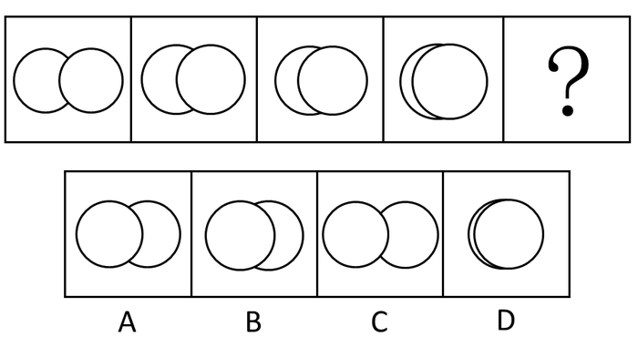

A. A

B. B

C. C

D. D

第 56 题 · 答案与解析

**参考答案（粉笔题库参考内容）**

D

**解析**

元素组成相同，考位置。题干图形中，两个圆圈逐渐靠近，且右圆在左圆上面。

故正确答案为D。

**考点**：位置规律-平移

**来源**：2013年广东省公务员录用考试《行测》题（一）第56题

### 第 57 题

从所给四个选项中，选择最合适的一个填入问号处，使之呈现一定的规律性：

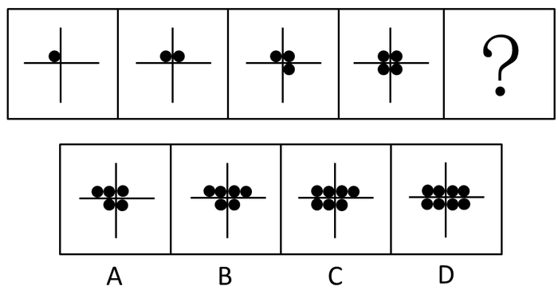

A. A

B. B

C. C

D. D

第 57 题 · 答案与解析

**参考答案（粉笔题库参考内容）**

A

**解析**

黑点数量明显递增，考数数。题干图形中，黑点个数依次为1、2、3、4，沿顺时针递增。所以待选图形中的黑点个数应为5，只有A项符合此规律。

故正确答案为A。

**考点**：数量规律-素

**来源**：2013年广东省公务员录用考试《行测》题（一）第57题

### 第 58 题

从所给四个选项中，选择最合适的一个填入问号处，使之呈现一定的规律性：

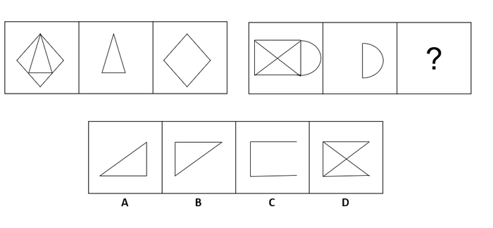

A. A

B. B

C. C

D. D

第 58 题 · 答案与解析

**参考答案（粉笔题库参考内容）**

D

**解析**

解析1：

元素组成相似，元素叠加--去同求异

前一组图中，后两幅图叠加可得到第一幅图；那么第二组图也应遵循此规律，显然只有D满足该条件。

故正确答案为D。

解析2：

题干中前一组图都根据竖轴对称，属性一致；后一组图前两幅图都根据横轴对称，所以待选图形也应符合此规律，排除A、B；

另外观察题干中所有图形均为封闭图形，所以待选图形也应符合此规律，排除C。

故正确答案为D。

**考点**：属性规律-复合、样式规律-加减同异

**来源**：2013年广东省公务员录用考试《行测》题（一）第58题

### 第 59 题

从所给四个选项中，选择最合适的一个填入问号处，使之呈现一定的规律性：

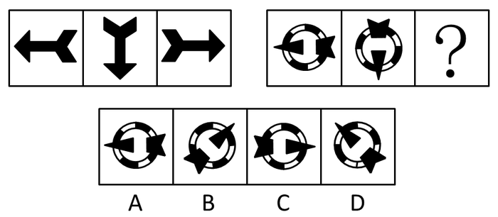

A. A

B. B

C. C

D. D

第 59 题 · 答案与解析

**参考答案（粉笔题库参考内容）**

C

**解析**

元素组成相同，考查位置-旋转。题干中前一组图，三幅图依次按照逆时针旋转，每次旋转90度；第二组中前两幅图也按此规律旋转，所以待选图形也应遵循此规律，第二幅图逆时针旋转90度，得到C。

故正确答案为C。

**考点**：位置规律-旋转

**来源**：2013年广东省公务员录用考试《行测》题（一）第59题

### 第 60 题

从所给的四个选项中，选择最合适的一个填入问号处，使之呈现一定的规律性：

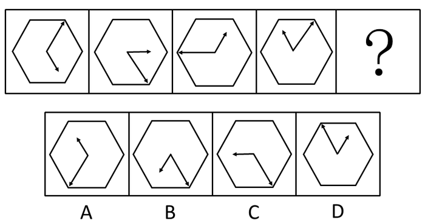

A. A

B. B

C. C

D. D

第 60 题 · 答案与解析

**参考答案（粉笔题库参考内容）**

C

**解析**

元素组成相同，考位置规律-旋转，具体考查箭头的旋转。短箭头每次逆时针旋转60度，长箭头每次顺时针旋转120度。

故正确答案为C。

**考点**：位置规律-旋转

**来源**：2013年广东省公务员录用考试《行测》题（一）第60题

### 第 61 题

请从所给的四个选项中，选择最合适的一项填在问号处，使之呈现一定的规律性。

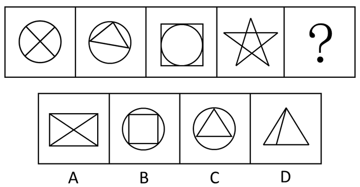

A. A

B. B

C. C

D. D

第 61 题 · 答案与解析

**参考答案（粉笔题库参考内容）**

A

**解析**

元素组成凌乱，考数数，具体考查直线的数量。题干图形中，直线条数依次为2、3、4、5，依次递增，所以待选图形应包含6条直线。选项中直线条数依次是6、4、3、4。

故正确答案为A。

**考点**：数量规律-线

**来源**：2013年广东省公务员录用考试《行测》题（一）第61题

### 第 62 题

从所给四个选项中，选择最合适的一个填入问号处，使之呈现一定的规律性：

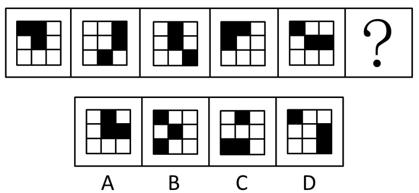

A. A

B. B

C. C

D. D

第 62 题 · 答案与解析

**参考答案（粉笔题库参考内容）**

C

**解析**

元素组成相同，考内部黑方块的位置。题干图形中，每幅图中均含有三个黑方块，且顶角位置只有一个，待选图形也应符合此规律，只有C符合条件。

故正确答案为C。

**考点**：位置规律-平移

**来源**：2013年广东省公务员录用考试《行测》题（一）第62题

### 第 63 题

从所给四个选项中，选择最合适的一个填入问号处，使之呈现一定的规律性：

A. A

B. B

C. C

D. D

第 63 题 · 答案与解析

**参考答案（粉笔题库参考内容）**

B

**解析**

题干中黑色的方块都是首或尾连接，选项只有B是首尾相连，一笔画出。

故正确答案为B。

**考点**：数量规律-线、黑白块类

**来源**：2013年广东省公务员录用考试《行测》题（一）第63题

### 第 64 题

从所给四个选项中，选择最合适的一个填入问号处，使之呈现一定的规律性：

A. A

B. B

C. C

D. D

第 64 题 · 答案与解析

**参考答案（粉笔题库参考内容）**

C

**解析**

元素组成相似，考虑样式规律。题干图形中，前一组图第一幅图和第三幅图求同去异，得到第二幅图；后一组图形也应符合此规律。

故正确答案为C。

**考点**：样式规律-加减同异

**来源**：2013年广东省公务员录用考试《行测》题（一）第64题

### 第 65 题

从所给四个选项中，选择最合适的一个填入问号处，使之呈现一定的规律性：

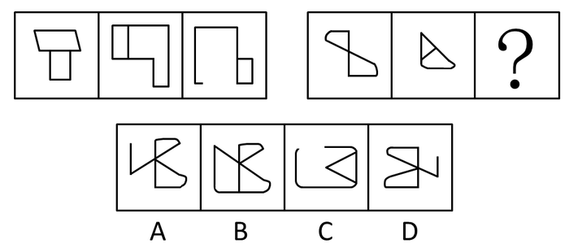

A. A

B. B

C. C

D. D

第 65 题 · 答案与解析

**参考答案（粉笔题库参考内容）**

C

**解析**

题干图形中，前一组图的封闭空间数依次为2、2、1 ，2除以2等于1；后一组图也应符合此规律，只有C项只包含一个封闭空间。

故正确答案为C。

**考点**：数量规律-面

**来源**：2013年广东省公务员录用考试《行测》题（一）第65题

### 第 66 题

小周、小吴、小郑三人中，一人是工人，一人是农民，一人是知识分子。已知：小郑的年龄比知识分子大；小周的年龄和农民不同；农民的年龄比小吴小。

根据以上情况，判断正确的是：

A. 小周是工人、小吴是知识分子、小郑是农民

B. 小周是知识分子、小吴是农民、小郑是工人

C. 小周是工人、小吴是农民、小郑是知识分子

D. 小周是知识分子、小吴是工人、小郑是农民

第 66 题 · 答案与解析

**参考答案（粉笔题库参考内容）**

D

**解析**

本题属于排列组合题。

第一步：找突破口。

本题突破口为信息量最大对象，即农民。由“小周的年龄和农民不同；农民的年龄比小吴小”可知，农民既不是小周，也不是小吴，所以小郑是农民。

第二步：将第一步结论代入题干。

小郑的年龄比知识分子大，小郑的年龄比小吴小，可知小吴不是知识分子，也不是农民，所以小吴是工人，则小周是知识分子。

故正确答案为D。

**考点**：从最大信息开始推

**来源**：2013年广东省公务员录用考试《行测》题（一）第66题

### 第 67 题

所有关心员工个人发展的企业老板，都被证明是管理得法的企业老板；而切实关心员工个人发展的企业老板，都首先把注意力放在员工的职业生涯发展上。因此，那些不首先把注意力放在关心员工职业生涯发展上的企业老板，都不是管理得法的企业老板。

为使上述论证成立，必须为真的一项是：

A. 员工的职业生涯发展，是员工个人发展中最突出的问题

B. 所有管理得法的企业老板，都是关心员工个人发展的企业老板

C. 近年来，员工普遍比较关心自己的个人发展

D. 员工个人发展同企业发展密切相关

第 67 题 · 答案与解析

**参考答案（粉笔题库参考内容）**

B

**解析**

第一步：找出论点和论据。

论点：那些不首先把注意力放在关心员工职业生涯发展上的企业老板，都不是管理得法的企业老板，即：管理得法⇒把注意力放在职业发展上。

论据：切实关心员工个人发展的企业老板，都首先把注意力放在员工的职业生涯发展上，即：关心个人发展⇒把注意力放在职业发展上。

第二步：逐一分析选项。

B项：管理得法⇒关心个人发展，在二者之间搭桥，加强了论证，当选；

A项的“员工个人发展中最突出的问题”，C项的“员工普遍比较关心自己的个人发展”，D项的“员工个人发展同企业发展密切相关”均与论点无关，属于无关选项，排除。

故正确答案为B。

**考点**：搭桥

**来源**：2013年广东省公务员录用考试《行测》题（一）第67题

### 第 68 题

某村有老赵、老钱、老孙、老李四个养鸡专业户，已知老赵、老钱两户养鸡的总数量与老孙、老李两户养鸡的总数量相等，老赵、老李两户养鸡的总数量比老钱、老孙两户养鸡的总数量多，而老钱养鸡的数量比老赵、老孙两户养鸡的总数量还要多。

由此可知，四个养鸡专业户养鸡数量由多到少的顺序是：

A. 老赵、老钱、老孙、老李

B. 老孙、老钱、老赵、老李

C. 老李、老钱、老赵、老孙

D. 老钱、老李、老赵、老孙

第 68 题 · 答案与解析

**参考答案（粉笔题库参考内容）**

C

**解析**

第一步：抓住题干主要信息。

(1)老赵＋老钱＝老孙＋老李

(2)老赵＋老李＞老钱＋老孙

(3)老赵＋老孙＜老钱

第二步：分析题干信息，并结合选项得出答案。

由(1)＋(2)，左边加左边，右边加右边，最后得到：老赵＞老孙；由(1)＋(2)，左边加右边，右边加左边，最后得到：老李＞老钱，再结合(3)，最终得到：老李＞老钱＞老赵＞老孙。

故正确答案为C。

**考点**：组合排列-单题-其他

**来源**：2013年广东省公务员录用考试《行测》题（一）第68题

### 第 69 题

某村村民反映，作为村主要农作物的甘蓝出现了根肿病，产量严重下降，村民收入锐减。对此，村里引进了多个蔬菜品种，并组织村民进行了蔬菜种植技术培训，可以预见，村民的收入将因此而有较大提高。

要使上述推断成立，必备的前提条件不包括：

A. 村民经培训后开始种植其他品种的蔬菜

B. 村民掌握了种植其他品种蔬菜的技术

C. 村民有销售其他蔬菜品种的渠道

D. 其他蔬菜品种的产量比甘蓝要高

第 69 题 · 答案与解析

**参考答案（粉笔题库参考内容）**

D

**解析**

第一步：找出论点和论据。

论点：村民的收入将因此而有较大提高。

论据：甘蓝产量下降，引进了其他多个蔬菜品种，并组织进行蔬菜种植技术培训。

第二步：判断加强方式。

论点强调收入，论据强调技术培训，范围不同，需要在二者之间搭桥，才能加强论证。选项无搭桥时，考虑必要条件。

第三步：逐一分析选项。

A项：村民开始种植其他品种的蔬菜是村民收入提高的必要条件，假设条件不成立，村民不种植蔬菜，那么村民的收入就无法提高，论点不成立，因此选项为必要条件，排除；

B项：村民掌握了技术是收入提高的必要条件，假设条件不成立，村民没有掌握技术，收入就无法提高，论点不成立，因此选项为必要条件，排除；

C项：村民有销售渠道是村民收入提高的必要条件，假设条件不成立，村民没有销售渠道，那么蔬菜卖不出去村民的收入就无法提高，论点不成立，因此选项为必要条件，排除；

D项：强调其他蔬菜的产量比甘蓝高，假设条件不成立，其他蔬菜的产量没有甘蓝高，并不能推出村民的收入就无法提高，因此选项不是必要条件，当选。

本题为选非题，故正确答案为D。

**考点**：加强选非题

**来源**：2013年广东省公务员录用考试《行测》题（一）第69题

### 第 70 题

某地一企业今年招聘时，平均每个职位的应聘人数比去年减少了30%。因此，该公司对求职者的吸引力有所下降。

以下最能削弱上述推论的一项是：

A. 今年全国应届毕业生人数比去年有所增加

B. 今年到该地求职的总人数有所减少

C. 该企业今年招聘的部分职位应聘人数多于去年

D. 该企业今年招聘的职位有八成提高了用人标准

第 70 题 · 答案与解析

**参考答案（粉笔题库参考内容）**

D

**解析**

本题为削弱题型。

第一步：找出论点和论据。

论点：该公司对求职者的吸引力有所下降。

论据：平均每个职位的应聘人数比去年减少了30%。

第二步：判断削弱方式。

本题论点和论据间存在因果关系，需要削弱论点。

第三步：逐一判断选项的作用。

A、B两项均扩大了范围，与该企业应聘人数是否减少无关，属于无关选项；

C项，部分职位的范围不明确，不能代表整体，无法削弱选项；

D项，招聘的职位有八成提高了用人标准，即应聘人数降低另有他因，并非公司对求职者的吸引力有所下降，削弱了论点，当选。

故正确答案为D。

**考点**：削弱论点

**来源**：2013年广东省公务员录用考试《行测》题（一）第70题

### 第 71 题

过年放鞭炮，上元吃汤圆，端午赛龙舟，随着社会的发展，许多传统文化中的节日习俗离我们渐行渐远。90年代出生的人开始相信圣诞老人，开始在西餐厅里过生日。文化发展是个“取其精华，去其糟粕”的过程，因此，有人认为，西方文化优于中国传统文化。

以下各项最有助于反驳上述观点的是：

A. 我国传统文化中的许多内容在西方国家受到热捧

B. 现代社会的一些不文明行为源于西方社会

C. 国家的经济优势有利于本国文化的对外传播

D. 能够不断吸收和借鉴正是我国文化的优势

第 71 题 · 答案与解析

**参考答案（粉笔题库参考内容）**

A

**解析**

本题为削弱题型。

第一步：找到论点论据。

论点：西方文化优于中国传统文化。

论据：中国人喜欢西方文化。

第二步：判断削弱方式。

论点和论据存在因果关系，需要削弱论点。

第二步：逐一分析选项。

A项我国传统文化中的许多内容在西方国家受到热捧，说明西方人喜欢我国的传统文化，直接削弱论点。是答案；

B、C和D三个选项均未涉及中国传统文化，与题干主题无关，均无法削弱。

故正确答案为A。

**考点**：削弱论点

**来源**：2013年广东省公务员录用考试《行测》题（一）第71题

### 第 72 题

据国家权威科研机构研究证实，当前市场上热销的某品牌保健食品并不含有提高人类身体机能、增强个体免疫力的成分。但调查结果表明，不少身体虚弱的人在购买服用了该品牌的保健食品一段时间后，身体素质明显提高。

以下最有助于解释上述矛盾的一项是：

A. 保健食品作用的发挥具有一定的时间滞后性

B. 许多身体健康的人在服用保健食品后体质也增强了

C. 购买该品牌保健品的人大多经济条件较好

D. 服用保健品的人在生活其他方面也开始注重健康

第 72 题 · 答案与解析

**参考答案（粉笔题库参考内容）**

D

**解析**

第一步：找出题干矛盾现象。

市场上热销的某品牌保健食品并不含有提高人类身体机能、增强个体免疫力的成分，但不少身体虚弱的人在购买服用了该品牌的保健食品一段时间后，身体素质明显提高。

第二步：逐一分析选项。

A项：作用的发挥具有滞后性说明保健食品还是有功效的，不能解释题干矛盾现象，排除；

B项：身体健康的人体质是否增强，与论点中“身体虚弱的人”无关，不能解释题干矛盾现象，排除；

C项：是否买得起该保健食品与是否能增强人的体质无关，不能解释题干矛盾现象，排除；

D项：说明服用保健品的人在生活其他方面也开始注重健康，即身体素质明显提高是另有他因，很好地解释了为什么明明保健品没有增强免疫力的成分身体却健康了这样的矛盾，当选。

故正确答案为D。

**考点**：原因解释

**来源**：2013年广东省公务员录用考试《行测》题（一）第72题

### 第 73 题

某公司研发了一种空调管理系统，通过对人流量的检测系统自动启动、关闭空调，这个系统的应用，将使得办公场所的空调用电量大大节省。但这个系统推出几年来，购买的单位并不多，销量不理想。

以下最能够合理解释上述现象的是：

A. 该空调管理系统受到许多城市家庭用户的欢迎

B. 该空调管理系统操作复杂，需配备专业人员才能运作

C. 市场上节能空调占主流，空调能耗较以往已大大降低

D. 许多单位的职工环保意识强，养成了出门关空调的习惯

第 73 题 · 答案与解析

**参考答案（粉笔题库参考内容）**

B

**解析**

第一步：找出矛盾点。

题干矛盾现象是：这一空调管理系统的使用可以大大节省电量，即节省开支，但购买量不多。

第二步：逐一判断选项。

A项：系统是否受到家庭客户欢迎，与单位客户是否购买无关，属于无关选项，排除；

B项：该空调管理系统操作复杂，需配备专业人员才能运作，说明使用该系统需要添加额外的开支，并不能节省开支，所以购买量少，可以解释上述矛盾现象，当选；

C项：无论空调能耗是否降低，都需要节电，不能解释矛盾，排除；

D项：养成出门关空调的习惯可节省电量，说明购买空调管理系统并不一定能比现有情况节省开支，一定程度上可以解释许多单位不买这个系统。但是D项与B项相比，D项强调的是许多，也就是部分而非全部，力度上不如B项强。

故正确答案为B。

**考点**：原因解释

**来源**：2013年广东省公务员录用考试《行测》题（一）第73题

### 第 74 题

相比于化工“污染地”、重金属“污染地”，化肥、农药、农膜带来的农地污染并没有那么触目惊心，但却具有量大、面广、隐蔽性强、持续时间长等特点。一些受污染严重的土地，已经不能进行正常的农业生产。农地的“批量污染”治理已经到了刻不容缓的地步。以农膜为例，由于塑料残余物在自然条件下可在土壤中残存数十年甚至上百年而不降解，这些废膜的存在会影响土壤的通透性，阻碍土壤水分的补给和养分转移。

根据以上表述，可以得出的结论是：

①化工和重金属的污染往往量不大、面不广、易发现、持续时间不长

②农膜残留通过阻碍土壤的水分补给和养分转移对农地产生影响

③农膜残留是当前农地“批量污染”中最为突出和严重的

④农地污染不能因其隐蔽性强等特点而在治理土地污染中被人们忽视

⑤化工和金属对土地的污染比农地污染更为严重

A. ①②

B. ①③④

C. ②④

D. ②③⑤

第 74 题 · 答案与解析

**参考答案（粉笔题库参考内容）**

C

**解析**

本题属于日常结论题型。

第一步：抓住题干主要信息。

(1)农地污染具有量大、面广、隐蔽性强、持续时间长等特点。

(2)农地的“批量污染”治理已经到了刻不容缓的地步。

(3)农膜的存在会影响土壤的通透性，阻碍土壤水分的补给和养分转移。

第二步：逐一分析选项。

由(1)可知，题干没有提及化工和重金属的污染特点，故①错误；

由(3)可知，②正确，③错误，以农膜为例，无法知道农膜残留是否是最为突出和严重的；

由(2)可知，农地的“批量污染”治理已经到了刻不容缓的地步，④正确；

由(1)、(2)、(3)可知，题干没有对比化工、重金属对土地的污染和农地污染的程度，故⑤错误。

只有②④正确。

故正确答案为C。

**考点**：日常结论

**来源**：2013年广东省公务员录用考试《行测》题（一）第74题

### 第 75 题

“没有经济的快速发展，就不会有社会事业的进步。现在经济发展速度很快，所以社会事业的建设也会取得显著的成绩。”

与上述文字推理形式相同的是：

A. 社会主义民主和法制相辅相成，缺一不可，民主是法制的前提，法制是民主的体现。现在法制体系不断健全，因此民主得以保障

B. 效益与公平是矛盾统一体，没有公平很难取得更大的效益。某企业的效益提高了，因此，该企业也实现了分配公平

C. 社会化程度越高，社会分工越细。现在社会化程度提高了，因此现在的社会分工也更细了

D. 清正廉洁是对领导干部的基本要求。一名作风正派、严于律己的领导干部就是合格的领导干部

第 75 题 · 答案与解析

**参考答案（粉笔题库参考内容）**

D

**解析**

解析1：

本题为关联词推导中的推出方式类似题型，需要逐一分析题干和选项的结构。

第一步：翻译题干。

题干：-P（经济的快速发展）→—Q（社会事业的进步）；P（经济的快速发展）→Q（社会事业的进步）。

第二步：逐一翻译选项。

A项推理形式：Q（法制）→P（民主），Q→P，与题干不同；

B项推理形式：-P（公平）→—Q（效益提高），Q→P，与题干不同；

C项推理形式：P（社会化程度高）→Q（社会分工细），P→Q，与题干不同；

D项推理形式：-P（清正廉洁）→—Q（合格的领导干部），P→Q，与题干相同。

经比较与题干结构一样的是D项。

故正确答案为D。

解析2：

第一步：分析题干。

条件：社会事业的进步→经济的快速发展。结论：经济发展速度很快→社会事业建设取得进步。即原题干是A→B→A，是个错误推理。

第二步：逐一分析选项。

A项法制推民主，后半部分是法制健全推出民主得以保障，是正确的推导；

B项效益推出公平，某企业效益提高，实现了公平，也是正确推导；

C项社会化程度高推出社会分工细，是正确推导；

D项前半部分是领导干部基本要求→清正廉洁；后者代入时用的是清正廉洁推出合格的领导干部，与题干推理方式相同。

故正确答案为D。

**考点**：推理形式

**来源**：2013年广东省公务员录用考试《行测》题（一）第75题

### 第 76 题

“一切为了群众，一切依靠群众，从群众中来，到群众中去”是中国共产党的：

A. 政治路线

B. 群众路线

C. 经济路线

D. 文化路线

第 76 题 · 答案与解析

**参考答案（粉笔题库参考内容）**

B

**解析**

1929年9月28日，《中共中央给红军第四军前委的指示信》中第一次提出了“群众路线”这个概念，群众路线是党的根本工作路线。以毛泽东为代表的中国共产党在长期斗争中形成了一切为了群众、一切依靠群众和从群众中来、到群众中去的群众路线。

故正确答案为B。

**来源**：2013年广东省公务员录用考试《行测》题（一）第76题

### 第 77 题

乡、民族乡、镇的人民政府对村民委员会的工作：

A. 进行领导和决策

B. 进行监督检查

C. 进行管理和服务

D. 给予指导、支持和帮助

第 77 题 · 答案与解析

**参考答案（粉笔题库参考内容）**

D

**解析**

《中华人民共和国村民委员会组织法》第四条规定：乡、民族乡、镇的人民政府对村民委员会的工作给予指导、支持和帮助，但是不得干预依法属于村民自治范围内的事项。

故正确答案为D。

**考点**：行政法

**来源**：2013年广东省公务员录用考试《行测》题（一）第77题

### 第 78 题

党中央、国务院把“三农”问题作为全国工作的重中之重，明确提出了城乡统筹发展的基本方略，制定了“工业反哺农业、城市支持乡村”和（   ）的基本方针。

A. “多予、少取、放活”

B. “改革、创新、搞活”

C. “互惠互利、相互促进、协调发展”

D. “先富带后富，最终实现共同富裕”

第 78 题 · 答案与解析

**参考答案（粉笔题库参考内容）**

A

**解析**

城乡统筹发展的基本方针有三点——工业反哺农业、城市支持乡村和多予、少取、放活。

故正确答案为A。

**来源**：2013年广东省公务员录用考试《行测》题（一）第78题

### 第 79 题

近年来，我国通过“三下乡”活动，把发展经济、建设小康和扶贫攻坚结合起来，为农村中心工作服务。“三下乡”是指文化、科技、（   ）三下乡。

A. 卫生

B. 教育

C. 人才

D. 金融

第 79 题 · 答案与解析

**参考答案（粉笔题库参考内容）**

A

**解析**

“三下乡”即有关文化、科技、卫生方面的内容知识向农民普及，促进农村文化、科技、卫生的发展。大力开展文化、科技、卫生“三下乡”活动，是我们党全心全意为人民服务宗旨的具体体现。

故正确答案为A。

**来源**：2013年广东省公务员录用考试《行测》题（一）第79题

### 第 80 题

党在社会主义初级阶段的基本路线是坚持“一个中心，两个基本点”，其中“一个中心”是指以（   ）为中心。

A. 经济建设

B. 政治建设

C. 文化建设

D. 党风建设

第 80 题 · 答案与解析

**参考答案（粉笔题库参考内容）**

A

**解析**

“一个中心，两个基本点”是邓小平在十三大提出的。“一个中心”即以经济建设为中心。这一中心的确立，是在对我国社会主义建设经验教训科学总结的基础上作出的正确选择，充分体现了社会主义本质的要求，是解决我国现阶段社会主要矛盾的根本途径。

故正确答案为A。

**来源**：2013年广东省公务员录用考试《行测》题（一）第80题

### 第 81 题

我们党和政府的宗旨是：

A. 加强和改进党的领导

B. 全心全意为人民服务

C. 全面建成小康社会

D. 建设中国特色社会主义

第 81 题 · 答案与解析

**参考答案（粉笔题库参考内容）**

B

**解析**

《中国共产党章程》规定，全心全意为人民服务是中国共产党的根本宗旨。在我国，中国共产党成为执政党以后，所领导的政权是人民政权，政府是人民政府，全心全意为人民服务是政府工作根本宗旨。

故正确答案为B。

**考点**：唯物史观

**来源**：2013年广东省公务员录用考试《行测》题（一）第81题

### 第 82 题

“青红皂白”现在常用来比喻事情的是非曲直，其原意是指各种深浅不同的颜色。其中“皂”指的是：

A. 黑色

B. 灰色

C. 黄色

D. 绿色

第 82 题 · 答案与解析

**参考答案（粉笔题库参考内容）**

A

**解析**

“青红皂白”比喻事情的是非或原因、来龙去脉、是非曲直。成语出自于明·凌濛初《二刻拍案惊奇》第16卷：“州官得过了贿赂，那管青红皂白，竟断道：‘夏家欠林家二千两’”。“皂”指黑色。

故正确答案为A。

**考点**：文学常识

**来源**：2013年广东省公务员录用考试《行测》题（一）第82题

### 第 83 题

“阳关大道”原是指通往（  ）的道路。

A. 东海

B. 西域

C. 南国

D. 中原

第 83 题 · 答案与解析

**参考答案（粉笔题库参考内容）**

B

**解析**

该词出自唐·王维《送刘司直赴安西》一诗：“绝域阳关道，胡沙与塞尘”。原指古代经过阳关通向西域的大道，后泛指宽阔的长路，也比喻光明的前途。

故正确答案为B。

**考点**：文学常识

**来源**：2013年广东省公务员录用考试《行测》题（一）第83题

### 第 84 题

任人唯贤的“贤”是指：

A. 思想品德好

B. 工作作风好

C. 德才兼备

D. 文武双全

第 84 题 · 答案与解析

**参考答案（粉笔题库参考内容）**

C

**解析**

“任人唯贤”出自《尚书·咸有一德》：“任官惟贤才，左右惟其人”，指用人只选有德有才的人，即德才兼备。

故正确答案为C。

**考点**：文学常识

**来源**：2013年广东省公务员录用考试《行测》题（一）第84题

### 第 85 题

以下属于我国传统节日的是：

A. 植树节

B. 感恩节

C. 父亲节

D. 中秋节

第 85 题 · 答案与解析

**参考答案（粉笔题库参考内容）**

D

**解析**

植树节、感恩节、父亲节均起源于美国；农历八月十五是中秋节，是我国的传统节日之一。

故正确答案为D。

**考点**：文化常识

**来源**：2013年广东省公务员录用考试《行测》题（一）第85题

## 材料 1

2012年，某地区农作物播种总面积达到1625.55万亩，同比增长4.6%。其中，粮食和蔬菜播种面积大幅增长，分别为459.40万亩、109.06万亩，同比增长32.7%和30.5%；棉花、油料和甜菜播种面积下降，分别为698.52万亩、103.42万亩、30.45万亩，同比下降17.3%、5.7%和18.2%。粮食作物中，小麦295.61万亩，同比增长67.7%；玉米93.77万亩，同比增长3.1%；大豆21.51万亩，同比增长76.6%；水稻32.66万亩，同比下降7.7%。蔬菜播种面积中，番茄65.48万亩，同比增长60.7%；辣椒21.27万亩，同比下降0.7%。

（注：与上一年同一时期相比称为“同比”。）

### 第 86 题

2012年，下列农作物播种面积同比增幅最大的一种是：

A. 棉花

B. 小麦

C. 玉米

D. 番茄

第 86 题 · 答案与解析

**参考答案（粉笔题库参考内容）**

B

**解析**

定位材料第四行,第五行与第六行中对应四个选项的数据，小麦同比增幅67.7%，为最高。

故正确答案为B。

**考点**：文字资料、直接找数

**来源**：2013年广东省公务员录用考试《行测》题（一）第86题

### 第 87 题

根据上述资料，2011年油料播种面积约为多少万亩？

A. 90

B. 100

C. 110

D. 120

第 87 题 · 答案与解析

**参考答案（粉笔题库参考内容）**

C

**解析**

由题干“2011年油料播种面积约为多少万亩”，结合材料时间为2012年，可判定本题为基期计算。定位材料第三行、第四行可知：2012年油料播种面积为103.42万亩，同比下降5.7%，则可得2011年油料播种面积为103.42/(1-5.7%) = 103.42/0.943，100 ＜ 103.42/0.943 ＜ 108/0.9 = 120。

故正确答案为C。

**考点**：基期计算、文字资料

**来源**：2013年广东省公务员录用考试《行测》题（一）第87题

### 第 88 题

2012年粮食和蔬菜播种总面积：

A. 超过600万亩

B. 同比增长超过40%

C. 约占该地区农作物总播种面积的35%

D. 比棉花的播种面积少近200万亩

第 88 题 · 答案与解析

**参考答案（粉笔题库参考内容）**

C

**解析**

定位材料第二行可知：2012年粮食和蔬菜播种面积分别为459.40万亩、109.06万亩，同比增长32.7%和30.5%。分别分析选项如下：

A项：二者之和为459.4+109.06=568.46万亩，显然小于600万亩，错误；

B项：二者同比增长均低于40%，错误；

C项：年粮食和蔬菜播种总面积占该地区农作物总播种面积比例为568.46÷1625.55≈560÷1600=35%，正确；

D项：棉花播种面积为698.52万亩，698.52-568.46=130.06万亩，远远低于200万亩，错误。

故正确答案为C。

**考点**：文字资料、综合分析

**来源**：2013年广东省公务员录用考试《行测》题（一）第88题

### 第 89 题

2012年水稻播种面积比2011年大约少多少万亩？

A. 2.21

B. 2.33

C. 2.72

D. 2.88

第 89 题 · 答案与解析

**参考答案（粉笔题库参考内容）**

C

**解析**

由题干“2012年水稻播种面积比2011年大约少多少万亩”，可判定本题为增长量问题。定位材料第五行与第六行可知：2012年水稻播种面积32.66万亩，同比下降7.7%，依据公式代入相应数据，可得增长量=现期量/(1+r)×r=32.66/(1−7.7%)×(−7.7%)≈ −32.66/(1−1/13) × 1/13 = −32.66/12 ≈ −2.7万亩，C项最接近。

故正确答案为C。

**考点**：增长量计算、文字资料

**来源**：2013年广东省公务员录用考试《行测》题（一）第89题

### 第 90 题

根据上述资料，以下说法正确的一项是：

A. 农作物播种面积的同比增长，主要是因为粮食作物和蔬菜播种面积的增加

B. 由于种植面积的减少，2012年水稻产量必然会减少

C. 粮食作物的种植是该地区最主要的农业生产项目

D. 2011年番茄播种面积是辣椒播种面积的近两倍

第 90 题 · 答案与解析

**参考答案（粉笔题库参考内容）**

D

**解析**

A项：农作物播种面积整体同比增长，除粮食作物和蔬菜外，其他作物播种面积同比均下降，A理应正确，但要注意到材料中涉及到的各类作物播种面积总和为459.40 + 109.06 + 698.52 + 103.42+30.45≈460+110+700+100+30=1400＜1625.55，结合D选项，无需具体计算，即可知A说法错误，为强干扰项；

B项：种植面积与水稻总产量没有必然联系，而材料中没有涉及到水稻亩产量，故无法得出此结论；

C项：由材料可知，棉花种植面积最大，应为主要农业项目，错误；

D项：由材料中数据可得65.48/(1+60.7%)÷(21.27/(1−0.7%))≈ 66/22 ÷ 1.6 = 1.875，近两倍，正确。

故正确答案为D。

**考点**：文字资料、综合分析

**来源**：2013年广东省公务员录用考试《行测》题（一）第90题

## 材料 2

2012年某市居民人均日常时间利用情况如下表所示，根据图表回答下列问题：

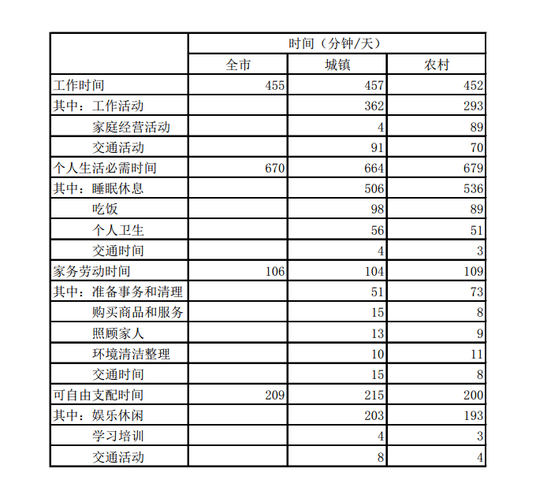

### 第 91 题

该市居民各项活动占用时间最多的是：

A. 工作时间

B. 个人生活必需时间

C. 家务劳动时间

D. 可以自由支配的时间

第 91 题 · 答案与解析

**参考答案（粉笔题库参考内容）**

B

**解析**

定位表格中“全市”一列，个人生活必需时间最高，为670分钟。

故正确答案为B。

**考点**：直接找数、统计表

**来源**：2013年广东省公务员录用考试《行测》题（一）第91题

### 第 92 题

在下列时间的分配上，城镇居民和农村居民差异最大的一项是：

A. 工作活动

B. 家庭经营活动

C. 交通活动

D. 个人生活必需时间

第 92 题 · 答案与解析

**参考答案（粉笔题库参考内容）**

B

**解析**

定位表格中对应四个选项的数据，简单计算即可得到，工作活动时间为69分钟/天；家庭经营活动差异最大，为85分钟/天；交通活动为21分钟/天；个人生活必需时间为15分钟/天。

故正确答案为B。

**考点**：简单加减计算、统计表

**来源**：2013年广东省公务员录用考试《行测》题（一）第92题

### 第 93 题

在个人生活必需时间的分配上，城镇居民比农村居民耗用时间多的活动项目共多少项：

A. 1

B. 2

C. 3

D. 4

第 93 题 · 答案与解析

**参考答案（粉笔题库参考内容）**

C

**解析**

定位表格中数据，个人生活必需时间的分配上，城镇居民比农村居民耗用时间多的活动项目有吃饭、个人卫生、交通3项。

故正确答案为C。

**考点**：直接找数、统计表

**来源**：2013年广东省公务员录用考试《行测》题（一）第93题

### 第 94 题

根据上表，可以推断该市城镇居民与农村居民的人数比是：

A. 2：1

B. 3：2

C. 4：3

D. 无法推断

第 94 题 · 答案与解析

**参考答案（粉笔题库参考内容）**

B

**解析**

由题干“该市城镇居民与农村居民的人数比”，结合选项，可判定本题为比值计算问题。由于城镇人数+农村人数=全市人数，且材料没有给出具体数值，考虑混合比例，利用线段法解题。

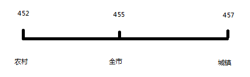

由上图可知城镇与农村的距离之比为2:3，线段法中距离之比与量（混合比例的分母）之比成反比，而人均 = 总量/人数，这里的量指的就是人数。则该市城镇居民与农村居民的人数比为3:2。

故正确答案为B。

**考点**：比值计算、统计表

**来源**：2013年广东省公务员录用考试《行测》题（一）第94题

### 第 95 题

根据上表，以下说法正确的一项是：

A. 人们平均每天约40%的时间用于工作

B. 农村居民人均每天比城镇居民节约交通时间21分钟

C. 农村居民家庭经营活动平均耗时约占工作时间的1/5

D. 农村居民人均每天比城镇居民睡眠多一个小时

第 95 题 · 答案与解析

**参考答案（粉笔题库参考内容）**

C

**解析**

A项，定位表格可知：工作时间比重为455 ÷ 1440 ＜ 480 ÷ 1440 = 1/3，故该项说法错误；

B项，定位表格可知：21分钟仅包括工作时间中的交通时间差距，未包含其他三项中的交通时间差距，所以该项说法错误；

C项，定位表格可知：对应家庭经营活动一行，可得89÷452≈90÷450＝20%，即约1/5，所以该项说法正确；

D项，定位表格可知：对应睡眠时间一行，可得536－506＝30分钟，即半小时，所以该项说法错误。

故正确答案为C。

**考点**：统计表、综合分析

**来源**：2013年广东省公务员录用考试《行测》题（一）第95题

## 材料 3

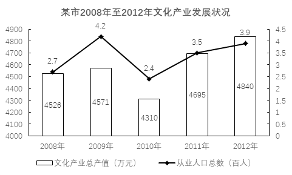

### 第 96 题

根据上图，2008年至2012年间，下列说法正确的是：

A. 该市文化产业从业人口逐年增长

B. 该市文化产业总产值年增长率逐年提高

C. 该市文化产业总产值最高的年份是2012年

D. 该市文化产业从业人口增长最快的年份是2011年

第 96 题 · 答案与解析

**参考答案（粉笔题库参考内容）**

C

**解析**

A项，文化产业从业人口2010年为下降趋势，错误；

B项，文化产业总产值2010年为下降趋势，故增长率为负值，错误；

C项，文化产业总产值最高的年份是2012年，为4840万元，正确；

D项，观察折线变化趋势，显然2009年最高，错误。

故正确答案为C。

**考点**：统计图、综合分析

**来源**：2013年广东省公务员录用考试《行测》题（一）第96题

### 第 97 题

2012年该市文化产业总产值比2008年大约提高了多少个百分点：

A. 7

B. 6

C. 5

D. 4

第 97 题 · 答案与解析

**参考答案（粉笔题库参考内容）**

A

**解析**

由题干“2012年…比2008年…提高了多少个百分点”可判定本题为增长率计算问题。定位图中数据可知2012年该市文化产业总产值为4840万元，2008年该市文化产业总产值为4526万元。依据公式增长率 = (现期量 - 基期量)/基期量，代入相关数据，可得(4840−4526)/4526 ≈ 315/4500 = 7%，即提高了7个百分点。

故正确答案为A。

**考点**：一般增长率、统计图

**来源**：2013年广东省公务员录用考试《行测》题（一）第97题

### 第 98 题

2008年至2012年间，该市文化产业总产值增长最快的年份是：

A. 2008年

B. 2009年

C. 2011年

D. 2012年

第 98 题 · 答案与解析

**参考答案（粉笔题库参考内容）**

C

**解析**

由题干“…增长最快的年份”可判定本题为增长率的比较问题。观察表中数据，2010年总产值最低，而2010年至2011年变化量最大，所以2011年增长最快。

故正确答案为C。

**考点**：一般增长率、统计图

**来源**：2013年广东省公务员录用考试《行测》题（一）第98题

### 第 99 题

2012年该市文化产业从业人员人均生产总值比上一年约减少了：

A. 3.5%

B. 7.5%

C. 1.5万元

D. 2万元

第 99 题 · 答案与解析

**参考答案（粉笔题库参考内容）**

B

**解析**

由题干出现“人均”结合材料与选项，可判定本题为平均数增长问题，AB所求为增长率，CD所求为增长量。定位图表可知：2012年该市文化产业总产值为4840万元，从业人口总数为3.9百人；2011年该市文化产业总产值为4695万元，从业人口总数为3.5百人。

依据公式代入相关数据，增长量 = 现期量 − 基期量 =4840万元/390人 - 4695万元/350人≈12.4 - 13.4 = -1万元/人，C、D选项相差较大，错误。增长率=增长量/基期量=−1/13.4≈− 1/13 = −7.7%，与B项最接近。

故正确答案为B。

**考点**：平均数的增长率、统计图

**来源**：2013年广东省公务员录用考试《行测》题（一）第99题

### 第 100 题

根据上图，下列说法正确的是：

A. 五年间，约有1200人新加入到该市文化产业工作中来

B. 五年间，该市文化产业从业人口数的变化趋势与总产值的变化趋势基本一致

C. 五年间，该市文化产业从业人口数量的增长速度整体要慢于文化产业总产值的增速

D. 该市的文化产业从业人口数量的增长是该市文化产业增长的主要推动因素

第 100 题 · 答案与解析

**参考答案（粉笔题库参考内容）**

B

**解析**

A项,五年间从业人口总数变化量＝3.9百人－2.7百人＝1.2百人＝120人，非1200人，错误。

B项，观察图中数据及变化趋势，可知B说法正确；

C项，计算量过大，优先看其他选项；

D项，文化产业从业人数与文化产业增长没有必然联系，不能从图中得出相关结论，错误。

故正确答案为B。

**考点**：统计图、综合分析

**来源**：2013年广东省公务员录用考试《行测》题（一）第100题

