# 2013年广东省公务员录用考试《行测》题（三）

<!-- gwy:overview:start -->
> **广东 · 2013 · 行测 · 统考** ｜ 100 题 · 图片 67 处 · 答案随题折叠

| 题型模块 | 题量 | 题号 |
| --- | ---: | ---: |
| 数量关系 | 15 | 1–15 |
| 言语理解与表达 | 30 | 16–45 |
| 判断推理 | 30 | 46–75 |
| 常识判断 | 10 | 76–85 |
| 资料分析 | 15 | 86–100 |
| **合计** | **100** | |

导航：[题型与作答说明](#题型与作答说明) · [题目](#题目) · [材料 1](#材料-1)
<!-- gwy:overview:end -->

> 候选采集稿。参考答案及解析来自粉笔页面，不代表官方答案或真实高分答卷；来源使用许可与原卷对应关系仍需人工核实。

## 题型与作答说明

数量关系

（15题）

包含数字推理和数学运算两种类型的题目。

言语理解与表达

（30题）

四个选项中，选择你认为正确的一项。

判断推理

（30题）

本部分包含类比推理、图形推理、演绎推理三种类型的题目

常识判断

（10题）

常识判断

资料分析

（15题）

所给出的图、表、文字或综合性资料具有若干问题要你回答。你应根据资料提供的信息进行分析、比较、计算和判断处理。

## 题目

### 第 1 题

1.8，3.6，7.2，14.4，（  ），57.6

A. 18.4

B. 22.6

C. 28.8

D. 34.4

第 1 题 · 答案与解析

**参考答案（粉笔题库参考内容）**

C

**解析**

题干数列变化较快，但不存在明显的平方数，原数列前后两两作商。可知原数列为等比数列，公比为2，所以未知项为。

故正确答案为C。

**来源**：2013年广东省公务员录用考试《行测》题（一）第3题

### 第 2 题

3，7，9，14，27，28，81，（  ）

A. 132

B. 108

C. 83

D. 56

第 2 题 · 答案与解析

**参考答案（粉笔题库参考内容）**

D

**解析**

题干数列较长，考虑分组或者交叉数列。通过观察容易发现：奇数项3、9、27、81为等比数列，公比为3；偶数项7、14、28、（56）为等比数列，公比为2。

故正确答案为D。

**来源**：2013年广东省公务员录用考试《行测》题（三）第2题

### 第 3 题

6，14，22，（  ），38，46

A. 30

B. 32

C. 34

D. 36

第 3 题 · 答案与解析

**参考答案（粉笔题库参考内容）**

A

**解析**

原数列递增，增长稳定，两两作差。可知原数列为等差数列，公差为8，所以未知项为22+8=38-8=30。

故正确答案为A。

**来源**：2013年广东省公务员录用考试《行测》题（一）第2题

### 第 4 题

1，5/6，7/10，3/5，8/15，（  ）

A. 1/5

B. 1/4

C. 1/3

D. 1/2

第 4 题 · 答案与解析

**参考答案（粉笔题库参考内容）**

D

**解析**

观察发现分母或者分子没有明显递增或递减规律，分母的公倍数比较明显，通分将分母变成常数列：30/30、25/30、21/30、18/30、16/30、( )；分母项为常数列，均为30；分子项：30、25、21、18、16、(15)为二级等差数列，后项减去前项：－5、-4、－3、－2、-1为等差数列。所以未知项为15/30=1/2。

故正确答案为D。

**来源**：2013年广东省公务员录用考试《行测》题（三）第4题

### 第 5 题

24，35，55，57，（  ）

A. 64

B. 68

C. 75

D. 79

第 5 题 · 答案与解析

**参考答案（粉笔题库参考内容）**

B

**解析**

十位与个位相加得到新数列：为等差数列，只有B满足该条件。

故正确答案为B。

**来源**：2013年广东省公务员录用考试《行测》题（三）第5题

### 第 6 题

师傅每小时加工25个零件，徒弟每小时加工20个零件，按每天工作8小时计算，师傅一天加工的零件比徒弟多几个：

A. 10

B. 20

C. 40

D. 80

第 6 题 · 答案与解析

**参考答案（粉笔题库参考内容）**

C

**解析**

由题意可得，师傅一天加工的零件比徒弟多(25－20)×8＝40个。

故正确答案为C。

**考点**：给具体单位型

**来源**：2013年广东省公务员录用考试《行测》题（一）第8题

### 第 7 题

某企业组织80名员工一起去划船，每条船乘客定员12人，则该企业最少需要租船多少条：

A. 7

B. 8

C. 9

D. 10

第 7 题 · 答案与解析

**参考答案（粉笔题库参考内容）**

A

**解析**

80÷12＝6……8，6条船不够，至少7条。

故正确答案为A。

**考点**：和差倍比问题

**来源**：2013年广东省公务员录用考试《行测》题（一）第7题

### 第 8 题

小陈家住在5楼，他每天上下楼各一次，共需走120级楼梯。后来小陈家搬到同一栋楼的8楼，如果每层楼的楼梯级数相同，则他搬家后每天上下楼一次共需走楼梯多少级？

A. 168

B. 192

C. 210

D. 240

第 8 题 · 答案与解析

**参考答案（粉笔题库参考内容）**

C

**解析**

住在5楼，需要走5－1＝4层楼梯，住在8楼，需要走8－1＝7层楼梯，每层楼梯级数不变，则可得级。

故正确答案为C。

**来源**：2013年广东省公务员录用考试《行测》题（三）第8题

### 第 9 题

某社区组织开展知识竞赛，有5个家庭成功晋级决赛的抢答环节，抢答环节共5道题。计分方式如下：每个家庭有10分为基础分；若抢答到题目，答对一题得5分，答错一题扣2分；抢答不到题目不得分。那么一个家庭在抢答环节有可能获得多少种不同的分数？

A. 18

B. 21

C. 25

D. 36

第 9 题 · 答案与解析

**参考答案（粉笔题库参考内容）**

B

**解析**

总共5道题，每题答对得5分，答错扣2分，各种情况的得分不会重复出现。抢到0题，得分情况：对0题；抢到1题，得分情况：对0题（错1题）、对1题；抢到2题，得分情况：对0题（错2题）、对1题（错1题）、对2题；同理可推知，抢到_n_题，得分情况有（_n_＋1）种，而共有5题，所以总得分情况为1＋2＋3＋4＋5＋6＝21种。

故正确答案为B。

**考点**：基础排列组合

**来源**：2013年广东省公务员录用考试《行测》题（三）第9题

### 第 10 题

一厂家生产销售某新型节能产品。产品生产成本是168元，销售定价为238元。一位买家向该厂家预订了120件产品，并提出产品销售价每降低2元，就多订购8件。则该厂家在这笔交易中能获得的最大利润是多少元？

A. 17920

B. 13920

C. 10000

D. 8400

第 10 题 · 答案与解析

**参考答案（粉笔题库参考内容）**

C

**解析**

假设每降低x元，获得的利润Y=单利×销量=(238–168–2x)(120＋8x) =(70-2x)(120+8x)，令Y=0，解得x_1 = 35，，则在时，利润最大为50×200=10000元。

故正确答案为C。

**考点**：函数最值问题、经济利润问题

**来源**：2013年广东省公务员录用考试《行测》题（三）第10题

### 第 11 题

某礼堂的观众座椅共96张，分东、南、西三个区域摆放。现从东区搬出与南区同样多的座椅放到南区，再从南区搬出与西区同样多的座椅放到西区，最后从西区搬出与东区剩下的座椅数量相同的座椅放到东区，这时三个区域的座椅数量相同。则最初南区的座椅有多少张？

A. 24

B. 28

C. 32

D. 36

第 11 题 · 答案与解析

**参考答案（粉笔题库参考内容）**

B

**解析**

采用倒推法，如下表。

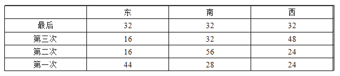

故正确答案为B。

**考点**：和差倍比问题

**来源**：2013年广东省公务员录用考试《行测》题（三）第11题

### 第 12 题

有一部96集的电视纪录片从星期三开始在电视台播出。正常情况下，星期二到星期五每天播出1集，星期六、星期天每天播出两集，星期一停播。播完35集后，由于电视台要连续3天播出专题报道，该纪录片暂时停播，待专题报道结束后继续按常规播放。那么该纪录片最后一集将在星期几播出？

A. 星期二

B. 星期五

C. 星期六

D. 星期日

第 12 题 · 答案与解析

**参考答案（粉笔题库参考内容）**

C

**解析**

周三开播，每周播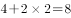集，每个周期在周二结束；正常播完需要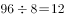周整，所以正常播完是在周二；播完35集，，则此时为周五，故专题报道播出时间为周六、周日、周一，正常情况下，纪录片应播出4集，故原本周二结束播放的纪录片，还剩下4集，则可知最后一集在周六播出。

故正确答案为C。

**考点**：周期余数问题、星期日期问题

**来源**：2013年广东省公务员录用考试《行测》题（三）第12题

### 第 13 题

某市居民用电实行分段式收费，以人为单位设定了相同的基准用电度数，家庭人均用电量超过基准用电度数的部分按照基准电费的两倍收取电费。某月，A家庭5口人用电250度，电费175元；B家庭3口人用电320度，电费275元。该市居民每人的基准用电为多少度？

A. 50

B. 35

C. 30

D. 25

第 13 题 · 答案与解析

**参考答案（粉笔题库参考内容）**

C

**解析**

设每人基准用电为x，基准电费为a，超标电费为2a，则可得方程组如下：5x×a+(250-5x)×2a=175，3x×a+(320-3x)×2a=275，两式相除，得到，即，解得x=30。

故正确答案为C。

**考点**：分段计算问题

**来源**：2013年广东省公务员录用考试《行测》题（三）第13题

### 第 14 题

某公安行动组有成员若干名，如果有1名女同志在外执勤，剩下组员中1/4是女性；如果有3名男同志在外执勤，剩下组员中有2/5是女性。如果行动组要派出男女各2名组员在外执勤，那么执勤人员的组成方式有多少种？

A. 168

B. 216

C. 286

D. 356

第 14 题 · 答案与解析

**参考答案（粉笔题库参考内容）**

B

**解析**

假设男同志m人，女同志n人，可得如下：，，解得m=9，n=4；行动组要派出男女各2名组员在外执勤，则组成方式有种。

故正确答案为B。

**考点**：基础排列组合

**来源**：2013年广东省公务员录用考试《行测》题（三）第14题

### 第 15 题

有一批商品需要装箱运输。商品每件均为10厘米\*40厘米\*80厘米的长方体。包装箱为边长为1.2米的立方体，一个包装箱最多能装多少件商品？

A. 54

B. 53

C. 52

D. 51

第 15 题 · 答案与解析

**参考答案（粉笔题库参考内容）**

C

**解析**

首先装的空间，此时装件；

剩余空间，再装空间，此时可装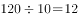件；剩余空间，还可装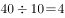件。

则一共可以装36＋12＋4＝52件。

故正确答案为C。

**考点**：几何公式类-立体图形、统筹规划问题

**来源**：2013年广东省公务员录用考试《行测》题（三）第15题

### 第 16 题

要加快新型产业布局，就需要进一步结合广东资源和经济发展的现状，以科技创新去\_\_\_\_产业新优势。

填入画横线部分最恰当的一项是：

A. 构造

B. 构建

C. 建筑

D. 建造

第 16 题 · 答案与解析

**参考答案（粉笔题库参考内容）**

B

**解析**

本题考查实词的应用。

A、C、D三项多用于具体事物，“构建”是指全方位、多角度、深层次地建立，多用于抽象事物。

故正确答案为B。

**考点**：实词填空、词的辨析-搭配对象

**来源**：2013年广东省公务员录用考试《行测》题（一）第16题

### 第 17 题

创新型人才的一个突出特点，就是不简单\_\_\_\_既成的事实，不\_\_\_\_于固定的想法，具有求异思维和批判精神。

依次填入画横线部分最恰当的一项是：

A. 认同 拘泥

B. 认同 局限

C. 认可 拘泥

D. 认可 局限

第 17 题 · 答案与解析

**参考答案（粉笔题库参考内容）**

A

**解析**

第一空，搭配“既成的事实”。A、B两项“认同”指承认、认可，侧重主观上的赞同，符合文意，均保留。C、D两项“认可”指许可、承认，多搭配“行为”“做法”等，与“既成的事实”搭配不当，均排除。

第二空，根据“具有求异思维和批判精神”可知，横线处应体现被固定想法束缚、不知变通之意。A项“拘泥”指固执、不知变通，且常与“于”搭配，符合文意，当选。B项“局限”指限制在一定范围内，强调客观范围受限，与文意不符，排除。

故正确答案为A。

**考点**：实词填空、对应关系-前后呼应、词的辨析-词义侧重

**来源**：2013年广东省公务员录用考试《行测》题（三）第17题

### 第 18 题

我国许多传统的老字号药店，\_\_\_\_在最困难的情况下，也在千方百计地保证药品的\_\_\_\_。

依次填入画横线部分最恰当的一项是：

A. 即使 质量

B. 即使 性能

C. 纵使 性质

D. 尽管 功效

第 18 题 · 答案与解析

**参考答案（粉笔题库参考内容）**

A

**解析**

本题考查实词的应用和虚词的搭配。

先看第二空，“性能”常与器物、机械等搭配，排除B项。

再看第一空，“即使······也······”表转折，为固定搭配，排除C、D两项。

故正确答案为A。

**考点**：混搭填空、词的辨析-搭配对象

**来源**：2013年广东省公务员录用考试《行测》题（三）第18题

### 第 19 题

暴雨暴露了城市公共管理和应急机制中的\_\_\_\_，更\_\_\_\_了市政规划建设中的硬伤。

依次填入画横线部分最恰当的一项是：

A. 隐患 显现

B. 软肋 凸显

C. 顽疾 揭示

D. 漏洞 呈现

第 19 题 · 答案与解析

**参考答案（粉笔题库参考内容）**

B

**解析**

第一空，“软肋”与“硬伤”前后呼应，软和硬相对，更为准确。

第二空，“揭示”与“呈现”首先排除，“凸显”与“显现”相比，前者更能表达“突出地显现”的语义，更符合题干的语境。

故正确答案为B。

**考点**：实词填空、对应关系-前后呼应、词的辨析-程度轻重

**来源**：2013年广东省公务员录用考试《行测》题（三）第19题

### 第 20 题

外交调研是一门特殊的学问，既要善于\_\_\_\_，又不能听风便是雨。

填入画横线部分最恰当的一项是：

A. 见微知著

B. 当机立断

C. 反躬自省

D. 触类旁通

第 20 题 · 答案与解析

**参考答案（粉笔题库参考内容）**

A

**解析**

“既要······又不能······”提示并列关系，“听风便是雨”表示听到风就觉得要下雨了，比喻听到一点点不确切的消息就信以为真，横线处应体现根据线索合理推断趋势之意。A项“见微知著”指见到苗头就知道它的实质或发展趋势，形容有远见，符合文意，当选。

B项“当机立断”指抓住时机，立刻果断作出决定，强调时机的重要性，与文意不符，排除；

C项“反躬自省”指回过头来检查自己的言行得失，与文意不符，排除；

D项“触类旁通”指接触某一事物并掌握其规律后，就能推知同类的其他事物，与“外交调研是一门特殊的学问”矛盾，排除。

故正确答案为A。

**考点**：关联关系-并列关系、成语填空

**来源**：2013年广东省公务员录用考试《行测》题（三）第20题

### 第 21 题

竞争性选拔是\_\_\_\_选人视野、打破论资排辈，让优秀年轻干部\_\_\_\_的“绿色通道”，也是公信度高、为干部群众普遍认同的选拔方式。

依次填入画横线部分最恰当的一项是：

A. 开拓 脱胎换骨

B. 开拓 脱颖而出

C. 拓宽 脱颖而出

D. 拓宽 脱胎换骨

第 21 题 · 答案与解析

**参考答案（粉笔题库参考内容）**

C

**解析**

本题考查实词和成语的应用。

第一空，“开拓”泛指扩大、扩充，通常搭配“市场”、“领域”等；“拓宽”指使之变得宽广，重在强调“由窄到宽”的过程，文段中的“视野”是以前就有的，仅强调“变宽”，故“拓宽”更为恰当，排除A、B两项。

第二空，“脱胎换骨”比喻通过教育，思想得到彻底改造，文段并无此意，排除D项；“脱颖而出”比喻本领全部显露出来，题干涉及“竞争性选拔”，“脱颖而出”符合语境 ，故C项当选。

故正确答案为C。

**考点**：对应关系-前后呼应、混搭填空、词的辨析-搭配对象、词的辨析-词义侧重

**来源**：2013年广东省公务员录用考试《行测》题（三）第21题

### 第 22 题

跟纸质出版界相比，网络文章发表之前无须经过身份验证、资格审查和学术评议等程序，这样就难免造成\_\_\_\_、\_\_\_\_的局面。

依次填入画横线部分最恰当的一项是：

A. 鱼目混珠 杂乱无章

B. 鱼龙混杂 杂乱无章

C. 鱼龙混杂 泥沙俱下

D. 鱼目混珠 泥沙俱下

第 22 题 · 答案与解析

**参考答案（粉笔题库参考内容）**

C

**解析**

根据“顿号”可知，第一空与第二空构成并列关系，所填词语语意相近。“鱼目混珠”指用假的冒充真的；“鱼龙混杂”强调好的坏的掺杂在一起；“杂乱无章”指乱七八糟，没有条理；“泥沙俱下”强调好的坏的混杂在一起。经对比，只有“鱼龙混杂”和“泥沙俱下”语意相近，均形容好的坏的掺杂在一起，锁定C项，而其余三项均不能构成并列关系，排除。

故正确答案为C。

**考点**：关联关系-并列关系、成语填空

**来源**：2013年广东省公务员录用考试《行测》题（三）第22题

### 第 23 题

只有\_\_\_\_勤俭节约，\_\_\_\_铺张浪费之歪风\_\_\_\_，才能有效净化我们的社会风气，培育健康向上的文明风尚。

依次填入画横线部分最恰当的一项是：

A. 厉行 提防 漫延

B. 力行 防止 漫延

C. 力行 防备 蔓延

D. 厉行 防范 蔓延

第 23 题 · 答案与解析

**参考答案（粉笔题库参考内容）**

D

**解析**

第一空，“力行”意为努力做，常见“身体力行”；“厉行”意为严格而认真地实行，“厉行节俭”为常见固定搭配，故排除B、C两项。

第三空，“蔓延”意为如蔓草滋生，连绵不断，通常形容东西扩散开来，“歪风蔓延”搭配恰当，“漫延”多与水相关，故排除A。

第二空验证，“防范”歪风蔓延，表意恰当合理。

故正确答案为D。

**考点**：实词填空、词的辨析-搭配对象、词的辨析-词义侧重

**来源**：2013年广东省公务员录用考试《行测》题（三）第23题

### 第 24 题

\_\_\_\_生态文明是由人的问题引起的，\_\_\_\_最终指向人的生存和发展，\_\_\_\_，要建设生态文明，就必须对人自身的观念、行为作出深刻的检视。

依次填入画横线部分最恰当的一项是：

A. 因为 甚至 所以

B. 虽然 并且 但是

C. 由于 甚至 因此

D. 既然 并且 那么

第 24 题 · 答案与解析

**参考答案（粉笔题库参考内容）**

D

**解析**

第一空、第二空，“由人的问题引起”和“指向人的生存和发展”，二者是并列关系，B、D两项“并且”表示并列关系，保留；A、C两项“甚至”表示递进关系，排除。

第三空，横线前论述生态文明与人相关的两个事实，横线后由前文推出结论，即需要对人的观念与行为进行检视。D项“既然······那么······”表示因果关系，填入符合逻辑关系，保留；B项“虽然······但是······”表示转折关系，不符合逻辑关系，排除。

故正确答案为D。

**来源**：2013年广东省公务员录用考试《行测》题（三）第24题

### 第 25 题

全球页岩气储量丰富，开发潜力巨大，在资源日益\_\_\_\_、能源需求增长、价格\_\_\_\_的大背景下，其作为常规天然气的有益补充，重要性\_\_\_\_。

依次填入画横线部分最恰当的一项是：

A. 匮乏 高涨 不可小觑

B. 匮乏 高企 不言而喻

C. 缺乏 高企 不言而喻

D. 缺乏 高涨 不可小觑

第 25 题 · 答案与解析

**参考答案（粉笔题库参考内容）**

B

**解析**

本题考查实词和成语的应用。

第一空，考查实词的应用，“匮乏”就是缺乏的意思，多用于物资，修饰资源更为合适，排除C、D两项。

第二空，考查实词的应用，“高企”是指价位持续停留在高位，且有可能继续上涨，包含了高涨的意思，更适合题干语境，排除A项。

故正确答案为B。

**考点**：混搭填空、词的辨析-搭配对象、词的辨析-词义侧重

**来源**：2013年广东省公务员录用考试《行测》题（三）第25题

### 第 26 题

说起社会公正，最多人的答案是要机会平等。说起机会平等，人们脑海浮现的，往往是竞技场上的起跑线。只要大家站在同一起跑线，竞争就是公平的，因此最后跑出来的结果无论是什么，那也是公正的。问题是：到底要满足什么条件，我们才能站在相同的起跑线？更进一步，当我们用起跑线这一比喻来思考正义问题时，背后有着怎样的道德想象？

这段文字的主要观点是：

A. 只有站在相同的起跑线上才能实现机会平等

B. 机会平等的概念，不能只停留在同一起跑线上

C. 机会平等是努力确保起点公平，容许竞争者自由发挥

D. 所谓起点公平是要抹平竞争者的所有差别

第 26 题 · 答案与解析

**参考答案（粉笔题库参考内容）**

B

**解析**

本题为中心理解题。

文段前两句对大多数人的看法进行了总结：机会平等就是起点公平，可得出A和C，D为无中生有，首先排除；最后一句提出了问题，对前面的看法提出了疑问，可知作者认为机会平等，不仅仅是起点公平，B表述最为准确，排除A、C。

故正确答案为B。

**考点**：主题词

**来源**：2013年广东省公务员录用考试《行测》题（一）第42题

### 第 27 题

识才需要智慧，用人需要胆略，护才需要勇气。大规模选拔人才必须依照制度进行，但“制度选人”不能代替“伯乐相马”。现在通行的标准化选人方法，只能选出一般性的优秀人才，而那些特殊性的杰出人才则很难被选拔出来，甚至会被当作“不合格产品”加以淘汰。

承接上述文字最恰当的一句是：

A. 因此，领导者只有独具匠心和慧眼，才能将他们选拔出来

B. 因此，高明的领导者应当大胆地起用、加倍地呵护杰出人才

C. 因此，标准化的选人方法已不合时宜，更为灵活、覆盖面更广、尊重特点、承认差别的选拔方法应运而生

D. 因此，选人方法必须由一般性人才向特殊性人才转换，为特殊性人才的发展开辟广阔的空间

第 27 题 · 答案与解析

**参考答案（粉笔题库参考内容）**

A

**解析**

由提问可知本题为接语选择题。文段首句提到“识才”、“用人”、“护才”，随后围绕“识才”这一话题展开论述。以“但”为转折，提出观点，“制度选人”不能代替“伯乐相马”，即强调“伯乐”的重要性。随后以一长句对这一观点进行论述。最后承接的“因此”结论句，应为对这一观点的总结呼应。结合选项可知，只有A项中的“领导者”与观点句中的“伯乐”形成对应，当选。B项中提到起用、呵护人才，文段仅强调识才，未提及用人、护才，排除；C、D两项中的方法均未体现出“伯乐”的重要性，排除。

故正确答案为A。

**考点**：接语选择题

**来源**：2013年广东省公务员录用考试《行测》题（三）第27题

### 第 28 题

在一些基层单位，总会发生群众同干部“顶嘴”的现象，有的还因此造成了干群情绪对立。究其原因，主要是一些基层干部忽视了群众的“辩白心理”。心理学家认为，人们在受到他人的批评时，大都会本能地产生一种辩解意识，也就是“辩白心理”。即便是做了明显的、无可推卸的错事，有的人也会讲几条客观原因来为自己辩解，冲淡自己的过失所造成的不良影响。一般来讲，“辩白心理”主要有以下两种表现：一种是通过辩白说明问题，另一种是为了逃避责任。

根据上述文字，以下说法正确的是：

A. 群众之所以为自己“辩白”，是想让干部弄清真实情况

B. 基层干部对待群众的“辩白”，要区分不同情况，正确处理

C. 做错事却心存侥幸以求逃避责任的人容易产生“辩白心理”

D. 基层干部与群众发生纠纷是因为忽视群众的“辩白心理”

第 28 题 · 答案与解析

**参考答案（粉笔题库参考内容）**

B

**解析**

A项，根据“‘辩白心理’主要有以下两种表现：一种是通过辩白说明问题，另一种是为了逃避责任”可知，群众为自己“辩白”不只是想让干部弄清楚真实情况，还有可能是为了逃避责任，表述错误，排除；

B项，根据“‘辩白心理’主要有以下两种表现：一种是通过辩白说明问题，另一种是为了逃避责任”可知，群众辩白存在两种不同动机，干部需要区分情况应对，表述正确，当选；

C项，根据“人们在受到他人的批评时，大都会本能地产生一种辩解意识，也就是‘辩白心理’”可知，“辩白心理”是人们受到他人批评时本能产生的，并非做错事心存侥幸想逃避责任的人才容易产生，表述错误，排除；

D项，根据“在一些基层单位，总会发生群众同干部‘顶嘴’的现象······究其原因，主要是一些基层干部忽视了群众的‘辩白心理’”可知，这里强调的是“顶嘴”现象的原因，并非基层干部与群众发生纠纷的原因，偷换概念，排除。

故正确答案为B。

**考点**：细节判断题

**来源**：2013年广东省公务员录用考试《行测》题（一）第30题

### 第 29 题

中华文化在数千年的历史演变中之所以始终保持强劲的生命力，就在于中华文化既具有鲜明的民族特征，同时，善于吸收不同民族、不同国家、不同地区的相关文化因子，作为改善自身文化机制，培养文化能力的有机元素。这就是为什么古巴比伦文化、古印度文化相继消亡，而中华文化却历数千年经久不衰并不断创新继而创造新的文明奇迹的奥秘所在。

这段文字主要说明了：

A. 只有不断改善自身文化机制才能经久不衰

B. 中华文化始终保持强劲生命力的关键

C. 古巴比伦文化的消失源于缺乏鲜明的民族特征

D. 中华民族要善于吸收不同民族、国家和地区的相关文化

第 29 题 · 答案与解析

**参考答案（粉笔题库参考内容）**

B

**解析**

本题为中心理解题。文段第一句指出了中华文化保持强劲生命力的原因是既保持鲜明的民族特征，又不断改善自身文化机制，A、D两项都只提到了一方面，过于片面，排除。C项“古巴比伦文化”这一主题词也发生了偏离，亦可排除。第二句进一步指出了这也是中华文化经久不衰并不断创新的奥秘，结合选项，B项中“关键”一词将文段中提及的多方面原因进行了高度概括。

故正确答案为B。

**考点**：主题词、关联词-因果

**来源**：2013年广东省公务员录用考试《行测》题（一）第33题

### 第 30 题

目前国内关于个人信息保护的法规分散，既缺乏对个人信息的界定，也缺乏可操作的标准，执法主体缺位，执法力度不足。对于个人信息保护的难题，业内讨论认为主要有三方面：保护程度界定，难以区别正当或非法使用个人信息；信息泄露取证，难以确定个人信息是在哪个环节发生泄露；执法力度统一，难以确保多个监管主体执法的宽严尺度一致。

因此，个人信息保护的关键在于：

A. 保障信息充分流通的同时避免滥用个人信息

B. 行业自律与政府部门监管相结合

C. 要形成一定程度的执法威慑

D. 要出台专门的法律法规保护个人信息

第 30 题 · 答案与解析

**参考答案（粉笔题库参考内容）**

D

**解析**

文段主要指出了没有系统的个人信息保护法来保护个人信息，存在很多问题，所以要出台专门的法律法规来保护个人信息。A项“保障信息流通”、B项“监管结合”、C项“执法威慑”均非针对文段论述问题的对策。

故正确答案为D。

**考点**：关联词-对策

**来源**：2013年广东省公务员录用考试《行测》题（一）第40题

### 第 31 题

近年来，社会热点事件频频占据了我们的视线，从毒奶粉事件到染色馒头事件，无疑给广大民众带来了巨大的心理负担和精神困惑；曾经轰动全国的抢盐事件，更是对社会正常秩序的一种冲击。很明显，这些社会热点事件给人们的社会生活带来了破坏性甚至是毁灭性的影响。但是最为严重的影响，莫过于这些社会热点事件所产生的负面效应不断扩散，并由此引发公众的困惑和不安。

根据这段文字，可以看出作者的意图是：

A. 呼吁对社会热点事件负面效应的扩散进行有效抑制

B. 批判社会热点事件的负面效应混淆了公众的视听

C. 揭示社会热点事件的负面效应不断扩散的实质

D. 提醒人们在复杂多变的环境中提高甄别社会热点事件的能力

第 31 题 · 答案与解析

**参考答案（粉笔题库参考内容）**

A

**解析**

文段首先指出近年来社会热点事件给人们的社会生活带来了破坏性甚至是毁灭性的影响，后文通过转折关联词“但是”进一步强调这些热点事件的不断扩散引发了公众的困惑和不安，故作者的意图是呼吁对社会热点事件负面效应的扩散进行有效抑制，对应A项。

B项：混淆视听只对应文段中的“困惑”，而文段中除了“困惑”，还有“不安”，表述片面，排除。

C项：“社会热点事件的负面效应不断扩散的实质”在文段中并未提及，属于无中生有，排除。

D项：“甄别社会热点事件”偷换概念，文段重在强调防止社会热点事件的负面效应扩散，排除。

故正确答案为A。

【文段出处】《科学普及与社会热点事件的效应扩散》

**考点**：关联词-转折

**来源**：2013年广东省公务员录用考试《行测》题（一）第41题

### 第 32 题

在公众印象中，每一次加大尾矿治理力度，总是在发生严重的尾矿溃坝事故之后。而突击式的尾矿治理方式不太可能持久奏效。数量巨大的尾矿伴随着矿山的开采不断增加，随着矿山枯竭，经年累月贮存起来的尾矿被堆放于江岸的山坡，因在技术层面缺乏有效的处理方法，只能以非安全的暴露方式，继续留存在自然界中。

这段文字主要想传递的信息是：

A. 尾矿如不能得到有效治理将会产生各种隐患和威胁

B. 我们总是在事故发生之后突击式的治理尾矿

C. 遗留的历史包袱和新增的隐患令尾矿治理压力剧增

D. 中国的尾矿治理将以何种模式继续进行才能有效

第 32 题 · 答案与解析

**参考答案（粉笔题库参考内容）**

A

**解析**

由文段前两句可知，尾矿处理一直采用突击式的尾矿治理方式，这种方式不是有效的处理方式，且由最后一句“非安全的暴露方式”可知，尾矿存在安全隐患。显然A项表述最符合文段原意。B项无中生有。D项中“何种模式”在文段中并没有具体体现。C项为强迷惑项，但与A项对比可知，A项的重点在于应该对尾矿进行有效治理，而C项的重点在于压力倍增。

故正确答案为A。

**考点**：关联词-对策

**来源**：2013年广东省公务员录用考试《行测》题（一）第43题

### 第 33 题

国家实施“农村义务教育学生营养改善计划”的目标，是有效改善农村少儿的营养状况和健康素质。由于各地的地理环境、食物资源、饮食习惯、传统民俗不同，要实现这一目标，就需要在对各地农村少儿健康和营养状况的实证研究基础上，因地制宜地提出合理的食物结构和改善计划。

这段文字主要说明了：

A. 农村少儿的营养需科学改善

B. 各地的营养改善方式存在差异

C. 营养改善目标是通过研究来确定的

D. 地域不同，营养改善的目标就不同

第 33 题 · 答案与解析

**参考答案（粉笔题库参考内容）**

A

**解析**

本题为中心理解题。文段先指出国家实施“农村义务教育学生营养改善计划”的目标是要改善农村少儿的营养状况和健康素质，其后指出由于各地具体情况的不同，要实现这一目标，就要在实证研究的基础上因地制宜提出改善计划。可见整个文段都在围绕改善农村少儿营养这一话题展开。结合选项可知，A项表述为文段重点的同义替换。

B、C、D三项均无“农村少儿”这一主题词，故排除。

故正确答案为A。

**考点**：主题词、关联词-对策

**来源**：2013年广东省公务员录用考试《行测》题（一）第29题

### 第 34 题

中国的科技进步举世瞩目。2010年中国科技人力资源总量居世界第一位，国际科技论文数量居世界第二位，发明专利授权量居世界第三位······但调查显示，我国人才资本对经济增长的贡献率远远低于西方国家，而关键技术的对外依存度明显高于西方国家。

这段文字主要想传递的信息是：

A. 缺乏关键核心技术的支持已成为科技发展的瓶颈

B. 中国科技发展的自主创新能力不强，研究基础薄弱

C. 中国的科技实力发展迅猛，取得了许多重大成果

D. 中国已成为科技大国，但仍与发达国家存在较大差距

第 34 题 · 答案与解析

**参考答案（粉笔题库参考内容）**

D

**解析**

文段首先指出我国的科技进步举世瞩目，并列举了一系列科技指标的世界排名，随后以“但”表转折，指出我国人才资本对经济增长的贡献率低，关键技术的对外依存度明显高于西方国家。由转折后是重点可知，我国虽然已经成为科技大国，但仍与发达国家存在较大差距，对应D项。

A项，未包含“中国”这一主题词，且未提及“人才资本对经济增长的贡献率低于西方国家”，表述片面，排除。

B项，文中没有提及自主创新与研究基础，无中生有，排除。

C项，为转折之前的内容，非文段重点，排除。

故正确答案为D。

**考点**：关联词-转折

**来源**：2013年广东省公务员录用考试《行测》题（一）第45题

### 第 35 题

很多经济学家统计，印度因为人口的快速增长而前景光明，因为它将逐步收获“人口红利”。未来十年，印度的就业人口将增长26%。这些年轻劳动力将显著降低人口的抚养比，从而提高储蓄率，促进投资，推动经济发展。但年轻人口转化为劳动力的前提在于一个国家的教育设施是否完备，能否提供足够的培训。印度欠缺的也正在于此，研究显示，尽管每年新增劳动人口1280万。但印度每年仅能培训310万人，只是新增人口的1/4，剩下的3/4反而成为社会发展的负担。

作者通过这段文字意在说明：

A. “人口红利”能推动经济起飞

B. 出生率对国家经济发展影响巨大

C. 高出生率有助于推动经济发展

D. 教育资源欠缺阻碍经济发展

第 35 题 · 答案与解析

**参考答案（粉笔题库参考内容）**

D

**解析**

本题为中心理解题。

文段首先指出印度会因为人口的快速增长而前途光明，接着以“但”做转折说明年轻人口转化为劳动力的前提在于一个国家的教育设施是否完备，而印度在这方面是欠缺的，并以一组数据来说明教育资源欠缺带来的结果。由此可知，作者意在说明教育资源欠缺阻碍经济发展。A、B、C三项均没有提到“教育”这个主题词，偏离文段中心，排除。

故正确答案为D。

**考点**：主题词、关联词-转折

**来源**：2013年广东省公务员录用考试《行测》题（三）第35题

### 第 36 题

互联网的普及让人们开始超越以民族、国家为单位看待历史发展的视角，看到了世界各个地区、各个文化之间的频繁互动和交流。而一些跨国公司，利用现代社会信息传送的发达和便利，其各个部门根据需要可以分布在世界的各个角落，通过电信技术和互联网加以沟通。

对这段文字概括最准确的是：

A. 互联网使当今世界进入信息交流十分便利的时代

B. 当今世界的交流和沟通已经完全突破民族、国家的限制

C. 以互联网为代表的信息时代的来临标志着当今世界走向全球化

D. 以互联网的普及为核心的信息时代改变了交流与沟通的传统模式

第 36 题 · 答案与解析

**参考答案（粉笔题库参考内容）**

A

**解析**

本题为中心理解题。

文段结构为“提出观点+举例说明”。第一句指出互联网的普及引发了地区和文化的频繁互动和交流，“频繁”说明互动和交流非常便利，而第二句通过跨国公司的例子，进一步阐述了互联网使现代社会的信息交流非常发达和便利。

因此，结合选项应该选择A，因为第一句为主旨句，A表述与之最为接近。

B项缺少文段的主体“互联网”，且其中的“已经完全突破”表述过于绝对，排除；C项、D项的主体为“信息时代”，偷换了文段主体“互联网的普及”，排除。

故正确答案为A。

**考点**：分述句特征-举例子

**来源**：2013年广东省公务员录用考试《行测》题（三）第36题

### 第 37 题

大众传媒主要是通过报纸、电视、广播等平台来开展。人际传播是指举办论坛、公众开放日等活动，实现人和人之间的传播。新媒体集合了大众传媒和人际传播两者的优点，兼具广泛性和精准性，既可以同时面对数百万甚至是数千万的受众，也可以实现传播者和受众一对一的交流。受众既是传播的目标对象，也是传播的主体，可以帮助我们实现二次乃至多次再传播。

根据上述文字，对“新媒体”理解不准确的一项是：

A. 新媒体是建立在大众传媒传播和人际传播的基础之上的

B. 新媒体的受众已从传播的目标对象转变为传播的主体

C. 新媒体有助于我们实现二次乃至多次再次传播

D. 新媒体的双向互动性体现了它与传统媒体的区别和优势

第 37 题 · 答案与解析

**参考答案（粉笔题库参考内容）**

B

**解析**

由“新媒体集合了大众传媒和人际传播两者的优点”可知A项正确。由“受众既是传播的目标对象，也是传播的主体，可以帮助我们实现二次乃至多次再传播”可知C、D两项正确，B项错误。

本题为选非题，故正确答案为B。

**考点**：实词

**来源**：2013年广东省公务员录用考试《行测》题（三）第37题

### 第 38 题

威慑其实是让假想敌人的内心产生恐惧，从而阻止他做出对自己不利的事情来。但是这种恐惧的根源有两个：第一，对手要认可威慑方所具备的实力，很难想象一个弱小的国家能够威慑强大的美国；第二，对手还要相信威慑方动用实力来达到目的的决心，换句话说，对手要确认威慑方的意图。如果对手认为威慑方并不具备真实的进攻性意图，那么简单的展示实力或者言语威胁就毫无意义了。

根据这段文字，以下说法正确的是：

A. 威慑方通过让潜在对手相信自己的实力以达到威慑的目的

B. 威慑的目的在于阻止强大对手的攻击并使其产生惧怕

C. 威慑方真实明确的意图更能给对手带来恐惧

D. 威慑的成功与否关键在于被威慑方的认知

第 38 题 · 答案与解析

**参考答案（粉笔题库参考内容）**

D

**解析**

A、B两项均围绕威慑的目的来阐述，而威慑的目的是让假想敌人的内心产生恐惧，从而阻止他做出对自己不利的事情来。A、B两项表述错误，均排除。

C项偷换概念，能给对手带来恐惧的是“真实的进攻性意图”，而并非仅仅“真实明确的意图”，排除。

D项表述正确，两个根源都涉及被威慑方的认知。

故正确答案为D。

**考点**：细节判断题

**来源**：2013年广东省公务员录用考试《行测》题（三）第38题

### 第 39 题

2012年8月，有“史上最严限抗令”之称的《抗菌药物临床应用管理办法》正式实施。根据《办法》，抗菌药物将依据安全性、疗效、细菌耐药性、价格等因素，被分为非限制使用级、限制使用级和特殊使用级三个级别。医疗机构和医疗人员应严格掌握使用抗菌药物预防感染的指征。违规使用抗菌药物的医师，将被警告、限制处方权、吊销执业证书，甚至追究刑事责任。

通过上述文字可以得知：

A. 抗菌药物滥用将得到有效遏制

B. 我国抗菌药物滥用现象严重

C. 医疗人员将会谨慎使用抗菌药物

D. 主管部门向抗菌药物滥用宣战

第 39 题 · 答案与解析

**参考答案（粉笔题库参考内容）**

D

**解析**

文段主要介绍的是新出台的《抗菌药物临床应用管理办法》的相关规定，介绍了抗菌药物的级别，医疗机构和医疗人员应该坚持的做法以及违规使用抗菌药物的医师将受到的处罚，体现出主管部门下决心治理抗菌药物滥用的现象，对应D项。A项“将得到有效遏制”无中生有，排除。B项非文段重点阐述的内容，排除。C项“医疗人员”表述片面，文段论述的是主管部门出台规定的具体措施，排除。

故正确答案为D。

**考点**：细节判断题

**来源**：2013年广东省公务员录用考试《行测》题（三）第39题

### 第 40 题

干细胞是具有自我更新和多向分化潜能的原始细胞群体，是形成各种组织器官的起源细胞。当机体成熟体细胞因衰老或受伤死亡，干细胞随时生产它们的替代品来维持各种细胞更新和组织修复。可惜的是，随着年龄的增长，人体中的干细胞族群增殖和分化的能力会严重减弱。从这个角度看，通过某种方式干预和恢复干细胞的活力就有望修复组织功能，达到延缓衰老的效果。

这段文字意在说明：

A. 人类实现青春不老的美丽夙愿依赖于干细胞技术的应用

B. 恢复活力的干细胞能替换各种因衰老或受伤而死亡的细胞

C. 干细胞技术将有助于改善人类健康水平、提高生活质量

D. 人体之所以会老去是因为衰老细胞不能及时被干细胞替代

第 40 题 · 答案与解析

**参考答案（粉笔题库参考内容）**

C

**解析**

文段开篇介绍干细胞是形成各种组织器官的起源细胞并具有维持细胞更新和组织修复的作用，接着指出随着年龄增长干细胞族群增殖和分化能力减弱的问题，最后通过指代词“从这个角度看”总结前文引出对策，强调通过干预和恢复干细胞活力有望修复组织功能、延缓衰老。故文段重点强调通过干预和恢复干细胞活力可以解决修复组织功能、延缓衰老的问题，C项，改善人类健康水平、提高生活质量是对修复组织功能、延缓衰老的同义替换，符合文段中心，当选。

A项，“青春不老”表述过于绝对，文段说的是延缓衰老，排除；

B项，偷换概念，文中说明替换衰老等细胞的并不是干细胞，而是干细胞生产的他们的替代品，排除；

D项，“人体之所以会老去”并非文段重点，文段重点强调干细胞技术将有助于改善人类健康水平、提高生活质量，排除。

故正确答案为C。

**考点**：关联词-因果

**来源**：2013年广东省公务员录用考试《行测》题（三）第40题

### 第 41 题

“云计划”极有可能引发新一轮信息技术革命，并且对国际局势产生深远的影响。简单地说，“云”就是利用互联网技术进行远程计算和数据存储，用户只要有一台能访问互联网的普通电脑或者手机就可以进行复杂计算，个人的数据资料也可以通过互联网轻松地放到“云端”进行存储。从硬件上说，“云”就是计算机群，每一群包括了几十万台、甚至上百万台计算机，这些计算机可能是高性能的服务器，也可能是连到互联网上的普通电脑，甚至是手机。

根据上述文字，对“云”理解最准确的一项是：

A. “云”是几十万台，甚至上百万台的计算机群

B. 离开互联网，“云”的功能将无法实现

C. “云”技术实际上就是互联网技术

D. 谁控制了“云”，谁就控制了虚拟世界

第 41 题 · 答案与解析

**参考答案（粉笔题库参考内容）**

B

**解析**

由“‘云’就是利用互联网技术进行远程计算和数据存储”可知，“云”技术需要依托互联网。由“用户只要有一台能访问互联网的普通电脑或者手机就可以进行复杂计算”可知，用户使用“云”也需要依托互联网；由此可知，离开互联网，“云”的功能无法实现。因此，B项正确，当选。

A项理解片面，只概括了硬件层面，排除；C项表述过于绝对，这两者并非完全等同，排除。D项无中生有，文段没有体现这一点，排除。

故正确答案为B。

**考点**：实词

**来源**：2013年广东省公务员录用考试《行测》题（三）第41题

### 第 42 题

近日，我国2000吨地沟油加工成的生物煤油被荷兰航空公司买走的报道震撼了国民：地沟油还有这么高端的用途！原来，经过特殊技术加工后的地沟油可以作为一种生物煤油来替代传统的柴油和汽油，用于航空飞行。事实上，不只是荷兰，欧美很多国家近些年来都在寻找妥善处理餐厨余油的办法。通过严格的国家立法和执法、先进的技术投入以及人们日益提高的环保意识和健康觉悟，餐厨余油经过回收、加工后流进了工矿、发电厂，甚至是家庭的汽车油箱，成为真正的可再生清洁能源，继续造福人类。

如果这是一篇文章的引言，这篇文章的内容最有可能是：

A. 世界各国都致力于研究地沟油的回收利用

B. 设立完整的处理地沟油的方法以造福民生

C. 地沟油已经成为真正的可再生清洁能源

D. 我国餐厨余油的加工生产前景广阔

第 42 题 · 答案与解析

**参考答案（粉笔题库参考内容）**

B

**解析**

文段由一则报道引出“地沟油经过特殊技术加工可以作为一种生物煤油替代传统的柴油和汽油，用于航空”这一话题；接着指出很多欧美国家都在寻找妥善处理餐厨余油的方法，通过国家立法执法、技术投入和提高人们的环保意识等，使地沟油能够回收再利用，造福人类。根据尾句的核心话题，正文应具体描述地沟油回收利用的具体措施及如何造福人类，对应B项。

A项：“各国致力于研究”属于前文论述过的内容，排除。

C项：尾句的核心话题是地沟油的处理方式及如何造福人类，选项与此话题不一致，排除。

D项：“加工生产前景广阔”并非尾句所谈论话题，排除。

故正确答案为B。

【文段出处】《让“地沟油”不再乱流》

**考点**：接语选择题

**来源**：2013年广东省公务员录用考试《行测》题（三）第42题

### 第 43 题

中国稀土产业正面临内外夹击困局：国内，资源消耗过快，环境污染严重，非法采矿现象屡禁不绝，大量稀土被变相出口与走私；国外，美国、欧洲、日本在稀土出口问题上不断对我国施压。半个多世纪的超强度开采，已使我国的稀土资源保有储量及保障年限不断下降。部分专家指出，以人均资源量相比，目前我国已经是稀土匮乏的国家，然而我国尚未完成工业化，未来需要更大量的稀土。

这段文字主要想传达的信息是：

A. 超强度开采使我国稀土资源匮乏，人均资源量低

B. 我国已经为稀土的开采付出了沉重的环境代价

C. 需要统筹管理稀土开发、生产和出口突破困境

D. 国内外因素造成稀土行业的开发无序等多种困难

第 43 题 · 答案与解析

**参考答案（粉笔题库参考内容）**

C

**解析**

文段先指出我国稀土产业面临内外困局：国内过度开发、非法开采，国外面临出口压力；然后指出我国现在已是稀土匮乏国家，并且未来发展需要消耗大量稀土；也就是说，我国需要合理开采和生产、严格控制出口，统筹管理，对应C项。A项“稀土资源匮乏”、B项“付出沉重的环境代价”、D项“多种困难”均为问题表述，非重点，排除。

故正确答案为C。

**考点**：关联词-对策

**来源**：2013年广东省公务员录用考试《行测》题（三）第43题

### 第 44 题

中国的邻邦日本，正在遭受“人口少子化”的困境。1999年，日本的总和生育率下降到1.57%，被称为“1.57%危机”。2006年，这一数字下降到1.04%。日本媒体惊呼“少子化已达危害国家兴衰地步”。与此同时，在人口众多的中国，少子化问题也日渐浮现。根据2010年全国人口普查的数据，我国0到16岁人口占人口总数的16.60%，比2000年下降了6.2个百分点，总和生育率约为1.18％。人口学家惊呼，中国已经步入最低生育率和严重少子化国家的行列。

这段文字意在强调：

A. 中国少子化的现象尚未引起国人的足够关注

B. 少子化已经成为困扰我国经济发展的社会问题

C. 中国少子化程度严重，总和生育率低于日本

D. 我们要重视人口少子化问题所带来的威胁

第 44 题 · 答案与解析

**参考答案（粉笔题库参考内容）**

D

**解析**

文段从日本少子化问题谈及我国目前也面临着少子化问题，根据2000年与2010年的统计数据，显示我国已经步入最低生育率和严重少子化国家的行列。根据我国的统计数据与日本的统计数据比较，结合日本例子中“少子化已达危害国家兴衰地步”一语可知，文段是以日本为例提醒我国重视少子化问题所带来的威胁。

因此，D项正确。

A项“尚未引起国人的足够关注”不能从文段中推出，文段中只提到了“人口学家”的态度，并没有提及国人的态度，排除；B项文段没有涉及，困扰经济社会发展体现不出来，排除；C表述错误，由数据可知，总和生育率仍高于日本。

故正确答案为D。

**考点**：关联词-对策

**来源**：2013年广东省公务员录用考试《行测》题（三）第44题

### 第 45 题

优抚安置工作要充分体现党、政府和人民对革命功臣的关爱。优抚安置的服务对象种类多，老龄化突出，服务对象有优抚和安置两大部分，共5类27种。优抚安置的工作环节和服务保障流程复杂。比如接收安置一名重点对象，需经过审定安置计划、落实住房建购经费、下达安置计划、办理移交手续等十几个环节。接收下来后还要负责落实政治待遇、生活待遇、医疗保障等服务管理内容几十项。

这段话主要说明：

A. 优抚安置工作政治性强，政策保障要求高

B. 优抚安置工作相关性强，协调沟通任务重

C. 优抚安置工作特殊性强，服务保障难度大

D. 优抚安置工作矛盾性强，形势任务适应难

第 45 题 · 答案与解析

**参考答案（粉笔题库参考内容）**

C

**解析**

文段开篇说明优抚安置工作要体现各方面对革命功臣的关爱，随即交待优抚安置工作环节和服务保障流程复杂，后文举例说明。故文段重点强调优抚安置工作环节和服务保障流程复杂，工作难度较高，且文段优抚安置工作理念、服务对象以及工作流程说明了该项工作与一般工作不同，对应C项。

A项，“政治性”指坚守正确政治方向，严明政治纪律，强调对政治原则的维护及政治立场的把握，文段未提及，无中生有，排除；

B项，“协调沟通”表述片面，排除；

D项，“矛盾性”强调冲突，文段未提及优抚安置工作过程中存在哪些冲突，排除。

故正确答案为C。

**考点**：主题词

**来源**：2013年广东省公务员录用考试《行测》题（三）第45题

### 第 46 题

业务：业绩

A. 工作：收入

B. 现实：幻想

C. 手术：疗效

D. 投入：产出

第 46 题 · 答案与解析

**参考答案（粉笔题库参考内容）**

C

**解析**

第一步：判断题干词语间逻辑关系。

“业务”与“业绩”为对应关系，业绩能够评估业务能力的强弱。

第二步：判断选项词语间逻辑关系。

A项：“工作”与“收入”为对应关系，但收入不能用来评估工作能力，排除；

B项：“现实”与“幻想”为并列关系，二者一实一虚，排除；

C项：“手术”与“疗效”为对应关系，疗效能够评估手术效果的好坏，与题干逻辑关系一致，当选；

D项：“投入”与“产出”为并列关系，排除。

故正确答案为C。

**考点**：逻辑关系-对应关系

**来源**：2013年广东省公务员录用考试《行测》题（一）第53题

### 第 47 题

政务：公文

A. 广告：电视

B. 品牌：产品

C. 市场：需求

D. 规划：计划

第 47 题 · 答案与解析

**参考答案（粉笔题库参考内容）**

A

**解析**

第一步：判断题干词语间逻辑关系。

“政务”与“公文”为对应关系，“政务”通过“公文”的形式来处理。

第二步：判断选项词语间逻辑关系。

A项：“广告”与“电视”为对应关系，“广告”通过“电视”来播放，与题干逻辑关系一致，当选。

B项：“品牌”与“产品”为对应关系，但顺序反了，“产品”通过“品牌”来推广，排除。

C项：“市场”与“需求”为对应关系，“市场”是“需求”的导向，排除。

D项：“规划”和“计划”是近义词关系，排除。

故正确答案为A。

**考点**：逻辑关系-对应关系

**来源**：2013年广东省公务员录用考试《行测》题（三）第47题

### 第 48 题

重视：人才

A. 依法：治国

B. 商品：销售

C. 掌握：知识

D. 作战：军队

第 48 题 · 答案与解析

**参考答案（粉笔题库参考内容）**

C

**解析**

第一步：判断题干词语间逻辑关系。

“重视人才”为动宾结构。

第二步：判断选项词语间逻辑关系。

A项：“依法”和“治国”分别为两个动宾结构，与题干逻辑关系不一致，排除；

B项：“销售商品”为动宾结构，但与题干顺序相反，排除；

C项：“掌握知识”为动宾结构，与题干逻辑关系一致，当选；

D项：“军队作战”为主谓结构，与题干逻辑关系不一致，排除。

故正确答案为C。

**考点**：语法关系

**来源**：2013年广东省公务员录用考试《行测》题（三）第48题

### 第 49 题

读书：治学

A. 收获：耕种

B. 继承：传播

C. 归纳：总结

D. 战争：战役

第 49 题 · 答案与解析

**参考答案（粉笔题库参考内容）**

C

**解析**

第一步：判断题干词语间逻辑关系。

“读书”与“治学”是组成关系，“治学”包括读书、练习、复习、实习。

第二步：判断选项词语间逻辑关系。

A项：“收获”与“耕种”是方式目的对应关系，“耕种”是为了收获，排除。

B项：“继承”与“传播”是方式目的对应关系，“继承”是为了传播，排除。

C项：“归纳”与“总结”是组成关系，“总结”包括“归纳”，与题干逻辑关系一致，当选。

D项：“战争”与“战役”是组成关系，但逻辑顺序反了，战争由若干战役组成，排除。

故正确答案为C。

**考点**：逻辑关系-包容关系

**来源**：2013年广东省公务员录用考试《行测》题（三）第49题

### 第 50 题

山色：水声

A. 春花：秋月

B. 珠圆：玉润

C. 钟鼓：琴瑟

D. 天寒：地冻

第 50 题 · 答案与解析

**参考答案（粉笔题库参考内容）**

A

**解析**

第一步：判断题干词语间逻辑关系。

“山色”与“水声”为并列关系，且“山色”与“水声”，都是定语修饰中心词，是偏正结构。

第二步：判断选项词语间逻辑关系。

A项：“春花”与“秋月”为并列关系，且“春花”是指春天的花，“秋月”是指秋天的月，都是定语修饰中心词，是偏正结构，与题干逻辑关系一致，当选；

B项：“珠圆”与“玉润”为并列关系，像珠子一样的圆，像玉石一样的光润，是偏正结构，但属于状语修饰中心词，与题干逻辑关系不一致，排除；

C项：“钟鼓”与“琴瑟”为并列关系，但“钟鼓”与“琴瑟”都是并列结构，与题干逻辑关系不一致，排除；

D项：“天寒”与“地冻”为因果关系，因为天气寒冷，所以地上冻结冰了，与题干逻辑关系不一致，排除。

故正确答案为A。

【注】判断偏正结构

如果在两个词之间加“的”或“地”，如果通顺大多数便是偏正短语。

如黑色跑车，中间加“的”，便是“黑色的跑车”，说明“黑色跑车”就是偏正短语。

**考点**：拆分思维、语法关系

**来源**：2013年广东省公务员录用考试《行测》题（三）第50题

### 第 51 题

兼济天下：独善其身

A. 扶危济困：落井下石

B. 前车之鉴：后顾之忧

C. 出双入对：形单影只

D. 好高骛远：好大喜功

第 51 题 · 答案与解析

**参考答案（粉笔题库参考内容）**

C

**解析**

第一步：判断题干词语间逻辑关系。

“兼济天下”和“独善其身”是反义词关系，且均没有贬义。

第二步：判断选项词语间逻辑关系。

A项：“扶危济困”与“落井下石”为反义词关系，但“落井下石”含贬义，排除。

B项：“前车之鉴”与“后顾之忧”没有明显逻辑关系，排除。

C项：“出双入对”与“形单影只”是反义词关系，均没有贬义，与题干逻辑关系一致，当选。

D项：“好高骛远”与“好大喜功”是近义词关系，且两词均为贬义，排除。

故正确答案为C。

**考点**：语义关系-反义关系

**来源**：2013年广东省公务员录用考试《行测》题（三）第51题

### 第 52 题

鱼沉雁渺：音信全无

A. 风声鹤唳：人心惶惶

B. 焚琴煮鹤：附庸风雅

C. 举杯望月：对牛弹琴

D. 势成骑虎：威风凛凛

第 52 题 · 答案与解析

**参考答案（粉笔题库参考内容）**

A

**解析**

第一步：判断题干词语间逻辑关系。

“鱼沉雁渺”与“音信全无”为近义词关系。“鱼沉雁渺”比喻书信不通，音信断绝。“音信全无”是指一点消息也没有。

第二步：判断选项词语间逻辑关系。

A项：“风声鹤唳”与“人心惶惶”为近义词关系。“风声鹤唳”形容惊慌失措，或自相惊忧。“人心惶惶”形容人们内心惊恐不安。与题干逻辑关系一致，当选。

B项：“焚琴煮鹤”指把琴当作柴火烧了去煮白鹤。比喻糟蹋美好的事物。“附庸风雅”指某些人为装点门面，追随结交名士，从事有关文化方面的活动（多含贬义）。不存在明显的逻辑关系，排除。

C项：“举杯望月”指举起杯子望着月亮。“对牛弹琴”指讥笑听话的人不懂对方说的是什么。不存在明显的逻辑关系，排除。

D项：“势成骑虎”比喻做某事过程中遇到障碍，但由于形势的需要，不可能就此罢手的情况。“威风凛凛”指使人敬畏的声势或气派。不存在明显的逻辑关系，排除。

故正确答案为A。

**考点**：语义关系-近义关系

**来源**：2013年广东省公务员录用考试《行测》题（三）第52题

### 第 53 题

刻薄不赚钱：忠厚不折本

A. 骏马不等鞭：响鼓不重锤

B. 慷慨杀身易：从容就死难

C. 枯木难复活：惯贼难悔悟

D. 谦虚使人进步：骄傲使人落后

第 53 题 · 答案与解析

**参考答案（粉笔题库参考内容）**

D

**解析**

第一步：判断题干词语间逻辑关系。

“刻薄不赚钱”与“忠厚不折本”为反义关系，且“刻薄”与“忠厚”、“赚钱”和“折本”互为反义关系。

第二步：判断选项词语间逻辑关系。

A、C两项没有反义关系，排除A、C两项。

B项中“慷慨”和“从容”没有反义关系，排除B项。

D项与题干逻辑关系一致，两句话为反义关系，且“谦虚”和“骄傲”、“进步”和“落后”互为反义关系，当选。

故正确答案为D。

**考点**：语义关系-反义关系

**来源**：2013年广东省公务员录用考试《行测》题（三）第53题

### 第 54 题

道路：红绿灯：畅通

A. 教室：教师：秩序

B. 运动员：拼搏：荣誉

C. 游泳池：救生员：健康

D. 国家：法律：稳定

第 54 题 · 答案与解析

**参考答案（粉笔题库参考内容）**

D

**解析**

第一步：判断题干词语间逻辑关系。

三者为对应关系，道路装红绿灯是为了保持交通畅通，前二者都是名词。

第二步：判断选项词语间逻辑关系。

A项：教室里的教师是为了给学生授课，而不是维持秩序，排除；

B项：运动员拼搏是为了荣誉，但拼搏不是名词，排除；

C项：游泳池配备救生员是为了安全，而不是为了健康，排除；

D项：国家制定法律是为了保持稳定，与题干逻辑关系一致，且前二者均为名词，当选。

故正确答案为D。

**考点**：逻辑关系-对应关系

**来源**：2013年广东省公务员录用考试《行测》题（三）第54题

### 第 55 题

铁路：火车：乘客

A. 车间：机器：工人

B. 旅馆：房间：宾客

C. 田地：庄稼：农民

D. 海洋：潜艇：士兵

第 55 题 · 答案与解析

**参考答案（粉笔题库参考内容）**

D

**解析**

第一步：判断题干词语间逻辑关系。

三者为对应关系，行驶在铁路上的火车搭载乘客。

第二步：判断选项词语间逻辑关系。

A项：工人操作车间里的机器，与题干逻辑关系不一致，排除；

B项：旅馆里的房间为宾客提供住宿，与题干逻辑关系不一致，排除；

C项：农民种植田地里的庄稼，与题干逻辑关系不一致，排除；

D项：行驶在海洋里的潜艇搭载士兵，与题干逻辑关系一致，当选。

故正确答案为D。

**考点**：逻辑关系-对应关系

**来源**：2013年广东省公务员录用考试《行测》题（三）第55题

### 第 56 题

从所给四个选项中，选择最合适的一个填入问号处，使之呈现一定的规律性：

A. A

B. B

C. C

D. D

第 56 题 · 答案与解析

**参考答案（粉笔题库参考内容）**

D

**解析**

解析1：

元素组成相似，元素叠加--去同求异

前一组图中，后两幅图叠加可得到第一幅图；那么第二组图也应遵循此规律，显然只有D满足该条件。

故正确答案为D。

解析2：

题干中前一组图都根据竖轴对称，属性一致；后一组图前两幅图都根据横轴对称，所以待选图形也应符合此规律，排除A、B；

另外观察题干中所有图形均为封闭图形，所以待选图形也应符合此规律，排除C。

故正确答案为D。

**考点**：属性规律-复合、样式规律-加减同异

**来源**：2013年广东省公务员录用考试《行测》题（一）第58题

### 第 57 题

从所给四个选项中，选择最合适的一个填入问号处，使之呈现一定的规律性：

A. A

B. B

C. C

D. D

第 57 题 · 答案与解析

**参考答案（粉笔题库参考内容）**

C

**解析**

元素组成相同，考查位置-旋转。题干中前一组图，三幅图依次按照逆时针旋转，每次旋转90度；第二组中前两幅图也按此规律旋转，所以待选图形也应遵循此规律，第二幅图逆时针旋转90度，得到C。

故正确答案为C。

**考点**：位置规律-旋转

**来源**：2013年广东省公务员录用考试《行测》题（一）第59题

### 第 58 题

从所给四个选项中，选择最合适的一个填入问号处，使之呈现一定的规律性：

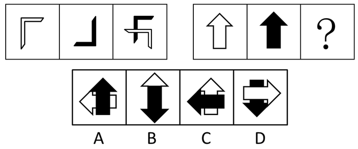

A. A

B. B

C. C

D. D

第 58 题 · 答案与解析

**参考答案（粉笔题库参考内容）**

D

**解析**

元素组成相似，且相同线条重复出现，考虑加减同异。第一组图中，图1顺时针旋转90°与图2顺时针旋转180°相压构成图3，且第一幅图在第二幅图上面；第二组图也应满足此规律，白色箭头应在黑色箭头上面，排除A、B、C三项。

故正确答案为D。

**考点**：样式规律-加减同异

**来源**：2013年广东省公务员录用考试《行测》题（三）第58题

### 第 59 题

从所给的四个选项中，选择最合适的一个填入问号处，使之呈现一定的规律性：

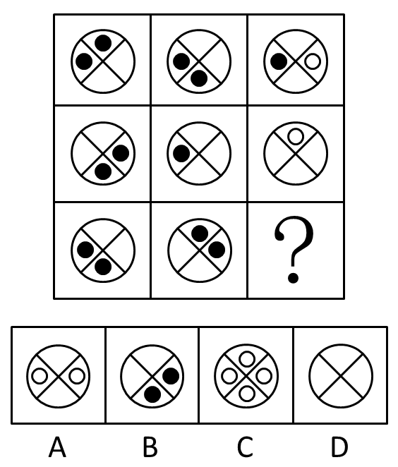

A. A

B. B

C. C

D. D

第 59 题 · 答案与解析

**参考答案（粉笔题库参考内容）**

D

**解析**

图形轮廓相同，内部图案不同，考虑黑白叠加。从行看，黑+空=空，空+黑=空，黑+黑=黑，空+空=白，只有D项符合此规律。

故正确答案为D。

**考点**：样式规律-黑白运算

**来源**：2013年广东省公务员录用考试《行测》题（三）第59题

### 第 60 题

从所给四个选项中，选择最合适的一个填入问号处，使之呈现一定的规律性：

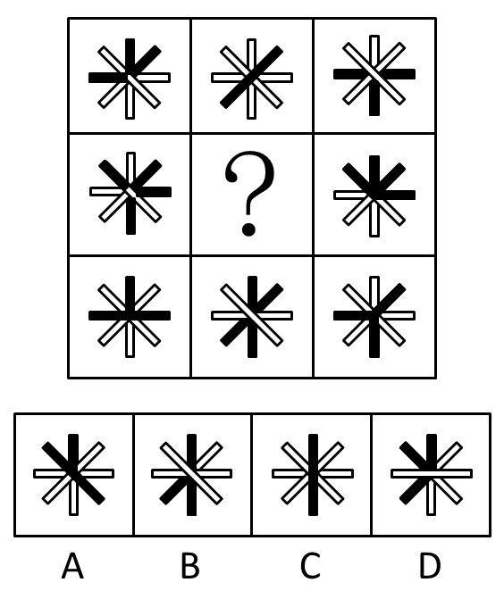

A. A

B. B

C. C

D. D

第 60 题 · 答案与解析

**参考答案（粉笔题库参考内容）**

C

**解析**

图形轮廓相同，内部颜色不同，考虑黑白叠加。问号图形为九宫格中的最中心图形，考虑米字形规律。代入选项进行排除，只有C项存在相对位置图形运算得到中间图形，此时符合规律：黑+黑=白，白+白=白，白+黑=黑，黑+白=黑。

故正确答案为C。

**考点**：样式规律-黑白运算

**来源**：2013年广东省公务员录用考试《行测》题（三）第60题

### 第 61 题

从所给四个选项中，选择最合适的一个填入问号处，使之呈现一定规律性：

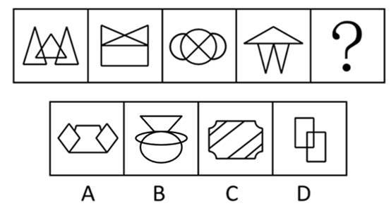

A. A

B. B

C. C

D. D

第 61 题 · 答案与解析

**参考答案（粉笔题库参考内容）**

B

**解析**

元素组成不同，优先考虑属性规律。观察题干图形，所有图形都是轴对称图形，排除C、D两项。再考虑数量规律，观察发现，题干均为一笔画图形，排除A项。

故正确答案为B。

**考点**：属性规律-对称性、数量规律-线

**来源**：2013年广东省公务员录用考试《行测》题（三）第61题

### 第 62 题

请从所给的四个选项中，选择最合适的一个填在问号处，使之呈现一定的规律性：

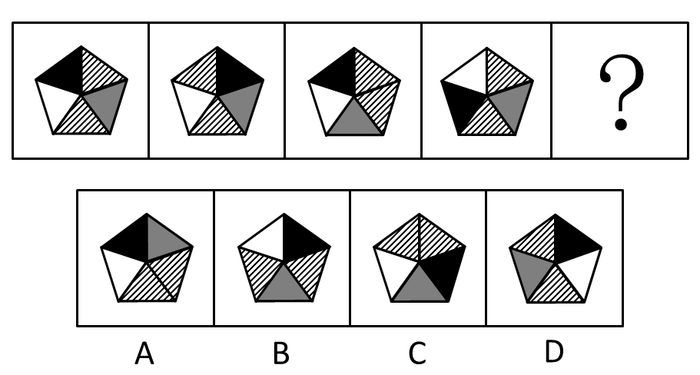

A. A

B. B

C. C

D. D

第 62 题 · 答案与解析

**参考答案（粉笔题库参考内容）**

A

**解析**

元素组成相同，考虑位置规律。相邻图形无法找到规律，尝试所有图形与第一个图形比较，发现每个图形都为第一个图形两个相邻部分交换位置得到，则问号处也应符合此规律，只有A项可由第一个图形交换两部分得到。

故正确答案为A。

**考点**：位置规律-平移

**来源**：2013年广东省公务员录用考试《行测》题（三）第62题

### 第 63 题

从所给四个选项中，选择最合适的一个填入问号处，使之呈现一定的规律性：

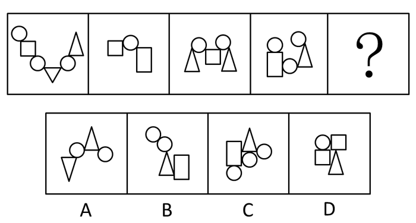

A. A

B. B

C. C

D. D

第 63 题 · 答案与解析

**参考答案（粉笔题库参考内容）**

A

**解析**

每个图形中都包含圆，考虑圆的相对位置。

题干图形中的直线图形都被圆圈间隔开来，不相接触，故待选图形也应满足此规律，只有A符合条件。

故正确答案为A。

**考点**：特殊规律-图形间关系

**来源**：2013年广东省公务员录用考试《行测》题（三）第63题

### 第 64 题

从所给四个选项中，选择最合适的一个填入问号处，使之呈现一定的规律性：

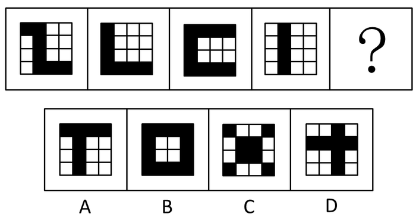

A. A

B. B

C. C

D. D

第 64 题 · 答案与解析

**参考答案（粉笔题库参考内容）**

B

**解析**

题干中黑色的方块都是首或尾连接，选项只有B是首尾相连，一笔画出。

故正确答案为B。

**考点**：数量规律-线、黑白块类

**来源**：2013年广东省公务员录用考试《行测》题（一）第63题

### 第 65 题

从所给的四个选项中，选择最合适的一项填在问号处，使之呈现一定的规律性：

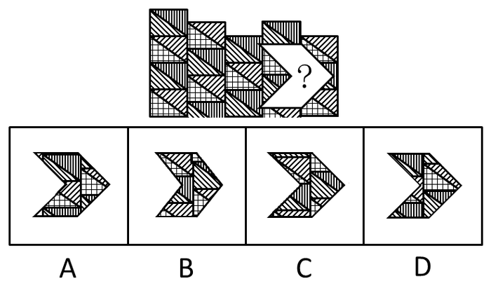

A. A

B. B

C. C

D. D

第 65 题 · 答案与解析

**参考答案（粉笔题库参考内容）**

C

**解析**

问号处图案填回原图应与原图中轮廓与条纹保持一致，观察发现最下面区域应该为斜条纹且轮廓线条划分的区域较小，只有C项符合此规律。

故正确答案为C。

**来源**：2013年广东省公务员录用考试《行测》题（三）第65题

### 第 66 题

据国家权威科研机构研究证实，当前市场上热销的某品牌保健食品并不含有提高人类身体机能、增强个体免疫力的成分。但调查结果表明，不少身体虚弱的人在购买服用了该品牌的保健食品一段时间后，身体素质明显提高。

以下最有助于解释上述矛盾的一项是：

A. 保健食品作用的发挥具有一定的时间滞后性

B. 许多身体健康的人在服用保健食品后体质也增强了

C. 购买该品牌保健品的人大多经济条件较好

D. 服用保健品的人在生活其他方面也开始注重健康

第 66 题 · 答案与解析

**参考答案（粉笔题库参考内容）**

D

**解析**

第一步：找出题干矛盾现象。

市场上热销的某品牌保健食品并不含有提高人类身体机能、增强个体免疫力的成分，但不少身体虚弱的人在购买服用了该品牌的保健食品一段时间后，身体素质明显提高。

第二步：逐一分析选项。

A项：作用的发挥具有滞后性说明保健食品还是有功效的，不能解释题干矛盾现象，排除；

B项：身体健康的人体质是否增强，与论点中“身体虚弱的人”无关，不能解释题干矛盾现象，排除；

C项：是否买得起该保健食品与是否能增强人的体质无关，不能解释题干矛盾现象，排除；

D项：说明服用保健品的人在生活其他方面也开始注重健康，即身体素质明显提高是另有他因，很好地解释了为什么明明保健品没有增强免疫力的成分身体却健康了这样的矛盾，当选。

故正确答案为D。

**考点**：原因解释

**来源**：2013年广东省公务员录用考试《行测》题（一）第72题

### 第 67 题

某公司研发了一种空调管理系统，通过对人流量的检测系统自动启动、关闭空调，这个系统的应用，将使得办公场所的空调用电量大大节省。但这个系统推出几年来，购买的单位并不多，销量不理想。

以下最能够合理解释上述现象的是：

A. 该空调管理系统受到许多城市家庭用户的欢迎

B. 该空调管理系统操作复杂，需配备专业人员才能运作

C. 市场上节能空调占主流，空调能耗较以往已大大降低

D. 许多单位的职工环保意识强，养成了出门关空调的习惯

第 67 题 · 答案与解析

**参考答案（粉笔题库参考内容）**

B

**解析**

第一步：找出矛盾点。

题干矛盾现象是：这一空调管理系统的使用可以大大节省电量，即节省开支，但购买量不多。

第二步：逐一判断选项。

A项：系统是否受到家庭客户欢迎，与单位客户是否购买无关，属于无关选项，排除；

B项：该空调管理系统操作复杂，需配备专业人员才能运作，说明使用该系统需要添加额外的开支，并不能节省开支，所以购买量少，可以解释上述矛盾现象，当选；

C项：无论空调能耗是否降低，都需要节电，不能解释矛盾，排除；

D项：养成出门关空调的习惯可节省电量，说明购买空调管理系统并不一定能比现有情况节省开支，一定程度上可以解释许多单位不买这个系统。但是D项与B项相比，D项强调的是许多，也就是部分而非全部，力度上不如B项强。

故正确答案为B。

**考点**：原因解释

**来源**：2013年广东省公务员录用考试《行测》题（一）第73题

### 第 68 题

相比于化工“污染地”、重金属“污染地”，化肥、农药、农膜带来的农地污染并没有那么触目惊心，但却具有量大、面广、隐蔽性强、持续时间长等特点。一些受污染严重的土地，已经不能进行正常的农业生产。农地的“批量污染”治理已经到了刻不容缓的地步。以农膜为例，由于塑料残余物在自然条件下可在土壤中残存数十年甚至上百年而不降解，这些废膜的存在会影响土壤的通透性，阻碍土壤水分的补给和养分转移。

根据以上表述，可以得出的结论是：

①化工和重金属的污染往往量不大、面不广、易发现、持续时间不长

②农膜残留通过阻碍土壤的水分补给和养分转移对农地产生影响

③农膜残留是当前农地“批量污染”中最为突出和严重的

④农地污染不能因其隐蔽性强等特点而在治理土地污染中被人们忽视

⑤化工和金属对土地的污染比农地污染更为严重

A. ①②

B. ①③④

C. ②④

D. ②③⑤

第 68 题 · 答案与解析

**参考答案（粉笔题库参考内容）**

C

**解析**

本题属于日常结论题型。

第一步：抓住题干主要信息。

(1)农地污染具有量大、面广、隐蔽性强、持续时间长等特点。

(2)农地的“批量污染”治理已经到了刻不容缓的地步。

(3)农膜的存在会影响土壤的通透性，阻碍土壤水分的补给和养分转移。

第二步：逐一分析选项。

由(1)可知，题干没有提及化工和重金属的污染特点，故①错误；

由(3)可知，②正确，③错误，以农膜为例，无法知道农膜残留是否是最为突出和严重的；

由(2)可知，农地的“批量污染”治理已经到了刻不容缓的地步，④正确；

由(1)、(2)、(3)可知，题干没有对比化工、重金属对土地的污染和农地污染的程度，故⑤错误。

只有②④正确。

故正确答案为C。

**考点**：日常结论

**来源**：2013年广东省公务员录用考试《行测》题（一）第74题

### 第 69 题

“没有经济的快速发展，就不会有社会事业的进步。现在经济发展速度很快，所以社会事业的建设也会取得显著的成绩。”

与上述文字推理形式相同的是：

A. 社会主义民主和法制相辅相成，缺一不可，民主是法制的前提，法制是民主的体现。现在法制体系不断健全，因此民主得以保障

B. 效益与公平是矛盾统一体，没有公平很难取得更大的效益。某企业的效益提高了，因此，该企业也实现了分配公平

C. 社会化程度越高，社会分工越细。现在社会化程度提高了，因此现在的社会分工也更细了

D. 清正廉洁是对领导干部的基本要求。一名作风正派、严于律己的领导干部就是合格的领导干部

第 69 题 · 答案与解析

**参考答案（粉笔题库参考内容）**

D

**解析**

解析1：

本题为关联词推导中的推出方式类似题型，需要逐一分析题干和选项的结构。

第一步：翻译题干。

题干：-P（经济的快速发展）→—Q（社会事业的进步）；P（经济的快速发展）→Q（社会事业的进步）。

第二步：逐一翻译选项。

A项推理形式：Q（法制）→P（民主），Q→P，与题干不同；

B项推理形式：-P（公平）→—Q（效益提高），Q→P，与题干不同；

C项推理形式：P（社会化程度高）→Q（社会分工细），P→Q，与题干不同；

D项推理形式：-P（清正廉洁）→—Q（合格的领导干部），P→Q，与题干相同。

经比较与题干结构一样的是D项。

故正确答案为D。

解析2：

第一步：分析题干。

条件：社会事业的进步→经济的快速发展。结论：经济发展速度很快→社会事业建设取得进步。即原题干是A→B→A，是个错误推理。

第二步：逐一分析选项。

A项法制推民主，后半部分是法制健全推出民主得以保障，是正确的推导；

B项效益推出公平，某企业效益提高，实现了公平，也是正确推导；

C项社会化程度高推出社会分工细，是正确推导；

D项前半部分是领导干部基本要求→清正廉洁；后者代入时用的是清正廉洁推出合格的领导干部，与题干推理方式相同。

故正确答案为D。

**考点**：推理形式

**来源**：2013年广东省公务员录用考试《行测》题（一）第75题

### 第 70 题

由于某市路边的报刊亭大多属于违章建筑，影响城市管理，而且普遍存在超范围经营等问题，当地政府考虑拆除路边报刊亭，居民可以直接到当地超市、书店或专门的报刊销售点购买报刊、杂志。

以下有助于推动当地政府作出拆除路边报刊亭决定的信息不包括：

A. 不少路边的报刊亭存在贩卖非法出版物的问题

B. 当地超市、书店和专门的报刊销售点相当充足，随处可见

C. 路边报刊亭的销售收入主要来源于贩卖烟酒零食而非报刊

D. 数据显示，当地居民购买报刊、杂志主要还是通过邮局订购

第 70 题 · 答案与解析

**参考答案（粉笔题库参考内容）**

D

**解析**

本题为加强题型。

第一步：找出论点和论据。

论点：政府考虑拆除路边报刊亭。

论据：路边报刊亭影响城市管理，普遍存在超范围经营；拆除后市民可以到当地超市、书店或专门的报刊销售点购买报刊。

第二步：逐一判断选项。

A、C两项：说明路边报刊亭普遍存在超范围经营，加强论据，排除；

B项说明市民可以到当地超市、书店或专门的报刊销售点购买报刊，加强论据，排除；

D项：主要通过邮局订购，这是在客观阐释报刊亭报刊销售量占本地报刊销售量的比例问题，剩下的不通过邮局订购而通过路边报刊亭购买的数量并不明确，为不明确选项，不能作为拆除报亭的理由，当选。

本题为选非题，故正确答案为D。

**考点**：加强选非题

**来源**：2013年广东省公务员录用考试《行测》题（三）第70题

### 第 71 题

在我国的黄海和东海的海底地层中，蕴藏着丰富的石油资源，这些石油就是远古时大量陆地植物的遗骸生成的。这说明，远古时代，黄海和东海的大陆架是一片生长茂密植物的大平原。

以下能够支持上述结论的一项是：

A. 大陆架会随着地球地壳的移动而持续着缓慢但永不停息的变化

B. 川流不息的江河就像传送带，把陆地上的有机物质源源不断地运到大海中

C. 中东的海湾地区大多是广袤的沙漠，地下蕴藏着丰富的石油资源

D. 一般来讲，陆地上相近纬度的山区比平原地区的植被资源更加丰富

第 71 题 · 答案与解析

**参考答案（粉笔题库参考内容）**

A

**解析**

第一步：分析题干，找出论点和论据。

论点：现在的黄海和东海的大陆架在远古时代是一片生长着茂密植物的大平原。

论据：黄海和东海的海底地层中的石油是远古时大量陆地植物的遗骸生成的。

第二步：逐一分析选项。

A项：如果大陆架不会随着地球地壳的移动而持续着缓慢但永不停息的变化，那么海洋就不能由陆地转化而成，论点也就无法成立，选项为论点成立的必要条件，可以加强，当选；

B项：论据强调植物遗骸，选项强调有机物质，范围不一样，不能加强论证，排除；

C项：沙漠地区即陆地是否蕴藏丰富的石油资源与海洋无关，属于无关选项，排除；

D项：不同地形的植被资源是否存在差别，与海底是否存在石油资源没有必然联系，属于无关选项，排除。

故正确答案为A。

**考点**：必要条件

**来源**：2013年广东省公务员录用考试《行测》题（三）第71题

### 第 72 题

中国社会的未来发展，离不开包括儒学在内的传统文化的滋养和作用，这一点已被越来越多的人们所认同和接受。因此，大力弘扬中国传统文化的优良传统应当成为当前我国文化建设的一项重要内容。

以下最能够支持上述主张的一项是：

A. 中国传统文化中的许多优良传统面临将要失传的危机

B. 许多地方政府加大了对本地各类文化遗产的保护和宣传力度

C. 经过历史积淀的传统文化对一个民族具有无可替代的积极作用

D. 传统文化对经济社会发展的积极作用在越来越多的地方呈现出来

第 72 题 · 答案与解析

**参考答案（粉笔题库参考内容）**

D

**解析**

第一步：找到论点和论据。

论点：应当大力弘扬中国传统文化的优良传统。

论据：中国社会的未来发展离不开传统文化的滋养和作用。

第二步：判断加强方式。

论据和论点之间存在因果关系，所以需要加强论点。

第三步：逐一判断选项。

A、B两项均强调保护，论点强调弘扬，范围不一样，不能加强论点。C项强调传统文化的积极作用，具有加强的作用。D项传统文化对经济社会发展的积极作用在越来越多的地方显现出来，所以需要大力弘扬，加强了论点。C、D两项都有加强作用，需要对二者进行比较，C项强调的是对民族具有作用，D项强调的是对经济社会的作用，而题干主要论述的是传统文化对社会发展的作用，因此，D项更契合题意，C项中的民族概念范围太广泛。

故正确答案为D。

**考点**：补充论据

**来源**：2013年广东省公务员录用考试《行测》题（三）第72题

### 第 73 题

为了让居者有其屋，某市筹措资金推进保障房建设。明年该市保障房建设将进入建成完工的高潮。目前，保障房申请资格如何界定引起市民的普遍关注。有人认为，保障房是政府筹资建设的，因此只能让本市居民购买。对于非本市户籍的人口，不应具有保障房申请资格。

以下最能够质疑这一观点的是：

A. 保障房建设的资金来源除了政府财政外，还有大量商业资本

B. 该市非户籍常住人口为政府财政上缴了大量税费

C. 该市户籍人口的收入水平普遍高于非户籍人口

D. 该市的常住人口有一半以上为非户籍人口

第 73 题 · 答案与解析

**参考答案（粉笔题库参考内容）**

B

**解析**

第一步：找出论点和论据。

论点：非本市户籍的人口不应具有保障房申请资格。

论据：保障房是该市政府筹资建设的。

第二步：判断削弱方式。

论点与论据存在因果关系，需要削弱论点。

第三步：逐一判断选项。

A项：该项只说明资金来源除了政府财政外，还有大量的商业资本，但与非本市户籍能否申请保障房无关，话题不一致，无法削弱，排除；

B项：该项指出非户籍常住人口为政府财政上缴了大量税费，所以政府筹资包括非户籍人口的税费，因此不能由保障房是政府筹资建设的推出非本市户籍人口不能申请保障房，切断论点和论据之间的联系，为拆桥项，可以削弱，当选；

C项：该项强调收入水平的区别，论点强调非本市户籍能否申请保障房，话题不一致，无法削弱，排除；

D项：该项强调非本市户籍人口的占比高，论点强调非本市户籍能否申请保障房，话题不一致，无法削弱，排除。

故正确答案为B。

**考点**：拆桥

**来源**：2013年广东省公务员录用考试《行测》题（三）第73题

### 第 74 题

据统计，自1901年起共有786位男性和44位女性科学家获得诺贝尔奖。这一男女比例为18：1。其中，在经济学和物理学领域，几乎没有女性科学家获奖。据此，诺贝尔奖存在着严重的性别歧视。

以下最能削弱上述结论的一项是：

A. 能否获得诺贝尔奖不是衡量工作潜能的唯一标准

B. 女性从事科研工作的人数远远低于男性

C. 近些年，诺贝尔评审委员会中女性评委的人数不断提高

D. 其他的国际科学大奖也存在此类获奖者男女失调的现象

第 74 题 · 答案与解析

**参考答案（粉笔题库参考内容）**

B

**解析**

第一步：找出论点和论据。

论点：诺贝尔奖存在着严重的性别歧视。

论据：获诺贝尔奖的女性比例小。

本题论据说的是诺贝尔获奖者中女性比例小，而论点说的是诺贝尔奖存在性别歧视，话题不一致，削弱优先考虑拆桥。

第二步：逐一分析选项。

A项：该项强调能否获得诺贝尔奖不是衡量工作潜能的唯一标准，题干说的是诺贝尔奖存在性别歧视，话题不一致，无法削弱，排除；

B项：该项指出女性从事科研工作的人数远远低于男性，说明论据中女性比例小属于正常现象，因此不能由诺贝尔奖获得者中女性占比小推出诺贝尔奖存在性别歧视，切断论点和论据之间的联系，为拆桥项，可以削弱，当选；

C项：该项强调女性评委人数提高，女性评委人数提高与诺贝尔奖是否存在性别歧视无关，话题不一致，无法削弱，排除；

D项：该项强调其他奖项获奖情况，题干强调诺贝尔奖获奖情况，话题不一致，无法削弱，排除。

故正确答案为B。

**考点**：拆桥

**来源**：2013年广东省公务员录用考试《行测》题（三）第74题

### 第 75 题

小周、小吴、小郑三人中，一人是工人，一人是农民，一人是知识分子。已知：小郑的年龄比知识分子大；小周的年龄和农民不同；农民的年龄比小吴小。

根据以上情况，判断正确的是：

A. 小周是工人、小吴是知识分子、小郑是农民

B. 小周是知识分子、小吴是农民、小郑是工人

C. 小周是工人、小吴是农民、小郑是知识分子

D. 小周是知识分子、小吴是工人、小郑是农民

第 75 题 · 答案与解析

**参考答案（粉笔题库参考内容）**

D

**解析**

本题属于排列组合题。

第一步：找突破口。

本题突破口为信息量最大对象，即农民。由“小周的年龄和农民不同；农民的年龄比小吴小”可知，农民既不是小周，也不是小吴，所以小郑是农民。

第二步：将第一步结论代入题干。

小郑的年龄比知识分子大，小郑的年龄比小吴小，可知小吴不是知识分子，也不是农民，所以小吴是工人，则小周是知识分子。

故正确答案为D。

**考点**：从最大信息开始推

**来源**：2013年广东省公务员录用考试《行测》题（一）第66题

### 第 76 题

任人唯贤的“贤”是指：

A. 思想品德好

B. 工作作风好

C. 德才兼备

D. 文武双全

第 76 题 · 答案与解析

**参考答案（粉笔题库参考内容）**

C

**解析**

“任人唯贤”出自《尚书·咸有一德》：“任官惟贤才，左右惟其人”，指用人只选有德有才的人，即德才兼备。

故正确答案为C。

**考点**：文学常识

**来源**：2013年广东省公务员录用考试《行测》题（一）第84题

### 第 77 题

“阳关大道”原是指通往（  ）的道路。

A. 东海

B. 西域

C. 南国

D. 中原

第 77 题 · 答案与解析

**参考答案（粉笔题库参考内容）**

B

**解析**

该词出自唐·王维《送刘司直赴安西》一诗：“绝域阳关道，胡沙与塞尘”。原指古代经过阳关通向西域的大道，后泛指宽阔的长路，也比喻光明的前途。

故正确答案为B。

**考点**：文学常识

**来源**：2013年广东省公务员录用考试《行测》题（一）第83题

### 第 78 题

今年年初，严重影响我国华北华东地区的灰霾天气再次引发人们对PM2.5的关注。以下关于PM2.5的说法错误的一项是：

A. PM2.5的主要来源是日常发电、工业生产、汽车燃油等过程中经过燃烧而排放的残留物

B. 与较粗的大气颗粒物相比，PM2.5粒径小，含有大量的有毒、有害物质且在大气中的停留时间长、输送距离远

C. PM2.5主要对呼吸系统和心血管系统造成伤害，老人、小孩以及心肺疾病患者是PM2.5污染的敏感人群

D. 空气中不同大小的颗粒物均能降低能见度，不过相对粗颗粒物，PM2.5由于颗粒细小，对空气能见度的影响相对较弱

第 78 题 · 答案与解析

**参考答案（粉笔题库参考内容）**

D

**解析**

空气能见度与空气中颗粒物密度有关，PM2.5尽管直径很小，但是当空气中PM2.5密度加大时，仍然会严重降低能见度，所以D项说法不准确；其他三项均正确。

本题为选非题，故正确答案为D。

**考点**：其他

**来源**：2013年广东省公务员录用考试《行测》题（三）第78题

### 第 79 题

日常生活中的污染现象可以分为不同的种类。下列污染不属于物理性污染的是：

A. 遗弃的废旧荧光灯管

B. 夜间刺眼的汽车灯光

C. 歌厅震耳欲聋的音乐

D. 变压器的电磁波

第 79 题 · 答案与解析

**参考答案（粉笔题库参考内容）**

A

**解析**

物理性污染是指由物理因素引起的环境污染，如放射性辐射、电磁辐射、噪声、光污染等，显然B、C、D项都属于物理性污染。

本题为选非题，故正确答案为A。

**考点**：生活常识

**来源**：2013年广东省公务员录用考试《行测》题（三）第79题

### 第 80 题

下列关于日常礼仪说法正确的一项是：

A. 在宴会中，将筷子横搁就表示自己已饱不需要再进食了

B. 行拱手礼时，双手的叠放次序为右手包在左手之外

C. 拜访别人时，如果有非常充分的理由，也可不提前预约

D. 同事开车时，为表示尊重，最好坐在后面一排而不要与同事并排而坐

第 80 题 · 答案与解析

**参考答案（粉笔题库参考内容）**

A

**解析**

筵席中暂时停餐，可以把筷子直搁在碟子或者调羹上；如果将筷子横搁在碟子上，那是表示酒醉饭饱不再进膳了。 这种横筷的礼仪，我国古已有之，A说法正确。

拱手礼又称作揖，是中国古代开始的，相见或感谢时常用的一种礼节，行礼时，双手互握合于胸前；当代一般右手握拳在内，左手在外，一说古人以左为敬，故B说法错误。

拜访之前必须提前预约，这是最基本的礼仪。一般情况下，应提前三天给拜访者打电话，简单说明拜访的原因和目的，确定拜访时间，经过对方同意以后才能前往，故C说法错误。

在比较正规的场合，乘车一定要分清座位的“尊卑”。由主人亲自驾驶时，座位顺序应当依次是副驾驶座、后排右座、后排左座、后排中座，故D说法错误。

故正确答案为A。

**考点**：文化常识

**来源**：2013年广东省公务员录用考试《行测》题（三）第80题

### 第 81 题

据统计，地震常常发生在夜间，而且还常常发生在农历初一或十五前后，这是因为：

A. 人们的错觉，因为人们在白天接收的刺激比较多，不容易感知小地震的发生

B. 农历初一、十五与夜间，地球表面受太阳、月球引力较大

C. 夜间气温较低，地表容易被炙热的岩浆冲破，而农历初一或十五也常常是当月中气温最低的时段

D. 地震统计仅统计较为剧烈的地震，而大多数地震是较为轻微的

第 81 题 · 答案与解析

**参考答案（粉笔题库参考内容）**

B

**解析**

“地震常常发生在夜间”是外因———太阳和月球引力的结果，太阳和月球的引力可引起海水在一天里两次涨落，而农历初一、十五或十六前后是太阳和月球引力最大的时候，更易发生地震。

故正确答案为B。

**考点**：自然地理

**来源**：2013年广东省公务员录用考试《行测》题（三）第81题

### 第 82 题

下列说法错误的一项是：

A. 日常生活中的无糖食品一般是指不含蔗糖、葡萄糖等的甜味食品

B. 人的汗液发臭主要是由于细菌分解了汗液中的有机物导致的

C. 人补充钙时加服维生素D可以促进钙剂的吸收

D. 肌肉系统是负责人体各类运动功能的重要系统

第 82 题 · 答案与解析

**参考答案（粉笔题库参考内容）**

D

**解析**

无糖食品一般是指不含蔗糖（甘蔗糖和甜菜糖）、葡萄糖、麦芽糖、果糖等的甜味食品，A说法正确。

由于空气污染和在健身房共用器械等问题，存在于皮肤表层的大量细菌、寄生虫等，会分解汗液中的有机成分，产生各种有毒物质，释放出有异味的气体，B说法正确。

维生素D可以提高肌体对钙、磷的吸收，故C说法正确。

人体各类运动功能都是在神经系统支配下，通过肌肉收缩而实现的，D表述不够准确。

本题为选非题，故正确答案为D。

**考点**：生活常识

**来源**：2013年广东省公务员录用考试《行测》题（三）第82题

### 第 83 题

“青红皂白”现在常用来比喻事情的是非曲直，其原意是指各种深浅不同的颜色。其中“皂”指的是：

A. 黑色

B. 灰色

C. 黄色

D. 绿色

第 83 题 · 答案与解析

**参考答案（粉笔题库参考内容）**

A

**解析**

“青红皂白”比喻事情的是非或原因、来龙去脉、是非曲直。成语出自于明·凌濛初《二刻拍案惊奇》第16卷：“州官得过了贿赂，那管青红皂白，竟断道：‘夏家欠林家二千两’”。“皂”指黑色。

故正确答案为A。

**考点**：文学常识

**来源**：2013年广东省公务员录用考试《行测》题（一）第82题

### 第 84 题

可再生能源是指自然界中可以不断利用、循环再生的能源。以下属于可再生能源的是：

A. 风能

B. 煤炭

C. 石油

D. 天然气

第 84 题 · 答案与解析

**参考答案（粉笔题库参考内容）**

A

**解析**

B、C、D项均为不可再生能源，排除；

只有A项风能为可再生能源，当选。

故正确答案为A。

**考点**：自然地理

**来源**：2013年广东省公务员录用考试《行测》题（三）第84题

### 第 85 题

发生雷暴时，有时会下冰雹。大的冰雹甚至可以击穿飞机的机翼，砸伤地面的动植物。影响冰雹大小的主要因素是：

A. 风速

B. 云团

C. 上升气流

D. 空气中的固体颗粒

第 85 题 · 答案与解析

**参考答案（粉笔题库参考内容）**

C

**解析**

冰雹来自对流特别旺盛的对流云（积雨云）中。积雨云中的上升气流要比一般雷雨云强，小冰雹是在对流云内由雹胚和过冷水滴上下数次碰撞而增长起来的，当积雨云中的上升气流支托不住时就下降到地面。由上述可知，上升气流起到了支托作用，使冰雹不断变大。

故正确答案为C。

**考点**：生活常识

**来源**：2013年广东省公务员录用考试《行测》题（三）第85题

## 材料 1

为了解网站对不同年龄段用户群体的吸引力，某综合网站随机调查了3000名该网站的用户，主要调查内容为用户在该网站首选阅读的频道（以下简称首选频道）。

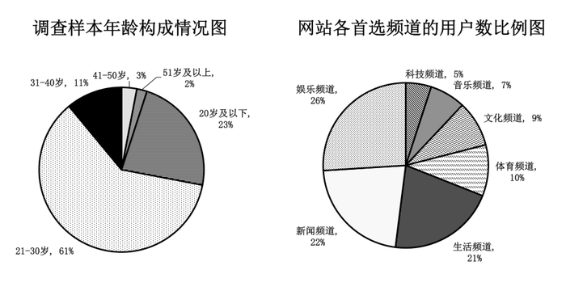

**各个首选频道的用户群体中不同年龄段人数的比例(单位：%)**

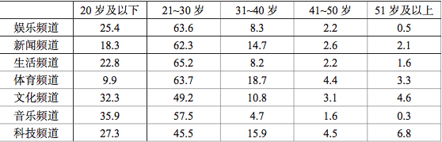

注：假设本次调查能够代表该网站用户的真实阅读情况。

### 第 86 题

如果该网站日均登录流量为6万人，则平均每日首选生活频道的用户约为（  ）人（不考虑同一用户反复登录该网站的情况）。

A. 331

B. 1260

C. 3310

D. 12600

第 86 题 · 答案与解析

**参考答案（粉笔题库参考内容）**

D

**解析**

根据题干“······则平均每日首选生活频道的用户约为······人”，且材料已知每日首选生活频道的用户占比，可判定本题为现期比重计算问题。定位图形材料可知：每日首选生活频道的用户占比为21%。根据公式：部分=整体×比重，则平均每日首选生活频道的用户约为60000×21%=12600人。

故正确答案为D。

**考点**：现期比重、综合资料

**来源**：2013年广东省公务员录用考试《行测》题（三）第86题

### 第 87 题

本次调查中，首选频道为体育频道的51岁及以上用户一共约有（    ）名。

A. 10

B. 18

C. 47

D. 99

第 87 题 · 答案与解析

**参考答案（粉笔题库参考内容）**

A

**解析**

根据题干“首选频道为体育频道的51岁及以上用户一共约有······名”，且材料已知调查总人数、首选体育频道的人占被调查总人数的比重和51岁及以上的用户占首选体育频道的人的比重，可判定本题为现期比重问题。定位文字材料“某综合网站随机调查了3000名该网站的用户”；定位图表材料可知：首选体育频道的人占被调查总人数的10%，而首选体育频道的人中，51岁及以上的用户占3.3%。根据公式：部分=整体×比重，所以首选频道为体育频道的51岁及以上用户一共约有人。

故正确答案为A。

**考点**：现期比重、综合资料

**来源**：2013年广东省公务员录用考试《行测》题（三）第87题

### 第 88 题

与该网站21~30岁的用户相比，该网站31岁及以上用户普遍对（  ）更感兴趣。

A. 文化频道

B. 音乐频道

C. 新闻频道

D. 科技频道

第 88 题 · 答案与解析

**参考答案（粉笔题库参考内容）**

D

**解析**

定位表格材料可知：对于文化频道、音乐频道、新闻频道、科技频道，21~30岁用户占比分别为49.2%、57.5%、62.3%、45.5%，31~40岁用户占比分别为10.8%、4.7%、14.7%、15.9%，41~50岁用户占比分别为3.1%、1.6%、2.6%、4.5%，51岁及以上4.6%、0.3%、2.1%、6.8%。

文化频道：21~30岁所占比重为49.2%，而31岁及以上用户首选文化频道占比为10.8%＋3.1%＋4.6%=18.5%；

音乐频道：21~30岁所占比重为57.5%，而31岁及以上用户首选音乐频道占比为4.7%+1.6%+0.3%=6.6%；

新闻频道：21~30岁所占比重为62.3%，而31岁及以上用户首选新闻频道占比为14.7%+2.6%+2.1%=19.4%；

科技频道：21~30岁所占比重为45.5%，而31岁及以上用户首选科技频道占比为15.9%+4.5%+6.8%=27.2%。

据上述计算可知，在四个频道中比较，21~30岁对科技频道的占比比其他频道都低，相对最不感兴趣，而31岁及以上对科技频道的占比比其他频道都高，相对最感兴趣。故与该网站21~30岁的用户相比，该网站31岁及以上用户普遍对科技频道更感兴趣。

故正确答案为D。

**考点**：简单加减计算、综合资料

**来源**：2013年广东省公务员录用考试《行测》题（三）第88题

### 第 89 题

如果有企业在该网站上播放广告，企业产品定位是31~40岁的人群，那么它播放广告的频道应该首选：

A. 音乐频道

B. 生活频道

C. 新闻频道

D. 体育频道

第 89 题 · 答案与解析

**参考答案（粉笔题库参考内容）**

C

**解析**

根据题干“······企业产品定位是31~40岁的人群，那么它播放广告的频道应该首选”，且材料已知各个频道观看人数占总人数的比重和31~40岁人群占各个频道的比重，可判定本题为现期比重问题。定位图表材料可知四个选项相关数据：音乐频道的比重为7%，而31~40岁的人员在音乐频道的比重为4.7%；生活频道的比重为21%，而31~40岁的人员在生活频道的比重为8.2%；新闻频道的比重为22%，而31~40岁的人员在新闻频道的比重为14.7%；体育频道的比重为10%，而31~40岁的人员在体育频道的比重为18.7%。要用频道的比重乘以每个频道的基数比例，故：

音乐频道为7%×4.7%=0.329%；

生活频道为；

新闻频道为；

体育频道为10%×18.7%=1.87%。

比较四个乘积结果3%最大，故新闻频道31~40岁的人数是最多的。

故正确答案为C。

**考点**：现期比重、综合资料

**来源**：2013年广东省公务员录用考试《行测》题（三）第89题

### 第 90 题

根据上述资料，下列说法正确的是：

A. 该网站科技频道对31岁以上用户的吸引力远大于该频道对20岁及以下用户的吸引力

B. 20岁及以下用户已经成为该网站继21~30岁用户之后的第二大用户群

C. 在该网站所有频道中，41~50岁用户数量均大于51岁及以上用户数量

D. 与其他频道相比，该网站的文化频道对21~30岁用户的吸引力最低

第 90 题 · 答案与解析

**参考答案（粉笔题库参考内容）**

B

**解析**

A项，定位表格材料可知：科技频道，20岁及以下占比27.3%，31~40岁占比15.9%，41~50岁占比4.5%，51岁及以上占比6.8%。所以该网站科技频道31岁及以上用户占比为15.9%+4.5%+6.8%=27.2%＜27.3%，故该网站科技频道对31岁以上用户的吸引力小于该频道对20岁及以下用户的吸引力，排除；

B项，定位图形材料可知：按年龄区分，20岁及以下的占比23%，21~30岁占比61%，31~40岁占比11%，41~50岁占比3%，51岁及以上占比2%。比较可得，61%最大，其次是23%，故20岁及以下用户已经成为该网站继21~30岁用户之后的第二大用户群，当选；

C项，定位表格材料，比较可得科技频道中，41~50岁的占比为4.5%，而51岁以上的占比为6.8%，因为科技频道用户数量一定，所以科技频道中41~50岁用户数量小于51岁及以上用户数量，排除；

D项，定位表格材料可知：21~30岁在各个频道占比依次为娱乐频道63.6%、新闻频道62.3%、生活频道65.2%、体育频道63.7%、文化频道49.2%、音乐频道57.5%、科技频道45.5%。比较可得，45.5%最小。故与其他频道相比，该网站的科技频道对21~30岁用户的吸引力最低，排除。

故正确答案为B。

**考点**：综合分析、综合资料

**来源**：2013年广东省公务员录用考试《行测》题（三）第90题

## 材料 2

城市综合竞争力十年间（2002年-2011年）的区域变化（单位：个）

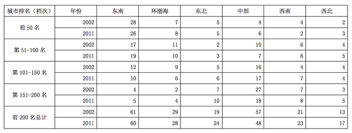

城市综合竞争力十年间(2002年—2011年)不同规模城市数量变化（单位：个）

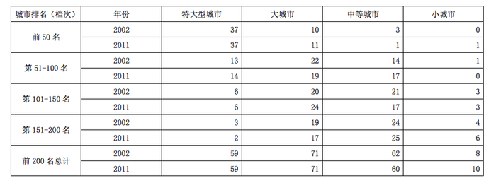

### 第 91 题

与2002年相比，2011年西北地区进入城市综合竞争力前100名的城市增加了（    ）个。

A. 1

B. 2

C. 3

D. 4

第 91 题 · 答案与解析

**参考答案（粉笔题库参考内容）**

B

**解析**

定位表格材料1可知：2002年西北前50名城市有2个，2011年有3个；2002年西北51~100名的城市有4个，2011年有5个。故2011年西北前100名城市有3+5=8个，2002年西北前100名城市有2+4=6个。与2002年相比，2011年西北地区进入城市综合竞争力前100名的城市增加了8－6＝2个。

故正确答案为B。

**考点**：简单加减计算、统计表

**来源**：2013年广东省公务员录用考试《行测》题（三）第91题

### 第 92 题

与2002年相比，2011年（    ）地区的城市综合竞争力前200名的城市数量下降最为显著。

A. 环渤海

B. 东南

C. 中部

D. 西南

第 92 题 · 答案与解析

**参考答案（粉笔题库参考内容）**

C

**解析**

定位表格材料1可知：前200名的城市数量，环渤海2002年29个、2011年28个，东南2002年61个、2011年60个，中部2002年57个、2011年48个，西南2002年21个、2011年23个。所以环渤海下降29－28＝1个，东南下降61－60＝1个，中部下降57-48=9个，西南上升23-21=2个。故与2002年相比，2011年中部地区的城市综合竞争力前200名的城市数量下降最为显著。

故正确答案为C。

**考点**：简单加减计算、统计表

**来源**：2013年广东省公务员录用考试《行测》题（三）第92题

### 第 93 题

2011年，城市综合竞争力前50名中的特大型城市，至少有（    ）个位于东南地区。

A. 11

B. 13

C. 18

D. 无法判断

第 93 题 · 答案与解析

**参考答案（粉笔题库参考内容）**

B

**解析**

定位表格材料1可知：2011年，排名前50的环渤海8个，东北5个，中部6个，西南2个，西北3个，特大型城市37个。2011年，除去东南地区的其他地区，排名前50名的城市有8＋5＋6＋2＋3＝24个，又知道2011年城市综合竞争力前50名中的特大型城市共有37个。假设特大型城市最大程度分布在东南地区以外的地区，则东南地区的特大型城市数量最少。因此2011年，城市综合竞争力前50名中的特大型城市，至少有37–24＝13个位于东南地区。

故正确答案为B。

**考点**：简单加减计算、统计表

**来源**：2013年广东省公务员录用考试《行测》题（三）第93题

### 第 94 题

十年间，与其他规模的城市相比，（  ）在各个排名档次内的城市数量变化幅度最小。

A. 特大型城市

B. 大城市

C. 中等城市

D. 小城市

第 94 题 · 答案与解析

**参考答案（粉笔题库参考内容）**

A

**解析**

根据题干“······变化幅度最小”，判定本题为一般增长率问题。问哪一类城市在各个排名档次内的城市数量变化幅度最小，则应该满足该类城市在4个排名档次内的城市数量变化幅度均最小。定位表格材料2可知，特大型城市在四个排名档次的变化幅度依次为0/37、1/13、0/6、1/3，大城市在四个排名档次的变化幅度依次为1/10、3/22、4/20、2/19，中等城市在四个排名档次的变化幅度依次为2/3、3/14、4/21、1/24，小城市在四个排名档次的变化幅度依次为1/0、1/1、0/3、2/4。

特大型城市在前50名、第51-100名、第101-150名的变化幅度均最小，但第151-200名变化幅度最小的是中等城市，因此没有任何一类城市在4个排名档次内的城市数量变化幅度均最小，题目本身不严谨。

除了“应该满足该类城市在4个排名档次内的城市数量变化幅度均最小”之外，还可以勉强理解为“应该满足该类城市在4个排名档次内的城市数量变化幅度之和最小”。根据前面的计算可知，各类城市在4个排名档次内的城市数量变化幅度之和分别为：①特大型城市，②大型城市，③中等城市，④小城市。因此，在4个排名档次内的城市数量变化幅度之和最小的城市类型为特大型城市。

故正确答案为A。

**考点**：简单加减计算、统计表

**来源**：2013年广东省公务员录用考试《行测》题（三）第94题

### 第 95 题

根据资料，以下有关2011年城市综合竞争力排名的描述无法判断的是：

A. 排名第101-200名的城市主要为大城市和中等城市

B. 排名第101-200名的城市有1/3以上集中在中部地区

C. 与十年前相比，西南和东南地区均有城市跌出城市综合竞争力前50名

D. 排名前200名的城市中，近1/4数量的城市属于中部地区的大城市和中等城市

第 95 题 · 答案与解析

**参考答案（粉笔题库参考内容）**

D

**解析**

A项，定位表格材料2可知：排名第101-200名中，2011年，特大型城市6+2=8个，大城市24+17=41个，中等城市17+25=42个，小城市3+6=9个。故排名第101-200名的城市主要为大城市和中等城市，正确；

B项，定位表格材料1可知：2011年，第101-150名中部17个，第151-200名中部18个。所以中部17＋18＝35个，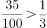，故排名第101-200名的城市有1/3以上集中在中部地区，正确；

C项，定位表格材料1可知：前50名，东南2002年28个、2011年26个，西南2002年4个、2011年2个。东南从28降到26，西南从4降到2，故与十年前相比，西南和东南地区均有城市跌出城市综合竞争力前50名，正确；

D项，材料中没有出现中部地区的大城市和中等城市具体数量，故无法判断，错误。

本题为选非题，故正确答案为D。

**考点**：统计表、综合分析

**来源**：2013年广东省公务员录用考试《行测》题（三）第95题

## 材料 3

2012年，某省加大扶持贫困残疾人力度，财政投入扶贫资金3816.3万元，比上年大幅增长18%，扶持贫困残疾人员56561人，脱贫35110人，享受优惠政策的贫困残疾人117727人，比上年增加3%。

        截止2012年底，城镇残疾人员安排就业人数共227192人，其中，集中就业25135人，按比例就业合计91384人，个体及其他形式就业110673人。农村残疾人实际就业630900人，其中，从事农业生产活动515278人，从事其他形式就业115622人。

        2012年城镇残疾职工参加社会保险133546人，城镇残疾居民参加社会保险235584人。2012年有14个区县确定为中央新农保的试点县，试点地区参保新农保22717人，参保率为34.5%；其中重度残疾人参保占19.9%。

        城镇纳入各类生活保障的残疾人共计147438人。其中，已经纳入最低生活保障范围87922人，集中供养3758人，临时救济22423人，定期补助33335人。农村纳入各类生活保障的残疾人共计339075人。其中，已纳入最低生活保障的残疾人共有221132人，五保供养18146人，临时救济32719人，定期补助67078人。

        截止2012年底，省、市、县、乡级残联实有人员5591人，比上年增加11.8%，全省21个地级市中的3个地级市与121个县（市、区）中的61个县（市、区）配备了残疾人领导干部，全省1589个乡镇街道中已建残联1547个；全省19435个村（社区）中已建残协10537个。

### 第 96 题

2012年，该省城镇残疾人就业形式主要为：

A. 集中就业

B. 按比例就业

C. 从事农业生产活动

D. 个体及其他形式就业

第 96 题 · 答案与解析

**参考答案（粉笔题库参考内容）**

D

**解析**

定位文字材料第二段，“截止2012年底，城镇残疾人员安排就业人数共227192人，其中，集中就业25135人，按比例就业合计91384人，个体及其他形式就业110673人”。110673最大，所以个体及其他形式就业所占比重最高，故2012年，该省城镇残疾人就业形式主要为个体及其他形式就业。

故正确答案为D。

**考点**：文字资料、直接找数

**来源**：2013年广东省公务员录用考试《行测》题（三）第96题

### 第 97 题

该省每年投入的残疾人财政扶贫资金如果可以均分到每位享受优惠政策的贫困残疾人身上，则2012年享受优惠政策的贫困残疾人的人均扶贫金额要比2011年增长约（    ）元。

A. 30

B. 40

C. 50

D. 60

第 97 题 · 答案与解析

**参考答案（粉笔题库参考内容）**

B

**解析**

根据题干“2012年······人均扶贫金额要比2011年增长约······元”，可判定本题为平均数的增长量计算问题。定位文字材料第一段，“2012年，某省加大扶持贫困残疾人力度，财政投入扶贫资金3816.3万元，比上年大幅增长18%······享受优惠政策的贫困残疾人117727人，比上年增加3%。”

根据平均数增长量的公式，在本题中A为每年投入的残疾人财政扶贫资金，a为扶贫资金的增长率，B为享受优惠政策的贫困残疾人，b为享受优惠政策的贫困残疾人数的增长率。代入数字后可得≈0.15/1.18元，与B项最接近。

故正确答案为B。

**考点**：平均数的增长量、文字资料

**来源**：2013年广东省公务员录用考试《行测》题（三）第97题

### 第 98 题

2011年全省、市、县、乡级残联实有人员（    ）人：

A. 5001

B. 4931

C. 4776

D. 3758

第 98 题 · 答案与解析

**参考答案（粉笔题库参考内容）**

A

**解析**

根据题干“2011年全省、市、县、乡级残联实有人员······人”，结合材料时间2012年，可判定本题为基期计算问题。定位材料最后一段，“2012年底，省、市、县、乡级残联实有人员5591人，比上年增加11.8%”。根据公式：，可得2011年全省、市、县、乡级残联实有人员5591/1.118≈5001人。

故正确答案为A。

**考点**：基期计算、文字资料

**来源**：2013年广东省公务员录用考试《行测》题（三）第98题

### 第 99 题

以下有关纳入各类生活保障范围的城镇残疾人和农村残疾人人数的说法，错误的是：

A. 无论在城镇还是在农村，领取定期补助的残疾人数量都高于领取临时救济的残疾人数量

B. 无论在城镇还是农村，最低生活保障都是当地残疾人生活保障的主要形式

C. 在所有被纳入生活保障范围的城镇残疾人群中，集中供养者的比例高于享受生活保障的农村残疾人中五保供养者的比例

D. 在所有被纳入生活保障范围的城镇残疾人群中，享受定期补助的人数比例高于农村

第 99 题 · 答案与解析

**参考答案（粉笔题库参考内容）**

C

**解析**

A项，定位文字材料第四段，“城镇······临时救济22423人，定期补助33335人，农村······临时救济32719人，定期补助67078人”。22423＜33335且32719＜67078，故无论在城镇还是在农村，领取定期补助的残疾人数量都高于领取临时救济的残疾人数量，正确。

B项，定位文字材料第四段，“城镇纳入各类生活保障的残疾人共计147438人。其中，已经纳入最低生活保障范围87922人······农村纳入各类生活保障的残疾人共计339075人。其中，已纳入最低生活保障的残疾人共有221132人”。因为城镇纳入最低生活保障的残疾人占纳入各类生活保障的残疾人的比重为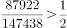，农村纳入最低生活保障的残疾人占纳入各类生活保障的残疾人的比重为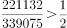，故无论在城镇还是农村，最低生活保障都是当地残疾人生活保障的主要形式，正确。

C项，定位文字材料第四段，“城镇纳入各类生活保障的残疾人共计147438人······集中供养3758人······农村纳入各类生活保障的残疾人共计339075人······五保供养18146人”。纳入生活保障范围的城镇残疾人中，集中供养者的比例为；享受生活保障的农村残疾人中，五保供养者的比例为＞0.02+，故在所有被纳入生活保障范围的城镇残疾人群中，集中供养者的比例低于享受生活保障的农村残疾人中五保供养者的比例，错误。

D项，定位文字材料第四段，“城镇纳入各类生活保障的残疾人共计147438人······定期补助33335人，农村纳入各类生活保障的残疾人共计339075人······定期补助67078人”。城镇享受定期补助的比例为，农村的比例为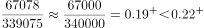，故在所有被纳入生活保障范围的城镇残疾人群中，享受定期补助的人数比例高于农村，正确。

本题为选非题，故正确答案为C。

**考点**：文字资料、综合分析

**来源**：2013年广东省公务员录用考试《行测》题（三）第99题

### 第 100 题

根据上述资料，以下说法正确的是：

A. 全省县（市、区）配备残疾人领导干部的情况要比地级市普遍

B. 全省乡镇各街道已建残联的比例要比农村（社区）已建残联的比例低

C. 全省区县接近2成的重度残疾人参加了新农保

D. 全省城镇残疾人被纳入最低生活保障范围的比例低于农村

第 100 题 · 答案与解析

**参考答案（粉笔题库参考内容）**

A

**解析**

A项，定位文字材料最后一段，“全省21个地级市中的3个地级市与121个县（市、区）中的61个县（市、区）配备了残疾人领导干部”。所以地级市配备残疾人领导干部占比为，县（市、区）配备残疾人领导干部占比为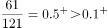，故全省县（市、区）配备残疾人领导干部的情况要比地级市普遍，正确；

B项，定位文字材料最后一段，“全省1589个乡镇街道中已建残联1547个；全省19435个村（社区）中已建残协10537个”。所以乡镇街道已建残联的比例为，村（社区）已建残联的比例为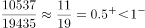，故全省乡镇各街道已建残联的比例要比农村（社区）已建残联的比例高，错误；

C项，定位文字材料第三段，只能知道在试点县中，重度残疾人参保接近二成，无法得到全省的数据，错误；

D项，定位文字材料，无法得出全省城镇、农村残疾人的数量，所以无法比较比例，错误。

故正确答案为A。

**考点**：文字资料、综合分析

**来源**：2013年广东省公务员录用考试《行测》题（三）第100题

