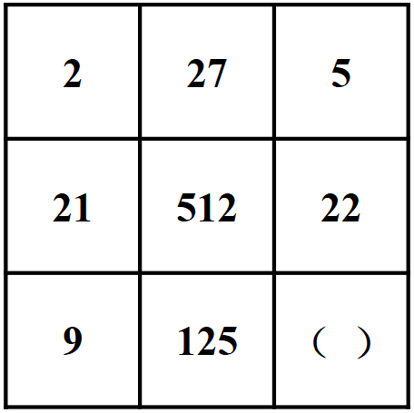
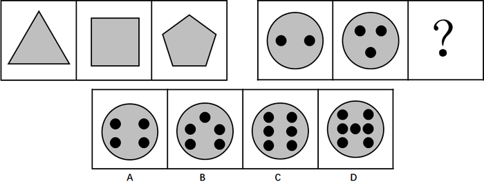
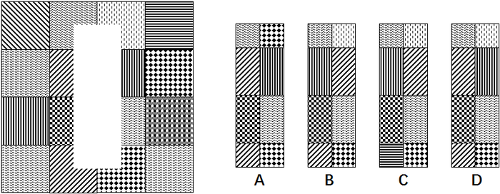
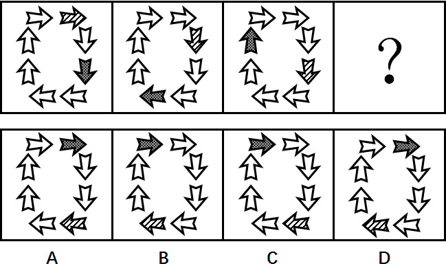
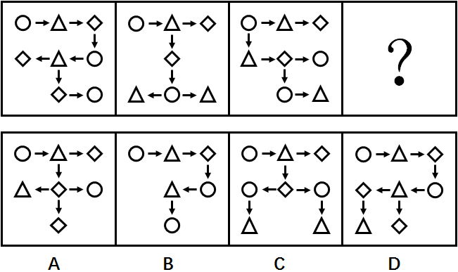
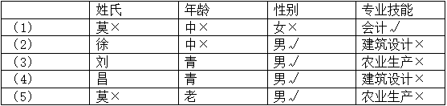
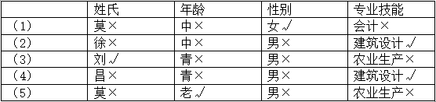
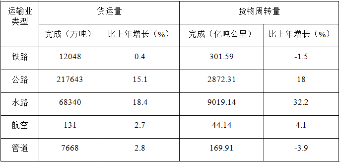
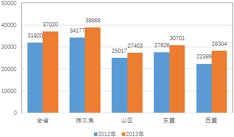

# 2014年广东省公务员录用考试《行测》题（乡镇）

<!-- gwy:overview:start -->
> **广东 · 2014 · 行测 · 乡镇卷** ｜ 100 题 · 图片 11 处 · 答案随题折叠

| 题型模块 | 题量 | 题号 |
| --- | ---: | ---: |
| 言语理解与表达 | 35 | 1–35 |
| 数量关系 | 10 | 36–45 |
| 判断推理 | 20 | 46–65 |
| 常识判断 | 20 | 66–85 |
| 资料分析 | 15 | 86–100 |
| **合计** | **100** | |

导航：[题型与作答说明](#题型与作答说明) · [题目](#题目) · [材料 1](#材料-1)
<!-- gwy:overview:end -->

> 候选采集稿。参考答案及解析来自粉笔页面，不代表官方答案或真实高分答卷；来源使用许可与原卷对应关系仍需人工核实。

## 题型与作答说明

言语理解与表达

（35题）

言语理解与表达

数量关系

（10题）

数量关系

判断推理

（20题）

判断推理

常识判断

（20题）

常识判断

资料分析

（15题）

资料分析

## 题目

### 第 1 题

乡村的美丽在于历史记忆，千百年来＿＿＿＿＿的村落空间、建筑风格，镌刻着一圈圈生命的年轮。

A. 养成

B. 形成

C. 造成

D. 变成

第 1 题 · 答案与解析

**参考答案（粉笔题库参考内容）**

B

**解析**

由文段中的重点提示词“历史记忆”“千百年来”可知，乡村的“村落空间、建筑风格”都是经过了长时间发展积淀，B项“形成”指通过发展变化而成为某种事物或出现或发生某种情况，符合文意，当选。

A项“养成”常搭配“习惯”，强调培养使之形成，与“空间”“风格”搭配不当，排除；C项“造成”指招致或引起，常搭配不好的结果，带有消极意味，排除；D项“变成”强调前后不同状态的对比，无法体现时间的积淀，排除。

故正确答案为B。

【文段出处】《乡村文明的明天是什么》

**考点**：实词填空、对应关系-前后呼应、词的辨析-搭配对象

**来源**：2014年广东省公务员录用考试《行测》题（乡镇）第1题

### 第 2 题

正如中国乡村在拥抱现代化的过程中不断嬗变一样，乡村道德也在剧烈变化的大时代里面临＿＿＿＿。

A. 转移

B. 转化

C. 转型

D. 转换

第 2 题 · 答案与解析

**参考答案（粉笔题库参考内容）**

C

**解析**

横线处所填词语与“乡村道德”搭配，且与“嬗变”形成对应，指根本性的转变，C项“转型”指事物的结构形态、运转模型和人们观念的根本性转变过程,与“乡村道德”搭配恰当，且与前文对应准确，当选。

A项“转移”意为将某物移动到某地，强调位置发生变化，置于此处搭配不当，排除；B项“转化”指转移变化，与“转型”相比，体现不出根本性的变化，用在此处程度过轻，与“嬗变”对应不当，排除；D项“转换”指变换不同的表现形式，与“乡村道德”搭配不当，排除。

故正确答案为C。

【文段出处】《中国乡村陷道德“软骨病” 物质丰富质朴再难寻》

**考点**：实词填空、词的辨析-搭配对象

**来源**：2014年广东省公务员录用考试《行测》题（乡镇）第2题

### 第 3 题

夏粮生产喜获丰收＿＿＿＿＿提振了农业工作者的信心，也为全年粮食丰收奠定基础，奏响序曲。

填入画横线部分最恰当的一项是：

A. 虽然

B. 如果

C. 不仅

D. 既然

第 3 题 · 答案与解析

**参考答案（粉笔题库参考内容）**

C

**解析**

分析文意可知，横线所填词语与后文的“也”构成递进关系，C项“不仅······也······”表达递进关系，符合文意，当选。

A项“虽然”表达转折关系，B项“如果”表达假设关系，逻辑关系均与文段不符，排除；D项“既然”表示先提出前提，而后加以推论，文段并非前提和推论的关系，排除。

故正确答案为C。

**来源**：2014年广东省公务员录用考试《行测》题（乡镇）第3题

### 第 4 题

＿＿＿＿＿原有产业基础和区位优势，某地区在金融、行政管理、涉外经济等领域不断推出改革创新举措。

填入横线处最恰当的一项是：

A. 依据

B. 依托

C. 依仗

D. 依赖

第 4 题 · 答案与解析

**参考答案（粉笔题库参考内容）**

B

**解析**

横线处所填词语与“产业基础和区位优势”搭配，由后文的提示信息“不断推出改革创新举措”可知，表达“依靠、凭借”的含义，B项“依托”指依靠凭借，常与“基础”“优势”搭配，符合文意，当选。

A项“依据”指把某事物作为基础或根据，其后通常接各种法律、制度、规则、原理等抽象事物，置于此处搭配不当，排除；C项“依仗”指倚仗、凭借，通常用于消极语境中，如“依仗权势”，与文段感情色彩不符，排除；D项“依赖”指依靠别人不能自立或自给，与文段“产业基础和区位优势”搭配不当，排除。

故正确答案为B。

**考点**：实词填空、词的辨析-感情色彩、词的辨析-搭配对象

**来源**：2014年广东省公务员录用考试《行测》题（乡镇）第4题

### 第 5 题

当前，农村各地正在不失时机对失地农民、失业返乡农民开展各种创业就业培训，并取得显著＿＿＿＿＿。

填入横线处最恰当的一项是：

A. 成果

B. 成效

C. 成功

D. 成就

第 5 题 · 答案与解析

**参考答案（粉笔题库参考内容）**

B

**解析**

横线处所填词语强调对农民开展的创业就业培训取得了很好的效果，B项“成效”指所获得的好效果和功效，符合文意，且常与“显著”搭配，当选。A项“成果”指收获到的果实，常用于指工作或事业方面的成就，常与“丰硕”等表示“大或小”的词语连用，一般不与“显著”搭配，排除；C项“成功”，无法与“显著”搭配，排除；D项“成就”指业绩，强调在事业上非凡的成绩，语义过重，排除。

故正确答案为B。

**考点**：实词填空、词的辨析-搭配对象

**来源**：2014年广东省公务员录用考试《行测》题（乡镇）第5题

### 第 6 题

来自人民、根植人民，是我们党先进性和纯洁性的集中＿＿＿＿＿，也是我们党永远立于不败之地的根本。

填入横线处最恰当的一项是：

A. 体现

B. 展现

C. 展示

D. 呈现

第 6 题 · 答案与解析

**参考答案（粉笔题库参考内容）**

A

**解析**

分析文意可知，“来自人民、根植人民”是我党根本性质的具体表现，A项“体现”指某种性质在某一事物上具体表现出来，符合文意，当选。B项“展现”意为明显地表现出来，C项“展示”指摆出来让人看，D项“呈现”指显露、出现，均表示具体的事物在眼前显现出来，无法与“来自人民、根植人民”搭配，排除。

故正确答案为A。

**考点**：实词填空、对应关系-前后呼应、词的辨析-搭配对象

**来源**：2014年广东省公务员录用考试《行测》题（乡镇）第6题

### 第 7 题

真情关注民生，着力改善民生，切实＿＿＿＿民生，努力解决好群众最关心，最直接、最现实的利益问题。

填入横线处最恰当的一项是：

A. 保证

B. 保障

C. 保护

D. 保卫

第 7 题 · 答案与解析

**参考答案（粉笔题库参考内容）**

B

**解析**

横线处所填词语与“民生”搭配，由后文的“努力解决好群众······利益问题”可知，表达为民生的实现提供支持之意，B项“保障”指确保、保证做到，且“保障民生”为固定搭配，当选。A项“保证”、C项“保护”、D项“保卫”均与“民生”搭配不当，排除。

故正确答案为B。

**考点**：实词填空、对应关系-前后呼应

**来源**：2014年广东省公务员录用考试《行测》题（乡镇）第7题

### 第 8 题

文艺的力量是无声无息的，它以春风化雨、潜移默化的方式＿＿＿＿＿着人们，如鲁迅所说，是“于无声处听惊雷”，这是文艺创作的一个定律。

A. 鼓励

B. 激发

C. 鼓动

D. 激励

第 8 题 · 答案与解析

**参考答案（粉笔题库参考内容）**

D

**解析**

横线处所填词语强调文艺的作用，后文通过鲁迅的话进行具体解释说明，由“于无声处听惊雷”可知，表达文艺可以产生使人震动、振奋人心的效果，D项“激励”指激发勉励，使振作，符合文意，当选。

A项“鼓励”通常搭配人，文段强调的是文艺的力量，与“文艺”搭配不当，排除；B项“激发”不能与“人们”搭配，且无法体现文艺的积极作用，排除；C项“鼓动”指以言语或行为激励他人使有所行动，文段并未体现“行动”之意，排除。

故正确答案为D。

**考点**：实词填空、词的辨析-感情色彩、词的辨析-搭配对象

**来源**：2014年广东省公务员录用考试《行测》题（乡镇）第8题

### 第 9 题

产业发展是农业增收致富的基础，由于各地情况不同，农业产业的具体方式和途径应该＿＿＿＿＿。

A. 因势利导

B. 因地制宜

C. 因利乘便

D. 因事制宜

第 9 题 · 答案与解析

**参考答案（粉笔题库参考内容）**

B

**解析**

根据文段中的提示信息“各地情况不同”可知，文段强调，农业产业的具体方式和途径有明显的地域差异，B项“因地制宜”指根据各地的具体情况，制定适宜的办法，符合文意，当选。

A项“因势利导”指顺着事情发展的趋势，加以引导，文段并无“引导”之意，排除；C项“因利乘便”指凭借有利的形势，利用有利条件，文段并未提及有利形势和条件，排除；D项“因事制宜”指根据不同的事情，制定适宜的措施，文段重在强调“不同的地方”而非“不同的事情”，排除。

故正确答案为B。

**考点**：对应关系-前后呼应、成语填空

**来源**：2014年广东省公务员录用考试《行测》题（乡镇）第9题

### 第 10 题

为知识分子营造良好的学习、工作和生活环境，使他们成长有机会、干事有舞台、发展有空间，是党和政府的重要＿＿＿＿＿。

A. 职责

B. 责任

C. 义务

D. 职权

第 10 题 · 答案与解析

**参考答案（粉笔题库参考内容）**

A

**解析**

分析文意可知，强调党和政府要为知识分子营造学习和工作环境，提供舞台与空间，这是党和政府在其职权范围内应尽的责任。A项“职责”指职务上应尽的责任，符合文意，当选。

B项“责任”语义过于宽泛，体现不出在职权范围内的含义，排除。C项“义务”与“权利”相对，带有“强制性”“约束性”，不能体现“责任”的含义，排除。D项“职权”指职务范围以内的权力，文段强调的是责任而非权力，排除。

故正确答案为A。

**考点**：实词填空、对应关系-前后呼应、词的辨析-词义侧重

**来源**：2014年广东省公务员录用考试《行测》题（乡镇）第10题

### 第 11 题

凡事从坏处准备，努力争取最好的结果，这样才能＿＿＿＿，遇事不慌，牢牢把握主动权。

A. 胸有成竹

B. 有备无患

C. 防患未然

D. 有的放矢

第 11 题 · 答案与解析

**参考答案（粉笔题库参考内容）**

B

**解析**

由文段提示信息“凡事从坏处准备，努力争取最好的结果”可知，横线处所填成语表达做好了充足的准备可以避免麻烦、祸患之意，B项“有备无患”指事先有准备，就可以避免祸患，符合文意，当选。

A项“胸有成竹”比喻在做事之前已经拿定主意，侧重事前的考虑、计划而非“准备”，排除；C项“防患未然”指防止事故或祸害于尚未发生之前，强调预防，无法对应文段“努力争取最好的结果”，排除；D项“有的放矢”强调说话做事有针对性，文段并无此意，排除。

故正确答案为B。

**考点**：对应关系-前后呼应、对应关系-解释说明、成语填空

**来源**：2014年广东省公务员录用考试《行测》题（乡镇）第11题

### 第 12 题

在过去的十年间，信息技术的飞速发展给当代人的生活、工作方式带来巨大的变革，而＿＿＿＿这一切的基础——通信网络，在神州大地上实现了＿＿＿＿＿式的发展。

A. 建造 飞越

B. 建造 跨越

C. 缔造 飞越

D. 缔造 跨越

第 12 题 · 答案与解析

**参考答案（粉笔题库参考内容）**

D

**解析**

第一空，横线处所填词语搭配“这一切”，指代前文“变革”，“缔造”指造业、建造、创立、建立，通常搭配抽象的事物，与“变革”搭配恰当。“建造”指制造，通常搭配具体的事物，用在此处搭配不当，故排除A、B两项。

第二空，横线处形容信息技术的发展速度快，越过了某些阶段，D项“跨越”指跨过、超越某个界限，符合文意，且“跨越式发展”为固定搭配，当选。C项“飞越”指从上空飞行越过，强调上升到一个阶段，与文意不符，排除。

故正确答案为D。

**考点**：实词填空、词的辨析-搭配对象、词的辨析-词义侧重

**来源**：2014年广东省公务员录用考试《行测》题（乡镇）第12题

### 第 13 题

如果一味＿＿＿＿＿于所谓的“成功之道”，放弃对生活的体验和思考，则有可能在追求“成功”的路上，与自己最初的梦想＿＿＿＿＿。

A. 沉溺 南辕北辙

B. 沉湎 南辕北辙

C. 沉迷 渐行渐远

D. 沉醉 渐行渐远

第 13 题 · 答案与解析

**参考答案（粉笔题库参考内容）**

C

**解析**

第一空，分析文意可知，横线处表达迷信、迷恋“成功之道”的含义，结合横线前的提示词“一味”，可知文段带有消极意味，D项“沉醉”比喻沉浸在某种境界里，为中性词，与文段感情色彩不符，排除。

第二空，横线处所填词语表示与“最初的梦想”越来越远的含义，C项“渐行渐远”指不断地行走，分离得越来越远，符合文意，当选。“南辕北辙”指行动与目的刚好相反，文段只强调与梦想拉开了距离，而非刚好相反，语义过重，排除A、B两项。

故正确答案为C。

**考点**：混搭填空、词的辨析-感情色彩、词的辨析-程度轻重

**来源**：2014年广东省公务员录用考试《行测》题（乡镇）第13题

### 第 14 题

无论是经验还是教训都表明，面对信任危机，主动＿＿＿＿比逃避拖延更理性，用心＿＿＿＿＿比一味堵塞更管用，未雨绸缪比应急救火更重要。

A. 应对 疏通

B. 应付 疏通

C. 应付 疏导

D. 应对 疏导

第 14 题 · 答案与解析

**参考答案（粉笔题库参考内容）**

D

**解析**

第一空，横线处所填词语与“主动”搭配，“应付”指被动地采取措施，与“主动”搭配不当，“应对”指采取措施面对出现的情况，与”主动“搭配恰当，故排除B、C两项。

第二空，D项“疏导”比喻开导、打通人的思想，通常搭配抽象事物，与“危机”搭配得当，当选。A项“疏通”指清除阻塞,使水流或交通畅通，多搭配具体事物，排除。

故正确答案为D。

【文段出处】《舆情监测显示民众对政府专家及媒体信任度低》

**考点**：实词填空、词的辨析-搭配对象、词的辨析-词义侧重

**来源**：2014年广东省公务员录用考试《行测》题（乡镇）第14题

### 第 15 题

我们把美丽乡村建设作为培育农村经济新增长点的有效＿＿＿＿＿，＿＿＿＿＿区位条件、生态资源、人文积淀等优势。

A. 途径 发扬

B. 路径 发扬

C. 途径 发挥

D. 路径 发挥

第 15 题 · 答案与解析

**参考答案（粉笔题库参考内容）**

C

**解析**

第一空，横线处所填词语表示美丽乡村建设成为实现培育农村经济新增长点的方式，“途径”和“路径”都有“方法，路子”之意，对比“途径”常用于体现出方式、方法的含义，而“路径”常用于指通向某个目标的道路，则“途径”更符合语义，故排除B、D两项。

第二空，“发挥优势”为固定搭配，C项当选。A项“发扬”指发展和提倡，通常搭配精神、优良作风、传统等，与“优势”搭配不当，排除。

故正确答案为C。

【文段出处】《美丽乡村建设的浙江实践》

**考点**：实词填空、词的辨析-搭配对象

**来源**：2014年广东省公务员录用考试《行测》题（乡镇）第15题

### 第 16 题

农机产业的快速发展为农机化水平的稳定提升提供了装备＿＿＿＿＿＿，但目前农机产品的有效供给远不能满足发展现代农业对其的＿＿＿＿＿。

A. 支援 需要

B. 支撑 需要

C. 支撑 需求

D. 支援 需求

第 16 题 · 答案与解析

**参考答案（粉笔题库参考内容）**

C

**解析**

第一空，分析文意可知，此处表达“农机产业的快速发展”可以为“农机化水平的稳定提升”提供有力的支持，“支撑”表示支持、顶住，用在此处符合文意。“支援”指对需要帮助的人或集体给予物质或精神的支持、援助，强调亟须帮助以摆脱困境，文段并非表示摆脱困境，排除A、D两项。

第二空，与“供给”形成对应，C项“需求”与“供给”对应准确，当选。B项“需要”与“供给”无法形成对应，排除。

故正确答案为C。

【文段出处】《农机产业发展调研：关键要转型升级》

**考点**：实词填空、词的辨析-搭配对象、词的辨析-词义侧重

**来源**：2014年广东省公务员录用考试《行测》题（乡镇）第16题

### 第 17 题

互联网为人们获取和交流信息提供了极大＿＿＿＿＿，同时也给个人信息被他人非法泄露、搜集、公开、传播和利用提供了＿＿＿＿＿。

依次填入横线处最恰当的一项是：

A. 方便 可能

B. 便利 可行

C. 便利 可能

D. 方便 可行

第 17 题 · 答案与解析

**参考答案（粉笔题库参考内容）**

C

**解析**

第一空，横线处应表示互联网的出现便于人们获取和交流信息，且与“极大”搭配，“方便”指省事的，为形容词，与形容词“极大”搭配不当；“便利”指利益、好处，与“极大”搭配恰当，排除A、D两项。

第二空，与“提供”搭配，“可能”指能成为事实的属性，与之搭配恰当，当选。B项“可行”指行得通、可以实行，与“提供”搭配不当，排除。

故正确答案为C。

**考点**：实词填空、词的辨析-搭配对象

**来源**：2014年广东省公务员录用考试《行测》题（乡镇）第17题

### 第 18 题

我们身边有许许多多优秀基层干部，把自己的生命无私地投入于百姓的幸福生活，他们闪光的足迹，就是最＿＿＿＿的表述和最＿＿＿＿的注解。

A. 生动 透彻

B. 深刻 透彻

C. 生动 精辟

D. 深刻 精辟

第 18 题 · 答案与解析

**参考答案（粉笔题库参考内容）**

C

**解析**

第一空，与“表述”搭配，强调优秀基层干部的足迹是他们无私奉献精神的最好的叙述，“生动”指具有活力、形象的，符合文意；“深刻”指深入透彻，多与“道理”“内涵”等搭配，排除B、D两项；

第二空，与“注解”搭配，即一种解释，C项“精辟”指精准凝练，符合文意，当选；A项“透彻”强调深入，多与“分析”搭配，置于此处搭配不当，排除。

故正确答案为C。

【文段出处】《当官的人有啥不一样》

**考点**：实词填空、词的辨析-搭配对象

**来源**：2014年广东省公务员录用考试《行测》题（乡镇）第18题

### 第 19 题

在有条件的地方开展按实际粮食播种面积或产量对生产者补贴试点，提高补贴精准性、指向性。这是中央一号文件的一个突出＿＿＿＿＿，也是对一直以来农业补贴政策上各种呼声的一个合理＿＿＿＿＿。

A. 亮点 回应

B. 特点 回应

C. 特点 回复

D. 亮点 回复

第 19 题 · 答案与解析

**参考答案（粉笔题库参考内容）**

A

**解析**

第一空，分析文意可知，文段强调的是一号文件中的一个惠民政策，用“突出”修饰，带有积极的感情色彩，“特点”指特色，为中性词，而“亮点”强调引人注目，褒义词，符合文意，排除B、C两项。

第二空，所填词语与“呼声”搭配，“回应呼声”为常见搭配，符合文意，当选；“回复”多指回答别人的问题，与“呼声”搭配不当，排除D项。

故正确答案为A。

【文段出处】《发挥农业补贴对粮食生产的激励作用》

**考点**：实词填空、词的辨析-感情色彩、词的辨析-搭配对象

**来源**：2014年广东省公务员录用考试《行测》题（乡镇）第19题

### 第 20 题

物质消费＿＿＿＿＿，但违背公序良俗和高尚生活的畸形消费则应抵制，树立科学、文明的消费观＿＿＿＿＿。

依次填入画横线部分最恰当的一项是：

A. 无可厚非 迫在眉睫

B. 无可厚非 急不可待

C. 无可置疑 急不可待

D. 无可置疑 迫在眉睫

第 20 题 · 答案与解析

**参考答案（粉笔题库参考内容）**

A

**解析**

第一空，由表示转折关系的关联词“但”可知，横线处与后文语义相反，即“物质消费不应受到抵制”，“无可厚非”意为不能过分责备，指说话做事虽有些问题，但还有可取之处，应予接受，“物质消费无可厚非”表示物质消费无需过分指责，符合文意；“无可置疑”意为事实明显或理由充足，没有什么可以怀疑的，与文意无关，故排除C、D两项。

第二空，强调通过“树立科学、文明的消费观”解决畸形消费问题非常迫切，A项“迫在眉睫”形容情势十分紧迫，符合文意，当选；B项“急不可待”形容心情急切，与文意不符，排除。

故正确答案为A。

【出处】《畸形消费之惑：喝人奶、吃胎盘能大补》

**考点**：关联关系-转折关系、成语填空、词的辨析-搭配对象

**来源**：2014年广东省公务员录用考试《行测》题（乡镇）第20题

### 第 21 题

乡村文化，只有跟乡村的未来发展相和谐，跟老百姓过日子不冲突，才能引动我们广袤乡村社会的文化之河长流。

下列选项中，与作者观点一致的是：

A. 乡村文化的保护与传承，要与乡村的发展变化相适应

B. 乡村文化的保护与传承，要保持乡村的原有风貌

C. 乡村文化的保护与传承，与社会发展完全没有关系

D. 乡村文化的保护与传承，常与老百姓利益发生冲突

第 21 题 · 答案与解析

**参考答案（粉笔题库参考内容）**

A

**解析**

分析文意可知，通过必要条件关联词“只有······才”引导的对策是重点，强调乡村文化要与乡村未来的发展和谐，对应A项。

B项“保持原有风貌”文段并未提及，无中生有，排除；

C项“完全没有关系”表述过于绝对，排除；

D项“常发生冲突”表述有误，文段强调“不冲突”，排除。

故正确答案为A。

【文段出处】《城镇化进程中乡村文化的保护与变迁》

**考点**：关联词-对策

**来源**：2014年广东省公务员录用考试《行测》题（乡镇）第21题

### 第 22 题

简单恢复历史旧貌，绝不可能实现复兴的目标。只有创造一种融合古今的新兴文明，才能恢复曾经有过的世界一流的兴盛状态。因此，（    ）。

下列选项中，最适合填入上述括号内的是：

A. 复兴之道，应当是改革创新之道

B. 要复兴，就要敞开胸怀学习全世界

C. 要复兴，就要批判地继承历史遗产

D. 复兴之道，需要敢想、敢干、能干

第 22 题 · 答案与解析

**参考答案（粉笔题库参考内容）**

A

**解析**

括号设置在文段结尾，由表示结论的关联词“因此”可知，应填入总结前文的语句，上文通过“只有······才”引导对策，强调“创造一种融合古今的新兴文明”，保持话题的一致性，对应A项“改革创新”。

B项“学习”、C项“继承历史遗产”、D项“敢想······”均无法与“创造一种融合古今的新兴文明”构成对应，排除。

故正确答案为A。

**考点**：横线在结尾

**来源**：2014年广东省公务员录用考试《行测》题（乡镇）第22题

### 第 23 题

我国环境保护和治理污染的重心在城市，特别是中心城市，而相对忽视了广大的农村。其实，我国农村最需要环境保护、环境治理和生态建设。

这段文字主要说明了：( )

A. 环境保护和治理污染的重心在城市

B. 环境保护和治理污染需要城市与农村联动

C. 环境保护和治理污染的重心要向农村转移

D. 环境保护和治理污染的难点在农村

第 23 题 · 答案与解析

**参考答案（粉笔题库参考内容）**

C

**解析**

由表示转折关系的关联词“其实”可知，文段重点强调农村应该是环境保护、治理污染的重心，对应C项。

A项“重心在城市”为转折前内容，非重点，排除。

B项“城市与农村联动”表述有误，文段重点强调农村，排除。

D项，文段强调治理的“重点”而非“难点”，表述有误，排除。

故正确答案为C。

【文段出处】《环保治污重心须向农村转移》

**考点**：关联词-转折

**来源**：2014年广东省公务员录用考试《行测》题（乡镇）第23题

### 第 24 题

如果说中央政府改革是上篇，地方政府改革就是下篇，需要整体构思，通盘考虑、上下贯通，把政府改革的整篇文章做好。地方政府职能转变和机构改革，是党和国家改革开放事业大局的重要内容，也是深化行政体制改革的重要组成部分。

这段文字主要说明了：

A. 取消地方行政审批的重要性

B. 搞好地方政府改革的重要性

C. 调整优化机构编制的重要性

D. 加快政府职能转变的重要性

第 24 题 · 答案与解析

**参考答案（粉笔题库参考内容）**

B

**解析**

文段首先指出需要通过整体构思进行政府改革，接着强调地方政府改革是国家改革开放的重要内容和重要组成部分，故文段重在强调地方政府改革的重要性，对应B项。

A项“地方行政审批”、C项“优化机构编制”无中生有，排除A、C两项；D项“政府职能转变”是地方政府改革的一部分内容，表述片面，排除。

故正确答案为B。

【文段出处】《李克强：上下联动，做好政府改革这篇大文章》

**考点**：主题词

**来源**：2014年广东省公务员录用考试《行测》题（乡镇）第24题

### 第 25 题

人以食为天，食品安全尤其是粮食安全是根本，在水土资源刚性约束的条件下，种业成为挖掘增产潜力、保障食品安全的关键，它不仅是农业发展的战略产物，也决定着农业发展的水平和竞争力，而且是人类赖以持续生存发展的战略。

这段文字主要说明了：（）

A. 种业的重要性

B. 粮食安全的重要性

C. 环境保护的重要性

D. 农业发展的重要性

第 25 题 · 答案与解析

**参考答案（粉笔题库参考内容）**

A

**解析**

文段首先指出粮食安全是根本，接着强调种业是保障食品安全的关键，后文详细阐述了种业的重要意义，故文段重在强调种业的重要性，对应A项。

B项“粮食安全”、C项“环境保护”、D项“农业发展”均未包含文段的主题词“种业”，排除。

故正确答案为A。

**考点**：主题词

**来源**：2014年广东省公务员录用考试《行测》题（乡镇）第25题

### 第 26 题

富人有富人的忧愁，穷人有穷人的快乐。立业与成功，是诸多人的幸福理想；生活幸福，工作幸福，则是每个人的平常愿望。幸福密码，似乎像账户密码，一般人都有，但是别人看不到，只有自己用心才能体会。

下列选项中，与作者观点不一致的是：（ ）

A. 富人与穷人都能获得幸福的感觉

B. 实现平常愿望也能让人感到幸福

C. 幸福与每个人的内心感受有关

D. 物质支撑的幸福才更加恒定持久

第 26 题 · 答案与解析

**参考答案（粉笔题库参考内容）**

D

**解析**

与文段对应可知，D项“物质支撑”在文段中并未提及，无中生有，表述错误，当选。

A项，根据“幸福密码，似乎像账户密码，一般人都有”可知，表述正确，排除；

B项，根据“生活幸福，工作幸福，则是每个人的平常愿望”可知，表述正确，排除；

C项，根据“只有自己用心才能体会”可知，表述正确，排除。

本题为选非题，故正确答案为D。

【文段出处】《幸福密码》

**考点**：细节判断题

**来源**：2014年广东省公务员录用考试《行测》题（乡镇）第26题

### 第 27 题

调查研究发现，某地基层农业科技队伍“断层”问题较为突出。因受地方事业总编制数的限制，当地农业科技推广服务机构已超过10年没有补充人才，而随着农业科技人员的升迁、调动，基层农业科技骨干日渐减少，农技服务队伍“青黄不接”。

通过这段文字，作者旨在建议：( )

A. 建立多元基层农技技术推广体系，实现技术推广与生产需求结合

B. 明确建设中以公益性为指导原则，解除县乡农技服务的后顾之忧

C. 发展政府外的涉农企业力量加入，完善现代农业的农技推广体系

D. 增设基层农业科技推广专项编制，解决农技服务队伍断层的问题

第 27 题 · 答案与解析

**参考答案（粉笔题库参考内容）**

D

**解析**

文段首先指出农业科技队伍“断层”问题突出，接着对其原因进行分析，即由于编制有限，人才无法补充，故文段重在强调解决问题的对策，即增加编制，解决队伍“断层”的问题，对应D项。

A项“技术推广与生产需求”、B项“县乡农技服务”、C项“技术推广体系”均不能有针对性地解决文段中提出的问题，排除。

故正确答案为D。

**考点**：关联词-对策

**来源**：2014年广东省公务员录用考试《行测》题（乡镇）第27题

### 第 28 题

马克思指出：“人们自己创造自己的历史，但是他们并不是随心所欲地创造，历史不在他们自己选定的条件下创造，而是在直接碰到的、既定的、从过去承接下来的条件下创造。”当前，探讨中国特色社会主义政治发展，同样离不开中国的现实国情。这必然是中国特色社会主义政治发展的逻辑起点。

对上文中的“这”理解最准确的是：(     )

A. 中国的现实国情

B. 人们创造的历史

C. 马克思的原话

D. 政治发展的方向

第 28 题 · 答案与解析

**参考答案（粉笔题库参考内容）**

A

**解析**

首先定位原文，“这”出现在文段结尾，需结合前文内容进行理解，文段首先援引马克思的话，然后指出探讨中国政治发展离不开中国的现实国情，故“这”指代中国的现实国情，对应A项。

B、C两项均对应首句马克思的话，是为了引出后文观点，并非代词所指，排除；D项“政治发展方向”文段并未提及，无中生有，排除。

故正确答案为A。

【文段出处】《习近平：在纪念邓小平同志诞辰110周年座谈会上的讲话》

**考点**：代词

**来源**：2014年广东省公务员录用考试《行测》题（乡镇）第28题

### 第 29 题

乡村与城市，本是两种不同的生活空间和文明形态，自有其不同的运行路径和发展规律。推进城乡一体，建设美丽乡村，不是追求城乡一样，不是让乡村全然变成城市，而是要尊重不同的文明，顺应不同的规律，走出一条生态、生产与生活契合，自然、文化与历史和谐的城乡差别化互动型协调发展道路。从文明的演进看，我们不可以割断历史；从社会的变迁看，我们也不可能消灭乡村。

对这段文字理解不准确的一项是：

A. 建设美丽乡村不能简单等同于农村城市化

B. 建设美丽乡村要符合乡村的发展规律

C. 建设美丽乡村是让乡村全然变成城市

D. 建设美丽乡村要考虑城乡差别化发展

第 29 题 · 答案与解析

**参考答案（粉笔题库参考内容）**

C

**解析**

A项，根据文段“推进城乡一体，建设美丽乡村，不是追求城乡一样，不是让乡村全然变成城市”可知，表述正确，排除；

B项，根据文段“要尊重不同的文明，顺应不同的规律”可知，表述正确，排除；

C项，根据文段“不是让乡村全然变成城市”可知，“全然变成城市”表述错误，当选；

D项，根据文段“要尊重不同的文明，顺应不同的规律，走出一条生态、生产与生活契合，自然、文化与历史和谐的城乡差别化互动型协调发展道路”可知，表述正确，排除。

本题为选非题，故正确答案为C。

【文段出处】《乡村文明的明天是什么》

**考点**：细节判断题

**来源**：2014年广东省公务员录用考试《行测》题（乡镇）第29题

### 第 30 题

调查显示，一方面当前的农村文化生活有了一定的发展，随着新农村建设的逐步深入，农村文化建设取得了一些成绩，各项公益文化设施不断增加，农民享受文化生活的意识得到提高，农民文化生活内容不断丰富，精神面貌也为之焕然一新。另一方面，受各种条件制约，农民享受文化生活的渴望与相对滞后的文化产品的矛盾日益显著，这在一定程度上抑制了农村文化生活建设和进一步发展。

这段文字主要说明了：

A. 农村文化生活的现状及特征

B. 农村文化生活存在的问题

C. 影响农村文化生活的主要因素

D. 农村文化建设所取得的成绩

第 30 题 · 答案与解析

**参考答案（粉笔题库参考内容）**

A

**解析**

文段首先通过“一方面”指出当前的农村文化生活有了一定的发展，并进行具体说明，然后通过“另一方面”指出农民享受文化生活的渴望与相对滞后的文化产品的矛盾日益显著，整个文段为并列结构，阐述了农村文化生活发展的情况，对应A项“现状及特征”。

B项“问题”、D项“成绩”分别对应文段一方面的内容，均表述片面，排除；C项“主要因素”文段并未提及，无中生有，排除。

故正确答案为A。

【文段出处】《新农村文化生活现状调查》

**考点**：关联词-并列

**来源**：2014年广东省公务员录用考试《行测》题（乡镇）第30题

### 第 31 题

推进改革需要相应的经济环境，从实际情况看，速度过高或过低都不利于改革。如果发展速度过低，就业会出问题，居民收入增速及民生改善步伐也会相应放缓，老百姓就会不满意，改革就难以推进。但发展速度过高，会使各方面的关系绷得很紧，容易引发通胀，妨碍结构调整，也会影响改革。改革是发展的动力，总体有利于经济增长。

这段文字主要说明了：(  )

A. 实现经济持续稳定健康地发展要靠改革

B. 要处理好改革与发展的关系

C. 经济发展仍是解决我国所有问题的关键

D. 我国市场经济改革和发展取得明显成效

第 31 题 · 答案与解析

**参考答案（粉笔题库参考内容）**

B

**解析**

文段开篇通过对策标志词“需要”强调，推进改革要有合适的经济发展速度，发展速度过高或过低都不利于改革。随后通过反面论证对这一对策展开分析，论证了发展速度过低和过高均会对改革带来不利影响。最后指出改革是发展的动力，总体有利于经济发展。故文段围绕“改革”和“发展”展开，重点强调要正确处理改革与发展的关系，对应B项。

A项，“实现经济持续稳定健康地发展”无中生有，排除；

C项，“所有问题的关键”表述过于绝对，且未提及核心话题“改革”，排除；

D项，“明显成效”文段未提及，无中生有，排除。

故正确答案为B。

**考点**：主题词、关联词-对策

**来源**：2014年广东省公务员录用考试《行测》题（乡镇）第31题

### 第 32 题

中国人的饭碗任何时候都要牢牢端在自己手上，保障一个国家的农业安全，造就一大批高素质的农民是一项重大战略选择。农业依靠农民，我们面临的现实不仅是农民数量萎缩，而且素质堪忧。青壮年农民数量急剧减少，农业劳动力老龄化严重，“未来谁种地”备受社会关注。因为没有人，农业安全就是一句空话。

这段文字旨在说明：（）

A. 吸引有志于农业的年轻人务农至关重要

B. 保障农业安全需要依靠高素质农民

C. 劳动力数量急剧下降对农业安全的影响

D. 国家的农业安全取决于农业劳动力的素质

第 32 题 · 答案与解析

**参考答案（粉笔题库参考内容）**

B

**解析**

文段首先提出观点，指出保障农业安全需要造就一批高素质农民，之后详细解释说明，指出我国面临的问题是农民素质问题，青壮年农民数量减少，高素质农民缺乏，农业安全问题必须依靠人来解决，整个文段为“观点+解释说明”结构，意在强调保障农业安全需要高素质农民，对应B项。

A项，文段重在强调提高农民素质，而非吸引年轻人务农，与文意不符，排除。

C项，劳动力数量减少的影响对应文段解释说明的内容，非重点，排除。

D项，“取决于”，表述绝对，排除。

故正确答案为B。

【文段出处】《让更多农民享受职业教育的阳光》

**考点**：分述句特征-其他

**来源**：2014年广东省公务员录用考试《行测》题（乡镇）第32题

### 第 33 题

实践一再告诫我们，要真正服务好干部群众，就必须关注“沉默的大多数”，特别要注意听那些平时听不到、难听到的底层干部群众的声音。要畅通各种民主渠道，通过开通热线电话、举办问政问计活动等形式，多捕捉来自“无声”干部群众的声音，从中去了解、感知、分析、思考，切实找准服务指导基层的差距不足和用力方向，使之成为推动基层建设的重要依据和参考。

对这段文字理解最准确的一项是：(  )

A. “无声”干部群众的声音更值得重视

B. 要重视来自“无声”干部群众的声音

C. 大多数干部群众都是“沉默的”

D. 畅通民主渠道才能获取干部群众的声音

第 33 题 · 答案与解析

**参考答案（粉笔题库参考内容）**

B

**解析**

文段首先指出应重视那些平时听不到、难听到的底层干部群众的声音。之后进一步说明，可以通过哪些方式倾听“无声”干部群众的声音。整个文段为“观点+解释说明”结构，意在强调应重视底层干部群众的声音，对应B项。

A项，文段只提到“无声”干部群众的声音应受到重视，但不存在比较，“更值得重视”无中生有，排除。

C项，文段重点是针对如何服务好干部群众给出对策，而干部群众“沉默”是对问题的分析，非文段重点，排除。

D项，“畅通民主渠道”为后文具体解释说明部分，非重点，排除。

故正确答案为B。

【文段出处】《会说“群众话”是做群众工作的一项基本功》

**考点**：细节判断题

**来源**：2014年广东省公务员录用考试《行测》题（乡镇）第33题

### 第 34 题

城镇化是一个自然历史过程，有其内在规律。要坚持按规律办事，厘清政府和市场的边界。要发挥市场在资源配置中的决定性作用，以市场化、社会化方式整合城镇化建设资源，壮大城市产业基础，改善就业条件，解决好公共服务投融资等问题。同时，政府要切实履行在创造制度环境、编制发展规划、建设基础设施、提供公共服务、加强社会治理等方面的职责。

这段文字主要说明了：（）

A. 推进城镇化建设要处理好政府与市场的关系

B. 推进城镇化建设要注重发挥政府的主导作用

C. 推进城镇化建设要发挥市场的决定作用

D. 推进城镇化建设要尊重城镇化的内在规律

第 34 题 · 答案与解析

**参考答案（粉笔题库参考内容）**

A

**解析**

文段首先提出观点，指出城镇化进程中应注意内在规律，厘清政府和市场的边界。然后分别论述如何发挥市场作用，以及政府应如何履行职责，整个文段为总—分结构，意在说明城镇化进程中应合理发挥政府与市场的作用，对应A项。

B项，只提到“政府”，表述片面，排除。

C项，只提到“市场”，表述片面，排除。

D项，没有提到内在规律是什么，根据文意，尊重内在规律即需厘清政府和市场的边界，故D项表述不明确，排除。

故正确答案为A。

【文段出处】《朱小丹在全省城镇化工作会议上的讲话》

**考点**：关联词-对策、分述句特征-多角度论述

**来源**：2014年广东省公务员录用考试《行测》题（乡镇）第34题

### 第 35 题

记忆力的改善并不需要求助于神奇的记忆术或昂贵的营养补充剂。一项针对120名老人进行的为期一年的研究表明，坚持每周快走3次、每次持续30到40分钟的老人，在实验结束时，负责记忆与计划关键部位的体积不但没有像预料那样随着衰老而萎缩，反而增长了2%到3%。这意味着将记忆力衰退的进程逆转了1到2年。此外，经常快步行走的老人在空间记忆测试中的得分也要高于运动的对照组。

以下最适合做这段文字标题的一项是：(  )

A. 神奇的记忆术

B. 超强记忆“走”出来

C. 记忆力的改善

D. 记忆力与行走

第 35 题 · 答案与解析

**参考答案（粉笔题库参考内容）**

B

**解析**

文段首先指出记忆力的改善不需要神奇记忆术以及补充剂，然后介绍了一项研究，根据研究结果，快步走可以延缓记忆衰退，提高空间记忆水平，故文段意在强调快步走可以提高记忆能力，对应B项。

A项，对应文段首句，“记忆力的改善并不需要求助于神奇的记忆术”，非重点，排除。

C项，缺乏主题词“行走”，排除。

D项，没有指出记忆力与行走之间的关系，表述不准确，排除。

故正确答案为B。

【文段出处】《超强记忆走出来》

**考点**：标题填入题

**来源**：2014年广东省公务员录用考试《行测》题（乡镇）第35题

### 第 36 题

11、18、25、32、(   )

A. 34

B. 37

C. 39

D. 41

第 36 题 · 答案与解析

**参考答案（粉笔题库参考内容）**

C

**解析**

观察数列发现，两两之间都差7，所以该数列是公差为7的等差数列，则所求项应为32＋7=39。

故正确答案为C。

**来源**：2014年广东省公务员录用考试《行测》题（乡镇）第36题

### 第 37 题

4、12、36、108、(   )

A. 223

B. 257

C. 315

D. 324

第 37 题 · 答案与解析

**参考答案（粉笔题库参考内容）**

D

**解析**

数列各项间存在明显的倍数关系，后一项为前一项的3倍，则所求项应为108×3=324。

故正确答案为D。

**来源**：2014年广东省公务员录用考试《行测》题（乡镇）第37题

### 第 38 题

10、5、15、20、35、(    )

A. 50

B. 55

C. 65

D. 70

第 38 题 · 答案与解析

**参考答案（粉笔题库参考内容）**

B

**解析**

数列无明显特征且起伏较小，优先考虑作差，作差无规律，考虑递推。观察数列发现：第三项=第一项＋第二项，则所求项应为20＋35=55。

故正确答案为B。

**来源**：2014年广东省公务员录用考试《行测》题（乡镇）第38题

### 第 39 题

90、45、15、3.75、(    )

A. 0.25

B. 0.5

C. 0.75

D. 1

第 39 题 · 答案与解析

**参考答案（粉笔题库参考内容）**

C

**解析**

数列各项间存在明显的倍数关系，考虑作商。第一项/第二项 = 2；第二项/第三项 = 3；第三项/第四项 = 4；故第四项/第五项=5，所以所求项应为3.75/5 = 0.75。

故正确答案为C。

**来源**：2014年广东省公务员录用考试《行测》题（乡镇）第39题

### 第 40 题

从所给的四个选项中，选择最合适的一个填入括号处，使之呈现一定的规律性：

A. 10

B. 9

C. 8

D. 7

第 40 题 · 答案与解析

**参考答案（粉笔题库参考内容）**

D

**解析**

根据题意可知本题为九宫格数列，寻找每行或者每列相同的规律，可发现27=3^3，2×2＋5=9=3²；512=8^3，21×2＋22=64=8²；故每一行√(第一项×2+第三项)=∛第二项，则√(9 × 2 + 所求项) = ∛125 = 5，所求项=25-18=7。

故正确答案为D。

**来源**：2014年广东省公务员录用考试《行测》题（乡镇）第40题

### 第 41 题

做同一种零件，赵师傅3小时做15个，钱师傅4小时做21个，孙师傅5小时做27个，李师傅6小时做31个，则( )的工作效率最高。

A. 赵师傅

B. 钱师傅

C. 孙师傅

D. 李师傅

第 41 题 · 答案与解析

**参考答案（粉笔题库参考内容）**

C

**解析**

题干已知工作时间与工作总量，根据工程问题计算公式，工作效率=工作总量/工作时间，可得：

赵师傅的工作效率=15/3=5；

钱师傅的工作效率=21/4=5.25；

孙师傅的工作效率= 27/5 = 5.4；

李师傅的工作效率=31/6≈5。

即工作效率最高的为孙师傅。

故正确答案为C。

**考点**：给具体单位型

**来源**：2014年广东省公务员录用考试《行测》题（乡镇）第41题

### 第 42 题

某合作社农场有5块稻田，今年夏季每块稻田的产量分别为：580千克、562千克、517千克、543千克、529千克。则5块稻田的平均产量是(      )千克。

A. 546.2

B. 548.4

C. 549.6

D. 550.8

第 42 题 · 答案与解析

**参考答案（粉笔题库参考内容）**

A

**解析**

方法一：稻田的平均产量= 总产量/稻田数 = (580+562+517+543+529)/5 = 2731/5 = 546.2，A项符合。

方法二：稻田的平均产量= 总产量/稻田数 = (580+562+517+543+529)/5，观察选项，尾数各不相同，尾数法计算。分子相加尾数为1，1/5尾数为2，只有A项满足。

故正确答案为A。

**来源**：2014年广东省公务员录用考试《行测》题（乡镇）第42题

### 第 43 题

某工程队给一个长方形广场铺地砖，已知每平方米铺设成本为25元，若广场的宽不变，长增加5米，总成本则上升1.25万元；若广场的长不变，宽增加3米，总成本则上升1.5万元。则广场原来铺设的总成本为(    )万元。

A. 50

B. 60

C. 70

D. 80

第 43 题 · 答案与解析

**参考答案（粉笔题库参考内容）**

A

**解析**

总成本 = 面积 × 单价 = 长 × 宽 × 单价

假设广场原来长为a，宽为b，则：

若广场的宽不变，长增加5米，增加的面积为5b，则5b×25=1.25万元，解得b=100；

若广场的长不变，宽增加3米，增加的面积为3a，则3a×25=1.5万元，解得a=200；

那么广场原来铺设的总成本= 200 × 100 × 25 = 50万元。

故正确答案为A。

**考点**：几何公式类-平面图形

**来源**：2014年广东省公务员录用考试《行测》题（乡镇）第43题

### 第 44 题

小李晚上到镇中心广场看电影。第一排共有21个座位，部分座位已有人就座，小李发现，他无论坐在第一排的哪个位置，都将与第一排已经就座的人相邻。在小李之前已在第一排就坐的人数最少是（）。

A. 6

B. 7

C. 8

D. 9

第 44 题 · 答案与解析

**参考答案（粉笔题库参考内容）**

B

**解析**

根据“第一排就坐的人数最少是”可知，本题为最值问题。要使就坐的人数最少，则第一个位置不坐人，从第二个位置开始坐一个人，之后每隔两个位置坐一个人，才能使小李无论怎么坐，均与已经就座的人相邻，因此已就坐的位置号为2、5、8、11、14、17、20，共7个。

故正确答案为B。

**考点**：周期余数问题、非典型最值问题

**来源**：2014年广东省公务员录用考试《行测》题（乡镇）第44题

### 第 45 题

某市组织技术人员到外地培训学习，需要先乘车再乘船才能到达目的地。要保证每个人都有座位，需要每辆有60个座位的大巴至少4辆，需要定员为70人的船至少3条。到达目的地之后，对技术人员进行分组培训，结果发现，分的组数跟每组的人数恰好相等，则参加这次培训学习的技术人员共有( )名。

A. 169

B. 181

C. 196

D. 225

第 45 题 · 答案与解析

**参考答案（粉笔题库参考内容）**

C

**解析**

根据“分的组数跟每组的人数恰好相等”，可知，总人数为平方数，排除B项。

方法一：“需要每辆有60个座位的大巴至少4辆，需要定员为70人的船至少3条”，代入A项，169/60 ＜ 3，排除；代入C项，3 ＜ 196/60 ＜ 4，2 ＜ 196/70 ＜ 3，符合条件；代入D项：3 ＜ 225/60 ＜ 4，22.5/70＞3，排除。

方法二：“需要每辆有60个座位的大巴至少4辆，需要定员为70人的船至少3条”，则用大巴车，180＜总人数≤240，用船，140 ＜ 总人数 ≤ 210，观察选项，只有C项符合条件。

故正确答案为C。

**考点**：和差倍比问题

**来源**：2014年广东省公务员录用考试《行测》题（乡镇）第45题

### 第 46 题

排忧：解难

A. 明亮：干净

B. 树木：花草

C. 创先：争优

D. 走访：寻找

第 46 题 · 答案与解析

**参考答案（粉笔题库参考内容）**

C

**解析**

第一步：判断题干词语间逻辑关系。

排忧和解难是一组并列关系的近义词，并且都是动宾结构，可以组成四字词语。

第二步：判断选项词语间逻辑关系。

A项：明亮和干净不是动宾结构，不能组成四字词语，与题干逻辑关系不一致，排除；

B项：树木和花草都是名词，且两者不是近义词的关系，与题干逻辑关系不一致，排除；

C项：创先和争优是一组并列关系的近义词，并且都是动宾结构，可以组成四字词语，与题干逻辑关系一致，当选；

D项：走访和寻找不是动宾结构，且两者不是近义词，与题干逻辑关系不一致，排除。

故正确答案为C。

**考点**：拆分思维、语义关系-近义关系、语法关系

**来源**：2014年广东省公务员录用考试《行测》题（乡镇）第46题

### 第 47 题

水稻：粮食

A. 课本：学校

B. 电视：空调

C. 阳光：雨露

D. 大象：动物

第 47 题 · 答案与解析

**参考答案（粉笔题库参考内容）**

D

**解析**

第一步：判断题干词语间逻辑关系。

水稻是一种粮食，两者是种属关系。

第二步：判断选项词语间逻辑关系。

A项：课本是学校教学的一种工具，两者不是种属关系，与题干逻辑关系不一致，排除；

B项：电视和空调都是家用电器，两者是并列关系，与题干逻辑关系不一致，排除；

C项：阳光和雨露是并列关系，与题干逻辑关系不一致，排除；

D项：大象是一种动物，两者是种属关系，与题干逻辑关系一致，当选。

故正确答案为D。

**考点**：逻辑关系-包容关系

**来源**：2014年广东省公务员录用考试《行测》题（乡镇）第47题

### 第 48 题

报纸：杂志

A. 厨师：菜单

B. 广播：电视

C. 银行：金钱

D. 企业：经理

第 48 题 · 答案与解析

**参考答案（粉笔题库参考内容）**

B

**解析**

第一步：判断题干词语间逻辑关系。

报纸和杂志都是大众传播的一种载体，两者是并列关系中的反对关系。

第二步：判断选项词语间逻辑关系。

A项：厨师是根据菜单来制作菜肴，不是反对关系，与题干逻辑关系不一致，排除；

B项：广播和电视都是一种新闻传播工具，两者是并列关系中的反对关系，与题干逻辑关系一致，当选；

C项：金钱储存在银行中，两者不是反对关系，与题干逻辑关系不一致，排除；

D项：经理是企业的员工，负责管理企业，两者不是反对关系，与题干逻辑关系不一致，排除。

故正确答案为B。

**考点**：逻辑关系-并列关系

**来源**：2014年广东省公务员录用考试《行测》题（乡镇）第48题

### 第 49 题

儿童：孩子

A. 同学：朋友

B. 兄长：哥哥

C. 饭店：商场

D. 玩具：游戏

第 49 题 · 答案与解析

**参考答案（粉笔题库参考内容）**

B

**解析**

第一步：判断题干词语间逻辑关系。

儿童和孩子都是指年龄比较小的人，两者是全同关系。

第二步：判断选项词语间逻辑关系。

A项：有的同学是朋友，有的同学不是朋友；有的朋友是同学，有的朋友不是同学，两者是交叉关系，与题干逻辑关系不一致，排除；

B项：兄长就是指哥哥，两者是全同关系，与题干逻辑关系一致，当选；

C项：饭店是饮食场所，商场是购物场所，两者是并列关系，与题干逻辑关系不一致，排除；

D项：玩具是做游戏的一种工具，两者是对应关系，与题干逻辑关系不一致，排除。

故正确答案为B。

备注：本题有同学将孩子理解成子女的意思，此时所有的儿童都一定是子女，但子女不一定是儿童，也可能是成年人等，因此二者是包容关系，但此时无答案，因此该题中出题人应还是将孩子理解成年龄比较小的人。

**考点**：逻辑关系-全同关系

**来源**：2014年广东省公务员录用考试《行测》题（乡镇）第49题

### 第 50 题

聪明：伶俐

A. 申请：申明

B. 颜色：色彩

C. 羡慕：嫉妒

D. 相信：信任

第 50 题 · 答案与解析

**参考答案（粉笔题库参考内容）**

D

**解析**

第一步：判断题干词语间逻辑关系。

聪明是指人耳目敏捷，天资灵敏，理解力高，心思细巧；伶俐是指人聪明机灵，反应敏捷，口齿犀利。二者为近义关系，且都是褒义词。

第二步：判断选项词语间逻辑关系。

A项：申请是向上级说明理由，提出请求，申明表示郑重说明、公开发表；两者不是近义词关系，与题干逻辑关系不一致，排除；

B项：颜色和色彩均有“色彩”的意思，两者是近义关系，但两者是中性词，与题干逻辑关系不一致，排除；

C项：羡慕是指心中爱慕渴望，嫉妒是指因他人胜过自己而心生妒恨的心理状态，羡慕是一种正面的情感，而嫉妒会导致一些负面的行为和情绪，与题干逻辑关系不一致，排除；

D项：相信和信任都有“信任”的意思，两者是近义关系，两者多用于褒义，与题干逻辑关系一致，当选。

故正确答案为D。

**考点**：语义-其他

**来源**：2014年广东省公务员录用考试《行测》题（乡镇）第50题

### 第 51 题

平凡：伟大

A. 高尚：伟岸

B. 平庸：优秀

C. 洪亮：宽阔

D. 可敬：可爱

第 51 题 · 答案与解析

**参考答案（粉笔题库参考内容）**

B

**解析**

第一步：判断题干词语间逻辑关系。

平凡与伟大是反义关系。

第二步：判断选项词语间逻辑关系。

A项：高尚是指道德品质高雅，伟岸是指身材高大挺拔，二者不是反义关系，与题干逻辑关系不一致，排除；

B项：平庸是指很寻常，而优秀是很出色不寻常，二者是反义关系，与题干逻辑关系一致，当选；

C项：洪亮是指声音响亮，宽阔是指面积大范围广，二者不是反义关系，与题干逻辑关系不一致，排除；

D项：可敬是值得尊敬的，可爱是令人敬爱的，二者是近义关系，不是反义关系，与题干逻辑关系不一致，排除。

故正确答案为B。

**考点**：语义关系-反义关系

**来源**：2014年广东省公务员录用考试《行测》题（乡镇）第51题

### 第 52 题

客车：载客

A. 电影：观众

B. 歌曲：戏曲

C. 货车：运输

D. 音乐：播放

第 52 题 · 答案与解析

**参考答案（粉笔题库参考内容）**

C

**解析**

第一步：判断题干词语间逻辑关系。

载客是客车的功能，二者是功能的对应关系。

第二步：判断选项词语间逻辑关系。

A项：观众观看电影，二者不是功能的对应关系，与题干逻辑关系不一致，排除；

B项：歌曲和戏曲是并列关系，二者不是功能的对应关系，与题干逻辑关系不一致，排除；

C项：运输是货车的功能，二者是功能的对应关系，与题干逻辑关系一致，当选；

D项：播放音乐构成动宾短语，二者不是功能的对应关系，与题干逻辑关系不一致，排除。

故正确答案为C。

**考点**：逻辑关系-对应关系

**来源**：2014年广东省公务员录用考试《行测》题（乡镇）第52题

### 第 53 题

粗茶：淡饭

A. 道听：途说

B. 见利：忘义

C. 丰功：伟绩

D. 四分：五裂

第 53 题 · 答案与解析

**参考答案（粉笔题库参考内容）**

C

**解析**

第一步：判断题干词语间逻辑关系。

粗茶和淡饭是并列关系，且粗和淡是形容词，茶和饭是名词。

第二步：判断选项词语间逻辑关系。

A项：道听和途说是并列关系，但道和途是名词，听和说是动词，与题干逻辑关系不一致，排除；

B项：因为见利，所以忘义，二者为因果对应关系，与题干逻辑关系不一致，排除；

C项：丰功和伟绩是并列关系，且丰和伟是形容词，功和绩是名词，与题干逻辑关系一致，当选；

D项：四分和五裂是并列关系，但四和五是数词，分和裂是动词，与题干逻辑关系不一致，排除。

故正确答案为C。

**考点**：逻辑关系-并列关系

**来源**：2014年广东省公务员录用考试《行测》题（乡镇）第53题

### 第 54 题

农民：土地：耕种

A. 学生：阅读：考试

B. 工人：工厂：生产

C. 教师：备课：授课

D. 医生：诊断：手术

第 54 题 · 答案与解析

**参考答案（粉笔题库参考内容）**

B

**解析**

第一步：判断题干词语间逻辑关系。

农民在土地里耕种，土地是场所，耕种是对应的行为。

第二步：判断选项词语间逻辑关系。

A项：阅读是学生发出的行为，不是场所，与题干逻辑关系不一致，排除；

B项：工人在工厂里生产，工厂是场所，生产是对应的行为，与题干逻辑关系一致，当选；

C项：备课是教师发出的行为，不是场所，与题干逻辑关系不一致，排除；

D项：诊断是医生发出的行为，不是场所，与题干逻辑关系不一致，排除。

故正确答案为B。

**考点**：逻辑关系-对应关系

**来源**：2014年广东省公务员录用考试《行测》题（乡镇）第54题

### 第 55 题

拔刀相助：袖手旁观

A. 群策群力：一意孤行

B. 见义勇为：助人为乐

C. 和衷共济：同心协力

D. 化险为夷：转危为安

第 55 题 · 答案与解析

**参考答案（粉笔题库参考内容）**

A

**解析**

第一步：判断题干词语间逻辑关系。

拔刀相助是指遇见不平之事仗义相助。袖手旁观是指把手笼在袖子里，在一旁观看。比喻置身事外，既不过问，也不协助别人。二者是反义关系。

第二步：判断选项词语间逻辑关系。

A项：群策群力指发挥集体的作用，大家一起来想办法，贡献力量。一意孤行指不接受别人的劝告，顽固地按照自己的主观想法去做，二者是反义关系，与题干逻辑关系一致，当选；

B项：见义勇为和助人为乐都有乐于帮助他人的意思，二者是近义关系，不是反义关系，与题干逻辑关系不一致，排除；

C项：和衷共济指同心协力地克服困难，与同心协力是近义关系，不是反义关系，与题干逻辑关系不一致，排除；

D项：化险为夷即化危险为平安，与转危为安是近义关系，不是反义关系，与题干逻辑关系不一致，排除。

故正确答案为A。

**考点**：语义关系-反义关系

**来源**：2014年广东省公务员录用考试《行测》题（乡镇）第55题

### 第 56 题

从所给的四个选项中，选择最合适的一个填在问号处，使之呈现一定的规律性：

A. A

B. B

C. C

D. D

第 56 题 · 答案与解析

**参考答案（粉笔题库参考内容）**

A

**解析**

观察第一组图形，第一组图形均为多边形，边数分别是3、4、5，呈现等差数列递增；第二组图形应该遵循相同或者类似规律，第二组图形以及选项中外框均为圆形，无变化，考虑内部黑点的数量变化，黑点数量分别是2、3、？，？处应该填入黑点数目为4的选项，即A选项。

故正确答案为A。

**考点**：数量规律-素

**来源**：2014年广东省公务员录用考试《行测》题（乡镇）第56题

### 第 57 题

从所给的四个选项中，选择最合适的一个填在空白处，使之呈现一定的规律性：

A. A

B. B

C. C

D. D

第 57 题 · 答案与解析

**参考答案（粉笔题库参考内容）**

D

**解析**

本题考查图形的补全，思路与原图对照，缺啥补啥。题干为4×4的正方形，且每一块正方形都应有完整的图案，中间空白部分为需要补全部分，将选项与题干对照，根据选项右上角的样式对照，排除A选项，根据选项第二行第一列的图形排除B、C两项，只有D选项能够与题干完全契合。

故正确答案为D。

**来源**：2014年广东省公务员录用考试《行测》题（乡镇）第57题

### 第 58 题

从所给的四个选项中，选择最合适的一个填在问号处，使之呈现一定的规律性：

A. A

B. B

C. C

D. D

第 58 题 · 答案与解析

**参考答案（粉笔题库参考内容）**

B

**解析**

题干每幅图均由4个不同的区间构成，每个区间均出现加号（+）和减号（-），元素组成相似，图形轮廓及分隔区域相同，优先考虑黑白运算。第一组图中，（+）+（+）=（+），（+）+（-）=（-），（-）+（-）=（+），（-）+（+）=（-），即相同符号则加（+），不同符号则减（-）。将此规律应用到第二组图形中，只有B选项满足此规律。

故正确答案为B。

**考点**：样式规律-黑白运算

**来源**：2014年广东省公务员录用考试《行测》题（乡镇）第58题

### 第 59 题

从所给的四个选项中，选择最合适的一个填在问号处，使之呈现一定的规律性：

A. A

B. B

C. C

D. D

第 59 题 · 答案与解析

**参考答案（粉笔题库参考内容）**

A

**解析**

每幅图均由1个斜线箭头、1个网格箭头、6个空白箭头组成，元素组成相同，考虑位置规律。观察发现，斜线箭头每次顺时针移动1个单位，网格箭头每次顺时针移动2个单位。对比选项，只有A选项满足此规律。

故正确答案为A。

**考点**：位置规律-平移

**来源**：2014年广东省公务员录用考试《行测》题（乡镇）第59题

### 第 60 题

从所给的四个选项中，选择最合适的一个填在问号处，使之呈现一定的规律性：

A. A

B. B

C. C

D. D

第 60 题 · 答案与解析

**参考答案（粉笔题库参考内容）**

C

**解析**

每幅图中出现了三种不同的元素，即圆、三角形、菱形，三种不同的元素之间存在不同的箭头指向，三个不同元素之间箭头指向规律：圆→三角形，三角形→菱形，菱形→圆。观察选项，只有C选项符合此规律。

故正确答案为C。

**来源**：2014年广东省公务员录用考试《行测》题（乡镇）第60题

### 第 61 题

爸爸、妈妈只要有一个人在家时，孩子可以留在家里；爸爸、妈妈都出差时，家中必须有人照顾孩子，才能把孩子留在家里。

根据以上条件，下列判断必定成真的是（    ）。

A. 爸爸出差时，孩子不能留在家里

B. 妈妈出差时，孩子不能留在家里

C. 孩子不能和爸爸、妈妈一起外出

D. 爸爸、妈妈出差时，可以由外祖母在家照顾孩子

第 61 题 · 答案与解析

**参考答案（粉笔题库参考内容）**

D

**解析**

第一步：翻译题干。

①爸爸在家 或 妈妈在家→孩子留在家

②孩子留在家→家中有人照顾

第二步：逐一分析选项。

A项：根据①可知，“或”命题其中一项为真，即“或”命题为真，已知“爸爸出差”，但妈妈是否在家，不知道，故不能推出“孩子不能留在家里”，排除；

B项：同A项，根据①可知，“或”命题其中一项为真，即“或”命题为真，已知“妈妈出差”，但爸爸是否在家，不知道，故不能推出“孩子不能留在家里”，排除；

C项：题干中并未提到孩子不能与爸妈一起外出，排除；

D项：根据②可知：孩子留在家→家中有人照顾，既然有人照顾，那么可以是外祖母在家照顾，可以推出，当选。

故正确答案为D。

**考点**：常规翻译

**来源**：2014年广东省公务员录用考试《行测》题（乡镇）第61题

### 第 62 题

某公司计划招聘一批员工，最不可能被录用的是学历在初中以下，或者是没有工作经历的人，在有可能被录用的人中，品德高尚的会被优先录用。

以下最有可能被该公司录用的是（    ）。

A. 老李，小学文化水平，从未放松过学习，常参加各种培训班，收获较大

B. 小张，大学应届毕业生，学习成绩优秀，品德高尚

C. 孙先生，40岁，高中文化水平，具有8年工作经验

D. 赵女士，小学文化水平，为人随和，品德高尚

第 62 题 · 答案与解析

**参考答案（粉笔题库参考内容）**

C

**解析**

第一步：分析题干。

不录用条件：学历&lt;初中 或 无工作经历。

优先录用条件：品德高尚。

第二步：逐一分析选项。

A项：学历&lt;初中；

B项：应届毕业生说明没有工作经历；

C项：学历>初中 且 有工作经历；

D项：学历&lt;初中。

综上来看，A、B、D三项都涉及了不录用条件“学历&lt;初中 或 无工作经历”，只有C项虽然没有优先录用条件，但没有涉及不录用条件，故最有可能被该公司录用的是C项孙先生。

故正确答案为C。

**来源**：2014年广东省公务员录用考试《行测》题（乡镇）第62题

### 第 63 题

某县政府部门工作人员表示：“总的来说，我县居民的家庭经济困难情况比起以前更加严峻了。这种情况十分明显，因为我们县居民申请最低生活补助的人数越来越多了。”

以上结论基于的假设是（    ）。

A. 金融危机使得很多下岗工人面临家庭经济困难的问题

B. 许多人不找工作，所以申请最低生活补助的人就多了

C. 尽管有的居民有工作，但是他们仍然申请了最低生活补助

D. 是否申请最低生活补助是判断一个家庭经济是否困难的重要标志

第 63 题 · 答案与解析

**参考答案（粉笔题库参考内容）**

D

**解析**

第一步：找出论点和论据。

论点：我县居民的家庭经济困难情况更加严峻。

论据：申请最低生活补助的人数越来越多。

第二步：逐一分析选项。

A项：强调金融危机对家庭经济情况的影响，为补充论据加强，保留；

B项：强调申请最低生活补助的原因是不找工作的人多，但与家庭经济情况的关系不明确，为不明确选项，排除；

C项：强调有的申请最低生活补助的人有工作，但有工作与家庭经济情况关系不明确，为不明确选项，排除；

D项：在最低生活补助与家庭经济情况之间搭桥，建立了论据和论点的联系，保留。

此题问的是“假设”，且搭桥的加强力度强于补充论据，即D项优于A项。

故正确答案为D。

**考点**：搭桥

**来源**：2014年广东省公务员录用考试《行测》题（乡镇）第63题

### 第 64 题

对某城镇居民休闲运动的一项调查显示：所有广场舞爱好者都爱好看电视；有些电视爱好者喜欢打羽毛球；所有喜欢打羽毛球的人都不爱好太极拳；有些广场舞爱好者同时爱好太极拳。

根据以上结论，下列判断必定为假的是（    ）。

A. 有些广场舞爱好者喜欢打羽毛球

B. 所有电视爱好者都爱好太极拳

C. 所有喜欢打羽毛球的人都爱好看电视

D. 有些太极拳爱好者不喜欢打羽毛球

第 64 题 · 答案与解析

**参考答案（粉笔题库参考内容）**

B

**解析**

第一步：翻译题干。

①广场舞→爱好看电视

②有些电视→喜欢羽毛球

③喜欢羽毛球→—爱好太极

④有些广场舞→爱好太极

第二步：逐一分析选项。

A项：有些广场舞→喜欢羽毛球，根据③④可推知：有些广场舞→爱好太极→—喜欢羽毛球，即有些广场舞→—喜欢羽毛球，“有些不是”不能推出“有些是”，但存在可能性情况，不是必定为假，排除；

B项：根据②③可知：有些电视→喜欢羽毛球→—爱好太极，即有些电视爱好者→—爱好太极，选项与题干矛盾，一定错误，当选；

C项：喜欢羽毛球→爱好看电视，“喜欢羽毛球”是对②的肯后，肯后虽然推不出必然性结论，但存在可能性情况，不是必定为假，排除；

D项：有些太极拳爱好者→—喜欢羽毛球，根据③的逆否定理可知：所有爱好太极→—喜欢羽毛球，“所有”可以推出“有些”，必定为真，排除。

本题为选非题，故正确答案为B。

**考点**：集合推理

**来源**：2014年广东省公务员录用考试《行测》题（乡镇）第64题

### 第 65 题

村里新来一位干部，乡镇村民分别听到这位干部的如下情况：

(1)姓莫，中年，女干部，精通会计

(2)姓徐，中年，男干部，懂建筑设计

(3)姓刘，青年，男干部，熟悉农业生产技术

(4)姓昌，青年，男干部，懂建筑设计

(5)姓莫，老年，男干部，熟悉农业生产技术

每位村民听到的四项情况中各有一项正确。这位新来的干部是一位（    ）。

A. 姓刘的青年女干部

B. 姓莫的老年男干部

C. 精通会计的干部

D. 懂建筑设计的干部

第 65 题 · 答案与解析

**参考答案（粉笔题库参考内容）**

D

**解析**

分析题干条件。

题干中每一个村民听到的四项情况各有一项正确，由于题干给出的信息是不确定的信息，因此本题优先考虑代入排除。

A项代入题干，如果A项成立，那么（3）中的姓刘和青年两项都正确，不符合各有一项正确的条件，排除；

B项代入题干，如果B项成立，那么（5）中的姓莫、老年、男干部三项都正确，不符合各有一项正确的条件，排除；

C项代入题干，要使得C项成立，（1）中的姓莫，中年，女干部，均错误，可得出，该干部不姓莫，是男性且不是中年（即不是青年就是老年），因此出现如下情况：

此时该干部不管是青年还是老年，（3）（4）（5）都至少有一个条件会出现两项正确的情况，不符合各有一项正确的条件，排除；

D项代入题干，要使得D项正确，（2）（4）中其他的部分必须全错。得出该名干部不是男性，不是中年，也不是青年，不姓徐也不姓昌，因此这位干部只能是老年女性，因此（5）老年是正确的，要满足（5）只有一项正确，说明该干部也不能姓莫，即只能姓刘。所有信息均已推出，如下图所示：

故正确答案为D。

**考点**：代入法

**来源**：2014年广东省公务员录用考试《行测》题（乡镇）第65题

### 第 66 题

乡镇人民政府是（    ）。

A. 国家行政机关

B. 国家立法机关

C. 国家权力机关

D. 国家司法机关

第 66 题 · 答案与解析

**参考答案（粉笔题库参考内容）**

A

**解析**

本题考查宪法常识：国家机构。

A项正确，《宪法》第一百零五条：地方各级人民政府是地方各级国家权力机关的执行机关，是地方各级国家行政机关。地方各级人民政府实行省长、市长、县长、区长、乡长、镇长负责制。故乡镇人民政府属于最基层的国家行政机关。

B项错误，《宪法》第五十八条：全国人民代表大会和全国人民代表大会常务委员会行使国家立法权。故我国立法机关是全国人大及其常委会。

C项错误，《宪法》第五十七条：中华人民共和国全国人民代表大会是最高国家权力机关。它的常设机关是全国人民代表大会常务委员会。第九十六条：地方各级人民代表大会是地方国家权力机关。故国家权力机关是全国人大及地方各级人大。

D项错误，国家的司法机关为行使司法权的国家机关。《宪法》第一百二十三条：中华人民共和国人民法院是国家的审判机关。第一百二十九条：中华人民共和国人民检察院是国家的法律监督机关。故司法机关是各级法院、检察院。

故正确答案为A。

**考点**：宪法

**来源**：2014年广东省公务员录用考试《行测》题（乡镇）第66题

### 第 67 题

2014年中央一号文件提出，推进中国特色农业现代化，要始终把改革作为根本动力，立足国情农情，顺应时代要求，坚持（    ）为基础与多种经营形式共同发展。

A. 家庭经营

B. 集体经营

C. 合作经营

D. 企业经营

第 67 题 · 答案与解析

**参考答案（粉笔题库参考内容）**

A

**解析**

本题考查政治常识，涉及时政内容。

国务院于2014年1月19日印发的中央一号文件《关于全面深化农村改革加快推进农业现代化的若干意见》指出，推进中国特色农业现代化，要始终把改革作为根本动力，立足国情农情，顺应时代要求，坚持家庭经营为基础与多种经营形式共同发展，传统精耕细作与现代物质技术装备相辅相成，实现高产高效与资源生态永续利用协调兼顾，加强政府支持保护与发挥市场配置资源决定性作用功能互补。因此，B、C、D三项不符合。

故正确答案为A。

**考点**：经济建设、重要文件

**来源**：2014年广东省公务员录用考试《行测》题（乡镇）第67题

### 第 68 题

农村村民实现村民自治的基本手段是（    ）。

A. 党的政策

B. 村民会议

C. 村规民约

D. 法律法规

第 68 题 · 答案与解析

**参考答案（粉笔题库参考内容）**

B

**解析**

本题考查法律常识，涉及村民自治的内容。

村民会议是全体村民行使民主自治权的权力机关，承担着类似人大“立法、监督、人事任免”的职责。只有通过“村民会议”这个基本手段，才能实现各项自治权的落实。例如，《中华人民共和国村民组织法》第二十三条：村民会议审议村民委员会的年度工作报告，评议村民委员会成员的工作；有权撤销或者变更村民委员会不适当的决定；有权撤销或者变更村民代表会议不适当的决定。第二十七条：村民会议可以制定和修改村民自治章程、村规民约。

可见，村民会议是村民实现村民自治的基本手段。

故正确答案为B。

**考点**：宪法

**来源**：2014年广东省公务员录用考试《行测》题（乡镇）第68题

### 第 69 题

根据《中国共产党章程》，党的（    ）每届任期两年或三年。

A. 支部委员会

B. 基层委员会

C. 地方委员会

D. 中央委员会

第 69 题 · 答案与解析

**参考答案（粉笔题库参考内容）**

A

**解析**

本题考查常识判断，涉及《党章》规定的支部委员会任期时长。

《中国共产党章程》第三十条：党的基层委员会每届任期三年至五年，总支部委员会、支部委员会每届任期两年或三年。基层委员会、总支部委员会、支部委员会选出的书记、副书记，应报上级党组织批准。因此，B、C、D三项不符合。

故正确答案为A。

**考点**：党章党纪

**来源**：2014年广东省公务员录用考试《行测》题（乡镇）第69题

### 第 70 题

中国共产党党员的党龄，从（    ）算起。

A. 递交入党申请书之日

B. 成为入党积极分子之日

C. 成为预备党员之日

D. 预备期满转为正式党员之日

第 70 题 · 答案与解析

**参考答案（粉笔题库参考内容）**

D

**解析**

本题考查政治常识，涉及《党章》党员党龄的计算。

《中国共产党章程》第七条：预备党员的预备期，从支部大会通过他为预备党员之日算起。党员的党龄，从预备期满转为正式党员之日算起。因此，A、B、C三项不符合。

故正确答案为D。

**来源**：2014年广东省公务员录用考试《行测》题（乡镇）第70题

### 第 71 题

根据《城市居民委员会组织法》，居民委员会决定问题，采取( )的原则。

A. 民主集中制

B. 少数服从多数

C. 居民委员会成员集体决定

D. 居民小组组长讨论决定

第 71 题 · 答案与解析

**参考答案（粉笔题库参考内容）**

B

**解析**

本题考查《城市居民委员会组织法》的相关知识点。

根据《城市居民委员会组织法》第十一条规定：“居民委员会决定问题，采取少数服从多数的原则。居民委员会进行工作，应当采取民主的方法，不得强迫命令”。因此A、C、D三项不符合。

故正确答案为B。

**考点**：宪法

**来源**：2014年广东省公务员录用考试《行测》题（乡镇）第71题

### 第 72 题

乡、民族乡、镇的人民政府对村民委员会的工作给予指导、支持和帮助，( )依法属于村民自治范围内的事项。

A. 不得干预

B. 必要时责令改正

C. 根据工作需要决定

D. 根据村民委员会申请决定

第 72 题 · 答案与解析

**参考答案（粉笔题库参考内容）**

A

**解析**

本题考查《中华人民共和国村民委员会组织法》的相关知识点。

根据《中华人民共和国村民委员会组织法》第五条规定：“乡、民族乡、镇的人民政府对村民委员会的工作给予指导、支持和帮助，但是不得干预依法属于村民自治范围内的事项。村民委员会协助乡、民族乡、镇的人民政府开展工作”。因此B、C、D三项不符合。

故正确答案为A。

**考点**：宪法

**来源**：2014年广东省公务员录用考试《行测》题（乡镇）第72题

### 第 73 题

某镇人民政府镇长是该镇安全生产的第一责任人，对辖区范围内的安全生产( )。

A. 负间接责任

B. 负普通责任

C. 不负责任

D. 负全面责任

第 73 题 · 答案与解析

**参考答案（粉笔题库参考内容）**

D

**解析**

本题考查《广东省各级政府安全生产领导职责》。

根据《广东省各级政府安全生产领导职责》第二条规定：“省长、市长、县(区)长、乡(镇)长是各级政府负责安全生产的第一责任人，对本辖区的安全生产工作负全面责任”。据此，A、B、C三项不符合。

故正确答案为D。

**考点**：行政法

**来源**：2014年广东省公务员录用考试《行测》题（乡镇）第73题

### 第 74 题

根据《村民委员会选举法》，提名权是直接提名村民委员会成员候选人的权利。直接提名不包括( )。

A. 选民自我提名

B. 选民联名提名

C. 选民个人提名

D. 村民委员会提名

第 74 题 · 答案与解析

**参考答案（粉笔题库参考内容）**

D

**解析**

本题考查《村民委员会选举法》的相关知识点。

根据《村民委员会选举法》第六条第三款规定：“提名权是直接提名村民委员会成员候选人的权利。直接提名包括：选民自我提名；选民联名提名；选民个人提名。选民个人提名在预选会议上以投票方式进行，提名投票须不记名秘密写票”。因此，D选项不符合。

本题为选非题，故正确答案为D。

**考点**：宪法

**来源**：2014年广东省公务员录用考试《行测》题（乡镇）第74题

### 第 75 题

根据《村民委员会组织法》，登记参加选举的村民，选举期间外出不能参加投票的，可以( )本村有选举权的近亲属代为投票，村民选举委员会应当公布委托人和受委托人的名单。

A. 间接委托

B. 口头委托

C. 书面委托

D. 电话委托

第 75 题 · 答案与解析

**参考答案（粉笔题库参考内容）**

C

**解析**

本题考查《中华人民共和国村民委员会组织法》的相关知识点。

根据《中华人民共和国村民委员会组织法》第十五条规定：“登记参加选举的村民，选举期间外出不能参加投票的，可以书面委托本村有选举权的近亲属代为投票。村民选举委员会应当公布委托人和受委托人的名单”。因此，A、B、D三项不符合。

故正确答案为C。

**考点**：宪法

**来源**：2014年广东省公务员录用考试《行测》题（乡镇）第75题

### 第 76 题

李某是甲村村民委员会成员，根据《村民委员会组织法》，以下人员可以担任该村村务监督机构成员的是( )。

A. 李某的妻子

B. 李某的父亲

C. 李某的哥哥

D. 李某的朋友

第 76 题 · 答案与解析

**参考答案（粉笔题库参考内容）**

D

**解析**

本题考查法律常识。

《中华人民共和国村民委员会组织法》第三十二条规定：“村应当建立村务监督委员会或者其他形式的村务监督机构……村民委员会成员及其近亲属不得担任村务监督机构成员。李某的妻子、父亲、哥哥属于李某的近亲属，所以不得担任村务监督机构人员”。因此，A、B、C三项不符合。但李某的朋友是可以担任的。

故正确答案为D。

**考点**：宪法

**来源**：2014年广东省公务员录用考试《行测》题（乡镇）第76题

### 第 77 题

以下不属于村民委员会职责的是( )。

A. 调解民间纠纷

B. 促进农村公共服务

C. 协助维护社会治安

D. 林木砍伐的罚没

第 77 题 · 答案与解析

**参考答案（粉笔题库参考内容）**

D

**解析**

本题考查法律常识。

《中华人民共和国村民委员会组织法》第二条规定：“村民委员会办理本村的公共事务和公益事业，调解民间纠纷，协助维护社会治安，向人民政府反映村民的意见、要求和提出建议。因此，A、B、C三项符合。

D项错误，林木砍伐的罚没属于行政处罚，处罚权属于国家行政机关行政权的一种（具体而言是林业部门），基层群众自治组织没有行政权”。

本题为选非题，故正确答案为D。

**考点**：宪法

**来源**：2014年广东省公务员录用考试《行测》题（乡镇）第77题

### 第 78 题

农作物肥料最主要的三要素是( )。

A. 硅、钾、磷

B. 钙、镁、铁

C. 氮、磷、钾

D. 锌、钾、氮

第 78 题 · 答案与解析

**参考答案（粉笔题库参考内容）**

C

**解析**

本题考查化学常识。

作物的正常生长和发育所需营养元素中，氮、磷、钾3种元素的需求量较大，而土壤里的贮藏量有限，通常都不能满足农作物的需求，要通过肥料来补充。人们便把氮、磷、钾称为农作物植物营养的“三要素”。可知C项正确。

A项：错误，硅非肥料三要素。硅肥是继氮、磷、钾之后的第四大元素肥料。主要用于水稻、小麦、玉米等喜硅作物，尤以水稻对硅最敏感。可以增强水稻抗病能力，提高结实率，增加产量，并改善米质。

B项：错误，钙、镁、铁均非肥料三要素。钙主要调节土壤pH值、增强作物免疫力；镁是叶绿素主要成分之一，促进植物光合作用；铁起着促进植物叶绿素形成、呼吸、豆类植物固氮等作用。

C项：正确，氮组成植物氨基酸、蛋白质、叶绿素，促进植物分殖；磷可增加产品、提高品质；钾可促进光合作用和光合产物运输，并促进蛋白质合成。

D项：错误，锌非肥料三要素。锌参与光合作用和生长素合成，植物缺锌会停止生长。

故正确答案为C。

**考点**：化学常识

**来源**：2014年广东省公务员录用考试《行测》题（乡镇）第78题

### 第 79 题

根据《广东省城乡居民基本养老保险实施办法》，参加城乡居民基本养老保险的人员应当按规定缴纳养老保险费。缴费标准的最低档次是每年( )元。

A. 50

B. 120

C. 240

D. 300

第 79 题 · 答案与解析

**参考答案（粉笔题库参考内容）**

B

**解析**

本题考查法律常识。

根据《广东省城乡居民基本养老保险实施办法》第六条规定：“个人缴费。参加城乡居民社会养老保险的人员(以下简称参保人)应当按规定缴纳养老保险费。缴费标准设为每年120元、240元、360元、480元、600元、960元、1200元、1800元、2400元、3600元十个档次。参保人可以自主选择其中一个档次，按年、季度或月的方式缴费，多缴多得。在一个自然年度内，参保人只能选择一种缴费方式和缴费标准”。因此，A、C、D三项不符合。

故正确答案为B。

**考点**：行政法

**来源**：2014年广东省公务员录用考试《行测》题（乡镇）第79题

### 第 80 题

广东省人民代表大会常务委员会于( )通过了《关于修改&lt;广东省人口与计划生育条例>的决定》，“单独二孩”政策在我省开始实施。

A. 2014年1月1日

B. 2014年3月27日

C. 2014年6月15日

D. 2014年7月1日

第 80 题 · 答案与解析

**参考答案（粉笔题库参考内容）**

B

**解析**

本题考查时政常识。

《广东省第十二届人民代表大会常务委员会公告（第11号）》文件显示：2014年3月27日，广东省第十二届人民代表大会常务委员会第七次会议通过了《广东省人民代表大会常务委员会关于修改〈广东省人口与计划生育条例〉的决定》。因此，A、C、D三项不符合。

故正确答案为B。

**来源**：2014年广东省公务员录用考试《行测》题（乡镇）第80题

### 第 81 题

根据《广东省社会抚养费征收管理办法》，当事人一次缴纳社会抚养费确有实际困难的，应当按规定向委托作出征收决定的机关提出分期缴纳申请，缴纳期限不得超过( )。

A. 两年

B. 三年

C. 四年

D. 五年

第 81 题 · 答案与解析

**参考答案（粉笔题库参考内容）**

B

**解析**

本题考查法律常识。主要考查《广东省社会抚养费征收管理办法》的相关规定。

根据《广东省社会抚养费征收管理办法》第十条：“当事人一次缴纳社会抚养费确有实际困难的，应当按规定向受委托作出征收决定的机关提出分期缴纳申请，分期缴纳期限不得超过三年”。所以B项说法正确，A、C、D三项错误。

故正确答案为B。

**考点**：行政法

**来源**：2014年广东省公务员录用考试《行测》题（乡镇）第81题

### 第 82 题

根据《村民委员会组织法》，村民委员会实行村务公开制度。下列不属于村务公开内容的是( )。

A. 国家计划生育政策的落实方案

B. 政府拨付和接受社会捐赠的救灾救助、补贴补助等资金、物资的管理使用情况

C. 村民委员会协助人民政府开展工作的情况

D. 村民委员会干部个人财产信息

第 82 题 · 答案与解析

**参考答案（粉笔题库参考内容）**

D

**解析**

本题考查法律常识。主要考查《村民委员会组织法》的相关规定。

根据《中华人民共和国村民委员会组织法》第三十条规定：村民委员会实行村务公开制度，村民委员会应当及时公布下列事项，接受村民的监督：1）本法第二十三条、第二十四条规定的由村民会议、村民代表会议讨论决定的事项及其实施情况；2）国家计划生育政策的落实方案；3）政府拨付和接受社会捐赠的救灾救助、补贴补助等资金、物资的管理使用情况；4）村民委员会协助人民政府开展工作的情况；5）涉及本村村民利益，村民普遍关心的其他事项。

所以A、B、C三项说法正确，D项错误。

本题为选非题，故正确答案为D。

**考点**：宪法

**来源**：2014年广东省公务员录用考试《行测》题（乡镇）第82题

### 第 83 题

根据《广东省信访条例》，信访人反映村(社区)一级干部问题，需走访有权处理的单位，应当到( )提出信访事项。越级走访，国家机关不支持、不受理。

A. 乡(镇)人民政府、街道办事处

B. 地级市信访部门

C. 省级信访部门

D. 中央信访部门

第 83 题 · 答案与解析

**参考答案（粉笔题库参考内容）**

A

**解析**

本题考查法律常识。主要考查《广东省信访条例》的相关规定。

根据《广东省信访条例》第三十二条规定：“信访事项属乡（镇）人民政府、街道办事处职权范围的，到乡（镇）人民政府、街道办事处的信访接待场所提出”，所以反映村（社区）级别干部的问题，可以去乡（镇）人民政府、街道办事处。据此，A项正确，B、C、D三项错误。

故正确答案为A。

**考点**：行政法

**来源**：2014年广东省公务员录用考试《行测》题（乡镇）第83题

### 第 84 题

村民委员会设立的治安保卫委员会，俗称“治保会”，是( )。

A. 国家机关

B. 行政机关

C. 事业单位

D. 群众性自治组织

第 84 题 · 答案与解析

**参考答案（粉笔题库参考内容）**

D

**解析**

本题考查法律常识。

A项错误，国家机关指从事国家管理和行使国家权力的机关。包括国家元首、权力机关、行政机关、审判机关、检察机关和军事机关。

B项错误，行政机关是国家机构的基本组成部分，是依法成立的行使国家行政职权的行政组织，包括政府以及有关功能部门。

C项错误，事业单位是指由政府利用国有资产设立的，从事教育、科技、文化、卫生等活动的社会服务组织。

D项正确，根据《宪法》第一百一十一条：“城市和农村按居民居住地区设立的居民委员会或者村民委员会是基层群众性自治组织。居民委员会、村民委员会设人民调解、治安保卫、公共卫生等委员会，办理本居住地区的公共事务和公益事业，调解民间纠纷，协助维护社会治安，并且向人民政府反映群众的意见、要求和提出建议”。所以说法正确。

故正确答案为D。

**考点**：宪法

**来源**：2014年广东省公务员录用考试《行测》题（乡镇）第84题

### 第 85 题

二十四节气是中国古代订立的一种用来指导农事的补充历法。二十四节中，“立夏”之后的下一个节气是( )。

A. 芒种

B. 小满

C. 夏至

D. 小暑

第 85 题 · 答案与解析

**参考答案（粉笔题库参考内容）**

B

**解析**

本题考查人文常识。主要考查二十四节气文化常识。

二十四节气歌：春雨惊春清谷天，夏满芒夏暑相连。秋处露秋寒霜降，冬雪雪冬小大寒。

二十四节气对应顺序为： 立春、雨水、惊蛰、春分、清明、谷雨、立夏、小满、芒种、夏至、小暑、大暑、立秋、处暑、白露、秋分、寒露、霜降、立冬、小雪、大雪、冬至、小寒、大寒。所以“立夏”后的下一个节气是“小满”。

所以B项说法正确，A、C、D三项错误。

故正确答案为B。

**考点**：人文常识

**来源**：2014年广东省公务员录用考试《行测》题（乡镇）第85题

## 材料 1

根据下列资料，回答86~90题：

      城市社区卫生服务中心和农村乡镇卫生院是我国卫生体系的重要组成部分。

      2011年底，我国共有社区卫生服务中心7861家，从业人员328676人，其中，卫生技术人员276252人，占全国卫生人员总数的4.5%，占城市卫生技术人员总数的8.8%，城市每千人口卫生技术人员数为7.97人。

　　2011年底，乡镇卫生院37295家，从业人员1165996人，其中，卫生技术人员981227人，占全国卫生技术人员总数的15.8%，占农村卫生技术人员总数的32.1%。农村每千人口卫生技术人员数为3.18人。

### 第 86 题

2011年底，社区卫生服务中心的机构数量和乡镇卫生院相比( )。

A. 社区卫生服务中心多

B. 乡镇卫生院多

C. 两者一样多

D. 无法比较

第 86 题 · 答案与解析

**参考答案（粉笔题库参考内容）**

B

**解析**

定位材料第2段第1行：“2011年底，我国共有社区卫生服务中心7861家”，定位材料第3段第1行：“2011年底，乡镇卫生院37295家”，乡镇卫生院数量>社区卫生服务中心的机构数量，所以社区卫生服务中心的机构数量和乡镇卫生院相比，乡镇卫生院多。

故正确答案为B。

**考点**：文字资料、直接找数

**来源**：2014年广东省公务员录用考试《行测》题（乡镇）第86题

### 第 87 题

2011年底，乡镇卫生院从业人员约为社区卫生服务中心从业人员的（ ）倍。

A. 1.5

B. 2.5

C. 3.5

D. 4.5

第 87 题 · 答案与解析

**参考答案（粉笔题库参考内容）**

C

**解析**

题干所求为“2011年，······是······的多少倍”，结合材料为2011年，可判定本题为现期倍数问题。定位材料第2段第1行：“2011年底，社区卫生服务中心从业人员328676人”，定位材料第3段第1行：“2011年底，乡镇卫生院从业人员1165996人”。所以2011年底，乡镇卫生院从业人员约为社区卫生服务中心从业人员的：1165996/328676 ≈ 3.5倍。

故正确答案为C。

**考点**：现期倍数

**来源**：2014年广东省公务员录用考试《行测》题（乡镇）第87题

### 第 88 题

2011年底，我国社区卫生服务中心从业人员中，不是卫生技术人员的有( )人。

A. 48790

B. 52424

C. 57438

D. 69873

第 88 题 · 答案与解析

**参考答案（粉笔题库参考内容）**

B

**解析**

定位材料第2段：“2011年底，社区卫生服务中心从业人员328676人，其中，卫生技术人员276252人”，所以2011年底，我国社区卫生服务中心从业人员中，不是卫生技术人员的人数=328676-276252，选项尾数不同，尾数为4。

故正确答案为B。

**考点**：简单加减计算

**来源**：2014年广东省公务员录用考试《行测》题（乡镇）第88题

### 第 89 题

2011年底，社区卫生服务中心和乡镇卫生院的卫生技术人数数量之和占全部卫生技术人员总数的( )。

A. 17.5%

B. 18.6%

C. 19.8%

D. 20.3%

第 89 题 · 答案与解析

**参考答案（粉笔题库参考内容）**

D

**解析**

题干所求为“2011年，······占······的比重”，结合材料为2011年，可判定本题为现期比重计算问题。定位材料第2段第2行：“2011年底，社区卫生服务中心卫生技术人员占全国卫生人员总数的4.5 %”，定位材料第3段第2行：“2011年底，乡镇卫生院卫生技术人员占全国卫生技术人员总数的15.8 %”，所以2011年底，社区卫生服务中心和乡镇卫生院的卫生技术人数数量之和占全部卫生技术人员总数的比重=4.5 %+15.8 %=20.3 %。

故正确答案为D。

**考点**：文字资料、现期比重

**来源**：2014年广东省公务员录用考试《行测》题（乡镇）第89题

### 第 90 题

2011年底，城市每千人口卫生技术人员数比农村每千人口卫生技术人员数( )人。

A. 多 4.79

B. 少 4.79

C. 多 3.87

D. 少 3.87

第 90 题 · 答案与解析

**参考答案（粉笔题库参考内容）**

A

**解析**

定位材料第2段第3行：“2011年底，城市每千人口卫生技术人员数为7.97人”，定位材料第3段第3行：“2011年底，农村每千人口卫生技术人员数为3.18人”，所以城市每千人口卫生技术人员数比农村每千人口卫生技术人员数多了7.97-3.18=4.79人。

故正确答案为A。

**考点**：简单加减计算

**来源**：2014年广东省公务员录用考试《行测》题（乡镇）第90题

## 材料 2

据统计，2013年我省完成货运量305830万吨，比上年增长14.8%；完成货运周转量12407.08亿吨公里，比上年增长26.9%。

2013年我省货物运输完成情况表

### 第 91 题

2013年，我省各类运输业务货运量完成最多的是（    ）。

A. 铁路

B. 公路

C. 水路

D. 管道

第 91 题 · 答案与解析

**参考答案（粉笔题库参考内容）**

B

**解析**

根据“货运量”定位表格：铁路货运量为12048万吨，公路货运量为217643万吨，水路货运量为68340万吨，航空货运量为131万吨，管道货运量为7668万吨，所以2013年，我省各类运输业务货运量完成最多的是公路。

故正确答案为B。

**考点**：直接找数、综合资料

**来源**：2014年广东省公务员录用考试《行测》题（乡镇）第91题

### 第 92 题

2013年，我省各类运输业货物周转量比上年出现下降的运输业有( )个。

A. 4

B. 3

C. 2

D. 1

第 92 题 · 答案与解析

**参考答案（粉笔题库参考内容）**

C

**解析**

根据“货物周转量”定位表格第五列：增长率为负即表示下降，有铁路、管道共2个满足条件，即货物周转量比上年出现下降的运输业有2个。

故正确答案为C。

**考点**：直接找数

**来源**：2014年广东省公务员录用考试《行测》题（乡镇）第92题

### 第 93 题

2012年，我省完成货物周转量约（    ）亿吨公里。

A. 8907

B. 9777

C. 10198

D. 11764

第 93 题 · 答案与解析

**参考答案（粉笔题库参考内容）**

B

**解析**

材料为2013年，故求2012年的货物周转量，可判定本题为基期计算问题。定位材料第1段：“2013年我省完成货运周转量12407.08亿吨公里，比上年增长26.9 %”，基期量 = 现期/(1 + r)，则2012年完成货物周转量=12407.08/(1+26.9%)＜10000亿吨公里，但与10000亿吨公里十分接近。

故正确答案为B。

**考点**：基期计算、综合资料

**来源**：2014年广东省公务员录用考试《行测》题（乡镇）第93题

### 第 94 题

2013年，我省各类运输业中，货运量和货物周转量增长率均超过15%的是（    ）。

A. 公路、水路

B. 公路、航空

C. 水路、航空

D. 铁路、管道

第 94 题 · 答案与解析

**参考答案（粉笔题库参考内容）**

A

**解析**

定位表格第三列与第五列：货运量增长率超过15%的为公路、水路，货物周转量增长率超过15%的也为公路、水路，所以货运量和货物周转量增长率均超过15%的是公路、水路。

故正确答案为A。

**考点**：直接找数、综合资料

**来源**：2014年广东省公务员录用考试《行测》题（乡镇）第94题

### 第 95 题

2012年，全省运输业货运量中水路完成的比例，比货物周转量中水路完成的比例约低（    ）个百分点。

A. 52

B. 46

C. 50

D. 48

第 95 题 · 答案与解析

**参考答案（粉笔题库参考内容）**

D

**解析**

根据“2012年······比例”，结合材料为2013年，可判定本题为基期比重。定位材料第1段和表格第5行，可得水路及总量的货运量、货物周转量。根据基期比重公式，基期比重= A/B × (1 + b)/(1 + a)，得

2012年全省运输业货运量中水路完成的比例= 68340/305830 × (1+14.8%)/(1+18.4%)≈21.7%；

2012年全省运输业货物周转量中水路完成的比例= 9019.14/12407.08 × (1+26.9%)/(1+32.2%)≈69.8%,69.8%-21.7%=48.1%，所以全省运输业货运量中水路完成的比例，比货物周转量中水路完成的比例约低48个百分点。

故正确答案为D。

**考点**：基期比重、综合资料

**来源**：2014年广东省公务员录用考试《行测》题（乡镇）第95题

## 材料 3

据统计，2013年广东省城镇化私营单位就业人员年平均工资为37020元，比上年增长16.0%，增幅回落3.9个百分点。

2013年广东省城镇私营单位分区域就业人员年平均工资图（单位：元）

### 第 96 题

2013年，我省城镇化私营单位就业人员年平均工资比2012年增加了（    ）元。

A. 5100

B. 5200

C. 5300

D. 5400

第 96 题 · 答案与解析

**参考答案（粉笔题库参考内容）**

A

**解析**

方法一：根据“增加了······元”可知，本题为增长量计算。定位材料第1段第1行：“2013年广东省城镇化私营单位就业人员年平均工资为37020元，比上年增长16.0%”，则增长量=现期/(1 + r) × r =(37020/(1+16%)) × 16% = (37020/1.16) × 0.16 ≈ (9255/0.29) × 0.16 ≈ 32000 × 0.16 ≈ 5120，与A项最接近。

方法二：根据“增加了······元”可知，本题为增长量计算。定位图表中2013年和2012年数据，增长量=现期-基期=37020-31920 =5100，对应A项。

故正确答案为A。

**考点**：增长量计算、综合资料

**来源**：2014年广东省公务员录用考试《行测》题（乡镇）第96题

### 第 97 题

2013年，城镇私营单位就业人员年平均工资与2012年相比，增长最慢的区域是（    ）。

A. 珠三角

B. 山区

C. 东翼

D. 西翼

第 97 题 · 答案与解析

**参考答案（粉笔题库参考内容）**

B

**解析**

题干所求为“增长最慢的区域”，可判定本题为一般增长率问题。

珠三角：38868/34177−1≈47/342；

山区：27403/25017 - 1 ≈ 24/250；

东翼：30701/27626 − 1 ≈ 31/276；

西翼：28304/22386 - 1 ≈ 59/224；

四个地区中，西翼的分子最大，分母最小，增长最快，排除。其余三个地区直接观察，无法比较大小，进行简单估算。珠三角≈47/342＞0.1，山区≈24/250＜0.1，东翼≈31/276＞0.1，所以珠三角增长率>东翼增长率>山区增长率，即山区的增长速度最慢。

故正确答案为B。

**考点**：一般增长率、综合资料

**来源**：2014年广东省公务员录用考试《行测》题（乡镇）第97题

### 第 98 题

2012年，我省城镇私营单位就业人员年平均工资最高的区域约为最低区域的（    ）倍。

A. 1.2

B. 1.8

C. 1.5

D. 2.0

第 98 题 · 答案与解析

**参考答案（粉笔题库参考内容）**

C

**解析**

求“2012年，······是······的多少倍”，图表中2012年的数据已知，故本题为现期倍数问题。定位图表：“2012年，我省城镇私营单位就业人员年平均工资最高的区域为珠三角，34177元；平均工资最低的区域为西翼，22386元”，所以广东省城镇私营单位就业人员年平均工资最高的区域约为最低区域的34177/22386 ≈ 1.5倍。

故正确答案为C。

**考点**：现期倍数、综合资料

**来源**：2014年广东省公务员录用考试《行测》题（乡镇）第98题

### 第 99 题

2011年，我省城镇私营单位就业人员年平均工资约为（    ）元。

A. 25891

B. 26622

C. 28083

D. 31920

第 99 题 · 答案与解析

**参考答案（粉笔题库参考内容）**

B

**解析**

方法一：材料为2013年，求2011年城镇私营单位就业人员平均工资，故可判定本题为间隔基期问题。间隔基期=现期/(1+r_隔)，定位材料第1段，“2013年广东省城镇化私营单位就业人员年平均工资为37020元，比上年增长16.0%，增幅回落3.9个百分点”，因此2012年比2011年增长了16%+3.9%=19.9%。根据间隔增长率公式有r间 = r1 + r2 + r1 × r2 = 16% + 19.9% + 16% × 19.9% ≈ 36% + 3% = 39%，则所求= 37020/(1 + 39%) ≈ 26600，与B项接近。

方法二：求2011年的城镇私营单位就业人员平均工资，判定为基期量问题，表格中给了2012年现期量31920元，材料第1段，“2013年广东省城镇化私营单位就业人员年平均工资为37020元，比上年增长16%，增幅回落3.9个百分点”，可求2012年的增长率，即2012年比2011年增长了19.9%。根据基期量 = 现期/(1+r) =31920/(1+19.9%) ≈ 32000/1.2 ≈ 26600，与B项接近。

故正确答案为B。

**考点**：综合资料、间隔基期

**来源**：2014年广东省公务员录用考试《行测》题（乡镇）第99题

### 第 100 题

如果2014年我省各区域城镇私营单位就业人员年平均工资保持2013年的增长速度，则2014年各区域年平均工资从高到低的正确排序是（    ）。

A. 珠三角>东翼>山区>西翼

B. 珠三角>山区>东翼>西翼

C. 珠三角>东翼>西翼>山区

D. 珠三角>西翼>东翼>山区

第 100 题 · 答案与解析

**参考答案（粉笔题库参考内容）**

D

**解析**

保持2013年的增速，求2014年的量从高到低排序，可知本题为现期量比较。根据选项，只需比较东翼、山区、西翼的大小即可。

山区：27403 × 27403/25017；

东翼：30701 × 30701/27626；

西翼：28304 × 28304/22386；

西翼与山区相比，西翼分子乘积大，分母小，故西翼>山区，排除A、B两项；

西翼与东翼相比，西翼≈ 28304 × 1.3 = 28304 + 28304 × 0.3 ≈ 37000，东翼≈30701×1.1=30701+3070.1≈34000，故西翼>东翼，排除C项。

故正确答案为D。

**考点**：现期计算、综合资料

**来源**：2014年广东省公务员录用考试《行测》题（乡镇）第100题

