# 2014年广东省公务员录用考试《行测》题（县级以上）

<!-- gwy:overview:start -->
> **广东 · 2014 · 行测 · 县级卷** ｜ 100 题 · 图片 66 处 · 答案随题折叠

| 题型模块 | 题量 | 题号 |
| --- | ---: | ---: |
| 言语理解与表达 | 30 | 1–30 |
| 数量关系 | 15 | 31–45 |
| 判断推理 | 30 | 46–75 |
| 常识判断 | 10 | 76–85 |
| 资料分析 | 15 | 86–100 |
| **合计** | **100** | |

导航：[题型与作答说明](#题型与作答说明) · [题目](#题目) · [材料 1](#材料-1)
<!-- gwy:overview:end -->

> 候选采集稿。参考答案及解析来自粉笔页面，不代表官方答案或真实高分答卷；来源使用许可与原卷对应关系仍需人工核实。

## 题型与作答说明

言语理解与表达

（30题）

本部分包括选词填空和阅读理解两种类型的题目。

数量关系

（15题）

本部分包括数字推理和数学运算两种类型的试题。

判断推理

（30题）

本部分包括类比推理、常识判断、图形推理、演绎推理四种类型的题目。

常识判断

（10题）

常识判断

资料分析

（15题）

根据下列文字、表格或图形回答问题。你应根据资料提供的信息进行分析、比较、计算、处理。

## 题目

### 第 1 题

我们要坚持稳中求进的工作总基调，把改革创新\_\_\_\_\_\_于发展的各个领域、各个环节。

填入画横线部分最恰当的一项是：

A. 穿插

B. 落实

C. 贯穿

D. 贯彻

第 1 题 · 答案与解析

**参考答案（粉笔题库参考内容）**

C

**解析**

本题考查实词辨析。题干“各个领域、各个环节”说明是在所有领域和环节中普遍存在，且相互结合。A项“穿插”指互相错开、交叉，也指在小说或戏曲中，为了增加情节曲折性和衬托主题而加上的一些次要内容，不符合文意，排除；B项“落实”和D项“贯彻”经常连用且意思相近，均表示完全地、饱满地将某理论、某计划付诸于实实在在的有效行动，这两个动词在搭配“各个环节”时，后面通常不接“于”，而接“到”，排除；C项“贯穿”表示穿过、连通，与文中各环节的相互连通、结合相符，最为恰当，当选。

故正确答案为C。

### 第 2 题

中国梦是全国各族人民的共同理想，也是青年一代应该牢固树立的远大理想。只有每个人都为美好梦想而奋斗，才能\_\_\_\_\_\_起实现中国梦的\_\_\_\_\_\_力量，才能实现中华民族的伟大复兴。

依次填入画横线部分最恰当的一项是：

A. 积聚 磅礴

B. 汇聚 庞大

C. 积聚 庞大

D. 汇聚 磅礴

第 2 题 · 答案与解析

**参考答案（粉笔题库参考内容）**

D

**解析**

第一空，根据“中国梦是全国各族人民的共同理想”及“每个人都为美好梦想而奋斗”可知，横线处应体现把各方面力量汇集一起之意。B、D两项“汇聚”指从四面八方聚集到一起，侧重多方面的集合与凝聚，符合文意，保留。A、C两项“积累”指逐渐聚集，侧重时间维度上的逐步累加，文段强调分散个体力量的集合，而非时间上的逐步积累，排除。

第二空，搭配“力量”，D项“磅礴”形容气势盛大、雄伟，常搭配“力量”、“气势”等抽象概念，当选。B项“庞大”指形体、组织、数量等规模巨大，多形容具体事物的体量，搭配不当，排除。

故正确答案为D。

【文段出处】新华网《习近平：在同各界优秀青年代表座谈时的讲话》

### 第 3 题

广东地处改革开放前沿，面临复杂环境，只有时刻绷紧作风建设这根弦，坚持团结和依靠人民群众，才能\_\_\_\_\_\_团结奋斗的思想基础和群众基础。

填入画横线部分最恰当的一项是：

A. 稳定

B. 筑牢

C. 修建

D. 强化

第 3 题 · 答案与解析

**参考答案（粉笔题库参考内容）**

B

**解析**

本题考查词语搭配。本文段由条件关联词“只有······才······”引导，且此空在结果句中，因此强调结果而非过程。结果已经存在，则首先可排除“修建”和“强化”，且此二者无法与“基础”搭配。故排除C、D两项。又因此空与后文中的“思想基础”“群众基础”搭配，“基础”与“筑牢”搭配更为恰当。故排除A项。

故正确答案为B。

【出处】《真正把改进作风落到实处》

### 第 4 题

广东人大首次\_\_\_\_\_\_用立法手段对行政审批进行管理监督，有望从源头上\_\_\_\_\_\_地方政府增加行政审批的冲动，避免落入行政审批“越减越多”的怪圈。

依次填入画横线部分最恰当的一项是：

A. 尝试 遏止

B. 尝试 遏制

C. 试图 遏止

D. 试图 遏制

第 4 题 · 答案与解析

**参考答案（粉笔题库参考内容）**

B

**解析**

第一空考查实词辨析。

首先文中“首次”一词说明这件事情第一次做，无先例，且后面说到“有望”，说明此事已经有了具体行动，因此，“尝试”可以表示第一次做，更为恰当；“试图”往往只停留在想法层面，之后是否真正实行并无体现，故排除C、D两项。

第二空考查近义词辨析。

“遏止”与“遏制”仅一字之差，区别在于“遏制”强调控制，“遏止”强调停止、终止，文段提到“避免落入怪圈”，强调的是控制在一定的范围内，故“遏制”更为合适，排除A项。

故正确答案为B。

### 第 5 题

我们要坚决依法严厉打击各种暴力恐怖犯罪活动，坚决维护法律的\_\_\_\_\_\_和\_\_\_\_\_\_，坚决保障人民群众生命财产安全。

依次填入画横线部分最恰当的一项是：

A. 尊严 权威

B. 庄严 威望

C. 尊严 威望

D. 庄严 权威

第 5 题 · 答案与解析

**参考答案（粉笔题库参考内容）**

A

**解析**

本题考查近义词辨析。两个空中间用“和”连接，说明其为并列关系，且与前文“维护”搭配，需填入一名词。第一空，“庄严”指庄重、严肃，为形容词，用于此处语法不当。“尊严”指可尊敬的身份或地位，经常搭配民族和法律。“维护尊严”更为恰当，故排除B、D两项。

第二空，“权威”指对权力的一种自愿的服从和支持。“威望”指声誉和名望，多用来形容人，此处是用来形容法律，因此第二空填入“权威”更为恰当，故排除C项。

故正确答案为A。

【出处】《张德江：坚决打击各种暴力恐怖犯罪活动》

### 第 6 题

必须更加注重改革的系统性、整体性、协同性，让一切劳动、知识、技术、管理、资本的活力竞相\_\_\_\_\_\_，让一切创造社会财富的源泉充分\_\_\_\_\_\_，让发展成果更多更公平惠及全体人民。

依次填入画横线部分最恰当的一项是：

A. 迸发 涌动

B. 散发 涌流

C. 迸发 涌流

D. 散发 涌动

第 6 题 · 答案与解析

**参考答案（粉笔题库参考内容）**

C

**解析**

本题考查近义词辨析。

第一空，此空与“竞相”（互相竞争做某事）对应，强调爆发的力度强且突然。“迸发”指由内而外地突然发出；“散发”指分散发出，释放出某种东西，没有强调力度的作用。所以此空使用“迸发”更为恰当。故排除B、D两项。

第二空，此空用来修饰前面的“源泉”，且与后文的“惠及全体人民”相对应，说明发展的成果已充分地让全体人民得到了相应的改革红利。“涌动”一般用来形容心情、人或事物像水一样冒出流动；“涌流”指喷涌流淌。对应第二空前的“源泉”、“充分”和第二空后的“惠及”，使用“涌流”更为恰当。故排除A项。

【出处】《全面深化改革必须更加注重系统性整体性协同性》

### 第 7 题

以节俭清正\_\_\_\_\_\_奢靡之风，\_\_\_\_\_\_勤俭节约传统美德和“八项规定”，保持质朴和勤俭的本色，刹住公款吃喝，规范接待标准，精简活动规模，杜绝浪费陋习，狠刹挥霍享乐和骄奢淫逸的不良风气。

依次填入画横线部分最恰当的一项是：

A. 克制 恪守

B. 克服 遵守

C. 克制 遵守

D. 克服 恪守

第 7 题 · 答案与解析

**参考答案（粉笔题库参考内容）**

D

**解析**

本题考查近义词辨析。

第一空，后文中提到的“刹住”“杜绝”“狠刹”用十分坚决的语气说明奢靡之风是要坚决制止的，不仅仅是克制，而是要用意志力战胜，要用勇气克服的。“克制”指对感情、言行等进行自我抑制，重在强调“自我”；“克服”指战胜或消除（不利条件或消极现象），与文段中“奢靡之风”的搭配更为恰当。故排除A、C两项。

第二空，此空用来修饰下文的“传统美德”“八项规定”，一般“遵守”只搭配规章制度，不能搭配传统美德，而“恪守”不仅有“遵守”的含义，同时恪守本分、恪守孝道的用法说明它也可以用来修饰传统美德。故“恪守”更合适。故排除B项。

故正确答案为D。

【出处】《“正衣冠”要外正其容更要内正其心》

### 第 8 题

当代大学生应当志存高远、脚踏实地，转变择业观念，坚持从实际出发，\_\_\_\_\_\_到基层一线和艰苦地方去，把人生的路一步步走稳走实，\_\_\_\_\_\_在平凡的岗位上创造不平凡的业绩。

依次填入画横线部分最恰当的一项是：

A. 乐于 善于

B. 勇于 善于

C. 乐于 易于

D. 勇于 易于

第 8 题 · 答案与解析

**参考答案（粉笔题库参考内容）**

B

**解析**

本题考查近义词辨析。

第一空，对应“到基层一线和艰苦地方”，艰苦的一线是一般人不愿意去的，而大学生去一线更是需要很大的勇气，故使用“勇于”比“乐于”更为恰当，故排除A、C两项。

第二空，“善于”强调擅长；“易于”强调容易，在平凡的岗位上创造不平凡的业绩，不是一件容易的事情，因此本空用“易于”不恰当，故排除D项。

故正确答案为B。

【出处】《当代大学生，趁年轻就应该去基层历练》

### 第 9 题

政府的行为对社会行为有着重要的\_\_\_\_\_\_和示范作用，所以政务诚信建设必须\_\_\_\_\_\_，并且要抓实抓好。

依次填入画横线部分最恰当的一项是：

A. 引领 快马加鞭

B. 指导 快马加鞭

C. 指导 一马当先

D. 引领 一马当先

第 9 题 · 答案与解析

**参考答案（粉笔题库参考内容）**

D

**解析**

第一空考查近义词辨析。

此空后一个“和”字，说明其与“示范作用”为并列关系。“示范作用”表示对别人有引导和指引的作用，为别人开一个先例，“指导”侧重指示、教导、指点；“引领”侧重“引导”，有带头的意思。第一空是反映一种行为对另一种行为的作用，因此用“引领”更好，故排除B、C两项。

第二空考查成语辨析。

前文说明政府行为对社会行为要有带头作用，要引领，着重强调“先”这一概念。“快马加鞭”仅强调“快”；而“一马当先”强调“先”，因此只有“一马当先”能对应“引领”和“示范作用”，故排除A项。

故正确答案为D。

【出处】2014年《半月谈》第3期：《政务诚信一马当先》

### 第 10 题

“四风”问题的形成是一个长期的过程，具有反复性和顽固性，其背后是\_\_\_\_\_\_的陈旧观念、\_\_\_\_\_\_的“潜规则”、\_\_\_\_\_\_的利益纠结。

依次填入画横线部分最恰当的一项是：

A. 根深蒂固 习以为常 错综复杂

B. 盘根错节 习以为常 扑朔迷离

C. 盘根错节 司空见惯 扑朔迷离

D. 根深蒂固 司空见惯 错综复杂

第 10 题 · 答案与解析

**参考答案（粉笔题库参考内容）**

A

**解析**

第一空，搭配“陈旧观念”，且根据“‘四风’问题的形成是一个长期的过程，具有反复性和顽固性”可知，横线处所填成语需体现“四风”问题基础牢固、难以根除的特点，A、D两项“根深蒂固”比喻基础稳固，不容易动摇，符合文意且搭配恰当，保留。B、C两项“盘根错节”形容事情或关系等相互交织，纷繁复杂，与“陈旧观念”搭配不当，且与文意不符，排除B、C两项。

第二空，搭配“潜规则”，且根据文意可知，“四风”问题是长期形成的，A项“习以为常”指常做某件事情或常见某种现象，成了习惯，就觉得很平常了，D项“司空见惯”比喻本来有些奇怪的事情，现在大家看惯了也就不觉得奇怪了，虽然语义均可，但是对比而言，A项“习以为常”不仅表达见得多，还包含身在其中做的也多的语义，故A项“习以为常”的语义更加丰富，形容潜规则也更为准确，排除D项。

第三空，代入验证。搭配“利益纠结”，根据文意可知，横线处所填成语需体现利益关系复杂，很难理清，A项“错综复杂”形容头绪繁多，情况复杂，符合文意，当选。

故正确答案为A。

### 第 11 题

“不谋全局者不足谋一域，不谋万世者不足谋一时。”大局是相对局部而言的，是全局中最重要的部分。唯物辩证法认为，整体处于统帅的决定地位，部分服从和服务于整体。部分是整体中的部分，部分离不开整体，离开了整体，部分也就不称其为部分。因此，大局的走向决定局部的命运。正因为大局在事物发展中起着主导的决定作用，找准全局性、大局性的问题，也就抓住了工作的重点和中心；掌握了大局，也就掌握了工作成败的关键。

与这段文字意思相符的一项是：

A. 只有对大局了然于胸，才能把各项工作做得更好

B. 胸怀大局，要贯穿从思考到决策的全过程

C. 片面强调局部会贻害大局，造成工作失误

D. 大局意识对于做好工作具有重要的作用

第 11 题 · 答案与解析

**参考答案（粉笔题库参考内容）**

A

**解析**

文段的开头“不谋全局者不足谋一域，不谋万世者不足谋一时”，此为正向援引，引出“大局是全局中最重要的部分”的观点。随后以唯物辩证法为正向援引，并以总结连词“因此”导出了文段的结论，即大局决定了局部，大局是掌握成败的关键。B项语义偷换，文中没有提及全过程；C项说的是局部，文中强调大局的重要性，不符合题意，此两项较易排除。A、D两项均提到了大局的重要作用。但对比来看，A项以“只有······才······”的必要条件形式，强调没有大局不行，而D项仅仅说具有重要的作用，显然A项的表述程度与文段中大局“起着主导的决定作用”、是“工作成败的关键”的契合度更高。

故正确答案为A。

### 第 12 题

大数据给人类呈现的是一幅既美好又可怕的未来图景：美好之处在于，它将给我们带来更大的视野和更新的发现，进而改变我们的工作和生活方式；可怕之处在于，它给我们带来更多的风险和更大的挑战，除了数据本身的安全之外，它更多地关乎人们的隐私。与此同时，在研究和制定大数据发展的政策中，需要打破思想上的束缚，做到与时俱进，与网俱进；需要有一个强有力的集中统一指挥与协调机制；需要处理好发展与安全的辩证关系；需要主动平衡全球治理的责任权利。

这段文字旨在说明：

A. 大数据的政策选择要考虑发展与安全

B. 安全问题将成为大数据应用的瓶颈

C. 大数据应用对人们生活的影响利大于弊

D. 大数据的安全风险应该引起足够的重视

第 12 题 · 答案与解析

**参考答案（粉笔题库参考内容）**

A

**解析**

文段首句介绍大数据既有美好之处也有可怕之处，然后以“需要”引导对策，即在制定大数据政策时，需要注意很多方面。两句对比，显然后者对策更为重要。分析选项可知，B项为问题性表述，排除；C项属于无中生有，没有强调利大于弊，排除。而A、D两项虽均为对策，但A项是围绕大数据政策这一主题词展开，表述更为准确，当选。

故正确答案为A。

### 第 13 题

政府职能转变，关键在于处理好与市场和社会的关系，确保政府在与市场、社会的关系上不“越位”，在保障民生等基本公共服务、监管违法行为等方面不“缺位”。这就需要政府理清与市场和社会之间的边界，明确政府该做什么，不该做什么。一方面，进一步简政放权，使市场在资源配置中起决定性作用；另一方面，政府可通过购买服务的方式，激发社会活力，增加民生福祉。

通过上述文字可以得知：

A. 区分市场与社会的差异就能明确政府职能

B. 简政放权有助于政府更好地监管违法行为

C. 保障民生就是处理好市场和社会的关系

D. 购买服务是政府职能转变的重要方式

第 13 题 · 答案与解析

**参考答案（粉笔题库参考内容）**

D

**解析**

结合文段，政府职能的转变关键在于处理好与市场和社会的关系，而在厘清与市场和社会关系时，政府可采取“购买服务”的措施。由此可推断，购买服务是政府职能转变的重要方式。因此，结合选项应该选择D。A项，文段论述的是政府与市场和社会的关系，没有论述市场和社会的差异，排除；B项，文段并未提及简政放权有助于监督违法行为，排除；保障民生是处理好政府与社会和市场的关系，C项没有提到政府，排除。

故正确答案为D。

### 第 14 题

航天技术脱胎于“二战”时发展起来的弹道导弹技术，靠人力计算弹道十分困难，由此促成世界上第一台计算机的诞生，使人类进入信息时代；美国为了扩大空间优势，适应空间飞行的需要，促使集成电路的诞生和发展；如今，超市中货物编码随处可见，这项技术脱胎于阿波罗登月时用条形码对航天器进行管理······据统计，我国近年来开发使用的1100多种新材料，80%是在航天技术的牵引下完成的。目前已有近2000项空间技术成果应用于通信、纺织、石油、交通运输、医疗等行业。

作者通过这段文字主要想传递的信息是：

A. 航天技术发展的历程

B. 航天技术发展的未来走向

C. 航天技术发展带来的间接影响

D. 航天技术发展所面临的突破

第 14 题 · 答案与解析

**参考答案（粉笔题库参考内容）**

C

**解析**

第一步：读文段概括主旨。

文段为并列结构，第一句话引出文段讨论对象“航天技术”，紧接着说信息行业、集成电路、条形码等是由航天技术发展促成的。第二句“据统计······”跟第三句“目前······”用数据表明航天技术影响其他各行业。

第二步：在主旨句的基础上适当延伸得到答案。

根据航天技术影响其他各行业可以得出航天技术发展的间接影响是本题所要传递的信息，A、B、D三项均未体现。

故正确答案为C。

### 第 15 题

城市不仅是一个国家或者地区的政治、经济、文化、科技和教育中心，而且已经成为经济增长的强大引擎。美国的纽约、芝加哥和洛杉矶三个城市群，日本的东京、阪神和名古屋三大城市群，以及中国的长三角、珠三角和环渤海三大城市群等对本国经济的贡献率都在一半以上。

承接上述文字最恰当的一句是：

A. 可以说，一个国家的经济发展主要依赖于城市群的经济发展

B. 可以说，任何国家或者地区都应该重点关注大城市的发展

C. 可以说，城市的兴衰关乎国家的兴衰，城市的发展关乎国家的发展

D. 可以说，城市的发展离不开国家的支持，国家的发展离不开城市的支撑

第 15 题 · 答案与解析

**参考答案（粉笔题库参考内容）**

A

**解析**

此题为接语选择题，重点关注尾句，下文谈论的内容要与尾句话题保持一致。文段首先引出话题，并通过“不仅······而且”强调城市对于国家的经济增长很重要。接着，尾句通过国内外的城市群举例说明，指出城市群对于国家的经济发展至关重要。故尾句谈论的话题为“城市群”与“经济发展”，保持话题一致，对应A项。

B项“任何······都”表述过于绝对，排除；

C项“国家发展”“国家兴衰”范围扩大，下文应围绕“经济发展”展开谈论，排除；

D项，文段未提及“国家的支持”，排除。

故正确答案为A。

### 第 16 题

当今，自然科学和社会科学之间的界限和分离局面已经被打破。多学科相互交叉、相互渗透，这是高度分化、高度综合的科学、技术、经济、社会一体化的结果。因此，知识结构的合理和多元化是科学、技术发展对科技从业人员新的和更高的要求。

作者通过这段文字主要想表达的是：

A. 自然科学和社会科学之间已经出现了深度的融合

B. 科技从业人员将面临自然科学和社会科学一体化所带来的严峻挑战

C. 科技从业人员需要具备多方面知识的综合运用能力

D. 科技从业人员不仅要有扎实的专业知识，还要有广博的知识面

第 16 题 · 答案与解析

**参考答案（粉笔题库参考内容）**

C

**解析**

文段结构较为简单，结尾由“因此”引出中心句，即知识结构的合理和多元化是对科技从业人员新的和更高的要求。

分析选项可知，A项未包含“科技从业人员”这一主题词，排除；

B项中“严峻挑战”并非文段重点，排除；

C、D两项均包含“科技从业人员”及“知识”两个主题词，但D项仅仅强调有知识，而C项在强调有知识的基础上还强调对知识的“运用”能力，表述更加符合文意。

故正确答案为C。

### 第 17 题

金鱼实际上是一类人工驯养的鲫鱼。大约2000年以前，中国的古人就开始养殖银鲫作为食物和观赏鱼，随着时间的推移，基因突变和人工选择使银鲫身上出现了橙、红、黄等颜色，改变了其沉闷乏味的形象，也造就了我们今天看到的多姿多彩的金鱼。17世纪的时候，金鱼传到欧洲，并于19世纪50年代传到美国。

这段话主要介绍了：

A. 金鱼的演进

B. 金鱼的特点

C. 金鱼的用途

D. 金鱼的养殖

第 17 题 · 答案与解析

**参考答案（粉笔题库参考内容）**

A

**解析**

本题为中心理解题。文段围绕金鱼展开，有非常明显的时间节点。首句介绍了金鱼的来源，随后介绍中国古人开始养殖鲫鱼，进而又产生了各种各样、多姿多彩的金鱼，并最终传到了欧洲、美国等地。由此可知，整个文段均在介绍金鱼的演进过程。

故正确答案为A。

### 第 18 题

一项调查研究结果显示：如果一个家庭非常整洁、一尘不染，这个家庭的幸福指数一定比较低。理由是，这个家里一定有一个非常挑剔的人。你只要把东西放歪一点，他心里就不舒服了。有孩子的家庭，玩具不轻易拿出来玩，总是整整齐齐地放在那里，待在这个家庭里面很受罪，更别说幸福指数了。

这段文字的主要观点是：

A. 非常整洁、一尘不染的家庭幸福指数低

B. 在整洁的家庭中，孩子一般不轻易玩玩具

C. 家庭中有成员比较挑剔，这个家庭会非常整洁

D. 家庭幸福指数高低取决于家庭中是否有挑剔的成员

第 18 题 · 答案与解析

**参考答案（粉笔题库参考内容）**

A

**解析**

文段首先指出如果家庭非常整洁，幸福指数一定比较低，随后对原因进行解释，并列举孩子的例子来论证，故文段为“观点+解释说明”的结构，重点在于文段首句的观点，对应A项。

B项：为例子中的内容，非重点，排除。

C项：为解释说明的内容，非重点，排除。

D项：“取决于”表述过于绝对，排除。

故正确答案为A。

### 第 19 题

20世纪80年代有一句口号叫“从我做起，从现在做起”，现在提倡“少说空话，多干实事”。具体在解决交通堵塞这个问题上，如果大家都能够“从我做起，从现在做起”，少发一点牢骚，在行车时多观察一下周围再采取适当的行动，交通堵塞的现象肯定会大大缓和，也就是驾驶员如果能自觉一点，不需要现在那么多的交警也能够有很好的交通秩序。

这段文字的主要观点是：

A. 营造良好的交通秩序需要大家的自觉性

B. “只说空话，不干实事”会加剧交通堵塞

C. 解决交通堵塞的根本在于提高人们的素质

D. 增加交警的数量无助于缓解交通堵塞

第 19 题 · 答案与解析

**参考答案（粉笔题库参考内容）**

A

**解析**

文段首句提出了“少说空话，多干实事”。随后具体到交通问题，运用反面论证，告诉我们要增强自己的自觉性，才能很好地解决交通问题。结合选项可知，A项中“自觉性”很好地体现了文段中心，当选。B项中“加剧交通堵塞”和D项中“无助于”表述均不够直接明确，排除。C项强调的是提高人们素质，概念过大，其中的自觉性才是文段强调的重点，排除。

故正确答案为A。

### 第 20 题

动物和人的差异很多，按照演化生物学家道金斯等人的观点，最大的差异可能在于动物缺乏“文化”。野生动物个体在环境中的部分行为，都可以追溯到它的基因：个体间的文化传承即便存在，影响通常也微乎其微。如果两群狼面对同一场景做出了不同的反应，那是因为它们的遗传特征不同，而不是因为它们各自经历了不同的狼群历史、有不同的狼群文化。就算有动物因为和人相处而从人类这里习得了复杂的行为，但当它回归野外时，也几乎不可能把自己学会的人类技巧教给其他动物，不能改变其种族的原有行为。

根据这段文字，对“文化”理解最准确的一项是：

A. 种族成员共有的行为习惯

B. 改造自我及其种族的能力

C. 可以模仿和传承的行为模式

D. 与遗传基因无关的行为模式

第 20 题 · 答案与解析

**参考答案（粉笔题库参考内容）**

C

**解析**

词语理解题。首先定位原文，“文化”一词出现在文段首句，接下来举了两个例子，一个谈的是个体文化传承影响小，另一个谈的是从人类学到的东西难以改变原有的种族行为。结合选项可知，C项表述更为直接准确。A、B两项文段中均未体现。D项中“与······无关”的表述和C项中“可以模仿和传承”相比而言，不够直接明确。

故正确答案为C。

### 第 21 题

这个时代有两个看似彼此矛盾的趋向：一方面，随着人们受教育水平的提高及获得信息渠道的多元化，人们能对各种传言作出更清醒的理性判断；但另一方面，信息的爆炸性增长和技术进步也使谣言传播的速度大大加快，人们往往来不及分辨各种信息的真假。虽然人们总是假定，只要不断提升人类的理性水平，并使信息透明化，就能消弭谣言产生的土壤，但迄今为止这一直只是个理想。没有哪个社会的人所传播的信息是完全正确的，在很多情况下，人们为了尽快获知自己所关心的真相，常常都在不知不觉中传播着谣言。

根据这段文字，下列说法正确的是：

A. 人类的理性水平达到一定的程度就能阻止谣言的产生

B. 谣言的传播往往反映了人们迫切想了解真相的需要

C. 人们的理性判断与信息技术的进步是彼此矛盾的趋向

D. 信息的增长和技术进步是谣言产生的主要根源

第 21 题 · 答案与解析

**参考答案（粉笔题库参考内容）**

B

**解析**

细节判断题，解题方法是将选项与原文一一对应。A项属于无中生有，文中并没有谈到如何阻止谣言的方法，且“就能”表述过于绝对。C项为概念偷换，应该是理性判断与人们分不清真假似乎是矛盾的。D项属于无中生有，文段没有谈及谣言产生的根源。而B项对应文段尾句，属于同义替换，以“往往”替换“常常”。

故正确答案为B。

### 第 22 题

科学家通过一系列的实验认为，金钱能激起人们的排他心理，这很可能是人的本能反应，就像爱情具有排他性一样。当相互合作存在金钱利益关系的时候，人们就会本能地保护自己的利益，于是会以反感的态度回应对方，并产生一定程度的厌恶心理。由此便有了金钱毁灭爱情、污染亲情和斩断友情的种种现象，显示出人情味真的难敌铜臭味。不过实验还证实，人们在金钱面前产生排他心理的同时，独立性和创造性也明显增强了。而且金钱作为人类文明的一个重要产物还要一直存在下去，回避它显然是不现实的。

通过这段文字，可以判断作者的观点是：

A. 金钱是把双刃剑

B. 应该正视金钱的作用

C. 金钱会影响人际关系

D. 要处理好金钱与情感的关系

第 22 题 · 答案与解析

**参考答案（粉笔题库参考内容）**

D

**解析**

文段首句通过科学实验引出“金钱与爱情一样，能激起人们的排他心理”的话题，并对此做出具体的解释说明，引出了“人情难敌金钱”的问题，然后通过“不过”进行转折，指出“金钱可以增强独立性和创造性”且“无法回避”，即转折之后分析得出“虽然人情难敌金钱，但金钱无法回避”，则作者的观点应为解决此问题的对策，即“必须处理好金钱与人情的关系”，D项为该对策的同义替换，当选。

A项，未包含核心话题“情感”，表述片面，排除；

B项，未包含核心话题“情感”，“正视金钱的作用”表述片面，排除；

C项，为转折前半部分的内容，非重点，排除。

故正确答案为D。

### 第 23 题

很多孩子只能听赞美之词，听不得半点反对意见；有的孩子外表高傲，内心脆弱，敏感多疑。他们遇到一些不顺心的事情，就会有极端的举动，这就是所谓的“蛋壳心理”。过分骄纵、百般溺爱是导致这种心理的最直接原因。建议父母在孩子顺心的成长道路上制造一点挫折，让孩子学会在逆境中保持自信，学会在挫折面前保持乐观，培养孩子的韧性和抗挫折能力。另外，父母要学会对孩子说“不”，要让孩子知道并不是所有的要求都能够得到满足，使他们学会接受拒绝。

最能概括这段文字的一项是：

A. 针对“蛋壳心理”，父母应采取恰当的教养方式

B. 父母在赞美孩子的同时要让其学会接受拒绝

C. “蛋壳心理”直接反映了孩子的脆弱心理

D. 孩子的脆弱心理大多源于父母的教养方式

第 23 题 · 答案与解析

**参考答案（粉笔题库参考内容）**

A

**解析**

文段首先阐述了“蛋壳心理”的概念，随后分析产生这一心理的原因，最后提出了解决问题的两方面对策，即父母应给孩子制造一点挫折，同时还要学会对孩子说“不”，使孩子学会接受拒绝，文段重在强调父母应采取恰当的教养方式解决孩子“蛋壳心理” 的问题，对应A项。

B项“让其学会接受拒绝”仅为对策的一方面，表述片面，排除；

C项“直接反映了孩子的脆弱心理”属于问题表述，没有概括文段对策，非重点，排除；

D项，分析“蛋壳心理”这一问题产生的原因，非重点，排除。

故正确答案为A。

### 第 24 题

天边曾经很遥远，现在忽然近了，正所谓咫尺天涯。天边发生的事情，诸如哪里又罢工了，哪里又骚乱了，哪里又政变了，只要上个网，转眼之间，我们就能了如指掌。人们义愤填膺，群情激奋，忧心如焚，比自己吃了苍蝇还窝心，恨不得插上翅膀，去帮忙开飞机、驾驶轮船。而身边发生的事情，诸如哪天是母亲的生日、亲戚家的孩子叫什么名字、妻子的发型是什么时候换了，我们一概浑然不知。甚至身边的老人在路边倒地不起，从他身边走过的人匆匆瞥一眼，就加快脚步赶紧逃离，没有一个人愿意或敢于将跌倒的老人搀扶起来。

通过这段文字，可以看出作者的意图是：

A. 说明人们通过网络开拓了视野

B. 批评人们过多关注“天边”的事

C. 倡导人们要胸怀天下、志向远大

D. 提醒人们要多关心身边的人和事

第 24 题 · 答案与解析

**参考答案（粉笔题库参考内容）**

D

**解析**

文段首先讲述了我们关心天边的事情，随后以转折词“而”强调说明我们对身边的事和人缺乏注意和关心，对应D项。

A项强调了网络的重要性，不是文段的重点，排除。B项为转折词前面的部分，并非文段重点，排除。C项是对我们要胸怀天下的倡导，与文段主题偏离，排除。

故正确答案为D。

### 第 25 题

高薪贫困症是都市白领群体的焦虑症之一。从社会学角度来说，它可以理解为白领薪水高，但因为各种过高的债务和生活成本，常有收入不抵支出的“相对贫困”及由此带来的紧张焦虑感。从个人职业生涯发展的角度来说，可以理解为部分职场中拥有较高的收入，但职业价值感不足，职业规划不清晰，内心诉求未得到满足，因而产生了职业心理焦虑。

根据这段文字，下列表述正确的是：

A. 大多数都市白领群体都患有高薪贫困症

B. 高薪贫困症源于多种因素所带来的心理焦虑

C. 白领的职业价值感不足导致产生高薪贫困症

D. 入不敷出和职业规划不清晰必然产生高薪贫困症

第 25 题 · 答案与解析

**参考答案（粉笔题库参考内容）**

B

**解析**

文段首句阐述了高薪贫困症的概念，接下来从社会学和职业生涯两个角度来论述其产生的原因。结合选项，B项中“多种因素”一词对文段中阐述的各方面原因进行高度概括，故为正确答案。A项表述过于绝对。C项曲解了文意，白领的职业价值感不强是导致其产生的原因之一。D项过于绝对，并不会“必然产生”。

故正确答案为B。

### 第 26 题

工业革命开始以后，化石燃料（煤炭、石油、天然气）的燃烧量越来越大，使大气中二氧化碳的浓度不断增加。同时，雷击、虫害、砍伐造成的森林火灾、草地衰退和森林破坏也使能够吸收二氧化碳的绿色植物遭到破坏。所以，要控制全球变暖，必须改变能源结构，大力植树造林。有科学家指出，只有以核燃料代替化石燃料，才能从根本上防止温室效应的加剧。

这段文字意在：

A. 探讨全球气候变暖现象出现的主要原因

B. 强调核能在防止温室效应加剧中的关键作用

C. 阐明大气层中二氧化碳含量上升的巨大危害

D. 呼吁人们改变能源结构并大力植树造林

第 26 题 · 答案与解析

**参考答案（粉笔题库参考内容）**

D

**解析**

第一步：读文段找到主旨句。

本段文字的开头列举了两个例子，运用了“同时”的并列结构，强调了二氧化碳的危害。“所以”给出了解决问题的对策，即改变能源结构，大力植树造林。

第二步：在主旨句的基础上适当延伸得到答案。

意图选项要对问题予以解决，即改变能源结构，大力植树造林。因此，D项正确。A、C两项文段并未体现。B项是援引的观点，不具有概括性。

故正确答案为D。

### 第 27 题

当下，“文化”成为最热的词之一。如何继承发扬传统文化，形成中国人自己的文化，增强我们的文化软实力，已成为热门话题。但这种共识其实是相当模糊的，很多争议因此而生。学繁体字、穿唐装、开国学班……围绕“传统文化”生出的热闹一场接一场，但讨论的背后都离不开对“文化”概念的深层次辨析。

如果这是一篇文章的开头，接下来的内容最有可能是：

A. 对“什么是文化”展开讨论

B. 探讨如何继承和发扬传统文化

C. 对当前“复古风”进行解读和反思

D. 分析“文化”缘何成为当下最热词之一

第 27 题 · 答案与解析

**参考答案（粉笔题库参考内容）**

A

**解析**

阅读文段可知，文段谈论的对象是“文化”，而末尾提出了“离不开对‘文化’概念的深层次辨析”。接下来阐述的应是围绕“文化”概念展开的，即什么是文化。

故正确答案为A。

### 第 28 题

在英国的教育中，要求孩子尊重的对象不仅局限于家人和朋友，还包括对所有生命都有爱心和责任感。喜爱小动物是孩子的天性，把珍惜和爱护小动物作为切入口，教导孩子珍爱生命是英国幼儿园、小学普遍采取的方式。此外，英国一些野生动物园组织或者救护中心也跟中小学有合作，经常组织学生参观他们收容救治的受伤动物和遭到遗弃的宠物。在这种教育背景下，家长也会刻意教育孩子理解生命的意义，把理性和温情代代相传。

这段文字主要讨论的是：

A. 尊重生命可以传递理性和温情

B. 关爱生命可以从爱护小动物开始

C. 生命教育依赖于家庭和社会的配合

D. 生命教育的方式方法

第 28 题 · 答案与解析

**参考答案（粉笔题库参考内容）**

B

**解析**

文段是通过“此外”引导的并列结构，“此外”之前的内容强调英国幼儿园、小学常常以珍惜和爱护小动物作为切入口，教育孩子关爱生命；“此外”之后同样强调英国一些组织、救护中心，包括家长，也会通过参观、救助小动物的方式让孩子尊重生命。“此外”引导并列结构，需全面概括，提取共性，文段前后谈论的都是通过关心、爱护小动物来尊重生命，对应B项。

A项“可以传递理性和温情”强调的是尊重生命带来的效果和意义，但是文段强调的是怎么去做才能够达到尊重生命，不符合文段中心，排除；

C项家庭“和”社会，“和”引导的是并列结构，文段应该是针对家庭和社会的并列结构，文段除了家庭与社会之外，还提及了学校的作用，选项表述片面，并且怎么配合表述也不明确，排除；

D项“方式方法”表述不明确，排除。

故正确答案为B。

### 第 29 题

在全球“智慧风潮”和相关政策的激促下，我国很多地方纷纷提出创建“智慧城市”的口号，将建设“智慧城市”作为培育竞争力、应对金融危机、扩大市民就业、抢占未来科技制高点的重要战略。但是，应当看到，目前的“智慧城市”实践多处于概念构建期，人们对“智慧城市”的理解仅仅局限于物联网、互联网、云计算等智能城市或数字城市层面，各大媒体出现的“智慧城市”也让人难以区别哪些是城市营销的手段，哪些是城市建设的实况。

这段文字意在说明：

A. 建设“智慧城市”是未来城市发展的重要战略

B. 建设“智慧城市”还有很长的路要走

C. 目前对于“智慧城市”概念的界定尚不明确

D. 媒体中的“智慧城市”很可能只是一种城市营销手段

第 29 题 · 答案与解析

**参考答案（粉笔题库参考内容）**

B

**解析**

文段首先提出建设“智慧城市”在当下城市建设大环境下的火热与流行，随后以“但是”转折，指出当下“智慧城市”实践多处于概念构建期，强调“智慧城市”的实践，即建设“智慧城市”。由此可知，建设“智慧城市”还有很长的路要走，对应B项。

A项仅仅提到建设“智慧城市”的重要性，并非文段重点，排除；C项偏离了文段中“建设‘智慧城市’”这一主题，仅论述“智慧城市”的概念问题，排除；D项中“媒体”并非文段重点，排除。

故正确答案为B。

### 第 30 题

中国传统医药学由汉、藏、蒙等多个民族的传统医药学共同组成。它有着东方传统医药学的神秘之处，往往含有神话、传说的成分。它的许多原理至今也无法用现代医学理论进行科学的解释。但这种“神秘”的医药学，却常常有着神奇的功效。比如藏医，很长一个时期，他们用青藏高原所独有的植物、动物、矿物和食物对患者进行治疗，对包括癌症、中风在内的多种令现代医学棘手的疾病有着较好的疗效。

这段文字主要说明了：

A. 中国传统医药学的构成及特征

B. 中国传统医药学的治疗原理

C. 中国传统医药学具有神奇的功效

D. 中国传统医药学与现代医学的区别

第 30 题 · 答案与解析

**参考答案（粉笔题库参考内容）**

C

**解析**

文段首先论述中国传统医药学的组成及神秘特征，随后通过转折关联词“但”引出“神奇的功效”这一文段重点，尾句以“比如”进行举例论证。C项为文段中心的同义替换，当选。

A项：“构成及特征”为文段转折前的内容，非重点，排除。

B、D两项：B项中“治疗原理”、D项中“区别”在文段中均未提及，无中生有，排除。

故正确答案为C。

### 第 31 题

2187，729，243，81，27，（   ）

A. 3

B. 6

C. 9

D. 12

第 31 题 · 答案与解析

**参考答案（粉笔题库参考内容）**

C

**解析**

基础幂次数列，题干数列下降速度非常快，且最后三项明显是3的幂次数列。题干依次为：，故下一项为。

故正确答案为C。

### 第 32 题

4，6，10，18，34，66，（    ）

A. 82

B. 98

C. 114

D. 130

第 32 题 · 答案与解析

**参考答案（粉笔题库参考内容）**

D

**解析**

数列起伏不大，优先考虑作差。原数列作差后得到新数列：2、4、8、16、32、(  )，为公比为2的等比数列，下一项为64，则题干所求应为：64+66=130。

故正确答案为D。

### 第 33 题

768，199，827，69，904，（    ）

A. 92

B. 77

C. 53

D. 39

第 33 题 · 答案与解析

**参考答案（粉笔题库参考内容）**

A

**解析**

数列起伏较乱且缺少敏感数字，考虑机械划分。将原数列数位分解后各个数位数字之和分别为21、19、17、15、13、(    )，为公差为-2的等差数列，故下一项为11，则题干所求应为数位数字之和为11的数字，查看选项只有A项符合。

故正确答案为A。

### 第 34 题

1，，2.6，，（    ）

A. 

B. 

C. 5.2

D. 6.2

第 34 题 · 答案与解析

**参考答案（粉笔题库参考内容）**

B

**解析**

题干数列第二项与第四项都为分母为15的分数，则将原数列分别转化为分母为15的分数列查找规律，转化后为：，分子为公差为12的等差数列，分母都为15，则下一项为。

故正确答案为B。

### 第 35 题

8，3，17，5，24，9，26，18，30，（   ）

A. 22

B. 25

C. 33

D. 36

第 35 题 · 答案与解析

**参考答案（粉笔题库参考内容）**

B

**解析**

题干数列较长，考虑分组。交叉分组后并无规律，考虑相邻两项两两分组，分组后相邻两项之和分别为：11、22、33、44、(  )，为公差为11的等差数列，则下一项为55，故题干所求为55-30=25。

故正确答案为B。

### 第 36 题

办公室工作人员使用红、蓝两种颜色的文件袋装29份相同的文件。每个红色文件袋可以装7份文件，每个蓝色文件袋可以装4份文件。要使每个文件袋都恰好装满，需要红色、蓝色文件袋的数量分别为（  ）个。

A. 1、6

B. 2、4

C. 3、2

D. 4、1

第 36 题 · 答案与解析

**参考答案（粉笔题库参考内容）**

C

**解析**

设需要红色、蓝色文件袋的数量分别为x、y个，则根据题意可列式为：7x＋4y＝29。代入选项，只有C项3、2满足题干要求，为7×3＋4×2＝29。

故正确答案为C。

### 第 37 题

一些员工在某工厂车间工作，如果有4名女员工离开车间，在剩余的员工中，女员工人数占，如果有4名男员工离开车间，在剩余的员工中，男员工人数占。原来在车间工作的员工共有（    ）名。

A. 36

B. 40

C. 48

D. 72

第 37 题 · 答案与解析

**参考答案（粉笔题库参考内容）**

B

**解析**

根据题意，减少4名女员工后，剩余女员工数量为总数的，则可推出总人数减4后为9的倍数；同样，减少4名男员工后，剩余男员工数量为总人数的，则可推出总人数减4后为3的倍数。观察选项，只有B项满足分析要求。

故正确答案为B。

### 第 38 题

一辆客车与一辆货车从东、西两个车站同时出发匀速相向而行，客车和货车的行驶速度之比为4：3。两车相遇后，客车的行驶速度减少10%，货车的行驶速度增加20%，当客车到达西车站时，货车距离东车站还有17公里。东、西两个车站的距离是（   ）公里。

A. 59.5

B. 77

C. 119

D. 154

第 38 题 · 答案与解析

**参考答案（粉笔题库参考内容）**

C

**解析**

相遇前，客车与货车的行驶速度之比为4:3。当它们第一次相遇时，两车的路程和为全程。客车与货车的路程之比为4:3，继而推出客车走了全程的，货车走了全程的。设客车速度为4v，减速10%后，速度变为4v×（1–10%）＝3.6v；设货车速度为3v，提速20%后，速度变为3v×（1＋20%）＝3.6v。故相遇后，客车与货车的行驶速度相同。相遇后，直至客车到达西车站时，客车走了全程的。因为货车速度与客车相同，时间相同，所以货车也走了全程的。此时距离东车站个全程，等于17公里。所以东、西两个车站的距离是公里。

故正确答案为C。

### 第 39 题

为丰富职工业余文化生活，某单位组织了合唱、象棋、羽毛球三项活动。在该单位的所有职工中，参加合唱活动的有189人，参加象棋活动的有152人，参加羽毛球活动的有135人，参加两种活动的有130人，参加三种活动的有69人，不参加任何一种活动的有44人。该单位的职工人数为（  ）人。

A. 233

B. 252

C. 321

D. 520

第 39 题 · 答案与解析

**参考答案（粉笔题库参考内容）**

B

**解析**

设参加该次活动的总人数为x人，根据三集合容斥原理非标准型公式可得：189＋152＋135－130－2×69＝x－44，计算尾数，x的尾数为2。

故正确答案为B。

### 第 40 题

在环保知识竞赛中，男选手的平均得分为80分，女选手的平均得分为65分，全部选手的平均得分为72分。已知全部选手人数在35到50之间，则全部选手人数为（    ）。

A. 48

B. 45

C. 43

D. 40

第 40 题 · 答案与解析

**参考答案（粉笔题库参考内容）**

B

**解析**

方法一：设男选手为x人，女选手为y人，由男选手的平均得分为80分，女选手的平均得分为65分，则总得分=男选手总得分+女选手总得分=80x+65y。由于全部选手平均得分为72分，则总得分又可以表示为72（x+y），则80x+65y=72（x+y），化简得8x=7y，即，即x为7的倍数，y为8的倍数，则总人数(x+y)为15的倍数，查看选项，只有B项符合。

方法二：题干为平均分计算问题，可利用线段法快速求解。根据线段法，可画图为：

可以得出，距离之比为8：7，男女选手人数之比为7：8，则男女选手总人数应为15的倍数，查看选项，只有B项符合。

故正确答案为B。

### 第 41 题

在一条新修的道路两侧各安装了33座路灯，每侧相邻路灯之间的距离相同。为提高照明亮度，有关部门决定在该道路两侧共加装16座路灯，要使加路灯后相邻路灯之间的距离也相同，最多有（  ）座原来的路灯不需要挪动。

A. 9

B. 10

C. 18

D. 20

第 41 题 · 答案与解析

**参考答案（粉笔题库参考内容）**

C

**解析**

由题干可知，加装路灯前，道路两侧各安装了33座路灯，则道路总长S=32m（m为每侧相邻路灯之间的距离）；加装路灯后，道路两侧共加装16座，即每侧各加装8座，每侧共计41座，则道路总长S=40n（n为加装后每侧相邻路灯之间的距离）。取32和40的最小公倍数，设道路总长S为160，则m=5，n=4。那么每一侧不需要挪动的路灯除每一侧的第一座外，其余不需挪动的路灯离起点的距离应为5与4的公倍数，分别为：20、40、60、80、100、120、140、160，每一侧共计9座，则两侧不需要挪动的路灯共计座。

故正确答案为C。

### 第 42 题

一名顾客购买两件均低于100元的商品，售货员在收款时错将其中一件商品标价的个位数和十位数弄反了，该顾客因此少付了27元。被弄错价格的这件商品的标价不可能是（  ）元。

A. 42

B. 63

C. 85

D. 96

第 42 题 · 答案与解析

**参考答案（粉笔题库参考内容）**

A

**解析**

根据题意可知，此件商品的原价格与弄反价格之差应为27。代入选项A、B、C、D，只有A项不符合题意。A项：42-24=18。B项：63-36=27。C项：85-58=27。D项：96-69=27。

本题为选非题，故正确答案为A。

### 第 43 题

某地民政部门对当地民间组织进行摸底调查，发现40%的民间组织有25人以上，20个民间组织有50人以上规模，80%的民间组织不足50人，人员规模在25人以上但不足50人的民间组织数量有（  ）个。

A. 20

B. 40

C. 60

D. 80

第 43 题 · 答案与解析

**参考答案（粉笔题库参考内容）**

A

**解析**

设组织总数量为x。根据题意，有80%的民间组织不足50人，则不足50人的组织数量为0.8x，则50人以上的为0.2x。因50人以上的组织数量为20个，故组织总数量为100个。25人以上的组织有个，50人以上的组织有20个，则人员数量在25至50之间的组织数量为40-20=20个。

故正确答案为A。

### 第 44 题

在某公司年终晚会上，所有员工分组表演节目。如果按7男5女搭配分组，则只剩下8名男员工；如果按9男5女搭配分组，只剩下40名女员工。该公司员工总数为（    ）。

A. 446

B. 488

C. 508

D. 576

第 44 题 · 答案与解析

**参考答案（粉笔题库参考内容）**

B

**解析**

由题干表述可以推出，员工总人数减去8应为12的倍数。

A项：446-8=438，不能被12整除；

B项：488-8=480，可以被12整除；

C项：508-8=500，不能被12整除；

D项：576-8=568，不能被12整除。

只有B项符合要求。

故正确答案为B。

### 第 45 题

小王和小刘手工制作一种工艺品，每件工艺品由一个甲部件和一个乙部件组成，小王每天可以制作150个甲部件，或者制作75个乙部件；小刘每天可以制作60个甲部件，或者制作24个乙部件。现两人一起制作工艺品，10天时间最多可以制作该工艺品（    ）件。

A. 660

B. 675

C. 700

D. 900

第 45 题 · 答案与解析

**参考答案（粉笔题库参考内容）**

C

**解析**

通过题干进行对比，小王制作甲乙两种部件的相对效率比为150:75=2:1；小刘制作甲乙两种部件的相对效率比为60:24=2.5:1。可以推出小刘制作甲部件的相对效率要高，故小刘应用全部时间来做甲部件，10天时间小刘可做甲部件共件。而小王做600件乙需要600÷75=8天时间。剩余两天，小王可用天来制作甲部件，可做个，剩下的（）天制作乙部件，同样可做个。因此10天时间两人一共可做600+100=700件。

故正确答案为C。

### 第 46 题

从所给的四个选项中，选择最合适的一个填入问号处，使之呈现一定的规律性：

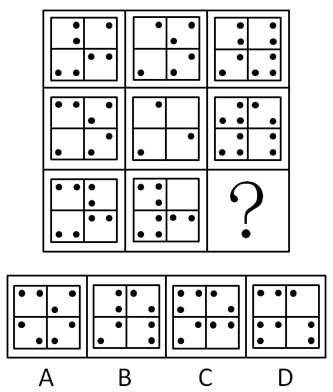

A. A

B. B

C. C

D. D

第 46 题 · 答案与解析

**参考答案（粉笔题库参考内容）**

D

**解析**

元素组成相似，但不完全相同，最中间图形比较特殊，一般考查两种：米字型规律或O字型规律，在这两种思路中首先考虑米字形。观察发现，米字型两端图形去异存同叠加运算均可得到最中间图形。

故正确答案为D。

### 第 47 题

从所给的四个选项中，选择最合适的一个填入问号处，使之呈现一定的规律性：

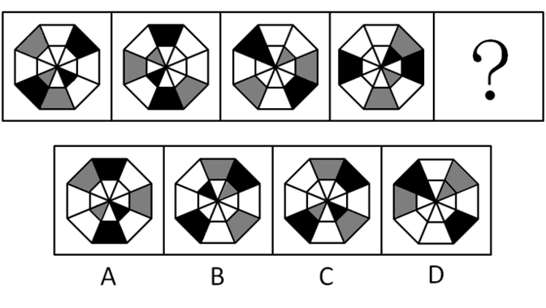

A. A

B. B

C. C

D. D

第 47 题 · 答案与解析

**参考答案（粉笔题库参考内容）**

C

**解析**

图形组成相同，考虑位置规律。图形由内圈和外圈两部分构成，并且黑块、灰块比较明显，分别观察黑块和灰块的移动规律。先看内圈黑块和灰块，每次顺时针移动两格，排除B、D两项。再看外圈黑块和灰块，每次逆时针移动一格，排除A项。

故正确答案为C。

### 第 48 题

从所给的四个选项中，选择最合适的一个填入问号处，使之呈现一定的规律性：

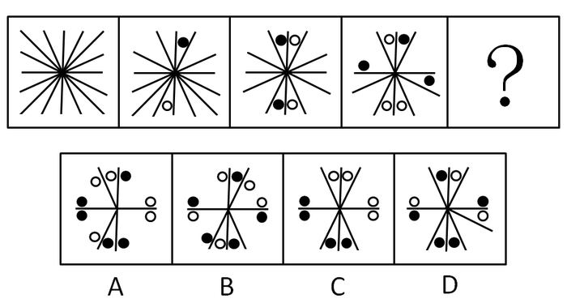

A. A

B. B

C. C

D. D

第 48 题 · 答案与解析

**参考答案（粉笔题库参考内容）**

C

**解析**

本题黑白点数量明显，优先考虑数量规律。先观察黑白点，发现题干相邻图形每次递增一对黑白点，即每次增加一个小黑点和一个小白点，则图五应该为4对黑白点。只有C项符合。

故正确答案为C。

### 第 49 题

从所给的四个选项中，选择最合适的一个填入问号处，使之呈现一定的规律性：

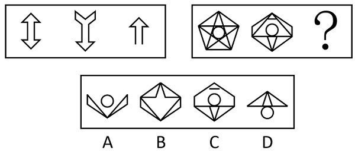

A. A

B. B

C. C

D. D

第 49 题 · 答案与解析

**参考答案（粉笔题库参考内容）**

D

**解析**

图形元素组成相似，且相同线条重复出现，优先考虑加减同异。第一组图形中，图2先旋转/上下翻转，再与图1求同，可以得到图3；第二组图形遵循同样的规律，符合规律的只有D项。

故正确答案为D。

### 第 50 题

从所给的四个选项中，选择最合适的一个填入问号处，使之呈现一定的规律性：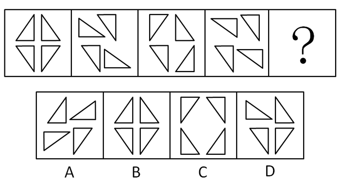

A. A

B. B

C. C

D. D

第 50 题 · 答案与解析

**参考答案（粉笔题库参考内容）**

B

**解析**

图形组成相同，考虑位置规律。图形包含四个三角形，分开观察，左上角三角形每次顺时针旋转90度，右上角三角形每次顺时针旋转180度，左下角三角形不变，右下角三角形每次逆时针旋转90度。

故正确答案为B。

### 第 51 题

请选择最适合的一项填入问号处，使右边图形的变化规律与左边图形一致：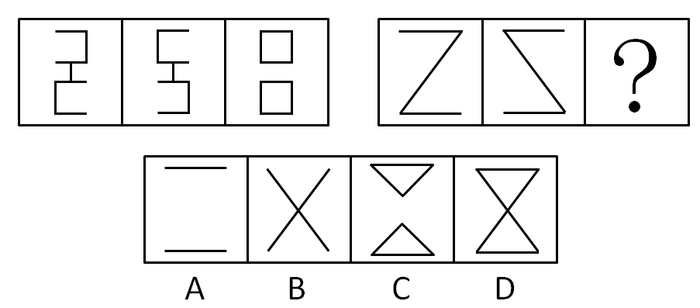

A. A

B. B

C. C

D. D

第 51 题 · 答案与解析

**参考答案（粉笔题库参考内容）**

D

**解析**

图形组成相似，考虑样式规律。第一组图形中，图一与图二运算得到图三，横线部分简单叠加，竖线（非横线）部分去同存异，则第二组图形中符合此规律的只有D项。

故正确答案为D。

### 第 52 题

从所给的四个选项中，选择最合适的一个填入问号处，使之呈现一定的规律性：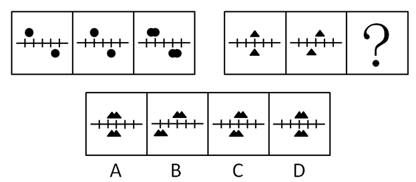

A. A

B. B

C. C

D. D

第 52 题 · 答案与解析

**参考答案（粉笔题库参考内容）**

C

**解析**

图形组成相似，考虑样式规律。第一组图形中，图一与图二简单叠加得到图三，第二组图形中符合此规律的只有C项。

故正确答案为C。

### 第 53 题

把给定图形中的元素重组可以得到的是：

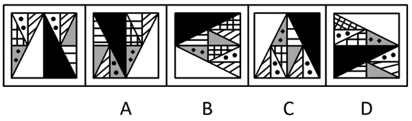

A. A

B. B

C. C

D. D

第 53 题 · 答案与解析

**参考答案（粉笔题库参考内容）**

C

**解析**

根据提问方式，图形中元素组成一定相同，此时需要注意选项中的图形元素与已知图形元素保持完全一致，可利用选项与题干对比进行排除。题干图形中有两个标黑点的白色三角形，而A项中没有，B项中只有一个，均排除；题干图形中只有一个网格三角形，D项中有两个网格三角形，排除D项。

故正确答案为C。

### 第 54 题

从所给的四个选项中，选择最合适的一个填入问号处，使之呈现一定的规律性：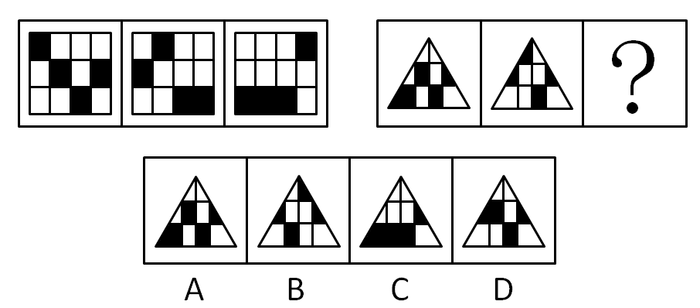

A. A

B. B

C. C

D. D

第 54 题 · 答案与解析

**参考答案（粉笔题库参考内容）**

C

**解析**

元素组成相同，考虑位置规律。观察发现，第一组图中，黑色方块在每一列上进行平移，且为穿墙式平移。具体为：第一列黑色方块每次向下移动一格，第二列黑色方块每次向上移动一格，第三列黑色方块保持不动，第四列黑色方块每次向上移动两格。第二组图形中黑色部分形状不同，不考虑形状，应该遵循第一组图的规律，只有C项符合。

故正确答案为C。

### 第 55 题

从所给的四个选项中，选择最合适的一个填入问号处，使之呈现一定的规律性：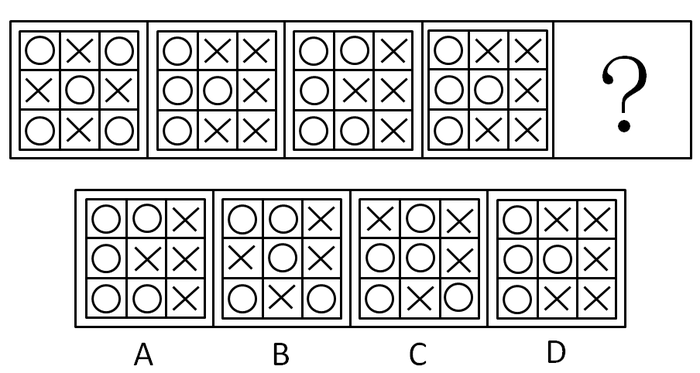

A. A

B. B

C. C

D. D

第 55 题 · 答案与解析

**参考答案（粉笔题库参考内容）**

A

**解析**

元素组成相同，但个数不同，考虑数量规律。观察图形，圆的数量分别为5、4、5、4，则图五应包含5个圆，排除D项。A、B、C三项区别在于位置不同，但无移动规律，从整体观察题干，发现所有图形都是对称图形，则应选一个对称图形，只有A项符合。

故正确答案为A。

### 第 56 题

水面：镜子

A. 毛笔：钢笔

B. 藤条：绳子

C. 图画：照片

D. 火把：电灯

第 56 题 · 答案与解析

**参考答案（粉笔题库参考内容）**

B

**解析**

第一步：判断题干词语间逻辑关系。

水面是最早的镜子，二者都是通过反射光线整理仪容，二者功能一致，水面是天然物，镜子是人造物。

第二步：判断选项词语间逻辑关系。

A项：毛笔与钢笔都有写字的功能，二者功能一致，但二者都是人造物，与题干逻辑关系不一致，排除；

B项：藤条是最早的绳子，藤条与绳子都有捆绑的功能，二者功能一致，且藤条是天然物，绳子是人造物，与题干逻辑关系一致，当选；

C项：图画与照片都能记录人或物，二者功能一致，但二者都是人造物，与题干逻辑关系不一致，排除；

D项：火把与电灯都有照明功能，二者功能一致，但二者都是人造物，与题干逻辑关系不一致，排除。

故正确答案为B。

### 第 57 题

解释：理解

A. 分析：结论

B. 奉献：赞许

C. 拼搏：成功

D. 分享：满足

第 57 题 · 答案与解析

**参考答案（粉笔题库参考内容）**

B

**解析**

第一步：判断题干词语间逻辑关系。

题干两个词属于因果关系，解释之后得到他人理解，二者主体不同。

第二步：判断选项词语间逻辑关系。

A项，分析之后获得结论，但是二者主体是同一个人，排除。

B项，奉献之后获得赞许，二者主体不同，符合题意，当选。

C项，拼搏之后获得成功，但是二者主体是同一个人，排除。

D项，分享之后获得满足，但是二者主体是同一个人，排除。

第三步：再次标注答案。

故正确答案为B。

### 第 58 题

兵马：粮草

A. 工人：工资

B. 植物：雨水

C. 电视：遥控器

D. 发动机：燃油

第 58 题 · 答案与解析

**参考答案（粉笔题库参考内容）**

D

**解析**

第一步：判断题干词语间逻辑关系。

粮草是兵马得以生存的必要条件。

第二步：判断选项词语间逻辑关系。

A项：工资并非工人得以生存的必要条件，与题干逻辑关系不一致，排除；

B项：雨水并非植物得以生存的必要条件，没有雨水可以浇自来水，与题干逻辑关系不一致，排除；

C项：电视与遥控器为对应关系，二者需要搭配使用，与题干逻辑关系不一致，排除；

D项：发动机与燃油为必然对应关系，燃油是发动机得以运转的必要条件，与题干逻辑关系一致，当选。

故正确答案为D。

### 第 59 题

上升：下降

A. 乡道：公路

B. 鸭梨：雪梨

C. 欢喜：悲哀

D. 平年：闰年

第 59 题 · 答案与解析

**参考答案（粉笔题库参考内容）**

C

**解析**

第一步：判断题干词语间逻辑关系。

上升与下降为反对关系，都是一种运动状态（除了上升、下降还有静止），且互为反义。

第二步：判断选项词语间逻辑关系。

A项：乡道与公路为反对关系，都是道路，无反义关系，排除；

B项：鸭梨与雪梨为反对关系，都是梨，无反义关系，排除；

C项：欢喜与悲哀为反对关系，都是情绪，且互为反义，与题干逻辑关系一致，当选；

D项：平年与闰年为矛盾关系，不是平年就是闰年，排除。

故正确答案为C。

### 第 60 题

春夏：秋冬

A. 生老：病死

B. 昨天：今天

C. 日出：日落

D. 雷鸣：暴雨

第 60 题 · 答案与解析

**参考答案（粉笔题库参考内容）**

A

**解析**

第一步：判断题干词语间逻辑关系。

春夏与秋冬均为季节，二者是并列关系，且将词语拆开，春、夏、秋、冬四个字也是并列关系。

第二步：判断选项词语间逻辑关系。

A项：生老与病死是并列关系，且将词语拆开，生、老、病、死四个字也是并列关系，与题干逻辑关系一致，当选；

B项：昨天与今天是并列关系，但词语拆开后，四个字不是并列关系，与题干逻辑关系不一致，排除；

C项：日出与日落是并列关系，但词语拆开后，四个字不是并列关系，与题干逻辑关系不一致，排除；

D项：雷鸣与暴雨是并列关系，但词语拆开后，四个字不是并列关系，与题干逻辑关系不一致，排除。

故正确答案为A。

### 第 61 题

泥土：煅烧：陶瓷

A. 泥炭：燃烧：热能

B. 玉石：雕刻：饰品

C. 学生：学习：人才

D. 粮食：发酵：白酒

第 61 题 · 答案与解析

**参考答案（粉笔题库参考内容）**

D

**解析**

第一步：判断题干词语间逻辑关系。

泥土通过煅烧得到陶瓷，三者为原材料、工艺及成品的对应关系，且煅烧为化学变化。

第二步：判断选项词语间逻辑关系。

A项：泥炭通过燃烧得到热能，但热能不是成品，最终得到的实物是灰烬，与题干逻辑关系不一致，排除；

B项：玉石通过雕刻得到饰品，三者为原材料、工艺及成品的对应关系，但雕刻为物理变化，与题干逻辑关系不一致，排除；

C项：学生通过学习成为人才，但学生并不是人才的原材料，与题干逻辑关系不一致，排除；

D项：粮食通过发酵得到白酒，三者为原材料、工艺及成品的对应关系，且发酵为化学变化，与题干逻辑关系一致，当选。

故正确答案为D。

### 第 62 题

流芳百世：遗臭万年（    ）

A. 佳偶天成：夫唱妇随

B. 近朱者赤：近墨者黑

C. 富商大贾：小商小贩

D. 卧虎藏龙：藏污纳垢

第 62 题 · 答案与解析

**参考答案（粉笔题库参考内容）**

D

**解析**

第一步：判断题干词语间逻辑关系。

题干两词是一对反义词，流芳百世是指美名永远流传后世，遗臭万年是指死后恶名流传，永远受人唾骂。

第二步：判断选项词语间逻辑关系。

A项，佳偶天成指美好的匹配，像是天然生成；夫唱妇随比喻夫妇相处和睦融洽。二者不是反义词，应排除；

B项，近朱者赤比喻接近好人容易使人变好；近墨者黑比喻接近坏人可以使人变坏。二者都强调客观环境对人的影响，是近义词，应排除；

C项，富商大贾是指拥有大量钱财的商人；小商小贩是经商规模较小的小商人。二者是反对关系，但不是反义词，应排除；

D项，卧虎藏龙是指隐藏着未被发现的人才，也指隐藏不露的人才；藏污纳垢比喻隐藏和包容坏人坏事。二者是一对反义词，应选。

第三步：再次标注答案

故正确答案为D。

### 第 63 题

技能：技术：技艺

A. 昏沉：昏迷：昏睡

B. 习惯：规矩：法律

C. 认可：鼓励：奖励

D. 经常：往往：一直

第 63 题 · 答案与解析

**参考答案（粉笔题库参考内容）**

B

**解析**

第一步：判断题干词语间逻辑关系。

技能、技术、技艺之间为近义词关系，三者都是名词，且程度不断加深。

第二步：判断选项词语间逻辑关系。

A项：昏沉、昏迷与昏睡之间为近义词关系，但三者之间昏迷程度最重，排除；

B项：习惯、规矩与法律之间为近义词关系，三者都是名词，且为程度不断加深，与题干逻辑关系一致，当选；

C项：认可与鼓励、奖励之间不是近义词关系，排除；

D项：经常与往往之间不存在程度轻重，为同义关系，排除。

故正确答案为B。

### 第 64 题

电波：基站：信息

A. 屏幕：观众：感动

B. 天线：卫星：影像

C. 音乐：民族：文化

D. 货轮：港口：物资

第 64 题 · 答案与解析

**参考答案（粉笔题库参考内容）**

D

**解析**

第一步：判断题干词语间逻辑关系。

电波通过基站传递信息，三者之间为对应关系。

第二步：判断选项词语间逻辑关系。

A项：观众通过屏幕观看视频，与题干逻辑关系不一致，排除；

B项：天线是卫星的组成部分，二者是组成关系，与题干逻辑关系不一致，排除；

C项：民族借助音乐传递文化，三者为对应关系，但词语顺序与题干不同，与题干逻辑关系不一致，排除；

D项：货轮通过港口传递物资，与题干逻辑关系一致，当选

故正确答案为D。

### 第 65 题

电脑：程序：功能

A. 组织：机制：作用

B. 汽车：汽油：路程

C. 环境：意识：保护

D. 纸张：印刷：书本

第 65 题 · 答案与解析

**参考答案（粉笔题库参考内容）**

A

**解析**

第一步：判断题干词语间逻辑关系。

三者之间为对应关系，电脑通过程序实现功能。

第二步：判断选项词语间逻辑关系。

A项：组织通过机制发挥作用，与题干逻辑关系一致，当选；

B项：汽车需要汽油才能行驶，汽车行驶一段路程，与题干逻辑关系不一致，排除；

C项：环境通过行动才能保护，而非意识，与题干逻辑关系不一致，排除；

D项：纸张经过印刷形成印刷品，成为书本还需要装订，与题干逻辑关系不一致，排除。

故正确答案为A。

### 第 66 题

甲、乙两份报纸的编辑部，都有专门校对文稿的工作人员。去年，甲报纸出现了一些文字错误，而乙报纸没有文字错误。因此，在去年的校对工作中，乙报纸的校稿员比甲报纸的校稿员的工作更有成效。

以上结论基于的假设是：

A. 乙报纸校稿员的工作时间比甲报纸校稿员长

B. 甲报纸收到的稿件存在文字错误的数量不比乙报纸少

C. 甲报纸每期的版面数量比乙报纸少

D. 文字错误出现的数量是评价校稿员工作成效的标准

第 66 题 · 答案与解析

**参考答案（粉笔题库参考内容）**

D

**解析**

第一步：找到论点和论据。

论点：乙报纸的校稿员比甲报纸的校稿员的工作更有成效。

论据：甲报纸出现文字错误，乙报纸没有。

第二步：逐一分析选项。

A项：工作时间与成效之间无直接联系，为无关选项，排除；

B项：甲存在的文字错误数量不比乙少，存在两种情况：①甲、乙收到的稿件文字错误数量一致。此时，甲报有错，乙报没错，确实可以支持结论；②甲报收到的稿件文字错误数量比乙报多很多。其出版后的文字错误如果只比乙多一点点的话，那么不能证明乙报校稿员的工作更有成效，因此，B项属于不明确的选项，排除；

C项：版面数量与成效之间无直接联系，为无关选项，排除；

D项：在报纸出错和工作成效之间建立了联系，加强论证，当选。

故正确答案为D。

### 第 67 题

据统计，与文科专业的大学毕业生相比，理工科大学毕业生刚入职时的收入更高。因此，高中毕业生要想将来毕业后获得较高收入，应该报考理工科专业。

最能削弱上述结论的一项是：

A. 文科生最终获得高收入的比例高于理工科学生

B. 理工科专业由于知识难度大而不容易毕业

C. 如今不少年轻人更愿意按自己的兴趣选择专业

D. 有些没有读过大学的人最后成了著名的企业家

第 67 题 · 答案与解析

**参考答案（粉笔题库参考内容）**

A

**解析**

第一步：找到论点和论据。

论点：高中毕业生要想将来毕业后获得较高收入，应该报考理工科专业。

论据：理工科大学毕业生刚入职时的收入比文科高。

第二步：逐一分析选项。

A项：通过举事实反例说明文科生收入比理工科学生高，补充反面论据，削弱论点，当选；

B项：毕业难度与最终获得多少收入无关，为无关选项，排除；

C项：按兴趣选择专业与最终获得多少收入无关，为无关选项，排除；

D项：没有读过大学不涉及选择专业区别，为无关选项，排除。

故正确答案为A。

### 第 68 题

公众人物需要担当更多的道德责任，因为权力和责任是相等的，既然拥有常人不具备的优势地位，那么就应该比一般人承担更高的道德要求。因此，承受更多的舆论批评甚至人身攻击，哪怕是一定程度的失真，也是不得不付出的必要代价。

最能质疑上述观点的一项是：

A. 普通人和公众人物应该具有同等的道德责任

B. 失真评价会影响公众人物对道德义务的履行

C. 更多的道德责任并不意味着一定要承受舆论批评

D. 公众人物正是因为没有尽到道德责任才会受到舆论批评

第 68 题 · 答案与解析

**参考答案（粉笔题库参考内容）**

C

**解析**

第一步：找出论点和论据。

论点：公众人物应该承受更多舆论批评。

论据：公众人物需要担当更多的道德责任。

本题论点讨论的是公众人物应承受更多舆论批评，论据讨论的是公众人物应担当更多道德责任，二者话题不一致，削弱优先考虑拆桥。

第二步：逐一判断选项。

A项：选项在普通人与公众人物之间作比较，说明公众人物需要承担的道德责任和普通人一样，削弱论据，保留；

B项：选项讨论失真评价影响公众人物道德义务的履行，而论点讨论的是公众人物应该承受更多舆论批评，话题不一致，无法削弱，排除；

C项：选项说明了道德责任与舆论批评之间没有必然联系，为拆桥项，可以削弱，保留；

D项：选项讨论的是公众人物受到舆论批评的原因，而论点讨论的是公众人物是否应该承受更多的舆论批评，话题不一致，无法削弱，排除。

对比A、C两项，A项为削弱论据，而C项为拆桥项，削弱力度更强，当选。

故正确答案为C。

### 第 69 题

某市环保部门的监测结果显示：今年上半年，该市的空气质量整体处于优良水平，严重污染天数不足15天，污染天数比去年同期少了4天。由此可知，今年的空气质量好于去年。

最能质疑上述结论的一项是：

A. 该市去年关停了几家重污染企业

B. 该市今年开展了植树造林活动

C. 该市的严重污染时段一般在下半年

D. 该市环保部门今年更新了空气检测设备

第 69 题 · 答案与解析

**参考答案（粉笔题库参考内容）**

C

**解析**

第一步：找到论点和论据。

论点：今年的空气质量好于去年。

论据：上半年的空气质量良好，污染天数较去年同期减少了。

第二步：逐一分析选项。

A项：去年关停了几家重污染企业，只说到了去年，但是今年的空气质量到底是否比去年好，无从得知，为无关选项，排除；

B项：今年开展了植树造林活动，只提到了今年，无法得出今年的空气质量是否比去年好，为无关选项，排除；

C项：补充了下半年的反面论据，说明不能仅通过上半年的空气质量推出全年的空气质量，为拆桥项，当选；

D项：更新空气检测设备与空气质量无关，为无关选项，排除。

故正确答案为C。

### 第 70 题

某市人口普查结果显示，35岁以上单身男性人数是35岁以上单身女性的1.5倍。显而易见，除非这些男性中的一些人娶外地女性为妻，否则这些单身男性中的一部分将被迫一直保持单身状态。

以上结论基于的假设是：

A. 这些单身男性持有“先立业再成家”的观念

B. 本市单身女性中外出务工的较多

C. 这些单身男性不愿娶比他们年龄大的女性为妻

D. 这些单身男性倾向于娶与他们同龄的女性为妻

第 70 题 · 答案与解析

**参考答案（粉笔题库参考内容）**

D

**解析**

第一步：找到论点和论据。

论点：本地35岁以上单身男性不娶外地女性的话，会一直单身。

论据：35岁以上的单身男性远比女性多。

第二步：逐一分析选项。

A项：“先立业再成家”的观念与论点35岁以上单身男性是否会一直单身无关，为无关选项，排除；

B项：“本市单身女性外出务工较多”与论点无关，为无关选项，排除；

C项：35岁以上单身男性不愿娶比他们年龄大的女性，那么可以娶比他们年龄小或同龄的，由于不知道这两个年龄段的女性人数到底是比这些男性多还是少，因此得不出这些男性是否保持单身，为不明确选项，排除；

D项：35岁以上单身男性倾向于娶同龄女性，而根据题干，同龄女性人数又比这些男性少，意味着有一部分人势必要一直保持单身，加强了论点，当选。

故正确答案为D。

### 第 71 题

由于销量过少难以回收药品的研发和生产成本，因此，制药厂生产治疗罕见疾病的药物，就会遭受经济损失。

最能削弱上述结论的一项是：

A. 一些治疗罕见疾病的药物对其他疾病也有良好的疗效

B. 治疗罕见疾病的药物的研发会推动医学的进步

C. 相对经济效益，有些制药厂更注重社会效益

D. 药物生产数量越大，每个单位的药物平均成本越小

第 71 题 · 答案与解析

**参考答案（粉笔题库参考内容）**

A

**解析**

第一步：找到论点和论据。

论点：制药厂生产治疗罕见疾病的药物，就会遭受经济损失。

论据：由于销量过少难以回收药品的研发和生产成本。

第二步：逐一分析选项。

A项：对其他疾病也有良好的疗效说明其他疾病对治疗罕见疾病的药物也有需求，即销量不会少，拆断了销量少和罕见疾病之间的关系，为拆桥选项，当选；

B项：推动医学进步与论点无关，为无关选项，排除；

C项：注重社会效益与论点无关，为无关选项，排除；

D项：生产数量与题干中强调的销量概念不一致，题干强调的是销量和成本之间的关系，而非产量和成本之间的关系，因此，为无关选项，排除。

故正确答案为A。

### 第 72 题

赵先生、钱先生、孙先生、李先生四人参加一项技能比赛，获得了比赛的前四名。据了解，他们之间有以下关系：

①孙先生和李先生经常相约一起打篮球；

②第一名和第三名在这次比赛中刚认识；

③第二名不会骑自行车，也不打篮球；

④赵先生的名次比钱先生的名次靠前；

⑤钱先生和李先生每天一起骑自行车上班；

根据以上条件，可以判断此次比赛的第一、二、三、四名次的获得者是：

A. 孙先生、赵先生、钱先生、李先生

B. 李先生、赵先生、孙先生、钱先生

C. 李先生、孙先生、赵先生、钱先生

D. 孙先生、李先生、赵先生、钱先生

第 72 题 · 答案与解析

**参考答案（粉笔题库参考内容）**

A

**解析**

结合条件①③⑤可知，第二名不是孙、李、钱，只能是赵，排除C、D两项。结合条件①②⑤可知，李与孙、钱都认识，则李不可能获得第一、三名，排除B项。

故正确答案为A。

### 第 73 题

在过去五年中，某地所有家庭所购买衣服的平均价格增长了50%，但在平均家庭消费支出中，购买衣服支出所占比例没发生变化，因此，所有家庭的平均消费支出在这五年中也增长了50%。

以上结论基于的假设是：

A. 在这五年中，所有家庭在购买衣服上的平均花费没有变化

B. 在这五年中，所有家庭所购衣服的平均数量没有变化

C. 在这五年中，该地的家庭数量增加了50%

D. 在这五年中，该地所有家庭用于购买衣服的支出总和增长了50%

第 73 题 · 答案与解析

**参考答案（粉笔题库参考内容）**

B

**解析**

第一步：找到论点和论据。

论点：家庭的平均消费支出增长了50%。

论据：购买衣服的平均价格增长了50%，而购买衣服平均支出占消费支出的比例不变。

第二步：逐一分析选项。

A项：购买衣服的平均花费没有变化，而论据说购买衣服平均支出占消费支出的比例不变，则消费支出应该保持不变，削弱论点，排除；

B项：根据所购衣服平均数量不变可以由衣服平均支出占消费支出的比例不变推出家庭的平均消费支出增长了50%，在论点和论据之间建立联系，当选；

C项：家庭数量与题干无关，为无关选项，排除；

D项：购买衣服的支出总和与题干无关，为无关选项，排除。

故正确答案为B。

### 第 74 题

甲、乙、丙、丁四名青少年拥有手机、电脑、相机三种电子产品的情况如下：

①只有一个人同时拥有手机、电脑、相机；

②有三个人拥有手机，有两个人拥有电脑，只有一个人拥有相机；

③每个人至少拥有三种电子产品中的一种；

④甲和乙是否拥有电脑的情况相同（要么两个都有，要么两个都没有）；

⑤乙和丙是否拥有手机的情况相同；

⑥丙和丁是否拥有手机的情况不同。

拥有相机的是：

A. 甲

B. 乙

C. 丙

D. 丁

第 74 题 · 答案与解析

**参考答案（粉笔题库参考内容）**

C

**解析**

本题条件确定，但无法直接排除选项，考虑最大信息法。由于对象和信息较多，为了使推理更加清晰，可以借助列表推理。

手机出现次数最多（4 次），结合②⑤⑥，三人拥有手机，乙和丙是否拥有手机的情况相同，丙和丁是否拥有手机的情况不同，如果乙和丙没有手机，则最多只有两人拥有手机，故乙和丙一定有手机，丁没有手机，甲有手机。得到表格如下。

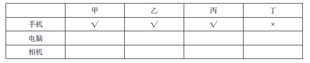

结合①③④，如果甲、乙有电脑，相机也应该在甲或乙手中，则丁一件电子产品都没有，与③矛盾，所以电脑一定在丙、丁手中，得到表格如下。

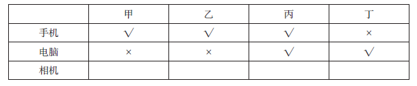

只有丙同时拥有手机、电脑，根据①可知，相机也一定在丙手中，得到表格如下。

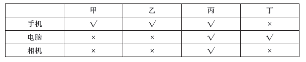

故正确答案为C。

### 第 75 题

随着技术的进步，科学家可以通过对木料的检测来确定树木被砍伐的年份。因此，通过古建筑中幸存的木料，就可以确定古建筑的建造年份。

上述论述基于的假设是：

A. 古建筑中的木料在使用前没有闲置很长时间

B. 古建筑大量使用木料作为建筑材料

C. 一栋古建筑的建造通常只使用一种木料

D. 保存完好的古建筑是使用最耐久的木料建造的

第 75 题 · 答案与解析

**参考答案（粉笔题库参考内容）**

A

**解析**

第一步：找到论点和论据。

论点：通过古建筑中幸存的木料，就可以确定古建筑的建造年份。

论据：科学家可以通过对木料的检测来确定树木被砍伐的年份。

第二步：逐一分析选项。

A项：古建筑中的木料在使用前没有闲置很长时间，是个必要条件项，如果木料在使用前闲置了很长时间则不能通过木料来确定建筑建造的年份，可以支持，当选；

B项：大量使用木料与论点无关，为无关选项，排除；

C项：只使用一种木料与论点无关，为无关选项，排除；

D项：使用最耐久的木料建造与论点无关，为无关选项，排除。

故正确答案为A。

### 第 76 题

春节，我们有贴春联的民俗。春联具有很强的时代性，新中国成立以来，一个家庭几代人贴过的春联有：

（1）联产承包显威力，国富民强示繁荣

（2）新中国百废待兴，共和国前程似锦

（3）已把复兴编入梦，正将崛起织成春

（4）骏马奔腾迎奥运，五洲健儿谱新篇

按照这些春联出现的时间先后顺序排列正确的是：

A. (2)(1)(3)(4)

B. (1)(2)(4)(3)

C. (1)(2)(3)(4)

D. (2)(1)(4)(3)

第 76 题 · 答案与解析

**参考答案（粉笔题库参考内容）**

D

**解析**

（1）为1984 年春节写的春联“联产承包显威力，国富民强示繁荣”。（2）为1953 年春联“新中国百废待兴，共和国前程似锦”，因此（2）在（1）前，排除B、C 两项。（3）为2013 年春节楹联征集评选中的一副。（4）为2008 年迎奥运春联，因此（4）在（3）前，排除A 项。

故正确答案为D。

### 第 77 题

如何提高老年人生活质量与幸福满意度已经逐渐成为国家立法所关注的热点话题，以下行为不违反《老年人权益保障法》的是：

A. 子女与生活不能自理的老年人分开居住

B. 子女阻止老年人再婚

C. 子女长时间不回家探望老人

D. 子女干涉老年人处置个人财产

第 77 题 · 答案与解析

**参考答案（粉笔题库参考内容）**

A

**解析**

我国《老年人权益保障法》第二十一条规定：“老年人的婚姻自由受法律保护。子女或者其他亲属不得干涉老年人离婚、再婚及婚后的生活。赡养人的赡养义务不因老年人的婚姻关系变化而消除。”故B项违反规定。2012年修订的《老年人权益保障法》，于2013年7月1日起正式实施。该法规定家庭成员应当经常看望或问候老年人，用人单位应当按照国家有关规定，保障赡养人探亲休假的权利。这就将“常回家看看”写入法律，意味着子女不常回家看望老人会违法。故C项违反规定。《老年人权益保障法》第二十二条第一款规定：“老年人对个人的财产，依法享有占有、使用、收益和处分的权利，子女或者其他亲属不得干涉，不得以窃取、骗取、强行索取等方式侵犯老年人的财产权益。”故D项违反规定。

本题为选非题，故正确答案为A。

### 第 78 题

上个世纪，我国提出了“实现工业、农业、科学技术和国防四个现代化”。当前，我国的“新四化”是指：

A. 工业化、信息化、城镇化、农业现代化

B. 工业化、信息化、城镇化、国际化

C. 工业化、信息化、市场化、农业现代化

D. 工业现代化、农业现代化、交通运输业现代化、国防现代化

第 78 题 · 答案与解析

**参考答案（粉笔题库参考内容）**

A

**解析**

党的十八大根据形势的发展，把原来“四个现代化”(工业、农业、国防和科学技术现代化)改为“工业化、信息化、城镇化、农业现代化”的“新四化”，并对新四化之间的关系作出了经验性科学规范。报告提出：“坚持走中国特色新型工业化、信息化、城镇化、农业现代化道路，推动信息化和工业化深度融合、工业化和城镇化良性互动、城镇化和农业现代化相互协调，促进工业化、信息化、城镇化、农业现代化同步发展。”

故正确答案为A。

### 第 79 题

在我国古代，人们把一夜分为五更，即一更、二更、三更、四更、五更，按更报时。“三更”相当于现在的时间为：

A. 17时—19时

B. 19时—21时

C. 21时—23时

D. 23时—1时

第 79 题 · 答案与解析

**参考答案（粉笔题库参考内容）**

D

**解析**

古代有报更的计时法。把夜间分为五更：相当于现代的晚上7点到9点为一更，9点到11点为二更，午夜11点到1点为三更，凌晨1点到3点为四更，凌晨3点到5点为五更。

故正确答案为D。

### 第 80 题

火车轨道由两道钢轨组成。一般来说，转弯处的火车轨道，内外两侧钢轨的高低关系为：

A. 内侧比外侧高

B. 外侧比内侧高

C. 两侧一样高

D. 有时内侧高，有时外侧高

第 80 题 · 答案与解析

**参考答案（粉笔题库参考内容）**

B

**解析**

转弯处的火车轨道外轨比内轨略高，这样可以使列车顺利转弯，减少车轮与铁轨的挤压。

故正确答案为B。

### 第 81 题

“斗柄东指，天下皆春”的意思是北斗七星斗柄指向东方的时候，春天就来了。那么，在冬季，北斗七星的斗柄指向:

A. 北方

B. 南方

C. 西方

D. 东方

第 81 题 · 答案与解析

**参考答案（粉笔题库参考内容）**

A

**解析**

《冠子·环流篇》：“斗柄东指，天下皆春；斗柄南指，天下皆夏；斗柄西指，天下皆秋；斗柄北指，天下皆冬。”意思就是说：若把观测的时间固定于傍晚，则二月春分时斗柄指东，五月夏至时斗柄指南，八月秋分时斗柄指西，十一月冬至时斗柄指北。借助斗柄指向地面上的东、南、西、北四个方位，可以确定四个季节的中间日期，二至二分的所在月确定之后，其他月份也就容易确定了。

故正确答案为A。

### 第 82 题

以下路况，一般来说，驾驶员最容易出现视觉疲劳的是：

A. 高速公路

B. 盘山水泥公路

C. 平原砂石公路

D. 城市街道

第 82 题 · 答案与解析

**参考答案（粉笔题库参考内容）**

A

**解析**

高速公路上，路况单调，最容易产生视觉疲劳。

故正确答案为A。

### 第 83 题

《清明上河图》是北宋作品，描述了800多个人物，70多匹牲畜，20多辆车、桥，29艘大小船只，以及各具特色的房屋、桥梁、城楼等。这幅画主要表现的是：

A. 祭祀风光

B. 山水景色

C. 田园风光

D. 社会风俗

第 83 题 · 答案与解析

**参考答案（粉笔题库参考内容）**

D

**解析**

《清明上河图》是中国十大传世名画之一，为北宋风俗画，是北宋画家张择端仅见的存世精品，被誉为“中华第一神品”，属国宝级文物，现藏于北京故宫博物院。清明上河是当时的民间风俗，像今天的节日集会，人们借以参加商贸活动。全图大致分为汴京郊外春光、汴河场景、城内街市三部分。

故正确答案为D。

### 第 84 题

当海面上空气各层的密度有较大差异时，远处的光线通过密度不同的空气层发生折射或全反射，海面上会出现远处物体的影像，这一现象被称为海市蜃楼。海市蜃楼最有可能发生的季节是：

A. 春季

B. 夏季

C. 秋季

D. 冬季

第 84 题 · 答案与解析

**参考答案（粉笔题库参考内容）**

B

**解析**

海市蜃楼是一种由光的折射产生的现象，多发生在夏天的海面上。夏天，较热的空气笼罩海面，但是海水比较凉，海面附近空气的温度比空中的低。来自地平线以外远处的物体的光线，本来不能到达我们的眼中，但有一些射向空中的光线，由于不同高度空气的疏密不同而发生弯曲，逐渐弯向地面，进入观察者的眼睛。逆着光线看去，就感觉看到了远处的物体。

故正确答案为B。

### 第 85 题

今年，农历闰九月。下列说法正确的是：

A. 农历九月有31天

B. 农历全年有390天

C. 闰九月有28天

D. 农历全年有13个月

第 85 题 · 答案与解析

**参考答案（粉笔题库参考内容）**

D

**解析**

D项正确，农历全年有12个月，闰月时另外多一个月，有13个月。B项错误，农历甲午马年是闰年，共计384天。A、C项错误，农历九月有29 天。

故正确答案为D。

## 材料 1

改革开放三十多年以来，广东经济发展连上新台阶，综合实力不断实现大跨越。1979—2012年，世界经济年均增长速度为2.8%，中国增速为9.8%，广东增速则达13.3%。持续较快的经济增速，推动广东经济总量不断跃上新台阶。自1989年开始，广东GDP总量（国内生产总值）在全国一直保持首位，到2012年已连续24年居全国第一，占全国经济总量比重在1/10至1/8之间。

        2012年，民营经济达29319.97亿元，占GDP比重为51.4%；民营经济上缴税金6467.82亿元，占全省税收总额的49.1%；民间投资10177.28亿元，占全部固定资产投资的52.7%，民营经济已成为支撑广东经济内生增长的主力。

        2012年，广东铁路营业里程达到2577公里，比1978年增长1.6倍；公路通车里程19.5万公里，增长2.7倍；民用航线里程185.1万公里，增长88.1倍；管道输油（气）里程6448.01公里，增长82.7倍；沿海港口货物吞吐量14.08亿吨，增长49.5倍。改革开放之初尚无的高速公路在2011年实现通车里程5049公里，首次突破5000大关，2012年进一步提高到5524公里。

        2012年，广东城镇居民人均消费性支出22396.35元，比1978年增长55.0倍；农村居民人均生活消费支出7458.56元，比1978年增长39.3倍。2012年，广东城镇居民人均住宅建筑面积34.4平方米，比1978年增加27.3平方米；农村居民人均生活住房面积31.67平方米，比1978年增加22.9平方米。

### 第 86 题

1979—2012年，广东经济年均增速约为世界经济增速的多少倍：

A. 1.4

B. 3.5

C. 4.8

D. 10.5

第 86 题 · 答案与解析

**参考答案（粉笔题库参考内容）**

C

**解析**

由第一段材料可知，世界经济年均增长速度为2.8%，广东增速则达13.3%，选项首位不同，直除看选项，13.3%÷2.8% 首位商4。

故正确答案为C。

### 第 87 题

2012年，广东税收总额约为多少亿元：

A. 12273

B. 13173

C. 19312

D. 57043

第 87 题 · 答案与解析

**参考答案（粉笔题库参考内容）**

B

**解析**

由第二段材料可知，民营经济上缴税金6467.82亿元，占全省税收总额的49.1%，税收总额为13000亿元，与B项最接近。

故正确答案为B。

### 第 88 题

广东高速公路在2012年实现通车里程比2011年增长约：

A. 9.4%

B. 109.4%

C. 270%

D. 370%

第 88 题 · 答案与解析

**参考答案（粉笔题库参考内容）**

A

**解析**

由第三段材料可知，2012年实现通车里程5524公里，2011年实现通车里程5049公里，增长率为，答案略小于10%。

故正确答案为A。

### 第 89 题

1978年，广东的下列四项数据中由小到大排列正确的是：

A. 管道输油（气）里程&lt;铁路营业里程&lt;民用航线里程&lt;公路通车里程

B. 管道输油（气）里程&lt;铁路营业里程&lt;公路通车里程&lt;民用航线里程

C. 民用航线里程&lt;公路通车里程&lt;管道输油（气）里程&lt;铁路营业里程

D. 民用航线里程&lt;公路通车里程&lt;铁路营业里程&lt;管道输油（气）里程

第 89 题 · 答案与解析

**参考答案（粉笔题库参考内容）**

A

**解析**

根据材料可知，1978年管道输油（气）里程为公里；

1978年铁路营业里程为公里；

1978年民用航线里程为公里；

1978年公路通车里程为公里。

故1978年里程最大的为公路通车里程，其次为民用航线里程，由小到大排列正确的为A项。

故正确答案为A。

### 第 90 题

下列说法不正确的是：

A. 2012年广东民间投资占全部固定资产投资的一半以上

B. 2012年广东沿海港口货物吞吐量比1978年大

C. 1978年广东城镇居民人均消费性支出比农村居民人均生活消费性支出高

D. 1978年广东城镇居民人均住宅建筑面积比农村人均生活住房面积大

第 90 题 · 答案与解析

**参考答案（粉笔题库参考内容）**

D

**解析**

由材料“民间投资10177.28亿元，占全部固定资产投资的52.7%”可知A项为真；由材料“沿海港口货物吞吐量14.08亿吨，增长49.5倍”可知B项为真；C项：1978年城镇居民人均消费性支出为元，农村居民人均生活消费性支出为元，前者大于后者，可知C项正确；A、B、C三项为真可知D项错误。1978年城镇居民人均住宅建筑面积为34.4－27.3＝7.1平方米，农村人均生活住房面积为31.67－22.9＝8.77平方米＞7.1平方米，因此D项错误。

本题为选非题，故正确答案为D。

## 材料 2

2013年，我国研究生招生61.1万人。在学研究生179.4万人，毕业生51.4万人。普通本专科在校生2468.1万人，毕业生638.7万人。中等职业教育在校生1960.2万人，毕业生678.1万人。普通高中在校生2435.9万人，毕业生799.0万人。初中招生1496.1万人，在校生4440.1万人，毕业生1561.5万人。普通小学招生1695.4万人，在校生9360.5万人，毕业生1581.1万人。特殊教育招生6.6万人，在校生36.8万人，毕业生5.1万人。幼儿园在园幼儿3894.7万人。

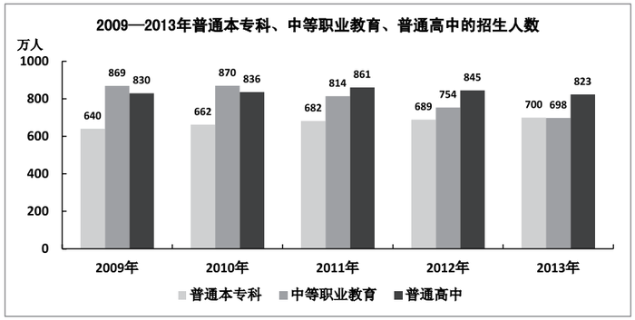

### 第 91 题

2013年，招生人数和毕业生人数相差最小的教育层次是：

A. 研究生

B. 普通本专科

C. 中等职业教育

D. 普通高中

第 91 题 · 答案与解析

**参考答案（粉笔题库参考内容）**

A

**解析**

由文字材料以及图表可知，2013年各项招生人数与毕业生人数相差分别为：

A项：研究生＝61.1-51.4=9.7万人；

B项：普通本专科＝700–638.7＝61.3万人；

C项：中等职业教育＝698–678.1＝19.9万人；

D项：普通高中＝823–799.0＝24.0万人。

比较得知，相差最小的为研究生。

故正确答案为A。

### 第 92 题

2013年我国中等职业教育招生人数比2012年大约：

A. 减少7.4%

B. 减少8.4%

C. 增加7.4%

D. 增加8.4%

第 92 题 · 答案与解析

**参考答案（粉笔题库参考内容）**

A

**解析**

由材料可知，2013年中等职业教育招生人数为698万人，2012年为754万人，2013年比2012年减少，排除C、D两项，

。

故正确答案为A。

### 第 93 题

我国普通本专科、中等职业教育及普通高中招生人数总和最多的年份是哪一年：

A. 2009

B. 2010

C. 2011

D. 2012

第 93 题 · 答案与解析

**参考答案（粉笔题库参考内容）**

B

**解析**

由图表可知，2009年：640+869+830=2339万人；2010年：662 + 870 + 836=2368万人；2011年：682+814+861=2357万人；2012年：689+754+845=2288万人。

故正确答案为B。

### 第 94 题

下列说法正确的是：

A. 2013年专科以上毕业生人数为638.7万人

B. 2013年特殊教育毕业生人数多于招生人数

C. 2013年普通高中在校生人数多于其他教育层次的在校生人数

D. 2013年普通小学毕业生有80万以上没有入读我国初中学校

第 94 题 · 答案与解析

**参考答案（粉笔题库参考内容）**

D

**解析**

A项：材料中普通本专科毕业生638.7万人，偷换概念，错误；

B项：特殊教育招生6.6万人，毕业生5.1万人，错误；

C项：普通高中在校生2435.9万人，少于普通本专科在校生2468.1万人，错误；

D项：普通小学毕业生1581.1万人，初中招生1496.1万人，相差85万人，正确。

故正确答案为D。

### 第 95 题

下列说法不正确的是：

A. 2010—2013年，普通本专科的招生人数逐年增加

B. 2010—2013年，中等职业教育的招生人数逐年减少

C. 2009—2013年，普通高中的招生人数先增加后减少

D. 2009—2013年，普通本专科的招生人数总是比中等职业教育少

第 95 题 · 答案与解析

**参考答案（粉笔题库参考内容）**

D

**解析**

由图形可知，A、B、C三项正确；D项，2013年普通本专科的招生人数比中等职业教育多，错误。

本题为选非题，故正确答案为D。

## 材料 3

2013年，广东固定资产投资总量迈上新台阶，共完成22858.53亿元，增长18.3%，比2012年加快2.8个百分点。其中，城镇投资18907.34亿元，增长18.6%；农村投资3951.19亿元，增长17.0%。

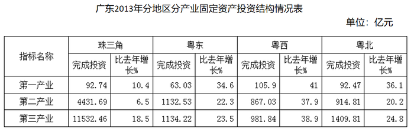

### 第 96 题

2013年，广东城镇投资约为农村投资的多少倍：

A. 1.2

B. 2.2

C. 4.8

D. 5.8

第 96 题 · 答案与解析

**参考答案（粉笔题库参考内容）**

C

**解析**

由材料可知，城镇投资18907.34亿元，农村投资3951.19亿元， 故城镇投资是农村投资的倍。

故正确答案为C。

### 第 97 题

2013年，广东第三产业完成投资多少亿元：

A. 354.14

B. 7446.06

C. 15058.33

D. 22858.53

第 97 题 · 答案与解析

**参考答案（粉笔题库参考内容）**

C

**解析**

由表格可知，广东省第三产业值=各分地区第三产业值之和=珠三角+粤东+粤西+粤北亿元，与C项最接近。

故正确答案为C。

### 第 98 题

2013年，珠三角完成投资比上年增长约：

A. 6.4%

B. 14.9%

C. 23.2%

D. 30.5%

第 98 题 · 答案与解析

**参考答案（粉笔题库参考内容）**

B

**解析**

由表格可知，珠三角地区第一、第二、第三产业的投资增长率分别为10.4%、6.5%、18.5%，由混合增长率特性可知，整体增长率必然处于6.5%与18.5%之间，观察选项可知答案为B项。

故正确答案为B。

### 第 99 题

2013年完成投资由大到小排列正确的是：

A. 珠三角>粤东>粤西>粤北

B. 珠三角>粤北>粤东>粤西

C. 粤东>珠三角>粤西>粤北

D. 粤东>珠三角>粤北>粤西

第 99 题 · 答案与解析

**参考答案（粉笔题库参考内容）**

B

**解析**

由表格可知，珠三角第三产业（单项数据过万）远远大于其他地区，因此排除C、D两项；观察A、B两项，只需比较粤东和粤北，各区域的投资额分别为：粤东=63.03+1132.53+1134.22=2329.78亿元；粤北=92.47+914.81+1409.81=2417.09亿元，粤北大于粤东。

故正确答案为B。

### 第 100 题

下列说法不正确的是：

A. 2013年，珠三角完成投资比粤东、粤西、粤北的总和大

B. 2013年，珠三角完成投资比上年增长的速度快于粤东、粤西、粤北

C. 2013年，第三产业完成投资比第一产业、第二产业的总和大

D. 2013年，第一产业完成投资比上年增长的速度快于第二产业、第三产业

第 100 题 · 答案与解析

**参考答案（粉笔题库参考内容）**

B

**解析**

A 项：观察表格，珠三角第三产业完成投资额是其他地区各产业投资额的 10倍左右，因此珠三角投资额一定大于其他三个地区的总和，正确。

B 项：珠三角增速与粤东对比，可发现珠三角三个产业的增长率均低于粤东数据，错误。

C 项：每一列纵向对比，除粤东外，其他三个地方第三产业投资额大于第一产业、第二产业总和，用珠三角的差值抵消粤东的差额，可知 C 项正确。

D 项：每一列纵向对比，除珠三角外，其他三个地区第一产业的增长率均大于第三产业，且这三个区第一产业的增长率均大于珠三角第三产业的增长率，正确。

本题为选非题，故正确答案为 B。

