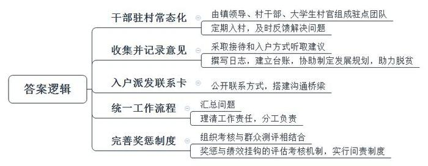
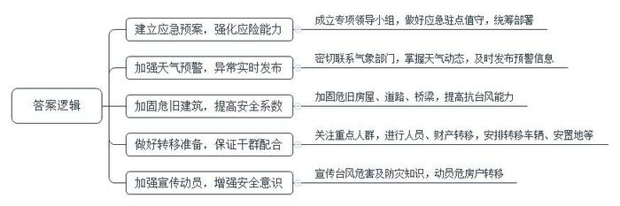
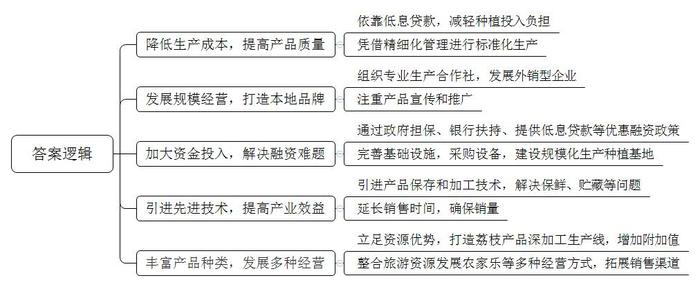
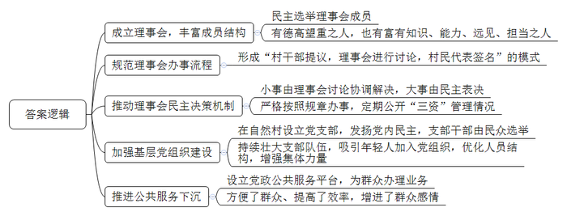

# 2015年广东省公考《申论》题（乡镇）

<!-- gwy:overview:start -->
> **广东 · 2015 · 申论 · 乡镇卷** ｜ 4 题 · 图片 4 处 · 答案随题折叠

导航：[题目](#题目) · [材料 1](#材料-1)
<!-- gwy:overview:end -->

> 候选采集稿。参考答案及解析来自粉笔页面，不代表官方答案或真实高分答卷；来源使用许可与原卷对应关系仍需人工核实。

## 给定材料

### 材料 1

材料1

中共中央政治局委员，广东省委书记胡春华指出：“联系和服务群众‘最后一公里’问题没有解决好，主要是镇（街）与村（居）的联系没有完全打通。”2014年10月，省委印发了《关于建立乡镇（街道）领导干部驻点普遍直接联系群众制度的意见》，要求领导干部驻点普遍直接联系群众必须长期坚持下去，做到常态化、制度化，按照省里的统一要求，各地结合实际，积极贯彻落实。

粤北某县A镇新园村村委会林主任说：“前几年，镇里面都会派一两个镇干部到村里挂职锻炼，但大多有事才来，没事就不来了。”

“以前要到镇里才能见到杨书记，现在不用了，每周二他都会来。有啥事儿直接去村委会找他就行了。”村民朱伯口中的“杨书记”，就是A镇党委书记，也是直接联系新园村的驻点团队负责人。

杨书记说：“现在镇党政领导班子成员全部带队当组长，我自己和镇里的4名干部组成的驻点团队，以及村干部和大学生村官组成的辅助团队，每周星期二都到村里上班。”

驻点的联系制度实行后，不少地方乡镇干部的下乡，逐渐由以往的不固定变成一种习惯，成为日常工作中固定的一部分，雷打不动。

A镇西街社区居民小郑反映路灯损坏，没想到第二天就修好了。之前，很少有机会接触镇领导的他，抱着试一试的想法向该社区驻点团队反映问题，对方说：“好，我知道了，马上派人去。”小郑说：“我原本以为要一个星期才能修好，没想到第二天晚上路灯就亮了。”

2014年12月23日，又是一个阳光明媚的周二，A镇5名驻点干部与5名盛隆村“两委”成员在镇人大副主席带领下，分成两组，一组4人负责在村委会办公楼接待反映问题的群众，另一组7人进村入户听取群众意见建议。

“上门的团队成员要走进田间地头，边干活边和群众拉家常。”镇人大副主席说。“不仅要挨家挨户走一遍，还要写驻点日志，做工作台账，帮助贫困户脱贫，协助村里制定集体经济发展规划。”

在A镇东口社区，家家户户都收到了一张联系卡。“您好，我是镇长老关。这是乡镇领导干部驻点普遍直接联系群众的联系卡，上面有我们团队全体成员的姓名、职位、手机号、微信号，如果您对社区、镇政府有什么意见和建议，或者个人有什么问题需要我们解决的，请直接和我们联系。”关镇长带着驻点团队来到联系点东口社区，走家入户派发联系卡，“小小联系卡搭起了党员干部和群众心连心的桥梁，承载了为民服务的信念。”

“我们镇统一了驻点联系工作流程，对于群众反映的每一个意见建议，驻点团队成员都会记录驻点日志，回来以后再把收集到的问题汇总成工作台账。是村（社区）负责的，还是镇负责的，我们划清责任再处理，不包办、不代替。”关镇长说。

为保证驻点联系工作有效推行、不走过场，镇里建立了组织考核与群众满意度测评相结合的绩效评估考核机制，实行问责制度。镇党委将驻点联系工作列入乡镇（街道）机关干部和村干部年度考核内容，涉及乡镇（街道）领导干部驻点普遍直接联系群众的事项占60%考核分值，直接与乡镇（街道）机关干部的奖励考核、村干部的绩效相挂钩。

### 材料 2

材料2

B镇地处粤西山区，下辖15个村委会和1个社区居委会，总人口约36万。当地充分利用优越的自然条件，大力发展种植业和养殖业。

2014年7月22日-24日，受第8号强热带风暴“韦尔森”影响，B镇境内风力达10级，倾盆大雨连续下了三天三夜，农田、鱼塘、房子处处遭受水浸，全镇共有4所房屋倒塌，89所房屋遭受不同程度的损坏。尤其是B镇受灾最为严重的竹坑村，村道共15处严重受损，唯一通往镇中心的竹坑桥塌方，村里与外界的交通几乎中断。“韦尔森”共造成7人受伤，其中1人重伤昏迷。

“我活了60多年，还没见过这么大的雨，居然下了三天，我本来还要去种地呢，结果村干部劝我说，雨大危险就别出门了。现在想起来还有点后怕，幸亏没出门，捡回了一条命！”竹坑村村民老王说，“但隔壁小周就没那么幸运了，可能是担心刚买回来没几天的鸭苗，想过去看看，才走出家门没几步，就被刮落的枯枝击中头部，现在还躺在医院。”

其实在“韦尔森”来临之前，镇政府就召开了紧急会议，布置抢险救灾工作。由镇领导牵头，镇干部、村“两委”干部组成工作小组，连夜进村，根据村里情况分小组通知到每家每户，叮嘱农户停止户外生产作业，并且提前做好防御。

23日，传来了“韦尔森”加强为台风的消息，空中乌云密布，风卷云集，雨点时疏时急。镇政府当机立断，“所有危房户必须转移！首先就近转移到亲戚或其他村民家，实在不行就转移到村委会办公室，镇村干部要负责将危房户安顿好。”

天色越来越暗，风越吹越急，就剩竹坑村没有完成转移了。竹坑村李主任说：“我们从来没有这么大规模地转移过群众，村里的情况又很复杂，路难走，大部分房子都是几十年前修建的，经不起这么大风雨。村里又没什么年轻人，都是老人、小孩，有的不愿走，有的走不动。”得知这一情况后，镇领导立即赶往竹坑村。

“房子的墙都有裂缝了，我肯定是想走啊。但儿子都外出打工了，自己的腿脚不好走不了啊！”彭大娘无奈地说，镇领导看了村里的情况后，找来了村干部和纪委乡贤，分成两个小组，一个小组负责劝说危房户转移，另一个小组动员群众调集了几辆农用车，负责转移行动不便的危房户。由于需要转移安置的人员较多，一部分转移到村委会，另一部分则被安置到附近的学校。

尽管镇村干部苦口婆心地劝说，但到了晚上7点多，竹坑村的危房户余大爷还是不愿意离开，“我在竹坑村都几十年了，有什么大风大雨没见过，怕啥！”正在这时候，轰隆一声，大家跑出门外一看，不远处一所房屋被泥石流冲倒了。这一幕让大家都惊呆了。最终，余大爷听从了镇村干部的建议。晚上8点，台风登陆的征兆越来越明显，全镇干部一刻也没有放松，通宵留守驻点等待“韦尔森”的来临。24日凌晨4点，“韦尔森”在省内沿海地区登陆，并向偏西方向移动。上午9点，“韦尔森”经过B镇，但已减弱为强热带风暴。

### 材料 3

材料3

C区气候温和，雨量充沛，加上阳光充足，适宜荔枝种植。去年，当地荔枝平均亩产约370斤，种植面积1.82万亩，约占全市荔枝种植面积的5%。

荔枝种植业曾经是C区的优势传统产业，但近年来荔枝产业走入了低谷。上世纪九十年代荔枝种植面积的快速增长，导致鲜果产量相对过剩，荔枝价格持续低迷，经济效益低，挫伤了果农积极性，导致部分荔枝园处于粗放管理状态。因此，影响了荔枝的产量和品质。也有农户尝试新的发展路子，结合本地的旅游资源做起农家乐，尝到了一些甜头，一位荔枝园经营者说：“我们把果园开放给游客，供他们采摘品尝。这样确实有赚头，但现在才刚起步，知道的人不多，想做大还要打响知名度才行啊！”

六月，荔枝大量上市。“我们的荔枝品质优良，但出了家门却鲜为人知，主要是我们没有做外销的大企业，以农户个体小规模经营为主，专业合作社只有1家，产业效益低。”C区水口街道陈书记说。C区荔枝虽然品质优良，但一般都被采购至外地并冠名为外地品牌销售。在该区的荔枝批发市场，果农们纷纷骑着摩托车，载着荔枝来销售，而市场旁边的街道上停的大多是外地牌照的货车，等着收购荔枝。

从荔枝种植上说，肥料、农药、人工等方面每年每亩需投入的资金约2500元。“我们也想多种一些，给加工企业收购，但是投入实在太高。如果贷款，还了利息也赚不了多少，所以就只有少种几亩了。”水口街道荔枝种植户表示。“荔枝品质虽然上乘，但是实在不好保存，摘下来不及时卖掉的话，很快就会烂掉。要是有技术能让荔枝保存时间长一点，那我们的销售量肯定大大提升。压力也就没那么大了。”荔枝产期短、上市时间集中，采摘后很容易变质。因此，如果保鲜、贮藏等环节跟不上，就会极大影响荔枝鲜果的销售。除了销售鲜果外，不少农户也会将荔枝做成传统的荔枝干产品。有的农户为了使荔枝干保存时间更长，往往会把荔枝加工得很干，一点水分也不留，致使荔枝中的果糖变成了焦糖。这样一来，荔枝干的品质下降，卖不起价钱。

此外，要建设规模化生产的种植基地，在标准园区建设、采后保鲜、冷链运输、贮藏加工等基础设施和设备方面也需要大量资金投入。例如，建设一座小型冷库需要投资二十多万元，购买一台冷链车也动辄数十万元。而种植基地通常在这方面也存在融资难的问题，基础设施建设和设备采购受到限制。

除了荔枝鲜果销售外，C区也有企业对荔枝进行加工销售。该区现有荔枝深加工企业一家，也是目前全市唯一的荔枝万吨精深加工企业。该企业拥有荔枝产品深加工生产线，能够包装荔枝鲜果，生产荔枝醋、荔枝酒等产品，增加产品附加值。但该企业每年1万吨的荔枝深加工量，相对于全市的鲜果产量来说只是杯水车薪。“我们公司的深加工项目获得了90万的资金扶持，但这相对于我们的投入来说，能产生的效益并不算多，深加工行业流动资金占用的时间较长，如果在银行贷款政策等方面给予相应的扶持，我们就可以收购更多鲜果。”该企业的负责人表示，“现在精深加工的品种还比较少，荔枝罐头、荔枝果汁加工还处于空白，主要是技术还不成熟，这也是我们下一步努力的方向。”

### 材料 4

材料4

为激发农村发展活力，D县近年来积极探索完善农村基层组织设置和社会治理模式，积累了一些经验，以下是该县几个比较典型的例子：

（一）东塘村

坐落在云峰山脚下的东塘村，是一个人口仅300多的小山村，2008年被评为市卫生村及社会主义新农村建设“明星村”，这与它较早成立理事会不无关系。

20世纪80年代，东塘村决定从山里引水，解决居民生活用水问题。村民推选10名代表监督村干部筹备资金，这是东塘村理事会的雏形。1987年理事会正式成立，现年60多岁的李名当时是市里的一名教师，是村民心目中少有的“知识分子”，被选为理事长；理事会成员李芬在参加水稻制种培训班后，在村里开始试种，随后联合村民与某蔬菜种子公司达成合作协议，成为东塘村商业制种的带头人；理事会成员李才有着灵活的经济头脑，在村民眼中向来是“有远见”的人。

在理事会成立前，虽然大家都想搞好村里的建设，但是缺乏有力的牵头组织。理事会成立后，成员都是村里德高望重的人，在村务管理中发挥了重要的作用。

在理事会的带领下，东塘村逐渐发展起来。2007年，该村推进新农村建设，要拆掉130多间泥砖房。“如果是镇里派人下来，肯定有村民不同意，或要提高补偿，”理事会成员李才说，“但理事会挨家挨户做工作，最终说服村民自愿拆房。”村中无论决定什么事，都形成了“村干部提议——理事会进行讨论——村民代表签名”的习惯。为了改善村民的生活环境，村党支部组织理事会进行讨论，理事会提出将获得的三十多万元补偿款用来建设村里的基础设施，这一提议得到了全村的响应，这些基础设施建设完成后，村容村貌焕然一新。

（二）桂山村

桂山村位于D县西北部，这里共有35户173人。近年来，桂山村理事会通过创新土地管理模式盘活资源的有效措施，摸索出一条致富之路。

“村里重新分配土地以后，现在更多村民都养鱼了，上半年养四大家鱼，下半年养桂花鱼，收入还不错，”村民叶大富说起现在的工作和生活，脸上一直挂着微笑。

桂山村党支部胡书记表示，村里过去事无大小，都要召集村民代表大会统一讨论解决。但由于村民都各忙各的，召集起来不容易，也难以统一意见。2008年，村民通过民主选举成立了理事会，选出了理事长、理事会成员，使村务管理效率得到提高。“最大的变化是人的转变，村民从观望到参与，从被动到主动，从事不关己到争当主角。”胡书记说。

理事会成立后，制定了理事会的章程，村中小事由理事会讨论协调解决，事关全体村民的大事则由理事会协商后，由村民代表进行表决。几年来，理事会成员扎实开展各项工作，严格按照章程办事，把群众的意愿、困难及时向村委会反映，使许多问题迎刃而解。同时，他们把集体资产、资金、资源管理得井井有条。并于每年底向全体村民通报“三资”管理的运作情况，阳光、透明的机制赢得了村民的信任和支持。

从前，村里的土地零散不连片，管理困难，不易形成规模，这都是摆在村民面前的发展难题。2010年，理事会经过多次调查研究，并经村民代表讨论同意之后，采取土地连片经营管理措施，将村民所有自耕地集中起来，重新划分土地。再按人口连片承包给农户。遇到村民争执的时候，理事会发挥了协调、化解矛盾的重要作用。通过不断协商，全村土地实现流转，土地划为养殖、种植等几块区域。实施连片土地经营管理有效带动了村民增收。同时，来源于土地租金的村集体年收入，全部投入村文化公园建设，为村民提供了休闲运动场所。

（三）河湾村

河湾村以前经常有村民因山林纠纷上访，是个远近闻名的上访村。河湾村所属的盛丰行政村，下辖33个自然村，共5712人，只有7名村干部。此外，党员队伍结构不合理、年龄老化、能力不足，难以带领群众发展致富。盛丰村郭书记说：“村里的工作实在不好做，上面摊派的事情多，自身承担的职能也多。很多事情想做好却有心无力。党务、村务、财务等工作稍有疏忽，就很容易引发一系列的问题。”

村党组织建设停滞不前，也影响了村里的建设和发展。郭书记说，村里只有二十多名党员，年纪最大的是83岁，最小的是39岁。2002年到2012年十年期间，没有发展党员。

2013年，河湾村被纳入D县农村综合改革试点，作为自然村成立了自己的党支部。

“现在村党支部干部都是我们自己选的，我们了解他的为人，熟悉他的能力，也相信他能为村里做贡献。”党员陈远新说。随着基层组织建设工作的开展，诸多新成立的党支部，都在发挥着越来越重要的作用。村党支部成立两年，村里发展了三名预备党员，都是致富能力较强的中青年。在自然村里建设党支部后，村里不再是“各人顾各人”，明显多了一股集体的力量。

2014年4月初，镇里筹集资金帮助河湾村加宽村道，但路两边已经被村民种满树木和竹子，要修路村里必须先把用地的问题解决好。通过党支部做工作，仅用了一个月的时间，村民就自愿将路两边的树木、竹子纷纷砍了，把地腾了出来，而且没有伸手要一分钱的补偿。

自村党支部成立以来，大量矛盾被化解在自然村，成功实现了零上访，而且带动农业增效，实现农民增收，推动了美丽乡村建设。

（四）大竹村

D县大竹村村民许秀芳从河头村嫁过来后，户口本弄丢了，来到大竹村党政公共服务站办理补办手续。

“现在方便多了，我只要跑村里服务站就可以了。”许秀芳说。原来，从2013年7月份起，为进一步深化农村综合改革，D县规范各级社会综合服务平台建设，在各行政村设立了党政公共服务站。

对于党政公共服务站，大家都非常认同，“群众委托的事，他们都能办好。”村民曾永发对村里的代办服务竖起大拇指。

镇党委吴书记说：“以往群众‘办事难’，是因为他们不熟悉业务，不知道怎么办，也不知道去哪办，盲目奔波，事情未能及时办结或者得不到很好的答复，往往会产生怨气，引发矛盾。现在我们通过服务站为群众办理业务，既提高了效率，也增进了与群众的感情。

## 题目

### 第 1 题

**请根据材料**1**，概括说明A镇在建立乡镇（街道）领导干部驻点普遍直接联系群众制度中的具体做法。（20分）**

关联材料：材料 1

作答要求：

要求：总结全面，概括准确，表达清晰；篇幅不超过200字。

第 1 题 · 答案与解析

**参考答案（粉笔题库参考内容）**

一、干部驻村常态化。由镇领导、村干部、大学生村官组成驻点团队，定期入村，及时反馈解决问题。

二、收集并记录意见。采取接待和入户方式听取建议，撰写日志，建立台账，协助制定发展规划，助力脱贫。

三、入户派发联系卡。公开联系方式，搭建沟通桥梁。

四、统一工作流程。汇总问题，理清工作责任，分工负责。

五、完善奖惩制度。建立组织考核与群众测评相结合，奖惩与绩效挂钩的评估考核机制，实行问责制度。

**解析**

**参考答案说明：**答案从“干部驻村常态化”“收集并记录意见”“入户派发联系卡”“统一工作流程”“完善奖惩制度”等不同的做法进行了分条撰写。各条要点之间在内容上是并列关系，无交叉。

### 第 2 题

**假如你是B镇政府的一名干部，在今年强对流天气多发季节到来前，镇领导安排你负责做好防灾减灾工作，请根据材料**2**，列出今年防台风工作的重点。（20分）**

关联材料：材料 2

作答要求：

要求：考虑全面，安排合理；符合实际，有效可行；篇幅不超过200字。

第 2 题 · 答案与解析

**参考答案（粉笔题库参考内容）**

一、建立应急预案，强化应险能力。成立专项领导小组，做好应急驻点值守，统筹部署。

二、加强天气预警，异常实时发布。密切联系气象部门，掌握天气动态，及时发布预警信息。

三、加固危旧建筑，提高安全系数。加固危旧房屋、道路、桥梁，提高抗台风能力。

四、做好转移准备，保证干群配合。关注重点人群，进行人员、财产转移，安排转移车辆、安置地等。

五、加强宣传动员，增强安全意识。宣传台风危害及防灾知识，动员危房户转移。

**解析**

**参考答案说明：**本参考答案从“建立应急预案”“加强天气预警”“加固危旧建筑”“做好转移准备”“加强宣传动员”这五个方面进行了分条撰写。各条答案要点之间在内容上是并列关系，没有交叉。

### 第 3 题

**假如你是C区农业部门的工作人员，请根据材料**3**，就如何促进当地荔枝产业发展提出建议。（30分）**

关联材料：材料 3

作答要求：

要求：

（1）考虑全面，思路清晰；

（2）符合实际，有效可行；

（3）篇幅不超过300字。

第 3 题 · 答案与解析

**参考答案（粉笔题库参考内容）**

一、降低生产成本，提高产品质量。依靠低息贷款，减轻种植投入负担。凭借精细化管理进行标准化生产。

二、发展规模经营，打造本地品牌。组织专业生产合作社，发展外销型企业，注重产品宣传和推广。

三、加大资金投入，解决融资难题。通过政府担保、银行扶持、提供低息贷款等优惠融资政策，完善基础设施，采购设备，建设规模化生产种植基地。

四、引进先进技术，提高产业效益。引进产品保存和加工技术，解决保鲜、贮藏等问题，延长销售时间，确保销量。

五、丰富产品种类，发展多种经营。立足资源优势，打造荔枝产品深加工生产线，增加附加值，整合旅游资源发展农家乐等多种经营方式，拓展销售渠道。

**解析**

**参考答案说明：**本答案分别从“降低生产成本，提高产品质量”“发展规模经营，打造本地品牌”“加大资金投入，解决融资难题”“引进先进技术，提高产业效益”“丰富产品种类，发展多种经营”这五个方面展开，分条撰写。每条要点之间内容上没有交叉。

### 第 4 题

**请根据材料**4**，分析说明D县在加强农村基层治理方面取得的成功经验。（30分）**

关联材料：材料 4

作答要求：

要求：分析全面，说明透彻；条理清晰，表达准确；篇幅不超过300字。

第 4 题 · 答案与解析

**参考答案（粉笔题库参考内容）**

一、成立理事会，丰富成员结构。民主选举理事会成员，有德高望重之人，也有富有知识、能力、远见、担当之人。

二、规范理事会办事流程。形成“村干部提议，理事会进行讨论，村民代表签名”的模式，有效化解村民矛盾纠纷。

三、推动理事会民主决策机制。小事由理事会讨论协调解决，大事由民主表决，严格按照规章办事，定期公开“三资”管理情况。

四、加强基层党组织建设。在自然村设立党支部，发扬党内民主，支部干部由民众选举。同时持续壮大支部队伍，吸引年轻人加入党组织，优化人员结构，增强集体力量。

五、推进公共服务下沉。设立党政公共服务平台，为群众办理业务，方便了群众、提高了效率，增进了群众感情。

**解析**

**参考答案说明：**本参考答案思路上从“成立理事会”“规范理事会办事流程”“推动理事会民主决策机制”“加强基层党组织建设”“推进公共服务下沉”等方面入手，进行相关经验的展开。各条的要点之间是并列关系，内容之间不存在重复、交叉。

