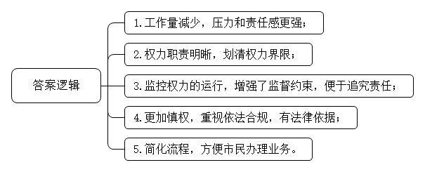
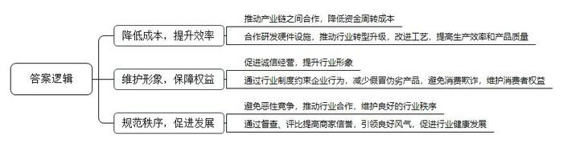
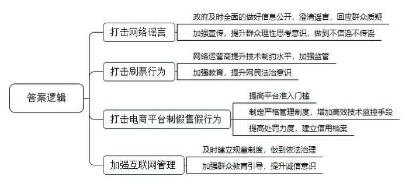
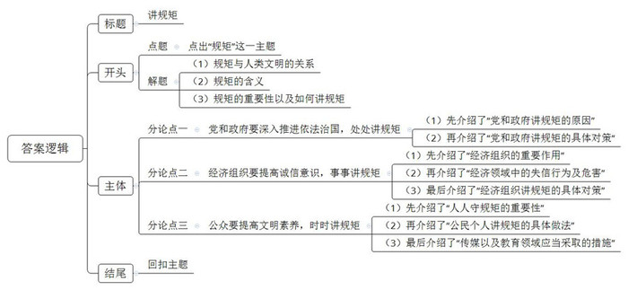

# 2015年广东省公考《申论》题（县级）

<!-- gwy:overview:start -->
> **广东 · 2015 · 申论 · 县级卷** ｜ 4 题 · 图片 4 处 · 答案随题折叠

导航：[题目](#题目) · [材料 1](#材料-1)
<!-- gwy:overview:end -->

> 候选采集稿。参考答案及解析来自粉笔页面，不代表官方答案或真实高分答卷；来源使用许可与原卷对应关系仍需人工核实。

## 给定材料

### 材料 1

2012年12月，习近平总书记主持召开中共中央政治局会议，审议通过了中央政治局关于改进工作作风、密切联系群众的八项规定。两年多来，为贯彻执行中央八项规定、加强党的作风建设，中央党政部门先后出台了一系列规定，以遏制“舌尖上的浪费”，管住“车轮上的腐败”，消除“会所中的歪风”，刹住“节庆公款送礼”……这些规定，有的是对八项规定的细化，有的是对八项规定的拓展和深化。这些配套制度的不断出台，使贯彻八项规定的制度“笼子”越织越密、越织越牢。

八项规定持续通过一场场“小战役”赢得口碑、改变作风，从一个个小切口活血化瘀、疗治病情。经过两年多的严格执行，八项规定已经成为党风政风改变的一个缩影，不少饱受诟病的歪风陋习得到有效整治，各级党政部门的风气得以焕然一新，同时也在带动整个社会规则的渐变，“潜规则”因此变得越来越没有市场。这些实实在在的变化，让人们看到了党中央踏石留印、抓铁有痕的决心，民心为之一振，风气为之一新；同时也用事实证明，只要将约束权力冲动的“制度之笼”扎紧，不良风气是能够改变的。现在，八项规定已经成为名副其实的“铁八条”，铸就了党员领导干部的作风“新常态”。

2015年1月，习近平总书记在中纪委五次全会上强调要“把守纪律讲规矩摆在更加重要的位置”。他指出：“纪律是成文的规矩，一些未明文列入纪律的规矩是不成文的纪律；纪律是刚性的规矩，一些未明文列入纪律的规矩是自我约束的纪律。”

### 材料 2

党的十八届四中全会提出，“推行政府权力清单制度，坚决消除权力设租寻租空间。”目前，国务院60个有行政审批事项的部门已经公开了行政审批清单，全国省级、市级、县级权力清单也在陆续公布。

2014年11月，A市市直58个行政部门先自行清理自身权力，然后汇总向市政府法制办申报。法制办依据现行的各项法律法规逐项核对，“符合的就保留，不符合的就撤销。”法制办负责人说，他们查阅了4000多部法律法规，经过三轮审核，一张包括396项行政许可权、518项行政处罚权、25项征税权、183项行政事业性收费权的权力清单终于浮出水面。A市政府把所属部门的职能、法律依据、实施主体、职责权限、管理流程、监督方式等事项，连同每一项权力的运行流程图公布在政府网站上，接受全社会的监督。

市长的权限最后被定格为85项。市长坦言：“清理后的权限比预期的要少，在工作量上感觉要轻松一些；但同时感觉又不轻松，压力感和责任感更强了，因为人民群众能更好地对政府实行监督，这就促使政府要更加慎重对待和使用手中的权力，要比以前更加慎权。”而权力重新界定之后，职责更加明晰，“比以前更清楚哪些该管，哪些不该管，该管的应该管到什么程度。”

“如果说清理权力是为了划清权力界限，让权力不再‘躲猫猫’，那么画出权力流程图，则是为了监控权力的具体运行，给权力套上‘缰绳’，”该市法制办负责人介绍说，“比如以前某部门的廉政风险点之一就是受理报件的环节，曾出现个别工作人员向申请人索取钱物的事情。现在工作必须严格按照流程走，增强了对每个环节的监督制约，而且事后一旦发现问题还要追究当事者的责任。”

清单公布后，不少干部反映，现在各部门做决策更加谨慎了，常常要对照权力清单，看看是否依法，是否合规，避免拍脑门决策，同时不再随意在清单之外增设审批事项，知道如要新增权力必须要有法律依据。

市政府推行权力清单制度，取消了一些行政权力，其中就包括核发《养老保险手册》的权力。市民王阿姨说：“以前办养老保险手续时，必须要拿《养老保险手册》，忘带了要回家取，丢了要先补办，很麻烦。现在只要出示打印的缴费明细，或者拿着市民卡核实信息后也能办理，方便多啦！”

### 材料 3

身为村里的当家人，书记、主任一肩挑的黄家祥每每听到村民们的赞许，总是摆摆手，笑着说：“这些事不是我能定的，而是经过了‘四议两公开一表决’，由村民拍板定下的。”都说村官既是最小的“官”，也是最大的“官”。在黄家祥看来，他这个村官“手里没啥权”，“村里大小事情，都让村民知道、由村民做主、交村民监督，村干部干起事来才更上心、更放心。”

作为当家人的黄家祥，对于村里办啥事、花啥钱，完全有“资格”说了算。而他却给自己“立规矩”——制定“四议两公开一表决”制度：凡涉及村民切身利益的大事，比如土地征用、集体资产管理、发展规划、公开接待管理等，必须经过“两委”会提议、党员议事会商议、党员大会审议、村民代表大会决议，再让涉及事项所在村民小组户代表表决，表决内容和实施结果全公开。村里的财务报销，也一直坚持“351”制度：“3”就是报销单据上经办人、审核人、负责人3人签字齐全；“5”就是民主理财小组5人同意盖章；最后一个“1”，才是村支书签字同意。“办事花钱讲‘规矩’，心里才踏实。”黄家祥常常这样说。

“村民的事，就是自己的事。为村民办事一包烟也不能收。”黄家祥还立下这样的“铁律”。但平日里，仍会有一些村民提着烟酒来托办各种事情，有的甚至“扔下”礼物后就走人：“大家都是乡里乡亲的，书记不收这礼，就是看不起人！”黄家祥推脱不了，只得办完事后，让其他村干部再把礼物送回去：“这事合规矩，不送礼也一定给你解决；这事不能办，就是牵头牛来也没用。我不是不懂人情世故，但是我必须守规矩。”

### 材料 4

在市场经济条件下，行业组织是支撑经济健康发展的三大支柱之一。政府转变职能，就要把有关维护行业市场秩序的权力转交给行业组织，使企业在行业组织的规范下实现有序竞争。

这些年，B市的行业组织发展迅速，陆续成立了拍卖典当协会、美容美发协会、家纺协会、汽车服务业协会、二手车协会等。各类行业组织在当地的经济发展中发挥着越来越重要的作用。

炒货业是B市的传统行业。近年来，业内竞争压力加大，但B市的炒货业依然能够在逆境中生存发展，靠的是在商会组织下“抱团取暖”。上世纪90年代，B市炒货业不仅档次低，而且经营者鱼龙混杂，出现过几起小炒货厂家在采购瓜子、花生等原材料时，拖欠货款甚至骗取货物的事情。这大大影响了当地炒货业的信誉，原材料供货商对B市炒货厂家多有提防，进货价格高不说，还必须是现款。原材料价格高，增加了成本，资金难以周转。为了生存，有些小厂家就不惜以次充好，相互压价。恶性竞争的结果，使整个行业的发展陷入困境。生死关头，一些炒货厂负责人想到应当拧成一股绳，于是成立了炒货业商会。

商会建立了保证金制度，对供货商和经销商郑重承诺：“凡会员企业拖欠货款或骗货的，由商会用保证金先行赔付；如果出现产品质量问题，商会用保证金加倍赔偿。”36家会员企业由商会统一采购原材料，采购量大加上商会的信誉保证，不仅压低了价格，还可以分期付款，B市炒货于是有了成本优势。接下来，商会与外地一家机械厂合作研制自动化的炒制设备，取得专利后，在全行业推广，推动了本地炒货业制作工艺的进步，大大提高了生产效率和产品质量。很快，B市炒货东山再起，在省内外恢复市场信誉，越做越强。

“诚信经营，自觉维护行业形象；不使用假冒伪劣产品，不搞价格欺诈……”在B市美容美发协会网站上，“行业公约”极为醒目。在协会成立前，某美发店老板张女士对行业乱象深感忧虑：有产品以次充好的，有在价格上“玩猫腻”的，甚至出现个别店家推出可以打折消费的预付卡，最终却“人走钱空”的情况。“这些问题败坏了整个行业的形象，如果再这样下去，整个行业都会垮掉，行业这条‘大船’漏了，所有经营者都会‘淹死’。必须成立行业协会，加强行业自律。”张女士的想法得到了几家大型美容美发店老板的支持，于是美容美发协会应运而生。协会联合消费者协会向社会推出《美发美容预付费消费卡发售企业自律公约》，明确提出，自愿加入的商家必须遵守公约条款，并缴纳相应的预付费保证金。较大规模的连锁店缴纳的保证金数额最高可达50万元。这样的约束，让商家不敢再在卖卡收钱后卷款走人。

“药商协会成立至今，最大的收获就是大大减少了行业内部的恶性竞争，如今药店之间恶性竞争的投诉案件为零。”李会长欣慰地说道。在协会未成立之前，药店之间“打价格战”的情况屡见不鲜，无序竞争导致互相压价，进而使药品质量受到影响，不仅扰乱市场经营秩序，还损害市民的利益。协会成立后，对药店进行多方面的规范督导，为药店之间搭建沟通桥梁，李会长笑着说：“我们像自家人一样好好说话，不搞行业内部恶性竞争，为营造良好氛围共同努力，事情就好解决了。”为防止个别药店有售卖不合格药品等违规行为，协会不定期对260多家会员单位进行“地毯式”巡查，并为合格的会员单位颁发“信誉牌”，有问题的限期整改。协会下一步将继续加强对申请入会药店的全面监督检查工作，同时举办“诚信药房”评比活动，完善自律规范经营体系，促进行业健康发展。

### 材料 5

2014年11月13日，东莞召开新闻发布会，公布2014年第三期守法经营、诚信经营“红黑榜”。其中“红榜”企业204家，“黑榜”企业69家。从2014年4月份起，全市累计发布企业诚信“红黑榜”36期，涉及企业4006家次，在全社会营造了褒奖诚信、惩戒失信的良好声势。

公布“红黑榜”是东莞加强企业守法诚信建设的具体措施。“红黑榜”上的企业名单是由各参与发布部门严格按照法律法规、行业规范选定的，有些部门选定名单后还需报省级部门审批，并在媒体上进行公示，具有权威性。

市旅游局对“红榜”旅行社实行激励机制，实施简化监督和低频率的日常检查。而对“黑榜”旅行社则以重点防范为主，实施重点监管和高频率的日常检查，实行信用惩戒机制。

此次公布的“黑榜”共涵盖8大类，除违法违规执业医疗机构、侵权盗版行为，违法违规用人单位、产品质量、餐饮食品安全等常规类别外，还新增了蔬菜水果生产环节质量安全、水务工程建设施工质量、旅行社信用等3类。

市农业局负责人表示，农业部门是首次发布“黑榜”信息，得到了各镇街的大力支持。此次某镇有两家蔬菜种植户因蔬菜质量问题上了“黑榜”，当地农办有关负责人表示，这一做法能更好地推动农户自觉诚信经营，也能引起更多基层干部重视。

### 材料 6

抢红包全神贯注，“摇一摇”争分夺秒，晒照片拜年贺春……刚刚过去的羊年春节，再次刷新“数字年味”。不过，也会有人心中会有点“堵”：拜年段子、求赞帖子，在高转发的同时，也被不断抄袭。造谣诽谤、“网络水军”、“黑公关”、网购假货等网络不诚信事件的频繁发生，反映了目前我国网络上各类行为的诚信水平还不够高，无论信息发布还是电子商务，都需要进一步规范。

【案例1】

2013年7月21日凌晨3时左右，一艘运载石材的轮船撞到大桥桥墩后，发生故障、失去动力，向下游漂流一段距离后沉没。这本是一起单纯的船只失事事件，却引起了位于沉船地点下游的C市市民的一片恐慌。

“在C市自来水厂取水口附近，一艘装满原油的轮船翻掉了，水面被大面积污染，全市的自来水都不能喝了！”从中午开始，这条据说是来自C市造船厂一名工作人员的“一手信息”，通过微博、微信、QQ群等网络社交平台在市民中疯传。整个下午，大量市民都在超市排队抢购桶（瓶）装水。直到下午五点，市政府才在政府官网上发布《关于C市自来水取水口安全问题的通告》，对此事进行澄清，市民们的不安情绪才得到一定缓解。在谣言传播发酵了5个小时后，政府才小范围发布权威信息。这也导致政府发布信息后，仍有部分市民半信半疑，误认为政府在隐瞒实情，于是继续在网上发帖质疑。

【案例2】

最近，小明希望为两岁的外甥女入选“十佳活力宝贝”增加一些网络投票数。因为发动亲朋好友投票太慢，他便在网上寻找投票代理公司，结果搜索到不少。最后，小明按要求将200元汇到代理公司账号上。汇款次日，小明外甥女的票数开始直线上升，瞬间达到1万多票，将其他参赛者远远抛在身后。据了解，这次网上评选活动是采取了严格监控措施的，一个IP地址只能投一票。投票代理公司对此表示，涨票并未使用黑客手段。那瞬间的1万票，是怎么刷出来的呢？

一位长期从事网络投票代理的业内人士透露内幕——全靠网络“水军”，水军大多是兼职的普通网民，长时间泡在网上，被一些代理公司招揽后，坐等赚外快的机会，有了业务随手点击就能得到报酬，却全然不知他们的行为有可能违法违规。对于这类做法，目前绝大多数网络运营商、服务商在技术层面上还缺乏有效的制约手段。

【案例3】

在D市，有家看上去很普通的鞋店，生意却出奇兴隆。每天下午4点，快递公司的车都会来取货，有时一天能发两车货。这家店主要靠网上销售。点开网页，里面卖得最好的是“正品原单，接受专柜验货”的雪地靴，该网页的销售记录显示，网店一天可出售200件左右商品，而价格仅为专柜的十分之一。

去年年底，D市工商局接到消费者举报，称这家网店销售假货。经审查，这家店老板对卖假货供认不讳。他承认这些所谓的“国际品牌产品”全部来自当地的一些厂家，否则也不会这么便宜。

工商局执法人员则指出，现在很多电商交易平台对经营者、商品销售和交易行为管理等方面存在诸多问题。“一根网线、一台电脑”就可以开网店，低门槛准入不免使一些诚信意识缺失的商家充斥其中，他们利用监管漏洞发布虚假图片和文字进行营销。在虚拟的宣传中，消费者难以判断商品信息的真实性，对商家的诚信更是无从获知。对于这些问题，不少电商交易平台既缺乏严格的管理制度，也没有高效的监控技术手段。尽管每次都对被举报售假的店铺依规进行了处罚，但罚款金额远低于违法获利，而相应的信用档案尚未建立。许多商家的网店被查封后，重新注册卷土重来。

诚然，互联网的每一次创新突破，都很可能会打破既定规则，建章立制的速度再快，也不可能与网络创新保持完全同步。正因如此，从电商兴起到微信公众号流行，与日新月异的网络创新相比，制度建设总是具有一定的滞后性。旧规则已破、新规则未立，容易出现法律缺失的灰色地带，我们该如何维护“网络诚信体系”？这是一项长期而又艰巨的任务。

### 材料 7

随着我国经济社会发展和人民生活水平不断提高，越来越多的国人走出国门，出境游成为一种时尚，但伴随而来的非议也不时传出。一些中国游客常常“不拘小节”：随处丢垃圾、在路边长椅上脱鞋袜、大声说话、对于外国的文化习俗不以为然等。在日常生活中，公共场所吸烟、乘车不排队、“中国式过马路”等种种不文明行为也屡见不鲜。

【情景1】

记者：你好，我想问一下，你知道这个地方不能抽烟吗？

游客：我不知道。

记者：这里是森林公园，如果不小心引起山火，怎么办？

游客：我们在这儿抽完以后，会把它灭了，扔在垃圾桶里。

记者：门口有个禁止抽烟的牌子，你没看见吗？

游客：哦，是吗？

【情景2】

动物园里：许多孩子在家长的示意下，随意投喂动物一些零食、水果，家长在一旁拍照，全家总动员，把这当成一种“娱乐”，而旁边就有明显的“请勿喂食”的温馨提示牌。

【情景3】

小林刚拿到驾照不久，今天是他第一天开车上班。

“嘟嘟嘟……”，因为不敢开太快，小林已经被后面的司机鸣笛好几次，吓得手心直冒汗。

快到单位小林更加紧张了，因为单位门口的路是条单行线，经常有车逆行，让人防不胜防。

【情景4】

交通协管员：大家等等，绿灯亮了再过马路！

行人甲：前面不是有人已经过去了吗？凭啥就不让我过啊！

行人乙：大哥，行行好，我赶时间，要迟到了，这会没车，你就让我过去吧，出事我自己负责……

### 材料 8

道德与法律都是人类社会的行为调整规范。德治的根本在于约束人的心灵，求诸内心；法治的根本在于约束人的行为，求诸外行。国家和社会治理需要法律和道德共同发挥作用。既应重视发挥法律的规范作用，又要重视发挥道德的教化作用，以法治体现道德理念，强化法律对道德建设的促进作用，以道德滋养法治精神，强化道德对法治文化的支撑作用，实现法律和道德相辅相成、法治和德治相得益彰。

道德与法律存在着纵横两个向度的关系：在纵向关系中，道德在上，法律在下。道德主要约束心灵，是关于真善美及公平正义等向上精神的指引；法律主要约束行为，是为人的行为设置的一条底线或大坝。在横向关系中，道德与法律相互渗透、相互影响。法律根据道德原则制定，反映道德诉求，固守道德底线；道德渗透于法律，内化于法律，制约着法律，评判着法律。

古人云：“绳墨以求直线，秤以权轻重，规以求圆，矩以划方，此为基本之器，由此基本之器，方能成就万器。”意思就是万事万物都有它的规矩。没有规矩，不成方圆。规矩是人类文明进步的基石。

## 题目

### 第 1 题

**推行政府权力清单制度是当前我国深入推进依法行政的重要举措。请根据资料**2**，简要概括A市推行权力清单制度取得的效果。（10分）**

关联材料：材料 2

作答要求：

要求：概括全面、准确，条理清晰。篇幅不超过100字。

第 1 题 · 答案与解析

**参考答案（粉笔题库参考内容）**

1.工作量减少，压力和责任感更强；

2.权力职责明晰，划清权力界限；

3.监控权力的运行，增强了监督约束，便于追究责任；

4.更加慎权，重视依法合规，有法律依据；

5.简化流程，方便市民办理业务。

**解析**

**参考答案说明：**本参考答案从“责任感”“权力界限”“监督监控”“决策”“市民便利”五大方面展开来概括A市推行权力清单制度取得的效果，每条要点之间没有交叉。

**考点**：影响类

**来源**：2015年广东省公考《申论》题（县级）

### 第 2 题

**请根据资料**4**，分析说明B市各类行业组织在规范行业行为、推动行业发展方面的积极作用。（20分）**

关联材料：材料 4

作答要求：

要求：分析全面、透彻，条理清晰，表达准确。篇幅不超过200字。

第 2 题 · 答案与解析

**参考答案（粉笔题库参考内容）**

1.降低成本，提升效率。推动产业链之间合作，降低资金周转成本；合作研发硬件设施，推动行业转型升级，改进工艺，提高生产效率和产品质量。2.维护形象，保障权益。促进诚信经营，提升行业形象；通过行业制度约束企业行为，减少假冒伪劣产品，避免消费欺诈，维护消费者权益。3.规范秩序，促进发展。避免恶性竞争，推动行业合作，维护良好的行业秩序；通过督查、评比提高商家信誉，引领良好风气，促进行业健康发展。

**解析**

**参考答案说明：**本参考答案思路上从“降低成本，提升效率”“维护形象，保障权益”“规范秩序，促进发展”这三个方面进行积极作用的内容阐述。此外，各条的要点之间是并列关系，内容之间不存在重复、交叉。

**考点**：影响类

**来源**：2015年广东省公考《申论》题（县级）

### 第 3 题

**请根据资料**6**，就进一步加强网络诚信建设提出建议。（20分）**

关联材料：材料 6

作答要求：

要求：建议合理、有针对性，条理清晰，表达准确。篇幅不超过200字。

第 3 题 · 答案与解析

**参考答案（粉笔题库参考内容）**

1.打击网络谣言。政府及时全面的做好信息公开，澄清谣言，回应群众质疑；加强宣传，提升群众理性思考意识，做到不信谣不传谣。

2.打击刷票行为。网络运营商提升技术制约水平，加强监管；加强教育，提升网民法治意识。

3.打击电商平台制假售假行为。提高平台准入门槛；制定严格管理制度，增加高效技术监控手段；提高处罚力度，建立信用档案。

4.加强互联网管理。及时建立规章制度，做到依法治理；加强群众教育引导，提升诚信意识。

**解析**

**参考答案说明：**本参考答案思路上从“打击网络谣言”“打击刷票行为”“打击电商平台制假售假行为”“加强互联网管理”这四个方面进行积极作用的阐述。此外，各条的要点之间是并列关系，内容之间不存在重复、交叉。

**考点**：提出对策类

**来源**：2015年广东省公考《申论》题（县级）

### 第 4 题

**请结合全部给定资料，以“讲规矩”为题目，撰写一篇议论文。（50分）**

关联材料：材料 1、材料 2、材料 3、材料 4、材料 5、材料 6、材料 7、材料 8

作答要求：

要求：

（1）文章主题应与所给资料联系紧密，思想性强；

（2）论点鲜明，论据确凿，论证严密、合乎逻辑；

（3）结构完整，条理清晰，行文流畅；

（4）篇幅在800-1000字。

第 4 题 · 答案与解析

**参考答案（粉笔题库参考内容）**

**讲规矩**

“欲知方圆，则必规矩”，人类文明一路走来，脱离了弱肉强食的丛林法则和与生俱来的野蛮行径，是因为建立了公平公正的行为准则，即为规矩。规矩既是熠熠生辉的道德，春风化雨、涵育人心；规矩也是亮出利刃的法律，激浊扬清、正本清源。只有各个社会主体俱讲规矩，我们才敢去期冀一个法治昌明、道德纯净的现代社会。

“仓廪实而知礼节，衣食足而知荣辱。”改革开放四十年后的今天，我们确实“仓廪实”“衣食足”，但“礼节”和“荣辱”似乎未能深入人心，国人依旧不讲规矩，“中国式过马路”是司空见惯，国人的“不拘小节”更是被屡屡诟病。想要整治这些陋习，我们就必须处处事事时时讲规矩。

**党和****政府要深入推进依法治国****，处处****讲规矩****。**党政部门具有示范带头作用，党风政风影响社会风气。如果放任一个个不讲规矩的“小问题”成为“大窟窿”，不但会影响政令通达，落入“虽令不从”的窘境，更会让讲规矩的社会成为海市蜃楼。近年来，从党中央的八项规定到各级政府部门陆续公布权力清单，再到黄家祥的“四议两公开一表决”，处处都讲规矩。因此，从党到行政部门再到基层组织，都要继续扎紧“制度之笼”，让党员干部心有所畏、行有所止，铸就作风“新常态”。

**经济组织要提高诚信意识****，事事讲规矩。**在现代社会中，经济组织关乎衣食住行、科教文卫等各方面，作用不言而喻。“业无信不兴”，诚信就是经济组织的帝王规矩。以次充好、假冒伪劣、价格欺诈，种种失信行为不仅使得人心惶惶，也损害了企业名誉，滞缓了经济发展。祸莫大于无信，无论是传统还是新兴行业，无论是生产还是销售，无论是独立生产还是互相协作，都应该事事讲诚信。故此，不但需要行业组织发挥作用，加强行业规范；还需要政府积极监管，通过奖惩机制倒逼企业提高诚信意识。

**公众要提高文明素养****，时时****讲规矩****。**没有人是一座孤岛，只有社会中的每个个体守住边界，谨遵规矩，才能避免冲突，真正保障自由。我们在出行时要遵守规矩，让红灯成为心中的警示灯；在休闲娱乐时要遵守规矩，让慎独成为行为的高压线。当然，想要让规矩意识内化为每个人的行为自觉不仅需要我们个体的努力，需要媒体积极发声承担社会责任，更需要将规矩意识纳入到国民教育体系中，让小手拉大手，共同建立一个讲规矩的社会。

“人不以规矩则废，国不以规矩则乱”，无论时代如何变迁，规矩始终是人类文明的基石。千里之行，始于足下，让我们从拒绝“中国式过马路”开始，从文明旅游做起，让规矩为自由和创新保驾护航！

**文章分析**

**讲规矩**

【**标题的优点：**严格按照题目的要求，以“讲规矩”为标题。】

（1）“欲知方圆，则必规矩”，人类文明一路走来，脱离了弱肉强食的丛林法则和与生俱来的野蛮行径，是因为建立了公平公正的行为准则，即为规矩。（2）规矩既是熠熠生辉的道德，春风化雨、涵育人心；规矩也是亮出利刃的法律，激浊扬清、正本清源。（3）只有各个社会主体俱讲规矩，我们才敢去期冀一个法治昌明、道德纯净的现代社会。

【**开头的优点：**★内容方面。范文的开头是紧扣题目给定的“讲规矩”这一主题展开的。首先，开头第一句话点出了“规矩”这一主题，做到了主题明确。其次，对“规矩”这一主题进行了分析阐述，指出了：（1）规矩与人类文明的关系；（2）规矩的含义；（3）规矩的重要性以及如何讲规矩。★文字表达方面。使用了“春风化雨”“利刃”等形象生动的修辞方法，让语言生动、有感染力。】

“仓廪实而知礼节，衣食足而知荣辱。”改革开放四十年后的今天，我们确实“仓廪实”“衣食足”，但“礼节”和“荣辱”似乎未能深入人心，国人依旧不讲规矩，“中国式过马路”是司空见惯，国人的“不拘小节”更是被屡屡诟病。想要整治这些陋习，我们就必须处处事事时时讲规矩。

【**过渡段的优点：**范文过渡段分析了当前我国在“讲规矩”方面存在的问题，此外，还要注意过渡段末尾的“想要整治这些陋习，我们就必须处处事事时时讲规矩”是用来引起下文的过渡句。】

**党和****政府要深入推进依法治国****，处处****讲规矩****。**（1）党政部门具有示范带头作用，党风政风影响社会风气。如果放任一个个不讲规矩的“小问题”成为“大窟窿”，不但会影响政令通达，落入“虽令不从”的窘境，更会让讲规矩的社会成为海市蜃楼。（2）近年来，从党中央的八项规定到各级政府部门陆续公布权力清单，再到黄家祥的“四议两公开一表决”，处处都讲规矩。因此，从党到行政部门再到基层组织，都要继续扎紧“制度之笼”，让党员干部心有所畏、行有所止，铸就作风“新常态”。

【**论述段****1****的优点**：★观点句：范文的观点句是紧扣“讲规矩”这一文章主题提出的。形式上，它在段首处直接写出，位置突出，容易被发现；内容上，内容要点明确，可以明显看出它是从“推进依法治国”入手，指出了党与政府如何讲规矩。★论述内容：（1）先介绍了“党和政府讲规矩的原因”；（2）再介绍了“党和政府讲规矩的具体对策”。注意：以上两个方面的内容都是紧扣观点句“党和政府要深入推进依法治国，处处讲规矩”进行分析论述的，针对性强、内容层次丰富。最后，在论证方法和论据选取方面，讲道理和举例子相结合，做到了丰富多样。】

**经济组织要提高诚信意识****，事事讲规矩。**（1）在现代社会中，经济组织关乎衣食住行、科教文卫等各方面，作用不言而喻。“业无信不兴”，诚信就是经济组织的帝王规矩。（2）以次充好、假冒伪劣、价格欺诈，种种失信行为不仅使得人心惶惶，也损害了企业名誉，滞缓了经济发展。（3）祸莫大于无信，无论是传统还是新兴行业，无论是生产还是销售，无论是独立生产还是互相协作，都应该事事讲诚信。故此，不但需要行业组织发挥作用，加强行业规范；还需要政府积极监管，通过奖惩机制倒逼企业提高诚信意识。

【**论述段****2的优点**：★观点句：范文的观点句是紧扣“讲规矩”这一文章主题提出的。形式上，它在段首处直接写出，位置突出，容易被发现；内容上，内容要点明确，可以明显看出它是从“提高诚信意识”入手，指出了经济组织如何讲规矩。★论述内容：（1）先介绍了“经济组织的重要作用”；（2）再介绍了“经济领域中的失信行为及危害”；（3）最后介绍了“经济组织讲规矩的具体对策”。注意：以上三个方面的内容都是紧扣观点句“经济组织要提高诚信意识，事事讲规矩”进行分析论述的，针对性强、内容层次丰富。最后，在论证方法和论据选取方面，讲道理和举例子相结合，做到了丰富多样。】

**公众要提高文明素养****，时时****讲规矩****。**（1）没有人是一座孤岛，只有社会中的每个个体守住边界，谨遵规矩，才能避免冲突，真正保障自由。（2）我们在出行时要遵守规矩，让红灯成为心中的警示灯；在休闲娱乐时要遵守规矩，让慎独成为行为的高压线。当然，想要让规矩意识内化为每个人的行为自觉不仅需要我们个体的努力，（3）需要媒体积极发声承担社会责任，更需要将规矩意识纳入到国民教育体系中，让小手拉大手，共同建立一个讲规矩的社会。

【**论述段****3的优点**：★观点句：范文的观点句是紧扣“讲规矩”这一文章主题提出的。形式上，它在段首处直接写出，位置突出，容易被发现；内容上，内容要点明确，可以明显看出它是从“提高文明素养”入手，人民群众如何讲规矩。★论述内容：（1）先介绍了“人人守规矩的重要性”；（2）再介绍了“公民个人讲规矩的具体做法”；（3）最后介绍了“传媒以及教育领域应当采取的措施”。注意：以上三个方面的内容都是紧扣观点句“公众要提高文明素养，时时讲规矩”进行分析论述的，针对性强、内容层次丰富。最后，在论证方法和论据选取方面，讲道理和举例子相结合，做到了丰富多样。】

【**论述段之间的关系**：★内容的内在逻辑：范文的论述段之间有并列逻辑。论述段1从政府角度谈如何讲规矩，论述段2从经济组织角度谈如何讲规矩，论述段3从公众个人角度谈如何讲规矩。】

“人不以规矩则废，国不以规矩则乱”，无论时代如何变迁，（1）规矩始终是人类文明的基石。千里之行，始于足下，（2）让我们从拒绝“中国式过马路”开始，从文明旅游做起，让规矩为自由和创新保驾护航！

【**结尾的优点：**范文的结尾回扣了“讲规矩”这一主题。（1）再次提到“规矩”；（2）发出了号召希望，阐述了“讲规矩”的深远意义。】

**解析状态：unknown（来源未提供）**

**考点**：文章写作题

**来源**：2015年广东省公考《申论》题（县级）

