# 2015年广东省公务员录用考试《行测》题（县级以上）

<!-- gwy:overview:start -->
> **广东 · 2015 · 行测 · 县级卷** ｜ 100 题 · 图片 166 处 · 答案随题折叠

| 题型模块 | 题量 | 题号 |
| --- | ---: | ---: |
| 言语理解与表达 | 20 | 1–20 |
| 数量关系 | 15 | 21–35 |
| 判断推理 | 35 | 36–70 |
| 常识判断 | 15 | 71–85 |
| 资料分析 | 15 | 86–100 |
| **合计** | **100** | |

导航：[题型与作答说明](#题型与作答说明) · [题目](#题目) · [材料 1](#材料-1)
<!-- gwy:overview:end -->

> 候选采集稿。参考答案及解析来自粉笔页面，不代表官方答案或真实高分答卷；来源使用许可与原卷对应关系仍需人工核实。

## 题型与作答说明

言语理解与表达

（20题）

言语理解与表达

数量关系

（15题）

数量关系

判断推理

（35题）

判断推理

常识判断

（15题）

常识判断

资料分析

（15题）

资料分析

## 题目

### 第 1 题

十八大之后，中国经济航船行进在“新常态”这片新海域上。尽管有风浪、有礁石，但依然交出了一份令世人＿＿＿＿的答卷，呈现出增长平稳、改革深入、结构优化、质量提升、民生改善的良好态势。

填入划横线部分最恰当的一项是：

A. 侧目

B. 注目

C. 炫目

D. 瞩目

第 1 题 · 答案与解析

**参考答案（粉笔题库参考内容）**

D

**解析**

本题考查近义词辨析及固定搭配。

空格处与“令世人”搭配共同形容“答卷”，且根据后文的内容可知这份答卷是一份写满成就的答卷。“令人瞩目”、“举世瞩目”为常见固定搭配，且多用于修饰“成就”。故D项为正确答案。

A项“侧目”指斜着眼睛看，表示畏惧或愤恨，如侧目而视，排除。

B项“注目”强调集中目光，如这身打扮太惹人注目了，排除。

C项“炫目”指耀眼夺目，如南京路上光彩炫目，排除。

故正确答案为D。

【文段出处】《驾驭宏观经济的大哲学》

**考点**：实词填空、词的辨析-搭配对象、词的辨析-词义侧重

**来源**：2015年广东省公务员录用考试《行测》题（乡镇）第1题

### 第 2 题

清正廉洁，不仅是党员干部的自我追求，也是老百姓的＿＿＿＿＿希望。

填入划横线部分最恰当的一项是：

A. 深切

B. 急切

C. 殷切

D. 恳切

第 2 题 · 答案与解析

**参考答案（粉笔题库参考内容）**

C

**解析**

本题考查近义词辨析及固定搭配。

A项“深切”指深厚亲切，深刻切实，常与感情、感受等搭配，如深切同情，体会深切；B项“急切”重在强调急迫，如急切的心情；D项“恳切”侧重于诚恳，常与态度搭配，如态度恳切，恳切祝愿，与文段中百姓对党员干部的“希望”都无法搭配。C项“殷切”意为深厚而急切，这一词已经包括了深切与急切的涵义，语义更为丰富，且最常与希望、期待等词搭配使用。

故正确答案为C。

【文段出处】《领导干部要做清正廉洁的表率》

**考点**：实词填空、词的辨析-搭配对象

**来源**：2015年广东省公务员录用考试《行测》题（县级以上）第2题

### 第 3 题

在历史使命的＿＿＿＿＿下，唯有深化改革开放，才能实现广东“三个定位、两个率先”的总目标。

填入画横线部分最恰当的一项是：

A. 指引

B. 召唤

C. 指导

D. 召集

第 3 题 · 答案与解析

**参考答案（粉笔题库参考内容）**

B

**解析**

本题考查近义词辨析及搭配。

此题的核心解题点在于空格处所填词语与“历史使命”的正确搭配。A项“指引”重在方向性的引导，除了与人搭配外，常与精神、理想等词搭配使用，鲜少搭配“使命”。

C项“指导”意为指示教导，往往与较为明确具体的词语搭配，而文段中的“使命”过于抽象。

D项“召集”意为通知有关人员聚集，与文意完全不符。

B项“召唤”为比喻性的呼唤，常与使命、时代、历史等抽象名词搭配使用。

故正确答案为B。

【文段出处】《为实现“三个定位，两个率先”而奋斗》

**考点**：实词填空、词的辨析-搭配对象

**来源**：2015年广东省公务员录用考试《行测》题（县级以上）第3题

### 第 4 题

只有从根本上解决农民问题，调动农民生产积极性，培养一代新型职业农民，农业问题才能＿＿＿＿＿，国民经济的基础才会更加牢固。

填入划横线部分最恰当的一项是：

A. 迎刃而解

B. 水到渠成

C. 立竿见影

D. 知难而进

第 4 题 · 答案与解析

**参考答案（粉笔题库参考内容）**

A

**解析**

横线处搭配“农业问题”，且根据“从根本上解决农民问题”可知，横线处所填成语应体现农业问题得到解决之意。A项“迎刃而解”比喻处理事情，解决问题非常顺利，符合文意，当选。

B项“水到渠成”比喻条件成熟，事情自然会成功，与“农业问题”搭配不当，排除；

C项“立竿见影”比喻见效极快，侧重效果快，与文意不符，排除；

D项“知难而进”指明知困难仍主动前进，主语通常为人，与“农业问题”搭配不当，且无解决问题之意，排除。

故正确答案为A。

【文段出处】人民网《正确认识和解决当今中国农民问题》

**考点**：对应关系-前后呼应、成语填空、词的辨析-搭配对象

**来源**：2015年广东省公务员录用考试《行测》题（县级以上）第4题

### 第 5 题

发展没有局外人，谁也不能＿＿＿＿，各级领导干部更是要身先士卒、做出表率。

填入划横线部分最恰当的一项是：

A. 置之度外

B. 置身事外

C. 置之不理

D. 置若罔闻

第 5 题 · 答案与解析

**参考答案（粉笔题库参考内容）**

B

**解析**

本题考查成语含义及重点字词对应。由前文中“发展没有局外人”以及后文中“身先士卒”均可知，文段要强调对发展的积极参与。

A选项“置之度外”指（把生死、利害）放在考虑的范围之外（度：指个人考虑所及的范围），与文意显然不符，排除；

B选项“置身事外”一词中的“事”恰好对应了发展这件大事，当选；

C选项“置之不理”指放在一边不予理睬，多搭配他人的言行，而非文段中的发展，排除；

D选项“置若罔闻”指放到一边，好像没听见一样，显然重在以听不见表达漠不关心之意，亦无法与发展搭配，排除。

故正确答案为B。

【文段出处】《干部是干出来的》

**考点**：对应关系-前后呼应、成语填空

**来源**：2015年广东省公务员录用考试《行测》题（乡镇）第6题

### 第 6 题

造成城市白领们“亚营养”危机的原因之一，是他们长期在外就餐且通常凑合应付。这样容易导致某种营养素的＿＿＿＿＿＿，并使他们不知不觉中养成多油、高糖、高盐等＿＿＿＿＿膳食习惯。

依次填入画横线部分最恰当的一项是：

A. 缺乏 不良

B. 失衡 不当

C. 流失 不良

D. 失调 不当

第 6 题 · 答案与解析

**参考答案（粉笔题库参考内容）**

A

**解析**

此题考查近义词辨析及搭配。

此题可从第二空入手。根据“不良习惯”的固定搭配排除B、D两项。“不当”多搭配行为。

反观A、C两项的第一空。“缺乏”重在强调少，没有；“流失”则为以前有，后来失去。与文段中“长期在外就餐且通常凑合应付”对应可知，这些营养素并非之前存在而后失去，而是由于吃饭凑合应付压根就没有。故排除C项。

故正确答案为A。

【文段出处】《亚营养百度百科》

**考点**：关联关系-因果关系、实词填空、对应关系-前后呼应、词的辨析-搭配对象

**来源**：2015年广东省公务员录用考试《行测》题（县级以上）第6题

### 第 7 题

某市推出“自住型商品房”，意在＿＿＿＿＿涨价预期，但由于自住型商品房用地进一步＿＿＿＿＿了普通商品房用地，使得商品房地价一再上涨。

依次填入画横线部分最恰当的一项是：

A. 平抑 缩减

B. 制止 挤压

C. 抑制 压缩

D. 平抑 挤压

第 7 题 · 答案与解析

**参考答案（粉笔题库参考内容）**

D

**解析**

本题考查近义词辨析及句子主干分析。

第一空分析选项，“制止”指用强力迫使行动停止或情况不再发生，显然无法与“涨价预期”搭配，违背常识，故排除B项。“抑制”为压抑、控制；“平抑”在抑制的基础上还含有使之平稳的涵义。可见“平抑”的语义更为丰富，故排除C项。

第二空分析句子主干，为“自住型商品房用地进一步＿＿＿＿＿了普通商品房用地”，显然“挤压”这个主动性动词更为合适，如用“缩减”，应为普通商品房用地被缩减。故排除A项。

故正确答案为D。

【文段出处】京地价三级跳明年房价难摁住

**考点**：关联关系-因果关系、实词填空、对应关系-前后呼应、词的辨析-搭配对象

**来源**：2015年广东省公务员录用考试《行测》题（县级以上）第7题

### 第 8 题

很多人对励志书籍的阅读体验是，读的时候＿＿＿＿＿，但激动了几天之后却发现生活还在继续，自己的人生道路并没有多大＿＿＿＿。

依次填入画横线部分最恰当的一项是：

A. 心潮澎湃 改变

B. 思潮起伏 改变

C. 热血沸腾 转变

D. 慷慨激昂 转变

第 8 题 · 答案与解析

**参考答案（粉笔题库参考内容）**

A

**解析**

本题考查重点词对应及近义词辨析。本题可从第二空入手，要与“人生道路”搭配，“改变人生道路”是常见搭配，“转变人生道路”搭配不当，排除C、D两项。

再看第一空，根据文段中“激动了几天”可知，所填成语应表达心情十分激动之意。A项“心潮澎湃”指心里像浪潮翻腾，形容心情十分激动，不能平静，符合文意，当选。B项“思潮起伏”仅指思想活动十分频繁，并无激动之意，排除。

故正确答案为A。

【文段出处】《书里的成功之道我能信多少》

**考点**：对应关系-前后呼应、混搭填空、词的辨析-搭配对象

**来源**：2015年广东省公务员录用考试《行测》题（乡镇）第10题

### 第 9 题

建设现代农业，要努力在提高粮食生产能力上＿＿＿＿＿新潜力，在优化农业结构上＿＿＿＿新途径，在转变农业发展方式上＿＿＿＿新突破。

依次填入画横线部分最恰当的一项是：

A. 发掘 开发 寻求

B. 挖掘 开发 寻找

C. 发掘 开辟 寻找

D. 挖掘 开辟 寻求

第 9 题 · 答案与解析

**参考答案（粉笔题库参考内容）**

D

**解析**

本题可从第二空入手。横线处所填词语与“新途径”搭配，C、D两项“开辟”指开创、建立，常与“道路、途径、局面”等抽象名词搭配，强调从无到有，符合文意，保留。A、B两项“开发”通过研究或努力，开拓、发现、利用新的资源或新的领域，常见搭配为“开发资源”“开发市场”等，与“新途径”搭配不当，排除。

第三空，横线处所填词语与“新突破”搭配，D项“寻求”指寻找探求、追求，与“新突破”搭配得当，保留。C项“寻找”指找寻、查找，与“新突破”的搭配不如“寻求”恰当，排除。

第一空，代入验证。D项“挖掘”指向下挖以发掘，“挖掘潜力”为常见固定搭配，符合文意，当选。

故正确答案为D。

【文段出处】《在提高粮食生产能力上挖掘新潜力》

**考点**：实词填空、词的辨析-搭配对象、词的辨析-词义侧重

**来源**：2015年广东省公务员录用考试《行测》题（县级以上）第9题

### 第 10 题

＿＿＿＿改革开放大业是一座正在建设中的大厦，＿＿＿＿老百姓身边细微之处的需求，就是建成这座大厦的一块砖、一片瓦，＿＿＿＿给这座大厦添砖加瓦，则是每个党员干部义不容辞的责任。

依次填入划横线部分最恰当的一项是：

A. 如果 那么 而

B. 尽管 但是 也

C. 因为 所以 则

D. 假设 那么 且

第 10 题 · 答案与解析

**参考答案（粉笔题库参考内容）**

A

**解析**

本题考查虚词，即分句间的逻辑关系。

改革开放是正在建设中的大厦与老百姓的需求是大厦的砖瓦之间并无B项的转折关系，亦非C项中的因果关系。故排除B、C两项。

A、D两项均为假设，均可填入。

需求是砖瓦，与每个党员干部必须给大厦添砖加瓦之间并非D项中“且”表达的并列关系，而是A项中“而”所表达的顺承关系，故排除D项。

故正确答案为A。

**来源**：2015年广东省公务员录用考试《行测》题（县级以上）第10题

### 第 11 题

从高层决心和公众自觉方面看，大气污染治理的步伐不断加快。调整能源结构、产业转型升级，需要政府更有所作为，这是无可争议的重头。同时，作为每位公民却可做到少些抱怨，多些从自身做起，比如不放鞭炮、多乘坐公共交通等等。

作者通过这段文字主要想表达的是：

A. 每位公民在大气污染治理中都应承担相应责任

B. 大气污染治理需要政府与每位公民的共同努力

C. 政府在大气污染治理中应承担起最主要的责任

D. 政府与公民都已经开始积极投身于大气污染治理中

第 11 题 · 答案与解析

**参考答案（粉笔题库参考内容）**

B

**解析**

本题为中心理解题。文段首句提出大气污染治理这一话题，后两句通过“同时”连接，为并列结构，强调政府与公民都需要发挥作用，故B项当选。

A、C两项：分别侧重于公民和政府，均表述片面，排除。

D项：偷换时态，文段中“需要”引导对策，表示呼吁，为对未来的倡导，而该项中的“已经”为对现状的描述，排除。

故正确答案为B。

**考点**：主题词、关联词-并列

**来源**：2015年广东省公务员录用考试《行测》题（县级以上）第11题

### 第 12 题

当前意义上的人民福祉已经不同于历史上简单的温饱状态，而是包括极为丰富的内容：既包括人民的权利和尊严，也包括人民的收入和消费，同时也涉及自由、安全、社会保障和精神生活等方面。

这段文字主要说明了：

A. 人民福祉的内涵相比以往有了巨大的变化

B. 人民已经不仅仅满足于温饱状态了

C. 人民福祉的含义在历史发展过程中会不断丰富

D. 人民福祉已经从物质层面向精神层面过渡

第 12 题 · 答案与解析

**参考答案（粉笔题库参考内容）**

A

**解析**

本题为中心理解题。

首先根据“人民福祉”这一主题词可排除B项。文段以“不同于历史上······而是包括······”表达对历史与现在的对比，A项准确地表达了这一对比。C项仅说明了现在，而未体现出前后的对比，故不够准确。D项的“过渡”意为从物质层面向精神层面转移，即人民福祉仅包括精神层面，与后文中物质、精神都包括的语义不符。

故正确答案为A。

**考点**：主题词、关联词-并列

**来源**：2015年广东省公务员录用考试《行测》题（乡镇）第13题

### 第 13 题

现代社会中对公共事务的探讨已经成为一种常态，与一般的“公共知识分子”和媒体不同，智库对公共事务的参与应基于科学的分析和论证，而非情绪的宣泄和价值判断的争议。智库要尽可能从自己一手得到的材料和客观事实出发进行研究，完成对复杂资料的筛选和判断，建立持之以恒的预测分析系统。

作者通过这段文字主要想表达：

A. 智库是一个参与公共事务管理的专业机构

B. 智库的运作具有相当高规格的要求

C. 智库应该科学客观地参与公共事务的探讨

D. 智库对公共事务的探讨比一般的“公共知识分子”和媒体更深入

第 13 题 · 答案与解析

**参考答案（粉笔题库参考内容）**

C

**解析**

本题为中心理解题。文段为“分—分”结构，从两方面指出智库应如何对公共事务进行探讨。第一句以“应”为标志，强调“基于科学的分析和论证”；第二句以“要”为标志，强调从“客观事实出发”。综而观之，C项中的“科学客观”可以对二者进行高度概括，当选。

A、B、D三项：A项为对智库的定义，非文段重点，B项偏离了“公共事务的探讨”这一主题词，D项仅针对第一句阐述，过于片面，且A项“专业机构”、B项“高规格”、D项“更深入”文段均未提及，无中生有，排除。

故正确答案为C。

**考点**：关联词-并列

**来源**：2015年广东省公务员录用考试《行测》题（县级以上）第13题

### 第 14 题

宋、明、清三代，非进士出身者，基本无法成为宰相，而许多炙手可热的官职，也规定不是进士出身者不许担任。能考上一个进士，已经殊为不易，更何况作为进士中第一名的状元了！状元一旦出笼，便立刻进入国家的储才机构——翰林院，被作为未来的宰相加以重点培养，各种别人削尖了脑袋也谋不到的美差也会扑面而来，挡都挡不住。

根据这段文字，下列说法正确的是：

A. 考取状元是成为宰相的必经之路

B. 重要官职都由进士出身者担任

C. 状元在仕途上有更好的发展机会

D. 只有状元才能进入翰林院

第 14 题 · 答案与解析

**参考答案（粉笔题库参考内容）**

C

**解析**

根据文段“状元一旦出笼，便立刻进入国家的储才机构——翰林院，被作为未来的宰相加以重点培养，各种别人削尖了脑袋也谋不到的美差也会扑面而来，挡都挡不住”可知，C项表述正确。

A项“必经之路”程度过重，文段说的是基本无法，且“状元”偷换概念，文段说的是非进士出身者基本无法成为宰相，而进士不等于状元，排除；

B项“都”表述绝对，文段说的是许多官差规定不是进士出身者不得担任，只是许多，而不是所有，排除；

D项“只有状元才能进入翰林院”无中生有，文段说的是状元可以进入翰林院，但无法得知别人能不能进，排除。

故正确答案为C。

**考点**：细节判断题

**来源**：2015年广东省公务员录用考试《行测》题（乡镇）第14题

### 第 15 题

从发展趋势来看，淡化GDP（国内生产总值）增长目标是大势所趋，因为片面过度追求这一个指标，不足以满足人民群众对青山绿水、放心食品、良好教育、便捷出行、健康工作、安享晚年等美好生活方面更高水平的期待与向往。

这段文字主要谈论的是：

A. 片面追求GDP指标的不当之处

B. 淡化GDP增长目标后的发展趋势

C. 人民群众对美好生活的期待与向往

D. 淡化GDP增长目标这一趋势出现的原因

第 15 题 · 答案与解析

**参考答案（粉笔题库参考内容）**

D

**解析**

本题为中心理解题。

文段结构非常清晰，首句提出淡化GDP增长目标是大势所趋，随后以“因为”为标志，详细阐述这一趋势出现的原因，故正确答案为D。

A项为原因内容，非文段重点，排除；B项为无中生有，排除；C项亦在原因解释中，非文段重点，排除。

故正确答案为D。

**考点**：分述句特征-其他

**来源**：2015年广东省公务员录用考试《行测》题（县级以上）第15题

### 第 16 题

一项调查结果显示，那些态度最积极乐观的被调查者在研究持续期间膳食结构的改善幅度最大，而最消极悲观的被调查者不仅从一开始便更倾向于选择较不健康的饮食，而且在运用各种手段加以干预后，改善的情况也不理想。研究者指出，自控能力是令乐观者更易成功戒除抽烟、喝酒和暴饮暴食等坏习惯的关键。

对这段文字理解准确的一项是：

A. 饮食结构取决于人的情绪的好坏

B. 不健康的饮食习惯很难通过干预而改善

C. 积极乐观的人更容易改善不良饮食习惯

D. 悲观者的自控能力无法通过干预而改善

第 16 题 · 答案与解析

**参考答案（粉笔题库参考内容）**

C

**解析**

本题考查细节的一一对应。A项中饮食结构与人情绪好坏之间的条件关系属于无中生有，排除；B项内容表述过于绝对，文段中明确表示饮食习惯难以通过干预而改善的群体为消极悲观者，排除；D项程度过重，文段中为“改善的情况不理想”而非“无法改善”，排除；C项内容对应首尾句，当选。

故正确答案为C。

**考点**：细节判断题

**来源**：2015年广东省公务员录用考试《行测》题（乡镇）第18题

### 第 17 题

经济增长下滑源于人口的老龄化，果真如此吗？有结论指出：人口结构越年轻，国家越穷，而反之则越富。那么为什么要恐惧老龄化呢？人们认为衰老会让人变得脆弱，65岁以上的人是社会的负担。不过，一些人的生产力要远远高于其他人，而这并不关乎年龄。事实证明，人口老龄化需要结合人力资本，特别是教育和健康状况来综合考虑。全球大多数国家年轻人受教育程度高于年长者，他们通过提高教育程度来提高生产力水平的办法，或许可以弥补人口少的缺陷。

这段文字旨在说明：

A. 人们完全有能力应对人口老龄化问题

B. 要多角度分析人口老龄化对经济的影响

C. 人口老龄化对经济增长没有任何影响

D. 人口老龄化对经济增长造成负面影响

第 17 题 · 答案与解析

**参考答案（粉笔题库参考内容）**

B

**解析**

文段开篇提出问题，即经济增长下滑是否源于人口老龄化。之后通过“不过”说明一些人的社会生产力并不关乎年龄，也就是说并非所有的人口老龄化都会对经济造成负面影响，最后以事实证明得出结论，人口老龄化需要综合考虑，并通过“全球大多数国家年轻人”对该结论进行举例说明。故文段重点在于“需要”引导的对策，即要“综合考虑”。B项中“多角度”一词为“综合考虑”的同义替换，当选。

A、C两项：A项中的“完全”与C项中的“任何”表述过于绝对，排除；

D项：对应文段首句，而首句只是提出问题，后面已经给出结论，即对前面问题给予了否定，故“造成负面影响”与文段表述相悖，排除。

故正确答案为B。

**考点**：关联词-对策

**来源**：2015年广东省公务员录用考试《行测》题（乡镇）第16题

### 第 18 题

对于雾霾天气，人们深受其害。殊不知，精神上也存在雾霾现象，如果不及时驱除，就会使心灵压抑灰暗，精神萎靡不振，思想浑浑噩噩，危害一点儿都不比雾霾天气小。现代社会，节奏快，压力大，矛盾多，这种精神的雾霾对于个人生活和各项事业的害处多多。如何调适心情，驱散雾霾？一剂良方就是借助文艺的力量，以文“明”志、以文“养”心、以文“怡”情、以文“化”人。

对这段文字理解准确的一项是：

A. 借助文艺有助于驱散精神雾霾

B. 精神雾霾比雾霾天气更难驱散

C. 不良生活方式是导致精神雾霾出现的原因

D. 精神雾霾对人们的危害比雾霾天气更大

第 18 题 · 答案与解析

**参考答案（粉笔题库参考内容）**

A

**解析**

A项，根据“这种精神的雾霾······如何调适心情，驱散雾霾？一剂良方就是借助文艺的力量”可知，表述正确，当选；

B项，文段未对比精神雾霾和雾霾天气的驱散难度，无中生有，排除；

C项，文段仅提及现代社会节奏快、压力大、矛盾多，并未指出不良生活方式是精神雾霾的成因，无中生有，排除；

D项，根据“危害一点儿都不比雾霾天气小”可知，文段指出精神雾霾危害“一点儿都不比雾霾天气小”，可能危害相等、或更大，故仅论述“更大”，表述错误，排除。

故正确答案为A。

【文段出处】共产党员网《吹散“精神雾霾”》

**考点**：细节判断题

**来源**：2015年广东省公务员录用考试《行测》题（乡镇）第17题

### 第 19 题

在现代社会中，虽然以有经济保障和物质享受为前提的婚姻数量迅速减少，但是“金钱决定一切”、“拜金论”仍然在一些人心中根深蒂固。在恋爱婚姻自由的现代社会里，依然存在家长极力干涉子女婚姻的情形，家庭背景、教育背景和工作条件仍然是主要的参考因素。我们不禁思考：金钱能决定一切吗？当然不是。

通过这段文字最有可能作出的结论是：

A. 纯粹建立在美貌和激情基础上的婚姻将会是失败和不幸的婚姻

B. 婚姻中感情是最重要的因素，经济保障和物质享受均无需考虑

C. 现代社会中女性需要通过婚姻中的财富和地位提高自身的身份

D. 为了美好的婚姻，我们要有正确的婚姻观和对待婚姻的态度

第 19 题 · 答案与解析

**参考答案（粉笔题库参考内容）**

D

**解析**

本题考查接语衔接，重点关注文段的最后一句。前文介绍了现代社会中“金钱决定一切”“金钱决定婚姻”的大背景，尾句以设问句的形式出现，可知作者的观点是完全否定“金钱决定一切”，接下来最可能作出的结论应与此紧密衔接，D项符合作者态度，当选。

A项的“美貌与激情”为无中生有，排除；B项感情最重要，经济保障无需考虑的表述过于绝对，排除；C项重点仍在财富和地位，与文段矛盾，排除。

故正确答案为D。

**考点**：接语选择题

**来源**：2015年江苏省公务员录用考试《行测》题（B类）第7题

### 第 20 题

对于消费者来讲，传统零售业最大的弊端在于信息的不对称。而互联网可以将一件商品的真正定价变得透明，让每个人都知道商品的真正价格区间。传统制造业属于封闭式生产，由生产商决定商品品种、型号，生产者与消费者之间是割裂的。而互联网会让消费者全程参与到生产环节，由用户决定他们想要的商品。

这段文字旨在说明：

A. 互联网将打破信息不对称的格局

B. 个性化定制是传统零售业的发展方向

C. 互联网会对传统行业进行渗透与改造

D. 互联网会对传统零售业和制造业产生影响

第 20 题 · 答案与解析

**参考答案（粉笔题库参考内容）**

D

**解析**

本题为中心理解题。文段为并列结构，从传统零售业和传统制造业两个角度，论述了其各自存在的弊端，并提出互联网可以予以解决，突出了当今互联网对传统零售业和传统制造业产生的良性影响。结合选项可知，D项为正确答案。

A项中“信息不对称”仅仅是传统零售业中的问题，概括不够全面；B项未包含“互联网”这一主题词；C项中“传统行业”相对于原文中传统零售业和传统制造业为概念扩大。

故正确答案为D。

**考点**：关联词-对策、关联词-并列

**来源**：2015年广东省公务员录用考试《行测》题（乡镇）第20题

### 第 21 题

3、10、31、94、

A. 125

B. 188

C. 283

D. 2914

第 21 题 · 答案与解析

**参考答案（粉笔题库参考内容）**

C

**解析**

方法一：原数列两两作差，得到新数列：7、21、63、，新数列是公比为3的等比数列，故括号内应为。题干所求项应为94+189=283。

方法二：观察题干，容易发现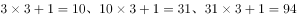，所求数字为。

故正确答案为C。

**来源**：2015年广东省公务员录用考试《行测》题（县级以上）第21题

### 第 22 题

2、10、30、68、130、

A. 222

B. 272

C. 300

D. 390

第 22 题 · 答案与解析

**参考答案（粉笔题库参考内容）**

A

**解析**

方法一：

原数列两两作差，得到新数列M：8、20、38、62、（  ）。继续两两作差得到新数列N：12、18、24、（  ），是公差为6的等差数列，故数列N括号里是30。数列M括号内为92，进而推出题干所求为130+92=222。

方法二：

这道题也能看成幂次修正数列，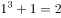、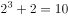、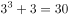、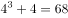、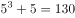，所以题干所求应为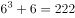。

故正确答案为A。

**来源**：2015年广东省公务员录用考试《行测》题（县级以上）第22题

### 第 23 题

19、18、26、24、33、30、40、

A. 32

B. 34

C. 36

D. 38

第 23 题 · 答案与解析

**参考答案（粉笔题库参考内容）**

C

**解析**

题干数列较长，考虑分组。

方法一：

两两分组，19-18=1、26-24=2、33-30=3、40-( )=4，分组后作差得到自然数列，故题干所求数为36。

方法二：

按照奇偶项划分，奇数项组成新数列A：19、26、33、40，是公差为7的等差数列。而偶数项组成的新数列B：18、24、30、，是公差为6的等差数列，则括号所求为30+6=36。

故正确答案为C。

**来源**：2015年广东省公务员录用考试《行测》题（县级以上）第23题

### 第 24 题

、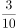、、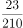、

A. 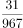

B. 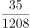

C. 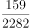

D. 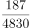

第 24 题 · 答案与解析

**参考答案（粉笔题库参考内容）**

D

**解析**

分母变化幅度很大，倍数关系为2、3、7，与前三项分子相同。再观察分子，5-2=3、10-3=7、30-7=23、210-23=187。故题干所求分数的分子应为210-23=187，分母为。

故正确答案为D。

**来源**：2015年广东省公务员录用考试《行测》题（乡镇）第24题

### 第 25 题

A. 11 7

B. 13 5

C. 17 9

D. 21 3

第 25 题 · 答案与解析

**参考答案（粉笔题库参考内容）**

B

**解析**

表格题目。按照列，或者按照行观察表格，数值较大的数字位置不固定，和差倍比也不能成关系。然后考虑每一行、每一列相加的和，结果都为148。所以左上角括号的数字应该为148-14-19-102=13。

故正确答案为B。

**来源**：2015年广东省公务员录用考试《行测》题（乡镇）第25题

### 第 26 题

阅览室有100本杂志，小赵借阅过其中75本，小王借阅过70本，小刘借阅过60本，则三人共同借阅过的杂志最少有（）本。

A. 5

B. 10

C. 15

D. 30

第 26 题 · 答案与解析

**参考答案（粉笔题库参考内容）**

A

**解析**

根据题干“三人共同借阅过的杂志最少”，即都满足的最少，判定本题为多集合反向构造。多集合反向构造的解题方法是“反向-求和-作差”，①反向：三个人没有借阅过的杂志分别是100-75=25本、100-70=30本、100-60=40本；②求和：要让共同借阅的杂志最少，就让没有借阅过的杂志不重复，三者相加一共25+30+40=95本；③作差：所以三人共同借阅的杂志最少为100－95＝5本。

故正确答案为A。

**考点**：多集合反向构造

**来源**：2015年广东省公务员录用考试《行测》题（县级以上）第26题

### 第 27 题

在一次抽奖活动中，要把18个奖品分成数量不等的4份各自放进不同的抽奖箱。则一个抽奖箱最多可以放（）个奖品。

A. 6

B. 8

C. 12

D. 15

第 27 题 · 答案与解析

**参考答案（粉笔题库参考内容）**

C

**解析**

构造思维。要让某一个抽奖箱放最多奖品，那么另外3个抽奖箱就要放最少的奖品。因为箱子的奖品数量是不等的，所以我们设3个箱子的奖品数量为1、2、3，所以最多奖品的箱子有18–1–2–3=12个奖品。

故正确答案为C。

**考点**：构造数列

**来源**：2015年广东省公务员录用考试《行测》题（乡镇）第29题

### 第 28 题

水果店一天卖出每千克为10元，12元，16元的3种水果共100千克，共收入1316元。已知售出的每千克12元和每千克16元的水果共收入1016元，那么每千克10元的水果售出了（）千克。

A. 26

B. 30

C. 34

D. 38

第 28 题 · 答案与解析

**参考答案（粉笔题库参考内容）**

B

**解析**

方法一：设三种水果分别卖x，y，z千克，根据题意可得：

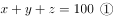

②-③得10x=300，所以每千克10元的水果售出了30千克。

方法二：三种水果一共卖了1316元，12元和16元的水果一共卖了1016元，则每千克10元的水果一共卖了1316-1016=300元，此水果一共售出了千克。

故正确答案为B。

**考点**：经济利润问题

**来源**：2015年广东省公务员录用考试《行测》题（县级以上）第28题

### 第 29 题

一个人骑车去工厂上班。他从家出发，用30分钟骑行一半的路程后，他加快了速度，以每分钟比原来快50米的速度，又骑行了10分钟。这时发现距离工厂还有2千米。那么他从家到工厂之间的距离为多少千米：

A. 6

B. 7.5

C. 8

D. 8.5

第 29 题 · 答案与解析

**参考答案（粉笔题库参考内容）**

B

**解析**

设原来的速度为每分钟x米，可得30x=10(x+50)+2000，解得x=125，所以从家到工厂的距离为米=7.5千米。

故正确答案为B。

**考点**：普通行程

**来源**：2015年广东省公务员录用考试《行测》题（乡镇）第31题

### 第 30 题

小吴到商店买布。有两种同样长的布料，小吴买了第一种布料25米，买了第二种布料12米。小吴买完后，第一种布料剩下的长度是第二种布料剩下的长度的一半。那么这两种布料原来共有多少米：

A. 26

B. 38

C. 72

D. 76

第 30 题 · 答案与解析

**参考答案（粉笔题库参考内容）**

D

**解析**

设原来一种布料有x米，可得2(x-25)=x-12，解得x=38，所以两种布料原来一共有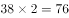米。

故正确答案为D。

**考点**：和差倍比问题

**来源**：2015年广东省公务员录用考试《行测》题（县级以上）第30题

### 第 31 题

某乡镇举行运动会，共有长跑、跳远和短跑三个项目。参加长跑的有49人，参加跳远的有36人，参加短跑的有28人，其中只参加两个项目的有13人，参加全部项目的有9人。那么参加该次运动会的总人数为多少：

A. 75

B. 82

C. 88

D. 95

第 31 题 · 答案与解析

**参考答案（粉笔题库参考内容）**

B

**解析**

设参加该次运动会的总人数为x人，根据三集合容斥原理非标准型公式可得：49＋36＋28－13－9×2＝x，采用尾数法，x的尾数为2。

故正确答案为B。

**考点**：三集合

**来源**：2015年广东省公务员录用考试《行测》题（乡镇）第30题

### 第 32 题

在400米的环形跑道上每隔16米插一面彩旗。现在要增加一些彩旗，并且保持每两面相邻彩旗的距离相等，起点的一面彩旗不动，重新插完后发现共有5面彩旗没有移动，则现在彩旗间的间隔最大可达到（  ）米。

A. 15

B. 12

C. 10

D. 5

第 32 题 · 答案与解析

**参考答案（粉笔题库参考内容）**

C

**解析**

原来一共插了400÷16＝25面旗。题中5面彩旗没动，一共分隔出5段跑道，每段400÷5＝80米。在被分隔出的80米内，原来是16米一个小段，现在被修改成另外一个长度x。两种情况下，前后两端的彩旗都没动，中间全部被移动，那代表x与16的最小公倍数为80。代入选项，C、D两项都符合要求，但题目求最大值，则选C项。

故正确答案为C。

**来源**：2015年广东省公务员录用考试《行测》题（乡镇）第32题

### 第 33 题

小李有一部手机，手机充满电后，可供通话6小时或者供待机210小时。某天，小李乘坐火车，上车时手机处于满电状态，而当他下车时手机电量刚好耗尽。如果小李在火车上的通话时长相当于他乘坐火车时长的一半，其余时间手机均为待机状态，那么他乘坐火车的时长是：

A. 9小时10分

B. 9小时30分

C. 10小时20分

D. 11小时40分

第 33 题 · 答案与解析

**参考答案（粉笔题库参考内容）**

D

**解析**

采用赋值法设手机满电电量为210，那么通话每小时消耗35，待机每小时消耗1。设乘坐火车时长为T，可得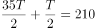，解得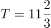。

故正确答案为D。

**考点**：给完工时间型

**来源**：2015年广东省公务员录用考试《行测》题（乡镇）第33题

### 第 34 题

某次考试中，成绩不超过30分的有153名考生，平均分为24分；成绩不低于80分的有59名考生，平均分为92分；成绩超过30分的平均分为62分；成绩低于80分的平均分为54分。那么参加这次考试的考生共有多少人：

A. 795

B. 875

C. 1007

D. 1264

第 34 题 · 答案与解析

**参考答案（粉笔题库参考内容）**

C

**解析**

设考生一共x人，则有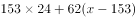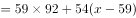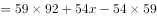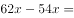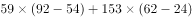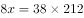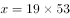，x尾数为7。

故正确答案为C。

**来源**：2015年广东省公务员录用考试《行测》题（乡镇）第34题

### 第 35 题

有两箱数量相同的文件需要整理。小张单独整理好一箱文件要用4.5小时，小钱要用9小时，小周要用3小时。小周和小张一起整理第一箱文件，小钱同时开始整理第二箱文件。一段时间后，小周又转去和小钱一起整理第二箱文件，最后两箱文件同时整理完毕。则小周和小张、小钱一起整理文件的时间分别是：

A. 1小时，2小时

B. 1.5小时，1.5小时

C. 2小时，1小时

D. 1.2小时，1.8小时

第 35 题 · 答案与解析

**参考答案（粉笔题库参考内容）**

A

**解析**

取时间的最小公倍数，设一箱文件的工作量为9，则小张、小钱、小周的效率分别为2、1、3。

方法一：

同时开始同时结束型，首先把两份文件当成一个整体，三人同时工作，整理两箱共需要9×2÷(2+1+3)=3小时，对于第一份文件，小张的工作量为3×2=6，剩余的工作量9-6=3由小周整理，则小周整理第一份文件（即为小周和小张一起整理）的时间为3÷3=1小时，所以小周和小钱一起整理的时间为3-1=2小时。

方法二：

选项信息充分，考虑代入排除法。根据小张的效率高于小钱，说明小张完成的工作量高于小钱，所以小周和小张一起整理文件的时间肯定更少，排除B、C两项。代入A项验证，第一份文件：3×2+1×3=9，第二份文件：3×1+2×3=9，完全符合题意。

故正确答案为A。

**考点**：工程问题-其他

**来源**：2015年广东省公务员录用考试《行测》题（乡镇）第35题

### 第 36 题

从所给的四个选项中，选择最合适的一个填入问号处，使之呈现一定的规律性：

A. A

B. B

C. C

D. D

第 36 题 · 答案与解析

**参考答案（粉笔题库参考内容）**

C

**解析**

元素组成相似，考查元素运算。两组图形外框相同，不做考虑，第一组图形内部，图一黑点减去图二黑点等于图三黑点。规律应用在第二组图，应保留最右边两个黑点。

故正确答案为C。

**考点**：样式规律-加减同异

**来源**：2015年广东省公务员录用考试《行测》题（乡镇）第40题

### 第 37 题

从所给的四个选项中，选择最合适的一个填入问号处，使之呈现一定的规律性：

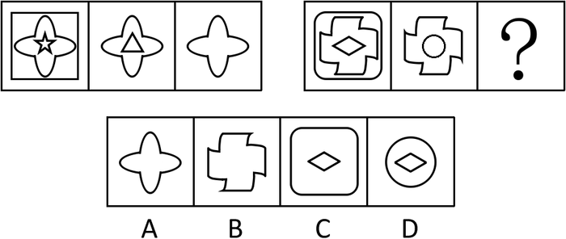

A. A

B. B

C. C

D. D

第 37 题 · 答案与解析

**参考答案（粉笔题库参考内容）**

B

**解析**

思路一：元素组成相似，考虑元素遍历。第一组图形中，所有图形都包含花朵样式，考查局部遍历。同理，第二组图形中图一与图二相同元素为B项所显示的样式。

思路二：元素组成相似，考虑元素运算。第一组图形中，图一与图二去异存同得到图三。同理，第二组图形中图一与图二去异存同可得B项。

故正确答案为B。

**考点**：样式规律-加减同异、样式规律-遍历

**来源**：2015年广东省公务员录用考试《行测》题（乡镇）第43题

### 第 38 题

从所给的四个选项中，选择最合适的一个填入问号处，使之呈现一定的规律性：

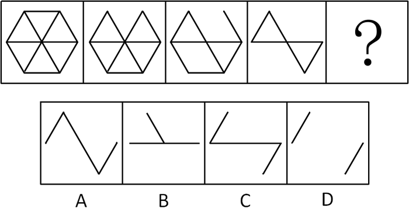

A. A

B. B

C. C

D. D

第 38 题 · 答案与解析

**参考答案（粉笔题库参考内容）**

D

**解析**

观察图形，图形存在的部分在递减，考虑数量规律，所有图形都是由等长的线段组成，分别为12、11、9、6、？，两两之间的差为1、2、3、（4），则问号处应为6–4=2条，D项符合规律。

故正确答案为D。

**考点**：数量规律-线

**来源**：2015年广东省公务员录用考试《行测》题（乡镇）第38题

### 第 39 题

从所给的四个选项中，选择最合适的一项填在问号处，使之呈现一定的规律性：

A. A

B. B

C. C

D. D

第 39 题 · 答案与解析

**参考答案（粉笔题库参考内容）**

D

**解析**

出现小黑点，考虑功能元素，考虑点与其他元素之间的位置关系，发现所有黑点都仅出现在图形的锐角处，A、B 两项存在直角处小黑点，C 项存在钝角处小黑点，排除 A、B、C 三项。

故正确答案为D。

**考点**：特殊规律-功能元素

**来源**：2015年广东省公务员录用考试《行测》题（乡镇）第44题

### 第 40 题

从所给的四个选项中，选择最合适的一个填入问号处，使之呈现一定的规律性：

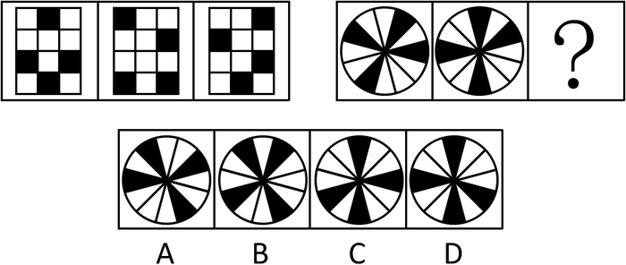

A. A

B. B

C. C

D. D

第 40 题 · 答案与解析

**参考答案（粉笔题库参考内容）**

B

**解析**

图形元素组成相同，优先考虑位置规律。第一组图中所有黑色方块均沿着外圈逆时针平移，每次移动一格。同理，第二组图中，第一个图形中的四个黑色扇形逆时针移动一格得到第二个图形，再逆时针移动一格得到B项。

故正确答案为B。

**考点**：位置规律-平移

**来源**：2015年广东省公务员录用考试《行测》题（县级以上）第40题

### 第 41 题

从所给的四个选项中，选择最合适的一个填入问号处，使之呈现一定的规律性：

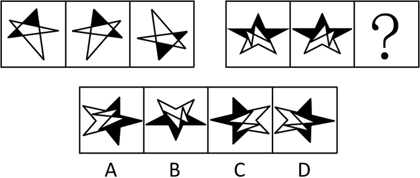

A. A

B. B

C. C

D. D

第 41 题 · 答案与解析

**参考答案（粉笔题库参考内容）**

B

**解析**

图形元素组成相同，优先考虑位置规律。观察发现，第一组图形中，第一幅图左右翻转得到第二幅图，第二幅图上下翻转得到第三幅图。第二组图形应用此规律，第一幅图左右翻转得到第二幅图，则第三幅图应由第二幅图上下翻转得到，只有 B 项符合。

故正确答案为 B。

**考点**：位置规律-翻转

**来源**：2015年广东省公务员录用考试《行测》题（乡镇）第42题

### 第 42 题

从所给的四个选项中，选择最合适的一个填入问号处，使之呈现一定的规律性：

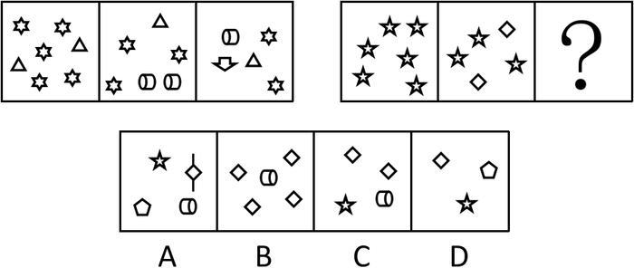

A. A

B. B

C. C

D. D

第 42 题 · 答案与解析

**参考答案（粉笔题库参考内容）**

C

**解析**

图形组成凌乱，且数量关系明显，考虑数量规律。先看整体，元素个数不一样，第一组图形中元素个数分别为 7、6、5 个，依次递减，同理可知第二组图形中元素个数应为 6、5、（4）个，排除 B、D 两项。再看局部，元素种类不一样，第一组图形中元素种类分别为 2、3、4 个，依次递增，同理可知第二组图形中元素种类应为 1、2、（3）个，排除 A 项。

故正确答案为C。

**考点**：数量规律-素

**来源**：2015年广东省公务员录用考试《行测》题（乡镇）第45题

### 第 43 题

从所给的四个选项中，选择最合适的一个填入问号处，使之呈现一定的规律性：

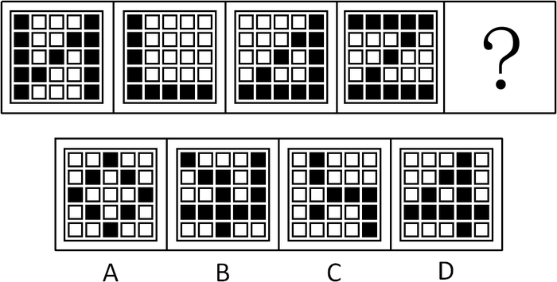

A. A

B. B

C. C

D. D

第 43 题 · 答案与解析

**参考答案（粉笔题库参考内容）**

A

**解析**

方法一：观察发现，题干图形中黑色方块部分都是由一笔画构成的，排除B、C两项，并且题干图形中均没有交叉形成的出头线段，排除D项。

方法二：题干中每幅图黑色方块都只在5×5宫格的最外圈和对角线位置出现，排除B、C、D三项。

方法三：观察发现，题干图形中黑色方块部分都是由一笔画构成的，排除B、C两项，并且题干图形中均有连在一起的两排黑块，排除A项。

本题为争议题，A、D两项均符合题干图形特征。比较A、D两项，通过两种方法都可以选到A，而D项虽然存在规律，但仔细观察发现，题干图形中的两排黑块均在最外圈，而D项的黑块并不在最外圈，因此D项并不严谨，粉笔更倾向于将A项作为正确答案。

故正确答案为A。

**考点**：数量规律-线、黑白块类

**来源**：2015年广东省公务员录用考试《行测》题（乡镇）第41题

### 第 44 题

从所给四个选项中，选择最合适的一个填入问号处，使之呈现一定的规律性：

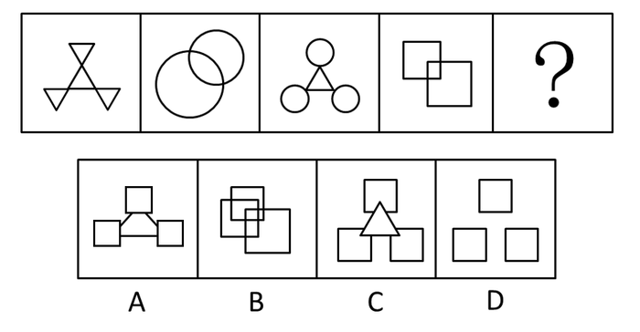

A. A

B. B

C. C

D. D

第 44 题 · 答案与解析

**参考答案（粉笔题库参考内容）**

B

**解析**

元素组成凌乱，考虑数量规律。观察发现图形都是一个整体，封闭空间较多，先考虑数面，图形面的数量分别为 4、3、4、3、（4），A、C两项都为4个面，无法确定选项，排除数面。再考虑数线，线段有曲有直，没有明显规律，但数线有一个特殊考点：一笔画。所有图形都是一笔画图形，选项中只有B项是一笔画。

故正确答案为B。

**考点**：数量规律-线

**来源**：2015年广东省公务员录用考试《行测》题（乡镇）第39题

### 第 45 题

从所给的四个选项中，选择最合适的一个填入问号处，使之呈现一定的规律性：

A. A

B. B

C. C

D. D

第 45 题 · 答案与解析

**参考答案（粉笔题库参考内容）**

A

**解析**

九宫格图形，一般考查横竖规律。元素组成看似凌乱，数量上又无明显规律，因此，只能从图形的样式入手。观察发现，第一行都有圆，第二行都有正方形，考查局部遍历，第三行相同元素为三角形，应选包含三角形的，只有 A 项符合。

故正确答案为A。

**考点**：数量规律-素、样式规律-遍历

**来源**：2015年广东省公务员录用考试《行测》题（乡镇）第36题

### 第 46 题

商场：小卖部

A. 县城：农村

B. 拖拉机：农用车

C. 水稻：莲藕

D. 工厂：作坊

第 46 题 · 答案与解析

**参考答案（粉笔题库参考内容）**

D

**解析**

第一步：判断题干词语间逻辑关系。

商场与小卖部是并列关系，且功能对应，都是出售商品，区别在于规模大小不一样，前者规模较后者更大。

第二步：判断选项词语间逻辑关系。

A项：县城与农村是并列关系，但没有功能的对应，县城属于我国行政区划，村不属于行政区划，排除。

B项：拖拉机是农用车的一种，二者是种属关系，排除。

C项：水稻和莲藕为并列关系，都为农作物，都能作为食物，不存在规模上的比较，排除。

D项：工厂和作坊是并列关系，且功能对应，都是生产商品区别同样在于规模大小不一样，前者规模较后者更大，与题干逻辑关系一致，当选。
故正确答案为D。

**考点**：逻辑关系-并列关系

**来源**：2015年广东省公务员录用考试《行测》题（乡镇）第46题

### 第 47 题

天真：幼稚

A. 小偷：强盗

B. 懵懂：糊涂

C. 公正：公平

D. 懦弱：忍让

第 47 题 · 答案与解析

**参考答案（粉笔题库参考内容）**

B

**解析**

第一步：判断题干词语间逻辑关系。

“天真”与“幼稚”都可以指思想单纯、不复杂，二者是近义关系。且“幼稚”的语义程度比“天真”更深。

第二步：判断选项词语间逻辑关系。

A项：“小偷”和“强盗”是对两种不同性质的犯罪人员的定义，二者不是近义关系，与题干逻辑关系不一致，排除；

B项：“懵懂”和“糊涂”都是用来形容不明事理,对事物的认识模糊或混乱，二者是近义关系，且“糊涂”的语义程度比“懵懂”更深，与题干逻辑关系一致，当选；

C项：“公正”和“公平”都是指不偏私，二者是近义关系，但二者之间没有语义程度的比较，与题干逻辑关系不一致，排除；

D项：“懦弱”指的是软弱无能，不坚强；“忍让”指容忍退让，二者不是近义关系，与题干逻辑关系不一致，排除。

故正确答案为B。

**考点**：语义-其他

**来源**：2015年广东省公务员录用考试《行测》题（乡镇）第51题

### 第 48 题

高大：渺小

A. 无穷：无尽

B. 春种：秋收

C. 赞誉：诋毁

D. 牛奶：面包

第 48 题 · 答案与解析

**参考答案（粉笔题库参考内容）**

C

**解析**

第一步：判断题干词语间逻辑关系。

高大和渺小是反义词关系。

第二步：判断选项词语间逻辑关系。

A项：无穷和无尽都是指没有穷尽的意思，是同义词关系，排除。B项：春种是指春天耕种，秋收是指秋天收获，二者不构成反义词关系，排除。C项：赞誉是指赞美称扬，诋毁是指污蔑诽谤，二者构成反义词关系，当选。D项：牛奶和面包都是食品，是并列关系，不构成反义词关系，排除。

故正确选项为C。

**考点**：拆分思维、语义关系-反义关系

**来源**：2015年广东省公务员录用考试《行测》题（乡镇）第47题

### 第 49 题

计算：电脑

A. 可乐：饮料

B. 热水：茶壶

C. 载货：货车

D. 火焰：灶台

第 49 题 · 答案与解析

**参考答案（粉笔题库参考内容）**

C

**解析**

第一步：判断题干词语间逻辑关系。

计算与电脑是功能对应关系，电脑的功能之一是计算，从词性上看，计算是动词，电脑是名词。

第二步：判断选项词语间逻辑关系。

A项：可乐和饮料属于种属关系，可乐是一种饮料，排除。B项：热水和茶壶是对应关系，但不是功能对应，茶壶可以用来装热水，从词性上看，热水是名词，排除。C项：载货和货车是功能对应关系，货车的功能之一是载货，从词性上看，载货是动词，货车是名词，与题干逻辑关系一致，当选。D项：火焰与灶台是对应关系，但不是功能对应，从词性上看，火焰是名词，排除。

故正确答案为C。

**考点**：逻辑关系-对应关系

**来源**：2015年广东省公务员录用考试《行测》题（乡镇）第49题

### 第 50 题

和平：战争（    ）。

A. 小生：老生

B. 油画：素描

C. 遗传：变异

D. 整齐：凌乱

第 50 题 · 答案与解析

**参考答案（粉笔题库参考内容）**

D

**解析**

第一步：判断题干词语间逻辑关系。

和平通常指没有战争或没有其它敌视暴力行为的状态，和平与战争是反义关系。

第二步：判断选项词语间逻辑关系。

A项：小生和老生都是传统戏曲角色行当，是并列关系，与题干逻辑关系不一致，排除。

B项：油画和素描是绘画的不同表现形式，是并列关系，与题干逻辑关系不一致，排除。

C项：遗传和变异是生物繁衍、生命进程中的一部分，是并列关系，与题干逻辑关系不一致，排除。

D项：不整齐指的就是凌乱，整齐和凌乱是反义关系，与题干逻辑关系一致，当选。

故正确答案为D。

**考点**：语义关系-反义关系

**来源**：2015年广东省公务员录用考试《行测》题（乡镇）第53题

### 第 51 题

艳羡：嫉妒（    ）。

A. 崇拜：迷信

B. 增长：衰退

C. 淡漠：热心

D. 排放：污染

第 51 题 · 答案与解析

**参考答案（粉笔题库参考内容）**

A

**解析**

第一步：判断题干词语间逻辑关系。

艳羡指十分羡慕，和嫉妒词义相近，且后者的程度比前者更深。

第二步：判断选项词语间逻辑关系。

A项：迷信指盲目的信仰崇拜，崇拜和迷信词义相近，且后者的程度比前者更深，与题干逻辑关系一致，当选；

B项：增长和衰退是反义关系，与题干逻辑关系不一致，排除；

C项：淡漠和热心是反义关系，与题干逻辑关系不一致，排除；

D项：排放和污染不是近义关系，与题干逻辑关系不一致，排除。

故正确答案为A。

**考点**：语义-其他

**来源**：2015年广东省公务员录用考试《行测》题（县级以上）第51题

### 第 52 题

花木：盆景

A. 布料：窗帘

B. 轮胎：汽车

C. 墨水：书画

D. 石头：假山

第 52 题 · 答案与解析

**参考答案（粉笔题库参考内容）**

D

**解析**

第一步：判断题干词语间逻辑关系。

题干中花木与盆景是原材料和成品的对应关系，花木是盆景的主要制作材料，且盆景为观赏性景物。

第二步：判断选项词语间逻辑关系。

A项，布料与窗帘是原材料和成品的对应关系，布料是窗帘的主要制作材料，但窗帘不是观赏性景物，不符合题意，排除；

B项，轮胎与汽车是组成关系，不符合题意，排除；

C项，墨水与书画是对应关系，但书画不是由墨水制作而成，不符合题意，排除；

D项，石头与假山是原材料和成品的对应关系，石头为假山的主要制作材料，且假山是观赏性景物，与题干逻辑关系一致，符合题意，当选。

故正确答案为D。

**考点**：逻辑关系-对应关系

**来源**：2015年广东省公务员录用考试《行测》题（乡镇）第52题

### 第 53 题

近视：远视

A. 雨水：冰雹

B. 瘦弱：肥胖

C. 前进：后退

D. 收缩：松弛

第 53 题 · 答案与解析

**参考答案（粉笔题库参考内容）**

B

**解析**

第一步：判断题干词语间逻辑关系。

近视与远视为相反相对的两种状态，且均为人体的一种非健康状态。

第二步：判断选项词语间逻辑关系。
A项：雨水与冰雹是并列关系，排除；

B项：瘦弱与肥胖是相反的状态，且均为人体的一种非健康状态，与题干逻辑关系一致，当选；

C项：前进与后退仅为反义关系，与人体健康无关，排除；

D项：收缩和松弛不是反义词，收缩的反义词应该是扩大，松弛的反义词应该是紧绷，排除。

故正确答案为B。

**考点**：逻辑关系-并列关系

**来源**：2015年广东省公务员录用考试《行测》题（乡镇）第50题

### 第 54 题

散步：走路：赶路

A. 战斗：战役：战争

B. 想象：理想：幻想

C. 休闲：无聊：空虚

D. 好感：喜欢：热爱

第 54 题 · 答案与解析

**参考答案（粉笔题库参考内容）**

D

**解析**

第一步：判断题干词语间逻辑关系。

散步、走路和赶路属于并列关系，都是指走路，且存在程度上的差异，三个词所形容的走路速度上越来越快。

第二步：判断选项词语间逻辑关系。

A项：战斗、战争、战役的区别在于规模不同，其中战役是指为实现一定的战略目的，按照统一的作战计划，在一定的方向上和一定的时间内进行的一系列战斗的总和，即战役由战斗组成，二者为组成关系，与题干逻辑关系不一致，排除；

B项：想象与幻想属于种属关系，与题干逻辑关系不一致，排除；

C项：休闲与无聊、空虚不构成关系，与题干逻辑关系不一致，排除；

D项：好感、喜欢与热爱属于并列关系，且存在程度上的差异，好感是轻微的喜欢，热爱是强烈的喜欢，三个词所形容的爱的程度越来越深，与题干逻辑关系一致，当选。

故正确答案为D。

**考点**：逻辑关系-并列关系

**来源**：2015年广东省公务员录用考试《行测》题（县级以上）第54题

### 第 55 题

空气：空调：冷气

A. 信号：电视：图像

B. 食材：烹饪：美食

C. 面粉：烤箱：面包

D. 石油：提炼：汽油

第 55 题 · 答案与解析

**参考答案（粉笔题库参考内容）**

A

**解析**

第一步：判断题干词语间逻辑关系。

空气经过空调处理之后变成冷气，三者是对应关系，且空调是一种电器。

第二步：判断选项词语间逻辑关系。

A项：信号经过电视处理之后变成图像，三者是对应关系，且电视是一种电器，与题干逻辑关系一致，当选；

B项：食材经过烹饪后成为美食，但烹饪是个动作，而非电器，与题干逻辑关系不一致，排除；

C项：面粉需要经过处理成为面团后，才能放入烤箱做出面包，所以烤箱不能直接处理面粉，与题干逻辑关系不一致，排除；

D项：石油经过提炼后成为汽油，但提炼是个动作，而非电器，与题干逻辑关系不一致，排除。

故正确答案为A。

**考点**：逻辑关系-包容关系、逻辑关系-对应关系

**来源**：2015年广东省公务员录用考试《行测》题（乡镇）第54题

### 第 56 题

只有遇到下雨天，客车才不会准时到达。现在，客车没有准时到达，所以（    ）遇到下雨天。

填入画横线部分最恰当的一项是：

A. 没有

B. 可能

C. 一定

D. 不可能

第 56 题 · 答案与解析

**参考答案（粉笔题库参考内容）**

C

**解析**

第一步：先翻译题干。

–准时到达→下雨；–准时到达。

第二步：逐一判断选项。

根据前推后原则，–准时到达可推知一定下了雨。

故正确答案为C。

**考点**：常规翻译

**来源**：2015年广东省公务员录用考试《行测》题（乡镇）第61题

### 第 57 题

已知甲、乙、丙、丁四人具有以下直系、旁系血亲关系：甲是乙的父亲，丙是甲的弟弟，丁是丙的母亲。则甲、乙、丙、丁四人中年龄最大的是：

A. 甲

B. 乙

C. 丙

D. 丁

第 57 题 · 答案与解析

**参考答案（粉笔题库参考内容）**

D

**解析**

本题可用排除法，由于甲是乙的父亲，可知：甲＞乙，因此乙肯定不是年龄最大的，排除B项；由丙是甲的弟弟，可知甲＞丙，因此丙肯定不是年龄最大的，排除C项；由丁是丙的母亲，可知丁＞丙，而丙是甲的弟弟说明甲与丙是同辈，因此丁肯定也大于甲，排除A项，故丁年龄最大。

故正确答案为D。

**考点**：排除法

**来源**：2015年广东省公务员录用考试《行测》题（乡镇）第59题

### 第 58 题

海水经过海水淡化技术的处理可变成淡水，而海水的量是极其巨大的。因此，无须节约使用淡水资源。最能质疑上述结论的是：

A. 近海海水的污染比较严重

B. 海水淡化成本高昂

C. 冰川水储量巨大，可替代海水淡化

D. 地球上的水资源总量是恒定的

第 58 题 · 答案与解析

**参考答案（粉笔题库参考内容）**

B

**解析**

第一步：找到论点论据。

论点：无须节约使用淡水资源。论据：海水经过海水淡化技术的处理可变成淡水，海水的量巨大。

第二步：逐一分析选项。

A项：近海海水污染严重说明近海海水被淡化的可行性不大，补充反面论据进行削弱，但是只说到了近海海水污染，属于局部削弱。B项：淡化成本高说明海水淡化有难度，通过这样的方式转化水资源并不现实，仍然需要节约用水，补充反面论据削弱题干。C项：冰川水可替代海水淡化，跟海水能否变成淡水及到底需不需要节约用水均没有直接的联系，故属于无关选项。D项：总量恒定说明水资源的量永远不会变少，不需要节约，通过补充新论据支持了论点。A项属于局部削弱，削弱力度没有B项强。

故正确答案为B。

**考点**：削弱论点

**来源**：2015年广东省公务员录用考试《行测》题（县级以上）第58题

### 第 59 题

有甲、乙两家公司，甲公司售后服务部门接到的产品投诉电话是乙公司的3倍。因此，甲公司产品的质量没有乙公司的好。以下最能反驳上述结论的是：

A. 乙公司的产品操作相对来说更为简单

B. 甲公司接到电话大多数是咨询电话

C. 甲公司的咨询电话机数量比乙公司多

D. 甲公司产品的市场占有率达到76%

第 59 题 · 答案与解析

**参考答案（粉笔题库参考内容）**

D

**解析**

第一步：找到论点和论据。

论点：甲公司产品的质量没有乙公司的好。论据：甲公司售后服务部门接到的产品投诉电话是乙公司的3倍。

第二步：逐一判断选项。

A项：操作简单与质量好坏无关，属于无关选项，排除；B项：咨询电话并非投诉电话，与产品质量无关，也无法说明甲的投诉电话到底是不是乙的3倍，因此，属于无关选项，排除；C项：电话机数量与产品质量无关联，属于无关选项，排除；D项：表明甲公司产品市场占有率至少是乙公司的3倍多（甲是76%，那么乙最多才24%），而接到的产品投诉电话仅为乙公司的3倍，说明甲公司的实际投诉率要比乙公司低，即：甲公司产品质量反而比乙公司更好，拆断了论点和论据之间的必然联系，拆桥项，当选。

故正确答案为D。

**考点**：拆桥

**来源**：2015年广东省公务员录用考试《行测》题（乡镇）第58题

### 第 60 题

某高中只有文科班和理科班，男生人数比女生多，理科班人数比文科班多。根据以上条件，可以判断下列说法必定为真的是：

A. 文科班的男生总人数多于文科班的女生总人数

B. 理科班的男生总人数多于理科班的女生总人数

C. 文科班的男生总人数多于理科班的女生总人数

D. 理科班的男生总人数多于文科班的女生总人数

第 60 题 · 答案与解析

**参考答案（粉笔题库参考内容）**

D

**解析**

分析题干已知条件可知：①男> 女；②理> 文。

由于高中只有文科班和理科班，①可以转化成③男（理+ 文）> 女（理+ 文），

即：男理+ 男文> 女理+ 女文；

同理②可以转化为④理（男+ 女）> 文（男+ 女），即：男理+ 女理> 男文+ 女文；

③ + ④可得：2 男理+ 男文+ 女理>2 女文+ 女理+ 男文，

去掉相同项可知2 男理>2 女文，即男理> 女文，只有D 项符合。

故正确答案为D。

**考点**：框架题

**来源**：2015年广东省公务员录用考试《行测》题（乡镇）第60题

### 第 61 题

据统计，和去年相比，今年1月以来流感患者的数量有明显的下降。这得益于新型特效药的发明和投入使用。以下最能反驳上述结论的是：

A. 2月份为流感的高发期

B. 流感患者很少到医院去治疗

C. 流感病毒具有抗药性

D. 新型特效药定价高，患者使用少

第 61 题 · 答案与解析

**参考答案（粉笔题库参考内容）**

D

**解析**

第一步：找到论点和论据。

论点：今年1月份以来流感患者数量的明显下降得益于新型特效药的使用。无明显论据。

第二步：逐一判断选项。

A项：时间的说明与特效药毫无关联，2月份是流感的高发期无法证明1月份流感数量下降的原因是什么，为无关项，排除。

B项：流感患者很少去医院治疗无法说明是否使用药物，为无关项，排除。

C项：具有抗药性并不能说明特效药无效，抗药性针对的一定是使用过的药物，而非新研发的药物，因此，为无关项，排除。

D项：患者使用特效药少，流感患者数量却明显下降，说明流感人数的下降并非特效药的功劳，削弱论点，当选。

故正确答案为D。

**考点**：削弱论点

**来源**：2015年广东省公务员录用考试《行测》题（乡镇）第56题

### 第 62 题

某项科学研究发现：经常使用左手能更好地锻炼右脑，使得人的形象思维能力增强，更利于促进创造性思维的发展。但事实证明：发明家中左撇子的比例并不高。因此，这个科学研究的结论不可信。以下最能削弱上述结论的是：

A. 用右手也可以达到锻炼右脑的效果

B. 用右手的人数大大超过用左手的人数

C. 发明创造主要依靠天赋，而非后天锻炼

D. 发明创造不依靠形象思维能力

第 62 题 · 答案与解析

**参考答案（粉笔题库参考内容）**

B

**解析**

第一步：找到论点和论据。

论点：科学研究（经常使用左手能更好地锻炼右脑，使得人的形象思维能力增强，更利于促进创造性思维的发展）不可信。论据：发明家中左撇子的比例并不高。

第二步：逐一判断选项。

A项：谈论的是右手的作用，题干谈论的是左手的作用，话题不一致，为无关选项，排除。

B项：用右手的人数大大超过左手的人数，说明左撇子在人群中本身比例不高，可见发明家中左撇子比例不高很正常，不能由此得出科学研究的结论不可信，削弱论证，当选。

C、D两项：发明创造主要依靠天赋，不依靠形象思维能力，也就证明了题干中科学研究的不可信，都属于加强论点，排除。

故正确答案为B。

【本题相关知识点】论据是一对矛盾现象。如果给出理由，能够解释两种现象可以并存，那么说明结论是可信的。（题干的论点说结论不可信，也就是说把矛盾解释通了即为反驳论点。B项为反驳论点）如果给出理由达到激化矛盾，或者加强矛盾，也就意味着支持了论点“结论不可信”。C、D两项为支持论点。

**考点**：拆桥

**来源**：2015年广东省公务员录用考试《行测》题（乡镇）第57题

### 第 63 题

有调查显示，那些作息时间不同的夫妻，虽然每天相处的时间较少，但他们发生争吵的次数比作息时间基本相同的夫妻更多。因此，为了建立良好的夫妻关系，夫妻之间应当尽量有相同的作息时间。最能削弱上述论点的一项是：

A. 夫妻产生矛盾后，往往以作息时间不同来表现不满

B. 具有同事关系的夫妻更容易在工作上产生矛盾

C. 作息时间不同的夫妻更容易产生矛盾

D. 生活习惯不同是夫妻产生矛盾的主要原因

第 63 题 · 答案与解析

**参考答案（粉笔题库参考内容）**

A

**解析**

第一步：找到论点和论据。

论点：建立良好的夫妻关系，夫妻之间应当尽量有相同的作息时间。

论据：作息时间不同的夫妻发生争吵的次数比作息时间基本相同的夫妻更多。

第二步：逐一判断选项。

A项：“往往以作息时间不同来表现不满”为产生矛盾之后，是矛盾的结果而非原因，因果倒置，削弱论证，当选。B项：同事关系不代表作息一定相同，可能一个白班一个晚班，二者没有必然联系，为无关选项，排除。C项：“作息时间不同的夫妻更容易产生矛盾”，意思即为“作息时间相同的夫妻不容易产生矛盾”，加强论点，排除。D项：“生活习惯不同”才是夫妻产生矛盾的主要原因，而非作息时间不同，属于他因削弱，相比A项削弱论证力度更弱，排除。

故正确答案为A。

**考点**：因果倒置

**来源**：2015年广东省公务员录用考试《行测》题（乡镇）第63题

### 第 64 题

小张准备在下周去观看一场比赛，但他忘了具体是哪一天，便分别询问了甲、乙、丙、丁和戊，他们五人的回答如下：

甲：肯定是在双休日。

乙：是周二、周四、周六的其中的一天。

丙：就是周一。

丁：绝对是周一、周三、周五、周日的其中一天。

戊：肯定是周五。

甲、乙、丙、丁和戊只有一个人说对了。那么比赛时间是（    ）。

A. 周一

B. 周三

C. 周五

D. 周六

第 64 题 · 答案与解析

**参考答案（粉笔题库参考内容）**

B

**解析**

方法一：

第一步：寻找突破口。

根据题干可知乙、丁说法矛盾，其中必有一真。

第二步：看其余的话。

题干中说只有一个人说对了，则说明甲、丙、戊都不对，即周一、周五、双休日都不对，排除 A、C、D 三项，B项当选。

方法二：

本题可采取代入排除法验证求解。

A项，当为周一时，丙与丁都说对了，与题干条件不符，排除；

B项，当为周三时，仅为丁说对了，与题干条件吻合，当选；

C项，当为周五时，丁与戊都说对了，与题干条件不符，排除；

D项，当为周六时，甲与乙都说对了，与题干条件不符，排除。

故正确答案为B。

**考点**：只有一真/一假

**来源**：2015年广东省公务员录用考试《行测》题（乡镇）第64题

### 第 65 题

某市举办了一场职业技能竞赛，有甲、乙、丙、丁四支代表队进入决赛，每支队伍有两名参赛选手，获得第一名的选手将得10分，第二名得8分，第三名到第八名分别是6、5、4、3、2、1分，最后总分最高的队伍将获得冠军。比赛的排名情况如下：

甲队选手的排名都是偶数，乙队两名选手的排名相连，丙队选手的排名一个是奇数一个是偶数，丁队选手的排名都是奇数；第一名是丁队选手，第八名是丙队选手；乙队两名选手的排名在甲队两名选手之间，同时也在丙队两名选手之间。

根据以上条件，可以判断各队总分由高到低的排列顺序为：

A. 丁＞甲＞丙＞乙

B. 甲＞丁＞乙＞丙

C. 甲＞丁＞丙＞乙

D. 丁＞甲＞乙＞丙

第 65 题 · 答案与解析

**参考答案（粉笔题库参考内容）**

D

**解析**

根据题干条件，可列表为

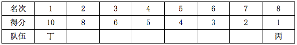

①：因乙队两名选手排名相连，甲队选手排名均为偶数，且乙队两名选手排名在甲队两名选手之间，故甲队两名选手的排名不能为2、4或4、6，只能为2、6（若为2、4或4、6，则乙队两名选手排名就不能在甲队之间）。甲为2、6；

②：乙队两名选手同时也在丙队两名选手之间，丙队选手排名一个是奇数一个是偶数，其中一个为第8名，另一个只能为第3名（若为第5或7名，则乙队两名选手不能在丙队之间） 。丙为3、8；

③：乙队两名选手排名相连，只能为第4、5名，最后推出第7名为丁。

正确排名如下：

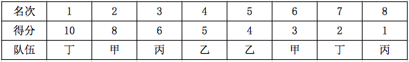

甲队得分11分，乙队得分9分，丙队得分7分，丁队得分12分，其排名为：丁>甲>乙>丙。

故正确答案为D。

**考点**：从确定信息开始推

**来源**：2015年广东省公务员录用考试《行测》题（乡镇）第65题

### 第 66 题

如下图所示，木框里面有两个平面镜相互垂直。一束入射光射入木框内，经两个平面镜反射出去。则入射光与出射光的位置关系是：

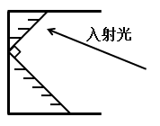

A. 平行关系

B. 垂直关系

C. 相交关系，交角为锐角

D. 相交关系，交角为钝角

第 66 题 · 答案与解析

**参考答案（粉笔题库参考内容）**

A

**解析**

方法一：

根据光的反射规律：反射角等于入射角，画出光路图，容易看出入射光线和出射光线平行。

方法二：

 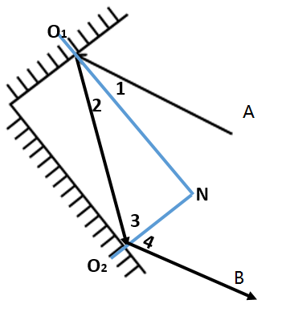

根据反射定律图解如图所示，∠1=∠2，∠3=∠4。由于两个平面镜相互垂直，所以法线也垂直，所以∠2+∠3=90°，可得∠1+∠2+∠3+∠4=180°，即，A为入射光线，B为反射光线，同旁内角互补，两直线平行。

故正确答案为A。

**来源**：2015年广东省公务员录用考试《行测》题（县级以上）第66题

### 第 67 题

如下图所示，一支试管口朝下插入水中，管内封闭有一定的量的空气，恰好悬浮在水中。当水的温度升高时，下列说法正确的是：

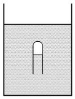

A. 试管下沉

B. 试管上浮

C. 试管先下沉后上浮

D. 试管静止不动

第 67 题 · 答案与解析

**参考答案（粉笔题库参考内容）**

B

**解析**

方法一：

水温升高前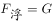，水温升高后，试管内的气体膨胀，排水量增加。根据浮力公式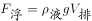，浮力增大，而试管重力不变，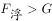，故试管上浮。

方法二：

本题考查受力分析。

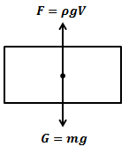

如图所示，将试管看做一个整体，此时试管受到向上的浮力和向下的重力G=mg。

初始状态，温度未升高时，二力平衡，此时。

状态改变，温度升高，根据理想气体状态方程，pV=nRT，T升高，其他条件不变，则V升高，则试管内封闭的气体的体积将会增加，增加，则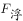增加，即向上的力增加，则该试管将向上浮。

故正确答案为B。

**来源**：2015年广东省公务员录用考试《行测》题（县级以上）第67题

### 第 68 题

如下图所示，小球A从斜面上由静止状态开始向下滑，撞击静止于水平木板上的木块B，下列说法正确的是：

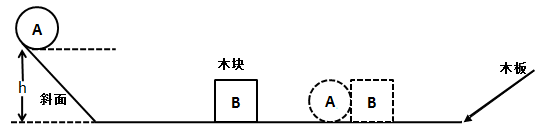

A. 小球A对木块B的作用力等于木板对木块B的摩擦力与木块B的重力相加

B. 若木板的表面光滑且足够长，小球A和木块B将一直保持匀速运动

C. 小球A在斜面上向下滑的过程中，以木板为参照物，小球是静止的

D. 小球A对木块B的作用力等于小球A的重力

第 68 题 · 答案与解析

**参考答案（粉笔题库参考内容）**

B

**解析**

方法一：

根据牛顿第三定律，小球A对木块B的作用力和木块B对小球A作用力相等，与其他因素无关。故A、D两项错。小球A下滑过程中相对木板的位置发生了变化，是运动的，故C项错。由于惯性，碰撞后木块B一直向右运动，没有摩擦，将保持匀速直线运动。A碰撞后有三种可能：质量比B大，将直接以小于B的速度向右运动，因没有摩擦而保持匀速；质量比B小，先反弹，冲上斜面，再滚下来，最后向右匀速运动，若速度比B大，追上后继续碰撞，重复前面过程，最终以小于木块B的速度向右做匀速直线运动；质量和B相等，碰撞后小球A保持静止，而静止是一种特殊的匀速直线运动，故B项正确。

方法二：

本题考查力学与运动问题。

A项错误，小球A对木块B的作用力只有水平方向的力，不存在竖直方向力，因此小球A对木块B的作用力等于木板对木块B的摩擦力，与木块B受到的重力无关。

B项正确，根据惯性定律（牛顿第一运动定律）：任何物体都要保持匀速直线运动或静止状态，直到外力迫使它改变运动状态为止。木板表面光滑且足够长，则不受到任何摩擦力，小球A撞击木块B后二者视为一个整体（忽略能量损失），二者将一直保持匀速运动状态。

C选项错误，小球A向下滑动，木板为参照物，木板与斜面均未动，小球相对于斜面在向下滑动，故小球A是运动的，而非静止的。

D选项错误，根据对A选项的分析，我们可知小球A与木块B的作用力只存在于水平方向，与竖直方向的重力无关。

故正确答案为B。

**来源**：2015年广东省公务员录用考试《行测》题（县级以上）第68题

### 第 69 题

在下图所示的电路中，电源电压保持不变，闭合开关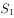、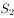后，电路正常工作。开关闭合，开关由闭合到断开时，下列说法正确的是：

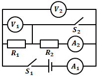

A. 电流表的示数不变

B. 电流表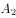的示数不变

C. 电压表的示数不变

D. 电压表的示数不变

第 69 题 · 答案与解析

**参考答案（粉笔题库参考内容）**

D

**解析**

方法一：

、闭合时，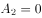，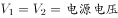。断开后，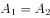，但比断开前小，故A、B两项错误。断开后，仅为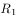两端的电压，仍与电源电压相等，故C项错误，D项正确。

方法二：

本题考查电路分析。

电压表测量的始终是电源两端的电压，与开关是否闭合无关，故的示数始终不变。

两个状态的详细分析：开关闭合，电流只通过电阻和电流表，未通过和，电压表和都是测的电源电压；开关断开，电流经过两个电阻和两个电流表，电压表测电阻的电压，示数变小了，电流表示数由0到有变大了，电流表示数变小。因此示数变小，示数变大，示数变小，的示数始终不变。

故正确答案为D。

**来源**：2015年广东省公务员录用考试《行测》题（县级以上）第69题

### 第 70 题

下图是A、B两种物质的溶解度曲线，下列说法正确的是：

A. A物质的溶解度大于B物质的溶解度

B. 温度越高，则A、B两种物质的溶解度越大

C. 将时A物质的饱和溶液降温，A物质变为不饱和溶液

D. 将时B物质的饱和溶液降温至时，没有B物质析出

第 70 题 · 答案与解析

**参考答案（粉笔题库参考内容）**

D

**解析**

方法一：

溶解度与温度有关，故A项错。B的溶解度随温度升高而降低，故B项错。时A的饱和溶液降温，将有溶质析出，故C项错。时B的饱和溶液降温至，溶解度将增大，故D项正确。

方法二：

本题考查溶解度曲线。溶解度曲线：溶解度曲线定义是同种物质在不同温度下的溶解度绘制出来的曲线。由于固体物质的溶解度随温度变化而变化，随温度一定而一定，这种变化可以用溶解度曲线来表示。我们用纵坐标表示溶解度，横坐标表示温度，绘出固体物质的溶解度随温度变化的曲线，这种曲线叫做溶解度曲线。

由物质A和物质B的溶解度曲线，我们可知，当温度在℃以下时，物质B的溶解度高于物质A的溶解度；温度到达时，二者溶解度相同；当温度大于℃后，A物质的溶解度始终高于B物质的溶解度。

A项错误，溶解度曲线可以用于比较相同温度时（或一定温度范围内）不同物质溶解度的大小，不能笼统说A物质的溶解度一定大于B物质的溶解度；

B项错误，观察溶解度曲线可知，A物质的溶解度随着温度的升高而增大，曲线为“陡升型”，B物质的溶解度随温度的升高而减小，曲线为“下降型”；

C项错误，对℃时的A物质饱和溶液降温，则随着温度的降低，A物质的溶解度也降低，A物质始终为饱和溶液；

D项正确，对℃时的B物质的饱和溶液降温，则随着温度的降低，B物质的溶解度升高，将能溶解更多的B物质，不会达到饱和即没有B物质的析出。

故正确答案为D。

**来源**：2015年广东省公务员录用考试《行测》题（乡镇）第69题

### 第 71 题

京剧脸谱采用不同色彩来表现人物的不同性格特点，其中白色用来表现：

A. 忠勇侠义

B. 刚烈正直

C. 粗豪暴躁

D. 阴险奸诈

第 71 题 · 答案与解析

**参考答案（粉笔题库参考内容）**

D

**解析**

D项正确，京剧脸谱中，白色一般表示阴险奸诈，如曹操、赵高。A项忠勇侠义一般用红色来表现，如关羽、姜维、常遇春；B项刚烈正直一般用黑色来表现，如包拯、张飞、李逵等；C项粗豪暴躁一般用蓝色或绿色来表现。

故正确答案为D。

**考点**：文化常识

**来源**：2015年广东省公务员录用考试《行测》题（乡镇）第80题

### 第 72 题

蜻蜓点水是指蜻蜓在水面飞行时轻触水面的动作，其主要是为了：

A. 求偶

B. 饮水

C. 产卵

D. 呼吸

第 72 题 · 答案与解析

**参考答案（粉笔题库参考内容）**

C

**解析**

蜻蜓的幼虫要生活在水里，为繁衍后代，蜻蜓要在有水的地方产卵。因此，蜻蜓点水实为蜻蜓产卵，卵排到水中，附在水草上，不久便孵出幼虫。

故正确答案为C。

**考点**：生活常识

**来源**：2015年广东省公务员录用考试《行测》题（乡镇）第71题

### 第 73 题

下列现象属于化学反应的是：

A. 春江水暖鸭先知

B. 蜡炬成灰泪始干

C. 玉不琢不成器

D. 绳锯木断、水滴石穿

第 73 题 · 答案与解析

**参考答案（粉笔题库参考内容）**

B

**解析**

判断一个反应是否为化学反应的依据是反应是否生成新的物质。题干四个选项中，只有B项有新的物质形成，“灰”便是“蜡炬”经过不完全燃烧生成的炭和蜡炬中杂质燃烧后的产物。A、C、D三项都属于物理现象，没有发生化学反应。

故正确答案为B。

**考点**：物理常识

**来源**：2015年广东省公务员录用考试《行测》题（县级以上）第73题

### 第 74 题

某商店贴出下列四个标语，不合法的是：

①特价商品，概不退还

②商品打折，不开发票

③小本买卖，概不赊欠

④损一赔十，偷一罚十

A. ①②③

B. ①②④

C. ①③④

D. ②③④

第 74 题 · 答案与解析

**参考答案（粉笔题库参考内容）**

B

**解析**

标语①不合法，根据《消费者权益保护法》的相关规定，对于未标明“处理品”或瑕疵状况的特价商品，如果该商品存在质量问题，经营者也应承担包修、包退、包换的“三包”义务。

标语②不合法，按相关规定，提供发票是商家的义务，和打折没有关系，商家不得以打折为由拒开发票。消费者如发现商家以任何理由拒开发票，可以向税务部门举报。

标语③是商家保护自身合法权益的声明，是合法有效的声明。

标语④不合法，商场没有处罚权，“偷一罚十”属于无效声明。

综上，四个标语中①②④均不合法。

本题为选非题，故正确答案为B。

**考点**：其他法律法规

**来源**：2015年广东省公务员录用考试《行测》题（乡镇）第81题

### 第 75 题

2014年，《注册资本登记制度改革方案》获得国务院批准通过。该方案大幅度降低了公司的设立门槛，取消了公司最低注册资本限制。这项改革最有可能产生的传导效应依次是：

①创业成本下降

②创业积极性提高

③注册资本降低

④带动就业

A. ①—②—③—④

B. ②—③—④—①

C. ③—①—②—④

D. ①—③—④—②

第 75 题 · 答案与解析

**参考答案（粉笔题库参考内容）**

C

**解析**

《注册资本登记制度改革方案》取消了公司最低注册资本限制，可见这项改革最有可能产生的传导效应，首先应该是注册资本降低，接着创业成本随之下降，人们创业的积极性从而得到提高，同时带动就业。

故正确答案为C。

**考点**：宏观经济与调控政策

**来源**：2015年广东省公务员录用考试《行测》题（乡镇）第83题

### 第 76 题

随着社会的发展，一些新的职业会不断出现。下列选项中，按照职业出现时间先后顺序排列正确的是：

A. 大学教师，火车司机，汽车修理工，软件工程师

B. 大学教师，汽车修理工，火车司机，软件工程师

C. 汽车修理工，火车司机，软件工程师，大学教师

D. 汽车修理工，软件工程师，大学教师，火车司机

第 76 题 · 答案与解析

**参考答案（粉笔题库参考内容）**

A

**解析**

火车诞生于第一次工业革命中，汽车发明于第二次工业革命中，计算机、网络等信息科学技术则是第三次科技革命的成果。而大学早在第一次工业革命之前就存在。由此可推断，选项所涉及的四个职业，按时间先后顺序排列，应该是大学教师、火车司机、汽车修理工和软件工程师。

故正确答案为A。

**考点**：中国历史

**来源**：2015年广东省公务员录用考试《行测》题（县级以上）第76题

### 第 77 题

举重运动员、体操运动员比赛前，会抓一些白色粉末（主要成分是碳酸镁）涂抹在手掌上，来增加手掌与器械之间的摩擦力。这主要是利用碳酸镁的：

A. 润滑作用

B. 吸湿作用

C. 中和作用

D. 保温作用

第 77 题 · 答案与解析

**参考答案（粉笔题库参考内容）**

B

**解析**

碳酸镁具有很强的吸湿作用。举重运动员、体操运动员在比赛时，手掌心常会冒汗，而湿滑的掌心会使摩擦力减少，因此在赛前涂抹些碳酸镁，能够吸去掌心汗水，从而增加掌心与器械之间的摩擦力，使运动员能握紧器械，提高动作质量。

故正确答案为B。

**考点**：生活常识

**来源**：2015年广东省公务员录用考试《行测》题（乡镇）第84题

### 第 78 题

存款准备金是指金融机构为保证客户提取存款和资金清算需求而准备的在中央银行的存款。存款准备金率是存款准备金占存款总额的比例。中央银行降低存款准备金率后，在市场上引起的可能反应是：

A. 商业银行可用资金增多，贷款上升，货币供应量增多，通货膨胀

B. 商业银行可用资金增多，贷款下降，货币供应量减少，通货紧缩

C. 商业银行可用资金减少，贷款上升，货币供应量增多，通货膨胀

D. 商业银行可用资金减少，贷款下降，货币供应量减少，通货紧缩

第 78 题 · 答案与解析

**参考答案（粉笔题库参考内容）**

A

**解析**

本题考查经济常识。

存款准备金率是存款准备金占其存款总额的比例。由此可知，下调存款准备金率，意味着存放在中央银行的存款准备金减少，商业银行可用资金增多，信用扩张能力增强，贷款上升，市场上流通的货币量增加，通货膨胀压力也上升。

故正确答案为A。

**考点**：宏观经济与调控政策

**来源**：2015年广东省公务员录用考试《行测》题（乡镇）第85题

### 第 79 题

冰冻的肉类在水中比在同温度的空气中解冻得快，这是因为：

A. 水的热容量比空气大

B. 水的密度比空气大

C. 水的热传递性比空气好

D. 水和冰的化学成分完全相同

第 79 题 · 答案与解析

**参考答案（粉笔题库参考内容）**

C

**解析**

冰冻的肉类在水中比在同温度的空气中解冻得快，这是因为水的热传递性比空气好，水能够较快的将热量转移给冻肉，使其更快解冻。

故正确答案为C。

**考点**：生活常识

**来源**：2015年广东省公务员录用考试《行测》题（乡镇）第77题

### 第 80 题

下列选项中，按照诗句所代表的时间先后顺序排列正确的是：

①问东城春色，正谷雨，牡丹期

②露从今夜白，月是故乡明

③微雨众卉新，一雷惊蛰始

④麦穗初齐稚子娇，桑叶正肥蚕食饱

A. ③①④②

B. ①④③②

C. ②③①④

D. ①②③④

第 80 题 · 答案与解析

**参考答案（粉笔题库参考内容）**

A

**解析**

诗句①出自元朝王恽的《谷雨日》，讲的是谷雨节气；诗句②出自唐朝诗人杜甫的《月夜忆舍弟》，讲的是白露节气；诗句③出自唐朝诗人韦应物的《观田家》，讲的是惊蛰节气；诗句④出自宋朝诗人欧阳修的《归田园四时乐春夏二首（其二）》，讲的是小满节气。因此，按这四个诗句所代表的时间先后顺序排列，应该是③①④②。

故正确答案为A。

**考点**：文学常识

**来源**：2015年广东省公务员录用考试《行测》题（乡镇）第76题

### 第 81 题

全国两会开幕前，人大代表、政协委员们为了提交议案、提案，会对经济社会发展问题进行深入的调查研究。这体现的哲理是：

A. 主观与客观具体的历史的统一

B. 具体问题具体分析

C. 科学理论对实践具有指导作用

D. 意识是人脑对客观事物的正确反映

第 81 题 · 答案与解析

**参考答案（粉笔题库参考内容）**

A

**解析**

A项正确，主观与客观具体的历史的统一是指：主观要符合客观，想问题、办事情要坚持一切从实际出发。题干中人大代表、政协委员们为提议案，对经济社会发展问题进行深入的调查研究，正是坚持从实际出发，实事求是，做到主观与客观的具体的历史的统一，当选。

B项错误，具体问题具体分析是要求人们在做事情、想问题时，要根据事情的不同情况采取不同措施，不能一概而论，与题意不符，排除。

C项错误，此项中的“科学理论”，题干中并未提及，排除。

D项错误，意识是人脑对客观存在的反映，正确的意识是人脑对客观存在的正确的反映，错误的意识是人脑对客观存在的歪曲的反映，排除。

故正确答案为A。

**考点**：认识论

**来源**：2015年广东省公务员录用考试《行测》题（乡镇）第82题

### 第 82 题

在我国，野外迷路时，下列辨别方向的方法不正确的是：

A. 树木年轮较密的一侧是南方

B. 树木枝叶茂盛的一侧是南方

C. 岩石上布满青苔的一侧是北方

D. 蚂蚁的洞口朝向的一侧是南方

第 82 题 · 答案与解析

**参考答案（粉笔题库参考内容）**

A

**解析**

野外迷路时，往往可以借助周围环境来辨别方向。在我国，树木南面的年轮较稀疏、北面的较密集；树木靠南面的枝叶较茂盛，靠北面的较稀疏；岩石上布满青苔的一面是北面，干燥光秃的一面是南面；也可借助蚂蚁洞穴来识别，蚂蚁的洞口大都朝南向。B、C、D项说法均正确。

本题为选非题，故正确答案为A。

**考点**：自然地理

**来源**：2015年广东省公务员录用考试《行测》题（乡镇）第78题

### 第 83 题

下列选项中，用热水比用冷水洗涤效果更好的是：

A. 有油渍的碗筷

B. 有汗渍的衣服

C. 有血渍的衣服

D. 有农药残留的蔬菜

第 83 题 · 答案与解析

**参考答案（粉笔题库参考内容）**

A

**解析**

A项正确，油渍不溶于水，用冷水难以去掉，而热水温度高，可以加快分子运动，使油渍更快软化，因此用热水来洗涤有油渍的碗筷，效果要比用冷水洗好。B项中的汗渍和C项中的血渍中都含有蛋白质，用热水洗容易导致蛋白质凝固，附着在衣服上，更难清洗。D项，去除有农药残留的蔬菜，通常是用清水多冲洗几遍，用热水洗，水温过高的话，容易导致蔬菜中的营养物质流失，洗涤效果不比冷水好。

故正确答案为A。

**考点**：生活常识

**来源**：2015年广东省公务员录用考试《行测》题（乡镇）第79题

### 第 84 题

我国古代有重阳节插茱萸的习俗，这种做法意在表达：

A. 敬老爱老之情

B. 对父母的感恩之情

C. 对亲朋好友的思念之情

D. 对美好生活的向往

第 84 题 · 答案与解析

**参考答案（粉笔题库参考内容）**

C

**解析**

茱萸是一种常绿带香的植物，具备杀虫消毒、逐寒祛风的功能。在古人看来，疾病与邪气密不可分，茱萸因为浓烈的气味和驱寒祛湿的药用价值，被认为具有辟邪祛疾的特殊功效。此题出题人根据王维的诗《九月九日忆山东兄弟》：独在异乡为异客，每逢佳节倍思亲。遥知兄弟登高处，遍插茱萸少一人。将答案选项设置为C项。

故正确答案为C。

**考点**：文化常识

**来源**：2015年广东省公务员录用考试《行测》题（乡镇）第72题

### 第 85 题

根据干支纪年法，2015年是乙未羊年，那么2020年是：

A. 癸丑牛年

B. 庚丑牛年

C. 庚子鼠年

D. 壬子鼠年

第 85 题 · 答案与解析

**参考答案（粉笔题库参考内容）**

C

**解析**

干支纪年是中国古代的一种纪年法，甲、乙、丙、丁、戊、己、庚、辛、壬、癸十个符号叫天干；子、丑、寅、卯、辰、巳、午、未、申、酉、戌、亥十二个符号叫地支。把十天干和十二地支一对一进行相配，共可配成60个组合，用来表示年份的次序，周而复始，循环使用。如甲子、乙丑等，经过六十年又回到甲子。由此可知，2015年是乙未羊年，2020年则是庚子鼠年。

故正确答案为C。

**考点**：文化常识

**来源**：2015年广东省公务员录用考试《行测》题（乡镇）第75题

## 材料 1

### 第 86 题

2014年月，我国手机出货量与上月相比增长率最高的月份是：

A. 2月

B. 3月

C. 6月

D. 11月

第 86 题 · 答案与解析

**参考答案（粉笔题库参考内容）**

B

**解析**

增长率大小比较。，观察第一张图，很容易就发现3月的差值（3月出货量-2月出货量）最大，并且基期值（2月的出货量）是最小的。

故正确答案是B。

**考点**：一般增长率、统计图

**来源**：2015年广东省公务员录用考试《行测》题（县级以上）第86题

### 第 87 题

2014年月，我国3G手机和4G手机出货量相差最大，最小的月份分别是：

A. 1月、8月

B. 2月、8月

C. 1月、7月

D. 2月、7月

第 87 题 · 答案与解析

**参考答案（粉笔题库参考内容）**

A

**解析**

观察选项，1月和2月，求差值较大的；7月和8月，求差值较小的。

首先观察1月出货量相差；

2月出货量相差。

1月出货量差值远远大于2月。

7月出货量相差；

8月出货量相差。

8月差值两个乘数都小于7月，所以8月份一定小于7月。

故正确答案是A。

**考点**：现期比重、统计图

**来源**：2015年广东省公务员录用考试《行测》题（县级以上）第87题

### 第 88 题

2014年月，我国2G手机出货量所占比例与上月相比有所上升的月份共有多少个：

A. 2

B. 4

C. 7

D. 8

第 88 题 · 答案与解析

**参考答案（粉笔题库参考内容）**

C

**解析**

直接查找第二张图，其中3月、4月、5月、7月、8月、10月、12月，一共7个月2G手机出货量所占比例高于前一个月。

故正确答案是C。

**考点**：直接找数、统计图

**来源**：2015年广东省公务员录用考试《行测》题（县级以上）第88题

### 第 89 题

2014年月，最接近我国手机出货量全年平均数的月份是：

A. 5月

B. 8月

C. 9月

D. 10月

第 89 题 · 答案与解析

**参考答案（粉笔题库参考内容）**

A

**解析**

方法一：

截位估算，40+21+40+41+36+42+42+30+36+34+45+45=452，，由图表可知，最接近的是5月。

方法二：

采用列表，每月份出货量取前三位有效数字，然后计算与400的差值，得下表：

其中1月+3月+4月=0、8月+11月+12月=-1、5月+10月+9月=-140、6月+7月=48、2月=-186，全部相加，总和=-279。

全年月平均出货量万，5月与此数值最接近。

故正确答案为A。

**考点**：现期平均数、统计图

**来源**：2015年广东省公务员录用考试《行测》题（县级以上）第89题

### 第 90 题

下列说法错误的是：

A. 2014年2-12月，我国手机出货量与上月相比有所下降的月份有5个

B. 2014年2月，我国2G手机和4G手机的出货量均为全年最低

C. 2014年7月，我国4G手机出货量首次超过了1500万

D. 2014年1-12月，我国3G手机出货量所占比例逐月下降

第 90 题 · 答案与解析

**参考答案（粉笔题库参考内容）**

D

**解析**

A项：观察第一张图，下降的月份有2月、5月、7月、8月、10月，共5个月，正确。B项：观察第二张图，2月的2G和4G手机的占比都是全年最低的，而且2月手机出货量是全年最低的，正确。C项：6月4G手机出货量为4245.1×34.8%≈1477万，7月4G手机出货量为4233×36.4%≈1541万，观察6月之前的占比和出货量，都没可能超过6月的量，正确。D项：2月3G手机占比83.8%比1月77.8%要大，错误。

本题为选非题，故正确答案为D。

**考点**：统计图、综合分析

**来源**：2015年广东省公务员录用考试《行测》题（县级以上）第90题

## 材料 2

2014年，全国汽车产销分别是2372万辆和2349万辆，同比增长7.3%和6.9%。汽车销售排名前十位的企业集团销售合计为2107.7万辆，比上年同期增长8.9%，高于全行业增速2个百分点。

        2014年乘用车销售1970万辆，比上年同期增长9.89%。其中轿车增速放缓，SUV、MPV依旧保持高速增长，交叉型乘用车则继续下降。乘用车分车型看：轿车销售1238万辆，同比增长3.1%；SUV408万辆，同比增长36.4%；MPV销量为191万辆，同比增长46.8%；交叉型乘用车销量为133万辆，同比下降18.1%。市场结构上，轿车占乘用车比重62.8%，比去年下降4.2个百分点；SUV占比20.7%，比去年提高4个百分点，MPV占比9.7%，比去年提高3个百分点；交叉型乘用车占比为6.8%，比去年下降2.4个百分点。

        受宏观经济和相关政策法规影响，今年的商用车市场销量降幅较大。全年商用车销售完成379万辆，同比下降6.5%，分车型看，其中货车销售318万辆，同比下降8.9%，客车销售61万辆，同比增长8.4%。货车车型中，受国四排放标准执行后带来成本上升和厂家生产准备不足等原因影响，使轻型货车出现了大幅下降，全年降幅达到了12.9%。由于轻型货车占到货车的比重较高，导致货车整体出现了较高降幅。客车方面受到城市公交（含新能源车）、校车增长及轻型客车带动，使客车市场继续保持平稳增长。

        随着政府全面出台支持发展新能源汽车的政策，企业对产品的升级改造和社会对新能源汽车认可度的提升，2014年新能源汽车有了较快的发展，全年新能源汽车销量为7.5万辆，同比增长324%，其中纯电动汽车销售4.5万辆，同比增长208%，插电式电动车销售3万辆，同比增长878%。

        中国品牌乘用车销售757万辆，同比增长4.1%，占有率为38.4%，比去年下降2.1个百分点。其中，中国品牌轿车销售277万辆，同比下降17.4%，占有率为22.4%，比去年下降5.6个百分点。中国品牌SUV销售55万辆，同比增长50.36%，占SUV市场份额为44.76%，比去年增长4.14个百分点。德、日、美、韩、法各系乘用车分别占到今年乘用车销售的20%、16%、13%、9%、4%，其中日系车占有率下降了0.34%，其余系别都有不同程度上升。

### 第 91 题

2014年汽车销量排名前十位的企业集团销量占汽车销售总量的：

A. 89.7%

B. 88.9%

C. 73.4%

D. 67.5%

第 91 题 · 答案与解析

**参考答案（粉笔题库参考内容）**

A

**解析**

求现期值比重。，计算出的结果比89%大。

故正确答案为A。

**考点**：文字资料、现期比重

**来源**：2015年广东省公务员录用考试《行测》题（乡镇）第91题

### 第 92 题

2013年乘用车销量约是商用车销量的多少倍？

A. 4.0

B. 4.4

C. 5.0

D. 5.2

第 92 题 · 答案与解析

**参考答案（粉笔题库参考内容）**

B

**解析**

求基期值倍数。。

其实在计算时，口算可知结果大于5且不等于5，这一步除法可以假设结果是5.2（D项）。然后，，结果一定大于4.2，小于5。

故正确答案为B。

**考点**：基期倍数、文字资料

**来源**：2015年广东省公务员录用考试《行测》题（乡镇）第92题

### 第 93 题

下列关于2014年乘用车各车型销量同比变化幅度的大小关系，正确的是：

A. MPV>SUV>交叉型>轿车

B. SUV>轿车>MPV>交叉型

C. SUV>交叉型>轿车>MPV

D. MPV>SUV>轿车>交叉型

第 93 题 · 答案与解析

**参考答案（粉笔题库参考内容）**

A

**解析**

由于题目问的是变化幅度，所以无需考虑增长率的正负问题。定位材料第二段，可知MPV(46.8%)>SUV(36.4%)>交叉型(18.1%)>轿车(3.1%)。

故正确答案为A。

**考点**：排序类、文字资料

**来源**：2015年广东省公务员录用考试《行测》题（乡镇）第93题

### 第 94 题

2014年商用车市场销量降幅较大，原因在于：

A. 受政府全面出台支持发展新能源汽车政策影响

B. 受宏观经济和相关政策法规影响

C. 受外国品牌汽车价格下降影响

D. 受中国品牌乘用车销售占有率下降影响

第 94 题 · 答案与解析

**参考答案（粉笔题库参考内容）**

B

**解析**

定位第三段第一句话，“受宏观经济和相关政策法规影响，今年的商用车市场销量降幅较大”。

故正确答案为B。

**考点**：文字资料、直接找数

**来源**：2015年广东省公务员录用考试《行测》题（乡镇）第94题

### 第 95 题

下列说法正确的是：

A. 2013年，全国汽车产量低于销量

B. 2014年，商用车各车型销量均有所下降

C. 2013年，新能源汽车销量不足2万辆

D. 2013年，中国品牌乘用车销售量低于德系与日系乘用车销售量之和

第 95 题 · 答案与解析

**参考答案（粉笔题库参考内容）**

C

**解析**

A项：2013年产量2210.6万辆，销量2197万辆，产量高于销量，错误；

B项：定位材料第三段，“客车销售61万辆，同比增长8.4%”，错误；

C项：定位材料第四段，“全年新能源汽车销量为7.5万辆，同比增长324%”。如果2013年销量是2万台，则2014年销量应该大于万辆。实际情况仅为7.5万辆，所以2013年销量一定不足2万台，正确；

D项：2013年中国品牌乘用车销售量占有率为38.4%+2.1%=40.5%。2013年德系占有率小于20%，日系16%+0.34%=16.34%，德系与日系的总和小于36.34%，小于中国品牌的40.5%，错误。

故正确答案为C。

**考点**：文字资料、综合分析

**来源**：2015年广东省公务员录用考试《行测》题（乡镇）第95题

## 材料 3

### 第 96 题

珠江水系2014年货运量比2013年多多少亿吨：

A. 0.5

B. 0.9

C. 1.2

D. 1.7

第 96 题 · 答案与解析

**参考答案（粉笔题库参考内容）**

B

**解析**

定位表格第二行、第三行。货运量差额亿吨。

故正确答案为B。

**考点**：简单加减计算、统计表

**来源**：2015年广东省公务员录用考试《行测》题（县级以上）第96题

### 第 97 题

珠江水系2014年客运量与2013年相差最大的是：

A. 一季度

B. 二季度

C. 三季度

D. 四季度

第 97 题 · 答案与解析

**参考答案（粉笔题库参考内容）**

B

**解析**

一季度：342-335=7；二季度：387-370=17；三季度：443-442=1；四季度：442-440=2，所以相差最大的是二季度。

故正确答案为B。

**考点**：简单加减计算、统计表

**来源**：2015年广东省公务员录用考试《行测》题（县级以上）第97题

### 第 98 题

与2013年相比，珠江水系2014年货运周转量增长率最高、最低的分别是：

A. 一季度、二季度

B. 一季度、三季度

C. 四季度、三季度

D. 四季度、二季度

第 98 题 · 答案与解析

**参考答案（粉笔题库参考内容）**

D

**解析**

从选项观察，可知题目所求为在第一季度和第四季度中的最大值，在第二季度和第三季度中的最小值。

第一季度增长率；

第四季度增长率。

观察发现，分子接近2倍关系，但是分母不到1.5倍数关系，所以第四季度增长率最高。

第二季度增长率；

第三季度增长率。

分母几乎相同，分子差别较大，所以分子小的第二季度增长率最低。

故正确答案为D。

**考点**：一般增长率、统计表

**来源**：2015年广东省公务员录用考试《行测》题（县级以上）第98题

### 第 99 题

与2013年相比，珠江水系2014年客货运输量增长率最低的是：

A. 货运量

B. 货运周转量

C. 客运量

D. 客运周转量

第 99 题 · 答案与解析

**参考答案（粉笔题库参考内容）**

C

**解析**

增长率大小比较，计算量较大。

货运量增长率；

货运周转量增长率；

客运量增长率；

客运周转量增长率。

所以增长率最低的是客运量。

故正确答案为C。

**考点**：一般增长率、统计表

**来源**：2015年广东省公务员录用考试《行测》题（县级以上）第99题

### 第 100 题

下列说法正确的是：

A. 珠江水系2014年客运量与2013年相差最大的季度是一季度

B. 珠江水系2014年货运周转量与2013年相差最小的季度是一季度

C. 与2013年相比，珠江水系2014年客运周转量增长率低于2%

D. 2013年、2014年，珠江水系货运量、客运量的最高值都出现在四季度

第 100 题 · 答案与解析

**参考答案（粉笔题库参考内容）**

C

**解析**

A项：根据第97题的解析，可知相差最大的是第二季度，错误；

B项：第一季到第四季货运周转量同比增量分别为24.9、16.2、25.5、44.6亿吨公里，相差最小的应该是第二季度，错误；

C项：根据99题的数据，2014年客运周转量增长率，远小于2%，正确；

D项：2014年客运量最高值出现在第三季，错误。

故正确答案为C。

**考点**：统计表、综合分析

**来源**：2015年广东省公务员录用考试《行测》题（县级以上）第100题

