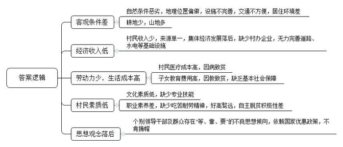
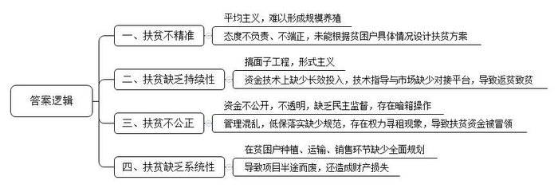
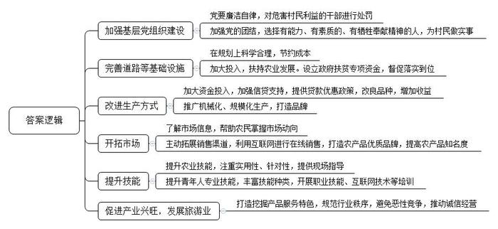

# 2016年广东省公考《申论》题（乡镇）

> 候选采集稿。参考答案及解析来自粉笔页面，不代表官方答案或真实高分答卷；来源使用许可与原卷对应关系仍需人工核实。

## 给定材料

### 材料 material-7496e4ebcfcd8b56

引言

农村贫困人口脱贫，是全面建成小康社会最突出的短板。为补齐这块短板，党的十八届五中全会提出，实施精准扶贫、精准脱贫，到2020年，我国现行标准下农村贫困人口实现脱贫，贫困县全部摘帽，解决区域性整体贫困。

广东改革开放30多年来，经济社会的快速发展和坚持不懈的扶贫开发促使农村绝对贫困基本消除，而农村相对贫困是一个长期存在的问题。在新形势下全面了解和掌握当前广东相对贫困的现状，对更加有效地开展农村扶贫开发，形成长效的脱贫机制，促进当前和今后广东农村经济社会健康稳定发展具有重大的现实意义。

中共中央政治局委员、广东省委书记胡春华在中共广东省委第十一届五次全会上强调，全面建成小康社会，核心在于“全面”，广东省需要补齐的短板有三块，其中之一便是扶贫开发的短板。胡春华书记强调，要补齐扶贫开发的短板，按照精准扶贫、精准脱贫要求，实施扶贫攻坚行动计划，坚持开发性扶贫，接力实施扶贫“双到”工程，打赢扶贫开发攻坚战，确保“十三五”末我省贫困人口全部脱贫。

2009年以来，广东省在扶贫开发工作中形成了独具特色的“双到”模式（规划到户、责任到人），各帮扶单位与贫困村结对帮扶，并选派优秀党员干部驻村工作。小张是珠三角某市直单位的一名干部，被单位选派到粤东某县A镇B村开展驻村帮扶，下面是他初到B村开展帮扶工作的一部分日记。

5月13日，星期一，小雨。

我带着行李在镇扶贫办林主任的陪同下前往B村报到，开始我为期两年的扶贫驻村工作。一路上，车辆沿着狭窄的盘山公路蜿蜒前行，两旁尽是光秃秃的山头。路上车辆和行人很少，偶尔能看到运石子的货车迎面开过来。面包车从镇里出发，走了1个小时左右，坐在前排的林主任跟司机说：“小李，前面岔路口转右。”车子转入一条泥路，路不宽，沿途散落着低矮破旧的泥房，听林主任说，村里大多数人都住这样的房子，阴冷潮湿蚊虫多。因为刚下过雨，路面坑坑洼洼，面包车颠簸着走了20多分钟才到达B村村委会。村委会坐落在山腰旁，是一排有5间房间的泥砖房，可能是建设时间较早，显得有点破旧。看着眼前的景象，我为当地贫困深感震撼，也坚定了我驻村帮扶的决心。

5月14日，星期二，多云。

今天，召开村两委干部会议，讨论研究脱贫工作。据村党支部陈书记介绍，B村位于A镇东北部，离镇政府驻地33公里，村辖区总面积约5650亩，其中耕地仅有350亩，其余都是山地，是A镇山地最多的村。全村1600多人，村民主要靠种植花果苗木、外出打工和手工制作等维持生活，收入普遍不高。

当我问到村集体经济发展情况时，陈书记说：“我村集体经济基本上是一张白纸，没有村办企业，村集体唯一的收入是出租100亩山地给一个老板开办果苗场，每年只有5万元。由于集体没有钱，村里也没有能力改善道路、水电等基础设施，希望工作队能给我们出出点子，想想办法。”

村里现有贫困户48户，201人，其中大多数是扶贫工作难啃的硬骨头：有20户家里劳动力只有一个，而家庭成员中至少有一个是残疾的或者得重病的；也有5户贫困家庭是因为家里发生重大变故，变成单亲家庭，而子女又比较小，需要长期帮扶的；还有10户家庭收入不高，是因为子女考上高中或者大学，无力承担高额教育费用而导致的。

6月6日，星期四，晴。

早上跟村支委老彭到贫困户刘叔家走访。刘叔一家四口，有一个正在读高中的女儿和一个读初中的儿子，老婆芳姨是个传统的农村妇女，在家照顾刘叔和打理自家的一亩承包地。刘叔原来在一家运输公司当长途司机，月收入有5000多元，2013年10月开车出了车祸导致双腿截肢，基本丧失劳动能力，生活不能自理，需要芳姨照顾日常起居。家庭主要经济支柱一下子倒了，刘叔一家生活陷入了困境。2014年6月，刘叔向村委会申请纳入贫困户帮扶范围，村委会按照上级制定的贫困户标准对刘叔的申请进行了审核、民主评议、公示、上报审批等，从2014年8月起纳入贫困户帮扶范围。

下午，梅婶到村委会为其准备入读大学的儿子办理贫困户证明，以便申请贫困户子女教育补贴。梅婶是我比较关注的贫困户，老公前几年得癌症去世了，她独自抚养两个小孩。大儿子今年考上大学，光学杂费就要六千多元；小儿子还在县上读高中，每个月光伙食费就得500块。现在梅婶在镇上的一家制衣厂当车间包装员，月收入仅1000多元，无法承担两个儿子高额的教育费用，生活拮据。

8月16日，星期二，阴天。

跟村干部到果苗场了解村民就业情况。据果苗场郭老板介绍，他承包的果苗场需要3个技术人员和15个工人，因为村民普遍文化素质较低，也没有果苗培育专业技能，他不得不高价从县里雇用技术人员。本来也想帮忙安置一些贫困户，帮助他们增加收入，但他们不是嫌劳动强度大，就是嫌工资低不肯来，现在场里只有2名贫困户，而其他工人都是从隔壁村雇来的。

9月13日，星期五，晴。

晚上，村里老党员老杜过来我宿舍串门。老杜今年63岁，党龄有41年，曾经担任过村党支部书记，在村民中有很高的威信。我热情地招呼老杜坐下，给他泡了―杯茶。原来，老杜是过来跟我探讨扶贫脱贫工作的。老杜对我说：“小张，关于村里脱贫工作，最近有一些不良思想倾向。比如说，上个星期召开的党员会议上，有干部就提出，要积极向上级和帮扶单位要政策、要项目、要资金、要贫困户指标，这样村里的工作就好开展了，只要把项目和帮扶资金落实好，村里就天下太平了，可以年年享受国家的优惠政策，就算把贫困村的帽子多戴几年也值了。另外，我隔壁家的小林跟我反映，村头的杨家新增了两个劳动力，按道理应该要脱贫了，但是杨家千方百计找理由强调困难，就是不肯摘帽。对于这些思想倾向，我是坚决反对，也希望你能多做做村干部和贫困户的思想工作，这种观念真是不能要的。”

### 材料 material-b2d32c1ca2097a1c

C镇位于粤赣边界，下辖21个村（居）委会。总人口31591人，其中贫困户1192户，贫困人口4648人。全镇总面积243.2平方公里，其中可开发耕地面积仅为29200亩，自然条件较差，经济发展水平落后，是我省重点帮扶的贫困地区。

自省扶贫开发“双到”工作启动以来，先后有多个对口支援单位驻村帮扶。通过六年两轮帮扶，C镇被帮扶贫困户生活状况大为改善，被帮扶村村容村貌焕然一新，C镇经济社会内生动力明显增强、发展速度显著提高。截至2015年底，全镇贫困户人均纯收入已由2009年的2320元提高到9371元，扶贫成效显著。

为了更真实、准确地了解该镇的贫困人口状况，进一步推动在更高层次上的精准扶贫，镇扶贫办组成工作队深入走访了部分贫困村。

塘西村党支部段书记正在给贫困户发放种鸡。段书记说：“这是今年村里向对口帮扶单位积极争取来的，贫困户每户15只。我们希望全村贫困户都能通过养鸡早日脱贫致富。”按照发放名册，前来领取种鸡的贫困户有的是病人，有的是残疾人，有的是行动不便的老年人，也有壮年劳动力。

刚领完种鸡的林斌是个三十岁出头的小伙，家里虽然贫困，但是他黝黑的脸上透露出希望摆脱贫穷的强烈愿望：“还是挺无奈的，村里发放扶贫种鸡，不管你能不能养，平均分发下去，他们任务就算完成了。但有些贫困户年纪大、身体差，根本搞不了养殖，往年分发给他们的种鸡也只能拿去卖钱或者等鸡大点了再吃掉，年年如此，生活并没有什么改善。我可不想再过穷日子了，我想成批量的养殖，可才发了15只，根本成不了规模啊。”

当工作队走到村尾时，看到镇里几年前大张旗鼓设立的“苗木科技示范园”，如今已大门紧闭，一点也看不出往日的影子。村民们抱怨道：“当时办这个示范园，征了村里的地，说是按照日后租金回报给村集体，开始的时候轰轰烈烈，县里、镇里派专人管理，各级领导都来参观，可风光了！可是仅仅开了不到半年，示范园就因为没有后续资金而关门了，干部和技术人员也撤走了，留下空荡荡的园区，长满了野草。如此扶贫项目别说示范作用，连正常效益都没有，你说建它干嘛？还不如不建呢。”

“就是，当时说这里是县长挂点扶贫点，县长一发话，县属企业跟着就来投资了，可现在县长一调走，企业立马撤资，你说这到底是为我们村民谋福利还是给领导脸上贴金呢？”

来到田东村时，贫困户普遍向工作队反映，现在农村的扶贫项目及资金，包括吃低保，都是村干部私下商定后就悄悄上报了。从没有开过村民大会或者搞过公示，镇里有什么优惠政策他们都不知道。贫困户丁大哥说：“就以前几天村里发放的扶贫种茶款为例，我们田东有8家人领到扶贫款。在我们村，大家都知道的栽有茶树的4个贫困户，没领到一分钱的补助，倒是好几个家庭条件较好且一棵茶树未栽的人家，凭借与村干部的关系各领了2000元的补助。至于低保人员，村里就更是一本糊涂账了。”

在山脚村，贫困户李叔听说工作队来了，赶紧来诉苦：“帮扶确实年年都有，但帮扶单位和帮扶项目换来换去，到头来我连一个项目都没有搞好。”李叔一脸沮丧地说：“最早扶贫单位给我们带来了技术人员，指导我们种辣椒，但是才种了两年，就因为市场价格暴跌，项目根本赚不到钱而终止了。后来又来了扶贫队让我们种番薯，虽然当年番薯大丰收，却由于村内道路破旧，运输货车无法进入，番薯根本运不出去，最后只能眼睁睁的看着番薯烂在地里。”李叔没能力跟上帮扶单位的“快节奏”，项目基本上都半途而废。

说起项目来，贫困户张婶也是满肚子苦水：“以前扶贫单位帮我们把水塘挖起来了，说是养鱼成本低，脱贫见效快，于是我们几家贫困户在镇里惠农补助外又东拼西凑了差不多两万元，买了3000尾鱼苗放下去养。不知道是咋回事，不到三个月鱼苗就死了上千尾，剩下的鱼长成了，我们也不知道拿去哪里卖，后来寒潮来了好多鱼都冻死了，我们几户钱没赚到，本都赔了进去，不但没有脱贫反而欠下了一屁股的债，像这样的帮扶，没有一点保障，你让我们哪里还有信心啊！”

## 题目

### 第 1 题

**请根据材料**1**中驻村干部小张的工作日记，简要分析导致B村贫困的主要原因。（本题30分）**

关联材料：material-7496e4ebcfcd8b56

作答要求：

要求：分析全面、透彻，条理清晰，表达准确。篇幅不超过300字。

### 第 2 题

**假设你是C镇扶贫工作队队员，请根据材料**2**分析指出该镇扶贫工作存在的主要问题。（本题30分）**

关联材料：material-b2d32c1ca2097a1c

作答要求：

要求：分析全面、透彻，条理清晰，表达准确。篇幅不超过300字。

### 第 3 题

**通过两轮扶贫开发“双到”工作，D镇扶贫工作取得了一定成效，但还存在一些亟待解决的问题。请根据材料**3**，就D镇进一步做好精准扶贫工作提出对策建议。（本题40分）**

关联材料：material-7496e4ebcfcd8b56

作答要求：

要求：建议合理、有针对性，条理清晰，表达准确。篇幅不超过500字。

## 答案与解析

第 1 题

**参考答案（粉笔题库参考内容）**

一、客观条件差。自然条件恶劣，地理位置偏僻，设施不完善，交通不方便，居住环境差；耕地少，山地多。

二、经济收入低。村民收入少，来源单一，集体经济发展落后，缺少村办企业，无力完善道路、水电等基础设施。

三、劳动力少，生活成本高。村民医疗成本高，因病致贫；子女教育费用高，因教致贫，缺乏基本社会保障。

四、村民素质低。文化素质低，缺少专业技能；职业素养差，缺少吃苦耐劳精神，好高骛远，自主脱贫积极性差。

五、思想观念落后。个别领导干部及群众存在“等、靠、要”的不良思想倾向，依赖国家优惠政策，不肯摘帽。

**解析**

**参考答案说明：**本答案从“客观条件差”“经济收入低”“劳动力少，生活成本高”“村民素质低”“思想观念落后”这五个方面原因进行了分条撰写。每条要点之间内容上没有交叉。

**考点**：考点原因类

**来源**：来源2016年广东省公考《申论》题（乡镇）

粉笔申论页面对本题只提供「解析视频」入口，该入口是会员推广位，页面无视频地址与文字解析。

第 2 题

**参考答案（粉笔题库参考内容）**

一、扶贫不精准。平均主义，难以形成规模养殖；态度不负责、不端正，未能根据贫困户具体情况设计扶贫方案。

二、扶贫缺乏持续性。搞面子工程，形式主义；资金技术上缺少长效投入，技术指导与市场缺少对接平台，导致返贫致贫。

三、扶贫不公正。资金不公开，不透明，缺乏民主监督，存在暗箱操作；管理混乱，低保落实缺少规范，存在权力寻租现象，导致扶贫资金被冒领。

四、扶贫缺乏系统性。在贫困户种植、运输、销售环节缺少全面规划；导致项目半途而废，还造成财产损失。

**解析**

**参考答案说明：**本参考答案从“扶贫不精准”“扶贫缺乏持续性”“扶贫不公正”“扶贫缺乏系统性”这四个方面对“扶贫工作”中存在的问题进行了分条撰写。各条答案要点之间在内容上是并列关系，没有交叉。

**考点**：考点问题类

**来源**：来源2016年广东省公考《申论》题（乡镇）

粉笔申论页面对本题只提供「解析视频」入口，该入口是会员推广位，页面无视频地址与文字解析。

第 3 题

**参考答案（粉笔题库参考内容）**

D镇需要在加强党组织建设，完善基础设施建设，满足群众需求，改善群众生产生活条件，提供长期稳定的增收致富渠道等方面进一步完善精准扶贫工作：

一、加强基层党组织建设。1.党要廉洁自律，对危害村民利益的干部进行处罚。2.加强党的团结，选择有能力、有素质的、有牺牲奉献精神的人，为村民做实事。

二、完善道路等基础设施。1.在规划上科学合理，节约成本。2.加大投入，扶持农业发展。设立政府扶贫专项资金，督促落实到位。

三、改进生产方式。1.加大资金投入，加强信贷支持，提供贷款优惠政策，改良品种，增加收益。2.推广机械化、规模化生产，打造品牌。

四、开拓市场。1.了解市场信息，帮助农民掌握市场动向。2.主动拓展销售渠道，利用互联网进行在线销售，打造农产品优质品牌，提高农产品知名度。

五、提升技能。1.提升农业技能，注重实用性、针对性，提供现场指导。2.提升青年人专业技能，丰富技能种类，开展职业技能、互联网技术等培训。

六、促进产业兴旺，发展旅游业。打造挖掘产品服务特色，规范行业秩序，避免恶性竞争，推动诚信经营。

**解析**

**参考答案说明**：（1）内容方面，本参考答案在宏观上采用了“总-分”的逻辑结构，先整体描述扶贫工作要改进的方向，后分情况描述具体问题。微观上，本参考答案分别从党建、基础建设、生产、市场、技能、产业六个方面描述具体问题。（2）形式上，参考答案做到了分段、分条撰写，整体上条理较为清晰，且各要点之间在内容上没有交叉。

**考点**：考点提出对策类

**来源**：来源2016年广东省公考《申论》题（乡镇）

粉笔申论页面对本题只提供「解析视频」入口，该入口是会员推广位，页面无视频地址与文字解析。

