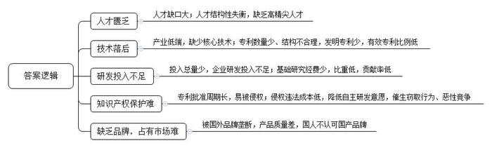
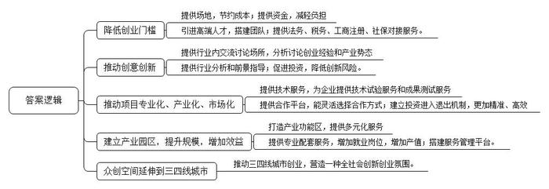
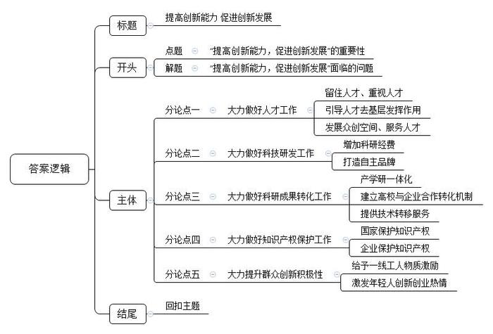

# 2016年广东省公考《申论》题（县级）

> 候选采集稿。参考答案及解析来自粉笔页面，不代表官方答案或真实高分答卷；来源使用许可与原卷对应关系仍需人工核实。

## 给定材料

### 材料 material-966ba69f50bd75a4

2015年1-10月，我国乘用车累计销售1648.47万辆，同比增长3.89%。中国车市以“低增长”的方式缓慢前行，人才匮乏成为制约汽车行业快速发展的最大瓶颈。据汽车行业一专家介绍，目前中国汽车行业研发、生产技术人才缺口40万，汽车销售和售后人才缺口70万，累计缺口达100多万。他说：“整体而言，目前汽车行业人才参差不齐，缺乏高精尖人才，影响中国由汽车大国走向汽车强国的步伐。”

对于我国机器人产业而言，最大的难题则在于技术。近两年，中国本土机器人厂商猛增至近千家，但主要扎堆中低端机器人的制造。减速器，特别是被机器人产业业内称之为机器人“御用”的RV减速器在我国起步太晚，基本空白。

RV减速器设计需专用软件，仅通过测绘无法得到精确的齿形数据，零件加工精度要求极高，加工困难。由于无法简单“山寨”，RV减速器的自主研发道路极其艰难。到目前为止，中国人申请的RV减速器专利仅26件，有效专利只有13件，发明专利只有2件，且都不属于核心技术。国外申请人在华申请了专利47件，其中有效的26件，全部是发明专利。

近年来，随着创新战略的加快推进，我国研发支出呈现快速增长趋势，研发经费占GDP的比重逐年增长，2013年首次突破了2%。2014年，研发经费占GDP的比重提升至2.09%。数据表明，我国正在向创新型国家转变。

尽管如此，相比发达国家，我国仍有不小的差距。据统计，美国2012年的研发投入为4535亿美元（约合人民币2.8万亿元），中国2014年的相关投入约为1.3万亿元人民币，不足美国2012年投入的一半。

作为科研经费投入的当然主体，目前，我国超过70%的研发经费来自企业。但与国际同行相比，我国企业的研发投入强度还有差距，如华为的投入强度为8.9%，而微软近14.6%；东风汽车为2.1%，而日本丰田为3.6%，德国大众为5.2%。

此外，我国用于基础研究的经费长期偏少，2013年用于基础研究的经费仅占研发经费总额的4.7%，远低于发达国家15%~25%的比例。我国企业用于基础研究经费的贡献很少，仅占全部基础研究经费的1.55%，远远不及美国的21.33%。

技术研发固然困难，不让他人觊觎自身成果也不容易。按照相关规定，申请专利必须公开专利说明书，而专利说明书一经公布，专利发明的思路及技术特征就公开，加之专利批准又需要长时间等待，这样一来，专利尚未得到授权保护，就可能已被侵权。而且，盗窃专利技术的速度往往要比申请专利保护的速度快得多。因此，创新者很容易陷入这样的窘境——不申请专利，知识产权得不到保护；申请了专利，知识产权也难以得到保护。

更重要的是，相对于窃取专利所获得的巨额利润，侵权者所付出的违法成本明显过低。这使得许多企业不愿投入资金自主研发，而是想方设法地窃取他人的专利，甚至以此为“优势”对专利拥有者展开“价格战”。这不仅会扰乱市场秩序，而且很容易将发明者及其企业置于死地。

“好酒也怕巷子深”，企业产品没有品牌，打不出品牌，想拥有市场自然难上加难。以医疗器械领域为例，我国该领域约80%的CT、90%的超声波仪器、90%的磁共振设备、90%的心电图机、95%的心脏起搏器等市场被跨国公司垄断。造成这一局面的原因，一方面是国产医疗器械在核心技术上还存在不足，另一方面则不妨归结为国人的“歧视”。对此，某CT制造企业首席执行官就曾明言，在合资期间，同一条CT生产线上，既贴牌生产“飞利浦”产品，又生产自主品牌的产品，一模一样的质量，贴上洋标签，市场价格就要高出许多。要想攻占国外品牌据守多年的市场，并不容易。

《中国制造2025》指出，制造业是国民经济的主体，是立国之本、兴国之器、强国之基。打造具有国际竞争力的制造业，是我国提升综合国力、保障国家安全、建设世界强国的必由之路。经过几十年的快速发展，我国制造业规模跃居世界第一位，建立起门类齐全、独立完整的制造体系，成为支撑我国经济社会发展的重要基石和促进世界经济发展的重要力量。但我国仍处于工业化进程中，与先进国家相比还有较大差距。推进制造强国建设，必须着力解决上述所反映的我国制造业存在的普遍问题。

### 材料 material-8d54ec15e678b7ba

“众创空间”是包括创客空间、创业咖啡馆等孵化器模式的新型创业服务平台的统称。2015年1月28日，国务院常务会议确定支持发展“众创空间”，并为创业创新搭建新平台提供政策支持。以下是有关“众创空间”的几个具体案例。

【案例1】

东部某市福地创业园D幢顶楼的福云咖啡馆内，清一色的年轻面孔，有的对着电脑忙碌，有的边喝咖啡，边在人群中观察着别人……咖啡馆经常举办沙龙，走动的都是互联网圈内人。一年多前，杨洋与两个小伙伴创办公司，准备开发拼车软件，租下了咖啡馆西侧角落的一张桌子。“围着这张木桌，最多只能坐6个人。我们每个月总共付给咖啡馆5000元，其中2500元是租金，2500元是消费券，还提供免费的Wi-Fi。”在这里，他们只需点上一杯咖啡，便可以坐上一天，入驻团队还可以在这里得到便捷的法务和税务咨询、工商注册以及社保对接服务。杨洋盯着走进走出的人，不断物色技术高手，很快招到了一个花名叫“蚂蚁”的海归。这位20多岁的年轻人，为杨洋开发出针对苹果手机的拼车软件。不久，杨洋又在咖啡馆里找到了花名叫“蟑螂”的互联网技术高手，“蟑螂”很快搭建了后台数据运行库。上线后不久，这款拼车软件就已经拥有上万的用户。

【案例2】

在中山大学北门附近的巷子里，有一栋不起眼的楼房，走进去却别有洞天：拥有350个卡位的大办公间里，上百名青年在用电脑工作；小会议室和办公室里也都举行着各种项目的讨论会。这里是刚刚建立一年多的中大创新谷，入驻的创业团队不仅可以得到工商注册、财务、法律咨询服务，更有专业的行业分析和前景指导。这里常常举办云珠沙龙、云珠风暴会以及云珠论坛，邀请行业相关人士与数以千计的青年一起分析、讨论创业经验和产业态势。创新谷还联合知名投资机构及天使投资人，共同指导、打磨创业项目，并予以投资。

【案例3】

某医疗园背靠母公司近30年的医疗器械行业实力，建立了一批生物医药公共技术支撑服务平台，为企业提供技术实验服务和成果测试服务。该园总经理吴冬梅介绍：“医疗器械领域孵化需要专业的技术服务平台，生物医药的成果转化也需要专业技术和资金的支持。因此，建设具有专业服务能力的生物医药大型综合孵化器十分必要。我们走的完全是专业化、产业化、市场化运作的路子，便于孵化平台与各创投基金的合作，能灵活选择合作方式。项目的进入和退出都遵循市场规律，使项目孵化更加精准、高效。”专业化发展也正进一步扩大园区产业集聚效应。“对面楼三楼和五楼的公司就是我们的重要器件供应商。”园内一家电子科技公司经理说，他们的主营业务是B超仪器，而入驻医疗园后发现，园内聚集了很多生产B超仪器零部件的企业，“我们肯定是优先和园内企业合作，既方便快捷，生产效率又得到了保证”。

【案例4】

2015年年初，某知名物业集团打造的智慧产业创新园区正式投入运营。该园区总面积10万平方米左右，前身是旧厂房。在对其周边的商业氛围、配套设施等进行评估后，该集团重新规划、升级了这一园区，规划建设智能机器人、智慧园区系统、智慧安防、智慧公寓、无线传输、智慧电子商务、无线支付、智慧终端、小微企业孵化器、小微企业加速器十大产业功能区，集智慧产业研发、高端人才引进、综合增值服务于一体，并将引进约100家科技企事业、研发机构及金融、科技中介等专业配套机构，提供就业岗位3000多个，预计年产值约30亿元，比改造前增加了25亿元。同时，这一园区还将设立专业服务管理机构，为各进驻企业提供产品交易平台、融资担保平台、信息交流平台、产学研平台、物流运输平台、人力资源平台、企业管理咨询平台等七大服务平台。

【案例5】

“众创空间”的热潮已经从一、二线城市蔓延至三、四线城市。西部某市表示到2016年，各高等院校至少打造2至3家“众创空间”，全市“众创空间”达500个以上；到2020年，全市“众创空间”达1000个。但三、四线城市“众创空间”发展迅速，大多处于盲目跟风的“有店无客”的尴尬境地，有人的没有项目，有项目的没有资金，有资金的没有配套服务。

2015年9月，“磁湖汇”在中部某三线城市正式开业。这一“众创空间”是由政府主导、专业公司运营、市场化运作的新型创新创业服务平台。如何在各方面资源都匮乏的三线城市健康运营，成为摆在“磁湖汇”面前最大的问题。“磁湖汇”声称要筹集一亿资金，来打造一个多元的资金扶持和投融资体系，其中包括大学生创业项目扶持资金、创业担保贷款基金、科技天使投资基金和创投基金及风险补偿金。但是面对庞大的创客群体，这一亿的资金是不是杯水车薪呢？

创客要想成功，光有资金是不够的，还需要专业的创业指导老师。而三、四线城市的导师资源，一般都是以本地企业家为主，这些企业家在实战上有一定的优势，但在创业指导上与一、二线城市的导师相比难免有些差距。

### 材料 material-1799843c7823689b

创新，是引领发展的第一动力。在新一轮科技革命中，世界各国都在摩拳擦掌，都想以科技为核心创新发展，争取发展的主动权。也许有人觉得创新应该是科研院所、“高精尖”行业等有关部门的事。殊不知，现代社会发展日新月异、竞争日趋激烈，“知足常乐”已经难以长久，“抱残守缺”更会惨遭淘汰。

就在日前，九段高手、世界冠军李世石以1∶4败给了机器人“阿尔法狗”。为此，有人忐忑不安：人类智慧是否真的要被机器碾压？其实，人工智能围棋软件与人类棋手的对弈，终归是人与人的对决，确切地说是在人类科技发展的基础上，某个人群研发的高科技在挑战某个人的智商。正如有评论者称，我们最该震惊的不是“阿尔法狗”的“神力”，而是其背后的研发团队、公司乃至国家的科研创新精神和战略前沿技术实力。

在新形势新机遇下，党和政府把创新摆在发展全局的核心位置，就是要以创新为支撑，蹚过改革“深水区”；就是要以创新为驱动，提速发展“中国号”。因此，创新已经成为我们每个人都要面对的新课题。创新，要从我做起，从现在做起。

## 题目

### 第 1 题

**请概括“资料**3**”所反映的我国制造业创新发展面临的主要问题。（20分）**

关联材料：材料 material-966ba69f50bd75a4

作答要求：

要求：全面准确，条理清晰；不超过200字。

### 第 2 题

**请根据“资料**4**”分析说明“众创空间”对于“推动大众创业、万众创新”的积极作用。（30分）**

关联材料：材料 material-8d54ec15e678b7ba

作答要求：

要求：全面透彻，条理清晰，表达准确；不超过300字。

### 第 3 题

**请根据全部“给定资料”（仅限“给定资料”），以“提高创新能力，促进创新发展”为题，写一篇策论文。（50分）**

关联材料：材料 material-1799843c7823689b

作答要求：

要求：

（1）对策合理，有针对性；

（2）条理清晰，论证严密，合乎逻辑；

（3）结构完整，表达准确，行文流畅；

（4）800～1000字。

## 答案与解析

第 1 题

**参考答案（粉笔题库参考内容）**

1.人才匮乏。人才缺口大；人才结构性失衡，缺乏高精尖人才。

2.技术落后。产业低端，缺少核心技术；专利数量少、结构不合理，发明专利少，有效专利比例低。

3.研发投入不足。投入总量少，企业研发投入不足；基础研究经费少，比重低，贡献率低。

4.知识产权保护难。专利批准周期长，易被侵权；侵权违法成本低，降低自主研发意愿，催生窃取行为、恶性竞争。

5.缺乏品牌，占有市场难。被国外品牌垄断，产品质量差，国人不认可国产品牌。

**解析**

**参考答案说明：**本参考答案从“人才匮乏”“技术落后”“研发投入少”“知识产权保护难”“缺乏品牌”五个方面进行了分条撰写，各条要点之间在内容上是并列的，没有交叉。并且撰写每条要点时，都提炼出概括性较强的总括词并前置，使答案的条理性更加清晰。

**考点**：考点问题类

**来源**：来源2016年广东省公考《申论》题（县级）

粉笔申论页面对本题只提供「解析视频」入口，该入口是会员推广位，页面无视频地址与文字解析。

第 2 题

**参考答案（粉笔题库参考内容）**

1.降低创业门槛：提供场地，节约成本；提供资金，减轻负担；引进高端人才，搭建团队；提供法务、税务、工商注册、社保对接服务。

2.推动创意创新：提供行业内交流讨论场所，分析讨论创业经验和产业势态，提供行业分析和前景指导；促进投资，降低创新风险。

3.推动项目专业化、产业化、市场化：提供技术服务，为企业提供技术试验服务和成果测试服务；提供合作平台，能灵活选择合作方式；建立投资进入退出机制，更加精准、高效。

4.建立产业园区，提升规模，增加效益：打造产业功能区，提供多元化服务；提供专业配套服务，增加就业岗位，增加产值；搭建服务管理平台。

5.众创空间延伸到三四线城市，推动三四线城市创业，营造一种全社会创新创业氛围。

**解析**

**参考答案说明：**本参考答案从“降低创业门槛”“推动创意创新”“推动项目专业化、产业化、市场化”“建立产业园区，提升规模，增加效益”“众创空间延伸发展”五个方面进行了分条撰写，各条要点之间在内容上是并列的，没有交叉。并且撰写每条要点时，都提炼出来概括性强的总括词并前置。

**考点**：考点影响类

**来源**：来源2016年广东省公考《申论》题（县级）

第 3 题

**参考答案（粉笔题库参考内容）**

**提高创新能力 促进创新发展**

创新是立国之本、兴国之器、强国之基。创新更是我国提升综合国力、保障国家安全、建设世界强国的必由之路。因此，我们要进一步提高创新能力，促进创新发展。

目前阻碍我国创新的因素有人才匮乏、科研经费投入少、知识产权保护薄弱、品牌缺乏竞争力、科技成果转化率低下等等。对此，建议做好以下几个方面的工作。

**大力做好人才工作**。培养、引进、服务、留住创新人才，不仅做到物质留人，还要给予足够人文关怀。不仅重视理工类人才，还要重视人文学科类人才。也要做到政策创新，引导人才到基层去发挥作用。同时，大力发展众创空间等创新服务平台。一切工作要由人来完成，创新也不例外。没有人，创新无从谈起，所以优先把人才工作做好，才能提升创新能力。

**大力做好科技研发工作**。增加科研经费的投入，尤其是鼓励企业投入，提升企业积极性，大力研发核心技术。核心技术是创新的结果，没有核心技术的创新是伪创新。企业还要着力打造自主品牌，提升产品的技术含量，增加品牌含金量与知名度。研发是创新的途径，研发需要经费、制度的保障。没有经费、制度保障，创新是无源之水。

**大力做好科研成果转化工作**。加大高校、企业合作力度，实现产学研一体化，提升科研成果转化率。科研工作是知识密集型的工作，高校等科研机构聚集了大量知识分子、科研人员，是天然的创新场所。企业应该与高校建立多元的研发合作和知识转化机制。而且，我们也应该给予技术转移专业服务，建立专门的技术转移机构。

**大力做好知识产权保护工作**。国家应加大对知识产权的保护力度，提高侵权者的违法成本。企业自身也要提升知识产权意识。创新能力的提升，也离不开品牌和知识产权的建设与保护。如果研发成果得不到保护，侵权没有成本，那么谁还愿意研发？知识产权的保护可以保障创新的积极性。

**大力提升群众创新积极性**。给予一线工人足够的精神与物质激励，尤其是物质激励，刺激其创新动力。对创新的奖励要落实到实实在在的报酬上，切实激发起职工搞发明、攻难关的积极性。同时，要激发年轻人创新创业的热情。政府和社会可以举办各类创新创业大赛，学校设置创新创业的课程。只有人人愿创新、想创新，才能真正实现万众创新。

总之，全力以赴、千方百计地提升我国创新能力，促进创新发展，功在当代，利在千秋！

**解析**

**文章分析**

**提高创新能力 促进创新发展**

【**标题的优点：**严格按照题目的要求，以“提高创新能力，促进创新发展”为标题。】

（1）创新是立国之本、兴国之器、强国之基。创新更是我国提升综合国力、保障国家安全、建设世界强国的必由之路。因此，我们要进一步提高创新能力，促进创新发展。

（2）目前阻碍我国创新的因素有人才匮乏、科研经费投入少、知识产权保护薄弱、品牌缺乏竞争力、科技成果转化率低下等等。对此，建议做好以下几个方面的工作。

【**开头的优点：**★内容方面：范文的开头是紧扣题目给定的“提高创新能力，促进创新发展”这一标题展开的。首先，开头点出主题，做到了主题明确。其次，对“提高创新能力，促进创新发展”这一主题进行了分析阐述：（1）先指出了“创新”的重要性；（2）接着指出了“我国创新”存在的问题。★文字表达方面：长短句配合使用，使语言表达有节奏感。】

**大力做好人才工作**。（1）培养、引进、服务、留住创新人才，不仅做到物质留人，还要给予足够人文关怀。不仅重视理工类人才，还要重视人文学科类人才。（2）也要做到政策创新，引导人才到基层去发挥作用。同时，（3）大力发展众创空间等创新服务平台。一切工作要由人来完成，创新也不例外。没有人，创新无从谈起，所以优先把人才工作做好，才能提升创新能力。

【**论述段****1****的优点：**★观点句：范文的观点句是紧扣“提高创新能力，促进创新发展”这一文章主题提出的。形式上，它在段首处直接写出，位置突出，容易发现。内容上，关键词突出，内容要点明确，可以明显看出它是从“人才”这一角度入手，指出了“提高创新能力，促进创新发展”的对策。★论述内容：（1）先介绍了“要留住人才、重视人才”；（2）接着介绍了“引导人才去基层发挥作用”；（3）最后介绍了“发展众创空间、服务人才”。注意：以上几个方面的内容都是紧扣“大力做好人才工作”这个观点句进行分析论述的，论述的针对性强，内容层次丰富。最后，在论述方法和论据的选取上以理论论证为主，做到了分析全面，论述有力。】

**大力做好科技研发工作**。（1）增加科研经费的投入，尤其是鼓励企业投入，提升企业积极性，大力研发核心技术。核心技术是创新的结果，没有核心技术的创新是伪创新。（2）企业还要着力打造自主品牌，提升产品的技术含量，增加品牌含金量与知名度。（3）研发是创新的途径，研发需要经费、制度的保障。没有经费、制度保障，创新是无源之水。

【**论述段****2****的优点：**★观点句：范文的观点句是紧扣“提高创新能力，促进创新发展”这一文章主题提出的。形式上，它在段首处直接写出，位置突出，容易发现。内容上，关键词突出，内容要点明确，可以明显看出它是从“科研”这一角度入手，指出了“提高创新能力，促进创新发展”的对策。★论述内容：（1）先介绍了“增加科研经费”；（2）接着介绍了“打造自主品牌”；（3）最后介绍了“研发需要经费、制度保障”。注意：以上几个方面的内容都是紧扣“大力做好科技研发工作”这个观点句进行分析论述的，论述的针对性强，内容层次丰富。最后，在论述方法和论据的选取上以理论论证为主，做到了分析深刻，论述有力。】

**大力做好科研成果转化工作**。（1）加大高校、企业合作力度，实现产学研一体化，提升科研成果转化率。科研工作是知识密集型的工作，高校等科研机构聚集了大量知识分子、科研人员，是天然的创新场所。（2）企业应该与高校建立多元的研发合作和知识转化机制。而且，（3）我们也应该给予技术转移专业服务，建立专门的技术转移机构。

【**论述段****3****的优点：**★观点句：范文的观点句是紧扣“提高创新能力，促进创新发展”这一文章主题提出的。形式上，它在段首处直接写出，位置突出，容易发现。内容上，关键词突出，内容要点明确，可以明显看出它是从“科研成果转化”这一角度入手，指出了“提高创新能力，促进创新发展”的对策。★论述内容：（1）先介绍了“产学研一体化”；（2）接着介绍了“建立高校与企业合作转化机制”；（3）最后介绍了“提供技术转移服务”。注意：以上几个方面的内容都是紧扣“大力做好科研成果转化工作”这个观点句进行分析论述的，论述的针对性强，内容层次丰富。最后，在论述方法和论据的选取上以理论论证为主，做到了分析深刻，论述有力。】

**大力做好知识产权保护工作**。（1）国家应加大对知识产权的保护力度，提高侵权者的违法成本。（2）企业自身也要提升知识产权意识。创新能力的提升，也离不开品牌和知识产权的建设与保护。如果研发成果得不到保护，侵权没有成本，那么谁还愿意研发？知识产权的保护可以保障创新的积极性。

【**论述段****4****的优点：**★观点句：范文的观点句是紧扣“提高创新能力，促进创新发展”这一文章主题提出的。形式上，它在段首处直接写出，位置突出，容易发现。内容上，关键词突出，内容要点明确，可以明显看出它是从“知识产权保护”这一角度入手，指出了“提高创新能力，促进创新发展”的对策。★论述内容：（1）先介绍了“国家保护知识产权”；（2）接着介绍了“企业保护知识产权”。注意：以上几个方面的内容都是紧扣“大力做好知识产权保护工作”这个观点句进行分析论述的，论述的针对性强，内容层次丰富。最后，在论述方法和论据的选取上以理论论证为主，做到了分析全面，论述有力。】

**大力提升群众创新积极性**。（1）给予一线工人足够的精神与物质激励，尤其是物质激励，刺激其创新动力。对创新的奖励要落实到实实在在的报酬上，切实激发起职工搞发明、攻难关的积极性。同时，（2）要激发年轻人创新创业的热情。政府和社会可以举办各类创新创业大赛，学校设置创新创业的课程。只有人人愿创新、想创新，才能真正实现万众创新。

【**论述段****5****的优点：**★观点句：范文的观点句是紧扣“提高创新能力，促进创新发展”这一文章主题提出的。形式上，它在段首处直接写出，位置突出，容易发现。内容上，关键词突出，内容要点明确，可以明显看出它是从“提升群众创新积极性”这一角度入手，指出了“提高创新能力，促进创新发展”的对策。★论述内容：（1）先介绍了“给予一线工人物质激励”；（2）接着介绍了“激发年轻人创新创业热情”。注意：以上几个方面的内容都是紧扣“大力提升群众创新积极性”这个观点句进行分析论述的，论述的针对性强，内容层次丰富。最后，在论述方法和论据的选取上以理论论证为主，做到了分析深刻，论述有力。】

【**论述段之间的关系：**★内容的内在逻辑：范文的论述段之间是依照“递进”的逻辑展开的。论述段1先写了“大力做好人才工作”，论述段2再写了“大力做好科技研发工作”，论述段3接着写了“大力做好科研成果转化工作”，论述段4再接着写了“大力做好知识产权保护工作”，论述段5最后写了“大力提升群众创新积极性”。】

总之，全力以赴、千方百计地（1）提升我国创新能力，促进创新发展，（2）功在当代，利在千秋！

【**结尾的优点：**范文的结尾回扣了“提高创新能力，促进创新发展”这一主题。（1）再次提到了“提高创新能力，促进创新发展”；（2）阐述了深远意义。】

**考点**：考点文章写作题

**来源**：来源2016年广东省公考《申论》题（县级）

