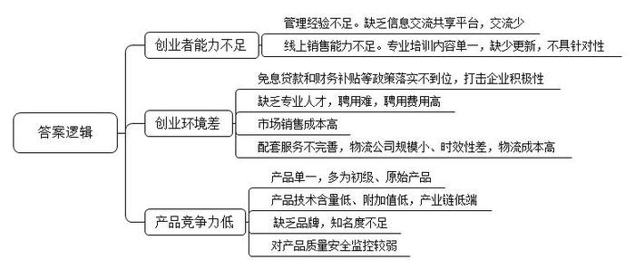
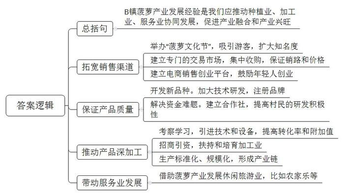
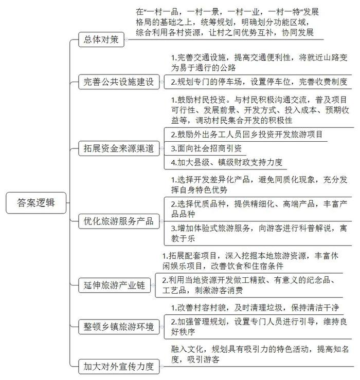

# 2017年广东省公考《申论》题（乡镇）

<!-- gwy:overview:start -->
> **广东 · 2017 · 申论 · 乡镇卷** ｜ 3 题 · 图片 3 处 · 答案随题折叠

导航：[题目](#题目) · [材料 1](#材料-1)
<!-- gwy:overview:end -->

> 候选采集稿。参考答案及解析来自粉笔页面，不代表官方答案或真实高分答卷；来源使用许可与原卷对应关系仍需人工核实。

## 给定材料

### 材料 1

A镇是某县的中心镇，也是农海产品大镇。2015年，该镇立足资源优势，在县财政的支持下，投入80多万元，率先在全县建成了电商产业园，旨在推动农海产品的传统销售模式向线上销售模式转型。产业园面积约1500平方米，可供80多家创业企业入驻，集办公、产品展示、洽谈等功能于一体，并向创业者提供免收租金、免息贷款、免费培训等多项优惠扶持政策。

自产业园挂牌运营以来，已有入园商户53家，入园创业人数达到160多人，有相当一部分是大学生毕业回乡创业。园区商家主要经营农产品、海产品、服装等，一时间，该产业园成为县里推进“互联网+”，促进产业转型发展的一张鲜亮的名片。

可是，不到一年时间，近一半商户纷纷选择了退园，产业园变得冷冷清清。针对这种情况，镇里成立了调研小组，专门调研电商产业园存在的问题。调研小组组织召开了创业商户代表座谈会。座谈会上，大家踊跃发言，提出了很多宝贵意见，下面是与会代表的基本情况与发言记录：

郑丹是入园较早的创业青年，主要经营化妆品，她将互联网与实体店巧妙地结合起来，实现了线上与线下的联动经营。她说：“平时在产业园里，我们大家都是自己干自己的，交流比较少，如果有电子商务协会之类的信息交流共享平台，就可以学到更多的经营管理经验，产品可以卖得更好。”

王海从事过多个行业，积累了一定的资金，近日返乡创业，刚加入产业园不久，主要销售当地农海产品。他说：“郑丹的意见很好，经验共享对我们这种刚入行的新人帮助很大。还有当初入园时产业园承诺的免息贷款和财务补贴等事情，到现在还没有落实，这也很打击我们的积极性。”

李姐是镇里有名的女强人，也是种植大户、流通大户。应镇领导的极力邀请，她尝试着把农产品搬到网上卖。可是线上的销路迟迟打不开。现在，她都很少到产业园去了，只留了一名工作人员在那里负责主打产品的展示，方便客商过来考察、洽谈合作事宜。

李姐说：“我自己一点都不懂电脑，都是请人来做网上销售，如果不投钱推广，产品就卖不出去，还不如我的老办法实在，和那些老客户电话联系一下，东西就卖出去了。还有镇里的年轻人都出去打工了，留下的都是老人和小孩，没有人来搞电商产业了，让老人和小孩来做也不现实，只能在外面请专业人才。但专业人才一个是不好找，找到好一点的很难，另一个是不容易请，高工资我们请不起，低工资人家又不肯来。”

小丽学的是服装设计专业，之前在产业园做服装网络销售，现在已经退出产业园到县城开实体店了。小丽说：“李姐说的都是事实，专业的事还是得由专业人士来做才行。做电子商务不仅要有货真价实的商品，还要懂网店美工、产品摄影、产品推介、促销活动策划等，需要具备一定的网络操作技能。有些东西我自己现在还学不来，加上身边没有这方面的人才，所以就暂时退出来了。先开好实体店，慢慢积累经验。另外产业园也要想办法多引导年轻人回来，进入我们的产业园才行，没有人才，就没有后续的发展。”

李华继去年刚毕业，学的是市场营销专业，一开始就借助农产品合作社，多渠道销售本地农产品，事业已经上了轨道。最近他又成立了公司，通过深加工方式开发了一系列特色农产品，现在每天订单达100多单，平均每月纯收入7万多元，成为当地最年轻的成功电商之一。“产业园提供了充足的条件，还主动协助创业者办理工商营业执照、食品经营许可证等。大家提着电脑入园就可以做生意了，这点的确值得点赞。”他认为，“产业园要多层面发力，让大家安心创业，创出好业。”

郑丹说：“说到这里，我想补充一点，我参加我们产业园组织的几次电商专业培训，培训老师讲的内容几乎没怎么变过，讲来讲去都是开店前期准备、开店流程、店铺初级运营基础等内容，而我最需要掌握的品牌推广、营销体系建构等知识就没有提供，现在都懒得去参加了。培训要有针对性才行，对不同的人要有不同的培训。”

陈明仕学的是养殖类专业，家里也是做海产品养殖的，毕业以后他就回家接手家里的生意，生意做得不错。产业园建成之后，他也注册了公司，在网上卖起了海产品。可是销售一直不景气，目前正在考虑转型。陈明仕说：“单纯卖海产品，附加值本来就低，加上产业园配套的都是小物流公司，时效性差，导致物流成本很高，生意不好做。我准备建厂深加工海产品，开发特供小食，特色礼品、海鲜精品等产品，打造特色品牌，然后在互联网上销售。”

李华继说：“关于品牌这点，我深有体会，我们的商品普遍为原始产品，或为初加工产品，技术含量低，附加值也低，基本处于产业链的低端，加上缺乏品牌意识，市场竞争力不强，产业园还是得引导大家树立自己的品牌才行。”

王海说：“是的，没有品牌就没有市场竞争力，产品的价值自然也高不到哪里去，我也计划注册一个品牌，通过深加工农产品，提高附加值，希望大家有合作的机会，让我们镇农产品走出去，迈向全中国。”

陈明仕说：“市场竞争是残酷的，我觉得华继和王海说的很对，想要立足市场，就得打响自己的品牌才行。我还想补充一点，现在我们的生活水平都提高了，大家对产品质量安全要求都很高，除了我刚刚提到的问题外，产业园也要加强对产品质量安全的监控，保证商品质量让我们产业园卖出去的每一样东西都是让顾客放心和满意的。”

### 材料 2

B镇的菠萝以体大、质优、肉脆、味甜、香气浓郁而闻名，菠萝成为该镇产业发展的主要经济支柱。近几年，镇里每年都举办“菠萝文化节”，菠萝的知名度进一步扩大，来参观旅游的人逐年增加。村民种植菠萝的积极性更高了，相继扩大了种植面积，产量和销量也跟着上来了。种植大户李想表示：“举办菠萝文化节，确实促进了菠萝的销售，带动了农民致富，希望菠萝文化节越办越好，再创辉煌，让我们的菠萝走出国门。”

最近正是菠萝收货季节。村民老李一大早就开着拖拉机，拉了3000斤菠萝来到镇上的菠萝交易市场，这是他第四天出来卖菠萝了。谈价、卸货、装车，忙个不停，数着新到手的一沓沓钞票，老李的心里乐开了花：“以前客商都是直接把车开到菠萝地里去收购装车的，人家去的地方一定是种植大户的地头，因为一片地就能装满一车，不用到处辗转折腾。种植小户只能是凑数装车，客商不愿意来，菠萝就很难卖出好价钱。现在好了，收货后就直接拉到交易市场，价格高，也容易卖。”

老李从2002年就开始种植菠萝，种植规模从原来的10多亩慢慢发展到了现在的40多亩，菠萝市场的建成直接帮助他提高了收入：“市场开张后，菠萝卖出去的价格提高了。以前，碰到菠萝丰收季节，老板都不搭理小农户，不愿意到园地收购，2、3毛一斤扔在地里都没人要，小农户都亏本了。现在有了交易市场，就算行情不好，我们小户也容易凑成车卖出去，销路有保证。”

该镇莫主任说：“我们的菠萝名声在外，很受市场欢迎，就想到建一个市场对群众比较有利，能让客商到市场集中收购，也方便农民销售，推动菠萝整体进入市场。谁都可以来这里卖，数量少的也可以拉来卖，这样小生产与大市场就有效对接上来了，解决了以往菠萝交易纠纷多等问题。”

菠萝产量上来了，就得拓宽销路。黄岗村村主任李晓源介绍，村里有14000多人口，总耕地面积将近7000亩，菠萝种植面积达到了4000多亩。现在整个村90%以上的农户都有种植菠萝，主要经济来源就是菠萝。“以往每到收货季节，地里成片都是菠萝。”村主任李晓源说，“怎么把菠萝卖出去，是村民最头疼的事。”

为解决菠萝的销路问题，镇里建了农产品电商创业平台，鼓励年轻人通过互联网创业，在互联网上把菠萝卖出去。小陈是返乡创业的年轻人，2014年，他大学毕业后放弃了在大城市发展的机会，回到家乡和村民一起发展菠萝产业。

“以前听到父母说家里菠萝难卖，心里就难受，那时我就寻思着回家创业，在网上寻找买家。心想在本地卖不出去，就到外地卖；在中国卖不出去，那就找外国人卖去。”小陈说道。农产品电商交易平台建成后，坚定了小陈通过互联网寻找买家的决心。他成为当地电商交易平台第一批入驻的创业者。想不到，经过一个月的努力，真的有外国人找上门来了。最后，自家以及亲朋好友的菠萝全都卖掉了，而且以比较高的价钱卖给了外国人。靠着互联网，菠萝走的更远了。聪明勤奋的小陈也成为了村里的骄傲。现在小陈坐在家里就可以把菠萝卖到全国各地。

“赶上互联网的时代确实是我的幸运。”谈起自己的创业经历，小陈感慨地说，“没有现代的电子商务平台，就没有我创业的第一桶金。”

创业成功的小陈又打起了新品种开发的主意，他试种了3万株菠萝种苗，这种菠萝口感好、汁多、肉脆、抗病和抗逆性强，常温下贮藏期长达2周，低温条件下贮藏可达20天以上。小陈表示：“我们现在具备了稳定、成熟的种植和育苗技术，预计一年内可育苗200万株，并逐年增长。这种菠萝质量好，得到了农业部的认可，也注册了品牌，现在我们最缺乏的是资金。”

村里像小陈这样有心开发新品种，却缺乏资金的村民还有不少。新品种开发前期投入大，风险高，很多农户因为资金和风险问题都不愿意开发新品种。为组织当地农户抱团发展，降低新品种开发的风险，B镇鼓励村民成立农产品农民专业合作社。

连姐是农产品专业合作社的带头人，她发起成立的合作社户数已经发展到了200多户，股金也从20多万增加到了5000多万。合作社为村民提供资金帮扶，村民有了合作社的支持，开发新品种的积极性提高了。优良的新品种保证了菠萝质量，提高了菠萝产量，推动了菠萝产业的良性发展。

农产品农民合作社董事长说：“我们办合作社，主要是为了解决村民开发新品种的资金问题，继续打造和打响菠萝品牌，把菠萝产业做大做强。同时，帮助群众解决就业问题。”合作社成立后，从附近农村招收了1000多人，附近农村富余劳动力不用出远门就能轻轻松松就业，待遇也不错。

合作社员工小林说：“自合作社创办以来，我就到社里工作了，不用到外地打工，在这里，每月工资3000左右，解决了家里的生活问题，比到外面打工好多了。”

吴如意是当地的菠萝大户，她刚参加了镇里组织的菠萝大户国外考察活动。一从国外考察回来，她就琢磨着怎么将国外学到的先进技术应用到菠萝生产中去，学以致用，“到外国去看了，才知道我们跟人家的差距。”在加工方面，人家的技术、设备先进，所以目前最好就是做好招商引资工作，扶持和培育加工业，筹集资金引进一批先进技术设备。

她投资500多万建成了菠萝罐头加工厂，另外承包了3000多亩土地种植菠萝保证原料供应，成为当地有名的菠萝深加工巨头。目前，她的菠萝罐头厂年产罐头3000多吨，年收入达到700多万。

为鼓励当地推行菠萝加工业的发展模式，B镇特地组织了种植大户到国外考察学习，引导种植大户引进先进设备提高农产品加工转化率和附加值。“菠萝罐头厂的成功就是延长了菠萝的产业链，克服了菠萝保质期短，不利于长途运输的弱点。引进加工技术设备，有利于大家分工更明确，做到标准化、规模化经营，形成产业链。这样才能推进菠萝深加工产业发展。”B镇一负责人说。

“两年前，我绝对没有想到自己能回来当老板！”回村创业的村民李七佬正在自己开的民宿门口招呼客人。看着络绎不绝的客人，他按捺不住自己的喜悦，脸上洋溢着幸福的笑容。自镇里办起了菠萝文化节，一批又一批游客到这里参观游玩，吃农家菜、住农家乐成为市民的一种新时尚。

“菠萝文化节我们连续参加3次了。带着家人孩子来这里走走，呼吸新鲜空气，品尝各种菠萝产品，心情很放松。”特地开车从外地过来参加菠萝文化节的游客小张说道。

借助菠萝产业发展起休闲旅游，李七佬投资的钱不到一年就回收了。他兴奋地说：“以前大家说待在村里没前途，都出去打工，现在都回来吃‘农业饭’了，村里搞休闲旅游，搞农家乐的人越来越多了，现在足不出户就能发家致富，生活可比以前好多了。”

### 材料 3

近年来，随着人们生活水平的提高和消费理念的转变，乡村休闲旅游已经成为一种时尚、一种生活方式，各地各级政府有关部门也把休闲农业和乡村旅游作为一大产业来抓。C镇积极响应号召，大力发展休闲旅游产业。在构建“一村一品，一村一景，一村一业，一村一特”的发展格局中，个别村遇到了一些问题。

（一）

A村是镇里的边远山村，人口有12000多人，村里有丰富的温泉资源，有条件开发特色休闲旅游，但由于离镇上远，进村山路多，交通不方便，一直没有发展起来。村里的年轻人都外出务工，留守在村里的基本上都是老人和儿童。

村委也想利用温泉资源开发特色旅游休闲项目，但一直没有找到合适的开发商，有合作意向的公司一进村里，看到村里破破烂烂的房子和弯曲狭窄的山路就打了退堂鼓。

“客人如果从市里过来泡温泉至少要三个小时，而进山道路狭窄弯曲，路不好走，也没有其他项目作为补充。只有温泉也吸引不了自驾游和旅游团的游客，资源过于单一，村里基础条件差，开发投入高，周期长，成本不一定能收的回来啊。”一名公司负责人在考察环境后说道。

“村民对温泉开发也没什么积极性，不了解这个项目是否可行，也不清楚前景怎样。”村里干部也说不清楚要怎么开发，要投入多少钱。村民老王说：“我们手里那点钱都是血汗钱，如果投进去就要赔老本，谁还敢投啊！”

年轻人宁愿在外打工，也不愿回来。“这路不好走啊，要能开发早开发了，年轻人都出去了，大家还是觉得在外面打工实在。”在外打工偶尔回家的小陈说。

该村郭主任无奈地说：“村里的旅游开发工作实在不好做，县里和镇里财务支持很少，想招商又招不到合适的，想集合开发又得不到村民支持，年轻人也不愿意回来。”

（二）

近日，B村的草莓熟了，一颗颗红透的草莓正待游人采摘，刚刚踏入草莓园便能闻到果香。游客在这里不仅可以观赏和品尝草莓，还可以进行现场采摘。然而，尽管草莓长势喜人，来采摘的游客却寥寥无几。

“真是倒霉啊，投资了30多万进去，成本还没有收回来，就没有人来采摘了，血本无归啊！”村民老王守着自家草莓园一脸愁容。

这几年，看着隔壁镇红红火火的草莓采摘热，B村也跟着建起了草莓园。但相比隔壁镇的草莓园，B村的村民却没有那么幸运。草莓不但没能招揽来客人，反而成为当地农民的负担，没到一年，生意就变得冷冷清清的。

种草莓的张大姐抱怨着，“刚开始草莓采摘还比较好，今年我们家也增加了草莓种植面积，结果现在隔壁镇也很多村在弄这个，大家都一样，他们离市区比较近，过去方便，游客就直接到他们那边去了。现在家里种的草莓都见不到人来采摘，只好我们自己来收，草莓熟透了，要么烂在地里，要么烂在路上，都卖不出去。”

“这边的草莓品种比较少，路也不好走。上个星期朋友去了隔壁镇的草莓基地，回来给我们摘了好几种草莓。”正在选摘草莓的游客吴小姐说，“那边的草莓田连成一片，拍起照片来很漂亮，基地那边还有种草莓的科普解说，寓教于乐，非常适合带家里的小朋友过去。”

该镇相关人员介绍，最近几年，各个乡镇旅游发展非常迅猛，出现了一批颇具特色的休闲农业与乡村旅游示范点和精品采摘园。但是，有不少镇的旅游景点跟风开发，同质化现象比较严重，看别的地方的草莓、葡萄有人气，就赶着上，没有根据镇的实际，充分发挥出现有优势。乡村旅游存在粗放、低水平开发的情况。

（三）

“连江五十里，修竹半其间。”C村有着丰富的竹林资源，随处可见，青翠悠远的竹林，山连山，竹连竹，层层叠叠。

竹林的风景别有一番滋味，偶尔带朋友来这里走一走，还是很开心的。但是虽然拥有这么好的自然资源，C村却并没有发展的很好，实在可惜。主要存在的问题是因为目前只有竹林资源，太过单一，没有相应的配套项目开发出来，所以游客逛完景区就走，留不住人。

来这里游玩的张先生说，还有一个问题是这里没有比较规范的饮食和住宿条件，现在只有一些路边的小摊、小吃，而且住的地方非常简陋，所以吃住都不太能让人放心。

还有一位女游客说，来这里能买的纪念品也太少了，现在做工粗糙，不精致，不好送给别人。其实，完全可以利用这里的竹林资源，开发一些竹质的纪念品、工艺品，既显精致，送给朋友又有意义。

（四）

D村有一个方圆300亩的油菜花田，每到周末有很多自驾游的游客来踏青赏花。由于景区主要集中在村里的油菜花田，村道又很狭窄，随着自驾游车辆的增多，周末塞车现象极为突出，小擦碰时有发生。村里没有专门设定的停车位，村民们随便圈地就收取停车费，导致乱停乱放现象很严重。这些现象使很多游客来一次就不愿意再来了。临近镇的葵花园、梅花园相继开放后，很多游客都转移到新旅游点了，D村的油菜花田游客量一日不如一日。

村里就有一条进出的道路能够通车，比较窄，虽然村里面有一个广场可以停车，但是根本就没有人管理，先进来的车出不去，后来的车进不去，就直接乱停在路边上，游客小黎一说起在D村的赏花经历就很激动，上次周末过来的时候，“车塞的太厉害了！”“我兜了半个小时还没有找到车位。”“等进去了谁还有心情看花啊！”而省外来的游客小李对D村的村容村貌也极为不满，在油菜花田有一些垃圾根本没有清理，之前带孩子过来孩子说臭，再也不愿意来了。

“车塞的太厉害了！”等了一个小时还没有进到村的小刘说，“我们听说这边的油菜花开了，一大早就从市里赶过来，没想到在村口就塞了一个小时，也没有人引导，早知道这么塞车就不来了。”

“我兜了半个小时还没有找到车位，下次再也不来了。”还在找车位的小胡则满是怨气，“这么多车，村里只有一个小广场可以停车。没有禁停标志，也没有人疏导，先来的车出不来，后面的车没有车位就随便停在路边。乱糟糟的，一点秩序都没有。”

该镇一负责人承认，个别村的乡村旅游还有道路不畅，景点分散，游客旅游中心、停车场、厕所、标牌标识、垃圾处理等设施不配套、管理不到位等问题。有的地方条件较差，游客来了，想玩没有地方玩，想购物没有地方购物，想住宿没有高级的酒店，存在有钱花不出去等现象。

## 题目

### 第 1 题

**假如你是调研小组的一员，请根据材料1指出A镇电商产业园发展中存在的问题。（30分）**

关联材料：材料 1、材料 2、材料 3

作答要求：

要求：

（1）归纳全面，准确；

（2）条理清楚；

（3）语言流畅；

（4）篇幅不超过300字。

第 1 题 · 答案与解析

**参考答案（粉笔题库参考内容）**

一、创业者能力不足。1.管理经验不足。缺乏信息交流共享平台，交流少。2.线上销售能力不足。专业培训内容单一，缺少更新，不具针对性。

二、创业环境差。1.免息贷款和财务补贴等政策落实不到位，打击企业积极性；2.缺乏专业人才，聘用难，聘用费用高；3.市场销售成本高；4.配套服务不完善，物流公司规模小、时效性差，物流成本高。

三、产品竞争力低。1.产品单一，多为初级、原始产品；2.产品技术含量低、附加值低，产业链低端；3.缺乏品牌，知名度不足；4.对产品质量安全监控较弱。

**解析**

**参考答案说明：**本参考答案思路上从“创业者能力不足”“创业环境差”“产品竞争力低”这三方面入手，进行相关问题的展开。此外，各条的要点之间是并列关系，内容之间不存在重复、交叉。

**考点**：问题类

**来源**：2017年广东省公考《申论》题（乡镇）

粉笔申论页面对本题只提供「解析视频」入口，该入口是会员推广位，页面无视频地址与文字解析。

### 第 2 题

**根据给定材料2，分析说明B镇推动菠萝产业发展的成功经验。（30分）**

关联材料：材料 1、材料 2、材料 3

作答要求：

要求：

（1）分析全面，说明透彻；

（2）条理清晰，表达准确；

（3）篇幅不超过300字。

第 2 题 · 答案与解析

**参考答案（粉笔题库参考内容）**

B镇菠萝产业发展经验是我们应推动种植业、加工业、服务业协同发展，促进产业融合和产业兴旺。具体体现在：

一、拓宽销售渠道。1.举办“菠萝文化节”，吸引游客，扩大知名度；2.建立专门的交易市场，集中收购，保证销路和价格；3.建立电商销售创业平台，鼓励年轻人创业。

二、保证产品质量。1.开发新品种。加大技术研发，注册品牌；2.解决资金难题。建立合作社，提高村民的研发积极性。

三、推动产品深加工。1.考察学习，引进技术和设备，提高转化率和附加值；2.招商引资，扶持和培育加工业；3.生产标准化、规模化，形成产业链。

四、带动服务业发展。借助菠萝产业发展休闲旅游业，比如农家乐等。

**解析**

**参考答案说明：**本参考答案先整体上对B镇菠萝产业发展的经验进行了概括，做到了说明透彻，再从“拓宽销售渠道”“保证产品质量”“推动产品深加工”“带动服务业发展”这四个方面对B镇菠萝产业发展的经验进行了具体的分条撰写，做到了分析全面，且各条答案要点之间在内容上是并列关系，没有交叉。

**考点**：经验启示类

**来源**：2017年广东省公考《申论》题（乡镇）

粉笔申论页面对本题只提供「解析视频」入口，该入口是会员推广位，页面无视频地址与文字解析。

### 第 3 题

**请根据材料3，就破解C镇休闲旅游发展难题提出对策。（40分）**

关联材料：材料 1、材料 2、材料 3

作答要求：

要求：

（1）考虑全面，思路清晰；

（2）针对性强，有效可行；

（3）篇幅不超过600字。

第 3 题 · 答案与解析

**参考答案（粉笔题库参考内容）**

在“一村一品，一村一景，一村一业，一村一特”发展格局的基础之上，统筹规划，明确划分功能区域，综合利用各村资源，让村之间优势互补，协同发展。

一、完善公共设施建设。1.完善交通设施，提高交通便利性，将就近山路变为易于通行的公路；2.规划专门的停车场，设置停车位，完善收费制度。

二、拓展资金来源渠道。1.鼓励村民投资。与村民积极沟通交流，普及项目可行性、发展前景、开发方式、投入成本、预期收益等，调动村民集合开发的积极性；2.鼓励外出务工人员回乡投资开发旅游项目；3.面向社会招商引资；4.加大县级、镇级财政支持力度。

三、优化旅游服务产品。1.选择开发差异化产品，避免同质化现象，充分发挥自身特色优势；2.选择优质品种，提供精细化、高端产品，丰富产品品种；3.增加体验式旅游服务，向游客进行科普解说，寓教于乐。

四、延伸旅游产业链。1.拓展配套项目，深入挖掘本地旅游资源，丰富休闲娱乐项目，改善饮食和住宿条件；2.利用当地资源开发做工精致、有意义的纪念品、工艺品，刺激游客消费。

五、整顿乡镇旅游环境。1.改善村容村貌，及时清理垃圾，保持清洁干净；2.加强管理规划，设置专门人员进行引导，维持良好秩序。

六、加大对外宣传力度。融入文化，规划具有吸引力的特色活动，提高知名度，吸引游客。

**解析**

**参考答案说明：**本参考答案先对C镇休闲旅游发展遇到的难题给出一个总括对策，再从“完善公共设施建设”“拓展资金来源渠道”“优化旅游服务产品”“延伸旅游产业链”“整顿乡镇旅游环境”“加大对外宣传力度”这六个方面对C镇休闲旅游发展遇到的难题给出的解决对策进行了具体的分条撰写，各条答案要点之间在内容上是并列关系，没有交叉。

**考点**：提出对策类

**来源**：2017年广东省公考《申论》题（乡镇）

粉笔申论页面对本题只提供「解析视频」入口，该入口是会员推广位，页面无视频地址与文字解析。

