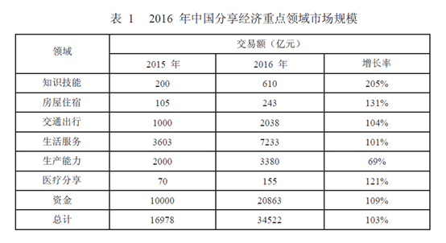
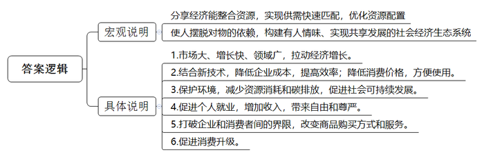
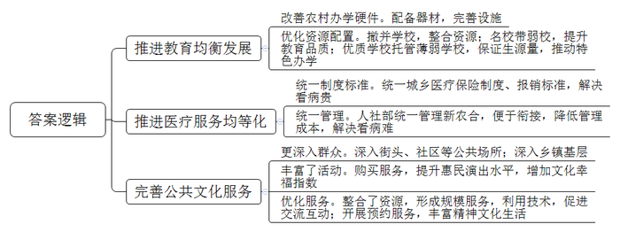
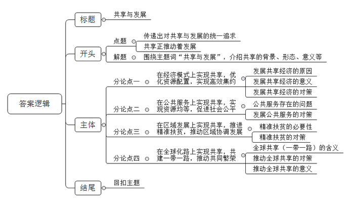

# 2017年广东省公考《申论》题（县级）

<!-- gwy:overview:start -->
> **广东 · 2017 · 申论 · 县级卷** ｜ 3 题 · 图片 4 处 · 答案随题折叠

导航：[题目](#题目)
<!-- gwy:overview:end -->

> 候选采集稿。参考答案及解析来自粉笔页面，不代表官方答案或真实高分答卷；来源使用许可与原卷对应关系仍需人工核实。

## 给定材料

### 材料 material-758438160fc831d4

2008年金融危机之后，伴随信息技术及其创新应用进入迸发期，分享经济快速成长，2014年以来呈现出井喷式发展态势。2016年中国分享经济发展报告认为，分享经济是指利用互联网等现代信息技术，以使用权分享为主要特征，整合海量、分散化资源，满足多样化需求的经济活动总和。分享经济是信息革命发展到一定阶段后出现的新型经济形态，是整合各类分散的资源、准确发现多样化需求、实现供需双方快速匹配的最优化资源配置方式。

现代社会发展的一大特点就是：自然资源越用越少，创新因素越来越多。从现实情况看，正是在与人们的生活密切相关、但资源分布不平衡的领域，最早孕育出了分享经济模式，如住房、出行、医疗、教育等。分享经济具有深刻的社会意义，能够把人从“物的依赖”的束缚中解放出来，有利于构建一个富有人情味、实现共享发展的社会经济生态系统。

2016年，“分享经济”第一次被写入《政府工作报告》，报告明确提出“支持分享经济发展，提高资源利用效率，让更多人参与进来、富裕起来”，同时提出“以体制机制创新促进分享经济发展”。

美国行动论坛的研究认为，2014年3家共享汽车服务公司带来了5.19亿美元的经济增长。某在线短租公司在旧金山的一项调查也显示，房屋分享带来了14%的新客户。从中国的实践看，各领域分享经济的发展均有大幅提升，与2015年相比，仅出行领域2016年市场交易额约为2038亿元，增长104%，融资超过700亿元人民币，增长约124%，参与总人数超过3.5亿，增长近40%。其中，网约车司机总人数约1800万，增长约24%。正如李克强总理早在2015年夏季达沃斯论坛上所强调的：“目前全球分享经济呈快速发展态势，是拉动经济增长的新路子。”

### 材料 material-c5d967ccdbe3bf70

我国义务教育资源配置仍然存在诸多问题和短板，区域间、城乡间、学校间教学质量与教学水平不均衡、师资储备不足以及各种严重的教育差距问题，都成了阻碍义务教育均衡发展的“拦路虎”。面对这一基本教育国情，推进教育均衡发展的重要举措，包括推行学校联合、推动教师流动、扩大优质教育资源的覆盖面等。

“大海是鱼儿的家，土地是禾苗的家，树林是小鸟的家……”B市某镇中心小学的教室传来了琅琅的读书声，操场上也有小朋友开心地玩着跳绳、踢着足球。这么一所山区学校，有平整的塑胶跑道、多媒体教室、计算机室、图书室，和电视上“城里的学校”一模一样。近年来，B市累计投入资金近32亿元，其中部分资金为农村学校配备各种教学器材，完善教育辅助设施，让农村学校在办学硬件上与城区学校站在同一起跑线上。

在加大对乡镇农村学校硬件设施建设投入的同时，B市各县区根据农村学校具体情况，适度撤并学校以提高教育资源配置效率，在乡镇农村学校掀起了一场整合高潮。教育部门根据群众意愿，科学、合理、规范地撤并学校，以便孩子们都能享受到更好的教育。

有的地方采用撤并乡镇农村学校的方式达到教育资源的合理配置，而有的地方则在均衡教育资源发展方面大力创新。2016年，C市某区教育局推出了“名校托管弱校”的新模式，全区17所小学划分为4个学区，每个学区内中心校将采用托管方式指导一所学校。名校带动弱校，共享名校资源，加速区域范围内优质教育资源的有效整合，来提升整体教育品质。与此同时，城区优质学校对农村薄弱学校也实行了托管，一年试运行后，被托管的学校不仅出现了“生源回流”现象，部分学校还挖掘出了自身资源优势，办出了自身教育特色。这种形式上的“输血”带来了实质上的“造血”，使得农村弱校在短时间内实现了质的飞跃，走出了一条推进城乡教育均衡发展的新路子。

## 题目

### 第 1 题

**请根据“资料**1**~**3**”，指出分享经济的发展对我国经济社会产生的积极影响。（20分）**

关联材料：材料 material-758438160fc831d4

作答要求：

要求：概括全面、准确，条理清晰；不超过200字。

第 1 题 · 答案与解析

**参考答案（粉笔题库参考内容）**

分享经济能整合资源，实现供需快速匹配，优化资源配置；使人摆脱对物的依赖，构建有人情味、实现共享发展的社会经济生态系统。体现在：1.市场大、增长快、领域广，拉动经济增长。2.结合新技术，降低企业成本，提高效率；降低消费价格，方便使用。3.保护环境，减少资源消耗和碳排放，促进社会可持续发展。4.促进个人就业，增加收入，带来自由和尊严。5.打破企业和消费者间的界限，改变商品购买方式和服务。6.促进消费升级。

**解析**

**参考答案说明：**本参考答案宏观上先从“宏观意义”和“具体意义”两个方面进行撰写。其中，从“整合资源”“构建共享发展的经济生态系统”这两个层面进行宏观说明；从“拉动经济增长”“促进企业经营、消费便利”“保护环境，促进社会可持续发展”“促进个人就业”“打破企业和消费者间的界限”“促进消费升级”这六个方面进行具体展开。各条要点之间在内容上相互并列，没有交叉。

**考点**：考点影响类

**来源**：来源2017年广东省公考《申论》题（县级）

粉笔申论页面对本题只提供「解析视频」入口，该入口是会员推广位，页面无视频地址与文字解析。

### 第 2 题

**请根据“资料**5**～**7**”，分析说明政府在公共服务领域推进共享发展的主要作用。（30分）**

关联材料：材料 material-c5d967ccdbe3bf70

作答要求：

要求：分析全面、透彻，条理清晰，表达准确；不超过300字。

第 2 题 · 答案与解析

**参考答案（粉笔题库参考内容）**

一、推进教育均衡发展。1.改善农村办学硬件。配备器材，完善设施。2.优化资源配置。撤并学校，整合资源；名校带弱校，提升教育品质；优质学校托管薄弱学校，保证生源量，推动特色办学。

二、推进医疗服务均等化。1.统一制度标准。统一城乡医疗保险制度、报销标准，解决看病贵。2.统一管理。人社部统一管理新农合，便于衔接，降低管理成本，解决看病难。

三、完善公共文化服务。1.更深入群众。深入街头、社区等公共场所；深入乡镇基层。2.丰富了活动。购买服务，提升惠民演出水平，增加文化幸福指数。3.优化服务。整合了资源，形成规模服务，利用技术，促进交流互动；开展预约服务，丰富精神文化生活。

**解析**

**参考答案说明：**本参考答案宏观上先从“教育”“医疗”“公共服务”三个角度展开。在教育方面，又从“改善农村办学硬件”“优化资源配置”等两个方面进行了分条撰写。各条要点之间在内容上相互并列，没有交叉。在医疗方面，又从“统一制度标准”“统一管理”等两个方面进行了分条撰写。各条要点之间在内容上相互并列，没有交叉。在公共服务方面，又从“更深入群众”“丰富了活动”“优化服务”等三个方面进行了分条撰写。各条要点之间在内容上相互并列，没有交叉。

**考点**：考点影响类

**来源**：来源2017年广东省公考《申论》题（县级）

粉笔申论页面对本题只提供「解析视频」入口，该入口是会员推广位，页面无视频地址与文字解析。

### 第 3 题

**请根据全部“给定资料”，以“共享与发展”为题，写一篇议论文。（50分）**

关联材料：材料 material-758438160fc831d4

作答要求：

要求：

（1）文章主题应与所给资料联系紧密，思想性强；

（2）论点鲜明，论据确凿，论证严密，合乎逻辑；

（3）结构完整，条理清晰，行文流畅；

（4）800～1000字。

第 3 题 · 答案与解析

**参考答案（粉笔题库参考内容）**

**共享与发展**

中共十八届五中全会上给出的“坚持共享发展，必须坚持发展为了人民、发展依靠人民、发展成果由人民共享”这一论断，掷地有声地传递出对**共享与发展的统一追求**。共享服务业快速发展，共享商业模式不断推出，全面改变着人们的消费习惯、生活方式，激发新的经济社会发展活力。毫无疑问，**共享正推动着发展**。

共享不仅仅是资源的共享，更是发展成果的共享。共享已经融入到经济领域、公共服务领域、扶贫工作、治国经邦等方方面面，通过共享真正实现了资源的共享和优化配置，解放生产力，不断创造经济社会财富，推动了各领域、各地区均衡发展，从而实现社会公平正义，进而推动社会全面可持续发展。

**在经济模式上实现共享，优化资源配置，实现高效集约。**由于自然资源分配不均，分享经济借助互联网时代的便利性应运而生。共享单车、共享民宿公寓等分享经济模式不仅实现了供需匹配，避免资源浪费，也改变了传统就业模式。分享理念还渗透到了制造业，利用工业云可以随时随地组织服务商为用户提供服务，提高生产效率，节约生产成本。当然，分享经济发展离不开政府政策的大力支持和引导，离不开体制机制创新。

**在公共服务上实现共享，实现资源均等，促进社会公平。**人人共享，到底共享什么？其中最基本的就是公共服务。当前，受发展水平制约，我国公共服务水平各地差距较大，影响了人民群众共享改革发展成果。未来还需要完善基本公共服务体系，在教育资源共享、医疗资源共享、公共文化共享方面加大投入力度，缩小公共服务差距，让全国全体人民普遍受惠，共享发展。

**在区域发展上实现共享，推进精准扶贫，推动区域协调发展。**现在，我国大部分群众生活水平有了很大提高，同时由于我们国家大、各地发展条件不同，我国还有为数不少的困难群众。对于困难群众，我们要量身定制帮扶举措，实施精准扶贫，缩小贫富差距，补齐发展短板。多年来，广东省正是充分发挥政治优势和制度优势，将精准扶贫嵌入广东共享发展的整体布局，使得扶贫开发与经济社会发展相互促进。

**在全球化路上实现共享，共建一带一路，推动共同繁荣。**习近平总书记先后提出建设“丝绸之路经济带”和“21世纪海上丝绸之路”两大战略构想。这是一种全球共治理念，在项目、规划、机制等方面都体现了平等、协商、互利共赢。因此，得到了多个国家和组织的热烈响应，各国家深入开展了多领域的经贸合作，为沿线国家创造了可喜的税收和就业机会，促进了人类共同利益、地区利益与国家利益的协调与共赢。

共享是理念，是手段，是载体，是发展的出发点和落脚点，指明了发展的价值取向。然而在一个13亿多人口的发展大国，实现广泛、全面的共享发展是一项十分艰巨的任务，需要连续不断的奋斗过程，我们要持续发力，人人参与、人人尽力，共享才有可能，发展才有方向。

**解析**

**文章分析**

**共享与发展**

【**标题的优点：**严格按照题目的要求，以“共享与发展”为标题。】

（1）中共十八届五中全会上给出的“坚持共享发展，必须坚持发展为了人民、发展依靠人民、发展成果由人民共享”这一论断，掷地有声地**传递出对****共享与发展的统一追求**。共享服务业快速发展，共享商业模式不断推出，（2）全面改变着人们的消费习惯、生活方式，激发新的经济社会发展活力。毫无疑问，**共享正推动着发展**。

【**开头的优点：**★内容方面。范文的开头是紧扣题目给定的“共享与发展”这一主题展开的。首先，开头最后一句话点出主题，做到了主题明确。其次，对“共享与发展”这一主题进行了分析阐述，指出了（1）介绍了共享发展提出的背景；（2）介绍了共享的意义。★文字表达方面。长短句配合使用，使语言表达有节奏感。】

共享不仅仅是资源的共享，更是发展成果的共享。（1）共享已经融入到经济领域、公共服务领域、扶贫工作、治国经邦等方方面面，（2）通过共享真正实现了资源的共享和优化配置，解放生产力，不断创造经济社会财富，推动了各领域、各地区均衡发展，从而实现社会公平正义，进而推动社会全面可持续发展。

【**过渡段的优点：**范文过渡段分析了共享发展涉及的领域、共享的意义等方面的内容，分别指出了（1）共享发展涉及的领域；（2）介绍了共享的意义。其中第二句中“共享已经融入到经济领域、公共服务领域、扶贫工作、治国经邦等方方面面”是用来引起下文的过渡句。】

**在经济模式上实现共享，优化资源配置，实现高效集约。**（1）由于自然资源分配不均，分享经济借助互联网时代的便利性应运而生。共享单车、共享民宿公寓等分享经济模式不仅（2）实现了供需匹配，避免资源浪费，也改变了传统就业模式。分享理念还渗透到了制造业，利用工业云可以随时随地组织服务商为用户提供服务，提高生产效率，节约生产成本。当然，（3）分享经济发展离不开政府政策的大力支持和引导，离不开体制机制创新。

【**论述段****1的优点：**★观点句：范文的观点句是紧扣“共享与发展”这一文章主题提出的。形式上，它在段首处直接写出，位置突出，容易发现。内容上，关键词突出，内容要点明确，可以明显看出它是从“如何实现共享与发展”入手，指出了“经济共享”。★论述内容：（1）介绍了发展共享经济的原因；（2）介绍了发展共享经济的意义；（3）介绍了发展共享经济的对策。注意：以上几个方面的内容都是紧扣“在经济模式上实现共享，优化资源配置，实现高效集约”这个观点句进行分析论述的，论述的针对性强，内容层次丰富。最后，在论述方法和论据的选取上做到了讲道理、举例子相结合，做到了丰富多样。】

**在公共服务上实现共享，实现资源均等，促进社会公平。**人人共享，到底共享什么？其中最基本的就是公共服务。当前，（1）受发展水平制约，我国公共服务水平各地差距较大，影响了人民群众共享改革发展成果。（2）未来还需要完善基本公共服务体系，在教育资源共享、医疗资源共享、公共文化共享方面加大投入力度，缩小公共服务差距，让全国全体人民普遍受惠，共享发展。

【**论述段****2****的优点：**★观点句：范文的观点句是紧扣“共享与发展”这一文章主题提出的。形式上，它在段首处直接写出，位置突出，容易发现。内容上，关键词突出，内容要点明确，可以明显看出它是从“如何实现共享与发展”入手，指出了“公共服务共享”。★论述内容：（1）介绍了公共服务存在的问题；（2）介绍了发展公共服务的对策。注意：以上几个方面的内容都是紧扣“在公共服务上实现共享，实现资源均等，促进社会公平”这个观点句进行分析论述的，论述的针对性强，内容层次丰富。最后，在论述方法和论据的选取上采取讲道理的方式。】

**在区域发展上实现共享，推进精准扶贫，推动区域协调发展。**现在，（1）我国大部分群众生活水平有了很大提高，同时由于我们国家大、各地发展条件不同，我国还有为数不少的困难群众。对于困难群众，（2）我们要量身定制帮扶举措，实施精准扶贫，缩小贫富差距，补齐发展短板。多年来，广东省正是充分发挥政治优势和制度优势，将精准扶贫嵌入广东共享发展的整体布局，使得扶贫开发与经济社会发展相互促进。

【**论述段****3****的优点：**★观点句：范文的观点句是紧扣“共享与发展”这一文章主题提出的。形式上，它在段首处直接写出，位置突出，容易发现。内容上，关键词突出，内容要点明确，可以明显看出它是从“如何实现共享与发展”入手，指出了“区域发展共享”。★论述内容：（1）介绍了精准扶贫的必要性；（2）介绍了精准扶贫的对策。注意：以上几个方面的内容都是紧扣“在区域发展上实现共享，推进精准扶贫，推动区域协调发展”这个观点句进行分析论述的，论述的针对性强，内容层次丰富。最后，在论述方法和论据的选取上做到了讲道理、举例子相结合，做到了丰富多样。】

**在全球化路上实现共享，共建一带一路，推动共同繁荣。**习近平总书记先后提出建设“丝绸之路经济带”和“21世纪海上丝绸之路”两大战略构想。（1）这是一种全球共治理念，在项目、规划、机制等方面都体现了平等、协商、互利共赢。因此，得到了多个国家和组织的热烈响应，（2）各国家深入开展了多领域的经贸合作，（3）为沿线国家创造了可喜的税收和就业机会，促进了人类共同利益、地区利益与国家利益的协调与共赢。

【**论述段****4****的优点：**★观点句：范文的观点句是紧扣“共享与发展”这一文章主题提出的。形式上，它在段首处直接写出，位置突出，容易发现。内容上，关键词突出，内容要点明确，可以明显看出它是从“如何实现共享与发展”入手，指出了“全球共享”。★论述内容：（1）介绍了全球共享（一带一路）的含义；（2）介绍了推动全球共享的对策；（3）介绍了推动全球共享的意义。注意：以上几个方面的内容都是紧扣“在全球化路上实现共享，共建一带一路，推动共同繁荣”这个观点句进行分析论述的，论述的针对性强，内容层次丰富。最后，在论述方法和论据的选取上做到了讲道理、举例子相结合，做到了丰富多样。】

【**论述段之间的关系**：★内容的内在逻辑：范文的论述段之间是依照材料的顺序逻辑展开的。论述段1先写了“在经济模式上实现共享，优化资源配置，实现高效集约”，论述段2再写了“在公共服务上实现共享，实现资源均等，促进社会公平”，论述段3接着写了“在区域发展上实现共享，推进精准扶贫，推动区域协调发展”，论述段4最后写了“在全球化路上实现共享，共建一带一路，推动共同繁荣”。】

（1）共享是理念，是手段，是载体，是发展的出发点和落脚点，指明了发展的价值取向。然而在一个13亿多人口的发展大国，实现广泛、全面的共享发展是一项十分艰巨的任务，需要连续不断的奋斗过程，（2）我们要持续发力，人人参与、人人尽力，共享才有可能，发展才有方向。

【**结尾的优点**：范文的结尾回扣了“共享与发展”这一主题。（1）再次提到“共享与发展”这一主题；（2）发出了呼吁、号召。】

**考点**：考点文章写作题

**来源**：来源2017年广东省公考《申论》题（县级）

粉笔申论页面对本题只提供「解析视频」入口，该入口是会员推广位，页面无视频地址与文字解析。

