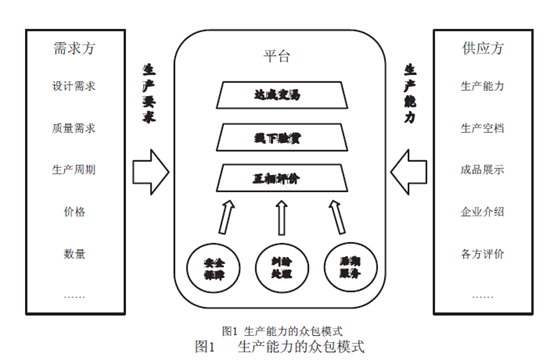

# 2017年广东省公考《申论》题（县级）

<!-- gwy:overview:start -->
> **广东 · 2017 · 申论 · 县级卷** ｜ 3 题 · 图片 4 处 · 答案随题折叠

导航：[题目](#题目) · [材料 1](#材料-1)
<!-- gwy:overview:end -->

> 候选采集稿。参考答案及解析来自粉笔页面，不代表官方答案或真实高分答卷；来源使用许可与原卷对应关系仍需人工核实。

## 给定材料

### 材料 1

2008年金融危机之后，伴随信息技术及其创新应用进入迸发期，分享经济快速成长，2014年以来呈现出井喷式发展态势。2016年中国分享经济发展报告认为，分享经济是指利用互联网等现代信息技术，以使用权分享为主要特征，整合海量、分散化资源，满足多样化需求的经济活动总和。分享经济是信息革命发展到一定阶段后出现的新型经济形态，是整合各类分散的资源、准确发现多样化需求、实现供需双方快速匹配的最优化资源配置方式。

现代社会发展的一大特点就是：自然资源越用越少，创新因素越来越多。从现实情况看，正是在与人们的生活密切相关、但资源分布不平衡的领域，最早孕育出了分享经济模式，如住房、出行、医疗、教育等。分享经济具有深刻的社会意义，能够把人从“物的依赖”的束缚中解放出来，有利于构建一个富有人情味、实现共享发展的社会经济生态系统。

2016年，“分享经济”第一次被写入《政府工作报告》，报告明确提出“支持分享经济发展，提高资源利用效率，让更多人参与进来、富裕起来”，同时提出“以体制机制创新促进分享经济发展”。

美国行动论坛的研究认为，2014年3家共享汽车服务公司带来了5.19亿美元的经济增长。某在线短租公司在旧金山的一项调查也显示，房屋分享带来了14%的新客户。从中国的实践看，各领域分享经济的发展均有大幅提升，与2015年相比，仅出行领域2016年市场交易额约为2038亿元，增长104%，融资超过700亿元人民币，增长约124%，参与总人数超过3.5亿，增长近40%。其中，网约车司机总人数约1800万，增长约24%。正如李克强总理早在2015年夏季达沃斯论坛上所强调的：“目前全球分享经济呈快速发展态势，是拉动经济增长的新路子。”

### 材料 2

2016年，不同品牌的共享单车陆续在全国各大城市上线，并迅速成为最潮的出行方式。与传统城市公共自行车需要提前办理手续、在固定位置还取车不同，共享单车不用办卡、没有停车桩，用手机扫描二维码就能开锁，在共享单车的APP（手机应用程序）上就能找车。用户可以把车停放在除了小区、楼道等区域外的任意合法非机动车停车点。

省去停车桩的好处很明显，人们的需求会被激活，同时规避了设置停车桩这件昂贵且只有政府能做的事。技术实现手段也不难：在电动车锁里加上传感器、GPS、3G网络和芯片，就可以在APP上找到附近车辆。基本上，只要附近有车，共享单车用起来就和打车应用一样方便。存入二三百元押金后，使用价格在每小时1元左右，这让它成为1至5公里行程内时间和价格都很合算的交通方式。

与共享单车极为相似的是，共享租车模式也日益受到消费者青睐。春节期间，家住上海的冯女士接北京的父母与自己的婆家一同过节，往年一家六口出门，一辆小轿车挤不下，总要开一辆车，再叫一辆出租车，非常不方便。今年，她在共享租车平台上租了一辆7座的商务车，这样一家人出门就可以坐在同一辆车里了。

共享租车模式就是车主和租车人借助于租车公司搭建和运营的互联网平台进行汽车租赁活动的运营模式。车主通过让渡汽车使用权获得经济回报，租车人通过支付一定费用获得汽车使用权，提高了资源配置效率。共享租车作为分享经济的一部分，践行的是“使用而不占有”的理念。它一方面改善了汽车需求者“求而不得”的状况，另一方面则避免了大量的汽车资源无法被有效利用而产生的浪费，对于交通、环境以及整个汽车行业的发展具有积极影响。

从路网的承载能力和环境保护的角度而言，一座城市能容纳的汽车保有量终究是有限的，而要在有限的供给条件下满足更多人的需求，最好的办法就是通过车辆共享来实现。目前，中国私家车保有量约有1亿多辆，但拥有驾照的人数已超过3亿，而且未来10年中国拥有驾照的人数仍将快于汽车保有量的增长。与此同时，中国私家车每天的闲置时间平均为22个小时，或闲置在单位，或闲置在家里。特别是在国内一些大城市，很多人有用车需求而一车难求，要么是因为限购，要么是因为传统租车价格太高，而共享租车模式恰恰为解决这一矛盾提供了平台和途径。

在分享经济充分发展的情况下，服装、汽车、家具、电话、电视、玩具、体育用品以及园艺工具等都是可分享的物品，通过分享可以减少20%的碳排放。美国分享经济协会数据显示，每分享1辆汽车，可以减少13辆汽车的购买行为。某共享汽车服务企业数据分析显示，其在杭州的拼车出行减少的碳排放相当于每三天增加一个西湖面积大小的森林。不管是共享单车还是共享租车，都会给社会的可持续发展带来积极影响。

与此同时，分享经济也给个人就业带来不小的变化。3年前，为了照顾家里的老人和孩子，赵东放弃了在沿海地区年薪近20万元的工作，回到老家重新开始求职。不过，只有高中学历的“70后”找份满意的工作并不容易。接连碰壁后，2015年4月，一次打车经历启发了赵东：“当时网约车刚刚流行起来，体验了一次之后，我就想，这样一份收入不错、时间又很自由的工作，自己为什么不尝试一下呢？”经过两个月的考察，赵东成了当地一家汽车服务公司的网约车司机。

像赵东这样再就业的群体，他们在失业之后再次进入劳务市场时，往往不受传统产业雇主的待见，很难实现再就业。对这种人群，分享经济为他们带来了新的就业形态。分享经济的发展让参与者比较自由地进入或退出社会生产过程，减轻了个人对组织的依赖程度，为自由职业者和兼职群体的成长提供了更多的机会；同时，分享经济还改变了传统的雇佣式与流水线就业模式，有一技之长的“手艺人”将获得“解放”。例如，一位服装设计师可以不再依赖于设计公司或者专门的工作室，通过网络平台就能接洽订单，直接按照客户的要求设计服装，联系厂家生产并配送给客户。

### 材料 3

借助于互联网，消费者不但可以轻松地找到他们所需的商品，还可以将自己闲置的资源分享给他人，从而赚取一些收入。其实，商品分享的概念并非最近才出现，如今借助于数字技术的发展，消费者利用互联网将分享经济带到了一个新高度。传统的企业和消费者之间的界限正在不断地弱化，人们逐渐开始放弃传统的商品购买方式和服务，转而在互联网上寻找商品分享服务。

A市白领小腾在城郊有一套房子，但因为上班距离太远，他与妻子又在市区购下一套58平方米的公寓。他们自己动手刷墙、设计室内装修，将这个一房一厨一卫的小家收拾得特别温馨舒适。今年3月，抱着尝试的心态，小腾成为在线短租平台上的一名房东，没想到将房子挂出去的当天，他就收到了一个订单。“那天也是有些狼狈，第二天中午房客就要入住，我们赶紧把房子里的东西收拾好。”小腾兴奋地说。

对于房客而言，小腾的这套房子的确是个不错的选择。步行几分钟就可以到地铁站，楼下就是公交总站，附近有便利店、早餐店、餐馆、菜市场。房间空着时夫妻俩就自己住，如果有客人他们就回城郊的房子住。几个月下来，夫妻俩接待了从台湾来的游客、外地的大学生、来出差的外国商人……最长的房客花8000多元将房子租了一个月。随着成交次数的增加和获得好评的增多，他们的房子越来越受欢迎。

2015年，党的十八届五中全会公报明确指出“发展分享经济”，标志着分享经济正式列入党和国家的战略规划；同年，国务院发布《国务院办公厅关于加快发展生活性服务业促进消费结构升级的指导意见》，提出“积极发展客栈民宿、短租公寓、长租公寓等细分业态”，并将其定性为生活性服务业，将在多维度给予政策支持；2016年，国务院办公厅再次发文《关于加快培育和发展住房租赁市场的若干意见》，鼓励住房租赁消费。政策利好是在线短租走上高速发展的一个重要影响因素。

### 材料 4

随着互联网、物联网、大数据、云计算等新一代信息技术与制造业的融合越来越紧密，互联网从消费领域进一步向制造业领域渗透拓展。

日前，有研究人员指出，全球制造业已经呈现出数字化、网络化、智能化、本地化、绿色化、个性化发展趋势，数据成为一种新的生产要素，大规模的生产转向大规模个性化订制生产已经成为这一轮新产业革命最显著的特征。

工业云是一种新型的网络化制造服务模式，融合了先进的制造技术，以及互联网、云计算、物联网、大数据等信息技术，以公共服务平台为载体，通过虚拟化、服务化和协同化，根据用户的需求，实现及时、低成本的服务，实现资源自动化、高质高效的对接。

依托工业云服务平台，企业可以整合研发、设计、生产、制造、销售、使用等环节的制造资源和服务。任何企业和个人都可以在工业云平台上提供他们所拥有的资源，也可以在平台上获取他们所需要的资源，从而实现一对一、一对多、多对多等多种制造服务模式。这就是分享经济模式下的众包特征，而不是与特定厂商合作的外包业务。面向客户的需求，工业云可以随时随地组织相关的服务商为其提供所需的服务。例如，贵州某企业每天生产250万瓶调味料，瓶身上的二维码的成本是两分钱，企业希望能够将成本降到一分钱，但是省内的服务商无法满足需求，于是就把需求通过工业云平台进行了发布，很快就找到了山东的一家服务商，一年节省成本900多万元；北京某汽车设计商，通过网络平台将海量的汽车非核心零部件外包给了自由设计师，并通过虚拟样机实现了在线的设计协同，通过在线的3D打印实现了快速车身的制造，将设计周期由原来的4个月缩短至2个月，节省了80%的差旅费用、60%的沟通成本。

工业云平台模式可以让企业根据需求在线租用各种资源、软件和服务，为企业极大地降低了信息化的建设和应用成本。此外，工业云平台运营商会选择一些行业龙头企业进行合作，以此带动产业链上下游的中小型企业使用工业云平台来拓展平台的用户群。

### 材料 5

我国义务教育资源配置仍然存在诸多问题和短板，区域间、城乡间、学校间教学质量与教学水平不均衡、师资储备不足以及各种严重的教育差距问题，都成了阻碍义务教育均衡发展的“拦路虎”。面对这一基本教育国情，推进教育均衡发展的重要举措，包括推行学校联合、推动教师流动、扩大优质教育资源的覆盖面等。

“大海是鱼儿的家，土地是禾苗的家，树林是小鸟的家……”B市某镇中心小学的教室传来了琅琅的读书声，操场上也有小朋友开心地玩着跳绳、踢着足球。这么一所山区学校，有平整的塑胶跑道、多媒体教室、计算机室、图书室，和电视上“城里的学校”一模一样。近年来，B市累计投入资金近32亿元，其中部分资金为农村学校配备各种教学器材，完善教育辅助设施，让农村学校在办学硬件上与城区学校站在同一起跑线上。

在加大对乡镇农村学校硬件设施建设投入的同时，B市各县区根据农村学校具体情况，适度撤并学校以提高教育资源配置效率，在乡镇农村学校掀起了一场整合高潮。教育部门根据群众意愿，科学、合理、规范地撤并学校，以便孩子们都能享受到更好的教育。

有的地方采用撤并乡镇农村学校的方式达到教育资源的合理配置，而有的地方则在均衡教育资源发展方面大力创新。2016年，C市某区教育局推出了“名校托管弱校”的新模式，全区17所小学划分为4个学区，每个学区内中心校将采用托管方式指导一所学校。名校带动弱校，共享名校资源，加速区域范围内优质教育资源的有效整合，来提升整体教育品质。与此同时，城区优质学校对农村薄弱学校也实行了托管，一年试运行后，被托管的学校不仅出现了“生源回流”现象，部分学校还挖掘出了自身资源优势，办出了自身教育特色。这种形式上的“输血”带来了实质上的“造血”，使得农村弱校在短时间内实现了质的飞跃，走出了一条推进城乡教育均衡发展的新路子。

### 材料 6

全民健康是全面小康的重要任务，医疗卫生服务直接关系着人民身体健康。为进一步推进城乡医疗服务均等化，解决好基层群众看病难、看病贵的问题，部分省市率先开始整合城乡居民基本医疗保险制度，统一了社保卡和参保报销标准。

63岁的李绍来是D省农村居民，从2014年起因患结肠癌多次住院治疗。由于该省新农合已并入城乡居民基本医疗保险，他累计支付医疗费用218632.47元，基本医疗保险统筹基金支付136476元，大病保险又报销23470元，总报销金额为159946元，实际报销比例达到73.16%。老李感慨道：“现在看病报销，城里人、农村人都一样啦！”

在整合之前，D省的新型农村合作医疗由卫生部门牵头，城镇居民基本医疗保险由人社部门牵头，这不仅造成城乡居民医疗保障政策不统一、衔接难，政府管理成本高，而且固化了城乡二元结构，强化了户籍观念造成的不公平印象。从2013年开始，省政府决定全面整合省内城镇居民基本医疗保险和新型农村合作医疗制度，建立全省统一、城乡一体的居民基本医疗保险制度，并同步开展居民大病保险工作。2014年初，D省各级新农合管理职能、机构、人员、编制、固定资产、资金、文书档案、数据资料等，整体划转移交人社部门。至2015年2月底，全省新农合各项管理工作由人社部门全面接手。

### 材料 7

2017年3月实施的《中华人民共和国公共文化服务保障法》规定，政府应在提供公共文化服务中发挥主导作用，承担主体责任。《公共文化服务保障法》的出台，为进一步推动公共文化服务体系建设，更好地保障人民群众基本文化权益，提供了有力的法律支撑。2016年，我国专门用于公共文化服务体系建设的资金达200多亿元，主要用于支持公益性文化设施免费开放、引导社会提供基本公共文化服务项目、改善基层公共文化设施条件、加强基层公共文化服务人才队伍建设和支持少数民族文化事业发展。

2016年10月17日晚，E市梨园春艺术团的演员们在西门桥文化小广场表演曲剧《王华买爹》，吸引了数百名观众前来欣赏这场家门口的惠民演出。“不管在哪儿演出，我们这帮老戏迷一定来捧场，一场都没落下。”梨园春艺术团的“铁杆粉丝”、家住闸口的80多岁的周大爷专程步行到西门桥，“以前想看戏，多不方便啊。现在好了，免费的大戏送到街头，真让我们老戏迷高兴！”

从2015年9月开始，E市文化惠民公益性演出在市剧院以及市区广场、社区等公共场所陆续上演。全市已成功举行这样的惠民演出150场，每场观众均在500人以上，最多时甚至有2000人驻足观看，惠及10余万名城乡居民。

E市先后在公共文化服务体系制度设计、文化惠民演出、“好戏大家看”优秀剧目展演、端午节龙舟赛等领域实行社会化购买。市政府用75万元文化惠民资金，引导52个社团组织参与竞争，6个中标的承接主体动员了35家企业参加文化惠民活动，撬动了180万元的社会资金，丰富了文化惠民活动内容，提升了文化惠民演出水平，增加了老百姓的文化幸福指数。市政府还先后将工人文化宫、科技馆、高等院校图书馆、音乐厅等与市级图书馆、美术馆、博物馆进行资源整合，形成规模服务功能，全部实行免费开放。E市数字文化网，以市图书馆、市博物馆、市少儿图书馆、市美术馆数字网站为依托，以E市文化APP为延伸，把全市范围内各级公共文化场馆、各级公共文化信息资源汇聚其中，实现了在线浏览3D版馆藏品、在线借阅图书、在线学校培训等交流互动。

为进一步提升公共文化服务水平，一些地方开展了文化活动“预约服务”。今年初，F县在全县范围内开展“文化预约惠民服务”活动，着力构建县、镇、村三级预约机制，搜集、汇总、回应群众的文化需求。为此，F县专门开通了文化预约服务热线，建立了“文化预约网”，发布文化资讯，列出项目“菜单”，接受群众点单预约。当预约节目满足一定的“点单量”时，县里就会安排文化预约服务工作队，将这些“大餐”配送到百姓身边。

“我们老百姓最喜欢看孝敬老人，能教育下一代孝顺上一辈的戏曲。”65岁的村民王红军拨通县文化预约服务热线后，该县文化预约工作人员立即根据王大爷的“订单”要求，对其进行分类汇总，并将以送戏下乡的形式送到他们身边。这样的预约电话，每月要接到100多个，各类文化诉求达200多条。截至目前，该县已接受城乡居民文化预约服务6万多人次，组织送戏下乡30场，送电影2610场，送图书22万元，各类辅导达90余次，极大地丰富了群众的精神文化生活。

### 材料 8

南方初春的田野里透着一股温润气息，夕阳的余晖洒满山丘起伏的菠萝地。广东汕尾陆丰市八万镇新葫村的老吴刚刚种下新一季的菠萝苗，去年他种植菠萝的收入超过6万元，不远处的田埂外，新盖的小楼里又能添置几件新家具。与陆丰市百里之隔，国内首个双地级市合作管理的深汕特别合作区也是春意盎然，区内到处都是开工建设的繁忙景象，一批世界500强企业相继落户投产，产业转移园项目初具雏形。在其带动之下，整个汕尾正形成产业发展的新格局。

在一个13亿多人口的发展中大国实现广泛、全面的共享发展，是一项十分艰巨的任务，需要经历连续不断的奋斗过程。党的十八大以来，党中央将扶贫开发工作提升至治国理政的新高度。《中共中央国务院关于打赢脱贫攻坚战的决定》指出，扶贫开发事关全面建成小康社会，事关增进人民福祉，事关巩固党的执政基础，事关国家长治久安。

精准扶贫是缩小贫富差距、补齐发展短板、让全民共享发展成果的务实之举。多年来，广东省一直高度重视扶贫开发工作，并形成了精准扶贫的成功经验和有效机制。广东充分发挥政治优势和制度优势，集中力量推进精准扶贫，尤其注重用发展的办法解决贫困问题，将精准扶贫嵌入广东共享发展的整体布局，使扶贫开发与经济社会发展相互促进。2013年至2015年9月，全省共实施重点帮扶村扶贫项目7.06万个、相对贫困户扶持项目184.9万个。

2016年中央和省、市、县各级财政用于广东省扶贫开发的投入总计143.2亿元，全省各地启动实施各类帮扶项目5.47万个，培训贫困劳动力38万人次，贫困人口新增就业6.1万人，全省实现脱贫57.4万人。

广东提出2018年率先实现全面建成小康社会目标，在2018年前推动全省176.5万贫困人口实现全部脱贫。接下来，广东将发挥精准扶贫的经验优势，攻坚克难，集中力量打赢脱贫攻坚战，确保实现中央确定的脱贫攻坚目标。

### 材料 9

2013年9月，习近平主席在访问哈萨克斯坦时，首次提出共同建设“丝绸之路经济带”的设想；同年10月，在印尼国会发表演讲时，又倡导共同建设“21世纪海上丝绸之路”。在不到一个月的时间里，习近平主席先后分别提出建设“丝绸之路经济带”和“21世纪海上丝绸之路”两大战略构想，强调相关各国要打造互利共赢的“利益共同体”和共同发展繁荣的“命运共同体”。

“一带一路”现已得到100多个国家和国际组织的热烈响应，中国已和60多个国家签订了有关的合作谅解备忘录；中国企业已经在“一带一路”沿线20多个国家建设了56个经贸合作区，累计投资超过180亿美元，为东道国和地区创造了超过10亿美元的税收和超过16万个就业岗位；2016年中国与“一带一路”沿线国家的进出口总额达6.3万亿元，在沿线国家新签对外承包工程合同1260亿美元，增长了36%，中国推动的一批重大“一带一路”合作标志性工程相继落地。

2016年11月，第71届联合国大会首次将“一带一路”倡议写入了决议；2017年3月23日，联合国人权理事会第34次会议又将习近平主席今年1月在联合国日内瓦总部倡导的构建人类命运共同体首次载入人权理事会决议；今年5月，我国将在北京主办“一带一路”国际合作高峰论坛，共商合作大计，共建合作发展平台，共享合作发展成果。

“一带一路”遵循“共商共建共享”和“人类命运共同体”的全球治理理念，在战略构想与框架、项目设计与落实、规划制定与对接、机制安排与推进等方面，充分体现了平等、协商、互利共赢，有效促进了人类共同利益、地区利益与国家利益的协调与共赢。“一带一路”不能仅仅定位为中国自身谋求国家利益的战略，更是中国积极参与全球治理、体现大国担当、促进世界各国共同发展的大战略。

## 题目

### 第 1 题

**请根据“资料1~3”，指出分享经济的发展对我国经济社会产生的积极影响。（20分）**

关联材料：材料 1、材料 2、材料 3

作答要求：概括全面、准确，条理清晰；不超过200字。

第 1 题 · 答案与解析

**参考答案（粉笔题库参考内容）**

分享经济能整合资源，实现供需快速匹配，优化资源配置；使人摆脱对物的依赖，构建有人情味、实现共享发展的社会经济生态系统。体现在：1.市场大、增长快、领域广，拉动经济增长。2.结合新技术，降低企业成本，提高效率；降低消费价格，方便使用。3.保护环境，减少资源消耗和碳排放，促进社会可持续发展。4.促进个人就业，增加收入，带来自由和尊严。5.打破企业和消费者间的界限，改变商品购买方式和服务。6.促进消费升级。

**解析**

**参考答案说明：**本参考答案宏观上先从“宏观意义”和“具体意义”两个方面进行撰写。其中，从“整合资源”“构建共享发展的经济生态系统”这两个层面进行宏观说明；从“拉动经济增长”“促进企业经营、消费便利”“保护环境，促进社会可持续发展”“促进个人就业”“打破企业和消费者间的界限”“促进消费升级”这六个方面进行具体展开。各条要点之间在内容上相互并列，没有交叉。

**考点**：影响类

**来源**：2017年广东省公考《申论》题（县级）

粉笔申论页面对本题只提供「解析视频」入口，该入口是会员推广位，页面无视频地址与文字解析。

### 第 2 题

**请根据“资料5～7”，分析说明政府在公共服务领域推进共享发展的主要作用。（30分）**

关联材料：材料 5、材料 6、材料 7

作答要求：分析全面、透彻，条理清晰，表达准确；不超过300字。

第 2 题 · 答案与解析

**参考答案（粉笔题库参考内容）**

一、推进教育均衡发展。1.改善农村办学硬件。配备器材，完善设施。2.优化资源配置。撤并学校，整合资源；名校带弱校，提升教育品质；优质学校托管薄弱学校，保证生源量，推动特色办学。

二、推进医疗服务均等化。1.统一制度标准。统一城乡医疗保险制度、报销标准，解决看病贵。2.统一管理。人社部统一管理新农合，便于衔接，降低管理成本，解决看病难。

三、完善公共文化服务。1.更深入群众。深入街头、社区等公共场所；深入乡镇基层。2.丰富了活动。购买服务，提升惠民演出水平，增加文化幸福指数。3.优化服务。整合了资源，形成规模服务，利用技术，促进交流互动；开展预约服务，丰富精神文化生活。

**解析**

**参考答案说明：**本参考答案宏观上先从“教育”“医疗”“公共服务”三个角度展开。在教育方面，又从“改善农村办学硬件”“优化资源配置”等两个方面进行了分条撰写。各条要点之间在内容上相互并列，没有交叉。在医疗方面，又从“统一制度标准”“统一管理”等两个方面进行了分条撰写。各条要点之间在内容上相互并列，没有交叉。在公共服务方面，又从“更深入群众”“丰富了活动”“优化服务”等三个方面进行了分条撰写。各条要点之间在内容上相互并列，没有交叉。

**考点**：影响类

**来源**：2017年广东省公考《申论》题（县级）

粉笔申论页面对本题只提供「解析视频」入口，该入口是会员推广位，页面无视频地址与文字解析。

### 第 3 题

**请根据全部“给定资料”，以“共享与发展”为题，写一篇议论文。（50分）**

关联材料：材料 1、材料 2、材料 3、材料 4、材料 5、材料 6、材料 7、材料 8、材料 9

作答要求：

（1）文章主题应与所给资料联系紧密，思想性强；

（2）论点鲜明，论据确凿，论证严密，合乎逻辑；

（3）结构完整，条理清晰，行文流畅；

（4）800～1000字。

第 3 题 · 答案与解析

**参考答案（粉笔题库参考内容）**

**共享与发展**

中共十八届五中全会上给出的“坚持共享发展，必须坚持发展为了人民、发展依靠人民、发展成果由人民共享”这一论断，掷地有声地传递出对**共享与发展的统一追求**。共享服务业快速发展，共享商业模式不断推出，全面改变着人们的消费习惯、生活方式，激发新的经济社会发展活力。毫无疑问，**共享正推动着发展**。

共享不仅仅是资源的共享，更是发展成果的共享。共享已经融入到经济领域、公共服务领域、扶贫工作、治国经邦等方方面面，通过共享真正实现了资源的共享和优化配置，解放生产力，不断创造经济社会财富，推动了各领域、各地区均衡发展，从而实现社会公平正义，进而推动社会全面可持续发展。

**在经济模式上实现共享，优化资源配置，实现高效集约。**由于自然资源分配不均，分享经济借助互联网时代的便利性应运而生。共享单车、共享民宿公寓等分享经济模式不仅实现了供需匹配，避免资源浪费，也改变了传统就业模式。分享理念还渗透到了制造业，利用工业云可以随时随地组织服务商为用户提供服务，提高生产效率，节约生产成本。当然，分享经济发展离不开政府政策的大力支持和引导，离不开体制机制创新。

**在公共服务上实现共享，实现资源均等，促进社会公平。**人人共享，到底共享什么？其中最基本的就是公共服务。当前，受发展水平制约，我国公共服务水平各地差距较大，影响了人民群众共享改革发展成果。未来还需要完善基本公共服务体系，在教育资源共享、医疗资源共享、公共文化共享方面加大投入力度，缩小公共服务差距，让全国全体人民普遍受惠，共享发展。

**在区域发展上实现共享，推进精准扶贫，推动区域协调发展。**现在，我国大部分群众生活水平有了很大提高，同时由于我们国家大、各地发展条件不同，我国还有为数不少的困难群众。对于困难群众，我们要量身定制帮扶举措，实施精准扶贫，缩小贫富差距，补齐发展短板。多年来，广东省正是充分发挥政治优势和制度优势，将精准扶贫嵌入广东共享发展的整体布局，使得扶贫开发与经济社会发展相互促进。

**在全球化路上实现共享，共建一带一路，推动共同繁荣。**习近平总书记先后提出建设“丝绸之路经济带”和“21世纪海上丝绸之路”两大战略构想。这是一种全球共治理念，在项目、规划、机制等方面都体现了平等、协商、互利共赢。因此，得到了多个国家和组织的热烈响应，各国家深入开展了多领域的经贸合作，为沿线国家创造了可喜的税收和就业机会，促进了人类共同利益、地区利益与国家利益的协调与共赢。

共享是理念，是手段，是载体，是发展的出发点和落脚点，指明了发展的价值取向。然而在一个13亿多人口的发展大国，实现广泛、全面的共享发展是一项十分艰巨的任务，需要连续不断的奋斗过程，我们要持续发力，人人参与、人人尽力，共享才有可能，发展才有方向。

**解析**

**文章分析**

**共享与发展**

【**标题的优点：**严格按照题目的要求，以“共享与发展”为标题。】

（1）中共十八届五中全会上给出的“坚持共享发展，必须坚持发展为了人民、发展依靠人民、发展成果由人民共享”这一论断，掷地有声地**传递出对共享与发展的统一追求**。共享服务业快速发展，共享商业模式不断推出，（2）全面改变着人们的消费习惯、生活方式，激发新的经济社会发展活力。毫无疑问，**共享正推动着发展**。

【**开头的优点：**★内容方面。范文的开头是紧扣题目给定的“共享与发展”这一主题展开的。首先，开头最后一句话点出主题，做到了主题明确。其次，对“共享与发展”这一主题进行了分析阐述，指出了（1）介绍了共享发展提出的背景；（2）介绍了共享的意义。★文字表达方面。长短句配合使用，使语言表达有节奏感。】

共享不仅仅是资源的共享，更是发展成果的共享。（1）共享已经融入到经济领域、公共服务领域、扶贫工作、治国经邦等方方面面，（2）通过共享真正实现了资源的共享和优化配置，解放生产力，不断创造经济社会财富，推动了各领域、各地区均衡发展，从而实现社会公平正义，进而推动社会全面可持续发展。

【**过渡段的优点：**范文过渡段分析了共享发展涉及的领域、共享的意义等方面的内容，分别指出了（1）共享发展涉及的领域；（2）介绍了共享的意义。其中第二句中“共享已经融入到经济领域、公共服务领域、扶贫工作、治国经邦等方方面面”是用来引起下文的过渡句。】

**在经济模式上实现共享，优化资源配置，实现高效集约。**（1）由于自然资源分配不均，分享经济借助互联网时代的便利性应运而生。共享单车、共享民宿公寓等分享经济模式不仅（2）实现了供需匹配，避免资源浪费，也改变了传统就业模式。分享理念还渗透到了制造业，利用工业云可以随时随地组织服务商为用户提供服务，提高生产效率，节约生产成本。当然，（3）分享经济发展离不开政府政策的大力支持和引导，离不开体制机制创新。

【**论述段1的优点：**★观点句：范文的观点句是紧扣“共享与发展”这一文章主题提出的。形式上，它在段首处直接写出，位置突出，容易发现。内容上，关键词突出，内容要点明确，可以明显看出它是从“如何实现共享与发展”入手，指出了“经济共享”。★论述内容：（1）介绍了发展共享经济的原因；（2）介绍了发展共享经济的意义；（3）介绍了发展共享经济的对策。注意：以上几个方面的内容都是紧扣“在经济模式上实现共享，优化资源配置，实现高效集约”这个观点句进行分析论述的，论述的针对性强，内容层次丰富。最后，在论述方法和论据的选取上做到了讲道理、举例子相结合，做到了丰富多样。】

**在公共服务上实现共享，实现资源均等，促进社会公平。**人人共享，到底共享什么？其中最基本的就是公共服务。当前，（1）受发展水平制约，我国公共服务水平各地差距较大，影响了人民群众共享改革发展成果。（2）未来还需要完善基本公共服务体系，在教育资源共享、医疗资源共享、公共文化共享方面加大投入力度，缩小公共服务差距，让全国全体人民普遍受惠，共享发展。

【**论述段2的优点：**★观点句：范文的观点句是紧扣“共享与发展”这一文章主题提出的。形式上，它在段首处直接写出，位置突出，容易发现。内容上，关键词突出，内容要点明确，可以明显看出它是从“如何实现共享与发展”入手，指出了“公共服务共享”。★论述内容：（1）介绍了公共服务存在的问题；（2）介绍了发展公共服务的对策。注意：以上几个方面的内容都是紧扣“在公共服务上实现共享，实现资源均等，促进社会公平”这个观点句进行分析论述的，论述的针对性强，内容层次丰富。最后，在论述方法和论据的选取上采取讲道理的方式。】

**在区域发展上实现共享，推进精准扶贫，推动区域协调发展。**现在，（1）我国大部分群众生活水平有了很大提高，同时由于我们国家大、各地发展条件不同，我国还有为数不少的困难群众。对于困难群众，（2）我们要量身定制帮扶举措，实施精准扶贫，缩小贫富差距，补齐发展短板。多年来，广东省正是充分发挥政治优势和制度优势，将精准扶贫嵌入广东共享发展的整体布局，使得扶贫开发与经济社会发展相互促进。

【**论述段3的优点：**★观点句：范文的观点句是紧扣“共享与发展”这一文章主题提出的。形式上，它在段首处直接写出，位置突出，容易发现。内容上，关键词突出，内容要点明确，可以明显看出它是从“如何实现共享与发展”入手，指出了“区域发展共享”。★论述内容：（1）介绍了精准扶贫的必要性；（2）介绍了精准扶贫的对策。注意：以上几个方面的内容都是紧扣“在区域发展上实现共享，推进精准扶贫，推动区域协调发展”这个观点句进行分析论述的，论述的针对性强，内容层次丰富。最后，在论述方法和论据的选取上做到了讲道理、举例子相结合，做到了丰富多样。】

**在全球化路上实现共享，共建一带一路，推动共同繁荣。**习近平总书记先后提出建设“丝绸之路经济带”和“21世纪海上丝绸之路”两大战略构想。（1）这是一种全球共治理念，在项目、规划、机制等方面都体现了平等、协商、互利共赢。因此，得到了多个国家和组织的热烈响应，（2）各国家深入开展了多领域的经贸合作，（3）为沿线国家创造了可喜的税收和就业机会，促进了人类共同利益、地区利益与国家利益的协调与共赢。

【**论述段4的优点：**★观点句：范文的观点句是紧扣“共享与发展”这一文章主题提出的。形式上，它在段首处直接写出，位置突出，容易发现。内容上，关键词突出，内容要点明确，可以明显看出它是从“如何实现共享与发展”入手，指出了“全球共享”。★论述内容：（1）介绍了全球共享（一带一路）的含义；（2）介绍了推动全球共享的对策；（3）介绍了推动全球共享的意义。注意：以上几个方面的内容都是紧扣“在全球化路上实现共享，共建一带一路，推动共同繁荣”这个观点句进行分析论述的，论述的针对性强，内容层次丰富。最后，在论述方法和论据的选取上做到了讲道理、举例子相结合，做到了丰富多样。】

【**论述段之间的关系**：★内容的内在逻辑：范文的论述段之间是依照材料的顺序逻辑展开的。论述段1先写了“在经济模式上实现共享，优化资源配置，实现高效集约”，论述段2再写了“在公共服务上实现共享，实现资源均等，促进社会公平”，论述段3接着写了“在区域发展上实现共享，推进精准扶贫，推动区域协调发展”，论述段4最后写了“在全球化路上实现共享，共建一带一路，推动共同繁荣”。】

（1）共享是理念，是手段，是载体，是发展的出发点和落脚点，指明了发展的价值取向。然而在一个13亿多人口的发展大国，实现广泛、全面的共享发展是一项十分艰巨的任务，需要连续不断的奋斗过程，（2）我们要持续发力，人人参与、人人尽力，共享才有可能，发展才有方向。

【**结尾的优点**：范文的结尾回扣了“共享与发展”这一主题。（1）再次提到“共享与发展”这一主题；（2）发出了呼吁、号召。】

**考点**：文章写作题

**来源**：2017年广东省公考《申论》题（县级）

粉笔申论页面对本题只提供「解析视频」入口，该入口是会员推广位，页面无视频地址与文字解析。

