# 2017年广州市公务员录用考试 行测（双考区）

> 行测 · 100 题 · 广州 2017

本卷为2017年3月25日双考区试卷，与次日单考区独立区分。原题、原图及参考解析来自新都网标注“中公教育”的公开转载，答案属于机构参考，不是官方公布答案。来源仅标2017年3月，未虚构作者姓名或实考分数。

[完整题本第一页](http://edu.newdu.com/Official/Class943/Class958/201703/210162_1.html)、[参考答案总览及解析起始页](http://edu.newdu.com/Official/Class943/Class958/201703/210162_15.html)、[同期双考区题目分析](http://www.zggwy.org/guangdong/363354.html)。原题的数字推理等实际内容依照完整题本保留，不用题型分析文章中的概述覆盖原卷。

源文校勘提示：第97题C项原文写“45～49岁”，附图对应分组为“40～49岁”；其他公开同题转载也保留该字样。本卷保留来源题面并指出差异，该处不影响按图计算得出的A项参考结论。原图全部原样保留。

## 试卷说明

2017年广州市公务员录用考试行政职业能力测验试卷（双考区）
说明

一、此项测验分为五个部分，共 100 小题，总时限 90 分钟，各部分不单独计时，但都给出参 考时限，供答题时合理分配时间。
二、请按照要求在答题卡上填写好自己的姓名，涂写好准考证号，严禁折叠答题卡。
三、必须在答题卡上答题；在题本上答题，一律无效。
四、监考人员宣布考试开始时，方可答题，宣布考试结束时，应立即停止答题。 题本、答题 卡、草稿纸一律留在桌上，待监考人员确认数量无误，允许离开后，方可离开考场。
如果你违反了以上任何一项要求，都将影响你的成绩。
五、在这项测验中，可能有些试题较难，因此你不要在一道题上思考时间太久，遇到不会答 的题目，可先跳过去，如果有时间再去思考。 否则，你可能没有时间完成后面的题目。
六、试题答错不倒扣分。

第一部分 言语理解与表达
（共25题，参考时限25分钟）

本部分包含两种类型的试题：

一、言语表达：请通过判断文意，为完善所给文字选择最合适的词语（共 10 题，每题 0.8分，共 8 分）。

## 第 1 题　言语理解与表达 · 双考区原题号

互联网与旅游各环节的深度融合，的确给人们的旅行带来很多________，例如扫一扫二维码就能收到景点的介绍。
填入画横线部分最恰当的一项是：

- **A**. 便利
- **B**. 选择
- **C**. 趣味
- **D**. 快捷

## 第 2 题　言语理解与表达 · 双考区原题号

环保的每一点进步，都离不开生活方式的________，在这方面得到群众的支持，跟在治理雾霾上取得共识同等重要。
填入画横线部分最恰当的一项是：

- **A**. 提高
- **B**. 转变
- **C**. 提升
- **D**. 转化

## 第 3 题　言语理解与表达 · 双考区原题号

几年前，曾有人写文章发问：雄辩胜于事实的年代，谁关心真相？这话可谓________。听清事实，是一切判断的基础。
填入画横线部分最恰当的一项是：

- **A**. 奇谈怪论
- **B**. 掷地有声
- **C**. 振聋发聩
- **D**. 不可理喻

## 第 4 题　言语理解与表达 · 双考区原题号

讲故事当然需要技巧，让一个无趣的人来讲，即使故事的内涵深厚，又曲折回环、跌宕起 伏，也可能被讲得________。
填入画横线部分最恰当的一项是：

- **A**. 丢三落四
- **B**. 索然无味
- **C**. 不堪入耳
- **D**. 天花乱坠

## 第 5 题　言语理解与表达 · 双考区原题号

“直播”不等于年轻貌美的网红，当“直播+正能量”成为新________，就可以________网络让正能量得到广泛的传播，让这一新媒体成为关注生活、融入生活、积极担当的新工具。
填入画横线部分最恰当的一项是：

- **A**. 风尚 倚重
- **B**. 风范 倚重
- **C**. 风尚 借助
- **D**. 风范 借助

## 第 6 题　言语理解与表达 · 双考区原题号

在国际国内多个场合，习近平总书记的精彩阐述， 让“ 一带一路”________、________、________的理念传遍世界，深入人心。
填入画横线部分最恰当的一项是：

- **A**. 共建 共商 共享
- **B**. 共建 共享 共商
- **C**. 共商 共享 共建
- **D**. 共商 共建 共享

## 第 7 题　言语理解与表达 · 双考区原题号

为了加快供给侧结构性改革，必须________现代产业体系，________发展新动能，________改革攻坚，________国际合作。
填入画横线部分最恰当的一项是：

- **A**. 培育 构建 深化 推进
- **B**. 培育 构建 推进 深化
- **C**. 构建 培育 推进 深化
- **D**. 构建 培育 深化 推进

## 第 8 题　言语理解与表达 · 双考区原题号

“城市行走”作为一种以文化探索为核心的城市旅行方式，________让人们在城市中游走，________让人们在其间走马观花。
填入画横线部分最恰当的一项是：

- **A**. 既不是 也不是
- **B**. 如果要 就
- **C**. 是 而不是
- **D**. 不但 而且

## 第 9 题　言语理解与表达 · 双考区原题号

在国有企业改革的大背景下，广东________是经济大省，________是国资重镇，________必然被各方寄予厚望。
填入画横线部分最恰当的一项是：

- **A**. 虽然 但是 因此
- **B**. 不但 而且 因此
- **C**. 因为 所以 进而
- **D**. 虽然 同时 进而

## 第 10 题　言语理解与表达 · 双考区原题号

大地春回，岭南世界姹紫嫣红，________常带朦胧烟雨，________时有料峭春寒，依然锁不住那勃勃生机，南国艳丽。 读书品茗，林荫漫步，自然勾出一番醉人韵味，让人________顾盼频繁，________“不辞长作岭南人”。
填入画横线部分最恰当的一项是：

- **A**. 不但 尤其 尽管 但是
- **B**. 尽管 尤其 尽管 但是
- **C**. 尽管 而且 不但 更是
- **D**. 不但 而且 不但 更是

二、阅读理解：请阅读每一道题的短文 或其他文字材料，然后回答问题 （ 共 15 题 ， 每题1.2 分，共 18 分）。

## 第 11 题　言语理解与表达 · 双考区原题号

习近平总书记强调，“为群众办实事既要有诚心，也要讲方法”。 脱离实际地“浑沌开窍”、 一厢情愿地“帮蝶破茧”、罔顾规律地“拔苗助长”，只会适得其反、事与愿违。 始终考虑政策出台 和实施之后的利益影响、舆论影响、社会影响，杜绝“好事蛮办”、摒弃“好事虚办”、防止“好事滥 办”，才能真正落实好意、办成好事。
这段文字主要说明了：

- **A**. 为群众办实事不能操之过急
- **B**. 为群众办实事不能只有诚心
- **C**. 为群众办实事应该讲究方法
- **D**. 为群众办实事要讲求效果

## 第 12 题　言语理解与表达 · 双考区原题号

从国际经验来看，中小企业的发展有两大至关重要的功能：促进就业和公平的收入分 配。 凡是中小企业发达的社会，收入分配就比较公平，否则，收入差距会很大。 不难发现，中小企 业发达的城市，中产阶层庞大，社会稳定；中小企业得不到发展的城市，中产阶层比较弱小，社会分化、不稳定。
关于这段文字，以下理解准确的是：

- **A**. 中小企业不发达的城市更可能出现社会动荡
- **B**. 大型企业发达的城市，中产阶层往往力量薄弱
- **C**. 壮大中产阶层有利于中国城市的经济增长
- **D**. 发展中小企业是降低失业率的根本途径

## 第 13 题　言语理解与表达 · 双考区原题号

今天的中国，不缺故事。 追梦的故事、改革的故事、发展的故事、民族命运的故事等等，都 可以通过不同人的兴衰际遇去发掘，通过不同群体的命运去演绎。 这里的关键是，需要会讲故 事的人，更需要有一双善于发掘故事的眼睛，去抓住文化精魂这个内核，巧妙地呈现中国理念、中国价值、中国自信。
关于这段文字，以下理解准确的是：

- **A**. 中国的故事中往往暗含着文化的精魂
- **B**. 今天的中国不缺故事但缺讲故事的人
- **C**. 可以从个人的兴衰际遇和群体的命运中发掘中国故事
- **D**. 应以中国理念、中国价值、中国自信为内核演绎中国故事

## 第 14 题　言语理解与表达 · 双考区原题号

每当事件发生，人们总有在第一时间获知真相的冲动。 如果权威信息无法及时占领舆论 的制高点，就容易给小道消息提供空间。 一旦人们关于事件的印象固化，官方再怎么表态，都会 被“有色眼镜”推敲，再怎么依法处置相关人员，重新赢得社会信任也是一件很难的事。
这段文字主要说明了：

- **A**. 一旦人们先入为主，官方很难改变人们的态度
- **B**. 小道消息往往会夸大或歪曲事件的真实情况
- **C**. 权威消息通常无法及时占领舆论的制高点
- **D**. 官方应在第一时间发布事件的权威信息

## 第 15 题　言语理解与表达 · 双考区原题号

大学不仅仅是为了创新而设，但是今天的创新几乎离不开大学。 作为科学研究中心、人类思想智库，大学的创新远不止产生新技术，而是创造新知识，哪怕起初看起来无用的知识。 近 一个世纪前，陈寅恪先生提出“独立之精神，自由之思想”，为中国最早的一批大学树立了通往 创新之路的学术精神和价值取向。 剑桥大学“此地乃启蒙之所，智识之源”的校训，麻省理工学 院象征“动手与动脑，行动与思考，两相并举的教育理念”的校徽，都诠释着大学与创新的深层 次关联。
关于这段文字，以下理解准确的是：

- **A**. 没有大学，就没有创新
- **B**. 大学的使命就是培养创新型人才
- **C**. 中国的大学与西方的高校在办学理念上是一致的
- **D**. 大学在新技术、新知识等创新上发挥着重要作用

## 第 16 题　言语理解与表达 · 双考区原题号

传统的外贸格局下，中国企业和海外之间如同在下象棋：各种贸易规则、壁垒构成了楚 河汉界，进口商和出口商好像“炮”，隔着品牌商、大代理商才能“打”到两端的工厂、零售商和消 费者。 中国流通链长，再加上品牌、定价的话语权在人家手上，中国企业特别是中小微企业，很 难弄清楚终端用户是怎么想的，“走出去”自然不容易。
这段文字主要说明了：

- **A**. 传统外贸格局下，中国企业“走出去”难的原因
- **B**. 中国企业尤其是中小微企业没有品牌、定价的话语权
- **C**. 通过互联网的力量把下象棋变成下围棋，打破传统外贸格局
- **D**. 传统“下象棋”式的外贸格局不利于中国企业发展

## 第 17 题　言语理解与表达 · 双考区原题号

为了精确地组装成生物体，胚胎内的细胞必须能感知它们各自处于生物体内部的哪个 位置。 现在有研究发现，细胞的这种定位系统的核心组成，包含一个由多个蛋白质构成的微型 “指南针”。 如果没有这个微型“指南针”，心脏、肺、皮肤以及其他器官都不能正常发育。 在人体 中，这几个蛋白质的任何一个突变都会导致严重的先天缺陷。
关于这段文字，以下理解错误的是：

- **A**. 细胞定位系统的核心组成的重要物质成分是蛋白质
- **B**. 细胞的定位系统使细胞感知自己处于生物体的位置
- **C**. 微型“指南针”的任何一个突变都会使生物体无法完成组装
- **D**. 微型“指南针”影响着心脏、肺、皮肤以及其他器官的正常发育

## 第 18 题　言语理解与表达 · 双考区原题号

网生代作家、艺术家享受了互联网带来的平等机会，成为新时代的受益者。 虽然由于专 业和业余、精英与草根的混杂，网络文艺有时候会在通俗和庸俗之间失去平衡。 但传统创作门 槛的降低，令许多业余作品不仅满足了创作者自己的创作和审美需求，还被广大受众所接受， 甚至获得远超传统作家、艺术家的影响力，更突出地体现了文艺不仅“为人民服务”，而且由人 民创造和主导的时代特征。
这段文字主要说明了：

- **A**. 互联网让大众的艺术创造力得以释放
- **B**. 互联网平台推出的作品难免良莠不齐
- **C**. 文艺创作应由人民创造和主导
- **D**. 文艺创作不再仅由专业化的精英完成

## 第 19 题　言语理解与表达 · 双考区原题号

现代经济学承认市场有其优点，但在某些情况下市场运作会失灵，政府也许有能力福国 利民。 现代经济学也承认，会有政府干预经济却仍然运作不畅的情况，换手让市场来试试可能 成效会更好。
这段文字主要说明了：

- **A**. 政府干预与市场机制没有本质区别
- **B**. 政府干预与市场机制都远非完美
- **C**. 政府干预和市场机制能够互相补充发挥作用
- **D**. 政府干预和市场机制能够互为替代发挥作用

## 第 20 题　言语理解与表达 · 双考区原题号

有人做过一个实验：体积不变的木桶，先放满小砾石，大石块很难再搁下；如果换个顺 序，小砾石就能填满石块间的缝隙。 物理空间内的闪转腾挪，和时间管理颇有相通之处。 所谓掌 握时间的主动权，就是轻重缓急安排得当，大事小情统筹兼顾。
这段文字主要说明了：

- **A**. 时间管理的意义
- **B**. 推进各项工作，应善于利用时间
- **C**. 抓大放小，有利于时间的合理安排
- **D**. 只有掌握时间主动权，才能统筹兼顾

## 第 21 题　言语理解与表达 · 双考区原题号

①一句话，“通”是“一带一路”倡议的精髓。
②“通，达也。 ”《说文解字》这句话，指明了发展中国家向发达国家过渡的关键——— 互联 互通。
③正如《周易•系辞》所言：“形而上者谓之道，形而下者谓之器，化而裁之谓之变，推而行之 谓之通，举而措之天下之民谓之事业。 ”
④这种“通”，不只是设施、贸易、资金的互通，也包括政策、民心的互通。
对以上几个句子进行排序，顺序最恰当的一项是：

- **A**. ④①②③
- **B**. ①④③②
- **C**. ③①②④
- **D**. ②④①③

## 第 22 题　言语理解与表达 · 双考区原题号

①但有十分力，绝不用九分，把问题想足，把办法穷尽，基层拿出来的政策才能经得起“乡亲们是哭是笑”的检验。
②恰恰是想说，治理者所追求的局面越简单，其背后往往需要有一个完备的制度体系，有 一些能够用好制度的人。
③面对利益复杂的中国，推进治理体系和治理能力的现代化，最需要我们摒弃简单化思维。
④“简单源于对复杂的控制，管理就是把复杂的事情简单化。 ”
⑤管理学中的这句话，并不是让人们都去学甩手掌柜。
对以上几个句子进行排序，顺序最恰当的一项是：

- **A**. ④①⑤③②
- **B**. ③④⑤①②
- **C**. ④⑤②③①
- **D**. ③⑤②④①

## 第 23 题　言语理解与表达 · 双考区原题号

①想复建出于怀旧也好，出于纪念也罢，这种情感是可以理解的。
②面临损毁的建筑，可以秉持修旧如旧的原则，做一定程度的修复。
③当初的粗暴拆除，事后证明是一个无知且短视的重大失误。
④但这和重建一座“赝品”，还是不同性质的事情。
⑤然而，历史建筑其实不可再生。
对以上几个句子进行排序，顺序最恰当的一项是：

- **A**. ①③②⑤④
- **B**. ①⑤③②④
- **C**. ③①⑤②④
- **D**. ③⑤②④①

## 第 24 题　言语理解与表达 · 双考区原题号

________。攀登者需要从海拔 2300 米的澜沧江边开始，攀爬至高度为 4400 米 的主峰卡瓦格博峰。 这个距离对攀山者的体能是一个极难突破的极限。 在这个路程中，平均每 隔 1 公里，地势就上升 400 米，从而形成一道道几近垂直的坡面。 山坡上冰川、冰瀑区、冰裂缝 处处可见，险象环生。 在梅里雪山上，刚刚还阳光普照，瞬间便是彤云密布，狂风大作，飞雪覆 盖，冰崖崩塌。 因此梅里雪山至今未被尘世沾染，是真正意义上的“圣山”。
填入画横线部分最恰当的一项是：

- **A**. 梅里雪山以其巍峨险峻而闻名于世
- **B**. 梅里雪山一年四季的雪景都不一样
- **C**. 梅里雪山至今仍是人类无法征服的圣地
- **D**. 梅里雪山吸引了无数中外的攀登者

## 第 25 题　言语理解与表达 · 双考区原题号

有句鸡汤说：“世界上最可怕的事是比你聪明的人还比你勤奋。”这句话的目的虽然是鼓励人勤奋，但它包含的隐秘信息———________，或者把别人的成功当成自己的失败，并不是健康的视角。 聪明的人比你勤奋，对你来说，是福音，而不是“可怕的事”。 比如，乔布斯比 你勤奋，但他的勤奋用在什么方面？ 是用在为你服务上。 正是因为他勤奋，你才有更好的手机 用———即便你用的不是苹果手机，你也从乔布斯推动的手机进步中受益。 手机帮助你提高了效 率，因而乔布斯其实在帮助你成功。
填入画横线部分最恰当的一项是：

- **A**. 认为天赋是成败的关键
- **B**. 否定他人对社会的贡献
- **C**. 把竞争看成零和游戏
- **D**. 暗示笨鸟就必须先飞

## 第 26 题　数量关系 · 双考区原题号

0， 5， 26， 257， （ ）

- **A**. 1023
- **B**. 1025
- **C**. 3124
- **D**. 3126

## 第 27 题　数量关系 · 双考区原题号

2， 4， 2， 1/2 ， 1/4 ， （ ）

- **A**. 1/2
- **B**. 1/4
- **C**. 2
- **D**. 4

## 第 28 题　数量关系 · 双考区原题号

7/128， 6/129， 5/32， 4/21， 3/8， 2/9， （ ）

- **A**. 1
- **B**. 1/2
- **C**. 1/72
- **D**. 1/8

## 第 29 题　数量关系 · 双考区原题号

0， -1， 1， -4， 0， -5， 9， （ ）

- **A**. -1
- **B**. -16
- **C**. -7
- **D**. -8

## 第 30 题　数量关系 · 双考区原题号

4， 5， 12， 39， 160， （ ）

- **A**. 805
- **B**. 810
- **C**. 815
- **D**. 820

四、数学运算：请根据每题题干中提供的信息计算出正确答案（共 10 题，每题 1 分，共 10 分）。

## 第 31 题　数量关系 · 双考区原题号

某轮船总载重 300 吨，若一次载重，只能搭载 100 辆小车，20 辆中型车，每减少 1 辆中 型车可增加 5 辆小车，已知小型车重量为 1 吨，中型车重量为 4 吨，且中型车不少于 10 辆，则该轮船实际载重量最多可达到（ ）吨。

- **A**. 170
- **B**. 180
- **C**. 190
- **D**. 200

## 第 32 题　数量关系 · 双考区原题号

在 400 米环形跑道上，甲、乙两人同时从起点背向练习跑步。 已知甲每秒跑 5 米，乙每秒 跑 3 米。 当他们第 4 次相遇时，甲还需要跑（ ）秒才返回起点。

- **A**. 40
- **B**. 45
- **C**. 50
- **D**. 55

## 第 33 题　数量关系 · 双考区原题号

小关要扫描 10 份文件。 每扫描 1 份文件，他需要先在扫描仪上操作 1 分钟，然后由扫描 仪自动扫描 2 分钟。 办公室共有 2 台扫描仪。 小关要自己扫描完所有文件，至少需要（ ） 分钟。

- **A**. 16
- **B**. 17
- **C**. 18
- **D**. 19

## 第 34 题　数量关系 · 双考区原题号

某研究所的用房安排如下：每 2 人合用一间宿舍（宿舍只能安排同性别居住），每 3 人合 用一间办公室，每 4 人合用一间实验室。 已知该研究所安排宿舍、办公室、实验室共 66 间，则该 研究所最少有（ ）人。

- **A**. 58
- **B**. 59
- **C**. 60
- **D**. 61

## 第 35 题　数量关系 · 双考区原题号

某公园里修建了一个长方形的喷水池，并以喷水池的四条边为边长，分别铺上四块正方 形的草坪，如右图所示。 经测量，四块草坪一共占地 68 平方米，喷水池的周长是 16 米，则喷水 池的占地面积是（ ）平方米。

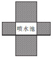

- **A**. 9
- **B**. 15
- **C**. 21
- **D**. 23

## 第 36 题　数量关系 · 双考区原题号

有两盏 4 米高的路灯相距 10 米。 一个身高 1.5 米的路人走在这两盏路灯之间，则他的 两个影子的总长度为（ ）米。

- **A**. 4
- **B**. 6
- **C**. 8
- **D**. 10

## 第 37 题　数量关系 · 双考区原题号

在一次班级数学考试中，按得分高低将全班同学进行排序，已知前七名的平均分比前五 名的平均分少 3 分，前五名的平均分比前三名少 2 分，则第六名和第七名的总成绩比第四名和 第五名的总成绩低（ ）分。

- **A**. 5
- **B**. 10
- **C**. 15
- **D**. 25

## 第 38 题　数量关系 · 双考区原题号

某农场主新经营一个农场，手头上仅有 100000 元。 假设养一头牛成本要 8000 元，半年 后卖出能盈利 2000 元；养一头羊成本要 1000 元，半年后卖出能盈利 500 元。 农场主养了若干 牛和羊，羊的数量最多是牛的 2 倍，则他在半年后卖出所有的牛和羊，最多能够盈利（ ）元。

- **A**. 10000
- **B**. 20000
- **C**. 30000
- **D**. 40000

## 第 39 题　数量关系 · 双考区原题号

某地公交车票价一律 2 元/次。 乘坐公交车可以用现金或者用城通卡。城通卡享有在一个月内刷卡前 15 次公交车票价 9 折、15 次后每次公交车票价 6 折的优惠。 小王本月共支出公 交车费 41.8 元，他本月最多共乘了（ ）次公交车。

- **A**. 24
- **B**. 26
- **C**. 27
- **D**. 29

## 第 40 题　数量关系 · 双考区原题号

一座高 10 层的写字楼有 A、B 两台电梯，每台电梯核载 12 人（假设所有人都不超重）。 电梯每上升或下降一层耗时 5 秒，每停留一层耗时 30 秒。上升时，A 梯每层都停，B 梯每单数楼 层都停且最高只到 9 层。 电梯下降过程中不在任何楼层停留。 此时，两台电梯刚回到一楼，A 梯 排队人数 30 人，B 梯排队人数 49 人。 小黎的办公室在 7 楼，他排哪台电梯的队伍能更快回到 办公室？ 最少需要多少秒？

- **A**. A 梯，990 秒
- **B**. B 梯，990 秒
- **C**. A 梯，1040 秒
- **D**. B 梯，1040 秒

## 第 41 题　常识判断 · 双考区原题号

家庭是社会的细胞。 家庭和睦则社会安定，家庭幸福则社会祥和，家庭文明则 社会文明。 以下关于家庭文明建设的说法，错误的是：

- **A**. 各级领导干部要带头抓好家风，继承和弘扬革命前辈的红色家风
- **B**. 各级党政部门要积极组织开展家庭文明评选、表彰活动
- **C**. 广大家庭要重言传、重身教、教知识、育品德，帮助孩子扣好人生的第一粒扣子，迈好人 生的第一个台阶
- **D**. 要用社会主义核心价值观引领家庭文明建设，推动核心价值观在家庭中生根

## 第 42 题　常识判断 · 双考区原题号

经济发展进入新常态，传统制造业面临着市场需求多变、劳动力等资源要素成本上升、 节能减排约束趋紧所形成的多重压力和困境，传统制造业的优势不断削弱，生存空间日渐缩小。 关于传统制造企业可遵循的转型思路，以下归纳不正确的是：

- **A**. 劳动密集，充分利用人口红利
- **B**. 结合需求，明晰制造新方向
- **C**. 融资融智，发展智能化制造
- **D**. 节能减排，走绿色制造之路

## 第 43 题　常识判断 · 双考区原题号

丘逢甲名作《春愁》：“春愁难遣强看山，往事惊心泪欲潸。 四百万人同一哭，去年今日割 台湾。 ”这首诗创作于（ ）年。

- **A**. 甲午
- **B**. 乙未
- **C**. 丙申
- **D**. 丁酉

## 第 44 题　常识判断 · 双考区原题号

下列说法符合我国法律规定的是：

- **A**. 妻子独立经营公司所获得的除工资、奖金之外的分红，属于妻子一方的财产
- **B**. 丈夫的智能机器人发明专利被使用而取得的报酬，属于丈夫一方的财产
- **C**. 妻子继承了祖父在越秀区的一套房产，该房产属于妻子一方的财产
- **D**. 丈夫在工作中受伤获得的10万元医疗费，属于丈夫一方的财产

## 第 45 题　常识判断 · 双考区原题号

甲公司持有相关公众所熟知的某商标。 近期，该公司认为其商标权受到了侵害，于是向商标局申请将这一商标认定为驰名商标。 商标局在认定驰名商标时，不必考虑的因素是：

- **A**. 相关公众对该商标的知晓程度
- **B**. 使用该商标的商品数量
- **C**. 该商标的任何宣传工作的持续时间、程度、地理范围
- **D**. 该商标作为驰名商标受保护的记录

## 第 46 题　常识判断 · 双考区原题号

选项“九宫格”中都暗含着一句诗。 这些诗名与“细数落花因坐久”恰成对仗工整的一联的是：

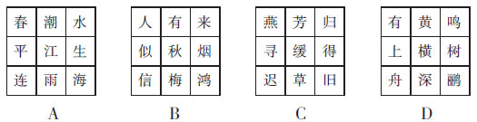

- **A**. 见题图中标注的A项
- **B**. 见题图中标注的B项
- **C**. 见题图中标注的C项
- **D**. 见题图中标注的D项

## 第 47 题　常识判断 · 双考区原题号

《神农本草经》说“菊花久服利血气、轻身、耐老延年”。 以下是菊花别名的是：

- **A**. 朝颜
- **B**. 寿客
- **C**. 长春花
- **D**. 七里香

## 第 48 题　常识判断 · 双考区原题号

在某个节气，我国民间有玩“竖鸡蛋”的习俗，以庆祝春天的来临。 此时太阳直 射赤道，地轴与地球绕太阳公转的轨道平面呈 66.5 度倾斜，处于一种力的相对平衡状 态，有利于把鸡蛋竖起来。 这个节气是：

- **A**. 立春
- **B**. 雨水
- **C**. 惊蛰
- **D**. 春分

## 第 49 题　常识判断 · 双考区原题号

《孙子兵法•九地篇》：“投之亡地然后存，陷之死地然后生。夫众陷于害，然后能为胜败。”
以下历史战役最能够体现这一思想的是：

- **A**. 巨鹿之战
- **B**. 赤壁之战
- **C**. 长平之战
- **D**. 淝水之战

## 第 50 题　常识判断 · 双考区原题号

斜面可以节省升高物体所用的力。 施加在斜面上的物体的重力分成两个分力，一个平行 于斜面，另一个垂直于斜面。 要将物体推上斜面，只需用大于平行分力的力来移动它。 物理学家 从这类现象中总结出了“斜面原理”。 以下工具主要体现了这一原理的是：

- **A**. 剪刀
- **B**. 滑轮起重机
- **C**. 订书机
- **D**. 螺丝钉

## 第 51 题　常识判断 · 双考区原题号

以下有关生活常识的说法，错误的是：

- **A**. 古书和旧纸会散发一股味道，是因为纸张老化生成数种容易挥发的有机分子
- **B**. 狗误食巧克力丧命，是因为巧克力里含有可可碱
- **C**. 胶合玻璃中间夹了一层塑料，即使碎得很厉害，也能保持完整的形状
- **D**. 铅笔的笔芯是由铅和石墨混合制造而成的

## 第 52 题　常识判断 · 双考区原题号

小杨最近腹泻，医生建议他暂时不要吃富含蛋白质和油脂的食物。 小杨应该选择的早 餐是：

- **A**. 玉米和馒头
- **B**. 豆浆和油条
- **C**. 炒面和白粥
- **D**. 鸡蛋和酸奶

## 第 53 题　常识判断 · 双考区原题号

潜伏于裸岩间“距神灵最近，距人类最远”的雪豹，常让摄影师近乎绝望：它们行踪诡秘， 常年栖息于海拔 3000~6000 米的偏远荒僻之处；银灰色皮毛则让它们与高山裸岩融为一体，叫 人难以发现。 想要幸运地拍到雪豹，不仅需要耐心，还必须掌握它们的习性。 以下关于雪豹的说 法，错误的是：

- **A**. 雪豹有几乎与身体一样长的“招牌式”尾巴
- **B**. 刨痕是雪豹标记领地的典型方式
- **C**. 在我国，雪豹多出现于喜马拉雅山脉、昆仑山脉、太行山脉
- **D**. 雪豹以岩羊为主要食物

## 第 54 题　常识判断 · 双考区原题号

钙元素是人体必需的金属元素。 下列说法错误的是：

- **A**. 人体中的钙元素主要存在于骨骼和牙齿中
- **B**. 钙是人体中含量最高的元素
- **C**. 婴幼儿和青少年比成年人需要摄入更多的钙
- **D**. 老年人缺钙会引起骨质疏松，容易骨折

## 第 55 题　常识判断 · 双考区原题号

一位驴友在一次旅行途中“发思古之幽情”，“想起了范蠡携西子泛舟的传说， 想起了‘夜半钟声到客船’的风致，想起了白居易、苏东坡为民造福的往事”。 这位驴友最有可能去的是：

- **A**. 江苏和浙江
- **B**. 河北和山东
- **C**. 湖南和湖北
- **D**. 广东和福建

## 第 56 题　判断推理 · 双考区原题号

养老保险：社会保障

- **A**. 精准扶贫：粗放扶贫
- **B**. 依法行政：依法治国
- **C**. 精神文明：物质文明
- **D**. 货币政策：财政政策

## 第 57 题　判断推理 · 双考区原题号

村庄：晨雾

- **A**. 沙漠：极光
- **B**. 病房：悲伤
- **C**. 战场：硝烟
- **D**. 天空：彩虹

## 第 58 题　判断推理 · 双考区原题号

海拔：等高线

- **A**. 设计：作品
- **B**. 电阻：电压
- **C**. 音量：振幅
- **D**. 涨幅：价格

## 第 59 题　判断推理 · 双考区原题号

烹饪：食客

- **A**. 焊接：木匠
- **B**. 手术：医生
- **C**. 装修：住户
- **D**. 安检：消防员

## 第 60 题　判断推理 · 双考区原题号

雨水：雪花

- **A**. 闪电：雷鸣
- **B**. 石油：汽油
- **C**. 蛤蟆：青蛙
- **D**. 干冰：二氧化碳

## 第 61 题　判断推理 · 双考区原题号

乡愁：落叶归根

- **A**. 爱慕：一往情深
- **B**. 豪迈：幅员辽阔
- **C**. 贤良：沉鱼落雁
- **D**. 勤劳：栉风沐雨

## 第 62 题　判断推理 · 双考区原题号

牙膏：牙刷：牙齿

- **A**. 水：拖把：地板
- **B**. 墨水：钢笔：日记本
- **C**. 耕牛：锄头：耕地
- **D**. 茶水：茶杯：桌子

## 第 63 题　判断推理 · 双考区原题号

煤炭：矿产：炼钢

- **A**. 电影：艺术：投资
- **B**. 钟乳石：景观：观赏
- **C**. 火车：铁路：运输
- **D**. 风力：能源：发电

## 第 64 题　判断推理 · 双考区原题号

栅栏：围墙：壁垒

- **A**. 火药：弓箭：子弹
- **B**. 高原：沙丘：山脉
- **C**. 铅笔：木炭：钻石
- **D**. 书信：电报：电话

## 第 65 题　判断推理 · 双考区原题号

工厂：河流：污水处理

- **A**. 种子：镰刀：耕地保护
- **B**. 汽车：道路：交通治理
- **C**. 渔民：海洋：过度捕捞
- **D**. 人口：空气：集体供暖

## 第 66 题　判断推理 · 双考区原题号

医生赵某才智出众，他是人大代表。
如果上述断定为真，则以下各项能判断真假的是：
Ⅰ.只有才智出众，才能成为人大代表； Ⅱ.所有才智出众的人都不是人大代表； Ⅲ.不是所有才智出众的人都是人大代表。

- **A**. 只有Ⅱ
- **B**. 只有Ⅲ
- **C**. Ⅰ和Ⅱ
- **D**. Ⅱ和Ⅲ

## 第 67 题　判断推理 · 双考区原题号

在传授式课堂，学生经历的是老师提出问题和解答的过程，不像在翻转式课堂，学生可 以自己提出问题进而解答。 阻碍学生创新力发展的正是如此机械而无趣的传授式课堂的问题 提出模式。
以下哪项是支持上述结论的前提假设？

- **A**. 当被允许选择一种课堂模式时，学生会更喜欢翻转式课堂而不是传授式课堂
- **B**. 当学生可以主动提出问题时，他的创新力才能得到更好的发展
- **C**. 由于每个学生都是不同的，所以学生提出的问题也是多样的
- **D**. 学生除非进入翻转式课堂，否则其创新力很难获得提高

## 第 68 题　判断推理 · 双考区原题号

不是每个值得一见的人都值得当作朋友，但是每个不值得一见的人都不值得当作朋友。
甲认为上述第一个判断是真的，第二个判断是假的。
乙认为上述第一个判断是假的，第二个判断是真的。
已知：黄某和李某都是值得当作朋友的人，但黄某值得一见，李某不值得一见。
由此可知，以下一定为真的一项是：

- **A**. 甲的判断是真的
- **B**. 乙的判断是真的
- **C**. 甲和乙的判断都可能是真的
- **D**. 甲和乙的判断都可能是假的

## 第 69 题　判断推理 · 双考区原题号

有人认为，每年的考研人数反映了当年应届本科毕业生的就业情况。 因为如果当年的应 届本科毕业生就业形势严峻，就会使更多人选择读研作为缓冲，导致考研人数增加。
以下哪项如果为真，最无法有效削弱上述观点？

- **A**. 在职考研的非应届生比例越来越大
- **B**. 越来越多的应届本科毕业生选择就业
- **C**. 研究生的招生总量逐年增加
- **D**. 大部分应届本科毕业生都会考研、找工作两手抓

## 第 70 题　判断推理 · 双考区原题号

某研究显示，有慢性抑郁症的个体与其他方面一致、但没有抑郁症的人相比，其免疫系 统明显失调。 研究人员认为，这项研究结果强有力地说明了，精神状况会影响身体对传染病的 抵抗能力。
以下哪项如果为真，将最有力地质疑上述结论？

- **A**. 免疫系统失调会使人患上慢性抑郁症
- **B**. 以前没有抑郁症的人可能非常迅速地变得抑郁
- **C**. 频繁感染传染病很可能是因为过多接触传染源
- **D**. 有慢性抑郁症的人在防止接触传染源方面绝不比其他人粗心

## 第 71 题　判断推理 · 双考区原题号

某场赛马比赛前，赵、钱、孙、李、周五位观众对甲、乙、丙、丁、戊五匹赛马的名次进行了 预测。赵说：“乙第三名，丙第五名。 ” 钱说：“戊第四名，丁第五名。 ” 孙说：“甲第一名，戊第四名。 ” 李说：“丙第一名，乙第二名。 ” 周说：“甲第三名，丁第四名。 ”
结果每个名次都有人猜中。 那么丙的名次是：

- **A**. 第一名
- **B**. 第二名
- **C**. 第四名
- **D**. 第五名

## 第 72 题　判断推理 · 双考区原题号

同事小王、小李、小张三人每天都去同一家面馆吃午餐。 他们每人每天中午不是吃拉面 就是吃刀削面。 如果小王吃拉面，那么小李就吃刀削面，小王和小张不会同时吃拉面，小李和小 王不会同时吃刀削面。 小王一定不吃与前一天一样的品种。
如果昨天小王吃的是拉面，那么以下判断正确的是：

- **A**. 今天小李吃的不一定是拉面
- **B**. 今天小张吃的一定是拉面
- **C**. 今天小张吃的一定是刀削面
- **D**. 昨天小张吃的一定是刀削面

## 第 73 题　判断推理 · 双考区原题号

有专家认为，2016年下半年我国一、二线城市的房价上涨迅速，其中相当部分涨幅较大，因此今年炒房者会为了及时套现选择尽快卖房，导致房地产市场供过于求，从而造成房价下跌。
以下哪项如果为真，最能质疑专家的观点？

- **A**. 部分炒房者认为房价还会继续上涨
- **B**. 今年国家经济政策强调以稳为主，调控引发房价下跌的可能性不大
- **C**. 一、二线城市的房价上涨是由于受到“去库存”经济政策的影响
- **D**. 炒房者在所有购房者中所占的比重不足1%

## 第 74 题　判断推理 · 双考区原题号

疲劳驾驶威胁着交通安全，尤其驾驶客运机动车的司机，其疲劳驾驶带来的隐患令人难以想象。 所以，公交公司应该缩短公交车司机上班的时间。
下列哪项最恰当地指出上述论证的漏洞？

- **A**. 公交车司机并不比其他客运机动车司机的上班时间长
- **B**. 货运机动车司机疲劳驾驶更为危险，尤其是驾驶装有易燃物品的油罐车
- **C**. 并非公交车司机的所有上班时间都在开车
- **D**. 如果公交公司缩短公交车司机的上班时间，城市公共交通将出现瘫痪的风险

## 第 75 题　判断推理 · 双考区原题号

早在 20 世纪 80 年代，3D 打印技术便横空出世，人们认为它将掀起一场革命，能改变产 品的设计和制造模式，甚至改变我们的世界。 然而，直到目前为止，它的应用并没有像预言那样广泛地取代传统制造行业。
以下哪项如果为真，最能解释这个现象？

- **A**. 可用于工厂规模化生产产品的 3D 打印设备价格不菲
- **B**. 可用 3D 打印技术批量生产产品需要耗费更高成本
- **C**. 在制造某些产品上，3D 打印技术还不够成熟
- **D**. 掌握 3D 打印技术的专业人才不足

## 第 76 题　判断推理 · 双考区原题号

请选择最适合的一项填入问号处，使之符合之前四个图形的变化规律。

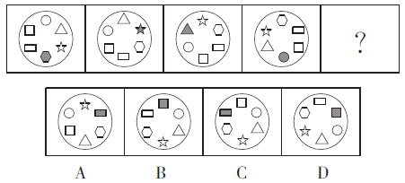

- **A**. 见题图中标注的A项
- **B**. 见题图中标注的B项
- **C**. 见题图中标注的C项
- **D**. 见题图中标注的D项

## 第 77 题　判断推理 · 双考区原题号

请选择最适合的一项填入问号处，使之符合之前四个图形的变化规律。

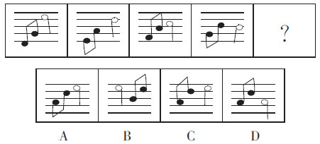

- **A**. 见题图中标注的A项
- **B**. 见题图中标注的B项
- **C**. 见题图中标注的C项
- **D**. 见题图中标注的D项

## 第 78 题　判断推理 · 双考区原题号

请选择最适合的一项填入问号处，使之符合之前四个图形的变化规律。

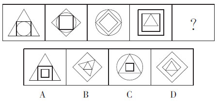

- **A**. 见题图中标注的A项
- **B**. 见题图中标注的B项
- **C**. 见题图中标注的C项
- **D**. 见题图中标注的D项

## 第 79 题　判断推理 · 双考区原题号

请选择最适合的一项填入问号处，使之符合之前四个图形的变化规律。

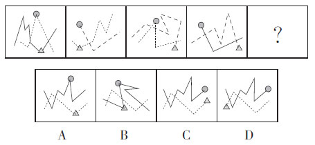

- **A**. 见题图中标注的A项
- **B**. 见题图中标注的B项
- **C**. 见题图中标注的C项
- **D**. 见题图中标注的D项

## 第 80 题　判断推理 · 双考区原题号

请选择最适合的一项填入问号处，使之符合整个图形的变化规律。

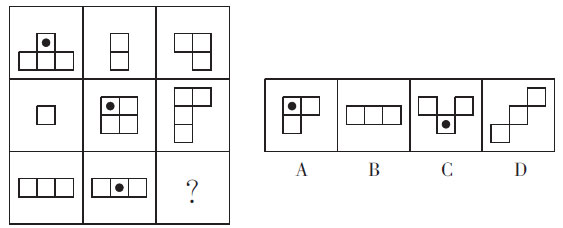

- **A**. 见题图中标注的A项
- **B**. 见题图中标注的B项
- **C**. 见题图中标注的C项
- **D**. 见题图中标注的D项

## 第 81 题　判断推理 · 双考区原题号

请选择最适合的一项填入问号处，使右边图形的变化规律与左边图形一致。

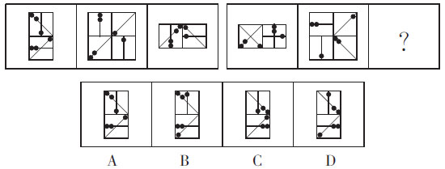

- **A**. 见题图中标注的A项
- **B**. 见题图中标注的B项
- **C**. 见题图中标注的C项
- **D**. 见题图中标注的D项

## 第 82 题　判断推理 · 双考区原题号

请选择最适合的一项填入问号处，使右边图形的变化规律与左边图形一致。

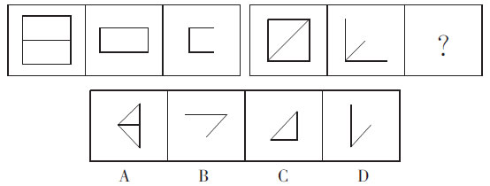

- **A**. 见题图中标注的A项
- **B**. 见题图中标注的B项
- **C**. 见题图中标注的C项
- **D**. 见题图中标注的D项

## 第 83 题　判断推理 · 双考区原题号

下列选项中最适合填入图形空缺处，使整幅图形呈现一致的规律性的是：

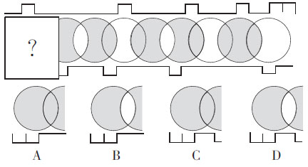

- **A**. 见题图中标注的A项
- **B**. 见题图中标注的B项
- **C**. 见题图中标注的C项
- **D**. 见题图中标注的D项

## 第 84 题　判断推理 · 双考区原题号

请选择最适合的一项填入问号处，使之符合之前五个图形的变化规律。

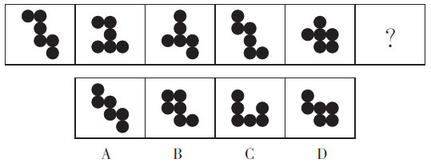

- **A**. 见题图中标注的A项
- **B**. 见题图中标注的B项
- **C**. 见题图中标注的C项
- **D**. 见题图中标注的D项

## 第 85 题　判断推理 · 双考区原题号

下列选项中最适合填入图形空缺处，使整幅图形呈现一致的规律性的是：

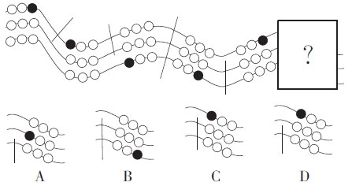

- **A**. 见题图中标注的A项
- **B**. 见题图中标注的B项
- **C**. 见题图中标注的C项
- **D**. 见题图中标注的D项

## 材料 1

第五部分 资料分析
（共15题，参考时限15分钟）

本部分仅有一种类型的试题：

九、资料分析：请根据以下给出的图表、文字资料进行分析，选出符合题目要求的正确答 案（共 15 题，每题 1 分，共 15 分）。

（一）根据以下资料，回答 86~90 题。

2016年1月三类新媒体应用公共云平台使用状况

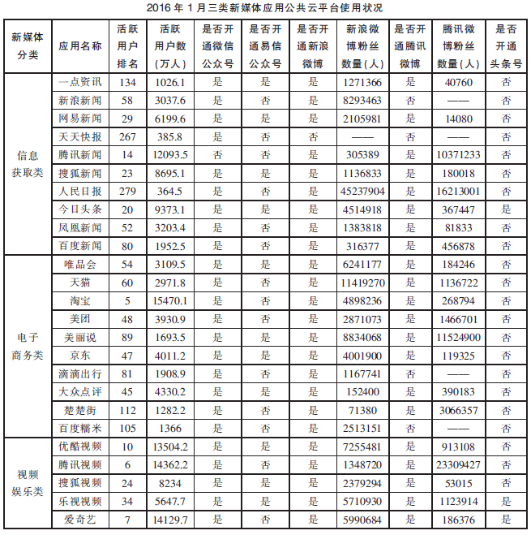

### 第 86 题　资料分析 · 双考区原题号

同时开通新浪微博和腾讯微博的上述新媒体应用中，2016 年 1 月新浪微博粉丝数量多 于腾讯微博粉丝数量的应用有（ ）个。

- **A**. 13
- **B**. 14
- **C**. 15
- **D**. 16

### 第 87 题　资料分析 · 双考区原题号

在上表中，新浪微博粉丝数量最少的应用与腾讯微博粉丝数量最少的应用，两者的共同 之处是：

- **A**. 都开通微信公众号
- **B**. 都开通易信公众号
- **C**. 都开通头条号
- **D**. 活跃用户排名都是前 50

### 第 88 题　资料分析 · 双考区原题号

2016 年 1 月， 活跃用户排名前 50 的上述新媒体应用， 活跃用户数 累 计 最 接 近 （ ）万人。

- **A**. 80000
- **B**. 90000
- **C**. 100000
- **D**. 110000

### 第 89 题　资料分析 · 双考区原题号

没有开通易信公众号的上述新媒体应用中，2016 年 1 月活跃用户数最多的应 用是：

- **A**. 腾讯新闻
- **B**. 淘宝
- **C**. 腾讯视频
- **D**. 爱奇艺

### 第 90 题　资料分析 · 双考区原题号

根据上表，以下说法准确的是：

- **A**. 2016年1月活跃用户数最多和最少的应用都没有开通易信公众号
- **B**. 2016年1月活跃用户数超过1亿人的应用都没有开通头条号
- **C**. 没有开通腾讯微博的应用，都开通新浪微博
- **D**. 活跃用户排名越高的应用，其新浪微博粉丝数量越多

## 材料 2

（二）根据以下资料，回答 91~95 题。

2005—2015年我国城乡居民人均收入情况

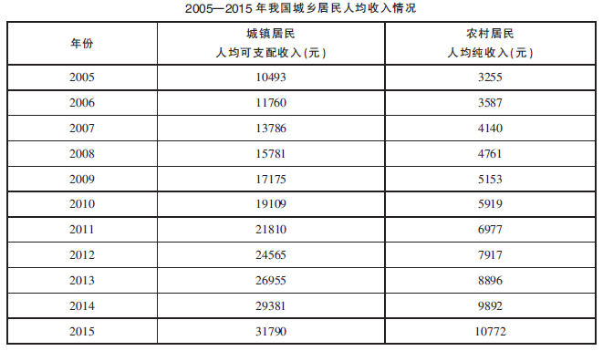

2014—2015年我国城乡居民人均可支配收入绝对额及构成情况

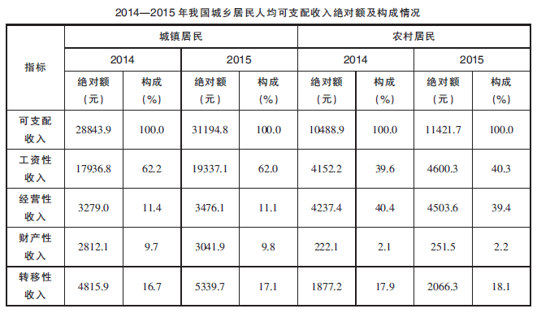

### 第 91 题　资料分析 · 双考区原题号

2015年，我国城镇居民人均可支配收入大约是 2005 年的（ ）倍。

- **A**. 2.5
- **B**. 3.0
- **C**. 3.5
- **D**. 10.0

### 第 92 题　资料分析 · 双考区原题号

相较于上一年，2015 年我国农村居民人均可支配收入绝对额的构成中，变化幅度最大 的是：

- **A**. 财产性收入
- **B**. 转移性收入
- **C**. 经营性收入
- **D**. 工资性收入

### 第 93 题　资料分析 · 双考区原题号

已知 2015 年我国城镇居民人数约占总人口数的 56.1%，则该年我国居民的人均工资性收入绝对额约为（ ）元。

- **A**. 3930
- **B**. 11960
- **C**. 12870
- **D**. 22510

### 第 94 题　资料分析 · 双考区原题号

2006 年至 2015 年间，我国农村居民人均纯收入与上一年相比，增长率最低的是：

- **A**. 2006 年
- **B**. 2009 年
- **C**. 2014 年
- **D**. 2015 年

### 第 95 题　资料分析 · 双考区原题号

根据上述资料，以下推论准确的是：

- **A**. 2005—2015 年，我国城乡居民收入保持较快增长，增长速度高于同期 GDP 的 增长速度
- **B**. 2005—2015 年，我国城镇居民人均可支配收入和农村居民人均纯收入同比增 长速度最快出现于同一年
- **C**. 相较于 2005 年，2015 年我国农村居民人均可支配收入绝对额由 3255 元增长到 11421.7元，翻了将近 3.5 番
- **D**. 2015 年，我国城乡居民人均经营性收入绝对额在人均可支配收入绝对额中所占比重相较 于上一年有所下降，而人均财产性收入绝对额所占比重有所上升

## 材料 3

（三）根据以下资料，回答 96~100 题。

某项社会研究分别于 2011 年和 2015 年调查了各年龄阶段农业户口和非农业户口的生育 情况和生育意愿（生育意愿指的是个人理想的子女数量）。 以下为调查数据：

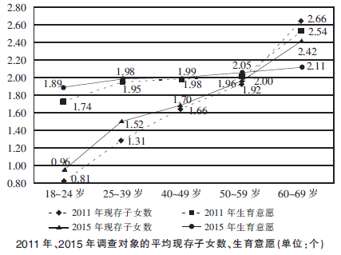

2011 年、2015 年调查对象的平均现存子女数、生育意愿（单位：个）

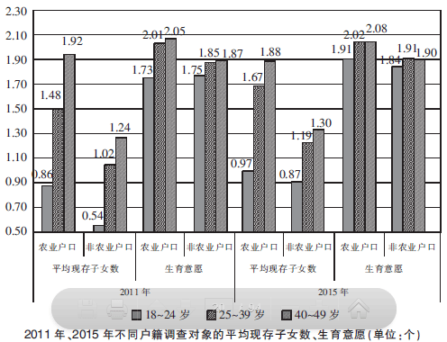

2011年、2015年不同户籍调查对象的平均现存子女数、生育意愿（单位：个）

### 第 96 题　资料分析 · 双考区原题号

2015 年，生育意愿最低的年龄段人口，比生育意愿最高的年龄段人口的平均理想子女数量少了（ ）人。

- **A**. 0.15
- **B**. 0.22
- **C**. 0.24
- **D**. 0.34

### 第 97 题　资料分析 · 双考区原题号

18～49 岁各年龄段人口中，2015 年农业户口和非农业户口的平均现存子女数量差异最小的年龄段是：

- **A**. 18～24 岁
- **B**. 25～39 岁
- **C**. 45～49 岁
- **D**. 无法判断

### 第 98 题　资料分析 · 双考区原题号

与 2011 年相比，2015 年（ ）年龄段人口的平均理想子女数量变化最大。

- **A**. 18～24 岁
- **B**. 25～29 岁
- **C**. 40～49 岁
- **D**. 60～69 岁

### 第 99 题　资料分析 · 双考区原题号

根据上述资料，以下说法错误的是：

- **A**. 与2011年相比，2015年18～24岁年龄段人口的平均现存子女数量和平均理想 子女数量都有所增长
- **B**. 与2011年相比，2015年40～49岁年龄段人口的平均现存子女数量的变化量、平均理想子女数量的变化量都是最低的
- **C**. 18～24岁年龄段人口的平均现存子女数量和平均理想子女数量的差距在2011年和2015年都是所有年龄段中最大的
- **D**. 25～39岁年龄段人口的平均现存子女数量和平均理想子女数量的差距在2011年和2015年都是所有年龄段中最小的

### 第 100 题　资料分析 · 双考区原题号

根据上述资料，以下说法错误的是：

- **A**. 从总体上看，人们的平均理想子女数量随着年龄的增长而增长
- **B**. 18~49 岁各年龄段人口中，非农业户口的平均现存子女数量普遍要低于农业户口
- **C**. 18~49 岁各年龄段人口中，2011 年至 2015 年农业户口的生育意愿变化趋势与非 农业户口不完全相同
- **D**. 18~49 岁各年龄段人口中，非农业户口的平均理想子女数量普遍均低于农业户口

## 答案与解析

第 1 题

**答案**：A

**来源参考解析（非官方标准答案）**

“例如扫一扫二维码就能收到景点的介绍”是对空缺处词语的解释，即文段强调的是互联 网给人们的旅行带来了方便，“便利”填入恰当。 故本题选 A。

第 2 题

**答案**：B

**来源参考解析（非官方标准答案）**

“提高”“提升”常与“水平”“质量”等搭配，与“方式”搭配不当，排除 A、C。 “转化”常与“成 果”“矛盾”等搭配，“转变”常与“思路”“方式”等搭配，此处与“生活方式”搭配，应选“转变”。 故本题选 B。

第 3 题

**答案**：C

**来源参考解析（非官方标准答案）**

由“听清事实，是一切判断的基础”可知，作者认同前文的提问，“奇谈怪论”“不可理喻”与 此义相悖，排除 A、D。 “掷地有声”比喻文章文辞优美，语言铿锵有力；“振聋发聩”比喻用语言文字唤醒糊涂麻木 的人。 “振聋发聩”填入更能突出前文提问的警醒作用。 故本题选 C。

第 4 题

**答案**：B

**来源参考解析（非官方标准答案）**

句意为无趣的人能把本来有趣的故事讲得无趣。 “丢三落四”形容因做事粗心或记忆力不 好而顾此失彼；“索然无味”形容呆板枯燥，一点意味或者趣味都没有；“不堪入耳”形容脏话难听；“天花乱坠”形容人说话巧妙动听，但虚妄、空洞不着边际。 只有“索然无味”与“无趣”的语境能构成对应。 故本题选 B。

第 5 题

**答案**：C

**来源参考解析（非官方标准答案）**

第一空，“风尚”指在一定社会时期中社会上流行的风气和习惯；“风范”指风度，气派。此处 句意为“直播＋正能量”成为新的社会流行风气，应选“风尚”，排除 B、D。 第二空，“倚重”指依靠，器重；“借助”指 靠别的人或事物的帮助。 此处的“网络”是正能量得以传播的媒介和平台，对正能量的传播起到的是辅助的作 用，用“借助”恰当。 故本题选 C。

第 6 题

**答案**：D

**来源参考解析（非官方标准答案）**

本题考查顺承逻辑关系。 “共商”强调的是“一带一路”建设之前的思想统一过程，“共建”强调的是“一带一路”建设的实施过程，“共享”强调的是“一带一路”建成之后的分享利好过程。 与此顺序相符的 为 D。

第 7 题

**答案**：C

**来源参考解析（非官方标准答案）**

前两空，“构建体系”“培育新动能”为习惯搭配，排除 A、B。 第三空，“深化”与“攻坚”搭配不当，第四空，“深化合作”为习惯搭配。 故本题选 C。

第 8 题

**答案**：C

**来源参考解析（非官方标准答案）**

由“以文化探索为核心的城市旅行方式”可知，文段对于“走马观花”的方式持否定态度，对于“在城市中游走”的方式是肯定的，故表肯定前者否定后者的 C 项填入恰当。 本题选 C。

第 9 题

**答案**：B

**来源参考解析（非官方标准答案）**

前两空，“经济大省”“国资重镇”之间为递进关系，“不但…… 而且……”连接恰当。 第三 空，由于是经济大省和国资重镇，因此被各方寄予厚望，表因果的“因此”填入符合逻辑。 故本题选 B。

第 10 题

**答案**：C

**来源参考解析（非官方标准答案）**

由“依然锁不住……”可知，第一空所填词语应表转折关系，“尽管”填入恰当，排除 A、D。后两空，“顾盼频繁”与“不辞长作岭南人”之间为递进关系，排除 B。 故本题选 C。

第 11 题

**答案**：C

**来源参考解析（非官方标准答案）**

文段首先以习近平总书记的话提出为群众办实事要讲方法的观点，然后论述了方法错 误对工作的危害，末句进一步强调只有方法正确，才能真正落实好事，办成好事。 “方法”为文段强调的重点，故 本题选 C。

第 12 题

**答案**：A

**来源参考解析（非官方标准答案）**

文段主要讲的是中小企业发达与否，对社会和城市的重要影响，B 项“大型企业发达的城 市”的情况文段未涉及，无中生有；C 项，“中产阶级”对城市经济增长的作用文段未涉及，排除；D 项的“根本途 径”无法推出，排除。 A 项可由末句“中小企业得不到发展的城市……社会分化、不稳定”得出。 故本题选 A。

第 13 题

**答案**：D

**来源参考解析（非官方标准答案）**

A 项，文段说的是在演绎中国故事的过程中要抓住文化精魂这个内核，而非中国故事中 暗含着文化的精魂；B 项，文段说的是“需要会讲故事的人”，而非“缺讲故事的人”；C 项，“从群体的命运中发掘 中国故事”表述有误，文段说的是“通过不同群体的命运去演绎”。 故本题选 D。

第 14 题

**答案**：D

**来源参考解析（非官方标准答案）**

文段首先指出，如果权威信息无法及时占领舆论的至高点，就容易给小道消息提供空 间，然后强调了由此造成的严重后果———一旦人们关于事件的印象固化，官方将很难赢得社会信任。 由此可知，文段意在说明官方应在事件发生后及时发布权威信息，以正视听。D 项与此相符。A 项是官方要及时发布信息的 原因；B 项小道消息的特点文段未涉及；C 项“通常无法及时占领”无法推出。 故本题选 D。

第 15 题

**答案**：D

**来源参考解析（非官方标准答案）**

A 项表述绝对，文段说的是“今天的创新几乎离不开大学”；B 项，文段说的是“大学不仅 仅是为了创新而设”“大学的创新远不止产生新技术， 而是创造新知识”，“大学的使命就是培养创新型人才”的论断无法推出；C 项，文段只是提到中西方很多大学都提倡创新，由此不能推出中西方大学的办学理念一致。 故 本题选 D。

第 16 题

**答案**：A

**来源参考解析（非官方标准答案）**

文段主要说的是传统的外贸格局下，中国企业和海外之间如同在“下象棋”，中国企业特别是中小微企业很难弄清楚终端用户是怎么想的，所以很难“走出去”。 因此文段主要说明的是传统外贸格局 下，中国企业“走出去”难的原因，即 A 项。 B、D 两项未提到“走出去”难问题；C 项无中生有，文段未提到如何打 破传统外贸格局。 故本题选 A。

第 17 题

**答案**：C

**来源参考解析（非官方标准答案）**

由“这几个蛋白质的任何一个突变都会导致严重的先天缺陷”可知，C 项的“都会使生物体无法完成组装”表述错误。 故本题选 C。

第 18 题

**答案**：A

**来源参考解析（非官方标准答案）**

文段介绍了互联网的出现使得网生代作家、艺术家成为新时代的受益者，虽然有些网络 文艺会在通俗和庸俗之间失去平衡，但是许多业余作品被广大受众所接受，甚至获得了超过传统作家、艺术家 的影响力。 由此可知，互联网对大众创作的积极影响应为文段论述的重点，C、D 两项均未提到“互联网”这一主 题词，B 项非文段重点。 故本题选 A。

第 19 题

**答案**：C

**来源参考解析（非官方标准答案）**

文段共两句话：第一句话说明在市场运作失灵的情况下，政府干预也许能够有效；第二 句话说明在政府干预经济运作不畅的情况下，市场也许能够有效。A 项“没有本质区别”、D 项“互为替代”均表述 错误；B 项，文段主要论述的是政府干预和市场机制之间的配合，而非它们的缺点。 C 项的“互相补充”概括恰当， 故本题选 C。

第 20 题

**答案**：B

**来源参考解析（非官方标准答案）**

文段通过一个木桶中放置大石块和小砾石的实验引出时间管理这一话题，并指出掌握 时间的主动权，就是轻重缓急安排得当，大事小情统筹兼顾。A 项的“意义”非文段重点，排除；C 项“抓大放小”与 文段的“大事小情统筹兼顾”不符，排除；D 项把“掌握时间的主动权”作为“统筹兼顾”的必要条件，而文段说的 是“所谓掌握时间的主动权，就是……统筹兼顾”，排除。 故本题选 B。

第 21 题

**答案**：D

**来源参考解析（非官方标准答案）**

④句以指代词“这种”开头，置于首句指代不明，排除 A。 分析可知，④句中的“这种‘通’” 指的应是②句的内容，且其中“…… 的互通，…… 的互通”亦与②句末尾的“互联互通”对应恰当，故两句应紧密 相连，顺序为②④，排除 B。 ①句以“一句话”开头，含总结义，接在③句后衔接不当，排除 C。 故本题选 D。

第 22 题

**答案**：C

**来源参考解析（非官方标准答案）**

⑤句中的“管理学中的这句话”指的应是④句的内容，因此两句应紧密相连，顺序为④⑤，排除 A、D。 ②句中的“恰恰是想说”是对⑤句中的“并不是……”的进一步阐述，故②应紧接⑤后，排除 B。 故 本题选 C。

第 23 题

**答案**：C

**来源参考解析（非官方标准答案）**

①句的“复建”“怀旧”“纪念”应是在③句“粗暴拆除”之后的行为，故③应置于①句之前，排除 A、B。 ⑤句的“然而”是针对①句的“这种情感是可以理解的”而言的，故①⑤应相连，排除 D。 本题选 C。

第 24 题

**答案**：C

**来源参考解析（非官方标准答案）**

空缺处句子在首句，很可能是文段的总起句。 后文主要介绍了梅里雪山的攀登难度，并总结说“梅里雪山至今未被尘世沾染”。 故横线处的句子也应体现梅里雪山未被征服之意，C 项最契合文意，且 能与文段尾句形成前后呼应，故答案选 C。

第 25 题

**答案**：C

**来源参考解析（非官方标准答案）**

由破折号可知，横线部分所填的内容是“它包含的隐秘信息”，即“世界上最可怕的事是 比你聪明的人还比你勤奋”这句话所包含的隐秘信息。 B 项与这句话完全无关，可首先排除。 由“并不是健康的视角”可知 D 项不合文意，排除。 A 项的“天赋”在后文没有相关内容，排除。 C 项，“零和游戏”指参与博弈的各方 在严格竞争下，一方的收益必然意味着另一方的损失，与后文的“把别人的成功当成自己的失败”对应，故本题答案为 C。

第 26 题

**答案**：C

**来源参考解析（非官方标准答案）**

多次方数列变式。 各项依次可以写为 11－1、22＋1、33－1、44＋1，应填入 55－1＝3124，选择 C。

第 27 题

**答案**：A

**来源参考解析（非官方标准答案）**

第二项÷第一项=第三项，应填入 （1/4）÷（1/2）=（1/2），选择 A。

第 28 题

**答案**：B

**来源参考解析（非官方标准答案）**

分子每次减少1； 奇数项分母128，32，8，（2）是公比为（1/4）的等比数列 。偶数项分母129，21，9都是3的倍数，选择 B。

第 29 题

**答案**：B

**来源参考解析（非官方标准答案）**

分组组合数列。每两个数字一组，二者之和依次为－1，－3，－5，（－7），是公差为－2 的等差数 列，应填入－7－9＝（－16），选择 B。

第 30 题

**答案**：A

**来源参考解析（非官方标准答案）**

前一项加 1 后依次乘以自然数列得到下一项。 （4＋1）×1＝5，（5＋1）×2＝12，（12＋1）×3＝39，（39＋1）×4＝160，（160＋1）×5＝805，选择 A。

第 31 题

**答案**：C

**来源参考解析（非官方标准答案）**

搭载 100 辆小车和 20 辆中型车，载重量为 180 吨。 减少 1 辆中型车可增加 5 辆小车，载 重量就增加 1×5－4＝1 吨。 题目要求中型车不少于 10 辆，最多减少 10 辆，载重量增加 10 吨，最多可载重 180＋ 10＝190 吨，选择 C。

第 32 题

**答案**：A

**来源参考解析（非官方标准答案）**

甲、乙一次相遇用时 400÷（5＋3）＝50 秒，第四次相遇时共跑了 50×4＝200 秒，此时甲跑了5×200＝1000 米，距离起点有 200 米，需要 200÷5＝40 秒才能返回起点，选择 A。

第 33 题

**答案**：A

**来源参考解析（非官方标准答案）**

第一台扫描仪从第一分钟开始，用 15 分钟完成 5 份文件的扫描；第二台扫描仪从第二 分钟开始，用 15 分钟完成 5 份文件的扫描。 即在其中一台打印机开始自动扫描时，在另一台打印机上进行操 作。 总共需要 16 分钟，选择 A。

第 34 题

**答案**：C

**来源参考解析（非官方标准答案）**

当人数确定的时候，办公室和实验室的数量唯一确定，宿舍的数量则需要考虑性别。 当人数为奇数时，宿舍数量为(人数+1)/2 ；当人数为偶数时，为(人数/2)或(人数/2)+1。 选项中 60 是 2、3、4 的公倍数，可优先分析60人的情况，此时需要 20 间办公室、15 间实验室，若 60 人中男女数都为奇数则需要宿舍最多为 31 间，总数为 66 间，符合题意，为最少的人数。 选择 C。

第 35 题

**答案**：B

**来源参考解析（非官方标准答案）**

设喷水池的长、宽分别为 ａ、ｂ。 则由题可知，a2+b2=34，ａ＋ｂ＝8，则 ａ＝5，ｂ＝3，则水池的面积为 15，选择 B。

第 36 题

**答案**：B

**来源参考解析（非官方标准答案）**

可以考虑极限情况，即此人走在其中一盏路灯之下，此时只有一个影子，如下图所示，设影子 BＭ 长为 ｘ，根据三角形相似可知， 1.5/4= x/(10+x)，解得 ｘ＝6，选择 B。

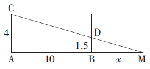

第 37 题

**答案**：C

**来源参考解析（非官方标准答案）**

特殊值法。 设前七名平均分为 1，则前五名平均分为 4，前三名平均分为 6。 则前七名总 分为 7，前五名总分为 20，前三名总分为 18。 则第四名和第五名总分为 20－18＝2 分，第六名和第七名总分为 7－ 20＝－13，本题所求为 15，选择 C。

第 38 题

**答案**：C

**来源参考解析（非官方标准答案）**

由题可知，养牛的利润率为 25％，养羊的利润率为 50％，应尽可能多的养羊。 羊最多为牛 的 2 倍，分别设为 2ｘ、ｘ，8000ｘ＋1000×2ｘ＝100000，得 ｘ＝10，盈利 2000×10＋20×500＝30000 元，选择 C。

第 39 题

**答案**：B

**来源参考解析（非官方标准答案）**

设原价乘坐公交、享六折优惠乘坐的次数分别为 ｘ、ｙ。 由题可得 2ｘ＋15×2×0.9＋2×0.6y＝41.8，化简得 ｘ＋0.6y＝7.4，且 x 要尽可能小才能保证次数最多，解得 ｘ＝2，y＝9，所求为 2＋15＋9＝26，选择 B。

第 40 题

**答案**：A

**来源参考解析（非官方标准答案）**

A 梯上升下降一个来回需要的时间为 30×10＋（5＋5）×9＝390 秒，在 A 电梯排队有 30 人， 小黎乘坐第三趟电梯，用时 5×6＋30×6＝210 秒，总共用时 390×2＋210＝990 秒；B 梯上升下降一个来回需要的时间 为 30×5＋（5＋5）×8＝230 秒，在 B 电梯排队有 49 人，小黎乘坐第五趟电梯，用时 5×6＋30×3＝120 秒，总共用时 230× 4＋120＝1040 秒。 所以排 A 梯能更快到办公室，最少需要 990 秒，选择 A。

第 41 题

**答案**：B

**来源参考解析（非官方标准答案）**

习近平同志指出，各级领导干部要带头抓好家风，继承和弘扬革命前辈的红色家风，向 焦裕禄、谷文昌、杨善洲等同志学习，做家风建设的表率。 A 项正确。
广大家庭都要重言传、重身教，教知识、育品德，帮助孩子扣好人生的第一粒扣子，迈好人生的第一个台阶。C 项正确。
要坚持用社会主义核心价值观引领家庭文明建设，融入家庭、家教、家风之中，促进核心价值观在家庭中落 地生根。 D 项正确。 B 项说法过于绝对。
故本题答案选 B。

第 42 题

**答案**：A

**来源参考解析（非官方标准答案）**

传统制造企业可遵循的转型思路主要有：需求与供给结合，明晰制造新方向；虚拟与实 业结合，提升制造新能力；融资与融智结合，发展智能化制造；节能与减排结合，走绿色制造之路。 故本题答案 选 A。

第 43 题

**答案**：C

**来源参考解析（非官方标准答案）**

丘逢甲名作《春愁》写于 1896 年，为丙申年（猴年）。 故本题答案选 C。

第 44 题

**答案**：D

**来源参考解析（非官方标准答案）**

《中华人民共和国婚姻法》第十八条规定，有下列情形之一的，为夫妻一方的财产：
（一）一方的婚前财产；
（二）一方因身体受到伤害获得的医疗费、残疾人生活补助费等费用；
（三）遗嘱或赠与合同中确定只归夫或妻一方的财产；
（四）一方专用的生活用品；
（五）其他应当归一方的财产。
故本题答案选 D。

第 45 题

**答案**：B

**来源参考解析（非官方标准答案）**

《中华人民共和国商标法》第十四条规定，驰名商标应当根据当事人的请求，作为处理涉 及商标案件需要认定的事实进行认定。 认定驰名商标应当考虑下列因素：
（一）相关公众对该商标的知晓程度；
（二）该商标使用的持续时间；
（三）该商标的任何宣传工作的持续时间、程度和地理范围；
（四）该商标作为驰名商标受保护的记录；
（五）该商标驰名的其他因素。
故本题答案选 B。

第 46 题

**答案**：C

**来源参考解析（非官方标准答案）**

“细数落花因坐久，缓寻芳草得归迟。 ”出自王安石的《北山》。 故本题答案选 C。

第 47 题

**答案**：B

**来源参考解析（非官方标准答案）**

牵牛花，别名朝颜，A 项错误；菊花，别名寿客、金英、黄华、秋菊、陶菊等，B 项正确；长春 花，别名金盏草、四时春、日日新、雁头红、三万花等，C 项错误；七里香，别名千里香、万里香、九秋香、九树香、过 山香、黄金桂、四季青、青木香、月橘、十里香等，D 项错误。 故本题答案选 B。

第 48 题

**答案**：D

**来源参考解析（非官方标准答案）**

二十四节气中的“春分”时节，这时太阳直射赤道，地轴与地球绕太阳公转的轨道平面呈66.5度倾斜，处于一种力的相对平衡状态。 在民间，春分还有“竖鸡蛋”“吃太阳糕”等节令民俗活动。 故本题答案 选 D。

第 49 题

**答案**：A

**来源参考解析（非官方标准答案）**

《孙子兵法》中所提到的“投之亡地然后存，陷于死地然后生。 夫众陷于害，然后能为胜 败”，集中表达了置之死地而后生的思想。 选项中能够体现这一思想的历史战役是巨鹿之战。 巨鹿之战是秦末大起义中，项羽率领义军与秦军进行的一场决战性战役，也是中国历史上著名的以少胜多的战役之一。 霸王项羽 破釜沉舟，置之死地而后生，击败了秦军主力，至此秦国已名存实亡。故本题答案选 A。

第 50 题

**答案**：D

**来源参考解析（非官方标准答案）**

A、B 选项体现的是杠杆原理，C 选项体现了部分力学原理，D 选项螺丝钉体现了斜面原理。 故本题答案选 D。

第 51 题

**答案**：D

**来源参考解析（非官方标准答案）**

铅笔的笔芯是用石墨和粘土按一定比例混合制造而成的，其主要成分是石墨，D 选项说 法错误。 故本题答案选 D。

第 52 题

**答案**：A

**来源参考解析（非官方标准答案）**

玉米和馒头中含有的主要营养物质是糖类，A 项应选；豆浆和油条中含有的主要营养物 质是油脂和蛋白质，B 项不选；炒面中含有大量油脂，C 项不选；鸡蛋和酸奶中含有的主要营养物质是蛋白质，D 项不选。 故本题答案选 A。

第 53 题

**答案**：C

**来源参考解析（非官方标准答案）**

雪豹常栖于海拔 2500～6000 米的高原地区。 而太行山脉北高南低，大部分海拔在1200米以上，山脊海拔 1500～2000 米。 主峰小五台山海拔 2882 米，不适合雪豹生存，C 项错误。 故本题答案选 C。

第 54 题

**答案**：B

**来源参考解析（非官方标准答案）**

在人体常量元素中，氧是人体含量最高的元素，而钙是人体内含量最高的金属元素。 故本题答案选 B。

第 55 题

**答案**：A

**来源参考解析（非官方标准答案）**

范蠡携西子泛舟出自东汉袁康的《越绝书》。 书中记载，“吴亡后，西施复归范蠡，同泛五 湖而去”。 五湖今指江苏省内太湖之内湖。 “夜半钟声到客船”出自唐代诗人张继的《枫桥夜泊》，此诗作于苏州。 白居易、苏东坡为民造福，是指两人曾在杭州为官，参与治理西湖。 故本题答案选 A。

第 56 题

**答案**：B

**来源参考解析（非官方标准答案）**

养老保险是社会保障的一部分，依法行政是依法治国的一部分。 故答案选 B。

第 57 题

**答案**：D

**来源参考解析（非官方标准答案）**

村庄里有晨雾，天空中有彩虹，且晨雾和彩虹都是自然现象。 故答案选 D。

第 58 题

**答案**：C

**来源参考解析（非官方标准答案）**

等高线可以表示海拔高度，振幅可以表示音量大小。 故答案选 C。

第 59 题

**答案**：C

**来源参考解析（非官方标准答案）**

烹饪后的食物供食客食用，装修后的房屋供住户居住。 故答案选 C。

第 60 题

**答案**：D

**来源参考解析（非官方标准答案）**

雨水和雪花是同种物质的不同形态，干冰和二氧化碳是同种物质的不同形态。 故答案 选 D。

第 61 题

**答案**：A

**来源参考解析（非官方标准答案）**

落叶归根比喻事物有一定的归宿，多指客居他乡的人终要回到本乡，有乡愁的情绪蕴含 其中。 一往情深指对人或对事物倾注了很深的感情，向往而不能克制，有爱慕的情绪蕴含其中。 D 项栉风沐雨形 容人经常在外面不顾风雨地辛苦奔波，强调辛苦，与勤劳略有不同。 故答案选 A。

第 62 题

**答案**：A

**来源参考解析（非官方标准答案）**

用牙刷蘸取牙膏清洁牙齿，用拖把蘸取水清洁地板。 故答案选 A。

第 63 题

**答案**：D

**来源参考解析（非官方标准答案）**

煤炭是矿产的一种，可以用来炼钢；风力是能源的一种，可以用来发电。 故答案选 D。

第 64 题

**答案**：D

**来源参考解析（非官方标准答案）**

栅栏、围墙、壁垒的功能相似，从前到后越来越坚固；书信、电报、电话的功能相似，从前到后越来越先进。 故答案选 D。

第 65 题

**答案**：B

**来源参考解析（非官方标准答案）**

工厂可能会造成河流污染，需要进行污水处理；汽车可能会造成道路拥堵，需要进行交 通治理。 故答案选 B。

第 66 题

**答案**：A

**来源参考解析（非官方标准答案）**

题干为联言命题，两个肢命题之间不存在充分或必要条件关系，Ⅰ不能判断真假；根据 “赵某才智出众”和“赵某是人大代表”，可以推出“有些才智出众的人是人大代表”，是Ⅱ的矛盾命题，因此Ⅱ为 假；Ⅲ可以转换为“有些才智出众的人不是人大代表”，根据“有些是”不能推出“有些不是”，Ⅲ也不能判断真假。 故答案选 A。

第 67 题

**答案**：B

**来源参考解析（非官方标准答案）**

题干的结论为“阻碍学生创新力发展的正是传授式课堂的问题提出模式”。B 项是必须假 设的，否则如果学生不用主动提出问题，创新能力也可以得到更好的发展，那么就不能说明传授式课堂的问题提出方式阻碍了学生的创新能力发展。 A、C 两项为无关项；除了翻转式课堂，可能还有其他课堂模式能提高学 生的创新能力，所以 D 项不是必须的假设。 故答案选 B。

第 68 题

**答案**：D

**来源参考解析（非官方标准答案）**

题干可以写成“有的值得一见的人不值得当朋友，每一个不值得一见的人都不值得当朋 友”。 而由已知条件黄某和李某的情况可以得出“有的值得一见的人值得当朋友”和“有的不值得一见的人值得当朋友”。 因此题干的前半句不能断定真假，而后半句为假。 甲的判断不一定为真，乙的判断为假，所以两人的判 断都可能是假的。 故答案选 D。

第 69 题

**答案**：B

**来源参考解析（非官方标准答案）**

题干的观点为：考研人数反映了当年本科毕业生的就业情况，因为就业形势严峻就会有 更多人选择考研。 A 项指出在职考研的非应届毕业生比例越来越大，C 项指出考研人数增多可能是受招生总量 的影响，D 项指出大部分应届毕业生都会考研工作两手抓，都说明考研人数的增加并非受就业形势的影响。B 项 为无关项，无法削弱题干观点。 故答案选 B。

第 70 题

**答案**：A

**来源参考解析（非官方标准答案）**

题干由“有慢性抑郁症的个体与其他方面一致、但没有抑郁症的人相比，其免疫系统明 显失调”得出结论“精神状况会影响身体对传染病的抵抗能力”。 A 项指出免疫系统失调会使人患上慢性抑郁 症，而并非因为慢性抑郁症才免疫系统失调，即题干推理是因果倒置，最有力地质疑了题干结论。 故答案选 A。

第 71 题

**答案**：A

**来源参考解析（非官方标准答案）**

因为每个名次都有人猜中，第二名只被猜了一次，因此肯定是正确的，即乙是第二名。 则乙是第三名为假，所以第三名就只能是甲，同理可得第一名是丙，第五名是丁，第四名是戊。 故答案选 A。

第 72 题

**答案**：D

**来源参考解析（非官方标准答案）**

已知昨天小王吃的是拉面，由于“小王和小张不会同时吃拉面”，并且“他们每人每天中 午不是吃拉面就是吃刀削面”，故小张昨天吃的肯定是刀削面。 故答案选 D。

第 73 题

**答案**：D

**来源参考解析（非官方标准答案）**

专家的观点为：由于房价快速上涨，因此炒房者会尽快卖房，导致房地产市场供过于求， 从而造成房价下跌。 D 项指出炒房者所占的比例很低，因此不足以引起市场的供过于求，也就不会造成房价下 跌，质疑了专家的观点；A、C 两项为无关项；B 项“可能性不大”削弱力度较弱。 故答案选 D。

第 74 题

**答案**：C

**来源参考解析（非官方标准答案）**

题干的论证为公交公司应该缩短公交车司机上班的时间，因为疲劳驾驶带来的隐患令人难以想象。 题干的论证存在漏洞，因为疲劳驾驶是长时间不间断地进行驾驶，并非公交车司机的所有上班时 间都在开车，即实际上工作时间并不等于是驾驶时间。 C 项很好地指出了这一漏洞。 故答案选 C。

第 75 题

**答案**：B

**来源参考解析（非官方标准答案）**

题干现象为：本来预计 3D 打印技术将改变产品的设计和制造模式。 然而，直到目前为止它的应用并没有广泛取代传统制造业。 B 项指出采用 3D 打印技术批量生产产品需要耗费更高成本，应用它取 代传统制造业是非常不划算的，因此可以很好地解释题干现象。 其他几项都不是合理的解释。 故答案选 B。

第 76 题

**答案**：D

**来源参考解析（非官方标准答案）**

前一个图形中的每个小图形逆时针移动 1 格，阴影所在的位置每次逆时针变化两格，选 D。

第 77 题

**答案**：D

**来源参考解析（非官方标准答案）**

“

”始终在左侧、开口朝下与朝上交替出现；圆圈在直线的左侧和右侧交替出现。 综合以上特征，选择 D。

第 78 题

**答案**：B

**来源参考解析（非官方标准答案）**

前一个图形的中间图形和最里边图形顺时针旋转 45°得到后一个图形的最外边图形和 中间图形，选择 B。

第 79 题

**答案**：A

**来源参考解析（非官方标准答案）**

上方的黑点分别连接 2 条、1 条线，应选择黑点连接 2 条线的图形，在 A、B 中选择；三角形和黑点不在同一条线上，排除 B 选择 A。

第 80 题

**答案**：B

**来源参考解析（非官方标准答案）**

每行三个图形通过平移，可组合成黑点位于中心的九宫格，故选 B。

第 81 题

**答案**：B

**来源参考解析（非官方标准答案）**

第一个图形中每一个带黑点的线条，依次旋转 45°得到后一个图形，故选 B。

第 82 题

**答案**：D

**来源参考解析（非官方标准答案）**

每组后一个图形是前一个图形的一半，选 D。

第 83 题

**答案**：D

**来源参考解析（非官方标准答案）**

圆圈以外的线条中心对称，排除 A、B；灰圆与灰圆的相交部分为白色，灰圆与白圆的相 交部分为灰色，排除 C 选择 D。

第 84 题

**答案**：B

**来源参考解析（非官方标准答案）**

每个图形的中间一列的黑点数都是 3，选项中只有 B 项符合。

第 85 题

**答案**：D

**来源参考解析（非官方标准答案）**

九宫格中的黑点依次逆时针移动 2 格，竖线与横线之间的交点数依次是 1、2、3、2、1，故 选 D。

第 86 题

**答案**：C

**来源参考解析（非官方标准答案）**

根据表格倒数第二列、倒数第四列数据，2016年1月新浪微博粉丝数量多于腾讯微博粉丝数量的应用有：一点资讯、网易新闻、搜狐新闻、人民日报、今日头条、凤凰新闻、唯品会、天猫、淘宝、美团、京东、优酷视频、搜狐视频、乐视视频、爱奇艺，共15个应用。

第 87 题

**答案**：A

**来源参考解析（非官方标准答案）**

新浪微博粉丝数量最少的应用是楚楚街，腾讯微博粉丝数量最少的应用是网易新闻，两 者都开通了微信公众号，答案选 A。

第 88 题

**答案**：D

**来源参考解析（非官方标准答案）**

根据表格第三列、第四列数据可知，活跃用户排名前 50 的新媒体应用活跃用户累计：6199.6＋12093.5＋8695.1＋9373.1＋15470.1＋3930.9＋4011.2＋4330.2＋13504.2＋14362.2＋8234＋5647.7＋14129.7≈6200＋12100＋8700＋9400＋15500＋3900＋4000＋4300＋13500＋14400＋8200＋5600＋14100＝119900，最接近的是D项。

第 89 题

**答案**：B

**来源参考解析（非官方标准答案）**

根据表格第四列、第六列数据并结合选项可知，没有开通易信公众号的新媒体应用中，2016 年 1 月活跃用户数最多的是淘宝，为 15470.1 万人，答案选 B。

第 90 题

**答案**：A

**来源参考解析（非官方标准答案）**

A 项，2016 年 1 月活跃用户数最多的是淘宝，最少的是人民日报，两者都没有开通易信 公众号，正确；直接选 A。
验证：B 项，2016 年 1 月活跃用户数超过 1 亿人的应用中爱奇艺开通了头条号，错误；
C 项，观察表格，天天快报既没有开通腾讯微博也没有开通新浪微博，错误；
D 项，观察表格第三列和倒数第四列数据，发现并没有此规律，错误。

第 91 题

**答案**：B

**来源参考解析（非官方标准答案）**

由第一个表格第二列数据可知，所求为 31790÷10493≈31500÷10500＝3，答案选 B。

第 92 题

**答案**：C

**来源参考解析（非官方标准答案）**

根据第二个表格第七、九列数据可知，变化幅度最大的是经营性收入，为 40.4－39.4＝1 个 百分点，选 C。

第 93 题

**答案**：C

**来源参考解析（非官方标准答案）**

根据第二个表格“工资性收入”一行及题干表述可知，所求为 19337.1×56.1％＋4600.3×（1－56.1％）≈20000×55％＋4600×44％＝200×55＋46×44≈11000＋452＝11000＋2025＝13025，最接近的是 C 项。

第 94 题

**答案**：B

**来源参考解析（非官方标准答案）**

根据第一个表格最后一列数据并结合选项可知，只需要判断 2006 年、2009 年、2014 年 和 2015 年的增长率即可，根据数据特点，直接排除 2006 年、2014 年，2009 年增长率为 5153/4761－1，2015年增长率为10772/9892-1由于
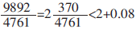
，
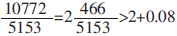
，故 9892/4761＜10772/5153 ，所以5153/4761＜10772/9892，故最小的是2009年，选择B。

第 95 题

**答案**：D

**来源参考解析（非官方标准答案）**

A 项，根据材料无法直接推出其增速与同期 ＧDＰ 的增长速度的关系，错误；
B项，计算量较大，先跳过；
C项，根据题干数据计算可得，11421.7÷3255≈3.5，即为 3.5 倍而非翻了 3.5 番，错误；
D项，根据第二个表格数据可知，2015 年城乡居民经营性收入占比分别为 11.1％、39.4％，均低于 2014 年，财产性收入占比分别为 9.8％、2.2％，均高于上年，正确，答案选 D。

第 96 题

**答案**：B

**来源参考解析（非官方标准答案）**

根据折线图，2015 年，生育意愿最低的年龄段平均理想子女数量是 1.89，生育意愿最高 的年龄段平均理想子女数量是 2.11，两者之差 2.11－1.89＝0.22，故选 B。

第 97 题

**答案**：A

**来源参考解析（非官方标准答案）**

比较柱状图中第五组、第六组柱状高度差发现，2015 年各年龄段农业户口和非农业户口 的平均现存子女数量差异分别为 0.97－0.87＝0.1，1.67－1.19＝0.48，1.88－1.30＝0.58，最小的 18～24 岁，答案选 A。

第 98 题

**答案**：D

**来源参考解析（非官方标准答案）**

比较折线图中虚线方块折线与实线圆点折线数据，变化最大的在 60～69 岁年龄段，答案 选 D。

第 99 题

**答案**：D

**来源参考解析（非官方标准答案）**

A 项，观察折线图，2015 年 18～24 岁年龄段人口的平均现存子女数量和平均理想子女数 量较 2011 年都有所增长，正确；B 项，观察折线图，与 2011 年相比，2015 年，40～49 岁年龄段人口的平均现存子女数量变化量 1.70－1.66＝0.04与 50～59 岁年龄段相同，都是最低，40～49 岁年龄段人口的平均理想子女数量变化量 1.99－1.98＝0.01，在各年龄 段变化最小，正确；C 项，根据折线图，2011 年 18～24 岁年龄段人口的平均现存子女数量和平均理想子女数量差距 1.74－0.81＝ 0.93，2015 年两者差距 1.89－0.96＝0.93，在各年龄段中差距均最大，正确；由排除法可选 D。
验证：D项，观察两条虚线差距、两条实线差距可知，平均现存子女数量和平均理想子女数量的差距在2011年和2015年所有年龄段中最小的是50～59岁，错误。

第 100 题

**答案**：C

**来源参考解析（非官方标准答案）**

观察折线图可知 A 正确；观察柱状图可知，B、D 正确，C 项应为完全相同，错误，选 C。

