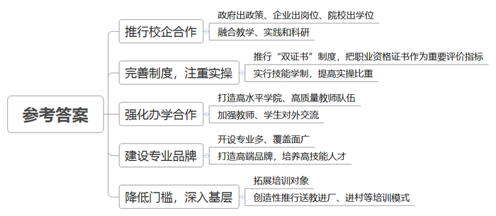
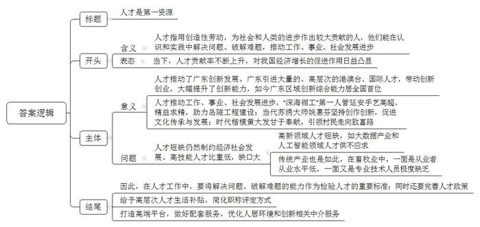
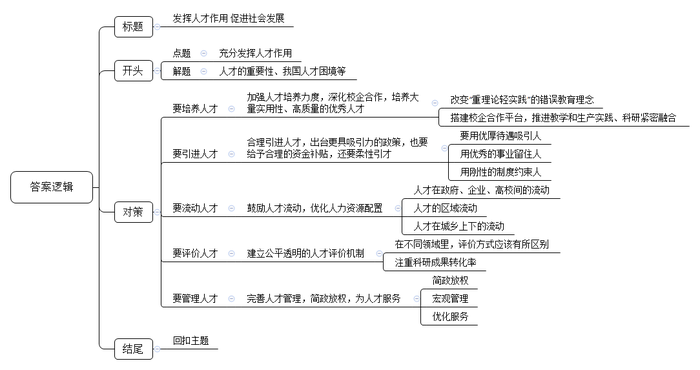

# 2018年广东省公考《申论》题

<!-- gwy:overview:start -->
> **广东 · 2018 · 申论 · 统考** ｜ 3 题 · 图片 3 处 · 答案随题折叠

导航：[题目](#题目) · [材料 1](#材料-1)
<!-- gwy:overview:end -->

> 候选采集稿。参考答案及解析来自粉笔页面，不代表官方答案或真实高分答卷；来源使用许可与原卷对应关系仍需人工核实。

## 给定材料

### 材料 1

国以才立，业以才兴。无论通过新技术改造传统产业，还是实现从“中国制造”到“中国智造”的跨越，技能人才都不可或缺。技工教育是技能人才培养的重要载体。广东技工教育始终走在全国前列，被誉为全国的一面旗帜。

2017年第44届世界技能大赛，21名广东“新工匠”闪耀“世界技能的奥运会”，勇夺5金4银6铜2优胜奖和“中国代表队国家最佳奖”。世界技能组织主席西蒙·巴特利盛赞“广东技工教育非常成功，选手们在第44届世界技能大赛中的表现令人惊叹”“广东的年轻人展现了中国乃至全世界技能人才最优秀的一面”。在巴特利看来，广东选手在第44届世界技能大赛中取得优异成绩，充分证明了广东技工教育创新和高技能人才培育非常成功。

长期以来，技工教育存在产教融合不深、企业参与不够、人才培养与企业和产业发展需求相脱节等突出问题。为此，广东首创“校企双制”合作办学模式，即政府出政策、企业出岗位、院校出学位。这一模式已被国务院纳入《关于加强企业技能人才队伍建设的意见》，成为指导推动企业培养技能人才的重要形式。为适应企业和产业发展需求，广东技工教育积极搭建“百校千企”校企合作平台，组织全省百所优质技工院校与包括现代产业500强和自主创新100强企业在内的千家重点企业对接，将教学和生产实践、科研紧密融合。

广东技工教育全面推行技能导向的“双证书”制度。把获得职业资格证书作为学校教学质量评估和学生培养评价重要指标。同时，实行技能学制提高实操比重，学生理论学习与实操实践的时间比为4∶6。实行一体化课程体系改革，老师在生产环境和模拟场景中教学，学生在做中学、学中练。广泛建立实习实训基地，建设了一批基础扎实、覆盖面广的技校实训中心。

广东技工教育着力建设国际合作学院（班）、深化中外校企合作、推进学生海外交流，打造一批国内一流、国际知名的高水平技师学院。技工院校围绕师资队伍建设强化合作交流，定期选派技工院校优秀教师、管理人员赴境外培训交流，打造一支具有国际新观念、宽视野、高素质的管理团队和专业教师队伍。围绕世界技能大赛强化合作交流，邀请世界技能大赛强国和地区机构到广东开展技能比武、技术研讨，选派广东优秀专家、选手到境外开展世界技能大赛观摩学习。

通过实施省级示范性品牌专业建设，广东全省技工院校共开设近400个专业，涵盖20个主要行业，其中80%面向现代产业。为了加快高技能人才培养步伐，打造技能人才培训的高端品牌，促进技工教育向高端发展，从2013年起，广东着力打造“世界知名、全国一流”的国家示范性技工院校，巩固了在全国的领先地位，形成为南方高技能人才硅谷。

多年来，广东技工教育在坚持面向城乡初高中毕业生、青年求职人员开展学制教育和劳动预备制培训的同时，还积极扩展培训对象，面向企业在职职工、农村转移就业劳动者、失业人员、高校毕业生等一切有学习需求、培训愿望的人，为他们提供机会均等的职业教育与培训服务；创造性推行送教进厂、送教进村、校镇结合等培训模式，不断输送技工技能人才满足经济社会发展需求，促进全省人力资源技能结构不断优化。

### 材料 2

今年3月7日，中共中央总书记、国家主席、中央军委主席习近平参加十三届全国人大一次会议广东代表团的审议，要求广东在构建推动经济高质量发展体制机制、建设现代化经济体系、形成全面开放新格局、营造共建共治共享社会治理格局上走在全国前列。

广东，40年前成为改革开放的“桥头堡”和“突破口”，如今借粤港澳大湾区建设的历史机遇，持续释放人才“引力波”。在众多人才数据统计中，成绩斐然。党的十八大以来，累计到粤工作的港澳台人才115万人次，位居全国首位，广东一跃成为港澳台人才总量最大、创新创业最为活跃的区域。据不完全统计，广东留学回国华侨华人专业人士约5.8万人，创办企业3000多家，为广东经济社会发展作出了巨大贡献。

《中国区域国际人才竞争力报告（2017）》蓝皮书显示，广东成为引进外国专家最多的省份，并在国际人才创新方面表现最佳。党的十八大以来，累计到粤工作的外国人才75万人次，居中国内地首位。“靓丽”的数据不仅体现在数量上，更反映在质量上。近年来，广东累计引进高层次海外人才5.8万人，其中诺贝尔奖获得者、发达国家院士、终身教授等143人，入选中央“外专千人计划”19人……

近年来，广东围绕创新驱动发展战略、人才强省战略，先后出台系列举措吸引高层次人才。2017年初，广东又出台了《广东省深化人才发展体制机制改革的实施意见》，提出给予青年拔尖人才每人50万元生活补贴。为破解制约广东青年人才创新发展的问题，助力打造南粤青年创新人才高地，同年12月广东出台了《关于加快新时代博士和博士后人才创新发展的若干意见》，将广东在站博士后的生活补贴资助标准提高到每人每年15万元，同时，博士毕业生和在站博士后可直接申报副高以上职称。

在各项人才政策的吸引下，广东正在形成一种“磁场效应”，海内外高层次人才纷纷涌来。人才是第一资源，人才“磁场效应”带来的是广东创新能力的“井喷”。

今年2月，《中国区域创新能力评价报告（2017）》对外发布，广东区域创新综合能力首次排名全国第一。在5个一级指标中，广东有3个位居全国第一，分别是企业创新、创新环境和创新绩效。据统计，截至目前，广东省国家高新技术企业总量达3.3万家左右。毋庸置疑，“广东创新”已成为一张闪亮的“世界名片”。

广东将研究更具创新力、更具吸引力的政策，持续通过打造高端平台来集聚人才，继续做好配套服务，提供良好的人居环境和创新所需要的中介服务。可以预见今后几年，广东将形成更加吸引人才的良好环境，实现更高质量的发展。

## 题目

### 第 1 题

**请根据材料1，总结广东技工教育的经验做法，并简要说明。（本题20分）**

关联材料：材料 1

作答要求：总结全面，表达准确，条理清晰。篇幅不超过200字。

第 1 题 · 答案与解析

**参考答案（粉笔题库参考内容）**

1.推行校企合作。政府出政策、企业出岗位、院校出学位，融合教学、实践和科研。2.完善制度，注重实操。推行“双证书”制度，把职业资格证书作为重要评价指标；实行技能学制，提高实操比重。3.强化办学合作。打造高水平学院、高质量教师队伍，加强教师、学生对外交流。4.建设专业品牌。开设专业多、覆盖面广，打造高端品牌，培养高技能人才。5.降低门槛，深入基层。拓展培训对象；创造性推行送教进厂、进村等培训模式。

**解析**

**参考答案说明：**本参考答案首先从“推行校企合作”“完善制度，注重实操”“强化办学合作”“建设专业品牌”“降低门槛，深入基层”五个方面分类概括要点；其次对每个经验进行概括时，进行分类整合，对具体每条要点的撰写时将总结性的信息前置，做到了题干要求的“总结”“简要说明”。

**考点**：概括措施类

**来源**：2018年广东省公考《申论》题

粉笔申论页面对本题只提供「解析视频」入口，该入口是会员推广位，页面无视频地址与文字解析。

### 第 2 题

**请根据材料2、3、4，以“人才是第一资源”为题目，写一篇短评。（本题30分）**

关联材料：材料 2

作答要求：

（1）论点鲜明，论据确凿，论证严密；

（2）内容与所给材料联系紧密，思想性强；

（3）条理清晰，行文流畅；

（4）篇幅不超过500字。

第 2 题 · 答案与解析

**参考答案（粉笔题库参考内容）**

人才是第一资源

人才指用创造性劳动，为社会和人类的进步作出较大贡献的人，他们能在认识和实践中解决问题、破解难题，推动工作、事业、社会发展进步。当下，人才贡献率不断上升，对我国经济增长的促进作用日益凸显。

人才推动了广东创新发展。广东引进大量的、高层次的港澳台、国际人才，带动创新创业，大幅提升了创新能力，如今广东区域创新综合能力居全国首位。

人才推动工作、事业、社会发展进步。“深海钳工”第一人管延安手艺高超、精益求精，助力岛隧工程建设；当代苏绣大师姚惠芬坚持创作创新，促进文化传承与发展；时代楷模黄大发甘于奉献，引领村民走向致富路。

人才短缺仍然制约经济社会发展。高技能人才比重低，缺口大；高新领域人才短缺，如大数据产业和人工智能领域人才供不应求；传统产业也是如此，在畜牧业中，一面是从业者从业水平低，一面又是专业技术人员极度缺乏。

因此，在人才工作中，要将解决问题、破解难题的能力作为检验人才的重要标准；同时还要完善人才政策。给予高层次人才生活补贴，简化职称评定方式；打造高端平台，做好配套服务，优化人居环境和创新相关中介服务。

**解析**

**参考答案说明：**（1）本题主要写到了格式和正文两部分。其中正文分别按照开头（主要写到了人才的定义并表明态度）+主体（给出理由，主要为人才建设的意义和当前人才建设的问题）+结尾（主要写到了人才建设的对策及总结）的结构展开。（2）形式上，本参考答案做到了分段、分条撰写，整体上条理较为清晰。（3）语言上，本参考答案能够结合题目中“语言流畅”这一要求，在语言表达上做到了简洁、流畅。同时，论证中结合实例，做到了“论据确凿，论证严密”。

**考点**：评论类

**来源**：2018年广东省公考《申论》题

粉笔申论页面对本题只提供「解析视频」入口，该入口是会员推广位，页面无视频地址与文字解析。

### 第 3 题

**请根据全部给定材料（仅限给定材料），就如何充分发挥人才在推动经济社会发展中的重要作用，自拟题目，写一篇策论文。（本题50分）**

关联材料：材料 1

作答要求：

（1）主题鲜明，对策合理、有针对性；

（2）条理清晰，论证严密、合乎逻辑；

（3）结构完整，表达准确，行文流畅；

（4）篇幅在800—1000字。

第 3 题 · 答案与解析

**参考答案（粉笔题库参考内容）**

**发挥人才作用 促进社会发展**

国以才立，业以才兴。现代化建设的宏伟目标，经济社会的全面发展，离不开人才的作用。

当前，人才短缺是制约经济社会发展的重要因素，这背后是产教融合不深、人才补贴不足、流动不够、管理部门权责不清、服务缺位等种种问题。在经济社会发展中如何才能更好地发挥人才的作用？

**加强人才培养力度，深化校企合作，培养大量实用性、高质量的优秀人才。**既要改变“重理论轻实践”的人才理念，又要搭建校企合作平台，推进教学和生产实践、科研紧密融合，不仅要注重人才的量，还要注重人才的质。形成创新时期的人才培养新局面，为社会的发展不断输送血液。

**合理引进人才，出台更具吸引力的政策，也要给予合理的资金补贴，还要柔性引才。**具体来说，应打破国籍、户籍、人事关系等限制。但对引进的人才也要建立合同契约，在机制上进行约束。同时，也要注重实效性、长期性，用优厚的待遇、完善的保障留住人才。如此，才能实现“聚天下英才而用之”。

**鼓励人才流动，优化人力资源配置。**面对现实中人才流动的种种制约，应打破制度的障碍，实现人才在政府、企业、高校间有序流动。同时，也要吸引外来人才，实现区域间流动。更要引导大学生到基层工作、选调基层人才到省重点企业学习，实现人才在城乡间上下流动。让人才得到合理配置，不断解放和增强人才的活力。

**建立公平透明的人才评价机制。**当前，一些地方还存在人才评价“一刀切”的情况。我们应该创新评价机制，针对不同学科领域的差异性，合理设置评价周期。注重成果转化，不仅关注论文的数量，更要关注科技成果是否转化为实际生产。从而激发人才工作热情，让其在各自领域、岗位发挥效力、作出贡献。

**完善人才管理，简政放权，为人才服务。**简政放权并不意味减少监管，放松管理的同时仍要加强纪律。政府购买人才服务，打造政府与市场主体、社会组织等有序分工的人才监管新格局。同时转变职能，把主要精力放在为人才提供更优的服务、更好的发展环境上来。用行政权力的“减法”，换来人才创新创业的加法。

治国安邦，人才为要。在不断推进人才强国战略的时代背景下，当一大批人才积极投身经济社会发展时，必将推动民族复兴的宏伟目标加快实现。

**解析**

**文章分析：**

**发挥人才作用 促进社会发展**

【**标题的优点：**首先，范文的标题“发挥人才作用 促进社会发展”突出了“发挥人才作用”这一主题。其次，它在形式上采用对称式结构，前半句点出主题，后半句点出了意义，使标题更加完整、饱满。】

国以才立，业以才兴。现代化建设的宏伟目标，经济社会的全面发展，离不开人才的作用。

【**开头的优点：**★内容方面。范文的开头是紧扣题目给定的“充分发挥人才在推动经济社会发展中的重要作用”这一话题展开的。首先，开头点出主题，做到了主题明确。其次，对“充分发挥人才作用”这一主题进行了分析阐述，指出了“人才的重要价值”。★文字表达方面。长短句配合使用，使语言表达有节奏感。】

当前，人才短缺是制约经济社会发展的重要因素，这背后是产教融合不深、人才补贴不足、流动不够、管理部门权责不清、服务缺位等种种问题。在经济社会发展中如何才能更好地发挥人才的作用？

【**过渡段的优点：**范文过渡段分析了我国存在“人才不足、人才价值”的问题及其原因，过渡段末尾的“在经济社会发展中如何才能更好地发挥人才的作用”是用来引起下文的过渡句。】

**加强人才培养力度，深化校企合作，培养大量实用性、高质量的优秀人才。**（1）既要改变“重理论轻实践”的人才理念，又要搭建校企合作平台，推进教学和生产实践、科研紧密融合，不仅要注重人才的量，还要注重人才的质。（2）形成创新时期的人才培养新局面，为社会的发展不断输送血液。

【**论述段1的优点：**★观点句：范文的观点句是紧扣“充分发挥人才作用”这一文章主题提出的。形式上，它在段首处直接写出，位置突出，容易发现。内容上，关键词突出，内容要点明确，可以明显看出它是从“培养人才”入手，指出了“发挥人才作用的措施”。★论述内容：（1）先介绍了“培养人才的具体措施”；（2）接着介绍了“形成人才培养新局面”。注意：以上两个方面的内容都是紧扣“加强人才培养力度，深化校企合作，培养大量实用性、高质量的优秀人才”这个观点句进行分析论述的，论述的针对性强，内容层次丰富。最后，在论述方法和论据的选取上做到了讲道理、举例子相结合，做到了丰富多样。】

**合理引进人才，出台更具吸引力的政策，也要给予合理的资金补贴，还要柔性引才。**具体来说，（1）应打破国籍、户籍、人事关系等限制。（2）但对引进的人才也要建立合同契约，在机制上进行约束。同时，也要注重实效性、长期性，用优厚的待遇、完善的保障留住人才。如此，才能实现“聚天下英才而用之”。

【**论述段2的优点：**★观点句：范文的观点句是紧扣“充分发挥人才作用”这一文章主题提出的。形式上，它在段首处直接写出，位置突出，容易发现。内容上，关键词突出，内容要点明确，可以明显看出它是从“引进人才”入手，指出了“发挥人才作用的措施”。★论述内容：（1）先介绍了“打破人才引进的限制”；（2）接着从“优厚待遇、优厚事业、刚性制度”等方面介绍了“如何刚柔并济吸引人才”。注意：以上两个方面的内容都是紧扣“合理引进人才，出台更具吸引力的政策，也要给予合理的资金补贴，还要柔性引才”这个观点句进行分析论述的，论述的针对性强，内容层次丰富。最后，在论述方法和论据的选取上做到了讲道理、举例子相结合，做到了丰富多样。】

**鼓励人才流动，优化人力资源配置。**（1）面对现实中人才流动的种种制约，应打破制度的障碍，实现人才在政府、企业、高校间有序流动。同时，（2）也要吸引外来人才，实现区域间流动。（3）更要引导大学生到基层工作、选调基层人才到省重点企业学习，实现人才在城乡间上下流动。（4）让人才得到合理配置，不断解放和增强人才的活力。

【**论述段3的优点：**★观点句：范文的观点句是紧扣“充分发挥人才作用”这一文章主题提出的。形式上，它在段首处直接写出，位置突出，容易发现。内容上，关键词突出，内容要点明确，可以明显看出它是从“人才流动”入手，指出了“发挥人才作用的措施”。★论述内容：（1）先介绍了“人才在政府、企业、高校间的流动”；（2）接着介绍了“人才的区域流动”；（3）再介绍了“人才在城乡上下的流动”；（4）最后介绍了“人才流动的意义”。注意：以上四个方面的内容都是紧扣“鼓励人才流动，优化人力资源配置”这个观点句进行分析论述的，论述的针对性强，内容层次丰富。最后，在论述方法和论据的选取上做到了讲道理、举例子、打比方相结合，做到了丰富多样、形象生动。】

**建立公平透明的人才评价机制。**当前，（1）一些地方还存在人才评价“一刀切”的情况。（2）我们应该创新评价机制，针对不同学科领域的差异性，合理设置评价周期。（3）注重成果转化，不仅关注论文的数量，更要关注科技成果是否转化为实际生产。从而激发人才工作热情，让其在各自领域、岗位发挥效力、作出贡献。

【**论述段4的优点：**★观点句：范文的观点句是紧扣“充分发挥人才作用”这一文章主题提出的。形式上，它在段首处直接写出，位置突出，容易发现。内容上，关键词突出，内容要点明确，可以明显看出它是从“评价人才”入手，指出了“发挥人才作用的措施”。★论述内容：（1）先介绍了“我国人才评价选拔标准的问题”；（2）接着介绍了“不同领域应采取不同的评价方式”；（3）最后介绍了“注重科技成果转化为实际生产”。注意：以上三个方面的内容都是紧扣“建立公平透明的人才评价机制”这个观点句进行分析论述的，论述的针对性强，内容层次丰富。最后，在论述方法和论据的选取上做到了讲道理、举例子相结合，做到了丰富多样。】

**完善人才管理，简政放权，为人才服务。**（1）简政放权并不意味减少监管，（2）放松管理的同时仍要加强纪律。政府购买人才服务，打造政府与市场主体、社会组织等有序分工的人才监管新格局。同时转变职能，把主要精力放在为人才提供更优的服务、更好的发展环境上来。（3）用行政权力的“减法”，换来人才创新创业的加法。

【**论述段5的优点：**★观点句：范文的观点句是紧扣“充分发挥人才作用”这一文章主题提出的。形式上，它在段首处直接写出，位置突出，容易发现。内容上，关键词突出，内容要点明确，可以明显看出它是从“管理人才”入手，指出了“发挥人才作用的措施”。★论述内容：（1）先介绍了“我国人才管理存在的问题”；（2）接着从“简政放权、宏观管理、优化服务”等方面介绍了“如何正确管理人才”；（3）介绍了“简政放权的意义”。注意：以上三个方面的内容都是紧扣“完善人才管理，简政放权，为人才服务”这个观点句进行分析论述的，论述的针对性强，内容层次丰富。最后，在论述方法和论据的选取上做到了讲道理、举例子相结合，做到了丰富多样。】

治国安邦，人才为要。在不断推进人才强国战略的时代背景下，当一大批人才积极投身经济社会发展时，必将推动民族复兴的宏伟目标加快实现。

【**结尾的优点：**范文的结尾回扣了“充分发挥人才作用”这一主题，并发出了号召希望，阐述了“人才”的深远意义。】

**考点**：文章写作题

**来源**：2018年广东省公考《申论》题

粉笔申论页面对本题只提供「解析视频」入口，该入口是会员推广位，页面无视频地址与文字解析。

