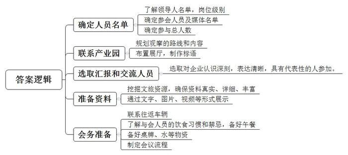
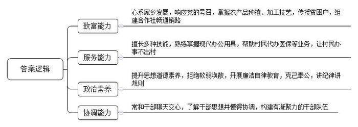
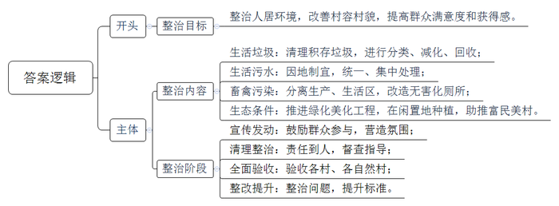
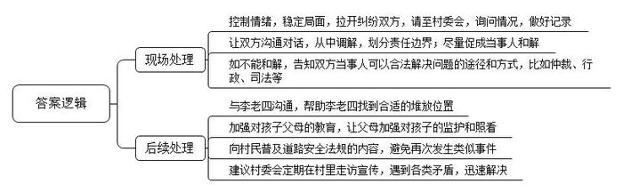
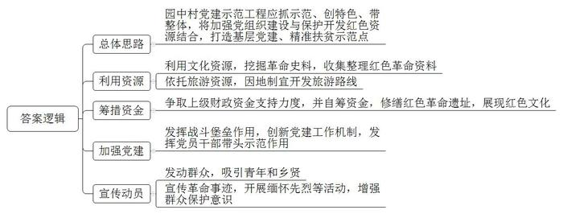

# 2019年广东省公考《申论》题（乡镇）

> 候选采集稿。参考答案及解析来自粉笔页面，不代表官方答案或真实高分答卷；来源使用许可与原卷对应关系仍需人工核实。

## 给定材料

### 材料 material-8540c4bc91ddabdf

实施乡村振兴战略，是党的十九大作出的重大决策部署。按照产业兴旺、生态宜居、乡风文明、治理有效、生活富裕的总要求，广东省提出了3年取得重大进展、5年见到显著成效、10年实现根本改变的目标，努力在实施乡村振兴战略上走在全国前列，为全面建成小康社会、全面建设社会主义现代化国家提供有力支撑。

A镇地处广东境内，生态环境优美，森林资源丰富，呈典型的高寒山区气候，农业以茶叶种植为主，是有名的革命老区。全镇总面积255.8平方公里，下辖25个村1个社区，总人口67536人，其中农业人口64231人。

近日，A镇为集中力量推进乡村振兴，从各部门抽调一批年轻干部，成立了乡村振兴办公室，负责协调推进新农村建设、脱贫攻坚、基层组织建设、农业产业园区建设、生态文化旅游等方面的乡村振兴工作。你是该镇综治办的一名干部，被抽调到乡村振兴办公室工作，同时也要兼顾综治办的工作。今天，你准时来到乡村振兴办公室上班，开始了一天的工作，请根据以下材料完成5项工作（回答5个问题）：

### 材料 material-5c677b9aa6191228

上午10:00

镇党委副书记召集相关部门及部分年轻干部，共同探讨即将举办的村党组织后备干部培训班的有关工作，听取大家的意见，你也被召集参加。以下是相关材料：

加强基层组织建设，是乡村振兴战略的一项重要工作任务。为了进一步增强基层组织政治功能，完善基层党组织领导下自治、法治、德治相结合的乡村治理体系，A镇党委以选优配强村党组织班子为重点，实施村党组织后备干部选拔培养“青苗”工程，从带富能力强的村民、复员退休军人、外出务工经商人员、村医村教、返乡大学生等党员中，选拔出53名优秀党员纳入村党组织后备干部人才库，并以培训为抓手增强后备人才的素质，着力打造一支政治坚定，为民服务的高素质农村后备干部队伍。

支部后备人才哪里来，从基层一线党员中来。贫困人口基数大，山多地少，是A镇各村普遍面临的问题。近年来，A镇党委将实施乡贤返乡工程与开展脱贫攻坚相结合，吸引能人返乡兴业，带动村民脱贫攻坚。比如，原先在广州经营茶叶生意的党员王平安就是返乡乡贤的杰出代表，回乡前他一直关心家乡发展，几年前响应党中央和各级党委号召，回村当选村干部，带动村民种植茶树，手把手教授贫困户种茶技术，并与大家一起组建合作社解决茶叶销售问题。如今，在王平安的帮助下，不少贫困户掌握了种茶制茶的好手艺，成功挖掉了他们的“穷根”。他们生产的茶叶在珠三角地区广受好评，辐射带动农户177户，其中包括贫困户125户，户均年增收12000多元。

返乡大学生是服务群众、扎根基层的另一股强大力量。大学毕业后，党员黄英回到生养自己的乡村，当起了大学生村官，后来在换届中进入石坑村村“两委”班子，成为村干部中难得的多面手。除了懂得使用电脑等现代办公用具，更可贵的是她那颗为群众服务的心，她积极主动帮村民代办医保、社保、计生证明等业务，让石坑村村民可以办事不出村，得到上级党委和干部群众的充分认可，被评为2018年全县优秀共产党员。

建强农村党支部，既要扬长处，更要补短板。除了贫困难题，A镇还受部分村党支部软弱涣散问题困扰，在A镇下辖的关西村，村党支部软弱涣散的症结在于出现“村官”贪腐。该村原村“两委”干部刘某冒领生态公益林补偿款，盗取省专项资金被县纪委立案查处。关西村被列为软弱涣散村党支部后，县纪委派出工作组进行整顿，开展廉政警示教育，以案为鉴敲响警钟。

被列为软弱涣散的绿荫村党支部，原是A镇远近闻名的先进支部。村级换届后，绿荫村却出现了村“两委”班子成员关系不和的问题，村“两委”开会议事经常吵吵闹闹、意见分歧较大，村内各项工作难于推进，县委组织部为此选派组织室干部张林任绿荫村第一书记进驻整顿。在绿荫村，张林常到村干部家中聊天交心。与村干部坐一条板凳，深入了解各个干部的所思所想并从中协调。通过张林的努力，村“两委”班子成员间的关系明显缓和，绿荫村党支部再次凝聚成坚强的战斗堡垒。

### 材料 material-be4dbee83ed9634c

上午11：30

接到镇里的通知，所有干部都要到驻点联系村入户宣传《A镇农村人居环境综合整治实施方案》，你计划下午两点半到你的驻点联系村开展宣讲工作。以下是相关材料：

A镇为推进生态宜居美丽乡村建设，改善乡村人居环境，按照全面建成小康社会和建设社会主义新农村的总体要求，制定了《A镇农村人居环境综合整治实施方案》，内容如下：

《A镇农村人居环境综合整治实施方案》

一、目标要求

按照“生产发展，生活宽裕，乡风文明，村容整洁，管理民主”的社会主义新农村建设总体目标，以村容村貌环境整治为重点，以农村持续增收、农村全面小康为目标，充分调动农民的内生动力，合理统筹安排资源，集中力量全面加快农村环境综合整治工作。

以村为单位，到2019年5月31日前全面完成全镇农村人居环境整治任务。农村人居环境得到显著改善，村容村貌更加整洁、道路交通更加便利、生态环境更加优美、乡镇特色更加凸显，人民群众的满意度和获得感得到明显提升。

二、整治任务

按照改善农村人居环境要求，由点到面、由标到本，全面整治农村垃圾、生活污水、畜禽污染和乱搭乱建现象。

（一）整治农村生活垃圾，构建长效保洁机制。全面清理村庄周边道路、村内街巷道、房前屋后、公共场所及其他卫生死角的各类积存垃圾，科学、合理设置垃圾收集、分拣和转运等设施。以自然村为单位，设立保洁员，建立健全长效保洁机制，鼓励各地开展垃圾分类、减化、回收处理。

（二）整治农村生活污水。加大农村生活污水治理力度，因地制宜开展农村生活污水治理。对人口稠密、布局相对集中、已纳入城镇建设规划的村庄，按照要求实行镇污水统一收集，集中处理。

（三）整治村庄畜禽污染，实行人居与畜禽圈养、生产区与生活区分离。全面实行村庄内畜禽集中圈养和污染综合治理，积极探索农村改厕新模式，推进农村无害化卫生厕所普及，全面消除农村露天粪坑。

（四）推进村庄绿化美化亮化，改善农村生态条件。推进乡村绿化美化建设工程，以村内道路、公共场所、农户庭前屋后和村庄为重心，着力建设一条进村绿化生态路。同时，积极引导村民充分利用农家房前屋后闲置地，发展名贵树种、经济林木、庭院经济，助推富民美村，改善农村生态条件。

三、实施步骤：分四个阶段

（一）第一阶段：宣传发动阶段（2019年4月10日-4月20日），各村驻村干部做好入户宣传工作，广泛发动群众积极参与环境整治工作，营造好浓厚的工作氛围。

（二）第二阶段：整治阶段（2019年4月21日-5月15日），各村要组织好人员分工，责任到人，组织机械、人员，包村班子成员、包村干部要上前指挥，做好督查指导，保证清理整治标准。

（三）第三阶段：验收阶段（2019年5月16日-5月20日），组织人员对各村、各自然村进行全面验收，不留死角。

（四）第四阶段：整改提升阶段（2019年5月21日-5月31日），各村要对验收中发现的整治不到位、不彻底、标准不高的问题，进一步整改，进一步提升标准。

四、组织领导

（一）加强领导，落实责任。建立党委主导、政府负责、部门分工、社会参与的工作格局。镇党委成立农村人居环境综合整治领导小组加强统筹协调。各部分强化牵头协调，指导组织村庄环境综合整治工作，综合整治领导组成员单位要切实履行职责，形成合力、共同推进村庄环境综合整治。

（二）农民主体，共建共享。尊重群众意愿，调动参与农村人员愿意综合整治的积极性、主动性，发挥群众主体作用，做到农村人居环境综合整治依靠群众、整治成果群众共享。

（三）督查督导，定期通报。建立科学合理的督查、验收和问责机制。

### 材料 material-77fc09faa3e75e83

下午16：00

你正在驻点联系村民开展人居住环境综合整理入户宣讲工作，接到镇综合办领导的电话被指派为负责人立刻前往村调处处理村民纠纷，以下是相关材料：

1.开展矛盾纠纷调解，应当依照法律、政策及社会主义道德规范，对纠纷当事人进行说服规劝。促其彼此互谦互让，在自主自愿情况下，达成协议，消除纠纷。  

2.应遵循“在当事人自愿、平等的基础上进行调解；不违背法律、法规和国家政策，尊重当事人的权利；不得因调解而阻止当事人依法通过仲裁、行政、司法等途径维护自己的权利”的原则。

3.当事人一方明确拒绝调解的，不得调解。

4.当事人中有未成人的，调解时未成年当事人的父母或者其他监护人应当在场，否则应另行选择合适的时机进行调解。

5.调解不成的，应当终止调解，并依据有关法律、法规的规定，当事人可以依法通过仲裁、行政、司法等途径维护自己的权利。

岭湖村村民李老四，小学文化，为人安分守己，但脾气比较倔，“一根筋”。前些日子，他的果树丰收了，果子卖了个好价钱，他琢磨着有钱了，得赶紧把去年年底因钱不够才建了一年的新房子给搭建起来。说干就干，他买来建筑材料，请了本地木匠，风风火火动了起来，为了方便取用，他便直接将钢筋、水泥、砂石等建筑材料堆放在村道，双向车道的村道，变成了单边通行，群众来往十分不便，大家对此颇有微词，但考虑到他是在建房，也没有人将此事向村委反映。一日，邻村有个小孩路过玩耍时不慎摔倒在堆放的建筑材料上，导致腿部流血不止并嚎啕大哭。5名家属闻讯纷纷赶来，小孩父母立刻将其送往镇卫生院就医，其他几名家属围住建房的李老四，李老四认为材料堆放那么久了，大家来往经过时都知道闪避，是大人没看住小孩才导致意外发生的，他并没有过错，因此毫不退让。双方各执一词，互不相让，情绪越来越激动，随时都可能引发斗殴事件。岭湖村干部到达了现场并向镇综合信访维稳中心报告，请求协助，接报后，镇综合信访维稳中心表示，要求综治办牵头，立即前往调处。

### 材料 material-fd44eb4e3b1c014f

下午17：20

你调处完村民纠纷回到办公室，领导提醒你明天办公室内部要召开园中村“红色村”党建示范工程建设讨论，需要你做好准备。以下是相关材料：

为铭记光辉历史，传承红色基因，广东启动了“红色村”党建示范工程将农村基层党组织建设与保护利用红色资源紧密结合起来，与实施乡村振兴、打赢脱贫攻坚战、引领基层治理战略紧密结合起来，坚持“抓示范、创特色、带整体”的总体思路，在全省范围内打造一批红色资源丰富、时代特色鲜明，社会影响广泛的基层党建示范点和精准扶贫示范点。

在“红色村”党建示范工程的打造中，B镇平乐村是一个成功案例。平乐村充分利用本村红色资源，打造红色村党建示范点，一方面深入挖掘全村的革命史料，收集整理红色革命资料，争取上级资金和自筹资金修缮多处红色革命遗址，红色文化得到全方位展现；另一方面发挥村党组织坚强战斗堡垒作用，创新党建工作机制，加强党的组织建设，带领全村党员干部参与到红色村创建中来。自创建红色村以来，该村依托红色资源和旅游资源，因地制宜开发出红色旅游路线，打响红色村旅游名片，吸引了大批游客，增加了村民收入。

园中村位于A镇最北端。全村总人口2350人，劳动力人口1175人，村“两委”干部5人，党员48名。土地面积15.2平方公里，其中耕地面积1350亩。村内以农业种植为主，经济来源单一。青壮年大多外出经商务工，其中不乏乡贤老板。当地山清水秀，环境优美，气候宜人，生态旅游资源丰富。该村是传统的革命老区，拥有丰富的红色资源，村内保存有地道、战壕等多处革命遗址，其中永平公祠便是当年革命起义军建立根据地和开展革命活动的主要场所。不少村民家中还保留有革命部队当年使用过的生活用品，村民支援革命的种种事迹仍不时被村中老人提起，但由于缺乏修缮资金，村领导班子办法不多，群众保护意识不强，多处革命历史建筑物年久失修，红色资源得不到有效开发和利用。

## 题目

### 第 1 题

**请你根据材料**1**\-**2**，列出本次观摩会****A镇需完成的前期准备工作。（15分）**

关联材料：material-8540c4bc91ddabdf、material-5c677b9aa6191228、material-be4dbee83ed9634c、material-77fc09faa3e75e83、material-fd44eb4e3b1c014f

作答要求：

要求：考虑全面，安排合理；符合实际，表达清晰；篇幅不超过200字。

### 第 2 题

**根据材料**3**，****你认为此次村党组织后备干部培训应该注重哪些能力素质的提升****。请简要说明。（****1****5分****）**

关联材料：material-8540c4bc91ddabdf、material-5c677b9aa6191228、material-be4dbee83ed9634c、material-77fc09faa3e75e83、material-fd44eb4e3b1c014f

作答要求：

要求：考虑全面，符合实际，表达清晰；篇幅不超过200字。

### 第 3 题

**为动员群众广泛参与，请您根据材料**4**，拟一份人居环境综合整治的入户宣讲提纲。（****2****0分****）**

关联材料：material-8540c4bc91ddabdf、material-5c677b9aa6191228、material-be4dbee83ed9634c、material-77fc09faa3e75e83、material-fd44eb4e3b1c014f

作答要求：

要求：符合实际，合理有效，逻辑清晰；篇幅不超过200字。

### 第 4 题

**请你根据材料**5**，提出具体****的****措施，以妥善处理该起矛盾纠纷、做好相关善后工作。（****25分）**

关联材料：material-8540c4bc91ddabdf、material-5c677b9aa6191228、material-be4dbee83ed9634c、material-77fc09faa3e75e83、material-fd44eb4e3b1c014f

作答要求：

要求：措施合理，处理得当，考虑全面；篇幅不超过300字。

### 第 5 题

**请你根据材料**6**，为园中村如何打造****“红色村”党建示范工程提出建议。（25分）**

关联材料：material-8540c4bc91ddabdf、material-5c677b9aa6191228、material-be4dbee83ed9634c、material-77fc09faa3e75e83、material-fd44eb4e3b1c014f

作答要求：

要求：考虑全面，符合实际，可行性强；篇幅不超过300字。

## 答案与解析

第 1 题

**参考答案（粉笔题库参考内容）**

1.确定人员名单。了解领导人名单，岗位级别；确定参会人员及媒体名单；确定参与总人数。

2.联系产业园。规划观摩的路线和内容；布置展厅，制作标语。

3.选取汇报和交流人员。选取对企业认识深刻，表达清晰，具有代表性的人参加。

4.准备资料。挖掘文旅资源，确保资料真实、详细、丰富；通过文字、图片、视频等形式展示。

5.会务准备。联系往返车辆；了解与会人员的饮食习惯和禁忌，备好午餐；备好桌牌、水等物资；制定会议流程。

**解析**

**参考答案说明**：答案从“确定人员名单”“联系产业园”“选取汇报和交流人员”“准备资料”“会务准备”五个方面进行分条撰写，各条要点在内容上是并列且没有交叉的。

**考点**：考点其他类

**来源**：来源2019年广东省公考《申论》题（乡镇）

粉笔申论页面对本题只提供「解析视频」入口，该入口是会员推广位，页面无视频地址与文字解析。

第 2 题

**参考答案（粉笔题库参考内容）**

一、致富能力。心系家乡发展，响应党的号召，掌握农产品种植、加工技艺，传授贫困户，组建合作社畅通销路。

二、服务能力。擅长多种技能，熟练掌握现代办公用具，帮助村民代办医保等业务，让村民办事不出村。

三、政治素养。提升思想道德素养，拒绝软弱涣散，开展廉洁自律教育，克己奉公，讲纪律讲规则。

四、协调能力。常和干部聊天交心，了解干部思想并懂得协调，构建有凝聚力的干部队伍。

**解析**

**参考答案说明：**答案从“致富能力”“服务能力”“政治素养”“协调能力”四个方面对应该提升的村党组织后备干部的“能力素质”进行了分条撰写，对每条要点提炼出了总括词并前置。各条要点之间内容上没有交叉。

**考点**：考点其他类

**来源**：来源2019年广东省公考《申论》题（乡镇）

粉笔申论页面对本题只提供「解析视频」入口，该入口是会员推广位，页面无视频地址与文字解析。

第 3 题

**参考答案（粉笔题库参考内容）**

一、整治目标。整治人居环境，改善村容村貌，提高群众满意度和获得感。

二、整治内容。生活垃圾：清理积存垃圾，进行分类、减化、回收；生活污水：因地制宜，统一、集中处理；畜禽污染：分离生产、生活区，改造无害化厕所；生态条件：推进绿化美化工程，在闲置地种植，助推富民美村。

三、整治阶段。宣传发动：鼓励群众参与，营造氛围；清理整治：责任到人，督查指导；全面验收：验收各村、各自然村；整改提升：整治问题，提升标准。

**解析**

**参考答案说明：**（1）本题不需要考虑格式，只写正文即可。（2）正文部分：一方面从内容来看，围绕着“人居环境综合整治”这一主题，开头部分总体介绍了“整治目标”，主体部分从“整治内容”“整治阶段”两个方面指出了“人居环境综合整治”的具体阶段内容。另一方面从形式来看，本参考答案进行分段撰写，做到了层次分明，体现了公文题的逻辑性。

  

**考点**：考点宣传类

**来源**：来源2019年广东省公考《申论》题（乡镇）

粉笔申论页面对本题只提供「解析视频」入口，该入口是会员推广位，页面无视频地址与文字解析。

第 4 题

**参考答案（粉笔题库参考内容）**

一、现场处理：1.控制情绪，稳定局面，拉开纠纷双方，请至村委会，询问情况，做好记录。2.让双方沟通对话，从中调解，划分责任边界；尽量促成当事人和解。3.如不能和解，告知双方当事人可以合法解决问题的途径和方式，比如仲裁、行政、司法等。

二、后续处理：1.与李老四沟通，帮助李老四找到合适的堆放位置；2.加强对孩子父母的教育，让父母加强对孩子的监护和照看；3.向村民普及道路安全法规的内容，避免再次发生类似事件；4.建议村委定期在村里走访宣传，遇到各类矛盾，迅速解决。

**解析**

**参考答案说明：**答案根据“现场处理”和“后续处理”这两方面对策进行了分条撰写。且每条要点之间内容上没有交叉。

**考点**：考点提出对策类

**来源**：来源2019年广东省公考《申论》题（乡镇）

粉笔申论页面对本题只提供「解析视频」入口，该入口是会员推广位，页面无视频地址与文字解析。

第 5 题

**参考答案（粉笔题库参考内容）**

园中村党建示范工程应抓示范、创特色、带整体，将加强党组织建设与保护开发红色资源结合，打造基层党建、精准扶贫示范点。

一、利用资源。利用文化资源，挖掘革命史料，收集整理红色革命资料；依托旅游资源，因地制宜开发旅游路线。

二、筹措资金。争取上级财政资金支持力度，并自筹资金，修缮红色革命遗址，展现红色文化。

三、加强党建。发挥战斗堡垒作用，创新党建工作机制，发挥党员干部带头示范作用。

四、宣传动员。发动群众，吸引青年和乡贤；宣传革命事迹，开展缅怀先烈等活动，增强群众保护意识。

**解析**

**参考答案说明**：本参考答案为总分逻辑，先阐述总体性建议，然后分别从“利用资源”“筹措资金”“加强党建”“宣传动员”这四个方面提出具体的建议，每条要点在内容上无交叉。

**考点**：考点提出对策类

**来源**：来源2019年广东省公考《申论》题（乡镇）

粉笔申论页面对本题只提供「解析视频」入口，该入口是会员推广位，页面无视频地址与文字解析。

