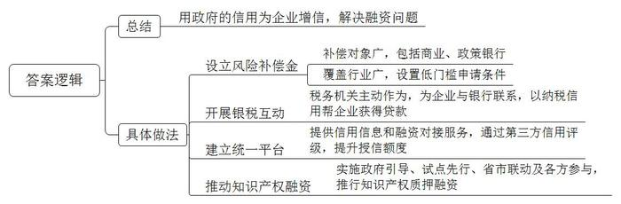
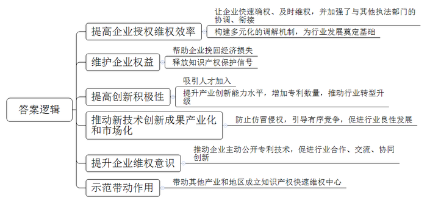
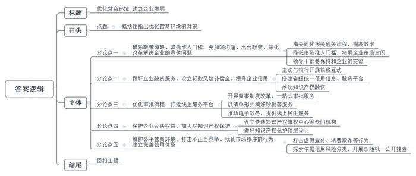

# 2019年广东省公考《申论》题（县级）

<!-- gwy:overview:start -->
> **广东 · 2019 · 申论 · 县级卷** ｜ 3 题 · 图片 3 处 · 答案随题折叠

导航：[题目](#题目)
<!-- gwy:overview:end -->

> 候选采集稿。参考答案及解析来自粉笔页面，不代表官方答案或真实高分答卷；来源使用许可与原卷对应关系仍需人工核实。

## 给定材料

### 材料 material-24f1191db9a4a553

改革开放以来，民营经济在我国经济发展中发挥了巨大作用。广东是民营经济大省，民营经济贡献了全省50%以上的地区生产总值和税收、60%以上的投资、75%以上的创新成果、80%以上的新增就业、95%以上的市场主体，而95%的民营企业是中小微企业。

近年来，融资难融资贵问题已经成为中小微企业发展中遇到的最突出问题，高昂的融资成本加重了企业的运行负担。这一问题越来越受到国家的重视。2018年10月，习近平总书记在视察广东省时强调，创新创造创业离不开中小微企业，要为他们的发展创造更好条件。事实上，在国家推动中小微企业金融服务工作的一系列部署下，广东省已经快速作出了响应，在解决中小微企业融资问题上做了许多尝试。

不少中小微企业由于缺乏传统抵押、质押物，经营年限又比较短等，导致信用积累比较少，获得银行的融资很难。这时就需要用政府的信用来为企业增信，让企业达到银行放贷门槛的要求。

目前S市共有超过180万家中小微企业。该市针对近年来中小微企业普遍遭遇的融资门槛高、成本高的问题，设立了初始规模20亿元的中小微企业银行贷款风险补偿资金，用于对银行业机构为中小微企业放贷形成的符合规定条件的不良贷款给予风险补偿。

该市设立的风险补偿金，首先是补偿对象广，包括辖区内设分行以上的商业和政策性银行；其次是覆盖行业广，只要发生不良贷款的中小微企业符合条件，相关放贷银行就可以申请补偿。据估算，风险补偿政策实施后，可相应撬动新增中小微企业贷款额度250亿元以上，新增4000多户中小微企业受益。

为了缓解中小微企业在转型发展过程中的资金压力，F市税务部门主动作为，与多家银行联合开展银税互动，在企业和银行之间搭起资金“鹊桥”，帮助企业用纳税信用申请贷款。

该市一家高新技术企业，同很多中小企业一样，也面临着融资难、融资贵、融资慢的问题，资金不足影响着企业高新技术成果的转化。F市税务部门了解到企业这一困境后，积极为其与银行“牵线搭桥”，最终，该企业获得89万元贷款。该公司财务人员说：“纳税信用贷款服务在一定程度上缓解了我们资金紧张的状况，帮助我们实现转型升级。”据统计，2015-2018年，F市银税互动项目累计发放贷款219.33亿元，惠及企业3974家。

某不锈钢生产企业因生产扩张需要流动资金，便向广东省中小微信用信息和融资对接平台J市分平台发出融资需求信息。随后，人民银行J市中心支行将相关信息发到辖区3家全国性评级公司对其进行信贷核查，并形成信用评级需求报告。在得知企业评级为A级别后，邮储银行基于这一第三方评级结果，通过“无抵押增信”将该企业授信额度从427万元提高至677万元。

事实上，已覆盖20个地市的中小微信用信息和融资对接平台只是广东省中小微企业融资服务供给能力不断增强的缩影。对接平台在广东省级层面上建立统一系统，加强跨地区、跨部门信息共享，强化对中小微企业的增信服务和信息服务，促进金融资源供给对中小微企业融资需求的有效对接。截至2018年10月，平台注册企业18.7万家，撮合银企融资逾3万笔、金额7652亿元。

针对中小微企业融资难以及专利增值问题，广东省连续多年实施知识产权金融创新促进计划，利用各种措施推动知识产权质押融资。各地市通过政府引导、试点先行、省市联动、各方参与等措施，知识产权质押融资产品不断推陈出新，越来越多的创新型中小企业获益。截至2018年9月，广东省知识产权质押融资登记金额达153.35亿元，一批拥有核心技术的中小微企业通过自主知识产权获得融资。

### 材料 material-0889642b31bbfc07

2018年9月，世界知识产权组织（WIPO）执法咨询委员会第十三届会议在瑞士日内瓦举行。我国A市代表团在大会上作“工业品外观设计保护中国A市模式”主旨演讲，推广介绍A市知识产权快速维权模式，分享A市实施严格知识产权保护的经验。

2011年，中国A市（灯饰）知识产权快速维权中心（以下简称“快维中心”）挂牌成立，成为全国第一个知识产权快速维权中心。这个行业维权中心的成立，实现了三个快速：快授权、快维权、快协调。在“快授权”方面，快维中心依靠外观设计审查的备案准入制度、预审制度及绿色通道制度，实现外观设计申请最快10个工作日内即可获得国家知识产权局授权。在“快维权”方面，A市知识产权局依法将灯饰领域的专利行政执法权委托快维中心行使，将维权保护网络覆盖到当地灯饰产业一线，及时满足维权需求。在“快协调”方面，快维中心与司法、仲裁、其他行政执法部门以及行业协会之间加强协调、快速衔接，构建行政、仲裁、司法、行业自律及人民调解的多元协调化解纠纷机制。

当初，快维中心刚进入试运行阶段就接了一宗轰动国内灯饰设计行业的“大案”。A市一家灯饰公司拿着厚厚一叠“仿品信息表”和相关证据资料，一口气投诉了28家单位侵犯版权。随后，A市快维中心的工作人员一家家上门，经过两个多月的调查取证，帮助该灯饰公司挽回了巨大的经济损失，由此也释放出知识产权保护的强大信号。

快维中心成立后，大大便利了外观设计作品从设计到保护，再到生产应用，极大地刺激了企业的创新积极性，在A市从事灯饰设计的人员大幅增加。2017年，A市古镇的灯饰设计人员数量达到2432人，较2011年增长10倍，保证了古镇灯饰产业的创新能力和水平。自2011年，A市古镇的专利申请量从2011年底的2553件，到2017年底达到11019件，是2011年的4.3倍，每年均保持两位数的增长率。2018年1-6月，全市发明专利申请量4298件，同比增长85%；发明专利授权量885件，同比增长21%。

A市某灯饰公司总经理表示：“灯饰产品具有研发周期较短，更新换代速度较快的特点，在有限的时间里，让技术创新成果产业化和市场化是灯饰企业能否取得好的投资回报的关键，如何快速将成果推向市场又不被仿冒侵权就变得尤为关键。以往缺乏高效的知识产权保护，整个行业就像长了毒瘤，你仿我、我抄你，行业内竞争除了打价格战之外别无他法。结果企业陷入了研发投入越多亏损越大的恶性循环。如今，通过快速通道申请专利，从提出专利申请到取得专利授权证书时间缩短到常规途径一半以上，快速取得专利权，为创新成果快速产业化提供了有力保障。”

2017年，A市专利行政执法立案821宗，相较于2011年增长6倍，专利侵权纠纷案件量连续多年位居广东省第一名。一个地区专利侵权案件数量的增加，也正好说明了企业维权意识的不断提升。企业从过去的不愿维权、不敢公开创新技术，到当前的主动维权、主动公开专利技术，以寻求更多知识产权保护、合作与交流。

A市知识产权灯饰行业快速维权模式的成功经验，被其他行业加以效仿，相继成立了A市家电、红木家具等不同行业的知识产权快速维权中心。此外，作为国内首家知识产权快速维权机构，其实践和经验直接带动了其他地区知识产权快速维权中心的设立，目前，各地针对当地重点产业特点，已成立17家知识产权快速维权中心。

### 材料 material-d419780bf92eff42

2018年全国两会期间，习近平总书记参加广东代表团审议，要求广东“在构建推动经济高质量发展体制机制、建设现代化经济体系、形成全面开放新格局、营造共建共治共享社会治理格局上走在全国前列”。2018年10月，习近平总书记在广东视察，提出深化改革开放、推动高质量发展、提高发展平衡性和协调性、加强党的领导和党的建设等四个方面重要指示要求。2019年2月18日，国家正式印发了《粤港澳大湾区发展规划纲要》。规划纲要提出，要深化粤港澳合作，打造具有国际竞争力的营商环境，为“一带一路”建设提供有力支撑。

设立于2014年12月的中国（广东）自由贸易试验区，涵盖广州南沙新区、深圳前海蛇口和珠海横琴新区3个片区，总面积116.2平方公里，立足面向港澳台深度融合，打造更加开放、便利的营商环境。

2018年5月，某物流公司通过“单一窗口”向广东自贸区广州海关申报保税清单，出仓一批货物，顺利完成进口报关手续，成为全国首票通过“单一窗口”办结通关手续的保税物流申报货物。“此前办理保税仓货物通关手续，我们需要在中国电子口岸客户端申报保税清单，然后再切换系统进入数据录入。”该公司负责人陈先生表示，“现在单一窗口新功能上线，可以在系统上一站式搞定所有申报环节，还能减少差错，提高通关效率。”广东自贸区挂牌以来，实现了货物通关的便利化，平均通关时间减少42.6%、平均通关效率提升80%、“单一窗口”货物申报上线率达100%。

两年前，某生物科技公司落户珠海横琴的创业谷。“公司顺利创办离不开创业谷的支持”，公司总经理王女士说，除获得了免费场地和跨境科研资金外，公司还与澳门大学共建生物医学产业孵化基地。目前，该公司已与20多家世界知名院校、科研机构和医院共建多中心研发和临床验证网络，产业化进程顺利，成为粤港澳深化科技和人才合作的一个典型。

截至2018年9月，广东自贸区累计新设企业25万家，新设外资企业1.4万家，吸引国际人才超过7000人，世界500强企业在区内投资设立企业超过270家。自贸区充分发挥了粤港澳区位优势和制度优势，实现了更高水平的对外开放，成为粤港澳大湾区合作示范区。

2019年1月4日，广东省印发的《关于贯彻落实<粤港澳大湾区发展规划纲要>的实施意见》提出，要充分发挥港澳在对外开放中的功能和作用，进一步优化珠三角九市投资和营商环境，提升大湾区市场一体化水平，实现粤港澳开放资源融合、开放优势互补、开放举措联动，打造“一带一路”建设重要支撑区。随着规划纲要的贯彻落实，粤港澳大湾区建设将进入新阶段，对进一步加强粤港澳合作、打造国际化营商环境提出了更高的要求。

## 题目

### 第 1 题

**请根据材料**3**，****简要概括广东各地****解决****中小微企业融资难问题的主要做法。（****20分****）**

关联材料：材料 material-24f1191db9a4a553

作答要求：

要求：概括全面、准确，条理清晰。篇幅不超过200字。

第 1 题 · 答案与解析

**参考答案（粉笔题库参考内容）**

用政府的信用为企业增信，解决融资问题，具体包括：

1.设立风险补偿金。补偿对象广，包括商业、政策银行；覆盖行业广，设置低门槛申请条件。

2.开展银税互动。税务机关主动作为，为企业与银行联系，以纳税信用帮企业获得贷款。

3.建立统一平台。提供信用信息和融资对接服务，通过第三方信用评级，提升授信额度。

4.推动知识产权融资。实施政府引导、试点先行、省市联动及各方参与，推行知识产权质押融资。

**解析**

**参考答案说明**：本参考答案，宏观上从“总结”与“具体做法”两方面展开。微观上，“具体做法”又从“设立风险补偿金”“开展银税互动”“建立统一平台”“推动知识产权融资”四个方面入手，进行相关内容的详细展开。各条的要点之间是并列关系，内容之间不存在重复、交叉。

**考点**：考点概括措施类

**来源**：来源2019年广东省公考《申论》题（县级）

粉笔申论页面对本题只提供「解析视频」入口，该入口是会员推广位，页面无视频地址与文字解析。

### 第 2 题

**请根据材料**6**，****分析说明****A市****（****灯饰****）****知识产权****快速维权中心在促进产业发展方面取得的成效。（****30分****）**

关联材料：材料 material-0889642b31bbfc07

作答要求：

要求：分析全面、透彻，条理清晰，表达准确。篇幅不超过300字。

第 2 题 · 答案与解析

**参考答案（粉笔题库参考内容）**

一、提高企业授权维权效率。让企业快速确权、及时维权，并加强了与其他执法部门的协调、衔接，构建多元化的调解机制，为行业发展奠定基础。

二、维护企业权益。帮助企业挽回经济损失；释放知识产权保护信号。

三、提高创新积极性。吸引人才加入；提升产业创新能力水平，增加专利数量，推动行业转型升级。

四、推动新技术创新成果产业化和市场化。防止仿冒侵权，引导有序竞争，促进行业良性发展。

五、提升企业维权意识。推动企业主动公开专利技术，促进行业合作、交流、协同创新。

六、示范带动作用。带动其他产业和地区成立知识产权快速维权中心。

**解析**

**参考答案说明：**本参考答案从“提高企业授权维权效率”“维护企业权益”“提高创新积极性”“推动新技术创新成果产业化和市场化”“提升企业维权意识”“示范带动作用”这六个方面对A市（灯饰）知识产权快速维权中心在促进产业发展方面取得的成效进行了分条撰写，各条答案要点之间在内容上是并列关系，没有交叉。

**考点**：考点影响类

**来源**：来源2019年广东省公考《申论》题（县级）

粉笔申论页面对本题只提供「解析视频」入口，该入口是会员推广位，页面无视频地址与文字解析。

### 第 3 题

**请根据全部给定材料（****仅限****给定材料）****，就****政府如何进一步优化营商环境，自拟题目，撰写一篇策论文****。****（****50分****）**

关联材料：材料 material-d419780bf92eff42

作答要求：

要求：

（1）对策合理，紧密联系材料。

（2）条理清晰，论证严密，合乎逻辑。

（3）结构完整，表达准确，行文流畅。

（4）篇幅在800-1000字。

第 3 题 · 答案与解析

**参考答案（粉笔题库参考内容）**

**优化营商环境 助力企业发展**

习近平曾强调，“要坚持‘两个毫不动摇’，为民营企业发展营造良好的法治环境和营商环境，依法保护民营企业权益，鼓励、支持、引导非公有制经济继续发展壮大。”**广东要依托粤****港****澳大湾区、一带一路、自贸区的区位和政策优势，打造具有国际竞争力的良好营商环境**。

要改善营商环境还面临很大挑战：**企业创新能力不足，高技术人才、关键核心技术缺乏；准入门槛高，办证难；民营企业融资难、融资贵；办事流程繁琐、效率低下；知识产权侵权严重，行业秩序混乱，信用体系不健全**等。对此必须优化营商环境，系统解决问题。

**破除政策障碍、降低准入门槛，要加强沟通、出台政策、深化改革解决企业的具体问题。**海关不断简化报关通关流程，通过“单一窗口”等方式提高效率。要进一步降低市场准入门槛，拓展企业市场空间，避免准入不准营的问题。领导干部要保持和企业的交流，倾听企业意见，及时回应合理诉求。

**做好企业融资服务。设立贷款风险补偿金，提升企业信用。**补偿对象包括商业、政策银行；覆盖行业广，门槛低；税务主动与银行开展银税互动，以纳税信用帮企业获得贷款。搭建省级统一信用信息、融资平台，通过第三方信用评级，提升企业授信额度；推动知识产权融资，政府引导、多方参与创新知识产权质押融资。

**优化审批流程，打造线上服务平台。**开展商事制度改革，试点一日办完，大力推广一站式审批服务。对流程简单的，以清单形式搞好即来即办的秒批等服务。研发“粤省事”等微信小程序，推动电子政务，提供线上民生服务，在线协调劳动纠纷，为个人企业提供便利。

**保护企业合法权益，加大对知识产权保护。**设立快速知识产权维权中心等专门机构，快授权、快维权、快协调保护企业知识产权，提高创新积极性。做好知识产权保护顶层设计、出台规划、开展专项工程、设立专门法院、机构及时有效地保护知识产权，降低知识产权保护成本。

**维护公平营商环境，打击不正当竞争、扰乱市场秩序的行为，建立完善信用体系。**打击虚假宣传、假冒伪劣、消费欺诈、滥用客户信息等行为。探索依据信用风险分类，开展双随机一公开抽查，平衡监管和企业发展的直接关系，优化监管方式，释放市场活力。

优化营商环境在战略上要配合国家战略打造具有国际竞争力的营商环境；在战术上解决具体问题，让企业有获得感；在方向上要系统化、制度化、法治化，为经济长远发展保驾护航。

**解析**

**文章分析**

**优化营商环境 助力企业发展**

【**标题的优点：**首先，范文的标题“优化营商环境 助力企业发展”突出了“营商环境”这一主题。其次，形式上，对偶式标题的设置较为工整，富有节奏，上句点出主题，下句指出主题的意义，使标题的逻辑性更加鲜明。此外，文字表达简洁明快有力，不拖沓。】

习近平曾强调，“要坚持‘两个毫不动摇’，为民营企业发展营造良好的法治环境和营商环境，依法保护民营企业权益，鼓励、支持、引导非公有制经济继续发展壮大。”**广东要依托****粤****港澳大湾区****、****一带一路****、****自贸区的区位和政策优势****，****打造具有国际竞争力的良好营商环境****。**

【**开头的优点：****★内容方面：**范文的开头是紧扣“营商环境”这一主题展开的。首先，开头在段首处点出主题，做到了主题明确。其次，对“营商环境”这一主题进行了分析阐述，指出了优化营商环境的总括性对策。**★文字表达方面：**使用了“依托……打造……”这一关联词，使对策表述更加清晰、富有逻辑性。】

要改善营商环境还面临很大挑战：**企业创新能力不足****，****高技术人才****、****关键核心技术缺乏****；****准入门槛高****，****办证难****；****民营企业融资难****、****融资贵****；****办事流程繁琐****、****效率低下****；****知识产权侵权严重****，****行业秩序混乱****，****信用体系不健全**等。对此必须优化营商环境，系统解决问题。

【范文过渡段分析了营商环境存在问题产生的原因，此外，还要注意过渡段末尾的“对此必须优化营商环境，系统解决问题”是用来引起下文的过渡句，起到了承上启下的作用。】

**破除政策障碍、降低准入门槛，要加强沟通、出台政策、深化改革解决企业的具体问题。**（1）海关不断简化报关通关流程，通过“单一窗口”等方式提高效率。（2）要进一步降低市场准入门槛，拓展企业市场空间，避免准入不准营的问题。（3）领导干部要保持和企业的交流，倾听企业意见，及时回应合理诉求。

【**论述段****1****的优点：****★观点句：**范文的观点句是紧扣“营商环境”这一文章主题提出的。形式上，它在段首处直接写出，位置突出，容易发现。内容上，关键词突出，内容要点明确，可以明显看出它是从“破除政策障碍”“加强沟通”等角度入手，指出了优化营商环境的对策。**★论述内容：**（1）介绍了优化营商环境的对策——简化流程方面；（2）介绍了优化营商环境的对策——降低准入门槛方面；（3）介绍了优化营商环境的对策——保持与企业交流方面。以上三个方面的内容都是紧扣“破除政策障碍、降低准入门槛，要加强沟通、出台政策、深化改革解决企业的具体问题”这个观点句进行分析论述的，论述的针对性强，内容层次丰富。最后，在论述方法上主要采取了讲道理和举例子相结合，做到了丰富多样。】

**做好企业融资服务。设立贷款风险补偿金，提升企业信用。**补偿对象包括商业、政策银行；覆盖行业广，门槛低；（1）税务主动与银行开展银税互动，以纳税信用帮企业获得贷款。（2）搭建省级统一信用信息、融资平台，通过第三方信用评级，提升企业授信额度；（3）推动知识产权融资，政府引导、多方参与创新知识产权质押融资。

【**论述段****2****的优点：****★观点句：**范文的观点句是紧扣“营商环境”这一文章主题提出的。形式上，它在段首处直接写出，位置突出，容易发现。内容上，关键词突出，内容要点明确，可以明显看出它是从“做好企业融资服务”这一角度入手，指出了优化营商环境的对策。**★论述内容：**（1）介绍了优化营商环境的对策——开展银税互动方面；（2）介绍了优化营商环境的对策——搭建平台方面；（3）介绍了优化营商环境的对策——推动知识产权融资方面。以上三个方面的内容都是紧扣“做好企业融资服务。设立贷款风险补偿金，提升企业信用”这个观点句进行分析论述的，论述的针对性强，内容层次丰富。最后，在论述方法上采取了讲道理的方式进行展开，做到了论述有力。】

**优化审批流程，打造线上服务平台。**（1）开展商事制度改革，试点一日办完，大力推广一站式审批服务。（2）对流程简单的，以清单形式搞好即来即办的秒批等服务。（3）研发“粤省事”等微信小程序，推动电子政务，提供线上民生服务，在线协调劳动纠纷，为个人企业提供便利。

【**论述段****3****的优点：****★观点句：**范文的观点句是紧扣“营商环境”这一文章主题提出的。形式上，它在段首处直接写出，位置突出，容易发现。内容上，关键词突出，内容要点明确，可以明显看出它是从“优化审批流程”“打造线上服务平台”等角度入手，指出了优化营商环境的对策。**★论述内容：**（1）介绍了优化营商环境的对策——开展商事制度改革方面；（2）介绍了优化营商环境的对策——做好“秒批”服务方面；（3）介绍了优化营商环境的对策——推动电子政务方面。以上三个方面的内容都是紧扣“优化审批流程，打造线上服务平台”这个观点句进行分析论述的，论述的针对性强，内容层次丰富。最后，在论述方法上主要采取了讲道理和举例子相结合，做到了丰富多样。】

**保护企业合法权益，加大对知识产权保护。**（1）设立快速知识产权维权中心等专门机构，快授权、快维权、快协调保护企业知识产权，提高创新积极性。（2）做好知识产权保护顶层设计、出台规划、开展专项工程、设立专门法院、机构及时有效地保护知识产权，降低知识产权保护成本。

【**论述段****4****的优点：****★观点句：**范文的观点句是紧扣“营商环境”这一文章主题提出的。形式上，它在段首处直接写出，位置突出，容易发现。内容上，关键词突出，内容要点明确，可以明显看出它是从“保护知识产权”这一角度入手，指出了优化营商环境的对策。**★论述内容：**（1）介绍了优化营商环境的对策——设立知识产权保护机构方面；（2）介绍了优化营商环境的对策——做好知识产权顶层设计方面。以上两个方面的内容都是紧扣“保护企业合法权益，加大对知识产权保护”这个观点句进行分析论述的，论述的针对性强，内容层次丰富。最后，在论述方法上采取了讲道理的方式进行展开，做到了论述有力。】

**维护公平营商环境，打击不正当竞争、扰乱市场秩序的行为，建立完善信用体系。**（1）打击虚假宣传、假冒伪劣、消费欺诈、滥用客户信息等行为。（2）探索依据信用风险分类，开展双随机一公开抽查，平衡监管和企业发展的直接关系，优化监管方式，释放市场活力。

【**论述段****5****的优点：****★观点句：**范文的观点句是紧扣“营商环境”这一文章主题提出的。形式上，它在段首处直接写出，位置突出，容易发现。内容上，关键词突出，内容要点明确，可以明显看出它是从“维护公平营商环境”这一角度入手，指出了优化营商环境的对策。**★论述内容：**（1）介绍了优化营商环境的对策——打击虚假行为方面；（2）介绍了优化营商环境的对策——探索信用风险分类方面。以上两个方面的内容都是紧扣“维护公平营商环境，打击不正当竞争、扰乱市场秩序的行为，建立完善信用体系”这个观点句进行分析论述的，论述的针对性强，内容层次丰富。最后，在论述方法上采取了讲道理的方式进行展开，做到了论述有力。】

优化（1）营商环境在（2）战略上要配合国家战略打造具有国际竞争力的营商环境；在战术上解决具体问题，让企业有获得感；在方向上要系统化、制度化、法治化，为经济长远发展保驾护航。

【**结尾的优点：**范文的结尾回扣了“营商环境”这一主题。（1）再次提到了“营商环境”；（2）从三个角度分别阐述了优化营商环境的对策。】

**考点**：考点文章写作题

**来源**：来源2019年广东省公考《申论》题（县级）

粉笔申论页面对本题只提供「解析视频」入口，该入口是会员推广位，页面无视频地址与文字解析。

