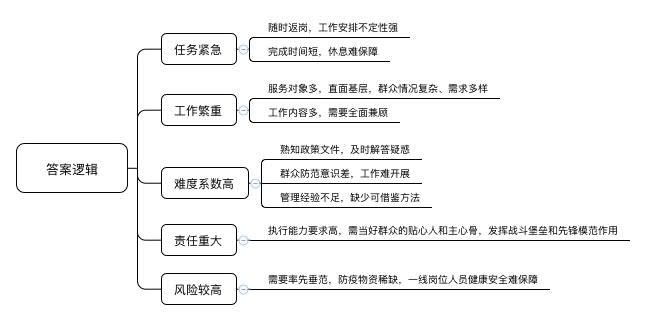
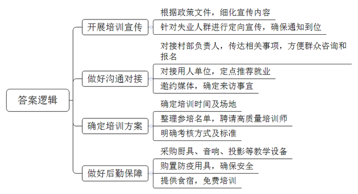
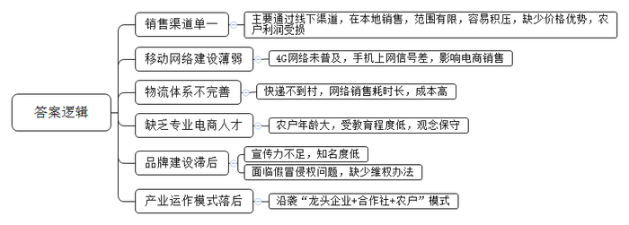
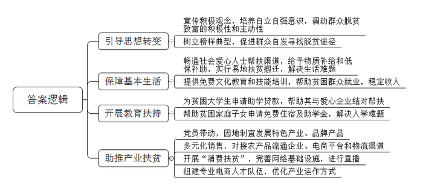
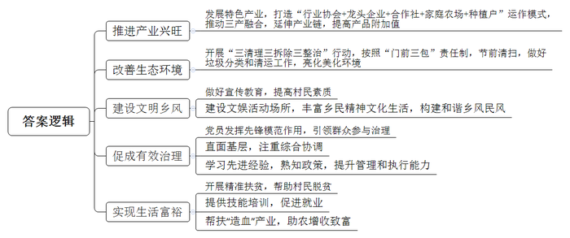

# 2020年广东省公考《申论》题（乡镇）

<!-- gwy:overview:start -->
> **广东 · 2020 · 申论 · 乡镇卷** ｜ 5 题 · 图片 5 处 · 答案随题折叠

导航：[题目](#题目)
<!-- gwy:overview:end -->

> 候选采集稿。参考答案及解析来自粉笔页面，不代表官方答案或真实高分答卷；来源使用许可与原卷对应关系仍需人工核实。

## 给定材料

### 材料 material-07987782b47b0a6a

“小张，你回来了呀！”“对呀波叔，昨天刚回到家。今天到街上来买买年货，买完得赶紧回去。村里组织我们开展节前大清洁，搞好卫生好过年。”

“老许你这辆新车不错嘛！柚子卖得怎样了？听说你那里还有不少新产品啊！”

“还可以吧。我们五田山好水好空气好，城里人就爱吃我们这的东西。连带着我的蜂蜜和果园鸡也卖得挺好，这才能换部新车。这两年试着生产的柚子茶、柚子酒、柚子酱、柚皮糖市场反响也不错，今年准备多生产点。”

五田镇区的街上人声鼎沸，外出的人们陆续回到了家乡，大家忙着采办年货，一派繁荣。

去年刚参加工作的乡镇公务员小温饶有兴致地看着这一切，城里长大的他还是第一次看见乡镇快过年的样子。

“小温，你那边情况怎样？”

“村民们都自觉将垃圾投放到指定地方，街上和市场的垃圾也能及时清运。”

“好的，那我们下村，到各个村里看看。”

1月17日，腊月二十三小年，小温和镇里分管乡村振兴和扶贫工作的吴副镇长正在分头检查年前镇村卫生情况。

走进田下村，映入小温眼帘的是一幅如花园般的乡村景象：一条条水泥道路通畅平坦，路旁的树木青葱可爱，一栋栋房屋白墙灰瓦、有序别致，党建长廊、农家书屋、文化广场等景观明亮整洁……老人们有聊天晒太阳的、也有读书看报的，孩子们则尽情嬉戏，不时发出银铃般的笑声。这真是一幅生动的现代版“富春山居图”。

村民们在党员、村干部的带领下，正按照“门前三包”责任制的要求，响应镇里的号召开展节前卫生大扫除。每个人的脸上都洋溢着幸福喜庆的笑容，准备迎接春节的到来。这跟小温印象中“晴天一身灰，雨天一身泥”，房子破烂、垃圾乱堆、污水横流、鸡粪遍地的农村样貌有着天壤之别。

## 题目

### 第 1 题

**请你根据给定材料，谈一谈乡镇公务员工作的特点。（****15****分）**

关联材料：材料 material-07987782b47b0a6a

作答要求：

要求：紧扣材料，符合实际，表达清晰；篇幅不超过200字。

第 1 题 · 答案与解析

**参考答案（粉笔题库参考内容）**

1.任务紧急。随时返岗，工作安排不定性强；完成时间短，休息难保障。

2.工作繁重。服务对象多，直面基层，群众情况复杂、需求多样；工作内容多，需要全面兼顾。

3.难度系数高。熟知政策文件，及时解答疑惑；群众防范意识差，工作难开展；管理经验不足，缺少可借鉴方法。

4.责任重大。执行能力要求高，需当好群众的贴心人和主心骨，发挥战斗堡垒和先锋模范作用。

5.风险较高。需要率先垂范，防疫物资稀缺，一线岗位人员健康安全难保障。

**解析**

**参考答案说明**：本参考答案从“任务紧急”“工作繁重”“难度系数高”“责任重大”“风险较高”这五个方面进行分条撰写，各条要点在内容上并列且无交叉。

**考点**：考点特点类

**来源**：来源2020年广东省公考《申论》题（乡镇）

粉笔申论页面对本题只提供「解析视频」入口，该入口是会员推广位，页面无视频地址与文字解析。

### 第 2 题

**根据给定材料，你认为小温应该如何做好****“粤菜师傅”培训班的前期准备工作？请列出工作要点。（****15****分）**

关联材料：材料 material-07987782b47b0a6a

作答要求：

要求：考虑全面，安排合理，符合实际，表达清晰；篇幅不超过200字。

第 2 题 · 答案与解析

**参考答案（粉笔题库参考内容）**

1.开展培训宣传。根据政策文件，细化宣传内容；针对失业人群进行定向宣传，确保通知到位。

2.做好沟通对接。对接村部负责人，传达相关事项，方便群众咨询和报名；对接用人单位，定点推荐就业；邀约媒体，确定来访事宜。

3.确定培训方案。确定培训时间及场地；整理参培名单，聘请高质量培训师；明确考核方式及标准。

4.做好后勤保障。采购厨具、音响、投影等教学设备；购置防疫用具，确保安全；提供食宿，免费培训。

**解析**

**参考答案说明**：本参考答案从“开展培训宣传”“做好沟通对接”“确定培训方案”“做好后勤保障”四个方面进行分条撰写，各条要点在内容上是并列且无交叉的。

**考点**：考点其他类

**来源**：来源2020年广东省公考《申论》题（乡镇）

粉笔申论页面对本题只提供「解析视频」入口，该入口是会员推广位，页面无视频地址与文字解析。

### 第 3 题

**近日，县里计划来五田镇调研，重点了解发展柚子产业存在的问题。你认为，五田镇在这方面有哪些短板？****请根据给定材料简要说明。****(20****分****)**

关联材料：材料 material-07987782b47b0a6a

作答要求：

要求：符合实际，分析全面，条理清晰；篇幅不超过200字。

第 3 题 · 答案与解析

**参考答案（粉笔题库参考内容）**

1.销售渠道单一。主要通过线下渠道，在本地销售，范围有限，容易积压，缺少价格优势，农户利润受损。

2.移动网络建设薄弱。4G网络未普及，手机上网信号差，影响电商销售。

3.物流体系不完善。快递不到村，网络销售耗时长，成本高。

4.缺乏专业电商人才。农户年龄大，受教育程度低，观念保守。

5.品牌建设滞后。宣传力不足，知名度低；面临假冒侵权问题，缺少维权办法。

6.产业运作模式落后。沿袭“龙头企业+合作社+农户”模式。

**解析**

**参考答案说明：**本参考答案从“销售渠道单一”“移动网络建设薄弱”“物流体系不完善”“缺乏专业电商人才”“品牌建设滞后”“产业运作模式落后”这六个方面对五田镇柚子产业存在的短板进行了分条撰写，各条答案要点之间在内容上是并列关系，没有交叉。

**考点**：考点问题类

**来源**：来源2020年广东省公考《申论》题（乡镇）

粉笔申论页面对本题只提供「解析视频」入口，该入口是会员推广位，页面无视频地址与文字解析。

### 第 4 题

**假设你参加了****5****月****21****日五田镇脱贫攻坚工作座谈会。为防止返贫和新致贫，你会提出哪些针对性措施？请根据给定资料简要说明。（****20****分）**

关联材料：材料 material-07987782b47b0a6a

作答要求：

要求：考虑全面，符合实际，措施合理；篇幅不超过300字。

第 4 题 · 答案与解析

**参考答案（粉笔题库参考内容）**

1.引导思想转变。宣传积极观念，培养自立自强意识，调动群众脱贫致富的积极性和主动性；树立榜样典型，促进群众自发寻找脱贫途径。

2.保障基本生活。畅通社会爱心人士帮扶渠道，给予物质补给和低保补助，实行易地扶贫搬迁，解决生活难题；提供免费文化教育和技能培训，帮助贫困群众就业，稳定收入。

3.开展教育扶持。为贫困大学生申请助学贷款，帮助其与爱心企业结对帮扶；帮助贫困家庭子女申请免费住宿及助学金，解决入学难题。

4.助推产业扶贫。党员带动，因地制宜发展特色产业、品牌产品；多元化销售，对接农产品流通企业、电商平台和物流渠道；开展“消费扶贫”，完善网络基础设施，进行直播；组建专业电商人才队伍，优化产业运作方式。

**解析**

**参考答案说明：**本参考答案分别从“引导思想转变”“保障基本生活”“开展教育扶持”“助推产业扶贫”这四个方面具体说明；各条要点之间在内容上是并列的，没有交叉，并且撰写每一个方面的要点时，都提炼出概括性较强的总括词并前置，使答案的条理性更加清晰。

**考点**：考点提出对策类

**来源**：来源2020年广东省公考《申论》题（乡镇）

粉笔申论页面对本题只提供「解析视频」入口，该入口是会员推广位，页面无视频地址与文字解析。

### 第 5 题

**脱贫摘帽不是终点，而是新生活、新奋斗的起点。请你根据给定材料为五田镇持续推进乡村振兴提出建议。（****30****分）**

关联材料：材料 material-07987782b47b0a6a

作答要求：

要求：考虑全面，符合实际，可行性强。篇幅不超过300字。

第 5 题 · 答案与解析

**参考答案（粉笔题库参考内容）**

1.推进产业兴旺。发展特色产业，打造“行业协会+龙头企业+合作社+家庭农场+种植户”运作模式，推动三产融合，延伸产业链，提高产品附加值。

2.改善生态环境。开展“三清理三拆除三整治”行动，按照“门前三包”责任制，节前清扫，做好垃圾分类和清运工作，亮化美化环境。

3.建设文明乡风。做好宣传教育，提高村民素质；建设文娱活动场所，丰富乡民精神文化生活，构建和谐乡风民风。

4.促成有效治理。党员发挥先锋模范作用，引领群众参与治理；直面基层，注重综合协调；学习先进经验，熟知政策，提升管理和执行能力。

5.实现生活富裕。开展精准扶贫，帮助村民脱贫；提供技能培训，促进就业；帮扶“造血”产业，助农增收致富。

**解析**

**参考答案说明：**答案从“推进产业兴旺”“改善生态环境”“建设文明乡风”“促成有效治理”“实现生活富裕”等不同的方面进行了分条撰写。各条要点之间在内容上是并列关系，无交叉。

**考点**：考点提出对策类

**来源**：来源2020年广东省公考《申论》题（乡镇）

粉笔申论页面对本题只提供「解析视频」入口，该入口是会员推广位，页面无视频地址与文字解析。

