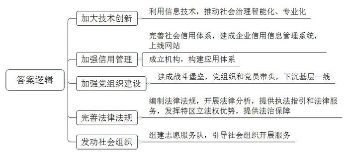
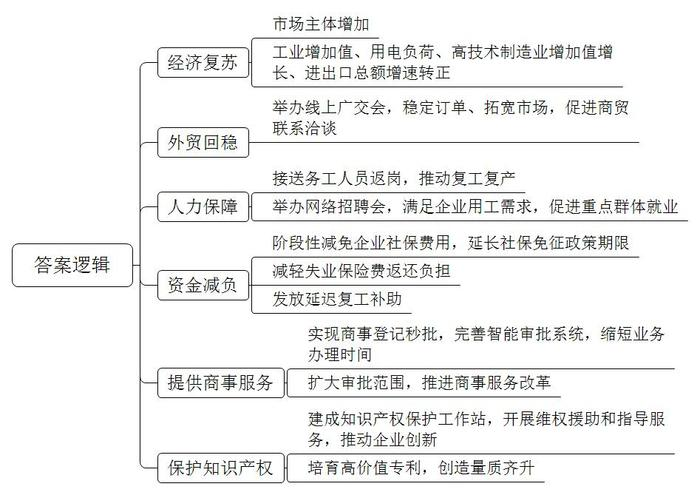
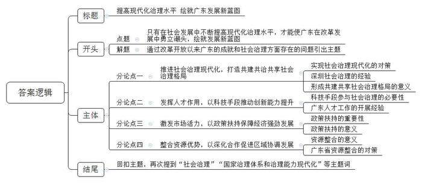

# 2020年广东省公考《申论》题（县级）

<!-- gwy:overview:start -->
> **广东 · 2020 · 申论 · 县级卷** ｜ 3 题 · 图片 3 处 · 答案随题折叠

导航：[题目](#题目) · [材料 1](#材料-1)
<!-- gwy:overview:end -->

> 候选采集稿。参考答案及解析来自粉笔页面，不代表官方答案或真实高分答卷；来源使用许可与原卷对应关系仍需人工核实。

## 给定材料

### 材料 1

1979年，中国改革开放的第一声春雷在深圳蛇口炸响。此后的四十年，深圳以奇迹般的速度迅猛发展，由一个“小渔村”迅速发展为一个实际人口超过2000万的现代化大都市。

先行先试，大胆探索，是深圳的基因和使命。《中共中央国务院关于支持深圳建设中国特色社会主义先行示范区的意见》提出，支持深圳高举新时代改革开放旗帜、建设中国特色社会主义先行示范区，为深圳促进社会治理现代化明确了方向，注入了动力。

近年来，深圳在社会治理上呈现出许多新的亮点。从统一政务服务平台“i深圳”APP，到早晚高峰期间只允许载有2人以上车辆驶入的“多乘员车道”，再到“人脸识别”查处非机动车闯红灯……一个个深圳“网红”的背后，都是深圳社会治理的智慧与创新。

不依靠信息技术，不在创新上下功夫，很难想象仅靠有限的人力、物力而能高效地治理越来越庞大的城市。2019年，深圳正式出台《深圳市新型智慧城市建设总体方案》，逐步综合应用大数据、云计算、人工智能等技术，提高社会治理智能化专业化水平，加快建设智慧城市。目前，深圳市政务信息资源共享平台每天数据交换量超过2000万条，峰值达到近8000万条。“这些数据每交换一次，可能就有1个市民少跑一次办事窗口，少盖一个章。”深圳市经济贸易和信息化委员会负责人说。

在社会信用管理领域，深圳同样是先行先试的典范。作为全国最早开展社会信用体系的城市之一，深圳于2003年率先建成企业信用信息管理系统并上线信用网站“深圳信用网”，从2019年1月1日至10月31日，“深圳信用网”的总查询量近1.2亿次，总访问量近1.9亿次。

此外，深圳率先成立信用机构，构建信用信息应用体系。目前，在全市首批83项重点事项中试点应用，在人才引进“秒批”等加快审批举措中，自动拦截失信主体，累计对“老赖”限制任职登记1.3万次，对经营异常名录的商事主体限制登记或备案25.5万次，对严重失信名单的企业限制登记或备案29万次，信用信息应用体系提高了失信成本，推动各类主体遵纪守法、守信崇德，助推社会治理现代化。

抗击新冠肺炎疫情，是对社会治理的一次大考，深圳迅速激活社会治理优势并转化为社会治理效能，经受住了考验，深圳努力把各级党组织建设成为宣传党的主张、贯彻党的决定、领导基层治理、团结动员群众、推动改革发展的坚强战斗堡垒，在抗击疫情的危难时刻，深圳各级党组织和广大党员充分发挥战斗堡垒作用和先锋模范作用，党员干部带头下沉社区，既当“社会暖心人”，又做“企业服务员”，让党旗在战“疫”一线高高飘扬，深圳机场集团党委充分发挥党领导的制度优势，1580名党员领导干部闻令而动，主动作为，以“指战员、组织员、战斗员”多重身份，全力以赴投身防控“疫”线，带领空港广大群众形成群防群治、联防联控强大合力，为深圳筑牢防疫“空中之门”。

疫情期间，深圳市、区两级分类推动，司法局等相关部门编制了一系列法律指引、防控期间劳动关系合规操作指南，对企业复工、征用等问题开展了法律分析，针对密切接触者居家医学观察事项提供了执法指引，网络普法、线上法律咨询，线上法律援助申请等法律服务。同时，充分发挥特区立法权优势，制定《深圳经济特区全面禁止食用野生动物条例（草案）》，为从源头上控制重大公共卫生风险提供法治保障。

作为全国闻名的“志愿者之城”，深圳全市注册志愿者达到165万，占常住人口的比例达到13%，位居全国前列。疫情防控期间穿梭在社区、小区、产业园区、商场等场所的“红马甲”，是温暖广大市民的“志愿之光”。疫情期间，深圳全市共组建了747支志愿服务队，9000多名志愿者积极参与基层疫情防控工作，开展心理咨询等志愿服务，彰显了“志愿者之城”的爱之力量。

近年来，深圳高度重视发挥社会组织作用。鼓励和引导社会组织在心理健康、法律援助、纠纷调处等社会治理的重点领域开展服务。通过动员和引导社会组织积极有序参与基层社会治理，实现政府治理和社会调节、居民自治良性互动。在市民政部门积极动员和引导下，市慈善会、壹基金、市社会公益基金会等社会组织积极响应，通过发布行业倡议、组织捐款捐物、提供心理援助等方式，全力投入疫情防控和经济社会发展各项工作。

共建共治共享的社会治理格局正在深圳逐渐形成，成为经济社会发展的重要保障。时光荏苒，一个个科技创新巨头企业在这里成长， 一个个源头创新的种子在这里播撒，一个个跨界融合的火花在这里碰撞……

四十载激情岁月，深圳的城市面貌发生了翻天覆地的变化。饱经沧桑的深圳河，滚滚汇入伶仃洋，见证改革开放大潮的奔涌，感受粤港澳大湾区的炽热温度。今天的深圳，迈入新时代，蹄疾步稳，扬帆启航。

### 材料 2

广东是经济大省，市场主体数量突破1300万户，连续7年位居全国第一。虽然受到疫情影响，但广东统筹推进疫情常态化防控和经济社会发展，经济已快速复苏，并逐渐回到强劲发展之路。

2020年4~6月，广东新登记市场主体数同比分别增长8.4%、11.0%和31.5%。截至6月底，全省实有市场主体达1305.9万户，同比增长10.0%。全省市场主体总量、企业以及私营企业、外商投资企业户数等指标持续稳居全国第一。6月，广东规模以上工业增加值增长3.9%，重回正增长。此外，用电负荷同比增长1.51%，高技术制造业增加值增长14.1%，进出口总额增速转正。

6月15日，第127届广交会正式拉开帷幕。这是创新市场采购贸易方式，第一次完全以线上形式举办的广交会，也是疫情发生以来最大规模的全球性贸易盛会。虽然转为线上进行，但广交会并没有降低参展门槛，依然维持原有规模，依然是很多中国企业稳订单、拓市场的重要平台。

生产销售美术颜料的广州丽美公司就通过广交会迎来了一次“小爆发”——他们通过线上交易的方式跟外国客户敲定了一笔近500万美元的订单。

“我们其实是有点幸运的。”丽美公司总经理说，“我们公司主要面向欧美发达国家生产外销产品，受疫情影响，公司经历过一两周都没什么订单的‘惊心动魄’，因为我们格外重视本次广交会带来的交易机会，按照广交会官方指引，丽美公司将企业、展品信息，以文字、图片、视频三位一体的方式呈现在相应展区，很快就有不少采购商主动联系。”

2.5万家参展企业，180万件商品，数十万全球采购商和数以百万计的中国外贸产业人员，在10天内24小时不间断地进行线上洽谈，堪称突破时空限制“史无前例”的贸易创举。

新的变化悄然发生，广东外贸逐步回稳态势越来越明显。二季度全省进出口值1.69万亿元，同比降幅收窄至3%，环比一季度增长23%。从月度走势看：6月，全省进出口同比由负转正，增长0.8%，出口降幅持续收窄至1.8%，进口也由负转正，增长4.9%。

据海关广东分署统计分析，今年外贸发展外部环境严峻复杂，但广东发展韧劲足，回旋余地大，尤其是随着一系列稳外贸政策措施效应持续释放，有信心稳住外贸基本盘。

## 题目

### 第 1 题

**请根据材料1，概括深圳在促进社会治理现代化方面的主要做法。（20分）**

关联材料：材料 1

作答要求：概括全面、准确，条理清晰。篇幅不超过200字。

第 1 题 · 答案与解析

**参考答案（粉笔题库参考内容）**

1.加大技术创新。利用信息技术，推动社会治理智能化、专业化。

2.加强信用管理。完善社会信用体系，建成企业信用信息管理系统，上线网站；成立机构，构建应用体系。

3.加强党组织建设。建成战斗堡垒，党组织和党员带头，下沉基层一线。

4.完善法律法规。编制法律法规，开展法律分析，提供执法指引和法律服务，发挥特区立法权优势，提供法治保障。

5.发动社会组织。组建志愿服务队，引导社会组织开展服务。

**解析**

**参考答案说明：**本参考答案首先从“加大技术创新”“加强信用管理”“加强党组织建设”“完善法律法规”“发动社会组织”这五个方面展开，各条答案要点之间在内容上相互并列，没有交叉。

**考点**：概括措施类

**来源**：2020年广东省公考《申论》题（县级）

粉笔申论页面对本题只提供「解析视频」入口，该入口是会员推广位，页面无视频地址与文字解析。

### 第 2 题

**请根据材料2、3，分析说明广东在应对新冠肺炎疫情影响，激发市场主体活力方面取得的成效。（30分）**

关联材料：材料 2

作答要求：分析全面、透彻，条理清晰，表达准确，篇幅不超过300字。

第 2 题 · 答案与解析

**参考答案（粉笔题库参考内容）**

1.经济复苏。市场主体增加，工业增加值、用电负荷、高技术制造业增加值增长、进出口总额增速转正。

2.外贸回稳。举办线上广交会，稳定订单、拓宽市场，促进商贸联系洽谈。

3.人力保障。接送务工人员返岗，推动复工复产；举办网络招聘会，满足企业用工需求，促进重点群体就业。

4.资金减负。阶段性减免企业社保费用，延长社保免征政策期限；减轻失业保险费返还负担；发放延迟复工补助。

5.提供商事服务。实现商事登记秒批，完善智能审批系统，缩短业务办理时间，扩大审批范围，推进商事服务改革。

6.保护知识产权。建成知识产权保护工作站，开展维权援助和指导服务，推动企业创新；培育高价值专利，创造量质齐升。

**解析**

**参考答案说明**：本参考答案从“经济复苏”“外贸回稳”“人力保障”“资金减负”“提供商事服务”“保护知识产权”六个方面展开，各条答案要点之间在内容上相互并列，没有交叉。

**考点**：影响类

**来源**：2020年广东省公考《申论》题（县级）

粉笔申论页面对本题只提供「解析视频」入口，该入口是会员推广位，页面无视频地址与文字解析。

### 第 3 题

**请根据全部给定材料（仅限给定材料），围绕“推进国家治理体系和治理能力现代化，推动新时代广东改革发展走在全国前列”的主题，自拟题目撰写一篇议论文。（50分）**

关联材料：材料 1

作答要求：

（1）文章主题与给定材料联系紧密，思想性强；

（2）论点鲜明，论据确凿，论证严密，合乎逻辑；

（3）结构完整，条理清晰，行文流畅；

（4）篇幅在800-1000字。

第 3 题 · 答案与解析

**参考答案（粉笔题库参考内容）**

**提高现代化治理水平 绘就广东发展新蓝图**

几千年前，先人就秉持“周虽旧邦，其命维新”的精神，开启了缔造华夏文明的伟大实践。伴随着改革开放一声春雷，广东坚持创新发展，走在全国前列。然而当前社会治理难度和风险逐渐加大，社会矛盾逐步加深，政府的治理水平面临严峻考验。因循守旧没有出路，畏缩不前坐失良机。只有在社会发展中不断提高现代化治理水平，才能使广东在改革发展中勇立潮头，绘就发展新蓝图。

**推进社会治理现代化，打造共建共治共享社会治理格局。**社会治理现代化需要多元主体参与，不断提升智能化水平，提供法治保障。面对新冠疫情的来势汹汹，社会治理能力迎来了巨大考验。深圳坚持共治模式，贯彻宣传党的主张，发挥党员先锋模范带头作用，进行部门联动，充分发挥社会组织作用，成立志愿服务队，为群众开展援助服务。干群合作，凝心聚力，为疫情防控提供了有力保障。事实证明只有形成共建共治共享的社会治理格局，才能为城市提供源源不断的发展动力。

**发挥人才作用，以科技手段推动创新能力提升。**当前有限的人力、物力已无法高效地治理越来越庞大的城市。只有充分利用互联网、大数据等科技手段，提高智能化专业化水平，才能真正提高政府行政效率。科技创新离不开人才队伍的建设，广东将高技能人才纳入人才引进制度，奖励有突出贡献的科技人才，为创客提供空间平台和优质服务，在发挥人才作用上下足功夫，为广东的治理能力的提升提供了有利保障。

**激发市场活力，以政策扶持保障经济强劲发展。**社会的治理能力关乎企业的发展动力，如果企业在遇到风险时没有政策的扶持就难以度过难关。在外贸发展外部环境严峻复杂的时期，广交会企业成交量逆势爆发，佛山市产能快速恢复，惠州市行政效率大幅提升，广州知识产权创造量质齐升。面对风险，广东抓住机遇，韧性十足。政府的大力支持为企业迎难而上坚定了信心，为稳定就业形势提供了有利支撑。

**整合资源优势，以深化合作促进区域协调发展。**资源整合有利于提升珠三角城市群国际竞争力，实现区域互惠共赢。一方面广东不断提升基础设施服务能力，满足大湾区建设对广东港口资源布局的要求，推进省内城市间形成先进“软件”和优质“硬件”的优势互补，打造与国际规则高度衔接的营商环境。另一方面，发挥辐射带动作用，和周边省份合力打造协同共享的绿色生态圈和优质生态圈。

行之力则知愈进，知之深则行愈达。社会治理是一项系统工程，靠零敲碎打不行，靠碎片化修补也不行，应使各个领域、各个方面的改革形成联动，方能实现国家治理体系和治理能力现代化的伟大愿景，推动广东发展走上新征程。

**解析**

**文章分析**

**提高现代化治理水平 绘就广东发展新蓝图**

【**标题的优点：**首先，范文的标题“提高现代化治理水平 绘就广东发展新蓝图”突出了“推进国家治理体系和治理能力现代化，推动新时代广东改革发展走在全国前列”这一主题。其次，形式上采用了对称式结构，前半句点出对策，后半句点出意义，使标题更加完整、饱满，富有逻辑性。】

（1）几千年前，先人就秉持“周虽旧邦，其命维新”的精神，开启了缔造华夏文明的伟大实践。伴随着改革开放一声春雷，广东坚持创新发展，走在全国前列。然而（2）当前社会治理难度和风险逐渐加大，社会矛盾逐步加深，政府的治理水平面临严峻考验。因循守旧没有出路，畏缩不前坐失良机。（3）只有在社会发展中不断提高现代化治理水平，才能使广东在改革发展中勇立潮头，绘就发展新蓝图。

【**开头的优点：**★内容方面。范文的开头是紧扣“推进国家治理体系和治理能力现代化，推动新时代广东改革发展走在全国前列”这一主题展开的。首先，开头在段首处点出主题，做到了主题明确。其次，对“推进国家治理体系和治理能力现代化，推动新时代广东改革发展走在全国前列”这一主题进行了分析阐述，指出了（1）创新发展的传承与现状；（2）社会治理面临的挑战；（3）广东未来发展的对策。★文字表达方面。使用了“然而”“只有……才能”等连接词，使语言表达有逻辑性。】

**推进社会治理现代化，打造共建共治共享社会治理格局。**（1）社会治理现代化需要多元主体参与，不断提升智能化水平，提供法治保障。面对新冠疫情的来势汹汹，社会治理能力迎来了巨大考验。（2）深圳坚持共治模式，贯彻宣传党的主张，发挥党员先锋模范带头作用，进行部门联动，充分发挥社会组织作用，成立志愿服务队，为群众开展援助服务。干群合作，凝心聚力，为疫情防控提供了有力保障。（3）事实证明只有形成共建共治共享的社会治理格局，才能为城市提供源源不断的发展动力。

【**论述段1的优点：**★观点句：范文的观点句是紧扣“推进国家治理体系和治理能力现代化，推动新时代广东改革发展走在全国前列”这一主题提出的。形式上，它在段首处直接写出，位置突出，容易发现。内容上，关键词突出，内容要点明确，可以明显看出它是从“治理现代化”“治理格局”这两个角度入手，指出了推进治理现代化，推动广东发展的对策。★论述内容：（1）介绍了实现社会治理现代化的对策；（2）介绍了深圳社会治理的经验；（3）介绍了形成共建共享社会治理格局的意义。以上三个方面的内容都是紧扣“推进社会治理现代化，打造共建共治共享社会治理格局”这个观点进行分析论述的，论述的针对性强，内容层次丰富。最后，在论述方法上主要采取了讲道理和举例子相结合，做到了丰富多样。】

**发挥人才作用，以科技手段推动创新能力提升。**（1）当前有限的人力、物力已无法高效地治理越来越庞大的城市。只有充分利用互联网、大数据等科技手段，提高智能化专业化水平，才能真正提高政府行政效率。（2）科技创新离不开人才队伍的建设，广东将高技能人才纳入人才引进制度，奖励有突出贡献的科技人才，为创客提供空间平台和优质服务，在发挥人才作用上下足功夫，为广东的治理能力的提升提供了有利保障。

【**论述段2的优点：**★观点句：范文的观点句是紧扣“推进国家治理体系和治理能力现代化，推动新时代广东改革发展走在全国前列”这一主题提出的。形式上，它在段首处直接写出，位置突出，容易发现。内容上，关键词突出，内容要点明确，可以明显看出它是从“人才作用”“科技手段”这两个角度入手，指出了推进治理现代化，推动广东发展的对策。★论述内容：（1）介绍了科技手段参与社会治理的必要性；（2）介绍了广东人才工作的开展经验。以上两个方面的内容都是紧扣“发挥人才作用，以科技手段推动创新能力提升”这个观点进行分析论述的，论述的针对性强，内容层次丰富。最后，在论述方法上主要采取了讲道理和举例子相结合，做到了丰富多样。】

**激发市场活力，以政策扶持保障经济强劲发展。**（1）社会的治理能力关乎企业的发展动力，如果企业在遇到风险时没有政策的扶持就难以度过难关。在外贸发展外部环境严峻复杂的时期，广交会企业成交量逆势爆发，佛山市产能快速恢复，惠州市行政效率大幅提升，广州知识产权创造量质齐升。面对风险，广东抓住机遇，韧性十足。（2）政府的大力支持为企业迎难而上坚定了信心，为稳定就业形势提供了有利支撑。

【**论述段3的优点：**★观点句：范文的观点句是紧扣“推进国家治理体系和治理能力现代化，推动新时代广东改革发展走在全国前列”这一主题提出的。形式上，它在段首处直接写出，位置突出，容易发现。内容上，关键词突出，内容要点明确，可以明显看出它是从“政策扶持”这个角度入手，指出了推进治理现代化，推动广东发展的对策。★论述内容：（1）介绍了政策扶持的重要性；（2）介绍了政策扶持的意义。以上两个方面的内容都是紧扣“激发市场活力，以政策扶持保障经济强劲发展”这个观点进行分析论述的，论述的针对性强，内容层次丰富。最后，在论述方法上主要采取了讲道理和举例子相结合，做到了丰富多样。】

**整合资源优势，以深化合作促进区域协调发展。**（1）资源整合有利于提升珠三角城市群国际竞争力，实现区域互惠共赢。一方面（2）广东不断提升基础设施服务能力，满足大湾区建设对广东港口资源布局的要求，推进省内城市间形成先进“软件”和优质“硬件”的优势互补，打造与国际规则高度衔接的营商环境。另一方面，（3）发挥辐射带动作用，和周边省份合力打造协同共享的绿色生态圈和优质生态圈。

【**论述段4的优点：**★观点句：范文的观点句是紧扣“推进国家治理体系和治理能力现代化，推动新时代广东改革发展走在全国前列”这一主题提出的。形式上，它在段首处直接写出，位置突出，容易发现。内容上，关键词突出，内容要点明确，可以明显看出它是从“资源整合、区域合作”这个角度入手，指出了推进治理现代化，推动广东发展的对策。★论述内容：（1）介绍了资源整合的意义；（2）介绍了广东省资源整合的对策——基础设施方面；（3）介绍了广东省资源整合的对策——辐射带动方面。以上三个方面的内容都是紧扣“整合资源优势，以深化合作促进区域协调发展”这个观点进行分析论述的，论述的针对性强，内容层次丰富。最后，在论述方法上主要采取了讲道理和举例子相结合，做到了丰富多样。】

【**论述段之间的关系：**★内容的内在逻辑：范文的论述段之间是依照并列逻辑展开的。论述段1先写了要构建社会治理格局，这是从治理格局的角度提出的对策；论述段2又写了要以人才和科技驱动治理发展，这是从治理手段的角度提出的对策；论述段3还写了要加强政策扶持，这是从治理工具的角度提出的对策；论述段4又讲到了整合资源、深化合作，这是从治理效能的角度提出的对策。四方面的对策既有政府对社会治理的直接干预，也有政府对社会治理的间接引导，有显有隐，有张有弛，对文章主题的阐述十分充分。】

行之力则知愈进，知之深则行愈达。（1）社会治理是一项系统工程，靠零敲碎打不行，靠碎片化修补也不行，应使各个领域、各个方面的改革形成联动，方能实现国家治理体系和治理能力现代化的伟大愿景，（2）推动广东发展走上新征程。

【**结尾的优点：**范文的结尾回扣了“推进国家治理体系和治理能力现代化，推动新时代广东改革发展走在全国前列”这一主题。（1）再次提到“社会治理”“国家治理体系和治理能力现代化”等主题词；（2）重申实现广东新发展的对策。】

**考点**：文章写作题

**来源**：2020年广东省公考《申论》题（县级）

粉笔申论页面对本题只提供「解析视频」入口，该入口是会员推广位，页面无视频地址与文字解析。

