# 广东省2020年度选调生和急需紧缺专业公务员招录笔试 思维能力测验（网友回忆版）

<!-- gwy:overview:start -->
> **广东 · 2020 · 行测 · 选调生** ｜ 100 题 · 图片 241 处 · 答案随题折叠

| 题型模块 | 题量 | 题号 |
| --- | ---: | ---: |
| 思维能力测验 | 100 | 1–100 |
| **合计** | **100** | |

导航：[题型与作答说明](#题型与作答说明) · [题目](#题目)
<!-- gwy:overview:end -->

> 候选采集稿。参考答案及解析来自粉笔页面，不代表官方答案或真实高分答卷；来源使用许可与原卷对应关系仍需人工核实。

## 题型与作答说明

思维能力测验

（100题）

在这项测验中，可能有一些试题很容易，但也有一些试题有一定的难度，建议不要在一道试题上思考太长时间，遇到不会的试题，可先跳过去，待完成较容易的试题后，有时间再去思考，试题答错不倒扣分，可根据猜测来解答那些没有把握的试题。

## 题目

### 第 1 题

建设一流大学、一流学科，离不开一流校舍、一流教师，更离不开一流学生。然而当前国内许多高校“严进宽出”的培养观念导致许多大学生放松了自我管理，严重降低了高校毕业生质量。因此把牢毕业“出口”是大学必然的选择。

下列选项中，与上述推理结构最为相似的是（ ）。

A. 好的书籍能够增进人的知识、陶冶人的性情，由于诗歌既能增进人的知识，又能陶冶人的性情，因此诗歌是好的书籍

B. 现代主义建筑强调建筑的功能性，反对毫无功用的纯美学装饰，然而缺乏美学装饰的建筑反而会令人感到单调，因此许多现代主义建筑并不受人喜爱

C. 预防近视必须适度用眼，尤其要避免长时间近距离用眼，但当前许多学生的学业压力过大，难以避免长时间伏案用眼，因此许多学生都会近视

D. 想拥有高超的钢琴技艺必须积累丰富的经验，而“三天打鱼两天晒网”式的练习是无法积累足够的经验的，因此要获得高超的钢琴技艺必须勤加苦练

第 1 题 · 答案与解析

**参考答案（粉笔题库参考内容）**

D

**解析**

第一步：分析题干。

题干翻译为：“一流大学一流学生”，“宽出一流学生”，因此“大学提高质量（一流的大学）宽出”，即a→b，c→-b，因此a→-c。

第二步：逐一分析选项。

A项翻译为：“好的书籍→增进人的知识和陶冶人的性情”，“诗歌→增进人的知识和陶冶人的性情”，因此“诗歌→好的书籍”，即a→b，c→b，因此c→a，与题干论证方式不一致，排除；

B项翻译为：“现代主义→建筑功能性，反对纯美学装饰”，然而“-美学装饰→单调”，因此“许多现代主义→不受人喜爱”，每个分句均涉及新内容，与题干论证方式不一致，排除；

C项翻译为：“预防近视→适度用眼”，但“学生→-适度用眼”，因此“学生→近视”，a→b，c→-b，因此c→-a，与题干论证方式不一致，排除；

D项翻译为：“超高的琴艺→积累经验”，则“三天打鱼两天晒网（-勤学苦练）→-积累经验”，因此“高超的琴艺→勤学苦练”即 a→b，c→-b，因此a→-c，与题干论证方式一致，当选。

故正确答案为D。

**考点**：论证结构

### 第 2 题

一个企业形象如何，取决于它的经济效益和社会效益。企业管理者需要明确的是，只有不断提高企业的经济效益，才能不断提高企业的社会效益。

由此可知，下列关系必然正确的是（ ）。

①企业的经济效益好，其社会效益必然好

②企业的经济效益差，其社会效益必然差

③企业的社会效益好，其经济效益必然好

④企业的社会效益差，其经济效益必然差

A. ①③

B. ②③

C. ①④

D. ②④

第 2 题 · 答案与解析

**参考答案（粉笔题库参考内容）**

B

**解析**

第一步：翻译题干。

题干翻译为：“提高企业社会效益→提高企业经济效益”。

第二步：逐一分析题干信息。

①翻译为：经济效益好→社会效益好，肯后无必然结论，不一定正确。

②翻译为：经济效益差→社会效益差，否后必否前，一定正确。

③翻译为：社会效益好→经济效益好，肯前必肯后，一定正确。

④翻译为：社会效益差→经济效益差，否前无必然结论，不一定正确。

综上，必然正确的是②③。

故正确答案为B。

**考点**：常规翻译

### 第 3 题

传承中华传统文化，既要合理创新，又要保留其精华而不失本色，对京剧、昆曲来说亦是如此。

下列选项中，与上述推理结构最为相似的是（ ）。

A. 老师必须有教师资格证才能上岗，小朱是老师，所以小朱有教师资格证

B. 注射某种药物后，实验室小白鼠失眠情况大大改善，所以给其他动物注射这种药物也能改善其睡眠状况

C. 运动员的身体素质都很好，小吴身体强健，所以小吴很可能是运动员

D. 水是无色无味的，空气是无色无味的，所以空气和水极其相似

第 3 题 · 答案与解析

**参考答案（粉笔题库参考内容）**

A

**解析**

第一步：分析题干。

题干前半句翻译为：“传统文化→合理创新，保留其精华而不失本色”，题干后半句“对京剧、昆曲来说亦是如此”，可以理解为“京剧、昆曲是中华传统文化，所以传承它们既要合理创新，又要保留其精华而不失本色”，题干后半句翻译为：“京剧、昆曲→传统文化”，所以“京剧、昆曲→合理创新，保留其精华而不失本色”，属于肯前推肯后的形式。

第二步：逐一分析选项。

A项翻译为：“教师→教师资格证”，由于“小朱→教师”，所以“小朱→教师资格证”，属于肯前推肯后的形式，与题干论证方式一致，当选；

B项翻译为：“小白鼠被注射药物失眠改善”，所以“其他动物被注射药物失眠改善”，不属于肯前推肯后的形式，与题干论证方式不一致，排除；

C项翻译为：“运动员身体素质好”，由于“小吴身体强健”，所以“小吴可能为运动员”，属于肯后推肯前的形式，且题干中不涉及可能性的推出，与题干论证方式不一致，排除；

D项翻译为：“水无色无味”，由于“空气无色无味”，所以“空气和水相似”，不属于肯前推肯后的形式，与题干论证方式不一致，排除。

故正确答案为A。

**考点**：推理形式

### 第 4 题

为了提高国内青少年的身体素质，有人建议增加义务教育阶段体育课的课时。因为体育课课时越多，中小学生进行体育锻炼的时间越长，他们的身体素质就会越好。

要使上述论证成立，必须补充的前提是（ ）。

A. 中小学生会在体育课上进行体育锻炼

B. 体育课课时越少，中小学生体育锻炼时间也越短

C. 体育课是中小学生提升身体素质的唯一途径

D. 增加体育锻炼时间有利于提高身体素质

第 4 题 · 答案与解析

**参考答案（粉笔题库参考内容）**

A

**解析**

第一步：找出论点和论据。

论点：为了提高国内青少年的身体素质，有人建议增加义务教育阶段体育课的课时。

论据：体育课课时越多，中小学生进行体育锻炼的时间越长，他们的身体素质就会越好。

本题的论点和论据讨论话题一致，且提问是“必须补充的前提”，优先考虑必要条件，说明开设体育课确实是有用的、合理的。

第二步：逐一分析选项。

A项：如果中小学生在体育课上不进行体育锻炼，那么增加再多的课时，也不能达到提高身体素质的目的，该项为论点成立的必要条件，可以加强，当选；

B项：选项讨论的是体育课时间少的后果，论点讨论的是体育课时增加身体素质就好，话题不一致，无法加强，排除；

C项：选项强调体育课是中小学生提升身体素质的唯一途径，但是并不需要其是唯一途径，只要是有效途径，就可以通过增加时长提高身体素质，因此该项不是论点成立的前提，排除；

D项：选项指出增加体育锻炼时间有利于提高身体素质，属于对论据的重复表述，具有一定的加强作用，但是力度不如A项，并不是论点成立的前提，排除。

故正确答案为A。

**考点**：必要条件

### 第 5 题

许多城市都实行了垃圾分类，但不少市民在丢垃圾时仍然没有正确地分类投放。有专家建议对没有正确垃圾分类的人罚款，这样人们为避免罚款就可能会正确地分类投放垃圾。

上述论证若成立，则必须补充的前提是（ ）。

A. 与正确进行垃圾分类相比，人们更加不愿意被罚款

B. 每一个没有正确进行垃圾分类的人都一定会被抓到并罚款

C. 罚款金额的大小不会影响到垃圾分类政策的效果

D. 对没正确垃圾分类的人罚款是改变其行为的唯一有效方法

第 5 题 · 答案与解析

**参考答案（粉笔题库参考内容）**

A

**解析**

第一步:找出论点和论据。

论点:有专家建议对没有正确垃圾分类的人罚款，这样人们为避免罚款就可能会正确地分类投放垃圾。

论据:许多城市都实行了垃圾分类，但不少市民在丢垃圾时仍然没有正确地分类投放。

本题提问为前提，论点和论据说的都是解决垃圾分类问题的事，论点和论据话题一致，要想加强，考虑必要条件，强调这种方法确实是有效的、可行的。

第二步:逐一分析选项。

A项:如果与正确的垃圾分类相比，人们更加愿意被罚款，那么罚款这种方法就是不可行的，人们就不会为了避免罚款选择正确分类，该项是论点成立的必要条件，当选；

B项:没有正确垃圾分类的人都会被抓到且罚款，说的是没有正确分类的后果，说明人们为了避免罚款可能会选择正确分类，具有一定的加强力度，但并不是论点成立的前提，排除；

C项:罚款金额的大小不会影响垃圾分类政策的效果，说明不会对人们的行为产生影响，否定论点，无法加强，排除;

D项:该项强调对没有正确垃圾分类的人罚款是改变其行为的唯一有效方法，但不需要其是唯一方法，只要有效即可，因此该项不是论点成立的前提，排除。

故正确答案为A。

**考点**：必要条件

### 第 6 题

甲乙丙丁四人参加象棋比赛，根据比赛规定每两人之间要比试一次，胜者计2分，平者计1分，负者计0分。已知全部比赛结束后，只出现了1次平局，且甲获得4分，乙获得3分，丙获得0分，丁获得5分。

则下列陈述不正确的是（ ）。

A. 甲胜过了乙

B. 乙胜过了丁

C. 丁胜过了甲

D. 乙获得一胜一平一负

第 6 题 · 答案与解析

**参考答案（粉笔题库参考内容）**

B

**解析**

第一步：分析题干条件。

（1）甲乙丙丁四人每两人之间要比赛一次，可知每人要参加3次比赛。

（2）胜者2分，平者1分，负者0分。

（3）只出现了一次平局。

（4）甲获得4分，乙获得3分，丙获得0分，丁获得5分。

第二步：根据条件分析选项。

根据丙获得0分可知，丙3场全部输了，甲、乙、丁在和丙的比赛中全部获胜，至少每人得2分。乙一共获得3分，赢了丙一场后获得2分，故剩下的两局平1次，负1次。根据（3）只出现了一次平局可知，甲得4分说明赢2局；丁得5分说明赢2局，平1局，所以乙不可能胜过丁，B项不正确。

本题为选非题，故正确答案为B。

**考点**：从确定信息开始推

### 第 7 题

有研究者发现，一个国家的国民识字率水平与其社会稳定程度息息相关。识字率水平在10%以下的国家中，不安定国家占了大约一半；而识字率水平高于90%的国家中，不安定国家只有大约五分之一。因此该研究者得出结论，识字率的提升能够有效降低国家不安定的可能性。

下列最能指出上述论断缺陷的是（ ）。

A. 忽视了很多国家的识字率水平处在10%和90%之间

B. 忽视了不存在识字率水平接近零的国家

C. 忽视了识字率水平相近的国家社会稳定程度也可能具有很大的差异

D. 忽视了可能存在同时导致识字率提升和社会稳定程度下降的因素

第 7 题 · 答案与解析

**参考答案（粉笔题库参考内容）**

D

**解析**

第一步：找出论点和论据。

论点：识字率的提升能够有效降低国家不安定的可能性。

论据：识字率水平在10%以下的国家中，不安定国家占了大约一半；而识字率高于90%的国家中，不安定国家只有大约五分之一。

本题论据是一个现象：识字率水平在10%以下比识字率高于90%的国家，不安定的占比更高，论点得出一组因果关系：识字率的提升能够有效降低国家不安定的可能性。指出论证陷阱需说明仅通过此现象无法得出因果关系。

第二步：逐一分析选项。

A项：忽略了很多国家识字率水平在10%-90%之间，说明论据中讨论的国家不是全部，指出论据的不足，但与论点讨论的识字率的提升能否降低国家不安定的可能性无关，无法指出论据和论点之间的漏洞，即不能指出上述论断缺陷，排除；

B项：该项说的是不存在识字率水平接近零的国家，与论点讨论的识字率的提升能否降低国家不安定的可能性无关，不能指出上述论断缺陷，排除；

C项：忽视了识字率水平相近的国家社会稳定程度也可能具有很大差异，说明论据中的数据不一定正确，但与论点讨论的识字率的提升能否降低国家不安定的可能性无关，无法指出论据和论点之间的漏洞，即不能指出上述论断缺陷，排除；

D项：忽视了可能存在同时导致识字率提升和社会稳定程度下降的因素，指出论点中识字率的提升和国家不安定可能是同一个原因导致的，因此识字率的提升和国家的不安定，二者之间不一定存在因果关系，可以指出上述论断缺陷，当选。

故正确答案为D。

### 第 8 题

集训队教练宣称，只要集训队全体队员都在承诺书上签名，那么，如果发生训练迟到的情况，则全部队员都要接受惩罚。结果训练时仍然有人迟到，但是队长没有接受惩罚。

根据以上情况可以得知（ ）。

A. 迟到的人是队长本人

B. 集训队多数人没有迟到

C. 集训队有人没在承诺书上签名

D. 集训队没有人在承诺书上签名

第 8 题 · 答案与解析

**参考答案（粉笔题库参考内容）**

C

**解析**

第一步：翻译题干。

①全体队员在承诺书上签名（训练迟到全部队员接受惩罚）；

②有人迟到且-队长接受惩罚。

“有人迟到且-队长接受惩罚”是“训练迟到全部队员接受惩罚”的矛盾命题，条件②为真，那么“训练迟到全部队员接受惩罚”则为假，根据否后必否前，可以推出“-全体队员在承诺书上签名”。

第二步：逐一分析选项。

A项：“有的是”不能推出“某个是”，根据有人迟到，无法确定队长是否迟到，无法推出，排除；

B项：“有的是”不能推出“有的不是”，根据有人迟到，无法确定是否有人不迟到，无法推出，排除；

C项：“-全体队员在承诺书上签名”等价于集训队有人没在承诺书上签名，可以推出，当选；

D项：“-全体队员在承诺书上签名”等价于集训队有人没在承诺书上签名，“有的不是”不能推出“所有不是”，故不能推出没有人在承诺书上签名，不能推出，排除。

故正确答案为C。

**考点**：常规翻译

### 第 9 题

某单位计划外出调研，在人员的安排上，需要综合考虑以下因素：

（1）甲或乙至少要派一人。

（2）如果派了乙，还要派丙才合适。

（3）甲和丙至多派一人。

（4）若派了甲，还必须派丁一起去。

（5）乙和丁是多年的搭档，应该一起去。

则参与此次调研的至少有（ ）人。

A. 1

B. 2

C. 3

D. 4

第 9 题 · 答案与解析

**参考答案（粉笔题库参考内容）**

C

**解析**

第一步：分析题干条件。

（1）甲或乙；

（2）乙丙；

（3）-甲或-丙；

（4）甲丁；

（5）乙和丁一起。

第二步：根据题干条件进行推理。

本题条件不确定，考虑假设法。假设甲参与，根据条件（4），甲参与为肯前，肯前必肯后，可得丁参与；根据条件（5），丁参与，则乙也要参与；根据条件（2），乙参与是肯前，肯前必肯后，可得丙参与；根据条件（3），丙参与是对-丙的否定，由或关系的否一推一，可得-甲，与假设矛盾，故假设不成立，即甲不参与。根据条件（1），-甲是对甲的否定，由或关系的否一推一，可得乙参与，乙参与是对条件（2）的肯前，肯前必肯后，可得丙参与；根据条件（5），乙参与，则丁也参与，此时乙、丙、丁均参与，所以参与此次调研的至少有3人，C项当选。

故正确答案为C。

**考点**：假设

### 第 10 题

荨麻疹属于过敏性疾病，有不少人认为，牛奶海鲜等食品是诱发荨麻疹的主要原因。但如果我们让荨麻疹患者停止食用牛奶、海鲜等食品，他们的荨麻疹症状并不会立即好转。因此，牛奶、海鲜等食品并不是荨麻疹的主要诱因。

以下最能指出上述论断存在的逻辑错误的是（ ）。

A. 假设了在停止接触过敏源后，过敏性疾病的症状应当立即好转

B. 默认了绝大多数荨麻疹患者都曾食用过牛奶、海鲜等食品

C. 忽视了许多其他的过敏性疾病的症状可能与荨麻疹非常接近

D. 默认了牛奶、海鲜诱发荨麻疹的可能性远高于其他食物

第 10 题 · 答案与解析

**参考答案（粉笔题库参考内容）**

A

**解析**

第一步：找出论点和论据。

论点：牛奶、海鲜等食品并不是荨麻疹的主要诱因。

论据：如果让荨麻疹患者停止食用牛奶、海鲜等食品，他们的荨麻疹症状并不会立即好转。

本题论据讨论荨麻疹患者停止食用牛奶、海鲜等，荨麻疹的症状是否好转，论点讨论牛奶、海鲜等食品是否会导致荨麻疹，论点、论据话题不一致，中间差了一步论据与论点的联系，找出说明联系的选项就能指出存在的逻辑错误。

第二步：逐一分析选项。

A项：论据指出荨麻疹患者停止食用牛奶、海鲜等，荨麻疹的症状并不会立即好转，但并未涉及论点讨论的荨麻疹的病因，说明题干默认了A项指出的假设停止接触过敏源后，过敏性疾病的症状应当立即好转，可以指出上述论断存在的逻辑错误，当选；

B项：题干讨论牛奶、海鲜等是否是荨麻疹的主要诱因，该项说的是荨麻疹患者食用过牛奶、海鲜等食品，话题不一致，不能指出上述论断存在逻辑错误，排除；

C项：题干讨论荨麻疹，该项讨论其他的过敏性疾病，话题不一致，不能指出上述论断存在逻辑错误，排除；

D项：题干讨论的是牛奶、海鲜与荨麻疹的关系，并未将牛奶、海鲜和其他食物作比较，不能指出上述论断存在逻辑错误，排除。

故正确答案为A。

### 第 11 题

城市比乡村人口密度更高，而高人口密度会导致犯罪率的上升，因此城市比乡村有着更高的犯罪率。

下列选项中，与上述推理结构最为相似的是（ ）。

A. 酶是一种蛋白质，而蛋白质是由氨基酸组成的，因此酶也是由氨基酸组成的

B. 县比市辖区拥有更高的自主权，而更高的自主权会带来更高的审批效率，因此县比市辖区的审批效率更高

C. 猫科动物拥有敏锐的听力，老虎、猎豹和家猫都属于猫科动物，因此它们的听力都很敏锐

D. 相比农村的孩子，城市的孩子能够接触到更加优质的教育资源，同时城市的孩子升学率更高，因此优质的教育资源会提高升学率

第 11 题 · 答案与解析

**参考答案（粉笔题库参考内容）**

B

**解析**

第一步：分析题干推理形式。

题干的推理形式为：A比B的C高，C越高导致D越高，所以A比B的D高。

第二步：逐一分析选项。

A项：A是B，B是由C组成的，所以A是由C组成的，与题干推理形式不同，排除；

B项：A比B的C高，C越高导致D越高，所以A比B的D高，与题干推理形式相同，当选；

C项：AB，CA，所以CB，与题干推理形式不同，排除；

D项：A比B的C高，同时A比B的D高，所以C越高导致D越高，与题干推理形式不同，排除。

故正确答案为B。

**考点**：论证结构

### 第 12 题

某外贸公司中有许多懂英语的人不懂法语，但是所有懂法语的人都懂英语。

由此，不能推出该公司中（ ）。

A. 有些懂英语的人也懂法语

B. 有些懂法语的人不懂英语

C. 没有一个懂法语的人不懂英语

D. 有些不懂法语的人懂英语

第 12 题 · 答案与解析

**参考答案（粉笔题库参考内容）**

B

**解析**

第一步：翻译题干。

①有的懂英语\-懂法语；

②懂法语懂英语。

第二步：逐一分析选项。

A项：翻译为有的懂英语懂法语，根据“所有A是B”可换位为“有的B是A”，由②可以推出，排除；

B项：翻译为有的懂法语\-懂英语，根据②可知，该项一定为假，不能推出，当选；

C项：“没有一个懂法语的人不懂英语”等价于“所有懂法语的人都懂英语”，是②的同义表述，可以推出，排除；

D项：翻译为有的-懂法语懂英语，根据“有的A是B”可换位为“有的B是A”，由①可以推出，排除。

本题为选非题，故正确答案为B。

**考点**：集合推理

### 第 13 题

对于减肥的人来说，最痛苦的事情是控制不住的饥饿感使他们总是想进食，导致热量摄入增加。而燕麦含有丰富的膳食纤维，这能让人在较长的一段时间内感觉不到饿。因此，选择用燕麦代替米饭做主食是减肥人士的上佳选择。

以下最能够质疑上述推论的是（ ）。

A. 荞麦等粗粮的膳食纤维并不比燕麦少

B. 燕麦的营养成分不如米饭全面

C. 膳食纤维能够加速胃肠蠕动

D. 相同重量的燕麦比大米热量更高

第 13 题 · 答案与解析

**参考答案（粉笔题库参考内容）**

D

**解析**

第一步:找出论点和论据。

论点：选择用燕麦代替米饭做主食是减肥人士的上佳选择。

论据：燕麦含有丰富的膳食纤维，这能让人在较长的一段时间内感觉到不饿。

论点论据话题一致，削弱优先考虑削弱论点。

第二步：逐一分析选项。

A项，强调的是荞麦的膳食纤维，与论点无关，无法削弱，排除；

B项，强调的是燕麦的营养成分不如米饭，但是营养成分不是减肥人士考虑的主要因素，属于无关选项，排除;

C项，强调膳食纤维有加速胃肠蠕动的作用，肠胃蠕动与减肥的关系不明确，无法削弱，排除；

D项，强调相同重量的燕麦的热量比大米高，热量高不利于减肥，可以削弱论点，当选。

故正确答案为D。

**考点**：削弱论点

### 第 14 题

A型血和AB型血的红细胞表面具有a抗原，B型血和O型血的血清内含有抗a抗体。在输血过程中，输入的带有a抗原的红细胞遭遇大量抗a抗体时，就会产生输血反应，甚至可能危及受血者的生命。小王接受了小李（A型血）的输血后，没有产生输血反应。

根据以上表述，下列判断必然正确的是（ ）。

A. 小王是A型血

B. 小王的血液中不含抗a抗体

C. 小李的血液中不含a抗原

D. 小李也可以接受小王的输血

第 14 题 · 答案与解析

**参考答案（粉笔题库参考内容）**

B

**解析**

日常结论题，根据题干信息逐一分析选项。

A项：小李（A型血）的红细胞表面有a抗原，而小王接受小李的输血后没有发生输血反应，可以推出小王血清中不含有抗a抗体，那么小王肯定不是B型血和O型血，无法推出小王的血型，排除；

B项：小李（A型血）的红细胞表面有a抗原，而小王接受小李的输血后没有发生输血反应，可以推出小王血清中不含有抗a抗体，当选；

C项：小李是A型血，血液中红细胞表面肯定有a抗原，排除；

D项：根据题干信息无法判断小王的血型，因此无法得知小李能否接受小王的输血，排除。

故正确答案为B。

**考点**：日常结论

### 第 15 题

某高档住宅小区远离市中心，小区附近开往市中心的公共交通线路很少。为此，开发商提供了免费穿梭巴士服务，在每天的上下班高峰期，免费接送业主往返于小区和市中心。但一段时间后发现，免费巴士的空座率很高。

以下最无法解释这一现象的是（ ）。

A. 不少业主只会在周末住在该小区

B. 楼巴经常出现故障

C. 楼巴残旧不舒适

D. 楼巴的班次并不多

第 15 题 · 答案与解析

**参考答案（粉笔题库参考内容）**

D

**解析**

第一步：找出题干矛盾。

小区开往市中心的公交线路很少，但是开发商在上下班高峰期为业主提供免费巴士，却发现空座率很高。

第二步：逐一分析选项。

A项：大多数业主只是周末住在小区内，说明平时上下班业主不在小区内居住，居住的人少，那么自然坐巴士的人就会少，可以解释免费巴士空座率高，排除；

B项：楼巴经常出现故障，在一定程度上会造成业主出行不方面，且故障是经常性出现，那么业主就不会选择乘坐，可以解释免费巴士空座率高，排除；

C项：楼巴残旧不舒适影响了业主乘坐的积极性，可以解释免费巴士空座率高，排除；

D项：楼巴班次不多，说明供少于求，反而应该乘坐的人多，不会出现空座率高的现象，无法解释免费巴士空座率高，当选。

本题为选非题，故正确答案为D。

**考点**：原因解释

### 第 16 题

羚羊是短跑能手，它们的代谢系统无法维持长时间的持续奔跑。因此即使羚羊是世界上跑得最快的哺乳动物之一，原始人类依然能捕获它们。办法就是，一直追逐，直到羚羊耗尽体能而无法逃跑。

根据以上表述，下列判断一定正确的是（ ）。

A. 羚羊的代谢能力比原始人类差

B. 原始人类的耐力跑能力优于羚羊

C. 原始人类是比羚羊跑得更快的哺乳动物

D. 奔跑中人类的体能消耗一定比羚羊少

第 16 题 · 答案与解析

**参考答案（粉笔题库参考内容）**

B

**解析**

日常结论题，根据题干信息逐一分析选项。

A项：根据题干第一句话可知，羚羊的代谢系统无法维持长时间的持续奔跑，并没有提及原始人类的代谢能力，无法推出，排除；

B项：题干中指出原始人类能够通过一直追逐、耗尽羚羊体能的方法来捕获羚羊，说明原始人类在耐力上是优于羚羊的，可以推出，当选；

C项：题干中指出原始羚羊是世界上跑的最快的哺乳动物之一，而原始人类是通过耐力跑而捕获羚羊的，无法推出原始人类速度比羚羊快，排除；

D项：题干中并没有提及原始人类和羚羊在奔跑中的体能消耗，无法进行比较，因此无法推出，排除。

故正确答案为B。

**考点**：日常结论

### 第 17 题

统计数据显示，G市的餐饮企业数量从5年前的20000个，逐年下降至今年的8000个。但是，该市餐饮企业的经营资本在整个服务行业中所占的比例却大幅增加了。

以下对解释上述现象最没有帮助的是（ ）。

A. 5年来，G市每年的餐饮业的经营资本总额逐年增加

B. G市餐饮企业今年的平均经营资本额比5年前有显著增长

C. 5年来，由于竞争激烈，G市部分餐饮企业扩大了经营规模

D. 5年来，G市服务行业经营资本占全市产业经营总资本的比例逐年下降

第 17 题 · 答案与解析

**参考答案（粉笔题库参考内容）**

D

**解析**

第一步：找出题干矛盾。

餐饮企业数量下降但是经营资本在整个服务行业中所占的比例却大幅增加。对于上述现象，以下两类数据有助于解释：第一，G市餐饮业尽管经营点的数量下降，但经营资本总额没有减少；第二，G市服务行业的经营资本总额下降。

第二步：逐一分析选项。

A项：餐饮业经营资本总额逐年增加，可以解释经营资本在整个服务行业所占比例增加，排除；

B项：餐饮企业的平均经营资本额显著增长，可以解释经营资本在整个服务行业所占比例增加，排除；

C项：G市餐饮企业扩大经营规模，说明其经营资本不会减少，可以解释经营资本在整个服务行业所占比例增加，排除；

D项：G市服务行业的经营资本占全市产业经营总资本的比例逐年下降，这并不意味着G市服务行业经营资本总额的下降，所以无法解释上述现象，当选。

本题为选非题，故正确答案为D。

**考点**：原因解释

### 第 18 题

如果全球变暖的趋势持续下去，主要粮食作物的害虫会变得更为活跃。对于绝大多数害虫而言，温带地区是其主要栖息地，因此在全球变暖背景下，温带粮食产区受到的虫害影响将会更为严重。

上述论证最可能基于的潜在假设是（ ）。

A. 全球变暖是当今各国正面临的主要气候问题

B. 绝大多数害虫在生长繁殖过程中不会进行大的迁移活动

C. 现代农业科技手段始终难以消除各种虫害的影响

D. 全球变暖不会直接导致主要粮食作物的生长状况发生变化

第 18 题 · 答案与解析

**参考答案（粉笔题库参考内容）**

B

**解析**

第一步：找出论点和论据。

论点：在全球变暖的背景下，温带粮食产区受到的虫害影响将会更严重。

论据：如果全球变暖的趋势持续下去，主要粮食作物的害虫会变得更为活跃。对于绝大多数害虫而言，温带地区是其主要栖息地。

本题论据和论点都是在讨论“温度”和“害虫”之间的关系，论据与论点话题一致，且提问为“假设”，优先考虑必要条件。

第二步：逐一分析选项。

A项：强调的是全球变暖是当今面临的主要气候问题，与论点无关，属于无关选项，排除；

B项：强调害虫在生长繁殖过程中不会迁移，如果害虫会迁移，就不能根据害虫的栖息地来判断虫害的影响，即选项不成立，题干论证不成立，故该项是论证成立的必要条件，当选；

C项：强调的是现代农业科技手段难以消除害虫的影响，与全球变暖害虫对温带地区的影响无关，属于无关选项，排除；

D项：说明全球变暖不会导致粮食作物的生长状况的变化，与害虫对粮食的影响无关，属于无关选项，排除。

故正确答案为B。

**考点**：必要条件

### 第 19 题

某地为抑制高房价，实施了严格的商品房限购政策，限制本地户籍家庭只能购买两套住房、外地户籍家庭只能购买一套住房，并且预测商品房价格会下降。但实际上，限购政策推行后，预期效果并未出现。

下列最有助于解释上述结果的是（ ）。

A. 流入当地的外来人口不断增加

B. 多数本地户籍家庭已经拥有两套住房

C. 当地的教育资源较好

D. 当地人均收入水平较高

第 19 题 · 答案与解析

**参考答案（粉笔题库参考内容）**

A

**解析**

第一步：找出题干矛盾。

矛盾双方：商品房限购对策实施后，房子销量降低，预测商品房房价会下降。

限购政策推行后，预期效果并未出现（房价并没有下降）。

第二步：逐一分析选项。

A项：该选项说流入当地的外来人口不断增加，外来人口的增加会导致购房需求的不断上升，也就不会使房价下降，可以解释题干矛盾，当选；

B项：该选项说多数本地户籍家庭已经拥有两套住房，按照该选项的意思，商品房需求应该会下降，价格也应该随之降低，不能解释题干矛盾，排除；

C项：该选项说当地的教育资源较好，教育资源的好坏与商品房房价无关，不能解释题干矛盾，排除；

D项：该选项说当地人均收入较高，该地的人均收入的高低与商品房房价无关，不能解释题干矛盾，排除。

故正确答案为A。

**考点**：原因解释

### 第 20 题

现在研究生毕业的难度比十年前要高得多。因为现在大部分学校都要求研究生毕业前必须在期刊上发表论文，而众所周知，现在各类期刊的退稿率比十年前提高了好几倍。

以下最能够质疑上述观点的是（ ）。

A. 各类期刊对投稿论文的审核标准比十年前严格了很多

B. 各类期刊的种类、数量比十年前均略有增长

C. 现在的研究生倾向于重复投稿，这会导致被退稿

D. 部分专业的研究生不需要在期刊上发表论文也能毕业

第 20 题 · 答案与解析

**参考答案（粉笔题库参考内容）**

C

**解析**

第一步：找出论点和论据。

论点：现在研究生毕业的难度比十年前要高得多。

论据：因为现在大部分学校都要求研究生在毕业前在期刊上发表论文，各类期刊的退稿率比十年前提高了好几倍。

论点说的是研究生更难毕业，论据说的是研究生投稿论文的退稿率更高，该题干论点论据话题不一致，削弱方式可以从拆桥入手，切断论文退稿率和研究生毕业难度的联系。

第二步：逐一分析选项。

A项：该选项提到各类期刊对投稿论文的审核标准比十年前严格了很多，审核标准越严格，退稿率可能越高，有利于论据的成立，具有一定的加强作用，无法削弱，排除；

B项：该选项提到期刊种类、数量略有增长，期刊的数量与退稿率之间并没有实际的关联，属于无关选项，无法削弱，排除；

C项：该选项提到现在的研究生倾向于重复投稿，导致被退稿，明确说明了是因为重复投稿导致的“退稿率”高于以前，所以并不能通过退稿率高就得出研究生难毕业的结论，切断了论文退稿率和研究生毕业难度的联系，属于拆桥项，当选；

D项：部分专业的研究生不需要在期刊上发表论文也能毕业，与题干论点论据均无关，无法削弱，排除。

故正确答案为C。

**考点**：拆桥

### 第 21 题

有研究指出，智商高的人更容易在某个专业领域取得成绩，而情商高的人，通常有较完满的婚姻和家庭，有良好的人际关系。专家指出，为了孩子的幸福，父母应该更加注重对孩子情商的培养。

以下最能支持上述专家观点的是（ ）。

A. 相比于社会环境因素，遗传因素对智商的影响更大

B. 许多成功的专业人士的智商并不是很高，但情商很高

C. 一个人的情商水平，与其童年时期接受的教育培养关系密切

D. 良好的人际关系和家庭状况比专业成就更能让人获得幸福感

第 21 题 · 答案与解析

**参考答案（粉笔题库参考内容）**

D

**解析**

第一步：找出论点和论据。

论点：父母应该更加注重对孩子情商的培养。

论据：情商高的人通常有较完满的婚姻和家庭，有良好的人际关系。智商高的人更容易在某个专业领域取得成绩。

论点讨论的是孩子幸福和注重培养孩子情商的关系，而论据讨论的是情商高的人有较完满的婚姻和家庭，有良好的人际关系，论点和论据讨论的话题不一致，优先考虑搭桥，建立“幸福”和“完满的婚姻和家庭、良好的人际关系”之间的关系即可。

第二步：逐一分析选项。

A项：遗传的因素对智商的影响更大，该选项说什么因素对智商影响更大，与题干论点无关，话题不一致，无法加强，排除；

B项：该选项说很多成功的专业人士智商并不是很高，但情商很高，而题干在说成功的专业人士一般代表着智商高，二者表述相矛盾，无法加强，排除；

C项：该选项在说情商水平与早期接受的教育培养相关，并没有说父母是不是应该更加重视对孩子情商的培养，话题不一致，无法加强，排除；

D项：该项在说良好的人际关系和家庭状况更能让人获得幸福感，建立了论点和论据之间的联系，为搭桥项，可以加强，当选。

故正确答案为D。

**考点**：搭桥

### 第 22 题

某中学地处山区，每年暑假时都会有高校学生前来开展一个月左右的支教活动。该中学有教师对此提出质疑，认为尽管高校学生受教育程度高，但他们没有教师资格证，因此无法开展专业有效的教学。

要使上述论证成立，必须补充的前提是（ ）。

A. 只有专业有效的教学才是学生们喜爱的教学

B. 高校学生不具备考取教师资格证的能力

C. 受教育程度高的人未必能开展专业有效的教学

D. 只有拥有教师资格证的人才能够开展专业有效的教学

第 22 题 · 答案与解析

**参考答案（粉笔题库参考内容）**

D

**解析**

第一步：找出论点和论据。

论点：高校学生无法开展专业有效的教学。

论据：高校学生受教育程度高，无教师资格证。

本题提问方式为“前提”，且论点与论据话题不一致，优先考虑搭桥，即建立“受教育程度高”和“无法开展专业有效的教学”之间的联系，或者建立“无教师资格证”和“无法开展专业有效的教学”之间的联系即可。

第二步：逐一分析选项。

A项：该选项说的是专业有效的教学为学生们喜爱的教学，论点说的是高校学生无法开展专业有效的教学，话题不一致，排除；

B项：该选项在说高校生是否具备考教师资格证的能力，论点是在说能不能开展专业有效的教学，话题不一致，排除；

C项：该选项说受教育程度高的人未必能开展专业有效的教学，即在“受教育程度高”与“无法开展专业有效的教学”之间建立联系，属于搭桥项，且选项中提到了“未必能”，属于可能性的搭桥，可以加强，保留；

D项：该选项说只有拥有教师资格证的人才能开展专业有效的教学，即在 “教师资格证”和“开展专业有效的教学”之间建立联系，属于搭桥项，保留。

对比CD选项，C项是可能性搭桥，力度没有D项强，故排除C项。

故正确答案为D。

**考点**：搭桥

### 第 23 题

近年来，不少地方政府热衷于参与“国家卫生城市”“国家园林城市”等荣誉称号的评比，并为此投入了大量的资金。有市民认为，与其为了获得这些城市荣誉称号投入大笔资金，不如把钱花在招商引资等促进经济发展的领域，这才更加符合广大市民的切身利益。

以下最能削弱该市民的论断的是（ ）。

A. 招商引资短期内并不会显著提高市民的生活水平

B. 与环境卫生相比，多数市民同样看重城市经济发展

C. 获得城市荣誉称号有助于开展招商引资工作

D. 城市荣誉称号有助于激发市民的城市认同感与自豪感

第 23 题 · 答案与解析

**参考答案（粉笔题库参考内容）**

C

**解析**

第一步：找出论点和论据。

论点：与其为了获得这些城市荣誉称号投入大笔资金，不如把钱花在招商引资等促进经济发展的领域，这才更加符合广大市民的切身利益。

论据：无。

题干论点在说与其为了获得这些城市荣誉称号投入大笔资金，不如把钱花在招商引资等促进经济发展的领域，无明显论据，削弱方式可以是否定论点。

第二步：逐一分析选项。

A项：该选项在说招商引资短期内没有效果，但是不是比把钱投在城市荣誉称号上有用并没有明确说明，无法削弱，排除；

B项：该选项说明了市民更加注重经济发展，有一定的加强作用，无法削弱，排除；

C项：该选项说明了获得这些荣誉称号会对招商引资有利，故获得这些城市荣誉称号是有必要的，削弱论点，当选；

D项：城市荣誉称号有助于激发市民的城市认同感与自豪感，该选项没有提及招商引资与经济发展，话题不一致，无法削弱，排除。

故正确答案为C。

**考点**：削弱论点

### 第 24 题

某公司今年定下了三个生产目标，甲乙丙丁分别做了如下预测：

甲：公司不能实现第一个生产目标。

乙：公司只能实现其中一个生产目标。

丙：公司能实现所有的生产目标。

丁：公司不能实现任何一个生产目标。

最终结果表明，4人中只有一人的预测正确，则公司实现的生产目标数量不可能是（ ）个。

A. 0

B. 1

C. 2

D. 3

第 24 题 · 答案与解析

**参考答案（粉笔题库参考内容）**

A

**解析**

本题属于真假推理题。

第一步：找出题干矛盾命题。

甲：不能实现第一个生产目标；

乙：只实现一个生产目标；

丙：所有的生产目标都能实现；

丁：所有的生产目标都不能实现。

四句话都不是矛盾关系，所以根据四句话只有一句真话来假设。

假设丁的表述为真，则甲的表述也为真，故丁的表述为假，即有的生产目标能实现，即至少有一个生产目标能实现。所以公司能够实现的目标不可能是0个。

本题为选非题，故正确答案为A。

**考点**：只有一真/一假

### 第 25 题

破坏森林会导致土地沙漠化，危害是深重的，对人类生存来说是一个极其重大的威胁，目前还没有任何灾害能达到如此严重的程度。近年来，不少国家的森林都遭受严重破坏，可以预见，全球沙漠化问题将会越来越严重。

以下最能削弱上述论证的是（ ）。

A. 多国启动生态保护工程，全球的森林面积逐年增加

B. 沙漠化更多由自然灾害或人类纵火导致森林面积减少而造成

C. 多国启动了防沙治沙工程，地球沙漠化的速度正在逐年降低

D. 经过多年的探讨与实践，人类已经找到了治理沙漠化的办法

第 25 题 · 答案与解析

**参考答案（粉笔题库参考内容）**

D

**解析**

第一步：找出题干论点论据。

论点：全球沙漠化问题将会越来越严重。

论据：破坏森林导致土地沙漠化，近年来，不少国家的森林都遭受严重破坏。

第二步：逐一分析选项。

A项：多国启动生态保护工程，全球的森林面积逐年增加，削弱论据，备选；

B项：指出了导致沙漠化的原因，不能削弱结论，排除；

C项：地球沙漠化的速度在逐年降低，但沙漠化程度还是在增加，问题依然越来越严重，不能削弱，排除；

D项：找到了治理沙漠化的办法，直接削弱论点，备选。

比较AD项，D项削弱论点比A项削弱论据削弱程度更强，优选D项。

故正确答案为D。

**考点**：削弱论点

### 第 26 题

所有电竞专业的毕业生都支持举办电竞赛事，所有支持举办电竞赛事的人都喜欢打游戏。有的电竞专业的毕业生在电视台体育频道工作，电视台体育频道有50岁以上的工作人员。所有50岁以上的人都不喜欢打游戏。

由此不能推出的结论是（ ）。

A. 没有一个50岁以上的人支持举办电竞赛事

B. 电视台体育频道中有工作人员喜欢打游戏

C. 有的电竞专业的毕业生年龄在50岁以上

D. 所有电竞专业的毕业生都喜欢打游戏

第 26 题 · 答案与解析

**参考答案（粉笔题库参考内容）**

C

**解析**

第一步：翻译题干。

①电竞专业的毕业生支持举办电竞赛事；

②支持举办电竞赛事喜欢打游戏；

③有的电竞专业的毕业生电视台体育频道工作，有的电视台体育频道工作50岁以上；

④50岁以上喜欢打游戏。

将①②与④的逆否串联可得：

⑤电竞专业的毕业生支持举办电竞赛事喜欢打游戏50岁以上。

第二步：逐一分析选项。

A项：翻译为“50岁以上支持举办电竞赛事”，对⑤进行逆否，可以推出“50岁以上喜欢打游戏支持举办电竞赛事”，可以推出，排除；

B项：翻译为“有的电视台体育频道工作喜欢打游戏”，根据“有的A是B”等价于“有的B是A”，③“有的电竞专业的毕业生电视台体育频道工作”可以推出“有的电视台体育频道工作人员电竞专业的毕业生”，再结合⑤可以推出“有的电视台体育频道工作人员喜欢打游戏”，可以推出，排除；

C项：翻译为“有的电竞专业的毕业生50岁以上”，根据⑤可知“电竞专业的毕业生50岁以上”，不能推出，当选；

D项：翻译为“电竞专业的毕业生喜欢打游戏”，根据⑤可以推出，排除。

本题为选非题，故正确答案为C。

**考点**：集合推理

### 第 27 题

天天公司将生产线由A县搬至B县，这对两个县来说都是好事，因为这一做法提高了两县企业的平均生产效率。

若上述论断成立，则必须补充的前提是（ ）。

①天天公司的生产效率比A县其他企业都低

②天天公司的生产效率低于A县企业的平均生产效率

③B县企业的平均生产效率低于A县企业

④B县企业的生产效率普遍低于A县企业

A. ①④

B. ①③

C. ②③

D. ②④

第 27 题 · 答案与解析

**参考答案（粉笔题库参考内容）**

C

**解析**

第一步：找出题干论点论据。

论点：天天公司将生产线由A县搬至B县，这一做法提高了两个县企业的平均生产效率。

论据：无。

论点中天天公司搬迁生产线与两个县企业的生产效率之间没有必然联系，需要补充前提条件。

第二步：逐一分析选项。

①天天公司的生产效率在A县是最低的；

②天天公司的生产效率低于A县企业的平均生产效率；

③B县企业的平均生产效率低于A县企业；

④B县企业的生产效率普遍低于A县企业；

天天公司将生产线由A县搬至B县，能提高A县的平均生产效率的必要条件是天天公司的生产效率低于A县企业的平均生产效率，②符合。同时，能提高B县的平均生产效率的必要条件是天天公司的生产效率高于B县企业的平均生产效率，③符合。

故正确答案为C。

**考点**：必要条件

### 第 28 题

今年暑假，小林去了高原地区旅游。为了防止被晒黑，小林在旅游期间每天都会按照说明来使用某品牌防晒霜，但在旅游结束后，小林发现自己还是被晒黑了。因此，小林认为该品牌防晒霜是不合格产品。

下列各项最好地总结了上述论证缺陷的是（ ）。

A. 忽视了每款防晒霜在销售之前都需要通过质量检测

B. 假设了小林在旅游期间并没有使用其他的美白产品

C. 默认了对于防晒霜而言，防止皮肤被晒伤的效果并不重要

D. 假设了合格的防晒霜必须起到完全防止皮肤被晒黑的效果

第 28 题 · 答案与解析

**参考答案（粉笔题库参考内容）**

D

**解析**

第一步：找出题干论点论据。

论点：该品牌防晒霜是不合格产品。

论据：小林在旅游期间每天都会按要求使用某品牌的防晒霜，但依然被晒黑了。

第二步：逐一分析选项。

A项：防晒霜是否通过质量检测与晒黑之间没有必然联系，不是本题的论证缺陷，排除；

B项：旅游期间只使用了一种美白产品，属于加强前提条件，不是本题的论证缺陷，排除；

C项：题干没有提到防止皮肤被晒伤和产品效果之间的关系，不是本题的论证缺陷，排除；

D项：假设了合格的防晒霜必须能防止皮肤被晒黑，在论点与论据间搭桥，加强结论，属于本题的论证缺陷，当选。

故正确答案为D。

### 第 29 题

有研究显示，学生在课堂学习时大脑内部活动较少，但在做实验、做作业、自学和考试时，学生的大脑内部活动相对活跃，因此要改变传统的学校教育方式。

要使上述论断成立，需补充的前提不包括（ ）。

A. 可以用思维活跃度判断课堂学习效果

B. 提升学习效果是学校教育的重要目标

C. 大脑内部活动活跃能够促进学生学习

D. 传统的学校教育方式以课堂学习为主

第 29 题 · 答案与解析

**参考答案（粉笔题库参考内容）**

B

**解析**

第一步：找出题干论点论据。

论点：要改变传统的学校教育方式。

论据：学生在课堂学习时大脑内部活动较少，但在做实验、做作业、自学和考试时，学生的大脑内部活动相对活跃。

本题论点说的是传统的学习教育方式，论据说的是在课堂学习与做实验、做作业、自学和考试时大脑内部活跃度不同，话题不一致，在二者之间建立联系是论断成立的前提，也可以考虑其他必要条件，且本题为选非题，排除三个前提条件，剩余选项为正确答案。

第二步：逐一分析选项。

A项：选项在思维活跃度与学习效果之间建立了联系，如果二者之间没有联系就不能根据论据中大脑内部活跃情况来判断学校教育方式是否应该改变，即选项不成立，题干论断不成立，是论断成立的必要条件，排除；

B项：选项在学习效果和学校教育之间建立联系，但论据中仅提到了大脑内部活跃情况，没有涉及学习效果，即该项没有在论据和论点之间建立联系，并不是论断成立的必要条件，当选；

C项：选项在“大脑内部活动活跃”与“学习”之间建立了联系，如果二者之间没有联系就不能根据论据中大脑内部活跃情况来判断学校教育方式是否应该改变，即选项不成立，题干论断不成立，是论断成立的必要条件，排除；

D项：指出传统的学校教育方式以课堂学习为主，如果传统的学校教育方式不是以课堂学习为主，那么就无法根据论据中大脑内部活跃情况来判断学校教育方式是否应该改变，即选项不成立，题干论断不成立，是论断成立的必要条件，排除。

本题为选非题，故正确答案为B。

**考点**：加强选非题

### 第 30 题

某运动会有跳高、跳远、铅球和长跑四个项目，甲乙丙丁四人报名参加了其中一个项目，且四人参加的项目各不相同，四人并不知道其他人参加的项目。

甲猜测：乙参加的是跳高。

乙猜测：丙没参加跳远。

丙猜测：丁没参加跳远。

丁猜测：甲没参加长跑。

结果表明，只有跳高和长跑项目的参加者猜对了。下列陈述正确的是（ ）。

A. 甲参加的是跳远

B. 乙参加的是长跑

C. 丙参加的是铅球

D. 丁参加的是跳高

第 30 题 · 答案与解析

**参考答案（粉笔题库参考内容）**

C

**解析**

根据题干信息，只有跳高和长跑项目的参加者猜对了，假设甲猜测是对的，那么乙参加的是跳高，甲参加的就是长跑，所以乙猜测的是对的，丙丁猜测的就是错的，得出丁参加了跳远，丙参加的是铅球。该假设符合题干所有条件，故根据推论可以得出只有C项符合题意，当选。

故正确答案为C。

**考点**：两真两假

### 第 31 题

为改变世界钢铁市场供过于求的局面，保护本国钢铁生产商，多个国家开始对进口钢材征收高额关税，以期促使全球钢铁生产大国控制产能。但关税实施后，国际钢铁价格虽然大跌，全球钢铁产量却并没有显著下降。

以下能够最好地解释这一情况的是（ ）。

A. 钢铁生产企业难以在短时间内降低产能

B. 部分发展中国家对钢材的需求量依然比较高

C. 世界钢铁生产大国本身也是钢铁消费大国

D. 大宗钢铁产品订单的生产需要一定周期

第 31 题 · 答案与解析

**参考答案（粉笔题库参考内容）**

C

**解析**

第一步：找出题干矛盾。

关税实施后，国际钢铁价格虽然大跌，全球钢铁产量却并没有显著下降。

第二步：逐一分析选项。

A项：强调的是钢铁生产企业在短时间内难以降低产能，无法解释题干关税实施后一段时间内价格降低和产能并没有下降之间的矛盾，如果是在实施政策一段时间后进行评估，那么钢铁企业的产能是能够下降的，不能解释题干矛盾，排除；

B项：部分国家对钢铁的需求量比较高，不能解释全球钢铁产量没有显著下降，局部的需求市场不能解释全球的需求供给情况，不能解释题干矛盾，排除；

C项：世界钢铁生产大国本身也是消费大国说明即使钢铁价格降低，但是产量依然不会下降，因为产能被自己国家消化了，产能的多少受到价格的影响较小，能够解释为什么价格下降产能却没下降，能够解释题干矛盾，当选；

D项：大宗钢铁产品订单的生产需要一定周期，和钢铁价格下跌、产能没有下降之间不存在必然联系，不能解释题干矛盾，排除。

故正确答案为C。

**考点**：原因解释

### 第 32 题

没有东西是永恒的。机器用久了就会发生故障，天上的星星最终也会熄灭。人在一生中也难免会生一两场大病，所以每个人都必须购买重大疾病保险。

下列各项最好地总结了上述论证缺陷的是（ ）。

A. 暗含了身体的健康也不是永恒的

B. 忽视了购买保险后也无法控制疾病的发生

C. 忽视了不少机器在出现故障之前已经被淘汰

D. 默认了只有购买重大疾病保险才能抵御大病风险

第 32 题 · 答案与解析

**参考答案（粉笔题库参考内容）**

D

**解析**

第一步：找出论点和论据。

论点：人→购买重大疾病保险。

论据：机器用久→发生故障；天上的星星→熄灭；人→会生大病。

本题的论点谈论的是人与购买重大疾病保险之间的关系，论据中涉及到人的，谈论的是人和生病之间的关系，所以要在购买重大疾病保险和会生病之间建立起联系，才能避免论证缺陷。

第二步：逐一分析选项。

A项：身体健康不是永恒的，是题干已有的论据，不能总结论证缺陷，排除；

B项：该选项探讨的是购买保险后与发生疾病的关系，题干论证的是发生疾病前与购买保险之间的关系，两者说明的不是同一个话题，不能总结论证缺陷，排除；

C项：该选项探讨的是机器出现故障被淘汰的问题，题干论证的是购买重大疾病保险和生病之间的关系，两者说明的不是同一个话题，不能总结论证缺陷，排除；

D项：抵御大病风险→购买重大疾病保险，在生病抵御风险和购买重大疾病保险之间建立起了联系，能够总结题干论证存在的缺陷，当选。

故正确答案为D。

### 第 33 题

中国戏曲具有丰富的表现力。粤剧是我国著名的戏曲剧种，所以粤剧具有丰富的表现力。

下列选项中，与上述推理结构最为相似的是（ ）。

A. 公共交通很便捷。地铁是公共交通，所以地铁很便捷

B. 护士是白衣天使。小舟是白衣天使，所以小舟是护士

C. 杜甫是诗人。杜甫是唐朝人，所以唐朝人擅写诗

D. 鸟儿都会飞。鸵鸟不会飞，所以鸵鸟不是鸟

第 33 题 · 答案与解析

**参考答案（粉笔题库参考内容）**

A

**解析**

第一步：翻译题干，找到题干的推理结构。

因为：中国戏曲→丰富的表现力；粤剧→中国著名戏曲剧种

所以： 粤剧→丰富的表现力

即a→b、c→a；所以c→b。

第二步：逐一分析选项。

A项：公共交通→便捷、地铁→公共交通；所以地铁→便捷，即a→b、c→a；所以c→b，与题干推理结构相似，当选；

B项：护士→白衣天使、小舟→白衣天使；所以小舟→护士，即a→b、c→b；所以c→a，与题干推理结构不相似，排除；

C项：杜甫→诗人、杜甫→唐朝人；所以唐朝人→擅长写诗，即a→b、a→c；所以c→d，与题干推理结构不相似，排除；

D项：鸟儿→会飞、鸵鸟→—会飞；鸵鸟→—鸟；即a→b、c→—b；所以c→—a，与题干推理结构不相似，排除。

故正确答案为A。

**考点**：推理形式

### 第 34 题

虽然已经有人指出纯电动车的电池生产和回收处理过程仍然很不环保，但对消费者个人而言，纯电动车比传统燃油车更加经济，毕竟相同公里数的花费是传统燃油车的一半。所以，消费者个人使用纯电动车仍然是较优选择。

下列各项最好地总结了上述论证缺陷的是（ ）。

A. 忽视了传统燃油车排放出的尾气也是一种污染

B. 假设了经济性是消费者选择用车类型的决定性因素

C. 暗含了电池生产和回收处理的环保技术在短时间内难以改进

D. 忽视了纯电动车和传统燃油车的经济性差异程度是因品牌而异的

第 34 题 · 答案与解析

**参考答案（粉笔题库参考内容）**

B

**解析**

第一步：找出论点和论据。

论点：消费者个人使用纯电动车仍然是较优选择。

论据：纯电动车比传统燃油车更加经济。

本题的论点谈论的是消费者个人使用纯电动车是较优选择，论据中谈论的是纯电动车比传统燃油车更加经济，要从论据推导得到论点，还需要在经济性和消费者选择之间建立起联系，才能避免论证缺陷。

第二步：逐一分析选项。

A项：该项探讨的是尾气污染问题，题干论证的是经济性和消费者选择之间的关系，两者说明的不是同一个话题，不能总结论证缺陷，排除；

B项：经济性是消费者选择使用车类型的决定性因素，在经济性和消费者选择之间建立起联系，能够总结题干论证存在的缺陷，当选；

C项：该项讨论的是电池生产和回收处理的环保技术在短时间内难以改进，题干论证的是经济性和消费者选择之间的关系，两者说明的不是同一个话题，不能总结论证缺陷，排除；

D项：该项强调的是经济性差异程度的决定因素是品牌，题干论证的是经济性和消费者选择之间的关系，两者说明的不是同一个话题，不能总结论证缺陷，排除。

故正确答案为B。

### 第 35 题

有研究显示，中国脑卒中（俗称中风）的患者数量正迅速上升，但对于中风防治效果好、费用低的颈动脉内膜剥脱手术（CEA）却尚未得到普及，该研究进而建议要培养大量能够熟练施行CEA手术的医生以应对严峻形势。

上述论证最可能基于的潜在假设是（ ）。

A. CEA手术的普及能够使患者、医生双赢

B. CEA手术的难度极高

C. CEA手术普及的瓶颈在于熟练施行该手术的人才缺乏

D. CEA手术的尚未普及使脑卒中患者数量上升

第 35 题 · 答案与解析

**参考答案（粉笔题库参考内容）**

C

**解析**

第一步:找出论点和论据。

论点：要培养大量能够熟练施行CEA手术的医生以应对严峻形式。

论据：中国脑卒中的患者数量正在迅速上升，但对于中风防治效果好、费用低的颈动脉内膜剥脱手术却尚未得到普及。

本题的论点是提出要加强培养施行CEA手术的医生的建议，论据强调的是CEA手术未能得到有效普及，那么要能够从论据推导得到论点，就必须在两者间建立起联系，即手术未能普及的原因在于手术人才的缺乏。

第二步:逐一分析选项。

A项：该选项强调的是CEA手术的好处，题干论证的是要培养能够施行CEA手术的医生和CEA手术未能进行普及之间的关系，无关选项，无法加强，排除；

B项：该选项强调的是CEA手术的实施难度，题干论证的是要培养能够施行CEA手术的医生和CEA手术未能进行普及之间的关系，无关选项，无法加强，排除；

C项：在CEA手术普及的瓶颈和手术人才缺乏之间建立起联系，说明要得到普及就必须要培养施行CEA手术的医生，是题干论证的潜在假设，可以对题干的论证进行加强，当选；

D项：该选项强调的是CEA手术尚未普及导致的危害，题干论证的是要培养能够施行CEA手术的医生和CEA手术未能进行普及之间的关系，无关选项，无法加强，排除。

故正确答案为C。

**考点**：搭桥

### 第 36 题

工业革命的历史表明，技术进步固然会使一些产品、细分行业、工作岗位消失，从而造成失业，但同时也会创造出许多新的就业岗位。由此可见，人们完全不必担忧新兴技术对人类社会产生威胁。

下列最不能说明上述论证缺陷的是（ ）。

A. 默认了技术进步创造的就业岗位数量多于它造成的失业人数

B. 暗含了造成失业是技术进步对人类社会的唯一威胁

C. 假设了新兴技术的发展将会符合工业时代的规律

D. 忽视了普通大众缺乏工业时代历史常识的可能性

第 36 题 · 答案与解析

**参考答案（粉笔题库参考内容）**

D

**解析**

第一步：找出论点和论据。

论点：人们完全不必担忧新兴技术对人类社会产生威胁。

论据：工业革命的历史表明，技术进步固然会使一些产品、细分行业、工作岗位消失，从而造成失业，但同时也会创造出许多新的就业岗位。

本题的论据是说技术进步创造很多新的就业岗位，而该题干的论点是说不必担忧新技术给人类的威胁，论点论据话题不一致，中间差了一步论据与论点的联系，指出联系的选项就能指出论证缺陷。论证缺陷就是题干中的漏洞，而该题问的是“最不能说明上述论证缺陷”，排除能够指出题干中存在漏洞的选项即可。

第二步：逐一分析选项。

A项：指出默认了技术进步造就的岗位多于失业人数，即真实情况可能新岗位人数会少于失业人数，即技术进步会造成失业，也就会给人类社会造成威胁，可以指出论证缺陷，排除；

B项：指出暗含了造成失业是技术进步对人类社会的唯一威胁，论据“创造出许多新的就业岗位”表明不会造成失业，即暗含了在论据“不会造成失业”与论点“不会产生威胁”之间建立联系，可以指出论证缺陷，排除；

C项：指出假设了新技术发展规律符合工业革命的规律，即可以用论据中的工业革命的历史证明论点，即暗含了在论点论据之间建立联系，说明二者有相关性，可以指出论证缺陷，排除；

D项：“普通大众缺乏工业时代历史常识”与该题目的论点论据均无关系，题干讨论的是新兴技术和人类社会威胁的关系，而与大众认知无关，话题不一致，无法指出论证缺陷，当选。

本题为选非题，故正确答案为D。

### 第 37 题

近些年来，电视剧的资本投入越来越大了，数量和类型越来越丰富了，真正能够走入并留存于观众内心的荧屏形象却越来越少了，并未能如以前一样对观众产生较为深刻的影响。这种现象背后的根本原因是电视剧的质量不如以往。

上述论证所隐含的前提是（ ）。

A. 电视剧的高资本投入不能带来高质量

B. 观众对于电视剧的要求越来越高

C. 经典电视剧难以超越

D. 质量上乘的电视剧才能对观众产生深刻影响

第 37 题 · 答案与解析

**参考答案（粉笔题库参考内容）**

D

**解析**

第一步：找出论点和论据。

论点：这种现象（电视剧很难对观众产生深刻的影响）背后的根本原因是电视剧的质量不如以往。

论据：无。

提问为“前提”，优先考虑搭桥，其次必要条件，本题只有两句话，前半句是背景介绍，讲了电视剧发展的现状，后半句是论点，讲的是电视剧质量不行导致荧屏形象很难对观众产生深刻影响。只有论点没有论据，无法考虑搭桥，故考虑论点的必要条件。

第二步：逐一分析选项。

A项：指出高投入不能换来高质量，而题干讨论的是现在电视剧很难对观众产生深刻的影响的原因，话题不一致，属于无关选项，排除；

B项：指出电视观众的要求高，而题干讨论的是现在电视剧很难对观众产生深刻的影响的原因，话题不一致，属于无关选项，排除；

C项：指出过去的经典难以超越，而题干讨论的是现在电视剧很难对观众产生深刻的影响的原因，话题不一致，属于无关选项，排除；

D项：指出高质量的电视剧才能给观众留下印象，肯定了现象与质量的因果关系，是论点的必要条件，当选。

故正确答案为D。

**考点**：必要条件

### 第 38 题

某城市的中心区域车流量大、道路较窄，常年交通拥堵。对此，有市民建议，既然交通拥堵是由于车多路窄引起的，那么拓宽道路就可以有效解决这一问题。

以下最能削弱上述论证的是（ ）。

A. 一般来说，遇到下雨天交通拥堵情况会更加严重

B. 道路拓宽施工会加剧该路段的交通拥堵问题

C. 发展公共交通同样有助于减缓道路拥堵

D. 道路拓宽后，行驶的车辆也会相应增加

第 38 题 · 答案与解析

**参考答案（粉笔题库参考内容）**

D

**解析**

第一步：找出论点和论据。

论点：既然交通拥堵是由于车多路窄引起的，那么拓宽道路就可以有效解决这一问题。

论据：无。

本题是削弱题型，优先考虑削论点。题干只有两句话，第一句话是背景介绍，第二句话是论点，要削弱只能否定论点，可以说拓宽道路不可行或者说拓宽道路没有解决拥堵的效果。

第二步：逐一分析选项。

A项：指出雨天更拥堵，而题干讨论的是拓宽道路后缓解拥堵，话题不一致，属于无关选项，排除；

B项：指出道路拓宽施工过程会加剧拥堵，而题干讨论的是道路拓宽之后会缓解，话题不一致，属于无关选项，排除；

C项：指出发展公共交通可以缓解拥堵，与论点拓宽道路能否解决这个问题无关，属于无关项，排除；

D项：指出拓宽道路之后汽车数量也会增多，还是无法缓解交通拥堵，即做法没有效果，属于直接削弱论点，当选。

故正确答案为D。

**考点**：削弱论点

### 第 39 题

某公益性消费投诉媒体平台发布了2018年消费投诉报告，该报告指出，2018年电商行业有效投诉量最高的前五位如下：A商城——2999件，B商城——2708件，C商城——2167件，D商城——2026件，E商城——815件。由此可见，在以上五大电商中，E商城服务质量和用户满意度最高。

下列最不能说明上述论证缺陷的是（ ）。

A. 忽视了电商用户规模的基数差异

B. 忽视了五大电商的客源之间存在一定的重叠

C. 忽视了各电商对投诉的实际处理效果可能存在差异

D. 忽视了对不同电商进行投诉的便利程度可能存在差异

第 39 题 · 答案与解析

**参考答案（粉笔题库参考内容）**

B

**解析**

第一步：找出论点和论据。

论点：在以上五大电商中，E商城服务质量和用户满意度最高。

论据：2018年电商行业有效投诉量最高的前五位如下：A商城——2999件，B商城——2708件，C商城——2167件，D商城——2026件，E商城——815件。

本题的论据是一份消费投诉报告，并列举了几大商城的有效投诉量，其中E商城的有效投诉量最少，而论点是说E商城服务质量和用户满意度最高，论点论据话题不一致，中间差了一步论据与论点的联系，找出涉及联系的选项就能指出论证缺陷。该题问的是“最不能说明上述论证缺陷”，排除能够指出题干中存在漏洞的选项即可。

第二步：逐一分析选项。

A项：指出忽视了基数差异，即有可能E商城的基数最少，所以投诉数量少，单纯从投诉数量上没有对于服务质量和用户满意度的可比性，可以指出论证缺陷，排除；

B项：客源是否重叠并不影响客户对某一商城的投诉，不会给投诉量和商城的服务质量的关系造成影响，无法指出论证缺陷，当选；

C项：指出忽视了对投诉的处理效果的差异，即有可能E商城虽然投诉数量少，但其对投诉的处理效果最差，即便数量最少用户的满意度也会不高，所以单纯从投诉数量上没有可比性，可以指出论证缺陷，排除；

D项：指出投诉的便利程度可能存在差异，即有可能E商城的投诉极其不便利，所以显得投诉数量少，单纯从投诉数量上没有可比性，可以指出论证缺陷，排除。

本题为选非题，故正确答案为B。

### 第 40 题

随着移动终端的发展，个人偏好的数据变得更加容易收集了。有专家认为，这能够形成一种双赢局面：媒体能够有效地找到自己的信息受众，而个人也能更便捷地获得符合自己偏好的信息。由于减少了无关信息的干扰，这对于社会创新将是一个重大利好。

下列能够最有力地质疑上述结论的是（ ）。

A. 创新更有赖于接收个人偏好以外的信息

B. 个人会根据自己的偏好主动选择一些信息提供渠道

C. 当前移动终端与互联网的发展尚未能充分收集个人偏好

D. 媒体向个人输送符合其偏好信息的同时也发送了更多广告

第 40 题 · 答案与解析

**参考答案（粉笔题库参考内容）**

A

**解析**

第一步：找出论点和论据。

论点：由于减少了无关信息的干扰，这对于社会创新将是一个重大利好。

论据：无。

文段最前面的个人偏好的数据易收集的双赢局面，其实就等同于论点中的“减少了无关信息的干扰”，所以前面的背景当不当成论据都不影响做题，这道题重点要削弱的就是“减少了无关信息的干扰”和“社会创新”之间的关系。

第二步：逐一分析选项。

A项：指出创新更有赖于接收个人偏好以外的信息，即减少了无关信息的干扰对于社会创新不是重大利好，当选；

B项：指出个人会主动选择信息提供的渠道，说明个人偏好数据确实更容易收集了，是加强项，排除；

C项：指出当前还未能充分收集，但是题干讨论的是一种未来发展趋势，当前不能充分收集不代表以后不能，属于不明确项，排除；

D项：指出媒体会捎带发送广告，但是题干讨论的是对社会创新的利好，发送广告是否对社会创新有危害并不明确，不能削弱，排除。

故正确答案为A。

**考点**：削弱论点

### 第 41 题

对于国家投入大量人力物力保护野生动物的做法，有网民认为：野生动物和家养的猪、牛、羊等都是动物，既然国家不保护家养的动物，也就没有必要去保护野生动物。

下列最能指出上述论证缺陷的是（ ）。

A. 默认了保护野生动物所花费的人力物力更多

B. 默认了所有动物拥有相同的受保护价值

C. 忽视了家养动物的数量远多于野生动物

D. 忽视了野生动物对人类生存的重要性

第 41 题 · 答案与解析

**参考答案（粉笔题库参考内容）**

B

**解析**

第一步：找出论点和论据。

论点：国家没有必要去保护野生动物。

论据：国家不保护家养的动物。

本题论点说的是没有必要去保护野生动物，论据说的是不保护家养的动物，二者话题不一致，默认了野生动物和家养动物是一样的，指出此论证缺陷即可。

第二步：逐一分析选项。

A项：指出默认了保护野生动物的投入巨大，花费大不大跟是否有必要保护之间没有必然联系，属于无关选项，无法指出论证缺陷，排除；

B项：指出默认了所有动物的保护价值相同，即默认了野生动物和家养动物的保护价值相同，可以指出论证缺陷，当选；

C项：指出忽视了两种动物的数量差异，数量多少跟保护与否没有必然联系，也不是保护与否的依据，属于无关选项，无法指出论证缺陷，排除；

D项：指出忽视了野生动物对人类的重要性，对人类是否重要跟是否有必要保护没有必然联系，属于无关选项，无法指出论证缺陷，排除。

故正确答案为B。

### 第 42 题

通常来说，我国食源性汞摄入主要来自大米和鱼。而某地区人们几乎不吃鱼类，也不喜食大米，所以该地区不可能发生汞中毒。

下列选项中，与上述推理结构最为相似的是（ ）。

A. 某地区不可能成功种植脐橙树，因为该地区土壤盐碱度高，且年降雨量只有400毫米，而脐橙树适宜生长在弱酸性土壤和年降雨量在1000毫米以上的环境中

B. 曾国藩曾说天下古今之庸人，皆以一惰字致败，天下古今之才人，皆以一傲字致败。小贾既不懒惰，也不骄傲，所以他一定会成功

C. 中国电影金鸡奖准确反映了本年度电影创作的最高水平。《湄公河行动》获得了第31届中国电影金鸡奖最佳故事片奖，因此，《湄公河行动》是本年度艺术水准最高的电影

D. 西汉南越王墓是岭南地区所发现的规模最大的汉代彩绘石室墓，并出土了文物一万余件。因此，西汉南越王墓很值得参观

第 42 题 · 答案与解析

**参考答案（粉笔题库参考内容）**

A

**解析**

第一步：分析题干逻辑关系。

题干逻辑：因为大部分AB 且 C，所以-B 且 -CA，其中A指的是汞中毒，B指的是吃大米，C指的是吃鱼。

第二步：逐一分析选项的逻辑。

A项：因为大部分AB 且 C，所以-B 且 -CA，其中A指的是种植脐橙树，B指弱酸性土壤，C指的是降雨量在1000毫米以上，与题干逻辑相同，当选；

B项：因为AB，CB，所以-A 且 -CB，其中A指的是庸人懒惰，C指的是才人骄傲，B指的是失败，与题干逻辑不相同，排除；

C项：因为AB，CA，所以，CB，其中A指的是获得电影金鸡奖，B指的是代表电影创作最高水平，C指的是《湄公河行动》这部电影，与题干逻辑不同，排除；

D项：因为AB 且 C，所以AD，其中A指的是西汉南越王墓，B指的是汉代彩绘石室墓，C指的是出土大量文物，D指的是值得参观，与题干逻辑不同，排除。

故正确答案为A。

**考点**：推理形式

### 第 43 题

某研究人员为了解企业家进行企业选址的决策心理，从高校学生中寻找到30名志愿者，让其扮演某种类型企业的总经理，并为其提供了企业的相关信息资料以及8个不同地区的相关信息资料，要求志愿者从8个地区中选择一个作为企业驻地并阐述原因。实验结束后，该研究者得出结论，交通状况和地区经济发展水平是影响企业选址最重要的两个因素。

下列最不能指出上述论证缺陷的是（ ）。

A. 默认了这些志愿者与现实中的企业家有着相同的思维方式

B. 假设了提供的8个地区能代表现实中企业选址面临的情况

C. 假设了这些志愿者获得的相关信息资料是真实可靠的

D. 默认了现实中企业家的选址决策仅取决于企业信息和地区信息

第 43 题 · 答案与解析

**参考答案（粉笔题库参考内容）**

C

**解析**

第一步：找出论点和论据。

论点：交通状况和地区经济发展水平是影响企业选址最重要的两个因素。

论据：某研究人员为了解企业家进行企业选址的决策心理，从高校学生中寻找到30名志愿者，让其扮演某种类型企业的总经理，并为其提供了企业的相关信息资料以及8个不同地区的相关信息资料，要求志愿者从8个地区中选择一个作为企业驻地并阐述原因。

第二步：逐一分析选项。

A项：志愿者与现实中的企业家有着相同的思维方式，那么根据志愿者选择的情况就可以得出影响企业选址最重要的两个因素，暗含了论据和论点之间的关系，可以指出论证缺陷，排除；

B项：提供的8个地区能代表现实中企业选址面临的情况，那么根据这8个地区的选择就可以得出影响企业选址最重要的两个因素，暗含了论据和论点之间的关系，可以指出论证缺陷，排除；

C项：只是说明志愿者获得的相关信息资料是真实可靠的，与论点讨论的影响企业选址的重要因素无关，即使志愿者获得的资料是模拟的、不真实的，也可以根据实验得出结论，无法指出论证缺陷，当选；

D项：现实中企业家的选址决策仅取决于企业信息和地区信息，而论据中志愿者也是根据企业信息和地区信息进行的选择，说明实验可以代表现实情况，暗含了论点和论据之间的关系，可以指出论证缺陷，排除。

本题为选非题，故正确答案为C。

### 第 44 题

节日期间，某商场开展了减价促销活动，许多商品较活动前降价了，结果发现促销并没有达到预期的效果，销量和平常相比并无明显变化。

以下最能解释这一结果的是（ ）。

A. 商品的降价幅度太小

B. 该商场曾经进行过类似的促销活动

C. 促销时间太短，降价带来的收益无法在总收益中体现出来

D. 促销商品为电视、冰箱等较耐用的家电，价格对销量影响不大

第 44 题 · 答案与解析

**参考答案（粉笔题库参考内容）**

D

**解析**

第一步：找出题干矛盾。

某商场开展了减价促销活动，许多商品较活动前降价了，结果销量和平常相比并无明显变化。

第二步：逐一分析选项。

A项：说明商品的降价幅度太小，但对于一些价格富有弹性的商品来说，即使降价幅度小，也会引起销量的增加，不能解释题干矛盾，排除；

B项：只是说明该商场曾经进行过类似的促销活动，无法说明为什么此次促销活动的销量和平常相比无明显变化，不能解释题干矛盾，排除；

C项：讨论的是收益无法体现出来，而题干讨论的是销量无明显变化，偷换概念，不能解释题干矛盾，排除；

D项：说明促销商品为较耐用的家电，价格对销量影响不大，因此降价也不会使得商品销量明显增加，故销量与平常相比无明显变化，可以解释题干矛盾，当选。

故正确答案为D。

**考点**：原因解释

### 第 45 题

“限塑令”实施以来取得了一定成效。但随着快递、外卖行业的蓬勃发展，我国的塑料制品使用量反而增加了。因此有人认为，只有实行更为严格的“禁塑”规定：全面禁止使用一次性餐具、塑料袋、吸管等不可降解塑料制品，才能从根本上降低塑料制品的使用量，保护生态环境。

下列各项最好地总结了上述论证缺陷的是（ ）。

A. 假设了不可降解塑料制品是塑料制品的主要类别

B. 忽视了塑料制品生产成本低廉，短时间内难以被替代

C. 忽视了随着科技发展，越来越多的塑料制品具有了可降解性

D. 默认了除“禁塑”外的其他方法都不能有效降低塑料制品的使用量

第 45 题 · 答案与解析

**参考答案（粉笔题库参考内容）**

A

**解析**

第一步：找出论点和论据。

论点：只有实行更为严格的“禁塑”规定：全面禁止使用一次性餐具、塑料袋、吸管等不可降解塑料制品，才能从根本上降低塑料制品的使用量，保护生态环境。

论据：随着快递、外卖行业的蓬勃发展，我国的塑料制品使用量反而增加了。

第二步：逐一分析选项。

A项：说明不可降解塑料制品是塑料制品的主要类别，那么全面禁止使用不可降解塑料制品，就可以从根本上降低塑料制品的使用量，保护生态环境，可以指出论证缺陷，当选；

B项：说明塑料制品生产成本低、短时间内难以被替代，与论点讨论的只有实行更为严格的“禁塑”才能从根本上降低塑料制品的使用量无关，无法指出论证缺陷，排除；

C项：说明塑料制品具有了可降解性，但与论点讨论的全面禁止使用不可降解塑料制品、降低塑料制品的使用量无关，无法指出论证缺陷，排除；

D项：论点讨论的是实行更为严格的“禁塑”才能从根本上降低塑料制品的使用量，选项讨论的是除“禁塑”以外的其他方法，有其他方法并不能说明“禁塑”的根本性，话题不一致，无法指出论证缺陷，排除。

故正确答案为A。

### 第 46 题

某教育机构在选拔学生的时候提出：我们录取学生，不看他的学习成绩，而是看他的潜力。有的同学各科成绩都很好，但是我们仍要怀疑他未来的发展空间。

以下和该教育机构选拔学生的逻辑最不一样的是（ ）。

A. 投资公司在评价项目的时候，主要看行业的发展前景

B. 小王在交朋友的时候，主要看对方的家庭条件好不好

C. 某专业就业相对困难，小张很感兴趣但是并没有选择报考

D. 老王判断某地房价将会持续上涨，在该地投资买了一栋房子

第 46 题 · 答案与解析

**参考答案（粉笔题库参考内容）**

B

**解析**

第一步：分析题干逻辑。

“不看他的学习成绩，而是看他的潜力。有的同学各科成绩都很好，但是我们仍要怀疑他未来的发展空间”说明该教育机构在选择学生时，注重的是未来，而不是现在。

第二步：逐一分析选项。

A项：“主要看行业的发展前景”说明评价项目时注重的是未来，与题干逻辑一样，排除；

B项：“主要看对方的家庭条件好不好”说明交朋友时注重的是现在的客观情况，与题干逻辑不一样，当选；

C项：“就业相对困难”说明选择专业时注重的是未来的就业情况，与题干逻辑一样，排除；

D项：“判断某地房价会持续上涨”说明注重的是房子未来的价格走势，与题干逻辑一样，排除。

本题为选非题，故正确答案为B。

**考点**：论证结构

### 第 47 题

为了探究居住环境对流动人口融入城市的影响，某研究小组对居住在商品房小区和出租房社区的部分流动人口进行了问卷调查，结果发现居住在商品房小区的流动人口表现出了更高的城市融入水平。据此该研究小组认为，相比出租房社区，居住在商品房小区能够显著提升流动人口的城市融入水平。

下列最能指出上述论断缺陷的是（ ）。

A. 忽视了流动人口在选择居住环境时可能存在同乡聚居的现象

B. 忽视了调查的商品房小区和出租房社区之间相隔很远

C. 忽视了对两组流动人口进行调查的可能并非同一批调查员

D. 忽视了居住在这两类小区的流动人口本身的社会经济地位不同

第 47 题 · 答案与解析

**参考答案（粉笔题库参考内容）**

D

**解析**

第一步：找出论点和论据。

论点：相比出租房社区，居住在商品房小区能够显著提升流动人口的城市融入水平。

论据：居住在商品房小区的流动人口表现出了更高的城市融入水平。

第二步：逐一分析选项。

A项：说明流动人口在选择居住环境时可能存在同乡聚居的现象，但与讨论的居住环境与流动人口城市融入水平之间的关系无关，无法指出论证缺陷，排除；

B项：该项说的是商品房小区和出租房社区之间的距离，与论点讨论的居住环境与流动人口城市融入水平之间的关系无关，无法指出论证缺陷，排除；

C项：该项说的是对两组流动人口进行调查的可能不是同一批调查员，但不是同一批调查员进行调查对调查结果影响不明确，且与论点讨论的居住环境与流动人口城市融入水平之间的关系无关，无法指出论证缺陷，排除；

D项：该项说明除了居住不同类型小区之外，流动人口的社会经济地位也不同，也就是说社会经济地位也会导致城市融入水平不同，所以D选项说明导致城市融入水平不同的还有其他原因，可以指出论证缺陷，当选。

故正确答案为D。

### 第 48 题

某健身房如果在同一天既开设瑜伽课程又开设动感单车课程，则该健身房一定也开设了形体芭蕾课程。该健身房只在每星期一开设形体芭蕾课程，王女士只有在开设瑜伽课程时才会去健身房。

根据以上表述，下列判断不一定正确的是（ ）。

A. 如果王女士在星期一参加了瑜伽课程，则当天该健身房一定开设了动感单车课程

B. 如果该健身房在星期二开设了动感单车课程，则王女士星期二必定不会去该健身房

C. 如果王女士在该健身房参加了形体芭蕾课程那么她不可能是在星期三去的

D. 如果王女士这周四去了该健身房，那么王女士并没有参加该健身房的动感单车课程

第 48 题 · 答案与解析

**参考答案（粉笔题库参考内容）**

A

**解析**

第一步：翻译题干。

①同一天开设瑜伽且动感单车→开设形体芭蕾

②开设形体芭蕾→星期一

③王女士去健身房→开设瑜伽

第二步：逐一分析选项。

A项：“星期一”是对条件②的肯后，“开设瑜伽”是对条件③的肯后，肯后无必然结论，无法推出是否开设了动感单车，故该选项判断不一定正确，当选。

B项：根据条件②，-星期一→-开设形体芭蕾；根据条件①，-开设形体芭蕾→-（瑜伽且动感单车）=-瑜伽或-动感单车，已知开设了动感单车，“或”关系否一推一，说明没有开设瑜伽，根据条件③，-瑜伽→-王女士去健身房，故王女士星期二必定不会去该健身房，该选项判断一定正确，排除；

C项：根据条件②，王女士参加形体芭蕾→星期一，因此一定不可能是星期三，该选项判断一定正确，排除；

D项：王女士周四去了健身房，根据条件②，-星期一→-开设形体芭蕾；根据条件①，-开设形体芭蕾→-（瑜伽且动感单车）=-瑜伽或-动感单车；根据条件③，王女士去健身房→开设瑜伽，“或”关系否一推一，瑜伽→-动感单车，故王女士没有参加动感单车课程，该选项判断一定正确，排除。

本题为选非题，故正确答案为A。

**考点**：常规翻译

### 第 49 题

随着互联网的发展，人们越来越喜欢选择网约车出行。这是因为网约车能通过网络下单，司机准时定点接送，具有高效便捷的优点。有人因此认为，出租车行业将会受到网约车的严重冲击，在不远的将来，会有更多的网约车取代出租车。

下列最能削弱上述论证的是（ ）。

A. 网约车虽然便利，但容易导致个人信息被不法分子利用

B. 网约车的司机入门门槛低，存在安全隐患

C. 越来越多的出租车公司开通了网上约车服务

D. 出租车能够即走即停，对一些人而言这种用车方式更方便

第 49 题 · 答案与解析

**参考答案（粉笔题库参考内容）**

C

**解析**

第一步：找出论点和论据。

论点：出租车行业将会受到网约车的严重冲击，在不远的将来，会有更多的网约车取代出租车。

论据：人们越来越喜欢选择网约车出行是因为网约车能通过网络下单，司机准时定点接送，具有高效便捷的优点。

第二步：逐一分析选项。

A项：只是说明网约车容易导致个人信息被不法分子利用，未说明网约车能否取代出租车，不能削弱，排除；

B项：只是说明网约车存在安全隐患，未说明网约车能否取代出租车，不能削弱，排除；

C项：说明越来越多的出租车也可以网上约车，即出租车也会有网约车最大的优势，那么可能不会被网约车取代，削弱论点，当选；

D项：只是说明出租车对于一些人而言更为方便，未说明网约车能否取代出租车，不能削弱，排除。

故正确答案为C。

**考点**：削弱论点

### 第 50 题

我国的省会城市都通铁路，然而有的省会城市没有高铁站，因此通铁路的城市不一定有高铁站。

下列选项，与上述论证方式最相似的是（ ）。

A. 所有的大跨度桥梁都是悬索桥，而有的悬索桥未必用铁索作为主要承重构件，因此有的大跨度桥梁的承重构件不是铁索

B. 大多数公交车都采用了无人售票系统，然而无人售票公交车并不一定支持电子支付，因此有的公交车尚不支持电子支付

C. 有的出租车并非采用燃油驱动，而出租车都是四轮驱动的，因此四轮驱动的车辆未必采用燃油驱动

D. 现役民用客机都无法实现垂直起降，但有的民用客机能够实现洲际飞行，因此能够实现洲际飞行的飞机不一定能做到垂直起降

第 50 题 · 答案与解析

**参考答案（粉笔题库参考内容）**

C

**解析**

第一步：分析题干推理形式。

省会城市通铁路，有的省会城市高铁站。因此，通铁路不一定有高铁站。推理形式为：ab，有的ac，因此，b不一定c。

第二步：逐一分析选项。

A项：翻译为“大跨度桥梁悬索桥，有的悬索桥不一定用铁索作为主要承重构件。因此，有的大跨度桥梁承重构件不是铁索”。推理形式为：ab，有的b不一定c，因此，有的ac，与题干推理形式不同，排除。

B项：翻译为“有的公交车无人售票系统，无人售票公交车不一定支持电子支付。因此，有的公交车不支持电子支付”。推理形式为：有的ab，a 且 b不一定c，因此，有的ac，与题干推理形式不同，排除。

C项：翻译为“出租车四轮驱动，有的出租车燃油驱动。因此，四轮驱动不一定燃油驱动”。推理形式为：ab，有的ac，因此，b不一定c，与题干推理形式相同，当选。

D项：翻译为“现役民用客机垂直起降，有的民用客机洲际飞行。因此，洲际飞行不一定能垂直起降”。推理形式为：ab，有的ac，因此，c不一定b，与题干推理形式不同，排除。

故正确答案为C。

**考点**：推理形式

### 第 51 题

近日，一则关于某品牌婴幼儿爽身粉含有某种有害物质的新闻，在朋友圈流传开来。但据调查，该新闻似乎对婴幼儿家长的影响很小，因为几乎没有婴幼儿家长表示将不再使用该品牌婴幼儿爽身粉。尽管如此，在新闻出现两个月后的10月份，该品牌婴幼儿爽身粉的销量却显著下降了。

下列各项能够最为合理地解释以上陈述的是（ ）。

A. 针对新生儿家长的调查出自某母婴杂志，调查结果可能并不真实

B. 在10月份，为了显示维护产品质量的决心，一些大型超市主动下架了该品牌婴幼儿爽身粉

C. 市场监管部门表示，该有害物质低于国家标准，不会对婴幼儿健康产生任何影响

D. 爽身粉主要功能为吸收汗液，滑爽皮肤，因此当气温降低时，其需求量将有所减少

第 51 题 · 答案与解析

**参考答案（粉笔题库参考内容）**

B

**解析**

第一步：找出题干矛盾。

一则新闻报道了某品牌婴幼儿爽身粉含有某种有害物质，调查显示，该报道对婴幼儿家长购买该品牌婴幼儿爽身粉的影响很小。但新闻报道两个月后，该品牌的婴幼儿爽身粉销量显著下降。

第二步：逐一分析选项。

A项：只是说对新生儿家长的调查结果可能不真实，但不能解释在负面报道对婴幼儿家长影响很小的情况下，该品牌的婴幼儿爽身粉销售却出现了显著下降，不能解释题干矛盾，排除；

B项：一些大型超市为了显示维护产品质量的决心而主动下降了该品牌的婴幼儿爽身粉，说明之所以该品牌婴幼儿爽身粉在负面报道未有影响的情况下销量出现显著下滑，是因为一些大型超市主动下架了其产品，可以解释题干矛盾，当选；

C项：市场监管部门表示该有害物质只要低于国家标准，就不会对婴幼儿健康产生影响，解释了该品牌婴幼儿爽身粉在负面报道出现后，家长仍表示会使用该品牌的婴幼儿爽身粉，但不能解释在负面报道对婴幼儿家长影响很小的情况下，该品牌的婴幼儿爽身粉销售却出现了显著下降，不能解释题干矛盾，排除；

D项：爽身粉在气温降低时，销量会有所减少，但题干中并未涉及气温变化，不能解释在负面报道对婴幼儿家长影响很小的情况下，该品牌的婴幼儿爽身粉销售却出现了显著下降，不能解释题干矛盾，排除。

故正确答案为B。

**考点**：原因解释

### 第 52 题

由于人类的生存和发展极大地依赖自然资源，可以预测，人类的生存和发展将会受制于自然资源短缺。

以下最能削弱上述论证的是（ ）。

A. 虽然自然资源终将枯竭，但进程比我们预想的要慢

B. 自然资源开发技术不断发展，让人类有了更多可利用的资源

C. 人类节约自然资源的意识提高，浪费资源的现象减少

D. 自然资源的结构方式发生变化，人类开始利用清洁能源

第 52 题 · 答案与解析

**参考答案（粉笔题库参考内容）**

D

**解析**

第一步：找出论点和论据。

论点：人类的生存和发展将会受制于自然资源短缺。

论据：人类的生存和发展极大地依赖自然资源。

本题的论点是对未来的一种预测，并且是通过当前的情况来预测未来，这种预测未来的题目我们通常采用的方法是否定过去和未来的关系，或补充一些能证明未来人类的生存和发展不会受制于自然资源短缺的论据。

第二步：逐一分析选项。

A项：自然资源终将枯竭的进程比我们预期的要慢，但其仍然会枯竭，最终仍然会制约人类的生存和发展，无法削弱，排除；

B项：自然资源开发技术的发展，使人类有了更多可利用的资源，但无论技术如何发展，人类仍然是在依靠自然资源来生存和发展，无法削弱，排除；

C项：人类自然资源节约意识的提高会减少对资源的浪费，浪费减少并不意味着人类将不再受制于自然资源的短缺，无法削弱，排除；

D项：自然资源结构发生变化使得人类开始利用清洁能源，说明人类摆脱了对自然资源的依赖，自然资源的短缺将不再制约人类的生存和发展，可以削弱，当选。

故正确答案为D。

**考点**：削弱论点

### 第 53 题

将各类医疗用品的采购权限由地方上升到国家集中采购显然是很有必要的，采购的金额大了，相对来说就能够拥有更大的市场话语权，也就能让百姓用上价格更低的医疗用品。

以下最能够质疑上述论证的是（ ）。

A. 国家集中采购降低了地方选用不同医疗用品的灵活性

B. 中小型医疗用品企业难以在集中采购中中标，反而会加剧市场垄断

C. 医疗用品成本估算未建立统一标准，医疗用品的价格以市场报价为主

D. 国家难以精确地估算各个地方的医疗用品种类和用量

第 53 题 · 答案与解析

**参考答案（粉笔题库参考内容）**

C

**解析**

第一步：找出论点和论据。

论点：将各类医疗用品的采购权限由地方上升到国家集中采购显然是很有必要的。

论据：采购的金额大了，相对来说就能够拥有更大的市场话语权，也就能让百姓用上价格更低的医疗用品。

本题的论点是将各类医疗用品的采购权由地方上升到国家集中采购是必要的，论据是集中采购的金额大了，在市场上议价的空间就大，这样也可让百姓用上更低的医疗用品。论点和论据说的是同一话题，此时可以通过补充一些能说明集中采购并不会降低采购价格的论据来进行削弱。

第二步：逐一分析选项。

A项：国家集中采购降低了地方选用不同医疗用品的灵活性，但采购灵活性的降低是否会影响价格，表述不明确，无法削弱，排除；

B项：题干讨论的是将各类医疗用品的采购权限由地方上升到国家集中采购是否有必要，而选项讨论的是集中采购会加剧市场垄断，与题干讨论的话题无关，无法削弱，排除；

C项：医疗用品的价格以市场报价为准，说明即使是集中采购，也不会降低采购的价格，可以削弱，当选；

D项：题干讨论的是将各类医疗用品的采购权限由地方上升到国家集中采购是否有必要，而选项讨论的是国家难以精准地估算各地医疗用品的种类和数量，与题干讨论的话题无关，无法削弱，排除。

故正确答案为C。

**考点**：削弱论据

### 第 54 题

电话手表越来越受家长和小朋友的青睐，它能让孩子随时随地与家长进行通话，并且带有GPS定位功能，能够让家长很方便地知道孩子的位置。但是，电话手表还是应该被禁用，这是因为一些电话手表带有游戏功能，可能会对孩子的学习造成影响。

下列选项，与上述论证过程最为类似的是（ ）。

A. 大多数电动汽车都存在续航问题，所以我不会买电动汽车

B. 小张的经济收入并不稳定，这导致了他很容易出现入不敷出的情况

C. 小赵工作很勤奋，但这并不意味着他能高效地完成工作

D. 虽然同样具有节能功能，但另一个品牌空调的节能效果要比您选的这一款更好，所以我建议您购买另一款

第 54 题 · 答案与解析

**参考答案（粉笔题库参考内容）**

A

**解析**

第一步：分析题干推理形式。

一些电话手表带有游戏功能，可能会影响孩子学习电话手表应该被禁止。推理形式为：通过“有的”推“所有”。

第二步：逐一分析选项。

A项：翻译为：大多数电动汽车存在续航问题不购买电动汽车。推理形式为：通过“有的”推“所有”，与题干推理形式相同，当选；

B项：翻译为：小张经济收入不稳定小张容易出现入不敷出，推理形式为：通过“有的”推“有的”，与题干推理形式不同，排除；

C项：没有逻辑关键词，不能翻译，与题干推理形式不同，排除；

D项：翻译为：另一个空调的节能效果比您选的好建议您买另一个，推理形式为：两款产品之间的对比，与题干推理形式不同，排除。

故正确答案为A。

**考点**：论证结构

### 第 55 题

有研究人员分析发现，那些在公共交通领域财政支出更多的城市空气质量也更好，因此，该研究人员得出结论：增加城市公共交通财政支出有利于提升城市空气质量。

以下最能削弱上述论断的是（ ）。

A. 城市空气质量可能会受到短期内天气变化的影响

B. 公共交通财政支出高的城市，也有更多的资金用于改善空气质量

C. 随着公共交通财政支出的增加，公共交通工具的数量也会相应增加

D. 公共交通财政支出的增加并不一定带来公共交通质量的提升

第 55 题 · 答案与解析

**参考答案（粉笔题库参考内容）**

B

**解析**

第一步：找出论点和论据。

论点：增加城市公共交通财政支出有利于提升城市空气质量。

论据：那些在公共交通领域财政支出更多的城市空气质量也更好。

论点和论据话题一致，优先考虑否定论点。又因为题干是因果关系，所以也可以考虑因果倒置和他因削弱。

第二步：逐一分析选项。

A项：选项讨论的是城市空气质量可能会受到短期内天气变化的影响，而题干讨论的是增加城市公共交通财政支出有利于提升城市空气质量，讨论的话题不一致，无法削弱，排除；

B项：选项指出公共交通领域财政支出高的城市有更多的资金用于改善空气质量，即同时存在另一个因素有利于改善空气质量，他因削弱，当选；

C项：随着公共交通财政支出的增加，公共交通工具的数量也会相应增加，但是题干并没有指出公共交通工具数量的增加与城市空气质量高低的关系，不明确选项，排除；

D项：选项讨论的是公共交通财政支出的增加并不一定会提升公共交通质量，而题干讨论的是增加城市公共交通财政支出有利于提升城市空气质量，讨论的话题不一致，无法削弱，排除。

故正确答案为B。

**考点**：他因削弱

### 第 56 题

学校社团负责人要从动漫社、舞蹈社团、新闻社、球类社团、健美操社团和书法协会这6个社团中选择3个社团送教下乡。已知：

（1）动漫社和新闻社这两个社团至少要去1个

（2）舞蹈社团和健美操社团这两个社团至少要去1个

（3）新闻社和健美操社团都不能与舞蹈社团同时去

根据以上条件，若健美操社团未被选上，则必然同时入选的有（ ）。

A. 动漫社和书法协会

B. 舞蹈社团和球类社团

C. 舞蹈社团和新闻社

D. 动漫社和舞蹈社团

第 56 题 · 答案与解析

**参考答案（粉笔题库参考内容）**

D

**解析**

第一步：分析题干条件。

①6个社团中选择3个社团送教下乡

②动漫社和新闻社至少去一个

③舞蹈社和健美操社至少去一个

④舞蹈社不能与新闻社和健美操社同时去

⑤健美操社团未选上

第二步：根据题干条件进行推理。

由⑤和③可知，舞蹈社一定选上了。再结合④，说明新闻社和健美操社都没被入选。然后再由②可知，动漫社一定也选上了。剩下的两个社团（书法协会和球类社团）只能选一个，且由题干所给条件，并不能得出确切的结论。综上，必然同时入选的是动漫社和舞蹈社。

故正确答案为D。

**考点**：常规翻译

### 第 57 题

某广告宣称，甲、乙两个品牌美白爽肤水的主要卖点都是其美白功效，而甲品牌的美白爽肤水有超过70%成分与知名乙品牌产品成分一样，但甲品牌爽肤水的售价却不到乙品牌的五分之一。如果上述广告不存在虚假成分，则消费者可以据此认为甲品牌爽肤水性价比远远高于知名乙品牌。

下列最能削弱上述论点的是（ ）。

A. 两个品牌的爽肤水的相同成分为基础成分，不具美白效果

B. 使用者反映，两个品牌爽肤水的使用感受有一定差异

C. 产品组成成分是决定产品性能的关键因素

D. 爽肤水还可以具有其他功效

第 57 题 · 答案与解析

**参考答案（粉笔题库参考内容）**

A

**解析**

第一步:找出论点和论据。

论点:甲品牌爽肤水性价比远远高于知名乙品牌。

论据:甲、乙两个品牌美白爽肤水的主要卖点都是其美白功效，而甲品牌的美白爽肤水有超过70%成分与知名乙品牌产品成分一样，但甲品牌爽肤水的售价却不到乙品牌的五分之一。

本题的论据和论点讨论的都是甲与乙两个品牌美白爽肤水成分差不多，但价格更低，所以性价比高，论点和论据话题一致，要想削弱，可以通过成分这一点，说明乙比甲化妆品成分含量更有价值，或者甲化妆品并没有那么高的性价比。

第二步:逐一分析选项。

A项:题干强调甲乙两个品牌主要卖点都是美白功效，该项说明甲品牌与乙品牌相同的部分为基础成分，没有美白效果，那么甲品牌的性价比没有高于乙品牌，直接否定论点，当选；

B项:强调使用者两个品牌的使用感受有一定差异，但是没有说具体差异是什么，是否美白功效一致，属于不明确选项，排除；

C项:该项讨论的是产品组成成分的重要性，论点讨论的是甲品牌比乙品牌爽肤水性价比高，话题不一致，无法削弱，排除；

D项:该项讨论的爽肤水还有其他功效，论点讨论的是甲品牌比乙品牌爽肤水性价比高，话题不一致，无法削弱，排除。

故正确答案为A。

**考点**：削弱论点

### 第 58 题

对患有某严重疾病的10位患者的研究表明，虽然他们都生活在某县的不同地方，有着不同的生活习惯、饮食爱好及病史，但他们都在同一家石棉厂工作。由此可以得出结论：长期接触石棉是导致他们患该严重疾病的原因。

下列选项中，与上述推理结构最为相似的是（ ）。

A. 调查了上千名中小学生后发现，他们在智力测验上的表现与其考试成绩存在显著正相关。故智力水平能够在一定程度上预测考试成绩

B. 牛顿、法拉第与爱因斯坦所处时代及成长经历大不相同，但他们都渴望发现这个世界的规律。因此，正是这种渴望使他们成为了伟大的物理学家

C. 光伏发电和水力发电的发电机制虽然大不相同，所需条件也有很大区别，但他们都使用可再生资源进行发电，显然也都属于低碳环保的发电方式

D. 我们虽然来自不同的地方，有着不同的性格特点，但我们有着共同的理想。所以，我们能够齐心协力，共同奋斗

第 58 题 · 答案与解析

**参考答案（粉笔题库参考内容）**

B

**解析**

第一步:分析题干推理形式。

题干通过10位患者的共同点为石棉厂工作，得到石棉是得病的原因，逻辑关系为：都有共同点A，得到A是原因。

第二步:逐一分析选项。

A项:选项强调智力测验上的表现与其考试成绩有关，但并没有指出中小学生的共同点，与题干推理形式不同，排除；

B项:通过指出牛顿等物理学家的共同点为渴望发现世界规律，得出渴望发现世界规律是成为物理学家的原因，符合都有共同点A，得到A是原因，与题干推理形式相同，当选；

C项:选项指出发电的共同点是使用可再生资源，但最终得出的结论是属于低碳的发电方式，并不是原因，与题干推理形式不同，排除；

D项:选项指出共同点为共同的理想，但并没有得出原因，与题干推理形式不同，排除。

故正确答案为B。

**考点**：论证结构

### 第 59 题

某地为提高医疗服务水平，加大了对社区医院的建设力度。社区医院可以为居民提供免费疫苗接种、输液及普通病情诊断等服务。但社区医院开始运营以来，前来看病的居民很少。有人推断这是因为社区医院不能满足居民的基本医疗需求。

以下最不能有效反驳上述结论的是（ ）。

A. 该社区内有一家三级甲等医院，居民习惯去大医院看病

B. 该社区医院位置较偏僻，大部分居民不知道如何前往

C. 由于经费等问题，该社区医院未能聘请到国内知名专家

D. 由于宣传力度不足，许多居民不知道社区医院已经开始运营

第 59 题 · 答案与解析

**参考答案（粉笔题库参考内容）**

C

**解析**

第一步:找出论点和论据。

论点: 社区医院开始运营以来，前来看病的居民很少是因为社区医院不能满足居民的基本医疗需求。

无明显论据。

本题的论点是社区医院开始运营以来，前来看病的居民很少是因为社区医院不能满足居民的基本医疗需求，只有论点，且论点为因果关系，要想削弱，可以考虑他因削弱，即存在其他原因导致前来看病的居民很少。

第二步:逐一分析选项。

A项，该项说明居民习惯去更好的医院，那么可能是去好的医院看病导致来社区医院看病的人很少，他因削弱，排除；

B项，该项说明该社区医院位置偏僻，那么可能是位置问题导致来社区医院看病的人很少，他因削弱，排除；

C项，该社区医院未能聘请到国内知名专家，而论点中社区医院只需要满足居民的基本医疗需求，不一定需要知名专家，属于不明确项，无法削弱，当选；

D项，该项说明该社区医院宣传不足，那么可能是宣传问题导致来社区医院看病的人很少，他因削弱，排除。

本题为选非题，故正确答案为C。

**考点**：削弱选非题

### 第 60 题

古典经济学的基本假设是所有人都是理性的，然而现实中并没有人能够做到完全理性，因此建立在理性人假设之上的古典经济学理论无法真正有效地解释现实的经济问题。

下列选项中，与上述推理结构最为相似的是（ ）。

A. 蛇属于爬行动物，靠腹部的鳞片爬行，因此爬行动物并不都用脚爬行

B. 冰是由水形成的，雪花同样是由水形成的，因此雪花也属于冰

C. 煤炭是一种不可再生能源，而所有的不可再生能源都必将耗尽，因此对人类而言煤炭并非是无穷无尽的

D. 钻石是一种由碳元素组成的单质晶体，而珍珠的主要构成成分为碳酸钙和碳酸镁，因此珍珠并不属于钻石

第 60 题 · 答案与解析

**参考答案（粉笔题库参考内容）**

C

**解析**

第一步:分析题干推理形式。

题干的逻辑关系为：古典经济学理性，理性不现实，古典经济学不现实，符合AB，BC，因此AC。

第二步:逐一分析选项。

A项:蛇爬行动物，蛇腹部爬行，因此爬行动物不都用脚爬行，不符合AB，BC，因此AC，与题干推理形式不同，排除；

B项:冰由水形成，雪花由水形成，因此雪花属于冰，不符合AB，BC，因此AC，与题干推理形式不同，排除；

C项:煤炭不可再生，不可再生会耗尽，因此煤炭会耗尽，符合AB，BC，因此AC，与题干推理形式相同，当选；

D项:钻石由碳元素组成，珍珠由碳酸钙和碳酸镁组成，因此珍珠不属于钻石，不符合AB，BC，因此AC，与题干推理形式不同，排除。

故正确答案为C。

**考点**：论证结构

### 第 61 题

下图问号处最适合填入的一项是（ ）。

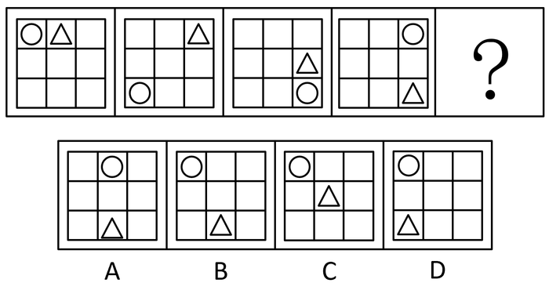

A. A

B. B

C. C

D. D

第 61 题 · 答案与解析

**参考答案（粉笔题库参考内容）**

B

**解析**

元素组成相同，优先考虑位置规律。观察发现，圆形绕着外圈每次逆时针移动两格，三角形绕着外圈每次顺时针移动一格，只有B项符合。

故正确答案为B。

**考点**：位置规律-平移

### 第 62 题

下图问号处最适合填入的一项是（ ）。

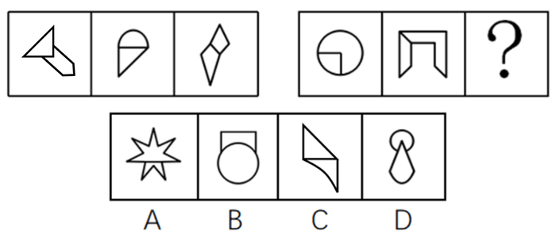

A. A

B. B

C. C

D. D

第 62 题 · 答案与解析

**参考答案（粉笔题库参考内容）**

C

**解析**

元素组成不同，优先考虑属性规律。观察发现，题干每幅图均由两个图形组成，且出现很多等腰图形，考虑对称性。分别画出每幅图中两个图形的对称轴，发现第一组图中，图一两个图形对称轴重合，图二两个图形对称轴相交成45度角，图三两个图形对称轴平行。第二组图遵循此规律，只有C项符合。

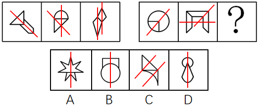

故正确答案为C。

**考点**：属性规律-对称性

### 第 63 题

下图问号处最适合填入的一项是（ ）。

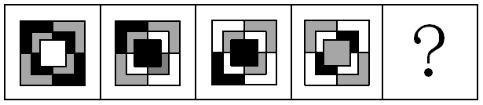

A. 

B. 

C. 

D. 

第 63 题 · 答案与解析

**参考答案（粉笔题库参考内容）**

A

**解析**

元素组成相似，位置、样式均无规律，考虑其他规律。观察发现，题干每幅图形均由3种颜色组成，且相同颜色互不相邻，因此？处图形也应具有相同规律，只有A项符合。

故正确答案为A。

**考点**：特殊规律-图形间关系、数量规律-素

### 第 64 题

下列选项中，能由所给的图形组成的是（ ）。

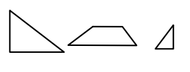

A. 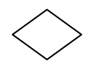

B. 

C. 

D. 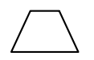

第 64 题 · 答案与解析

**参考答案（粉笔题库参考内容）**

C

**解析**

本题考查平面拼合，题干并没有说不能旋转和翻转，所以此题可以进行旋转和翻转。通过旋转消除等长的线条的方法进行做题。消去等长的线段后进行组合即可得到轮廓图，即为C选项。等长线段相消的方式如下图所示。

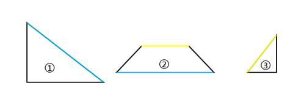

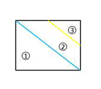

故正确答案为C。

### 第 65 题

下图是由两个相同的三棱锥组合而成的物体。下列选项中，不可能从该物体的切面观察到的图形是（ ）。

A. 

B. 

C. 

D. 

第 65 题 · 答案与解析

**参考答案（粉笔题库参考内容）**

C

**解析**

本题考查剖视图，可以通过排除法做题，逐一分析选项。

A项：沿图中红线位置进行切，观察a块的切面可以得到，排除；

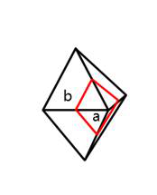

B项：沿图中红线位置进行切，可以观察到，排除；

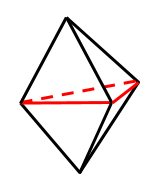

D项：沿图中红线位置进行切，观察b块的切面可以得到，排除；

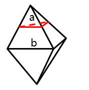

A、B、D三项均通过切面观察得到。

本题为选非题，故正确答案为C。

**考点**：空间类-截面图

### 第 66 题

下列选项中，与所给的立体图形不同的是（ ）。

A. 

B. 

C. 

D. 

第 66 题 · 答案与解析

**参考答案（粉笔题库参考内容）**

B

**解析**

A项：题干图形向右翻转180度即可得到，排除；

B项：题干图形向前翻转后，左上角黑块的位置与选项不一样，当选；

C项：题干图形向后翻转立起来后再向右旋转180度即可得到，排除；

D项：题干图形向左翻转即可得到，排除；

本题为选非题，故正确答案为B。

**考点**：位置规律-综合

### 第 67 题

以下选项均是由四个三角形和三个正方形组成，无法折叠成左图所示立体图形的是（ ）。

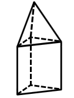

A. 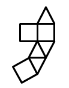

B. 

C. 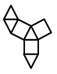

D. 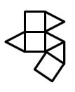

第 67 题 · 答案与解析

**参考答案（粉笔题库参考内容）**

B

**解析**

这道题主要考查立体图形的折叠，可采用排除法。

题干上面三个三角形有公共顶点，可以通过判断是否存在公共顶点进行排除；

A、C、D三项中三个三角形均有公共点，如图所示，排除；

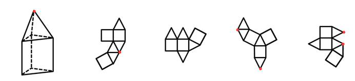

本题为选非题，故正确答案为B。

**考点**：空间类-多面体折叠

### 第 68 题

下列各项中不可能是如左图所示长方体组成部分的是（ ）。

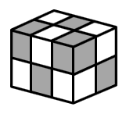

A. 

B. 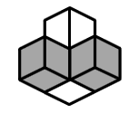

C. 

D. 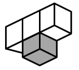

第 68 题 · 答案与解析

**参考答案（粉笔题库参考内容）**

D

**解析**

本题考查立体拼合。题干长方体有12个小方块，将小方块进行标号，能通过题干图形看到10个小方块，如下图所示，看不到的小方块为⑪⑫。

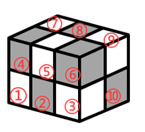

A项：如下图所示，若⑪⑫为黑色，则⑧⑩⑪⑫有可能是题干的组成部分，排除；
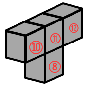

B项：如下图所示，若⑫为白色，则④⑦⑧⑫有可能是题干的组成部分，排除；
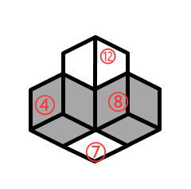

C项：如下图所示，若⑪为黑色，②③⑩⑪有可能是题干的组成部分，排除；
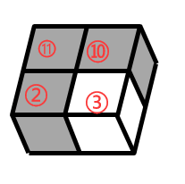

D项：题干已知10个方块的颜色，即使2个未知的方块为全白，也不可能出现三个白块连在一起的情况，故不可能是题干的组成部分，当选。
本题为选非题，故正确答案为D。

**考点**：空间类-立体拼合

### 第 69 题

以下两个图形是从正面和斜45°观察某物体所得的图形，则选项中最符合这一物体俯视图的是（ ）。

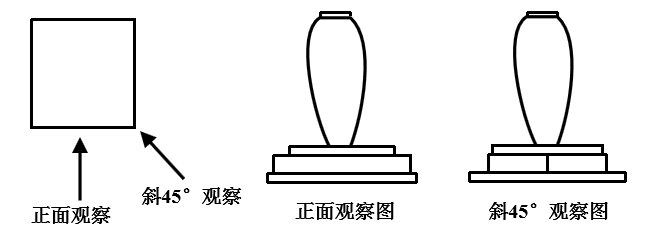

A. 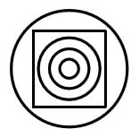

B. 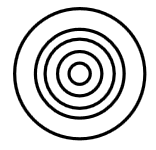

C. 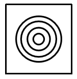

D. 

第 69 题 · 答案与解析

**参考答案（粉笔题库参考内容）**

A

**解析**

本题考查三视图。观察题干，正面观察图和斜45°观察图都有5层，从下到上标号为1-5。结合选项判断：

第1层：正面观察图和斜45°观察图均为长方形，则该物体第1层为圆，若为正方形，斜45°观察图长方形中应有一条竖线，排除C项；

第2层：正面观察图为长方形，斜45°观察图中长方形中间有一条竖线，则该物体第2层为正方形，排除B项；

第3层：正面观察图和斜45°观察图均为长方形，则该物体第3层为圆；

第4层：为不规则圆柱体最宽处，俯视图依旧为圆，排除D项，A项当选。

故正确答案为A。

**考点**：空间类-三视图

### 第 70 题

下列4张纸条中，沿折痕能够折出如图所示图形的是（ ）。

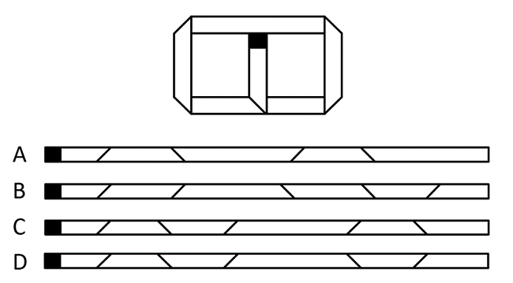

A. A

B. B

C. C

D. D

第 70 题 · 答案与解析

**参考答案（粉笔题库参考内容）**

D

**解析**

本题考虑从折痕入手，题干能看到有5处折痕，因此展开之后也应有5处折痕，排除A项。再次观察发现，如下图所示，相邻的两处折痕方向均是相反的，排除B、C两项，只有D项符合。

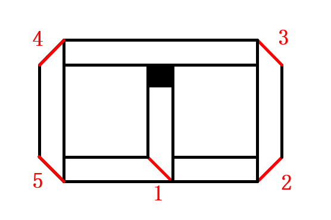

故正确答案为D。

### 第 71 题

某单位组织趣味运动会，运动会一共安排了8个项目，一个项目结束才进行下一个项目。如果每个项目每支队伍都要派出4人参加，同时每个队员参赛的项目不超过3个。则每支队伍至少需要（ ）名队员。

A. 11

B. 12

C. 13

D. 14

第 71 题 · 答案与解析

**参考答案（粉笔题库参考内容）**

A

**解析**

一共8个项目，每个项目需要4人参加，则一共需要8×4=32人次参赛。因每个队员的参赛项目不超过3个，因此要想需要的人数尽可能少，则每人均参加3个项目，一共需要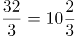人，至少需要11人。

故正确答案为A。

**考点**：非典型最值问题

### 第 72 题

某学校对500名学生进行了一次调查，结果显示，会游泳的学生比不会游泳的学生多34人，而在会游泳的学生中，会自由泳的学生只占1/3。则在500名学生中，不会自由泳的学生比会自由泳的学生多（ ）人。

A. 322

B. 237

C. 231

D. 79

第 72 题 · 答案与解析

**参考答案（粉笔题库参考内容）**

A

**解析**

设500名学生中不会游泳的学生人数为x，则会游泳的人数为x+34，总人数=x+(x+34)=500，解得x=233人，会游泳的人数为233+34=267人。

在会游泳的学生中，会自由泳的学生占，所以会自由泳的人数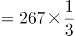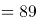人，不会自由泳的人数=总人数-会自由泳的人数=500-89=411人。不会自由泳的人数比会自由泳的多：411-89=322人。

故正确答案为A。

**考点**：和差倍比问题

### 第 73 题

如图所示，一个边长为16厘米的大正方形，在距离角一定距离位置处与对角线平行折叠四次，得到中部小正方形的边长为4厘米。如果CB与大正方形的边平行，则三角形ABC的面积为（ ）。

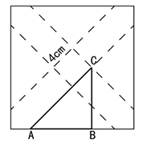

A. 32

B. 16

C. 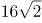

D. 24

第 73 题 · 答案与解析

**参考答案（粉笔题库参考内容）**

A

**解析**

方法一：因为最终形成的是一个小正方形，因此四条对折的虚线距离角的长度一定相等。将FG平移到角E，交大正方形两条边于AD，则AD=4，根据勾股定理可得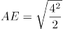。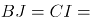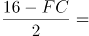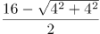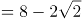。则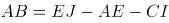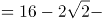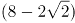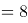。BC为大正方形边长的一半=8。则△ABC的面积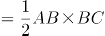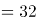。

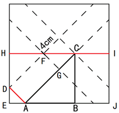

方法二：如图中所示，已知AC所在的虚线折痕平行于正方形对角线，故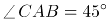。又已知CB与大正方形的边平行，故CB⊥AB，即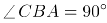，因此△ABC为等腰直角三角形，即AB=BC。BC为大正方形边长的一半等于8，故AB=BC=8。则△ABC的面积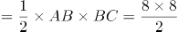。

故正确答案为A。

**考点**：几何结论类-三角形相关、几何公式类-平面图形

### 第 74 题

某工程队进行电线安装，第一天用去电线总长度的1/4，第二天用去余下长度的一半后，还剩下24米，则这捆电线原本长度为（ ）米。

A. 58

B. 64

C. 72

D. 96

第 74 题 · 答案与解析

**参考答案（粉笔题库参考内容）**

B

**解析**

第一天用去了总长的，则还剩余，第二天用去余下的一半，还剩余总长的。设电线的总长为x米，则 米，解得x=64米。

故正确答案为B。

**考点**：和差倍比问题

### 第 75 题

一个大的正方体的6个面分别写有数字1～6，甲乙丙丁四人分别面对正方体的四个侧面，分别能看到正方体的一个侧面和顶部。甲乙丙三人看到的正方体侧面和顶部的点数之和分别是4、9和5，则正方体底部的点数是（ ）。

A. 4或5

B. 3或4

C. 2或3

D. 1或2

第 75 题 · 答案与解析

**参考答案（粉笔题库参考内容）**

A

**解析**

设甲乙丙三人看到的点数分别为b、c、d，顶部的点数为a，则可得a+b=4，a+c=9，a+d=5。因点数为1-6的数字，且各不相等，则a+b=4，只能为1+3=4。同时a+c=9，则a≠1，只能为3。此时b、c、d对应的点数为1、6、2。

正方体底部的点数为三人均未看到的点数，1-6中除了3、1、6、2外，还剩下4和5。则底部的点数只能为4或5。

故正确答案为A。

**考点**：和差倍比问题

### 第 76 题

甲、乙二人绕着圆形操场跑道散步，甲顺时针走，乙逆时针走。两人在跑道A处同时出发，甲每分钟走90米，乙每分钟走60米，当甲、乙两人在跑道B处相遇时，乙加快了速度，甲在原地停留4分钟后保持原来的速度继续往前走，最后甲、乙二人仍在A处相遇。已知该操场的周长为1800米，那么相遇后，乙的速度变为每分钟（ ）米。

A. 70

B. 80

C. 90

D. 100

第 76 题 · 答案与解析

**参考答案（粉笔题库参考内容）**

C

**解析**

甲乙两人同时从A点出发，在B点相遇，所用时间相同，路程与速度成正比，即所走路程之比为90:60=9:6。则甲走了米，乙走了1800-1080=720米。

相遇后，甲在原地停留四分钟，然后保持原来的速度继续前行，最终与乙在A点再次相遇，则所走路程为720米，所走的时间分钟；因乙并未停留，故乙共走了8+4=12分钟，所走路程为1080米，则相遇后乙的速度变为米/分钟。

故正确答案为C。

**考点**：相遇追及

### 第 77 题

商场销售某种型号的冰箱，上半年的利润率为20%，由于下半年的进货价格下降10%，商场决定适当下调销售价格，但调整后下半年的利润率仍然达到了24%。则同上半年相比，下半年的销售价格降低了（ ）。

A. 5%

B. 6%

C. 7%

D. 8%

第 77 题 · 答案与解析

**参考答案（粉笔题库参考内容）**

C

**解析**

方法一：设上半年进货价格为x，则售价为1.2x，下半年进货价格为0.9x，售价为0.9x×（1+24%）=1.116x。则下半年售价比上半年降低了。

方法二：将上半年的进货价格赋值为100，则上、下半年销售情况可列表如下：

下半年售价比上半年降低了。

故正确答案为C。

**考点**：经济利润问题

### 第 78 题

服务大厅每天上午8点半开始办理业务。某天8点半，已经有15位市民正在排队，并且每3分钟都会新增一位前来办理业务的市民。由于大厅只开放了3个窗口，到10点整时发现，仍有18位市民正在排队。如果每个窗口办理一项业务的时间相同，则大厅还需要至少再增开（ ）个窗口，才能在中午12点前办理完所有业务。

A. 1

B. 2

C. 3

D. 4

第 78 题 · 答案与解析

**参考答案（粉笔题库参考内容）**

B

**解析**

由题意，每小时新增办理业务市民为人。设每个窗口每小时可办理x人的业务。已知从8点半到10点经过1.5小时，可得：15+1.5×20-1.5×3x=18，解得x=6人；设至少新增y个窗口，从10点到12点经过2小时，可得：18+20×2=（3+y）×6×2，解得y≈1.8，可得大厅还需要至少再增开2个窗口。

故正确答案为B。

### 第 79 题

有一批边长为1厘米的小正方体，其中一面涂红色的有400个，相邻两面涂红色的有30个，相邻三面涂红色的有1个，其余小正方体各面都没有涂颜色。用这一批小正方体组成一个大正方体，要求这个大正方体有三个面是红色，且这三个面两两相邻，其余的三个面没有颜色。假如没有涂颜色的小正方体数量足够多，那么这个正方体的边长最大是（ ）厘米。

A. 10

B. 11

C. 12

D. 13

第 79 题 · 答案与解析

**参考答案（粉笔题库参考内容）**

B

**解析**

如下图，要组成符合题意的大正方体，三个红色面对应的顶点必须是三面涂红色的小正方体，刚好需要1个。红色面交汇的3条棱上，需要使用相邻两面涂红色的小正方体，共有30个，分3组，则每组有10个，此时组成的大正方体的边长为11厘米。

大正方体涂红色面上，排除三面涂红色的顶点和两面涂红色的棱，三个面至少需要“一面涂红色”的小正方体3×10×10=300个，题干有400个“一面涂红色”的小正方体，满足要求。则这个三面涂红的正方体边长最大是11厘米。

故正确答案为B。

**考点**：几何结论类-几何小题型

### 第 80 题

某展览使用了序号为1～100的100盏灯，现在有两个开关，开关A能切换所有序号为偶数的灯的开关状态，开关B能切换所有序号为3的倍数的灯的开关状态。若在100盏灯都打开的状态下，先后按下开关A和B，则还有（ ）盏灯处于打开状态。

A. 33

B. 34

C. 49

D. 50

第 80 题 · 答案与解析

**参考答案（粉笔题库参考内容）**

C

**解析**

序号为1-100的灯中，序号为偶数的灯有50盏，序号为3的倍数的灯有33盏，序号为偶数同时也为3的倍数的灯有16盏。根据题意，先按下开关A，则灭掉的灯有50盏，此时处于打开状态的灯有50盏；再按下开关B，灭掉的灯中有16盏再次打开，打开的灯有17盏灭掉，故先后按下开关A和B，还处于打开状态的灯有16＋50－17＝49盏。

故正确答案为C。

**考点**：两集合、周期相遇问题

### 第 81 题

3，4，6，10，18，（ ）

A. 28

B. 32

C. 34

D. 40

第 81 题 · 答案与解析

**参考答案（粉笔题库参考内容）**

C

**解析**

数列无明显特征，考虑作差。相邻两项作差，后项-前项得到新数列：1，2，4，8，是公比为2的等比数列，则新数列的下一项为8×2=16，故原数列所求项=18＋16=34。

故正确答案为C。

**考点**：多级数列、递推数列

### 第 82 题

87，86，84，79，69，52，（ ）

A. 24

B. 25

C. 26

D. 27

第 82 题 · 答案与解析

**参考答案（粉笔题库参考内容）**

C

**解析**

数列变化幅度不大且呈递减趋势，优先考虑作差。后一项减前一项，得到的新数列（1）为-1，-2，-5，-10，-17。将新数列（1）继续作差，后一项减前一项，得到的新数列（2）为-1，-3，-5，-7，为公差为-2的等差数列，则新数列（2）的下一项为-9，新数列（1）的下一项为-9－17=-26，故所求项＝52-26=26。

故正确答案为C。

**考点**：多级数列

### 第 83 题

，，，，（ ）

A. 

B. 

C. 

D. 

第 83 题 · 答案与解析

**参考答案（粉笔题库参考内容）**

C

**解析**

观察数列，分子分母均不单调，考虑将分数进行反约分，分别将分子和分母列成新数列，找寻规律。根据已有分数，可考虑将题干数列化为新数列：，，，。观察新数列，分子为1，2，3，4，为公差为1的等差数列，故所求项的分子为4＋1=5；分母为3，4，5，6，为公差为1的等差数列，故所求项的分母为6＋1=7，所求项。

故正确答案为C。

**考点**：分数数列

### 第 84 题

607，819，10211，12313，（ ）

A. 13414

B. 14415

C. 14514

D. 15415

第 84 题 · 答案与解析

**参考答案（粉笔题库参考内容）**

B

**解析**

数列起伏较大，且缺少敏感数字，考虑机械划分。将原数列数位分解为三部分，6|0|7、8|1|9、10|2|11、12|3|13，前面部分组成新数列为6、8、10、12、（ ），是公差为2的等差数列，则括号内应为14。中间部分组成新数列为0、1、2、3、（ ），是公差为1的等差数列，则括号内应为4。后面部分组成新数列为7、9、11、13、（ ），是公差为2的等差数列，则括号内应为15。将三部分组合，则题干所求项应为14415。

故正确答案为B。

**考点**：机械划分

### 第 85 题

100，7，14，（ ），100，5，20，0，100，3，33，1

A. 1

B. 2

C. 3

D. 4

第 85 题 · 答案与解析

**参考答案（粉笔题库参考内容）**

B

**解析**

题干数列较长，交叉分组后并没有规律，考虑以四个数字为一组进行分组。分组后可发现：100=5×20+0，100=3×33+1，存在规律：第一个数字=第二个数字×第三个数字+第四个数字，则题干所求项应满足：100=7×14+？，计算可得？=2。

故正确答案为B。

**考点**：多重数列

### 第 86 题

0.02，3.13，8.24，15.35，24.46，35.57，48.68，（ ）

A. 63.79

B. 73.89

C. 66.79

D. 76.89

第 86 题 · 答案与解析

**参考答案（粉笔题库参考内容）**

A

**解析**

数列为小数数列，作差没有规律，考虑机械划分。将数列中每一个数字的整数部分和小数部分划分后，得到两组新的数列。其中整数部分组成的新数列为0、3、8、15、24、35、48，两两作差得：3、5、7、9、11、13，是公差为2的等差数列，则下一项为13+2=15，故题干所求项的整数部分为48+15=63。小数部分组成的新数列为2、13、24、35、46、57、68，是公差为11的等差数列，则题干所求项的小数部分为68+11=79。因此题干所求项为63.79。

故正确答案为A。

**考点**：机械划分

### 第 87 题

100，82，66，52，（ ）

A. 40

B. 36

C. 32

D. 26

第 87 题 · 答案与解析

**参考答案（粉笔题库参考内容）**

A

**解析**

数列无明显特征，且单调递减，优先考虑作差。前项减后项得到新数列18、16、14、（ ），是公差为2的等差数列，则新数列下一项为14－2=12，故原数列题干所求项为52-12=40。

故正确答案为A。

**考点**：多级数列、幂次数列

### 第 88 题

521，232，172，422，（ ）

A. 158

B. 233

C. 397

D. 406

第 88 题 · 答案与解析

**参考答案（粉笔题库参考内容）**

B

**解析**

数列无明显特征，各项之间变化无规律，且各项均为多位数，考虑机械划分。观察发现：5×2×1=10，2×3×2=12，1×7×2=14，4×2×2=16；即每项的各位数字乘积构成公差为2的等差数列，则新数列下一项为16+2=18。只有B项2×3×3=18满足题意。

故正确答案为B。

**考点**：机械划分

### 第 89 题

6，20，42，72，（ ）

A. 90

B. 100

C. 110

D. 120

第 89 题 · 答案与解析

**参考答案（粉笔题库参考内容）**

C

**解析**

数列变化幅度平缓，优先考虑作差。两两作差可得，14、22、30，构成公差为8的等差数列，故所求项为72+30+8=110。

故正确答案为C。

**考点**：多级数列、因数分解数列

### 第 90 题

A. 53

B. 63

C. 73

D. 83

第 90 题 · 答案与解析

**参考答案（粉笔题库参考内容）**

B

**解析**

观察数阵发现，大数字固定出现在每行第一个数，且每行均为从左到右依次递减的等差数列。63、56、49公差为-7，76、68、60公差为-8，72-81=-9，可知第三行应是公差为-9的等差数列，故题干所求项为72+(-9)=63。

故正确答案为B。

**考点**：图形数阵

### 第 91 题

乡村：振兴（ ）

A. 西部：开发

B. 改革：创新

C. 人才：强国

D. 国际：合作

第 91 题 · 答案与解析

**参考答案（粉笔题库参考内容）**

A

**解析**

第一步：判断题干词语间逻辑关系。

振兴乡村，二者是动宾关系。

第二步：判断选项词语间逻辑关系。

A项：开发西部，二者是动宾关系，与题干逻辑关系一致，当选；

B项：改革和创新二者不能构成动宾关系，与题干逻辑关系不一致，排除；

C项：强国和人才二者不能构成动宾关系,与题干逻辑关系不一致，排除；

D项：国际和合作二者不能构成动宾关系，与题干逻辑关系不一致，排除。

故正确答案为A。

**考点**：语法关系

### 第 92 题

计划：总结（ ）

A. 跑步：运动

B. 预习：复习

C. 授权：审批

D. 分析：统计

第 92 题 · 答案与解析

**参考答案（粉笔题库参考内容）**

B

**解析**

第一步：判断题干词语间逻辑关系。

先计划再总结，二者是时间先后的对应关系。

第二步：判断选项词语间逻辑关系。

A项：跑步是运动，二者是种属关系，与题干逻辑关系不一致，排除；

B项：先预习再复习，二者是时间先后的对应关系，与题干逻辑关系一致，当选；

C项：授权和审批不存在时间上的先后顺序，与题干逻辑关系不一致，排除；

D项：先统计再分析，与题干顺序相反，与题干逻辑关系不一致，排除。

故正确答案为B。

**考点**：逻辑关系-对应关系

### 第 93 题

江河：湖海（ ）

A. 名山：大川

B. 风吹：雨打

C. 日月：星辰

D. 湖光：山色

第 93 题 · 答案与解析

**参考答案（粉笔题库参考内容）**

C

**解析**

第一步：判断题干词语间逻辑关系。

江、河、湖、海是并列关系，且均为名词。

第二步：判断选项词语间逻辑关系。

A项：名山和大川，二者均是偏正关系，与题干逻辑关系不一致，排除；

B项：风吹和雨打，二者均是主谓关系，与题干逻辑关系不一致，排除；

C项：日、月、星、辰是并列关系，且均为名词，与题干逻辑关系一致，当选；

D项：湖光和山色，二者均为偏正关系，与题干逻辑关系不一致，排除。

故正确答案为C。

**考点**：逻辑关系-并列关系、拆分思维

### 第 94 题

电费：（ ）相当于 重量：（ ）

A. 用电量 质量

B. 水费 热量

C. 电器 物体

D. 功率 密度

第 94 题 · 答案与解析

**参考答案（粉笔题库参考内容）**

A

**解析**

逐一分析选项

A项：用电量决定电费多少，质量决定重量大小，前后逻辑关系一致，当选；

B项：电费和水费是并列关系，重量和热量无明显逻辑关系，排除；

C项：电器是电费产生的必要条件，物体是有重量的，二者是属性对应关系，前后逻辑关系不一致，排除；

D项：功率和电费无明显逻辑关系，密度和重量无明显逻辑关系，排除。

故正确答案为A。

**考点**：逻辑关系-对应关系

### 第 95 题

行距：（ ）相当于 品德：（ ）

A. 段落 道德

B. 字体 规范

C. 排版 教育

D. 缩小 高尚

第 95 题 · 答案与解析

**参考答案（粉笔题库参考内容）**

C

**解析**

逐一代入选项。

A项：行距是调整段落包含的内容之一，道德是社会意识形态之一，是人们共同生活及其行为的准则和规范，品德是个体依据一定的道德行为准则行动时所表现出来的特征，是对个体道德标准的一种反映，前后逻辑关系不一致，排除；

B项：行距和字体都为文章的排版内容，二者为并列关系，品德和规范之间没有必然的逻辑关系，前后逻辑关系不一致，排除；

C项：行距是排版的内容之一，排版包括调整行距，品德是教育的内容之一，教育包括品德教育，前后逻辑关系一致，当选；

D项：缩小行距为动宾短语，高尚品德为偏正短语，前后逻辑关系不一致，排除。

故正确答案为C。

**考点**：逻辑关系-对应关系

### 第 96 题

税务局：收税（ ）

A. 医院：健康

B. 回收站：分类

C. 企业：投资

D. 学校：教育

第 96 题 · 答案与解析

**参考答案（粉笔题库参考内容）**

D

**解析**

第一步：判断题干词语间逻辑关系。

税务局的主要功能是收税，二者为功能对应关系。

第二步：判断选项词语间逻辑关系。

A项：健康不是医院的主要功能，与题干逻辑关系不一致，排除；

B项：分类不是回收站的主要功能，与题干逻辑关系不一致，排除；

C项：投资不是企业的主要功能，与题干逻辑关系不一致，排除；

D项：教育是学校的主要功能，二者是功能对应关系，与题干逻辑关系一致，当选。

故正确答案为D。

**考点**：逻辑关系-对应关系

### 第 97 题

鹤发童颜：敬老尊贤（ ）

A. 垂髫稚子：童言无忌

B. 桃李芬芳：后生可畏

C. 豆蔻年华：高风亮节

D. 窈窕淑女：君子好逑

第 97 题 · 答案与解析

**参考答案（粉笔题库参考内容）**

A

**解析**

第一步：判断题干词语间逻辑关系。

鹤发童颜，仙鹤羽毛般雪白的头发，儿童般红润的面色，形容老年人的气色很好。敬老尊贤指尊敬年纪大的或品德高尚、才能出众的人。鹤发童颜描述的是老年人，与敬老尊贤当中的“老”相对应，后一个词中包含前一个词所描述的对象，二者为对应关系。

第二步：判断选项词语间逻辑关系。

A项：垂髫和稚子都指儿童，童言无忌指儿童天真无邪，讲话诚实，纵出不吉之言，亦无须见怪，垂髫稚子描述的是儿童，与童言无忌当中的“童”相对应，后一个词中包含前一个词所描述的对象，二者为对应关系，与题干逻辑关系一致，当选；

B项：桃李芬芳，一般指老师的学生很有成就，后生可畏，年轻人是可敬畏的，后一个词中不包含前一个词所描述的对象，与题干逻辑关系不一致，排除；

C项：豆蔻年华指女子十三四岁时，高风亮节，形容道德和行为都很高尚，后一个词中不包含前一个词所描述的对象，与题干逻辑关系不一致，排除；

D项：窈窕淑女指美好的女子，君子好逑指是男子追求佳偶，“逑”指匹配的意思，后一个词中不包含前一个词所描述的对象，与题干逻辑关系不一致，排除。

故正确答案为A。

**考点**：逻辑关系-对应关系

### 第 98 题

环保：发电：太阳能（ ）

A. 民主：选举：选票

B. 高效：配置：市场

C. 公正：审判：法官

D. 精准：扶贫：资金

第 98 题 · 答案与解析

**参考答案（粉笔题库参考内容）**

B

**解析**

第一步：判断题干词语间逻辑关系。

太阳能有发电的功能，二者是功能的对应关系；环保是太阳能发电的必然属性，二者为属性的对应关系。

第二步：判断选项词语间逻辑关系。

A项：选票是选举所需文件，选票不具有选举的功能，二者不是功能的对应关系，与题干逻辑关系不一致，排除；

B项：市场有配置的功能，二者是功能的对应关系；高效是市场配置的必然属性，二者为属性的对应关系，与题干逻辑关系一致，当选；

C项：审判是法官的职责，而非法官的功能，二者不是功能的对应关系，与题干逻辑关系不一致，排除；

D项：资金可以用于扶贫，但精准是资金扶贫的或然属性，与题干逻辑关系不一致，排除。

注：B项的市场配置一定会实现高效（来源于李克强总理的工作报告如下图）。

故正确答案为B。

**考点**：逻辑关系-对应关系

### 第 99 题

指纹：钥匙：密码（ ）

A. 公交：地铁：客轮

B. 月季：玫瑰：花朵

C. 现金：信用卡：手机

D. 宣纸：毛笔：狼毫

第 99 题 · 答案与解析

**参考答案（粉笔题库参考内容）**

A

**解析**

第一步：判断题干词语间逻辑关系。

指纹、钥匙和密码的主要功能都是解锁和保护安全，三者功能一致，为功能并列关系。

第二步：判断选项词语间逻辑关系。

A项：公交、地铁和客轮都是交通工具的一种，主要功能都是运输，三者功能一致，为功能并列关系，与题干逻辑关系一致，当选；

B项：月季和玫瑰都属于花朵的一种，为并列关系，和第三个词均为种属关系，与题干逻辑关系不一致，排除；

C项：现金和信用卡的主要功能都是支付，而手机虽然也有支付的功能，但并非主要功能，手机的主要功能是通讯，与题干逻辑关系不一致，排除；

D项：宣纸和毛笔都属于文具的一种，为并列关系，狼毫属于毛笔的一种，后两词为种属关系，与题干逻辑关系不一致，排除。

故正确答案为A。

**考点**：逻辑关系-并列关系

### 第 100 题

工人：齿轮：机械表（ ）

A. 诗人：诗词：出版物

B. 老师：教材：优等生

C. 画家：画笔：画作

D. 厨师：面粉：馒头

第 100 题 · 答案与解析

**参考答案（粉笔题库参考内容）**

D

**解析**

第一步：判断题干词语间逻辑关系。

工人制作机械表，第一个词与第三个词为职业和对象的对应关系，齿轮为制作机械表的原材料，后两者为原材料对应关系。

第二步：判断选项词语间逻辑关系。

A项：出版物是由出版社制作的而不是由诗人，第一个词与第三个词不是职业和对象的对应关系，且“诗词”是“出版物”的内容，后两个词不是原材料对应关系，与题干逻辑关系不一致，排除；

B项：教材不是优等生的材料，后两者不是原材料对应，与题干逻辑关系不一致，排除；

C项：画家制作画作，但画笔是制作画作的工具，而不是画作的原材料，后两者不是原材料对应，与题干逻辑关系不一致，排除；

D项：厨师制作馒头，第一个词与第三个词为职业和对象的对应关系，面粉是制作馒头的原材料，后两者为原材料对应关系，与题干逻辑关系一致，当选。

故正确答案为D。

注意：齿轮和机械表可以看成原材料的对应关系，也可以看成是组成关系，但是看成组成关系的话此题没有正确答案，因此，在本题中只能看成原材料。

**考点**：逻辑关系-对应关系

