# 广东省2020年度选调生和急需紧缺专业公务员招录笔试 综合行政能力测验（网友回忆版）

<!-- gwy:overview:start -->
> **广东 · 2020 · 行测 · 选调生** ｜ 100 题 · 图片 140 处 · 答案随题折叠

| 题型模块 | 题量 | 题号 |
| --- | ---: | ---: |
| 常识判断 | 40 | 1–40 |
| 选词填空 | 15 | 41–55 |
| 阅读理解 | 20 | 56–75 |
| 推理判断 | 10 | 76–85 |
| 资料分析 | 15 | 86–100 |
| **合计** | **100** | |

导航：[题型与作答说明](#题型与作答说明) · [题目](#题目) · [材料 1](#材料-1)
<!-- gwy:overview:end -->

> 候选采集稿。参考答案及解析来自粉笔页面，不代表官方答案或真实高分答卷；来源使用许可与原卷对应关系仍需人工核实。

## 题型与作答说明

常识判断

（40题）

请运用基本常识理解分析，从4个备选项中选出最符合题干要求的1项。

选词填空

（15题）

每题给出一句（一段）话，但其中缺少一个或几个词，请从4个备选项中选出最合适的1项填补空缺，使之符合句子所表达的意思。

阅读理解

（20题）

每题给出一段文字，后面有一个不完整的陈述，请从4个备选项中选出最合适的1项。

推理判断

（10题）

每题给出了文字或图表信息，请运用基本科学知识推理判斯，从4个备选项中选出最合理的1项。

资料分析

（15题）

请根据资料所提供的信息分析、比较、计算，从4个备选项中选出符合题意的1项。

## 题目

### 第 1 题

党的十九大报告提出，在全面建成小康社会的基础上，分两步走在本世纪中叶建成（ ）的社会主义现代化强国。

A. 富强民主法治幸福美丽

B. 富强平等法治幸福绿色

C. 富强平等文明和谐美丽

D. 富强民主文明和谐美丽

第 1 题 · 答案与解析

**参考答案（粉笔题库参考内容）**

D

**解析**

题考查政治常识。

2017年10月18日，中国共产党第十九次全国代表大会在北京隆重召开，习近平总书记代表第十八届中央委员会向大会作报告。报告指出：“新时代中国特色社会主义思想，明确坚持和发展中国特色社会主义，总任务是实现社会主义现代化和中华民族伟大复兴，在全面建成小康社会的基础上，分两步走在本世纪中叶建成富强民主文明和谐美丽的社会主义现代化强国。”

故正确答案为D。

### 第 2 题

五大发展理念是新时代指导中国经济社会发展的基本理念。以下举措主要体现的不是共享发展理念的是（ ）。

①调查摸清我国贫困人口分布、致贫原因、脱贫需求等信息，建立起全国统一的扶贫开发信息系统

②健全以基层党组织为核心，以群众自治组织、辖区企事业单位、社会组织、社区居民为补充的“五位一体”自治组织

③取消对义务教育阶段学校的考核排名，推动校长和教师异校交流

④把资源消耗、环境损害、生态效益等指标纳入经济社会发展评价体系

⑤鼓励企业发挥优势，按照市场化的方式开展产业扶贫，实现贫困地区与企业发展的双赢

A. ②④

B. ①④⑤

C. ①②③

D. ③④⑤

第 2 题 · 答案与解析

**参考答案（粉笔题库参考内容）**

A

**解析**

本题考查政治常识。

党的十八届五中全会强调，实现“十三五”时期发展目标，破解发展难题，厚植发展优势，必须牢固树立并切实贯彻创新、协调、绿色、开放、共享的发展理念。其中，共享是中国特色社会主义的本质要求。必须坚持发展为了人民、发展依靠人民、发展成果由人民共享，作出更有效的制度安排，使全体人民在共建共享发展中有更多获得感，增强发展动力，增进人民团结，朝着共同富裕方向稳步前进。

①正确，党的十八届五中全会指出：“坚持共享发展，必须坚持发展为了人民、发展依靠人民、发展成果由人民共享，作出更有效的制度安排，使全体人民在共建共享发展中有更多获得感，增强发展动力，增进人民团结，朝着共同富裕方向稳步前进······实施脱贫攻坚工程，实施精准扶贫、精准脱贫，分类扶持贫困家庭，探索对贫困人口实行资产收益扶持制度，建立健全农村留守儿童和妇女、老人关爱服务体系。”通过调查摸清我国贫困人口分布、致贫原因、脱贫需求等信息，建立起全国统一的扶贫开发信息系统，体现了精准扶贫、精准脱贫，符合实施脱贫攻坚工程的要求。

②错误，“健全以基层党组织为核心，以群众自治组织、辖区企事业单位、社会组织、社区居民为补充的‘五位一体’自治组织”属于政治方面的建设，与共享发展理念无关。

③正确，党的十八届五中全会指出：“坚持共享发展，必须坚持发展为了人民、发展依靠人民、发展成果由人民共享，作出更有效的制度安排，使全体人民在共建共享发展中有更多获得感，增强发展动力，增进人民团结，朝着共同富裕方向稳步前进......提高教育质量，推动义务教育均衡发展，普及高中阶段教育，逐步分类推进中等职业教育免除学杂费，率先从建档立卡的家庭经济困难学生实施普通高中免除学杂费，实现家庭经济困难学生资助全覆盖。”通过取消对义务教育阶段学校的考核排名，推动校长和教师异校交流，有利于推动教育的均衡发展和优秀教育资源的共享。

④错误，党的十八届五中全会指出：“坚持绿色发展，必须坚持节约资源和保护环境的基本国策，坚持可持续发展，坚定走生产发展、生活富裕、生态良好的文明发展道路，加快建设资源节约型、环境友好型社会，形成人与自然和谐发展现代化建设新格局，推进美丽中国建设，为全球生态安全作出新贡献。”因此，“把资源消耗、环境损害、生态效益等指标纳入经济社会发展评价体系”属于绿色发展理念。

⑤正确，鼓励企业发挥优势，按照市场化的方式开展产业扶贫，实现贫困地区与企业发展的双赢，即通过产业扶贫的方式使全体人民共享发展成果。

因此，①③⑤正确，②④错误。

本题为选非题，故正确答案为A。

### 第 3 题

党的十九届四中全会提出，我国国家治理一切工作和活动都依照中国特色社会主义制度展开，我国（ ）是中国特色社会主义制度及其执行能力的集中体现。

A. 基层治理体系和治理能力

B. 城乡治理体系和治理能力

C. 社会治理体系和治理能力

D. 国家治理体系和治理能力

第 3 题 · 答案与解析

**参考答案（粉笔题库参考内容）**

D

**解析**

本题考查政治常识。

党的十九届四中全会提出，中国特色社会主义制度是党和人民在长期实践探索中形成的科学制度体系，我国国家治理一切工作和活动都依照中国特色社会主义制度展开，我国国家治理体系和治理能力是中国特色社会主义制度及其执行能力的集中体现。

故正确答案为D。

### 第 4 题

今年是五四运动100周年。以下关于五四运动表述错误的是（ ）。

A. 五四运动是中国共产党领导的第一次爱国青年运动

B. 五四运动是中国旧民主主义革命走向新民主主义革命的转折点

C. 五四精神以爱国、进步、民主、科学为主要内容

D. 五四运动具有彻底反帝反封建的革命性

第 4 题 · 答案与解析

**参考答案（粉笔题库参考内容）**

A

**解析**

本题考查政治常识。

2019年4月30日,纪念五四运动100周年大会在北京人民大会堂隆重举行。中共中央总书记、国家主席、中央军委主席习近平在大会上发表重要讲话。

A项错误，讲话指出：“五四运动，爆发于民族危难之际，是一场以先进青年知识分子为先锋、广大人民群众参加的彻底反帝反封建的伟大爱国革命运动，是一场中国人民为拯救民族危亡、捍卫民族尊严、凝聚民族力量而掀起的伟大社会革命运动，是一场传播新思想新文化新知识的伟大思想启蒙运动和新文化运动，以磅礴之力鼓动了中国人民和中华民族实现民族复兴的志向和信心。”五四运动爆发于1919年，而中国共产党成立于1921年，因此，五四运动不是由中国共产党领导的。

B、D项正确，讲话指出：“五四运动，以彻底反帝反封建的革命性、追求救国强国真理的进步性、各族各界群众积极参与的广泛性，推动了中国社会进步，促进了马克思主义在中国的传播，促进了马克思主义同中国工人运动的结合，为中国共产党成立做了思想上干部上的准备，为新的革命力量、革命文化、革命斗争登上历史舞台创造了条件，是中国旧民主主义革命走向新民主主义革命的转折点，在近代以来中华民族追求民族独立和发展进步的历史进程中具有里程碑意义。”

C项正确，讲话指出：“五四运动，孕育了以爱国、进步、民主、科学为主要内容的伟大五四精神，其核心是爱国主义精神。”

本题为选非题，故正确答案为A。

### 第 5 题

关于新时代我国社会主要矛盾的变化，下列说法有误的是（ ）。

A. 我国社会主要矛盾已经转化为人民日益增长的美好生活需要和不平衡不充分的发展之间的矛盾

B. 生产力水平低已经成为满足人民日益增长的美好生活需要的主要制约因素

C. 我国社会主要矛盾的变化是关系全局的历史性变化，对党和国家工作提出了许多新要求

D. 我国社会主要矛盾的变化，没有改变我们对我国社会主义所处历史阶段的判断

第 5 题 · 答案与解析

**参考答案（粉笔题库参考内容）**

B

**解析**

本题考查中国特色社会主义理论体系。

A项正确，党的十九大报告中指出：“中国特色社会主义进入新时代，我国社会主要矛盾已经转化为人民日益增长的美好生活需要和不平衡不充分的发展之间的矛盾。”社会主要矛盾变化是我国发展新的历史方位的基本依据，是准确把握社会主义初级阶段发展变化的科学认识。

B项错误，党的十九大报告指出：“我国稳定解决了十几亿人的温饱问题，总体上实现小康，不久将全面建成小康社会，人民美好生活需要日益广泛，不仅对物质文化生活提出了更高要求，而且在民主、法治、公平、正义、安全、环境等方面的要求日益增长。同时，我国社会生产力水平总体上显著提高，社会生产能力在很多方面进入世界前列，更加突出的问题是发展不平衡不充分，这已经成为满足人民日益增长的美好生活需要的主要制约因素。”

C项正确，党的十九大报告指出：“必须认识到，我国社会主要矛盾的变化是关系全局的历史性变化，对党和国家工作提出了许多新要求。我们要在继续推动发展的基础上，着力解决好发展不平衡不充分问题，大力提升发展质量和效益，更好满足人民在经济、政治、文化、社会、生态等方面日益增长的需要，更好推动人的全面发展、社会全面进步。”

D项正确，党的十九大报告中指出：“必须认识到，我国社会主要矛盾的变化，没有改变我们对我国社会主义所处历史阶段的判断，我国仍处于并将长期处于社会主义初级阶段的基本国情没有变，我国是世界最大发展中国家的国际地位没有变。”

本题为选非题，故正确答案为B。

### 第 6 题

马克思主义是科学的理论，创造性地揭示了人类社会发展规律。以下关于马克思主义表述错误的是（ ）。

A. 实践性是马克思主义理论区别于其他理论的显著特征

B. 马克思主义第一次创立了人民实现自身解放的思想体系

C. 马克思主义政党同其他政党的根本区别在于为民族利益而奋斗

D. 中国共产党是用马克思主义武装起来的政党

第 6 题 · 答案与解析

**参考答案（粉笔题库参考内容）**

C

**解析**

本题考查马克思主义。

Ａ项正确，实践的观点是马克思主义认识论的基本观点，实践性是马克思主义理论区别于其他理论的显著特征。

Ｂ项正确，马克思主义第一次创立了人民实现自身解放的思想体系。马克思主义第一次站在人民的立场探求人类自由解放的道路，以科学的理论为最终建立一个没有压迫、没有剥削、人人平等、人人自由的理想社会指明了方向。正是因为马克思主义植根人民之中，把无产阶级解放与全人类解放作为同一个过程，无产阶级立场同时也是广大人民立场，这才保证自身成为公正无私的社会科学，具有跨越国度、跨越时代的影响力。

Ｃ项错误，习近平总书记在庆祝中国共产党成立95周年大会上的讲话中指出：人民立场是中国共产党的根本政治立场，是马克思主义政党区别于其他政党的显著标志。

D项正确，中国共产党是用马克思主义武装起来的政党，马克思主义是中国共产党人理想信念的灵魂。坚持用马克思主义中国化最新成果武装全党、教育人民，不仅是坚持和发展马克思主义的需要，而且是推动党和国家事业不断发展的需要。

本题为选非题，故正确答案为C。

### 第 7 题

习近平总书记指出：“我们追求人与自然的和谐、经济与社会的和谐，通俗地讲就是要‘两座山’：既要金山银山，又要绿水青山，绿水青山就是金山银山。”这句话体现的哲学原理是（ ）。

A. 对立统一关系原理

B. 质量互变关系原理

C. 否定之否定关系原理

D. 物质与意识关系原理

第 7 题 · 答案与解析

**参考答案（粉笔题库参考内容）**

A

**解析**

本题考查中国特色社会主义理论体系。

A项正确，对立统一规律揭示了事物发展的源泉和动力。任何事物都包含着矛盾，矛盾双方既对立又统一，在一定条件下相互转化。一方面“绿水青山”和“金山银山”两者是对立的，经济发展会给生态建设带来一些危害。另一方面，“绿水青山”也能转化为“金山银山”，生态优势可以转化为经济优势，发展服务业、旅游业等。

B项错误，质量互变规律揭示事物发展的形式和状态，事物的存在和发展主要存在量变和质变两种状态,体现了事物发展渐进性和飞跃性的统一。题干没有体现。

C项错误，否定之否定规律揭示的是事物发展的方向和道路，事物发展的前进性与曲折性的统一，事物的发展不是直线式前进而是螺旋式上升的。题干没有体现。

D项错误，物质决定意识，意识对物质具有反作用。题目没有体现。

故正确答案为A。

### 第 8 题

构建国土空间开发保护制度，完善主体功能区配套政策，建立以（ ）为主体的自然保护地体系。

A. 生态保护区

B. 生态发展区

C. 自然公园

D. 国家公园

第 8 题 · 答案与解析

**参考答案（粉笔题库参考内容）**

D

**解析**

本题考查中国特色社会主义理论体系。党的十九大报告指出：构建国土空间开发保护制度，完善主体功能区配套政策，建立以国家公园为主体的自然保护地体系。

故正确答案为D。

### 第 9 题

坚持和完善共建共治共享的社会治理制度，保持社会稳定、维护国家安全。以下举措不属于打造共建共治共享的社会治理格局的是（ ）。

A. 畅通民意表达渠道

B. 依法有序的信息公开

C. 降低城乡人口流动性

D. 开展行业公共安全风险评估

第 9 题 · 答案与解析

**参考答案（粉笔题库参考内容）**

C

**解析**

本题考查政治常识。

A项正确，十九届四中全会指出：“坚持和发展新时代‘枫桥经验’，畅通和规范群众诉求表达、利益协调、权益保障通道，完善信访制度，完善人民调解、行政调解、司法调解联动工作体系，健全社会心理服务体系和危机干预机制，完善社会矛盾纠纷多元预防调处化解综合机制，努力将矛盾化解在基层。”

B项正确，依法有序的信息公开能够保障公民、法人和其他组织依法获取政府信息，提高政府工作的透明度，建设法治政府，充分发挥政府信息对人民群众生产、生活和经济社会活动的服务作用。

C项错误，降低城乡人口流动性不利于部分农村劳动力向城市转移，不利于城乡融合发展，不符合打造共建共治共享的社会治理格局的要求。

D项正确，十九届四中全会指出：“加强国家安全人民防线建设，增强全民国家安全意识，建立健全国家安全风险研判、防控协同、防范化解机制。”开展行业公共安全风险评估体现了坚持总体国家安全观，统筹发展和安全，坚持人民安全、政治安全、国家利益至上有机统一。

本题为选非题，故正确答案为C。

### 第 10 题

党的十九大报告提出，建设教育强国是中华民族伟大复兴的基础工程。办好继续教育，加快建设（ ）社会，大力提高国民素质。

A. 学习型

B. 创新型

C. 发展型

D. 改革型

第 10 题 · 答案与解析

**参考答案（粉笔题库参考内容）**

A

**解析**

本题考查政治常识。

2017年10月18日，党的十九大报告指出：“建设教育强国是中华民族伟大复兴的基础工程，必须把教育事业放在优先位置，深化教育改革，加快教育现代化，办好人民满意的教育。要全面贯彻党的教育方针，落实立德树人根本任务，发展素质教育，推进教育公平，培养德智体美全面发展的社会主义建设者和接班人。推动城乡义务教育一体化发展，高度重视农村义务教育，办好学前教育、特殊教育和网络教育，普及高中阶段教育，努力让每个孩子都能享有公平而有质量的教育。完善职业教育和培训体系，深化产教融合、校企合作。加快一流大学和一流学科建设，实现高等教育内涵式发展。健全学生资助制度，使绝大多数城乡新增劳动力接受高中阶段教育、更多接受高等教育。支持和规范社会力量兴办教育。加强师德师风建设，培养高素质教师队伍，倡导全社会尊师重教。办好继续教育，加快建设学习型社会，大力提高国民素质。”

故正确答案为A。

### 第 11 题

建设社会主义文化强国需要加强文物保护利用和文化遗产保护传承。以下举措不符合文物保护利用和文化遗产保护传承要求的是（ ）。

A. 分拆整理出土文物

B. 维护修缮名人故居

C. 培训博物馆志愿讲解员

D. 举办粤绣工艺展览

第 11 题 · 答案与解析

**参考答案（粉笔题库参考内容）**

A

**解析**

本题考查政治常识。

A项错误，分拆整理出土文物不利于保护文物的完整性和文物原状。

B项正确，名人故居自身蕴含着历史价值和人文价值，通过维护修缮名人故居，能够达到弘扬中华优秀传统文化，延续城市历史文脉，保留中华文化基因的目的。

C项正确，培训博物馆志愿讲解员能够激发群众对中华传统文化的热情，通过以博物馆为纽带，不仅加大了中华文化的宣传力度，而且有利于中华文化的传承和发展。

D项正确，粤绣是中国四大名绣之一，也是中国的非物质文化遗产。通过举办粤绣工艺展览能够充分展示我国非遗的丰富性和多样性，体现非遗与人民群众生活的密切联系，展现非遗的当代活力。

本题为选非题，故正确答案为A。

### 第 12 题

2019年2月18日，中共中央、国务院印发了《粤港澳大湾区发展规划纲要》。其中，对于粤港澳大湾区发展的战略定位包括（ ）。

①充满活力的世界级城市群

②“一带一路”建设的重要支撑

③具有重大影响力的国际科技创新中心

④宜居宜业宜游的优质生活圈

A. ①③

B. ②④

C. ①②④

D. ①②③④

第 12 题 · 答案与解析

**参考答案（粉笔题库参考内容）**

C

**解析**

本题考查政治常识。

《粤港澳大湾区发展规划纲要》对于粤港澳大湾区发展的战略定位包括：充满活力的世界级城市群；具有全球影响力的国际科技创新中心；“一带一路”建设的重要支撑；内地与港澳深度合作示范区；宜居宜业宜游的优质生活圈。因此，①②④正确，③错误。

故正确答案为C。

### 第 13 题

习近平总书记指出，全球治理体系变革源于（ ），我们要坚持以经济发展为中心，集中力量办好自己的事情，不断增强我们在国际上说话办事的实力。

A. 国际力量对比变化

B. 全球治理观念更新

C. 世界经济持续增长

D. 坚持共商共建共赢

第 13 题 · 答案与解析

**参考答案（粉笔题库参考内容）**

A

**解析**

本题考查政治常识。

2016年9月27日下午，中共中央政治局就二十国集团领导人峰会和全球治理体系变革进行第三十五次集体学习。中共中央总书记习近平在主持学习时强调，全球治理格局取决于国际力量对比，全球治理体系变革源于国际力量对比变化。我们要坚持以经济发展为中心，集中力量办好自己的事情，不断增强我们在国际上说话办事的实力。我们要积极参与全球治理，主动承担国际责任，但也要尽力而为、量力而行。

故正确答案为A。

### 第 14 题

党的十八大以来，我国经济保持中高速增长，国内生产总值稳居世界（ ），对世界经济增长贡献率超过百分之三十。

A. 第一

B. 第二

C. 第三

D. 第四

第 14 题 · 答案与解析

**参考答案（粉笔题库参考内容）**

B

**解析**

本题考查政治常识。

党的十九大报告中指出，十八大以来的五年，经济建设取得重大成就。经济保持中高速增长，在世界主要国家中名列前茅，国内生产总值从五十四万亿元增长到八十万亿元，稳居世界第二，对世界经济增长贡献率超过百分之三十。

故正确答案为B。

### 第 15 题

党的十九大报告提出，加强党的基层组织建设，要以提升（ ）为重点，突出政治功能，把基层组织建设成为宣传党的主张、贯彻党的决定、领导基层治理、团结动员群众、推动改革发展的坚强战斗堡垒。

A. 组织力

B. 影响力

C. 协调力

D. 战斗力

第 15 题 · 答案与解析

**参考答案（粉笔题库参考内容）**

A

**解析**

本题考查政治常识。

党的十九大报告提出，加强党的基层组织建设，要以提升组织力为重点，突出政治功能，把企业、农村、机关、学校、科研院所、街道社区、社会组织等基层党组织建设成为宣传党的主张、贯彻党的决定、领导基层治理、团结动员群众、推动改革发展的坚强战斗堡垒。

故正确答案为A。

### 第 16 题

当前，各地政府高度重视生态环境保护，习近平总书记曾引用“子钓而不纲，弋不射宿”来强调生态环境的重要性，以下与这句古文表达的理念不同的是（ ）。

A. 不夭其生，不绝其长也

B. 竭泽而渔，岂不得鱼，而明年无鱼

C. 斧斤以时入山林，林木不可胜用也

D. 天之于民厚矣！殖五谷，生鱼鸟，以为之用

第 16 题 · 答案与解析

**参考答案（粉笔题库参考内容）**

D

**解析**

本题考查人文常识。

“子钓而不纲，弋不射宿”出自《论语》，意思是不用大网打鱼，不射夜宿之鸟。因为大网所捞必多，对于鱼类、对于自然会造成伤害；飞鸟归巢，它们也需要栖息繁殖。这句话告诉我们要对自然界生物心存仁爱，不可滥捕滥杀、过度开发，要重视人与自然的和谐共存。

A项正确，“不夭其生，不绝其长也”出自《荀子·王制》，原文为“草木荣华滋硕之时，则斧斤不入山林，不夭其生，不绝其长也”，大意为草木开花生长之时，不能进山林砍伐，断绝它们的生长。告诉我们要保护生态，避免过度开发，重视人与自然的和谐。

B项正确，“竭泽而渔，岂不获得，而明年无鱼”出自《吕氏春秋·义赏》，原句为“竭泽而渔，岂不获得，而明年无鱼；焚薮而田，岂不获得，而明年无兽”，意思是，用把水池排干的办法来捉鱼，眼下当然有收获，但明年就无鱼可捕了；用把树林烧光的办法来打猎，眼下当然有收获，但明年就无兽可打了。告诫我们切勿只顾眼前而不顾长远，向自然索取应当有所节制。

C项正确，“斧斤以时入山林，材木不可胜用也”出自《孟子·梁惠王上》，原文为“不违农时，谷不可胜食也；数罟不入洿池，鱼鳖不可胜食也；斧斤以时入山林，材木不可胜用也”，大意是说，只要不违背农时、耽误百姓耕种，粮食就吃不完；不用细密的网在池塘里捕捞，鱼鳖就吃不完；按照时令采伐林木，木材就用不完。告诉我们要把自然生态同人类文明联系起来，按照大自然规律活动，取之有时，用之有度。

D项错误，“天之于民厚矣！殖五谷，生鱼鸟，以为之用”出自《列子·说符》，意思为上天对人类真是厚恩大德，生长五谷，繁殖鱼鸟，将这些东西给人们食用。这是一种上天制造万物的客观唯心主义思想，没有表达出人与自然要和谐共生的观点。

本题为选非题，故正确答案为D。

### 第 17 题

2019年7月，展现新石器时代我国长江下游稻作文明发展程度的（ ）被正式列入“世界遗产名录”。

A. 马坝人遗址

B. 南越王宫署遗址

C. 平遥古城遗址

D. 良渚古城遗址

第 17 题 · 答案与解析

**参考答案（粉笔题库参考内容）**

D

**解析**

本题考查政治常识。

A项错误，马坝人遗址位于广东省韶关市曲江区马坝镇。“马坝人”是介于中国猿人和现代人之间的古人类，为12.9万年前的旧石器时代的古人类，它为完善我国原始人类发展的序列提供了相当重要的资料。

B项错误，南越国宫署，位于广州老城区中心中山四路，是汉朝境内的割据政权南越国的皇宫，已被列为国家重点文物保护单位。

C项错误，平遥古城位于山西省中部，始建于周宣王时期，明洪武三年（1370年）扩建，距今已有2700多年的历史。还较为完好地保留着明清时期县城的基本风貌，是中国汉民族地区现存最为完整的古城。平遥古城1997年被列入世界文化遗产名录。

D项正确，良渚古城遗址，位于浙江省杭州市余杭区瓶窑镇内，是中国长江下游环太湖地区的一个区域性早期国家的权力与信仰中心所在。良渚文化的年代为距今5300-4300年，持续发展约1000年，属于新石器时代晚期的考古学文化。2019年7月6日中国良渚古城遗址获准列入世界遗产名录。良渚古城遗址是人类早期城市文明的范例，实证中华五千年文明史。此次申遗成功，标志着中华五千年文明史得到国际社会认可。

故正确答案为D。

### 第 18 题

2019年7月19日晚，遨游太空近3年的（ ）在预定时间返回地球，这标志着中国载人航天工程空间实验室阶段全部任务圆满完成。

A. 嫦娥一号

B. 天宫二号

C. 长征五号

D. 神舟十号

第 18 题 · 答案与解析

**参考答案（粉笔题库参考内容）**

B

**解析**

本题考查政治常识。

A项错误，嫦娥一号是我国首颗绕月人造卫星。该卫星的主要探测目标是：获取月球表面的三维立体影像；分析月球表面有用元素的含量和物质类型的分布特点；探测月壤厚度和地球至月球的空间环境。2007年10月24日18时05分左右，嫦娥一号卫星在西昌卫星发射中心升空。2009年3月1日完成使命，撞向月球预定地点。

B项正确，天宫二号空间实验室于2016年9月15日22时04分12秒在酒泉卫星发射中心成功发射。2017年，天舟一号货运飞船与“天宫二号”对接。2019年7月19日晚，天宫二号在预定时间返回地球。天宫二号主要开展地球观测和空间地球系统科学、空间应用新技术、空间技术和航天医学等领域的应用和试验，打造中国第一个真正意义上的空间实验室，发射时释放伴飞小卫星。

C项错误，长征五号于2016年11月3日在中国文昌航天发射场首飞成功， 由此成为中国运载能力最大的火箭。中国未来天宫空间站、北斗导航系统的建设，探月三期工程及其它深空探测的实施都将使用该火箭系列。长征五号是运载火箭，不能在太空遨游。

D项错误，神舟十号飞船是中国第五艘载人飞船,飞行乘组由男航天员聂海胜、张晓光和女航天员王亚平组成，聂海胜担任指令长。飞船于2013年6月11日17时38分从酒泉卫星发射中心发射，2013年6月26日8时7分许，搭乘3名中国航天员的神舟十号载人飞船返回舱，在位于内蒙古中部草原上的“神十”任务主着陆场预定区域顺利着陆。

故正确答案为B。

### 第 19 题

2019年9月29日，中华人民共和国（ ）颁授仪式在北京人民大会堂隆重举行。

A. 和平勋章和友谊勋章

B. “十一”勋章和军队功勋

C. 人民满意的公务员和集体

D. 国家勋章和国家荣誉称号

第 19 题 · 答案与解析

**参考答案（粉笔题库参考内容）**

D

**解析**

本题考查政治常识。

经中共中央批准，中华人民共和国国家勋章和国家荣誉称号颁授仪式于2019年9月29日上午10时在北京人民大会堂隆重举行。于敏、申纪兰、孙家栋、李延年、张富清、袁隆平、黄旭华、屠呦呦被授予“共和国勋章”；劳尔·卡斯特罗·鲁斯、玛哈扎克里·诗琳通等6人被授予“友谊勋章”；南仁东、董建华、于漪、王蒙、王有德等28人获授国家荣誉称号。

故正确答案为D。

### 第 20 题

2019年5月，习近平总书记在江西于都参观中央红军长征出发纪念馆时强调，我们一定要牢记红色政权是从哪里来的、新中国是怎么建立起来的。以下历史事件不是发生在长征途中的是（ ）。

A. 井冈山会师

B. 遵义会议

C. 四渡赤水

D. 飞夺泸定桥

第 20 题 · 答案与解析

**参考答案（粉笔题库参考内容）**

A

**解析**

本题考查毛中特。

长征是土地革命战争时期，中国工农红军主力撤离长江南北各苏区，转战两年，到达陕甘苏区的战略转移行动。红军长征发生于1934年10月—1936年10月。

A项错误，井冈山会师是指1928年4月毛泽东率领的秋收起义部队与朱德、陈毅领导的部分南昌起义部队在井冈山的胜利会师。井冈山会师后壮大了井冈山的革命武装力量，对巩固扩大全国第一个农村革命根据地，推动全国革命事业的发展，具有深远的意义。井冈山会师不是发生在长征途中。

B项正确，遵义会议是指1935年1月中共中央政治局在贵州遵义召开的独立自主地解决中国革命问题的一次极其重要的扩大会议。是在红军第五次反“围剿”失败和长征初期严重受挫的情况下，为了纠正博古、王明等人“左”倾领导在军事指挥上的错误而召开的。

C项正确，四渡赤水战役是遵义会议之后，中央红军在长征途中，处于国民党几十万重兵围追堵截的艰险条件下，进行的一次决定性运动战战役。在毛泽东主席、周、朱等指挥下，中央红军采取高度机动的运动战方针，纵横驰骋于川黔滇边境广大地区，积极寻找战机，有效地调动和歼灭敌人，彻底粉碎了蒋介石等反动派企图围歼红军于川黔滇边境的狂妄计划，红军取得了战略转移中具有决定意义的胜利。

D项正确，飞夺泸定桥，是中国工农红军长征中的一场重要战役，发生于1935年5月29日。这次胜利打破了蒋介石妄图把红军变成第二个石达开的反革命迷梦，是红军长征中具有战略意义的重大胜利之一。

本题为选非题，故正确答案为A。

### 第 21 题

习近平总书记曾说：“泰山半腰有一段平路叫‘快活三里’，一些人爬累了，喜欢在此歇脚。然而，挑山工一般不在此久留，因为休息时间长了，腿就会‘发懒’，再上‘十八盘’就更困难了。”这对党的建设的启示是（ ）。

A. 要以钉钉子精神担当尽责

B. 要全面提高领导能力和执政水平

C. 作风建设永远在路上，必须常抓不懈

D. 应当以马克思主义科学理论武装头脑

第 21 题 · 答案与解析

**参考答案（粉笔题库参考内容）**

C

**解析**

本题考查政治。

习总书记讲述这个例子意在强调作风建设永远在路上，一刻也不能松懈，必须持续努力。

A项错误，2013年2月28日，在党的十八届二中全会第二次全体会议上，习主席对钉钉子精神进行了详细阐述：“我们要有钉钉子的精神，钉钉子往往不是一锤子就能钉好的，而是要一锤一锤接着敲，直到把钉子钉实钉牢，钉牢一颗再钉下一颗，不断钉下去，必然大有成效。”钉钉子精神主要强调干事业并非一朝一夕之功，并未突出题干例子中的“休息”。

B项错误，全面提高领导能力和执政水平是指领导干部要能力过硬，不断掌握新知识、熟悉新领域、开拓新视野。

C项正确，习总书记在《在党的群众路线教育实践活动总结大会上的讲话》中提到：“改进作风到了节骨眼上，社会上有种种议论和思想情绪。很多人担心活动一结束就曲终人散，‘四风’问题又‘涛声依旧’了。还有一些人盼着紧绷的弦松一松，好让自己舒服舒服。一些人等着看中央还要出什么招，看左邻右舍有什么动静。对此，我们的态度是，作风建设永远在路上，永远没有休止符，必须抓常、抓细、抓长，持续努力、久久为功。”“休止符”契合题干例子中的“休息”。

D项错误，用马克思主义科学理论武装头脑，可以把理想信念建立在对科学理论的理性认同上，建立在对历史规律的正确认识上，建立在对基本国情的准确把握上。

故正确答案为C。

### 第 22 题

与驾驶小汽车相比，驾驶员以同样的速度驾驶公交车时，会感觉公交车移动的速度更快。以下最能解释这一现象的是（ ）。

A. 公交车挡风玻璃比小汽车的挡风玻璃厚，造成司机视线差异

B. 公交车车头更短，司机可以看到距离车头很近的地面

C. 公交车体型比小汽车大得多，需要更大的动力和刹车距离

D. 公交车挡风玻璃面积更大，司机的视线范围更广

第 22 题 · 答案与解析

**参考答案（粉笔题库参考内容）**

B

**解析**

本题考查科技常识。人们判断运动知觉的变量不是线速度，而是角速度（视角度/秒）。一个点状物以相同速度运动，若其运动方向恰好与眼睛视线平行，此时的视角为0°（当然，人有两只眼睛，不可能与两只眼睛都为0，实际上只能是接近0），即角速度为0，你几乎感觉不到它在运动；而当运动方向与眼睛视线垂直时，角速度就最大，就能感觉到很快的运动速度；另外，角速度的大小还与距离相关，距离越远，角速度显然越小，距离越近，角速度越大。由此可见，在不同的位置（不同的角度、不同的距离）观看相同运动速度的物体，会有截然不同的速度感。开不同的车会有不同的视野，也会产生不同的速度感。

小汽车与公交车，由于公交车都是平头，前挡玻璃几乎是垂直的，人的座位又高，驾驶员可以看到离车头很近的路面，自然就感觉快。而小车就不一样了，小车车头较长，前挡玻璃都是倾斜安装的，而且斜度还较大，座位比较靠后，这样人离车头的距离就远了；同时小车的座位又很低，这样驾驶员的视线就只能以比较平的角度看车头前的路面，所能看到的路面与驾驶员所坐的位置有了很大的一段水平距离（也就是说车头前方还有一段较长路面被车头挡住看不到），就会感觉速度比公交车慢。

故正确答案为B。

### 第 23 题

为了降低食品袋中食物湿度，防止食品变质腐败，常常会在食品袋中放入干燥剂。下列干燥剂中，其干燥原理与其他不同的是（ ）。

A. 硅胶

B. 活性炭

C. 碱石灰

D. 活性氧化铝

第 23 题 · 答案与解析

**参考答案（粉笔题库参考内容）**

C

**解析**

本题考查科技常识。

A项正确，硅胶是一种高活性、多孔性物质，其内部表面积很大，有较强的吸附性，吸湿量能达到40%左右。它的干燥原理是吸附。

B项正确，活性炭是一种粉状或粒状的多孔无定形炭，它具有发达的孔隙结构、很大的比表面积(可达1500平方米/克以上)和巨大的吸附力。它的干燥原理是吸附。

C项错误，碱石灰是氧化钙与氢氧化钠的混合物，极易吸收水分和二氧化碳而变成碳酸钙和碳酸钠，因而常用作气体的干燥剂和二氧化碳的吸收剂。它的干燥原理是发生化学反应，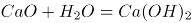；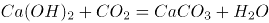；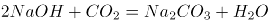。因此它与其他三项干燥原理不同。

D项正确，活性氧化铝是多孔的颗粒状氧化铝，它对气体、水蒸气和某些液体的水分有选择吸附本领。它的干燥原理是吸附。

本题为选非题，故正确答案为C。

### 第 24 题

大雾天气，公路两旁路灯的灯光会变得朦胧，其主要原因是（ ）。

A. 雾气吸收了路灯的光线

B. 灯光照射在雾气上发生了散射

C. 雾气吸附在灯罩表面，阻挡了灯光

D. 雾气阻挡了人的视线

第 24 题 · 答案与解析

**参考答案（粉笔题库参考内容）**

B

**解析**

本题考查科技常识。雾主要是由接近地面的水蒸气，遇冷凝结后飘浮在空气中的小水滴构成的。

A项错误，吸收光线的话会使光线变暗，但不是变得朦胧。

B项正确，当光通过不均匀介质时(如雾气中的小水滴)，一部分光就会偏离原来的直线方向，改向四面八方传播，这种现象被称为光的散射。光的散射是使人们看到灯光变得朦胧的主要原因。

C项错误，路灯由于发光伴随发热，灯罩的温度应该是相对高于环境温度的，雾气不会遇冷凝结在灯罩表面。

D项错误，雾气阻挡人们的视线是由于光线被雾气散射所造成的。

故正确答案为B。

### 第 25 题

植物一生吸水的重量常常达到其自重的数百倍，但植物所吸取的水分最终存储在植物体内的并不多，大约98%的水分都蒸腾散失掉。以下不属于植物需要进行蒸腾作用的原因是（ ）。

A. 帮助植物降温散热，避免被烈日烤焦

B. 为植物吸收和运输水分提供了动力，使根部不断向土壤吸水

C. 水在从根部向叶片运输的过程中，把各种养分带到了植物全身

D. 叶片水分散失的同时会发生代谢，有利于植物维持内环境稳定

第 25 题 · 答案与解析

**参考答案（粉笔题库参考内容）**

D

**解析**

本题考查科技常识。

A项正确，蒸腾作用是植物体内水分以水蒸气态通过植物体表面(主要是叶面)散失到大气中的过程。水在蒸腾作用中变为水蒸气会吸收一部分热量，可以降低植物体的温度，避免植物被烈日烤焦。

B项正确，蒸腾作用是植物体内水分散失的主要方式，也是水分吸收和运输的主要动力。

C项正确，植物所需的养分大部分为无机盐类，需要溶于水中才能被植物吸收和在体内运转，既然蒸腾作用是对水分吸收和流动的动力，那么，养分也随水分的吸收和流动而被吸入和分布到植物体各部分中去，使植物体所需的养分能够到达植物全身。

D项错误，不是进行蒸腾作用的主要原因。

本题为选非题，故正确答案为D。

### 第 26 题

PUE值是国际通用的数据中心电力使用效率指标，数据中心的冷却占机房总功耗的40%，降低机房制冷的耗电量能有效降低PUE值。为使大型云计算数据中心建设达到国际标准，以下计算数据中心建设选址不是从利用自然环境降低PUE这一方面考虑的是（ ）。

A. 贵州贵安

B. 上海青浦

C. 宁夏中卫

D. 内蒙古乌兰察布

第 26 题 · 答案与解析

**参考答案（粉笔题库参考内容）**

B

**解析**

本题考查地理国情。

A项正确，贵安新区地势西高东低，平均海拔1200米；气候宜人，空气清新，年平均气温12.8—16.2℃，有利于数据中心利用自然环境降低PUE。

B项错误，上海属亚热带季风性气候，四季分明，日照充分，加之城市热岛效应，导致夏季炎热，易出现持续高温天气，不利于数据中心降温。

C项正确，宁夏中卫属典型的温带大陆性季风气候，2017年全市平均气温为 10.2℃，有利于数据中心利用自然环境降低PUE。

D项正确，乌兰察布处于北纬40—44度之间，地处中温带，属于大陆性季风气候区。其特殊的地理条件，形成了特殊的气候特点。其夏季平均气温罕见地明显低于周边所有区域（包括其北部地区），最热月平均气温一般也低于20℃，有利于数据中心利用自然环境降低PUE。

本题为选非题，故正确答案为B。

### 第 27 题

2018年，我国将每年农历“秋分”这一天设立为中国农民丰收节。如果按照“日出而作，日落而息”的习惯，中国农民丰收节当天，下列地方的农民耕作时间（按北京时间）最早的是（ ）。

A. 位于华北平原的北京市郊

B. 位于珠江三角洲平原的广州市郊

C. 绿茶产地，地处云贵高原的大理州

D. “中国大豆之乡”，东北嫩江县

第 27 题 · 答案与解析

**参考答案（粉笔题库参考内容）**

D

**解析**

本题考查地理国情。

根据“日出而作”的习惯，日出时间最早的地区农民耕作时间最早。由于地球自西向东转动，导致各地见到日出的时间不同，东边要先看到日出，4个选项中，东北嫩江县位于最东边，故嫩江县农民耕作时间（按北京时间）最早。

A项错误，北京位于东经116°20′，地处华北平原的北部。

B项错误，广州市位于东经112°57′至114°3′，地处珠江三角洲的北缘，接近珠江流域下游入海口。

C项错误，大理白族自治州地处云南省中部偏西，地处东经98°52′～101°03′。

D项正确，嫩江县位于黑龙江省西北部，地跨东经124°44′～126°49′。

故正确答案为D。

### 第 28 题

地形与气候的差异使得中国自南向北、自西向东形成了风情各异的建筑文化。下列关于各地区建筑风格的描述不正确的是（ ）。

A. 东北地区的民居一般坐南向北，窗户大，采光通风好

B. 西北地区利用地形，就地取材建造下沉式窑洞

C. 西藏地区的民居多为木制的崩空式建筑，就地取材，且可防震

D. 华南地区的“骑楼”，沿街而建，上楼下廊，可挡避风雨和炎阳

第 28 题 · 答案与解析

**参考答案（粉笔题库参考内容）**

A

**解析**

本题考查地理国情。

A项错误，东北地区气候寒冷，民居一般坐北朝南，南面窗户大，这样有利于增加日照，避免厢房对正房的光线遮挡。

B项正确，下沉式窑洞是由地下穴居演变而来，隐藏于地面以下，也叫地坑窑、地阴窑、天井窑。“进村不见村，树冠露三分；麦垛星罗布，户户窑洞沉”中的“窑洞”说的便是下沉式窑洞，其主要分布于豫西、陇东、陕西渭北、山西运城等地。

C项正确，“崩空”是藏族建筑中十分具有民族和地域特色的木结构建筑，它是川藏线上众多民居中的一道质朴风景。西藏地区森林资源丰富，为修建“崩空”式建筑提供了木材保证。崩空式民居冬暖夏凉，结构牢固防震性能强，外观造型简洁庄重，色彩亮丽，深受当地藏族群众喜爱。

D项正确，“骑楼”是一种临架于人行道上的楼房，多见于南方炎热而多雨的地区，具有遮阳、蔽雨之功能。一般多沿街或傍河建造，将房屋底层的前面部分辟为柱廊，做互相联通的人行道，其上层为房间。

本题为选非题，故正确答案为A。

### 第 29 题

近年来，全球贸易保护主义兴起，全球主要大国之间发生贸易摩擦。某经济大国严重依赖出口贸易，假如该国深陷贸易摩擦，则以下情况中，该国最有可能发生的是（ ）。

A. 当年的贸易顺差减少

B. 当年的通货膨胀率提升

C. 当年的失业率降低

D. 当年的财政支出增加

第 29 题 · 答案与解析

**参考答案（粉笔题库参考内容）**

A

**解析**

本题考查经济。

A项正确，贸易顺差亦称“贸易出超”，是指各国家或地区在一定时期内的出口额大于进口额的现象。本题中，该经济大国依赖出口贸易，现深陷贸易摩擦，即会严重影响其对外出口，导致贸易顺差减少。

B项错误，通货膨胀率，也称为物价变化率，是货币超发部分与实际需要的货币量之比，用以反映通货膨胀、货币贬值的程度。就题干已有信息，并未涉及通货膨胀。

C项错误，失业率是指一定时期满足全部就业条件的就业人口中仍未有工作的劳动力所占的比例，旨在衡量闲置中的劳动产能，是反映一个国家或地区失业状况的主要指标。其计算公式为：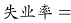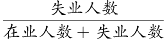。本题中，该经济大国出口受阻，易引起失业率的提升，而非降低。

D项错误，财政支出，也称公共财政支出，是指在市场经济条件下，政府为提供公共产品和服务，满足社会共同需要而进行的财政资金的支付。财政支出是国家将通过各种形式筹集上来的财政收入进行分配和使用的过程。就题干已有信息，并未涉及财政支出。

故正确答案为A。

### 第 30 题

2019年11月10日，第二届中国国际进口博览会圆满落幕。以下有关此次博览会的说法正确的有（ ）。

①是世界上第一个以进口为主题的国家级展会，是国际贸易发展史上一大创举

②体现了中国支持多边贸易体制，推动发展自由贸易的一贯立场

③是中国推动建设开放型世界经济、支持经济全球化的实际行动

④不是中国的独唱，而是各国的大合唱

A. ②③

B. ②③④

C. ①②④

D. ①②③④

第 30 题 · 答案与解析

**参考答案（粉笔题库参考内容）**

D

**解析**

本题考查政治。

2018年11月5日，首届中国国际进口博览会在上海开幕。国家主席习近平在出席首届进博会开幕式时发表了主旨演讲。

习近平指出：“中国国际进口博览会是迄今为止世界上第一个以进口为主题的国家级展会，是国际贸易发展史上一大创举。这体现了中国支持多边贸易体制、推动发展自由贸易的一贯立场，是中国推动建设开放型世界经济、支持经济全球化的实际行动。”

习近平强调：“中国国际进口博览会不是中国的独唱，而是各国的大合唱。希望各位嘉宾深入探讨全球经济治理体系改革新思路，共同维护自由贸易和多边贸易体制，共建创新包容的开放型世界经济，向着构建人类命运共同体目标不懈奋进，开创人类更加美好的未来。”

故正确答案为D。

### 第 31 题

我国有上亿市场主体，而且还在不断增加。把市场主体的活跃度保持住、提上去，是促进经济平稳增长的关键所在。下列举措属于激发市场主体活力，优化营商环境的是（ ）。

①对招收特定人群的用工单位，三年内给予定额税费减免

②加快收费清单“一张网”建设，让收费公开透明

③在各行业推进“互联网+”

④深化综合行政执法改革，清理规范行政处罚事项

⑤加强消费者权益保护

A. ③⑤

B. ②④

C. ①②

D. ④⑤

第 31 题 · 答案与解析

**参考答案（粉笔题库参考内容）**

B

**解析**

本题考查时事政治。

国务院总理李克强2019年3月5日在第十三届全国人民代表大会第二次会议上所作的《政府工作报告》中指出：“激发市场主体活力，着力优化营商环境。我国有上亿市场主体，而且还在不断增加。把市场主体的活跃度保持住、提上去，是促进经济平稳增长的关键所在。要深化‘放管服’改革，降低制度性交易成本，下硬功夫打造好发展软环境。”主要有三项内容：一是以简审批优服务便利投资兴业；二是以公正监管促进公平竞争；三是以改革推动降低涉企收费。

①是减税降费措施，属于“继续创新和完善宏观调控，确保经济运行在合理区间”的工作内容。

②正确，《2019政府工作报告》中指出：“加快收费清单‘一张网’建设，让收费公开透明，让乱收费无处藏身。”加快收费清单“一张网”建设，让收费公开透明是“以改革推动降低涉企收费”，有利于激发市场主体活力，优化营商环境。

③错误，在各行业推进“互联网+”有利于促进新兴产业加快发展，属于“坚持创新引领发展，培育壮大新动能”的工作内容。

④正确，《2019政府工作报告》中指出：“深化综合行政执法改革，清理规范行政处罚事项，坚决治理多头检查、重复检查。对监管者也要强监管、立规矩，决不允许搞选择性执法、任性执法，决不允许刁难企业和群众。”深化综合行政执法改革，清理规范行政处罚事项是“以公正监管促进公平竞争”，有利于激发市场主体活力，优化营商环境。

⑤错误，加强消费者权益保护有利于推动消费稳定增长，属于“促进形成强大国内市场，持续释放内需潜力”的工作内容。

故正确答案为B。

### 第 32 题

以下关于我国宪法中的规定，说法有误的是（ ）。

A. 如果遇到不能进行下届全国人民代表大会代表选举的非常情况，由全国人民代表大会常务委员会以全体组成人员的三分之二以上的多数通过，可以推迟选举，延长本届全国人民代表大会的任期

B. 宪法的修改，由全国人民代表大会常务委员会或者四分之一以上的全国人民代表大会代表提议，并由全国人民代表大会以到会代表的四分之三以上的多数通过

C. 如果全国人民代表大会常务委员会认为必要，或者有五分之一以上的全国人民代表大会代表提议，可以临时召集全国人民代表大会会议

D. 法律和其他议案由全国人民代表大会以全体代表的过半数通过

第 32 题 · 答案与解析

**参考答案（粉笔题库参考内容）**

B

**解析**

本题考查法律常识。

A项正确，根据《宪法》第六十条第二款规定：“全国人民代表大会任期届满的两个月以前，全国人民代表大会常务委员会必须完成下届全国人民代表大会代表的选举。如果遇到不能进行选举的非常情况，由全国人民代表大会常务委员会以全体组成人员的三分之二以上的多数通过，可以推迟选举，延长本届全国人民代表大会的任期。在非常情况结束后一年内，必须完成下届全国人民代表大会代表的选举。”

B项错误，根据《宪法》第六十四条第一款规定：“宪法的修改，由全国人民代表大会常务委员会或者五分之一以上的全国人民代表大会代表提议，并由全国人民代表大会以全体代表的三分之二以上的多数通过。”

C项正确，根据《宪法》第六十一条第一款规定：“全国人民代表大会会议每年举行一次，由全国人民代表大会常务委员会召集。如果全国人民代表大会常务委员会认为必要，或者有五分之一以上的全国人民代表大会代表提议，可以临时召集全国人民代表大会会议。”

D项正确，根据《宪法》第六十四条第二款规定：“法律和其他议案由全国人民代表大会以全体代表的过半数通过。”

本题为选非题，故正确答案为B。

### 第 33 题

第十三届全国人民代表大会第一次会议通过的宪法修正案，将“国家工作人员就职时应当依照法律规定公开进行宪法宣誓”写入宪法，这有利于（ ）。

①坚持依法治国，坚持依宪治国

②增强国家机关工作人员乃至全社会的宪法意识

③保障国家机关工作人员履行职务的合法性

④激发国家机关工作人员履行职务的使命感

A. ①②③

B. ②③④

C. ①②④

D. ①③④

第 33 题 · 答案与解析

**参考答案（粉笔题库参考内容）**

C

**解析**

本题考查法律常识。

宪法是国家的根本法，是我国社会主义法律体系的基础，具有最高法律效力。同时，宪法是社会共同体的基本规则，凝聚着基本共识和价值观。建立宪法宣誓制度的意义主要在于：一是有助于树立宪法权威，推进依法治国的实施；二是有助于增强公职人员的宪法观念，激励其忠于和维护宪法；三是有助于提高公民的宪法意识，培养宪法情感；有助于在全社会传播宪法理念，树立法治信仰。

①正确，宪法宣誓有助于树立宪法权威，推进依法治国的实施。宪法是根本法，依法治国首先是依宪治国，依法执政首先是依宪执政，国家机关工作人员对宪法进行宣誓的制度突出了宪法所具有的最高的法律地位、法律权威、法律效力，有利于促进国家机关工作人员增强宪法意识，运用宪法思维、宪法理念分析问题、解决问题的能力；有利于国家机关工作人员在内心深处尊重宪法；有利于国家机关工作人员在工作中首先想到宪法，避免出现违反宪法的行为，避免有关机关制定违反宪法的规范性文件。

②正确，宪法宣誓有助于增强国家机关工作人员乃至全社会的宪法意识。庄严的就职宣誓，可以使宣誓者本人和民众同时从神圣的仪式中经历神圣的体验。宪法在人们内心深处是否具有神圣的地位同宪法权威具有密切联系，这种情感是宪法权威的渊源之一。因此，宣誓仪式本身就是一次很好的宪法教育，有助于国家机关工作人员和公民更好地认知宪法，从内心产生对宪法的情感寄托，使尊重和维护宪法权威成为国家机关工作人员和公民的心理基础。

③错误，宪法宣誓可以增强国家机关工作人员履行职务的合法性和严肃性，但无法保障国家机关工作人员履行职务的合法性。

④正确，宪法宣誓有助于激发国家机关工作人员履行职务的使命感。经人民代表大会及其常委会选举或决定任命的国家工作人员，在庄严的就职仪式上向选民或者代表机关宣誓，对国家法律和权力赋予者郑重承诺。通过宪法宣誓可以使国家工作人员明确权力来源于宪法，宪法高于权力，宪法约束权力，按照宪法法律规定行使权力。宣誓者将为人民服务的公仆意识和承诺公开化，产生神圣的使命感和强烈的责任感，时刻受到誓言和自身道德良知的约束。

故正确答案为C。

### 第 34 题

由（ ）颁布的《中华人民共和国食品安全法实施条例》自2019年12月1日起正式施行，该条例在食品安全法的基础上补短板、强弱项，以良法善治，为人民群众“舌尖上的安全”保驾护航。

A. 全国人民代表大会常务委员会

B. 国家发展和改革委员会

C. 全国人民代表大会

D. 国务院

第 34 题 · 答案与解析

**参考答案（粉笔题库参考内容）**

D

**解析**

本题考查法律常识。

根据《中华人民共和国国务院令》（第721号），《中华人民共和国食品安全法实施条例》已经2019年3月26日国务院第42次常务会议修订通过，自2019年12月1日起施行。该条例是由国务院颁布的，性质上属于行政法规。

故正确答案为D。

### 第 35 题

社会保障是指国家通过立法，积极动员社会各方面资源，保证无收入、低收入以及遭受各种意外灾害的公民能够维持生存，保障劳动者在年老、失业、患病、工伤、生育时的基本生活不受影响，同时根据经济和社会发展状况，逐步增进公共福利水平，提高国民生活质量。社会保障包括社会保险、社会福利、社会救助、社会优抚等类型。以下情况属于社会救助的是（ ）。

A. 学校给特困家庭学生发放助学金

B. 工伤职工获得一次性伤残补助金

C. 某慈善基金为贫困家庭的先天性心脏病儿童提供免费医疗

D. 退出现役的一级至四级残疾军人，由国家供养终身

第 35 题 · 答案与解析

**参考答案（粉笔题库参考内容）**

A

**解析**

本题考查管理学。

A项正确，社会救助，是指国家和社会对由于各种原因而陷入生存困境的公民，给予财物接济和生活扶助，以保障其最低生活需要的制度。包括城乡居民最低生活保障、灾害救助、医疗救助、农村特困户救助、五保供养、失业救助、教育救助、法律援助等内容。

B项错误，该项属于社会保险。社会保险是指一种为丧失劳动能力、暂时失去劳动岗位或因健康原因造成损失的人口提供收入或补偿的一种社会和经济制度。社会保险的主要项目包括养老保险、医疗保险、失业保险、工伤保险、生育保险。

C项错误，该项属于社会福利。社会福利有广义和狭义的理解，广义的社会福利是指面对广大社会成员并改善其物质和文化生活的一切措施，是社会成员生活的良好状态。狭义的社会福利基本上指向困难群体提供的带有福利性的社会支持，包括物质支持和服务支持。

D项错误，该项属于社会优抚。社会优抚，是指国家和社会对有特殊贡献者及其家属提供褒扬和优惠性质的物质帮助，以保障其生活不低于当地一般生活水平的制度。社会优抚的主要特征有：1.社会优抚的对象是法定特殊群体；2.社会优抚的直接责任主体是政府和社区组织；3.社会优抚具有褒扬性；4.社会优抚具有优待性。

故正确答案为A。

### 第 36 题

改革开放四十多年来，我们解放思想、实事求是，大胆地试、勇敢地改，干出了一片新天地。以下与改革开放相关的重大事件，发生时间的先后顺序排列正确的是（ ）。

①取消农业税

②加入世贸组织

③设立深圳经济特区

④邓小平南巡讲话

⑤十一届三中全会高度评价“实践是检验真理的唯一标准”大讨论

A. ⑤②④③①

B. ④⑤③①②

C. ⑤③④②①

D. ④③⑤①②

第 36 题 · 答案与解析

**参考答案（粉笔题库参考内容）**

C

**解析**

本题考查人文常识。

①2005年12月29日，十届全国人大常委会第十九次会议决定：一届全国人大常委会第九十六次会议于1958年6月3日通过的《中华人民共和国农业税条例》自2006年1月1日起废止。

②《<中国与世界贸易组织>白皮书》指出：“2001年中国加入世界贸易组织，是中国深度参与经济全球化的里程碑，标志着中国改革开放进入历史新阶段。”

③1980年8月26日，第五届全国人民代表大会常务委员会第十五次会议中通过了由国务院提出的《广东省经济特区条例》，批准在深圳设置经济特区。

④邓小平视察南方谈话，发生在1992年1月18日-2月21日，邓小平以普通党员的身份，凭着对党和人民伟大事业的深切期待，先后赴武昌、深圳、珠海和上海视察，沿途发表了重要谈话。

⑤1978年12月18日-22日，中国共产党第十一届中央委员会第三次全体会议在北京举行。全会实现了思想路线的拨乱反正，坚决批判和否定了“两个凡是”的错误方针，高度评价了关于真理标准问题的讨论。

综上所述，按发生时间的先后顺序排列正确的是⑤③④②①。

故正确答案为C。

### 第 37 题

在我国，有人用“青如天，明如镜，薄如纸，声如磬”来形容优秀的（ ）作品。

A. 漆器

B. 瓷器

C. 玉器

D. 铜器

第 37 题 · 答案与解析

**参考答案（粉笔题库参考内容）**

B

**解析**

本题考查人文常识。

“青如天，明如镜，薄如纸，声如磬”是明代张应文《清秘藏》中形容柴窑瓷器的特点，“青如天”是指釉之色，“薄如纸”是指胎之厚，“明如镜”是指釉之光泽，“声如磬”是指器之声。柴窑是五代周显德初年所烧，出自当时的河南郑州，五代时期，郑州辖管城、新郑、荥阳等7县 。那里本来就适合做陶器，又因为当时世宗姓柴，故名。当时亦称御窑，从宋朝开始便叫柴窑。其瓷青如天，明如镜，薄如纸，声如磬，滋润细媚有细纹，制精色异。可是，多年来因找不到确凿的烧造遗址，专家们始终持有疑义。

故正确答案为B。

### 第 38 题

广东音乐是国家级非物质文化遗产，其旋律亮丽、节奏明快，是具有岭南特色韵味的乐种。以下属于广东音乐的曲目是（ ）。

①《步步高》②《胡笳十八拍》③《赛龙夺锦》④《雨打芭蕉》⑤《广陵散》

A. ①②⑤

B. ①③④

C. ②③④⑤

D. ①②③④

第 38 题 · 答案与解析

**参考答案（粉笔题库参考内容）**

B

**解析**

本题考查人文常识。

①正确，广东音乐《步步高》是广东音乐名家吕文成作曲。他是一位对广东音乐的形成和发展有重大贡献的音乐家。他擅长演奏高胡，又善作曲，《步步高》是他的代表作。创作中，他大胆采用新的表现手法，依情谱声，开门见山地迸发出一种奋发向上的情调。乐曲中多采用乐汇的重复以积蓄力量，向新的层次跃进。旋律升降有序，音浪叠起叠落，音乐富有动力。该曲的命名应该说与乐曲在结构上的递升递降有关。

②错误，《胡笳十八拍》是一首中国古琴名曲，据传为蔡文姬作，为中国古代十大名曲之一。《胡笳十八拍》是古乐府琴曲歌辞，一章为一拍，共十八章，故有此名，反映的主题是“文姬归汉”。

③正确，《赛龙夺锦》又叫《龙舟竞渡》，属“广东音乐”，由何柳堂创作，是描述中国南方端午节，龙舟竞渡的热闹情况，全曲节奏轻快。

④正确，《雨打芭蕉》是中国汉族民间器乐曲。乐谱最早载于1921年丘鹤俦所编《弦歌必读》，后由潘永璋改编，成为广东音乐代表性曲目。曲首以流畅明快的旋律表现人们的喜悦之情，然后接以句幅短小、节奏顿挫、并比排列的乐句互相催递，短促的断奏，犹似雨打芭蕉淅沥之声，极富南国情趣，最后为气氛热烈的快板段落。

⑤错误，《广陵散》，又名《广陵止息》。它是中国古代一首大型琴曲，为中国古代十大名曲之一，即古时的《聂政刺韩傀曲》。魏晋琴家嵇康以善弹此曲著称，刑前仍从容不迫，索琴弹奏此曲，并慨然长叹：“《广陵散》于今绝矣！”

故正确答案为B。

### 第 39 题

李清照是宋代著名女词人，一生中经历了北宋灭亡和南渡漂泊，在变乱前后其词风也发生了很大的变化。下列词句中属于其南渡之前所创作的是（ ）。

A. 空梦长安，认取长安道

B. 故乡何处是？忘了除非醉

C. 物是人非事事休，欲语泪先流

D. 莫道不销魂，帘卷西风，人比黄花瘦

第 39 题 · 答案与解析

**参考答案（粉笔题库参考内容）**

D

**解析**

本题考查人文常识。

A项错误，“空梦长安，认取长安道”出自李清照的《蝶恋花·上巳召亲族》，意为“只能在梦里梦见京城，还能认出那些熟悉的京都街道”，这首词是在李清照南渡以后所作，“长安”代指汴京，词人长夜辗转反侧，梦见汴京，看到汴京的宫阙城池，然而实不可到，故说“空”，抒写对汴京被占的哀思。

B项错误，“故乡何处是？忘了除非醉”出自李清照的《菩萨蛮·风柔日薄春犹早》，意为“我日夜思念的故乡在哪里呢？只有在醉梦中才能忘却思乡的愁苦。”这首词是词人的晚年之作，“忘了除非醉”，平白如话，却极深刻沉痛。借酒浇愁，说明只有醉乡中才能把故乡忘掉，清醒时则无时无刻不思念故乡。抒发了词人深切的思乡之情。

C项错误，“物是人非事事休，欲语泪先流”出自李清照的《武陵春·春晚》，意为“风物依旧是原样，但人已经不同，想要诉说苦衷，眼泪早已先落下。 ”这首词是宋高宗绍兴五年（1135）词人避难浙江金华时所作，那时，她已处于国破家亡之中，亲爱的丈夫死了，珍藏的文物大半散失了，自己也流离异乡，无依无靠，所以词情极其悲苦。

D项正确，“莫道不消魂，帘卷西风，人比黄花瘦”出自李清照的《醉花阴》，这首词是词人婚后所作，当时还未南渡，抒发的是重阳佳节思念丈夫的心情。

故正确答案为D。

### 第 40 题

某高校开设了《中国画鉴赏》选修课，其中一节课的内容是介绍明清两代的国画发展特点。则以下画作适合作为例子给学生讲解介绍的是（ ）。

A. 《簪花仕女图》——周昉

B. 《果蔬图卷》——八大山人

C. 《天王送子图》——吴道子

D. 《洛神赋图》——顾恺之

第 40 题 · 答案与解析

**参考答案（粉笔题库参考内容）**

B

**解析**

本题考查人文常识。

A项错误，《簪花仕女图》传为唐代周昉绘制的一幅画，粗绢本，设色。作品现藏于辽宁省博物馆。画中描写了六位衣着艳丽的贵族妇女及其侍女于春夏之交赏花游园。该作品是周昉贵族人物画风格的代表。同时也体现出贵族仕女养尊处优、无所事事、游戏于花蝶鹤犬之间的生活情态。

B项正确，朱耷，明末清初画家，中国画一代宗师，字雪个，号八大山人，八大山人在入清后隐其姓名，出家为僧，在这个时期的绘画，主要是写生画。例如《西瓜》、《芋头》、《石榴》、《水仙》、《草虫》等等以果蔬为主的画作。

C项错误，《送子天王图》由唐人吴道子所作，图又名《释迦降生图》，乃吴道子根据佛典《瑞应本起经》绘画。此图写异域故事，而画中的人、鬼神、兽等却完全加以中国化、道教化，当是佛教与中国本土变化至唐日趋融合之势所致。此图意象繁富，以释迦降生为中心，天地诸界情状历历在目，技艺高超，想象奇特，令人神驰目眩。

D项错误，《洛神赋图》是东晋顾恺之的画作，原《洛神赋图》卷为设色绢本。是由多个故事情节组成的类似连环画而又融会贯通的长卷，现已失。现主要传世的是宋代的四件摹本，全卷分为三个部分，曲折细致而又层次分明地描绘着曹植与洛神真挚纯洁的爱情故事。人物安排疏密得宜，在不同的时空中自然地交替、重叠、交换，而在山川景物描绘上，无不展现一种空间美。在现存的中国古代绘画中，《洛神赋图》被认为是第一幅改编自文学作品的画作。

故正确答案为B。

### 第 41 题

基层减负应当让乡镇干部自冗务中（ ），自羁绊中（ ），恢复矫健的姿态，重获澎湃的动能，在乡村振兴中更好地发挥引领带动作用。

A. 突围 逃脱

B. 解围 逃脱

C. 突围 脱身

D. 解围 脱身

第 41 题 · 答案与解析

**参考答案（粉笔题库参考内容）**

C

**解析**

第一空，由“恢复······重获······”可知，此处说的是要让乡镇干部摆脱冗务，摆脱羁绊。“突围”指突破包围，符合语境。“解围”指解除窘困或困境，侧重帮助别人解决困难，而此处说的是让乡镇干部自己从冗务中摆脱出来，且“自······中解围”搭配不当，排除B、D两项。

第二空，“逃脱”指逃离险地，为躲避不利于自己的事或物而离开；“脱身”指抽身。文段强调让乡镇干部摆脱羁绊，用“脱身”恰当。文段并非危险的语境，排除A项。

故正确答案为C。

【文段出处】《有责无权！有事无钱！有心无闲！乡镇干部如何强起来？》

### 第 42 题

政府要努力当好服务企业的“店小二”，（ ）倾听市场主体的呼声，（ ）“有求必应、无事不扰”的理念，为新经济企业发展提供更优服务。

A. 耐心 传播

B. 精心 秉承

C. 细心 传承

D. 悉心 秉持

第 42 题 · 答案与解析

**参考答案（粉笔题库参考内容）**

D

**解析**

第一空，所填词语表示如何倾听市场主体的呼声，搭配“倾听”。A项“耐心”、C项“细心”和D项“悉心”均能搭配“倾听”，保留。B项“精心”一般搭配“制作”、“设计”等，不能搭配“倾听”，排除。

第二空，此处说的是政府对企业要有“有求必应、无事不扰”的理念，D项“秉持”指执持，持有，具有，填入恰当。文段并非强调要把这一理念传播开来，让所有的人或企业单位等都按这一理念办事的意思，而是强调政府为企业服务时要秉持这一理念，所以A项“传播”填入不恰当，排除。同样，文段也没有强调要把这一理念“传承”下去，让后世也秉持这一理念的意思，排除C项“传承”。

故正确答案为D。

【文段出处】《激发市场主体活力，顶住经济下行压力！》

### 第 43 题

打通实体经济与金融服务之间的（ ），提升经济社会运行效率，才能让金融这一经济血脉融入到实体经济的高质量发展中去，（ ）国民经济循环，持续激发经济活力。

A. 障碍 联通

B. 梗阻 畅通

C. 妨碍 贯通

D. 阻碍 疏通

第 43 题 · 答案与解析

**参考答案（粉笔题库参考内容）**

B

**解析**

第一空，所填词语搭配“打通”，A项“障碍”、B项“梗阻”和D项“阻碍”均与之搭配恰当。C项“妨碍”指干扰、阻碍，使事情不能顺利进行，与“打通”搭配不当，排除。

第二空，打通实体经济与金融服务之间的阻障后，会使国民经济发展更为顺利，此处将“金融”比作血脉，将“国民经济”比作血液循环，B项“畅通”指畅行，顺利通过，能体现国民经济发展更顺利之意，符合语境，当选。A项“联通”指互相联系相通，是两个或几个对等事物之间联系相通，而金融服务本身属于国民经济的一部分，所以“联通”填入不恰当，排除。D项“疏通”指疏导水流，调解双方的争执。文段说的是打通实体经济与金融服务之间的阻障后，其带来的结果是使国民经济发展更顺利，而非国民经济在发展过程中遇到阻障需要疏导调解，所以“疏通”置于此处不恰当，排除。

故正确答案为B。

【文档出处】《激发市场主体活力，顶住经济下行压力！》

### 第 44 题

只有（ ）工作实绩，增强督查检查考核工作的科学性、针对性、实效性，才能进一步（ ）干部崇尚实干、攻坚克难的责任担当。

A. 重视 鼓舞

B. 注重 激发

C. 看重 激励

D. 注意 勉励

第 44 题 · 答案与解析

**参考答案（粉笔题库参考内容）**

B

**解析**

第一空，搭配“工作实绩“，要体现的是对工作实绩越来越看重，A项“重视”指认为人的德才优良或事物的作用重要而认真对待，B项“注重”指重视，C项“看重”指很看得起，看得很重要，均可以与“工作实绩”搭配，符合文意，保留。D项“注意”指把心思、思想放到某一方面，与“工作实绩”搭配不当，排除。

第二空，横线处所填词语搭配“责任担当”。B项“激发”意思是刺激使奋发，与“责任担当”搭配恰当，当选。A项“鼓舞”意思是使振作起来，增强信心或勇气，与“责任担当”搭配不当，排除。C项“激励”侧重使用奖惩措施这种外界物质刺激来达到鼓励效果，但文段中并没有涉及到采用何种物质刺激，排除。

故正确答案为B。

【文段出处】《督查检查“大瘦身”：中央好声音 下面勿跑调》

### 第 45 题

我国素有尊医重卫的传统，从“悬壶济世”到“白衣天使”，人们对良医的（ ）从未因时代变迁而褪色。医师节的设立，是国家和社会对广大医务人员的集体肯定和关怀，也是（ ）尊医重卫的新举措。

A. 仰慕 发扬

B. 认可 提倡

C. 尊敬 重视

D. 敬重 倡导

第 45 题 · 答案与解析

**参考答案（粉笔题库参考内容）**

D

**解析**

第一空，由“我国素有尊医重卫的传统”可知，空白处所填词语应表达尊敬之意。C项“尊敬”、D项“敬重”均符合文意，保留。A项“仰慕”指敬仰思慕，崇拜某人，B项“认可”指承认、许可，均与文意不符，排除。

第二空，空白处搭配“尊医重卫”这一行为，D项“倡导”指带头提倡，与“尊医重卫”的行为搭配恰当，当选；C项“重视”指认为人的德才优良或事物的作用重要而认真对待，往往搭配具体的人或事物，与“尊医重卫”的行为搭配不当，排除。

故正确答案为D。

【文段出处】《尊重是最好的医师节礼物》

### 第 46 题

有家长认为，升学压力前移，竞争愈发激烈，实际上（ ）的是公众对优质教育资源的渴求与公共教育资源配置不均衡、不充分之间的矛盾愈发（ ）。

A. 展现 突出

B. 反映 突现

C. 折射 突显

D. 呈现 突兀

第 46 题 · 答案与解析

**参考答案（粉笔题库参考内容）**

C

**解析**

第一空，分析文意可知，空白处应表示出“升学压力前移，竞争愈发激烈”这一表象与“公众对优质教育资源的渴求与公共教育资源配置不均衡、不充分······”这一本质的关系。B项“反映”比喻把客观事物的实质表现或显示出来、C项“折射”比喻把事物的表象或实质表现出来，两项均符合文意，保留。A项“展现”指明显地表现出来，D项“呈现”指显露、出现，两个词语均无法表达出表象与本质的关系，排除。

第二空，所填词语与“愈发”搭配。C项“突显”指突出地显露，“愈发突显”为固定搭配，当选。B项“突现”指突然出现，与“愈发”搭配不当，排除。

故正确答案为C。

【文段出处】《家长谈教育改革：看上去很美 实际上很难》

### 第 47 题

遏制“校园贷”卷土重来，需要监管部门加大甄别力度，定期（ ）不合规、不合法的网贷平台，通过制定规范的借款协议和贷款流程，（ ）隐形高利贷。

A. 排查 防范

B. 排除 防止

C. 筛查 避免

D. 检查 消除

第 47 题 · 答案与解析

**参考答案（粉笔题库参考内容）**

A

**解析**

第一空，监管部门通过加大甄别力度，定期处理掉一些不合规、不合法的网贷平台。A项“排查”、C项“筛查”、D项“检查”均符合语境；B项“排除”指消除、除掉，文段“甄别”指鉴别，区别，侧重分辨和查找，达不到“消除”的作用，排除。

第二空，通过制定规范，对隐形高利贷可起到“防范”作用。A项当选。C项“避免”、D项“消除”均程度过重，排除。

故正确答案为A。

【文段出处】《“借四千还五万”！不能让“校园贷”卷土重来》

### 第 48 题

总的来说，真实电影的（ ）过去是、现在也仍然是利用同步声、无画外解说和无操纵剪辑等技术，尽可能地给观众呈现不加控制的事件。简言之，真实电影希望给予观众一种（ ）的感觉。

A. 作风 栩栩如生

B. 风格 身临其境

C. 标签 设身处地

D. 特点 如梦似幻

第 48 题 · 答案与解析

**参考答案（粉笔题库参考内容）**

B

**解析**

从第二空入手，根据文意“真实电影”尽可能给观众呈现“不加控制的事件”，突出了“真实”。B项“身临其境”指亲身面临那种境地，符合文意。A项“栩栩如生”形容画作、雕塑中的艺术形象等生动逼真，就像活的一样，不用于形容电影真实，排除；C项“设身处地”指站在别人的处境替别人着想，侧重为别人着想，不符合语境，排除；D项“如梦似幻”意为不是真实的，像梦又像幻觉，侧重“不真实”，不符合文意，排除，锁定B项。

验证第一空，“风格”指其表现出来的一种带有综合性的总体特点，符合文意。

故正确答案为B。

【文段出处】《真理电影与直接电影》

### 第 49 题

金砖五国孕育出各自灿烂文明，彼此（ ），人文交流合作（ ）。我们要继续以民心相通为宗旨，广泛开展文化、教育、卫生、体育、旅游等各领域人文大交流，筑牢金砖合作民意基础。

A. 交相辉映 大有可为

B. 同气连枝 势在必行

C. 各有所长 蓄势待发

D. 互通有无 刻不容缓

第 49 题 · 答案与解析

**参考答案（粉笔题库参考内容）**

A

**解析**

第一空，用以形容金砖五国的灿烂文明彼此之间的关系。A项“交相辉映 ”指各种光亮、色彩等互相映照，多用于形容美好的景象，在文中指金砖五国的文明都互相映照，互相衬托，呈现出一种和谐互促的关系，符合文意；D项“互通有无”指拿出自己多余的东西给对方，与之进行交换，以得到自己所缺少的东西，亦可。B项“同气连枝”比喻同胞的兄弟姐妹，金砖五国不是“同胞”的关系，排除；C项“各有所长”指各有各的长处、优点。一般多指人，不用于形容文明，排除。

第二空，A项“大有可为”比喻所做之事很有价值，很有发展前途，符合文意。D项“刻不容缓”指形势紧迫，一刻也不允许拖延，文段没有体现出紧迫性，排除。

故正确答案为A。

【文段出处】《第二个“金色十年”，习主席指明金砖合作四大方向》

### 第 50 题

广大知识分子的前途命运与中华民族伟大复兴事业（ ）。纵览历史，那些（ ）的知识分子，无不是将聪明才智赤诚奉献于国家富强、民族振兴和人民幸福的追求之中。

A. 休戚与共 博闻强识

B. 无出其右 高山仰止

C. 息息相关 名垂青史

D. 相得益彰 万古流芳

第 50 题 · 答案与解析

**参考答案（粉笔题库参考内容）**

C

**解析**

第一空，形容知识分子的前途命运与中华民族伟大复兴事业关系密切。A项“休戚与共”指有幸福共同享受，有祸患共同抵挡，形容关系紧密，利害相同，符合文意；C项“息息相关”指彼此呼吸都相互关联，形容关系非常密切，符合文意。B项“无出其右”表示没有能超过他的，与天下第一相近似，不符合文意，排除；D项“相得益彰”指两个人或两件事物互相配合，双方的能力和作用更能显示出来，文段侧重的是关系密切，而非通过配合凸显各自的作用，排除。

第二空，根据第一句所述“广大知识分子的前途命运”可知，此处应填入能体现出知识分子有前途命运的词语。C项“名垂青史”形容功业巨大，永垂不朽，名声永留史册，体现出了知识分子的成就，符合文意。A项“博闻强识”意思是形容知识丰富，记忆力强，侧重能力特点，而文段强调知识分子的前途命运与国家相关，而非单纯是其能力特点，排除。

故正确答案为C。

【文段出处】《知识分子要在奋斗中砥砺爱国之情担当之志》

### 第 51 题

推进史学创新，一个重要的问题是要有正确的史观和史识。就治史而言，马克思主义唯物史观至今仍然（ ）。现在，有的人为了史学创新而刻意放弃唯物史观的指导作用，这无疑是（ ）。

A. 如日中天 舍本逐末

B. 历久弥新 缘木求鱼

C. 颠扑不破 南辕北辙

D. 长盛不衰 买椟还珠

第 51 题 · 答案与解析

**参考答案（粉笔题库参考内容）**

C

**解析**

第一空，根据“要坚持正确的史观和史识”可知，空白处表示直到今天，马克思主义唯物史观仍然是正确，可起到指导作用的，C项“颠扑不破”比喻言论、学说等牢固可靠，经得起检验；D项“长盛不衰”比喻长时间保持旺盛的势头，均可形容马克思主义唯物史观仍然正确、有效，保留。A项“如日中天”比喻事物正发展到十分兴盛的阶段，文段未提及“发展到十分兴盛的阶段”，与文意不符，且“如日中天”与“仍然”搭配不当，排除；B项“历久弥新”指经历长久的时间而更加鲜活，更加有活力，更显价值，文段未提及其随着时间发展更有活力，与文意不符，且“历久弥新”与“仍然”搭配不当，排除。

第二空，根据空白处前的“这无疑是”可知，空白处为前文的解释说明，分析前文可知，有的人为了达到“史学创新”的目的，采取了“刻意放弃唯物史观的指导作用”的错误做法，故空白处应体现出做法与目的相反之意，对应C项，“南辕北辙”比喻行动和目的相抵触，符合文意，当选。D项“买椟还珠”比喻取舍不当，次要的东西比主要的还要好，与文意不相符，排除。

故正确答案为C。

【文段出处】《史学创新要坚持正确方法》

### 第 52 题

并非所有纪录片都在商业化之路上（ ），前方已然有许多口碑与流量并存的精品用自己的经验告诉后来者：观众的口味并非（ ），无论时代和观众的口味如何变迁，精耕内容、细磨品质永远是赢得观众的制胜法宝。

A. 一帆风顺 变幻莫测

B. 折戟沉沙 不可捉摸

C. 一败涂地 高深莫测

D. 披荆斩棘 耐人寻味

第 52 题 · 答案与解析

**参考答案（粉笔题库参考内容）**

B

**解析**

第一空，根据后文“口碑与流量并存的精品”可知，有的纪录片成功了，也就是并非所有的纪录片都会失败，B项“折戟沉沙”指断戟沉没在泥沙里，成了废铁，形容失败十分惨重，C项“一败涂地”形容失败到不可收拾的地步，均符合文意，保留。A项“一帆风顺”比喻非常顺利，没有阻碍，与文意相矛盾，排除；D项“披荆斩棘”比喻在前进道路上清除障碍，克服重重困难，与文意不符，排除。

第二空，根据后文“精耕内容，细磨品质永远是赢得观众的法宝”可知，观众的口味是有规律可循，并非猜不透的，B项“不可捉摸”指对人或事物无法猜测和估量，符合文意，当选。C项“高深莫测”意思是高深的程度无法揣测，形容使人难以理解，侧重强调理解不了，而文段强调猜想不到之意，与文意不符，排除。

故正确答案为B。

【文段出处】《纪录片商业化之路别走偏了》

### 第 53 题

我们（ ）历史、（ ）历史、（ ）历史，并不是要耽搁在历史的苦难上唉声叹气，而是要从历史中塑造民族精神、民族魂。

A. 研究 重视 借鉴

B. 重视 研究 借鉴

C. 借鉴 重视 研究

D. 重视 借鉴 研究

第 53 题 · 答案与解析

**参考答案（粉笔题库参考内容）**

B

**解析**

根据文段句式和选项的特点可知，三个空呈现出一种递进关系，分析词意可知，“重视”指看重，“研究”指探求事物的真相、性质、规律等，“借鉴”指把别的人或事当镜子，对照自己，以便吸取经验或教训，根据写作的逻辑顺序可知，学习历史时应先从态度上重视起来，之后再进行深入研究，并且在研究出历史的规律之后才能吸取教训，故文段应先“重视历史”再“研究历史”，最后“借鉴历史”，排除A、C和D三项。

故正确答案为B。

【文段出处】《增强做中国人的骨气和底气》

### 第 54 题

中国对世界的贡献，不仅有中国资金、中国（ ）、中国市场，还有中国对策、中国（ ）、中国经验，更有中国思想、中国（ ）、中国愿景。

A. 技术 方案 智慧

B. 技术 智慧 方案

C. 智慧 技术 方案

D. 智慧 方案 技术

第 54 题 · 答案与解析

**参考答案（粉笔题库参考内容）**

A

**解析**

第一空，根据文段特点可知，三处均为并列结构，根据“中国资金，中国市场”可知，该处所填词语应与经济有关，体现出一种经济属性，对应选项，相较于“智慧”，“技术”更能体现出经济属性，排除C、D两项。

第二空，根据“中国对策，中国经验”可知，该空所填词语应体现出“对策、经验”之意，即解决问题的方法，对应选项，A项“方案”指一种方法或计划，符合文意，当选。B项“智慧”指聪明才智，更侧重表示一种能力，而非方法，排除B项。

第三空，代入验证，“智慧”指聪明才智，可与“思想”“愿景”相对应，符合文意，当选。

故正确答案为A。

【文段出处】《中国带给世界的全新选择》

### 第 55 题

科技带来的便捷与高效不可否认，（ ）这世上始终有一些事情并不执着于效率。相较于即时通信的便捷，存留在纸张中的温情（ ）弥足珍贵，值得反复回味。（ ）今天我们拥有更加快速便捷的网络，也无须面对“烽火连三月”的岁月，家书（ ）抵万金。这，就是不能忘却的情感涵养和文化传承。

A. 然而 或许 而且 依旧

B. 即使 反而 尽管 不再

C. 但 更 纵然 依然

D. 可 也 或许 始终

第 55 题 · 答案与解析

**参考答案（粉笔题库参考内容）**

C

**解析**

第一空，由“科技带来的高效不可否认”、“并不执着于效率”可知，横线处词语应表示转折关系，A、C、D项均能体现转折，B项“即使”表示假设，排除。

第二空，A项“或许”、C项“更”均能体现网络便捷之下，纸张的温情很珍贵，保留；D项“也”表示并列，但括号内词语所在的分句与“即时通信的便捷”不能构成并列关系，排除。

第三空，尾句“这”是对前文的总结，可知文段上一句强调即便在高效便捷的网络时代家书依然珍贵，C项“纵然······依然”能体现让步假设关系，当选；A项“而且”并无让步假设之意，排除。

故正确答案为C。

【文段出处】《纸墨年轮家书万金》

### 第 56 题

当前，我国科技事业实现了重大发展，重大创新成果竞相涌现。但也应看到，我国科技领域仍存在一些亟待解决的问题，关键核心技术受制于人的局面没有得到根本性改变。现在，我们迎来了世界新一轮科技革命和产业变革同我国转变发展方式的历史性交汇期，科技创新角逐空前激烈，只有努力实现关键核心技术自主可控，才能抓住千载难逢的历史机遇，真正发挥创新引领发展的第一动力作用。

最适合做这段文字标题的是（ ）。

A. 从关键核心技术到创新动力

B. 关键技术核心——“大国重器”

C. 把关键核心技术握在手中

D. 掌握关键核心技术岂能只争朝夕

第 56 题 · 答案与解析

**参考答案（粉笔题库参考内容）**

C

**解析**

文段开篇介绍了我国科技事业发展的成绩，用“但”表示转折，提出我国科技领域存在的问题，后面提到了我们现在处于重大科技变革的背景，最后通过“只有······才”句式表示对策，强调只有实现关键核心技术自主可控才能促进科技强国建设，对应C项。A项“创新动力”出现在“才”之后，并非文段重点，排除；B项是关键核心技术的意义、价值，没有提及对关键核心技术的掌控，非对策，排除；D项“岂能只争朝夕”无中生有，文段只是强调要掌控关键核心技术，排除。

故正确答案为C。

【文段出处】《把关键核心技术掌握在自己手中》

### 第 57 题

如今，人们对美好生活的期待日益从物质走向精神。这既给中国电影带来更广阔的发展空间，                    。如何更好地挖掘新人，为电影市场注入新的活力？如何坚定文化自信，提升创作水平，讲好中国故事？如何进一步承载时代精神、展现中国风貌，提升中华文化影响力？回答好这些问题，中国电影才能书写出更加精彩的时代篇章。

以下选项最适合填入画横线处的是（ ）。

A. 同时也给电影市场提出了更高要求

B. 同时也为中国电影的发展指明了方向

C. 同时也标志中国电影市场不断走向成熟

D. 同时也为中国电影打开了一扇通往世界的窗口

第 57 题 · 答案与解析

**参考答案（粉笔题库参考内容）**

A

**解析**

横线处于文段中间位置，要注意与上下文之间的关系。横线前面提及人们的期待为中国电影带来了发展空间，后面通过几个问句介绍要做好挖掘新人、坚定文化自信等几个方面，让中国电影发展的更好，故横线之后是对中国电影提出的要求，对应A项。B项“指明了方向”表述不准确，文段是提出了相关的问题，没有提到怎样解决这些问题，排除；C项“走向成熟”与后文衔接不上，排除；D项“通往世界的窗口”无中生有，文段只是强调让中国电影发展得更好，排除。

故正确答案为A。

【文段出处】《推动中国影视创作从“高原”迈向“高峰”》

### 第 58 题

过去，不少干部存在“先污染后治理”的惯性思维，认为追赶发展阶段“环境代价还是得付”；生态环保与修复各唱各调，谋全局不足，缺乏整体推进。如今，“不搞大开发”“绿色发展”深入人心，“共抓大保护”“生态优先”成为共识，沿江各省市“去污还绿”“拒黑植绿”。环境保护联防联控、生态修复加强合作、环境犯罪联合执法······为搞好长江大保护，沿江省市逐渐摒弃各自为战，在“共”字上做好文章。

上述文字主要说的是（ ）。

A. 长江沿岸省市转变理念，形成合力治理生态

B. 沿江地区共同治理长江，成效令人瞩目

C. 长江生态文明建设的系统工程正稳步推进

D. 大干快上、追求规模速度的发展模式已然走到尽头

第 58 题 · 答案与解析

**参考答案（粉笔题库参考内容）**

A

**解析**

文段开篇介绍过去很多干部在环境保护方面存在一些惯性思维和误区，后面通过“如今”进行对比，指出现在沿江各省市转变观念开展环境保护，采取了一系列措施，尾句进行总结，指出沿江省市摈弃各自为战，共同进行治理，对应A项。B项“成效令人瞩目”文中没有提及，只是强调沿江各省市共同治理，排除；C项“生态文明建设系统工程”表述不准确，文中只提及了长江的保护，排除；D项，表述不明确，没有提及现在沿江省市共同治理这一重点，排除。

故正确答案为A。

【文段出处】《守护绵延后世的生态长江》

### 第 59 题

有网友感慨，进入了自媒体时代，新闻越来越多，离真相却越来越远。的确，浮夸自大的文风套路，看似抄了“10万+”的近路，实则误入新闻生产的歧路。全媒体时代，真实客观理性的新闻准绳没有变，新鲜有趣优质的价值取向没有变，平实求实务实的文风导向也没有变。只有创作者自律自觉，将文风与世风勾连，给流量和情绪松绑，方能写出真正从容自信的作品。

上述文字意在指出（ ）。

A. 新闻媒体浮夸自大的文风影响深远

B. 许多新闻媒体误入了新闻生产的歧路

C. 新闻报道来不得半点虚假和浮夸

D. 全媒体时代新闻创作的正确文风导向

第 59 题 · 答案与解析

**参考答案（粉笔题库参考内容）**

D

**解析**

文段首句指出自媒体时代出现的远离真相的问题，第二句对问题进行了进一步的阐述。接下来指出新闻的真实、新鲜、平实等特征并未改变，尾句通过“只有……方能”的形式给出对策，说明了只有通过“自律自觉，将文风与世风勾连”等方法才能写出好的作品，文段为“提出问题+解决问题”的脉络，尾句对策是重点，对应D项。

A项“新闻媒体浮夸自大的文风……”、B项“新闻媒体……误入歧途”均属于问题表述，非重点，排除。

C项，“来不得半点虚假和浮夸”，表述不明确，排除。

故正确答案为D。

【文段出处】《人民网三评浮夸自大文风之一：文章不会写了吗？》

### 第 60 题

历史证明，一个文化认同感强的民族，往往是最容易抗拒外来侵略、保持民族和国家团结、不容易为外来势力分裂的民族。中华民族几千年来一直维持团结统一，这种由文化认同而产生的爱国主义民族精神是非常重要的，因而即使有分裂也是暂时的。

对这段文字理解准确的是（ ）。

A. 文化认同感强的民族不会被外来势力分裂

B. 文化认同是维系国家统一的根本力量

C. 培育爱国主义民族精神有利于巩固民族团结

D. 中华民族历史上的分裂是因为缺乏文化自信

第 60 题 · 答案与解析

**参考答案（粉笔题库参考内容）**

B

**解析**

文段开头指出文化认同感强的民族最容易抗拒外来侵略、保持团结且不容易被分裂，接下来通过中华民族的情况说明了文化认同对于中华民族维持团结统一的作用，文段意在强调“文化认同”对于国家和民族团结统一的重要性，B项包含主题词“文化认同”且“维系国家统一”对应“维持团结统一”，且对前文“最容易抗拒外来侵略、保持民族和国家团结、不容易为外来势力分裂的民族”进行高度概括，当选。

A项，文段提到“不容易为外来势力分裂”、“有分裂也是暂时的”说明会有分裂情况出现，所以“不会被外来势力分裂”表述错误且过于绝对，而且“不会被外来势力分裂”仅对应文段中的一个方面，表述片面，排除；

C项“爱国主义民族精神”偏离文段重点，文段强调的是“文化认同”对于爱国主义民族精神的重要性，排除；

D项，“缺乏文化自信”无中生有，排除。

故正确答案为B。

【文段出处】《文化自信是对民族生命力的自信》

### 第 61 题

我们处于高速发展的进程中，科学的触角延伸到了我们日常生活的各个角落。而“科学仍然是摆脱贫穷和落后的金光大道”，就这个角度来说，某些最重要的科学发现和科学方法必须在最大的范围内使公众得到了解，使公众具备一双“慧眼”，支持、理解科学，树立科学的生活方式，这才能让科学真正地服务于最广大人民的根本利益。

上述文段意在指出（ ）。

A. 科学对生活的重要性

B. 掌握科学知识的方法

C. 普及科学知识的重要性

D. 公众具备科学素养的重要性

第 61 题 · 答案与解析

**参考答案（粉笔题库参考内容）**

C

**解析**

文段首句指出科学的广泛性，交代现状。随后说明科学对于摆脱贫穷和落后有积极意义，后文通过“必须”提出对策，应该让公众了解科学，后文均为让公众了解科学的意义，故文段重在强调要让公众了解科学，对应C项，“普及科学知识”即科普。

A项，为对策前的表述，非重点，排除；

B项，“掌握科学知识的方法”无中生有，排除；

D项，公众具备科学素养为结果表述，而文段重在强调“使公众了解科学”，即进行科普这一动作，偷换概念，排除。

故正确答案为C。

【文段出处】《新科普需要我们共同参与》

### 第 62 题

从道德角度说，我们提倡国家、民族利益高于一切，这种集体主义、爱国主义并不违反法律中有关个人权利保障的条款。维护个人合法权利属于法律范畴，为了集体利益而牺牲个人权利很多时候并非法律规定，而是属于道德范畴，它们都是社会主义社会所需要的。相反，如果将依法治国和以德治国对立起来，则是有害的。例如，认为提倡集体主义、爱国主义就是不尊重个人权利，以私权神圣为由反对提倡集体主义、爱国主义，这样的论断和做法实际混淆了法律和道德的不同功能。

对这段文字理解准确的是（ ）。

A. 我们既需要法治的社会，又需要道德高尚的社会

B. 在崇尚集体主义的国家中，道德要求往往高于法律规定

C. 维护个人合法权利与集体主义、爱国主义之间是矛盾的

D. 在社会主义社会，依法治国和以德治国同等重要

第 62 题 · 答案与解析

**参考答案（粉笔题库参考内容）**

D

**解析**

A项，文段强调的是社会主义社会需要“法治”和“道德”两种精神，“法治的社会”、“道德高尚的社会”无中生有，排除；

B项，“道德要求往往高于法律规定”文段未提及，无关对比，排除；

C项，由“这种集体主义、爱国主义并不违反法律中有关个人权利保障的条款”可知，C项表述错误，排除；

D项，由“相反，如果将依法治国和以德治国对立起来，则是有害的”可知，依法治国和以德治国并非对立，而是相辅相成的，D项表述正确，当选。

故正确答案为D。

【文段出处】《法治与德治何以相得益彰》

### 第 63 题

形式主义与官僚主义是一对孪生兄弟。长期以来，形式主义整而难治，禁而难绝，根子在于官僚主义作祟。从根本上整治形式主义，首先要以政治建设为统领，让广大干部始终牢记“为了谁”“依靠谁”“我是谁”。要树立正确的政绩观，以实际行动践行“以人民为中心”的执政理念。

上述文段的主题是（ ）。

A. 要通过政治建设根治形式主义

B. 形式主义的根源在于官僚主义

C. 正确的政绩观能根治形式主义

D. 树立正确政绩观有利于政治建设

第 63 题 · 答案与解析

**参考答案（粉笔题库参考内容）**

A

**解析**

文段首先指出形式主义和官僚主义是孪生兄弟，形式主义难以根治根源在于官僚主义，属于提出问题。紧接着提出根治形式主义的对策，即要以政治建设为统领。后文“要树立正确的政绩观”即为对“政治建设”的解释说明。故文段重点在解决问题的对策，也就是强调从政治建设入手解决形式主义的问题，对应到A项。

B项，“形式主义的根源在于官僚主义”，属于问题表述，非重点，排除；

C项，“正确的政绩观”，属于解释说明部分，并且“能根治形式主义”属于对策的意义表述，文段重点在于提出对策，排除；

D项，“政绩观”非重点，且文段主要讨论的是如何去根治形式主义，并非如何进行政治建设，排除。

故正确答案为A。

【文段出处】《力戒形式主义 切实为基层减负》

### 第 64 题

不可否认，学生到职场人的角色转换注定需要时间。一方面，职场的“游戏规则”不同于校园。在学校，一个人只需在所学专业有所建树，再辅以丰富的实践经历，便可成为师弟、师妹心中的榜样。而职场对人的要求大大提高，团队协作、人际沟通等能力样样不可少。高智商与高情商是在职场站稳脚跟的关键，后者甚至显得更为重要。步入职场，过往的成绩归零。无论你是不是名校毕业生，无论你的学历是本科还是硕博，在新的跑道上“栽跟头”在所难免。

对这段文字理解最准确的是（ ）。

A. 要想在所学的专业有所建树就必须要有高智商

B. 与学校相比，职场对刚踏进社会的毕业生要求更高

C. 学生的在校学习成绩对踏入社会工作的帮助不大

D. 毕业生可以通过提前积累经验避免在职场“栽跟头”

第 64 题 · 答案与解析

**参考答案（粉笔题库参考内容）**

B

**解析**

文段开篇指出学生到职场需要时间，之后提到职场和学校对学生的要求是不一样的，而职场对人的要求则更高，不仅需要专业、实践，还需要有团队协作、人际沟通等能力。接着又提到高智商和高情商是在职场站稳脚跟的关键，高情商是更为重要的。对应到B项。

A项，“在所学专业有所建树就必须要有高智商”，无中生有，排除；

C项，“帮助不大”表述无中生有，排除；

D项，“提前积累经验”无中生有，排除。

故正确答案为B。

【文段出处】《职场“小白”在逆境中成长，这是我们奋斗的青春》

### 第 65 题

近代以后，中华民族复兴进程曾多次被打断，给我们留下了深刻的历史警示。古人云，“天下之祸不生于逆，生于顺”。今天，我们以党和国家事业的历史性成就和变革，推动中国特色社会主义进入了新时代，但中华民族伟大复兴绝不是轻轻松松、敲锣打鼓就能实现的。前进的道路上，我们还会面临这样那样的风险挑战，如果处理不好、处理不当都会对我国发展进程产生重大冲击和干扰。

以下最符合这段文字所表达的意思的是（ ）。

A. 积谷防饥

B. 高瞻远瞩

C. 曲突徙薪

D. 居安思危

第 65 题 · 答案与解析

**参考答案（粉笔题库参考内容）**

D

**解析**

文段首先指出中华民族复兴进程曾多次被打断给我们留下历史警醒，之后提到我们党和国家事业的历史性成就和变革推动中国特色社会主义进入新时代，接着通过“但”引导转折，引出文段重点，强调的是我们前进道路上还会遇到很多困难，处理不好、处理不当都会对我国发展造成冲击和干扰，也就是我们虽然进入新时代但依然不能放松对问题的警惕。“居安思危”指在平安稳定的时候要想到可能会出现的危险灾难。指时时要提高警觉，预防祸患，与文段对应合适。因此对应到D项。

A项，“积谷防饥”指积存粮食，以防饥荒。比喻预作准备，以备不时之需，没有体现出“安”，排除；

B项，“高瞻远瞩”意思是站得高，看得远。比喻眼光远大。文段强调的是要在发展好的时候也要能考虑到困难，与眼光无关，排除；

C项，“曲突徙薪”意思是把烟囱改建成弯的，把灶旁的柴草搬走。比喻事先采取措施，才能防止灾祸。文段没有涉及到提前采取措施，排除。

故正确答案为D。

【文段出处】《一以贯之增强忧患意识、防范风险挑战——三论学习贯彻习近平总书记“1·5”重要讲话》

### 第 66 题

为了真正地把握社会现实，不仅需要坚实彻底的理论，还需要使这样的理论深入到社会的实体性内容中去，并通过这样的深入实现其全面的具体化。之所以这么说，是因为现实本身是具有实体性内容的，并因而是具体的。遗忘了这一点，再高明的理论也只能被当做“外部反思”来加以运用，也就是说，被当做某种公式来教条地加以运用。

这段文字意在强调（ ）。

A. 理论应当深入实践并实现全面的具体化

B. 人们不应当遗忘现实本身是实体而且具体的

C. 好的理论不能只被当成“外部反思”的工具

D. “外部反思”有可能将理论公式化和教条主义化

第 66 题 · 答案与解析

**参考答案（粉笔题库参考内容）**

A

**解析**

文段首先引出一个观点，即理论是需要深入到实体内容中并且要实现其全面的具体化。之后通过原因进行解释说明，最后通过反面论证来进一步解释说明。故文重点在首句，对应A项。

B项，“不应当遗忘”，属于解释说明，并且表述不明确，排除；

C、D两项，“外部反思”，属于解释说明，非重点，排除。

故正确答案为A。

### 第 67 题

科学技术的发展加速了生产、贸易和消费的跨国化，从而最终导致民族国家的某些功能性变化。但是，在分析这一过程时应该防止过分地夸大民族国家的衰亡。事实上，当代世界日益全球化的经济和文化关系没有发展出与之相应的新的政治形式，全球化的经济过程仍然是以民族国家体系作为其政治保障的。

根据这段文字，作者最有可能认同（ ）。

A. 科学技术的发展使民族国家走向衰亡

B. 民族国家全面地介入当代世界的社会关系

C. 民族国家在全球化过程中仍具有重要作用

D. 民族国家正在以积极的姿态干预经济过程

第 67 题 · 答案与解析

**参考答案（粉笔题库参考内容）**

C

**解析**

文段首句引出民族国家变化的话题，随后通过转折关联词“但是”指出不应过分夸大民族国家的衰亡，最后通过转折关联词“事实上”引出文段重点：“全球化的经济过程仍然是以民族国家体系作为其政治保障的”，即民族国家体系对全球化至关重要，对应C项。

A项，“民族国家走向衰亡”与文意相悖，排除；

B项，文段并未提及“社会关系”，排除；

D项，文段并未提及“干预经济过程”，排除。

故正确答案为C。

【文段出处】《论优秀的民族国家文化》

### 第 68 题

线在中国岩画中较为常见。同样是在用线表现动物的形象，西方岩画的线描更多的是着眼于表现动物结构的准确性，线只是一种手段，它的审美意义是依附于形象表现得像还是不像的基础之上的。而中国岩画的线描相对而言则更讲究“线”本身的形式感，动物的形象只是被线借用来表现理想审美状态的一种符号。

对这段文字理解准确的是（ ）。

A. 西方岩画的线描完善了线的审美价值

B. 中国岩画的线描提升了线的审美价值

C. 西方岩画的线具有相对独立的审美价值

D. 中国岩画的线具有相对独立的审美价值

第 68 题 · 答案与解析

**参考答案（粉笔题库参考内容）**

D

**解析**

文段分析比较了线在东西方岩画中的差异。

A项，根据“西方岩画的线描更多的是着眼于表现动物结构的准确性，线只是一种手段，它的审美意义是依附于······”可知，西方岩画的线仅仅是一种手段，并未完善审美价值，选项表述错误，排除；

B项，“提升了线的审美价值”文中并未提及，排除；

C项，根据“西方岩画的线描更多的是着眼于表现动物结构的准确性，线只是一种手段，它的审美意义是依附于形象表现······”可知，西方岩画的线描的审美依附于形象，不具有相对独立的审美价值，选项表述错误，排除；

D项，根据“而中国岩画的线描相对而言则更讲究‘线’本身的形式感”可知，中国岩画的线审美价值相对独立，选项表述正确，当选。

故正确答案为D。

【文段出处】暂无

### 第 69 题

所有的经济活动并不发生在抽象的空间内，而是发生在实实在在的社会空间里，任何经济交易都是发生在人与人之间和不同社会群体之间。或者说，经济生活不能独立于社会生活，而是社会生活的一个重要组成部分。社会的正常运作是经济发展的最基本条件，基本社会正义的重要性也在这里，如果没有基本社会正义，社会运作就会出现很大的问题。

该段文字意在说明（ ）。

A. 经济生活与社会生活相互依存，密不可分

B. 经济活动能为基本社会正义创造经济条件

C. 经济的可持续发展要求基本社会正义

D. 社会缺少基本正义将使社会失去秩序和稳定

第 69 题 · 答案与解析

**参考答案（粉笔题库参考内容）**

C

**解析**

文段首句提出经济活动发生在社会空间，经济生活是社会生活的一个重要组成部分。结尾引出观点：社会正常运作是经济发展的最基本条件，以及如果没有基本社会正义，社会运作就会出现很大的问题，即强调基本社会正义是经济有序发展的关键，对应C项。

A项，缺少文段主题词“基本社会正义”，排除；

B项，“创造经济条件”文中并未提及，排除；

D项，缺少文段主题词“经济发展“，排除。

故正确答案为C。

【文段出处】《国际发展视野中的中国经验》

### 第 70 题

放眼当下，人工智能正有力提高经济社会发展的智能化水平，有效增强公共服务和城市治理能力；展望未来，人工智能必将为经济社会发展持续注入新动能。但也要看到，传统人工智能主要依靠机器学习算法，这一运行模式也带来一些问题：知识引导方法长于推理，但是难以拓展；数据驱动模型擅于预测识别，但过程难以理解；策略学习手段能对未知空间进行探索，但依赖于搜索策略。

对这段文字理解最为准确的是（ ）。

A. 人工智能的发展既有成就，也有风险，应当谨慎对待

B. 人工智能前途光明，但依然存在着困难与挑战

C. 人工智能本质上并不能代替人类的思考

D. 人工智能必须有新的方法替代机器学习算法

第 70 题 · 答案与解析

**参考答案（粉笔题库参考内容）**

B

**解析**

文段首先指出人工智能在当下和未来发挥积极作用，之后通过转折关联词“但”指出人工智能依靠机器学习算法会引发诸多问题，故文段重点强调了“人工智能”虽然能发挥积极影响但存在很多问题，对应B项。

A项，“应当谨慎对待”无中生有，文段的问题并未是对待人工智能不谨慎小心，排除；

C项，“人工智能本质”、“代替人类的思考”无中生有，排除；

D项，“替代机器学习算法”，文段仅指出“依靠机器学习算法”会有问题，并未强调需完全摒弃机器学习算法，取代它，故表述过于绝对，排除。

故正确答案为B。

【文段出处】《许宁生：让人工智能更好造福人类》

### 第 71 题

。要聚焦脱贫攻坚、教育医疗、社会保障、生态环境、平安建设等重点领域，从广大群众普遍关心的就业、看病、上学、住房、养老等方面的实际问题入手，一件件梳理、一条条研究、一项项落实，力求早解决、早见效。要把“当下改”和“长久立”结合起来，从人民群众普遍关注、反复出现的问题背后查找制度机制弊端，把中央要求、群众期盼、实际需要、新鲜经验结合起来，把该完善的体制机制完善起来，巩固深化整改成果。

以下最适合放在文段开始的是（ ）。

A. 注重解决群众最急最忧最盼的紧迫问题，就要回应群众关切，把为民服务解难题落到实处

B. 着重解决群众最关心的问题，就要广泛回应群众的诉求，把以人民为中心的服务理念落实落细

C. 重视群众最关切的切身利益和问题，倾听群众呼声必不可少，以此作为解决群众问题的根本

D. 重点解决人民群众关注的民生问题，及时回应群众呼吁，落实各项群众工作重点

第 71 题 · 答案与解析

**参考答案（粉笔题库参考内容）**

A

**解析**

横线出现在文段开头，需结合后文内容分析，后文首先指出“要聚焦重点领域”、“从广大群众关心的问题入手”逐步落实、解决群众难题。后具体介绍了解决群众难题的方法，即“当下改”和“长久立”相结合。故后文重点强调，要关注群众关心的问题，切实解决群众的难题，对应A项。

B项，文段重在强调解决群众的问题，并非落实“以人民为中心的理念”，排除；

C项，文段并未提及要将“群众的呼声”作为“解决群众问题的根本”，无中生有，排除；

D项，文段重在强调解决群众的问题，并非“落实各项群众工作”，偏离文段核心话题，排除。

故正确答案为A。

### 第 72 题

近年来，市场监管、司法等部门纷纷开展了告知承诺制度的积极探索。告知承诺制度是指行政机关在办理有关事项时，以书面形式把法律法规中规定的证明义务和证明内容一次性告知申请人。申请人书面承诺已符合告知的条件、标准和要求，愿意承担不实承诺的法律责任，行政机关便不再索要有关证明，直接予以办理。该制度的创新之处是以一种“合同式”治理的方式来替代以往反复的行政审批。

以下最适合接在这段文字后面的是（ ）。

A. 告知承诺制度已经在多个部门里面进行了推广使用，但是也有群众说造成了新的不便，那么下一步应该如何解决新的问题，值得深入思考、研究

B. 告知承诺制度已经取得了一定的实践经验，应当考虑如何进一步宣传推广方案，最终取代反复的行政审批

C. 显然，告知承诺制已经迈出了简约治理的第一步，接下来要怎么走下去，各个部门都应该结合自身实际，加以整改落实

D. 尽管告知承诺制度已经在许多行政领域开展了应用探索，也取得了一些成绩，但实施中存在的问题不容忽视，应当积极解决，进一步完善这一制度

第 72 题 · 答案与解析

**参考答案（粉笔题库参考内容）**

C

**解析**

本题为接语选择题，需通读全文，重点把握文段最后谈论的核心话题。文段开篇介绍市场监管、司法等部门开展告知承诺制度的探索，接下来介绍告知承诺制度的实质，尾句论述该制度以“合同式”方式替代“以往反复的行政审批”，该制度即“告知承诺制度”是“简政”上的创新，结合文段最后讨论的核心话题，对应C项。

A项，“也有群众说造成了新的不便”、 D项，“实施中存在的问题”文段均未提及，无中生有，排除。

B项，“应当考虑进一步宣传推广方案”，文段开头已提到“市场监管、司法等部门纷纷开展了告知承诺制度的探索”，可见前期推广工作已完成，属于前文论述过的内容，排除。

故正确答案为C。

【文段出处】《削减证明让企业群众享“轻”福》

### 第 73 题

①因为乡村是熟人社会，乡里乡亲知根知底，失信一次得不偿失。

②让现代信用体系在乡村茁壮成长，激发“三农”发展的新动能。

③其实，信用对于广袤农村而言，并不陌生。

④可以说，农村信用“土壤”肥沃，前景广阔，关键要用现代理念去培育、引导。

⑤从讲“人情”、讲“情面”变为更注重市场公认的契约、规则。

⑥面对市场经济需求，不仅要做好顶层设计，完善信息征集、强化信用意识，也需要技术、资金、人才等方面的保障，完善农村信用软环境。

将以上句子重新排列，顺序最恰当的一组是（ ）。

A. ②①③⑥⑤④

B. ⑤④②⑥③①

C. ⑥⑤②①④③

D. ③①④⑥⑤②

第 73 题 · 答案与解析

**参考答案（粉笔题库参考内容）**

D

**解析**

对比选项，判断首句。②③⑤⑥中③句出现转折词“其实”，此时依据转折前后语义相反，③句论述农村对信用“不陌生”，故前一句话应当提及“陌生”，验证①④⑥三句话，这三句话中均未出现“陌生”语义，另三句均无法和转折词构成捆绑，故可知③句虽然出现转折词，但无法排除。命题人截取文段时，故意截取了转折词“其实”开头的句子，增加题目难度。

故寻找其他线索，①句出现“因为”，可知对上一句进行解释，结合选项①前为②或③，③中“并不陌生”和①中“熟人社会”有对应，而②中“激发三农发展新动能”与①中“熟人社会”话题不一致，故③①捆绑，排除A、C两项。

同时，①句出现“因为”，可寻找后文是否有结论句，从而形成关联词捆绑。依据选项①后为④，④中出现“可以说”相当于结论词“所以”，故①④捆绑，对应D项。

故正确答案为D。

【文段出处】《让现代信用体系在乡村茁壮成长》

### 第 74 题

①以此为基点，我们就必须在习近平新时代中国特色社会主义思想的指导下，直面矛盾，加快转变教育发展方式。

②分析、研判和实现人民对美好生活的需要和对美好教育的追求，是新时代教育发展改革创新的基点。

③特别是对长期以来没有得到很好解决的问题，必须破除思想和体制障碍，树立新的发展理念，创新顶层设计思路。

④在人民对美好生活的需要中，教育占有基础性的位置。

⑤离开这个基点，就不能真正体现以人民为中心，不断促进人的全面发展，办好人民满意的教育的宗旨。

将以上句子重新排序，顺序最恰当的一组是（ ）。

A. ②①④⑤③

B. ④②⑤①③

C. ①③⑤④②

D. ③④①⑤②

第 74 题 · 答案与解析

**参考答案（粉笔题库参考内容）**

B

**解析**

对比选项，判断首句。首句为①②③④，①句出现指代词且指代不明确，不适合做首句，故排除C项。③句出现“特别是”，相当于起到递进作用，故该句不适合做首句，排除D项。②句说明“教育和发展改革创新”的关系，④句指出“教育”占据基础位置，不好判别。寻找其他线索，发现⑤句出现指代词“这个基点”，故可利用指代词捆绑解答。⑤句前衔接②句和④句，②句“新时代教育发展改革创新的基点”与⑤句“离开这个基点”衔接得当，锁定B项。④句并未谈及“基点”，无法与⑤句捆绑，排除A项。

故正确答案为B。

【文段出处】《教育创新时不我待(新评弹·凝神聚气新时代⑦)》

### 第 75 题

？        ，        ，        ，        ，        。

①从科技层面来看，区块链涉及数学、密码学、互联网和计算机编程等很多科学技术问题

②什么是区块链

③这些特点保证了区块链的“诚实”与“透明”

④而从应用视角来看，区块链是一个分布式的共享账本和数据库

⑤为区块链创造信任奠定基础

⑥具有去中心化、不可篡改、全程留痕、可以追溯、集体维护、公开透明等特点

将以上句子填入划线部分，顺序最恰当的一组是（ ）。

A. ②④①⑥③⑤

B. ②①④⑥③⑤

C. ②④③⑥⑤①

D. ②①⑥③④⑤

第 75 题 · 答案与解析

**参考答案（粉笔题库参考内容）**

B

**解析**

判断②后接①还是④，①句为“从科技层面看······”，④句为“而从应用视角看······”，这两句话通过相同句式表并列应当捆绑在一起，且出现关联词“而”字，表顺承关系，故可知应当先①后④，对应B项。

故正确答案为B。

【文段出处】《人民日报人民时评：区块链，换道超车的突破口》

### 第 76 题

如图所示为a、b、c三种物质的溶解度曲线。

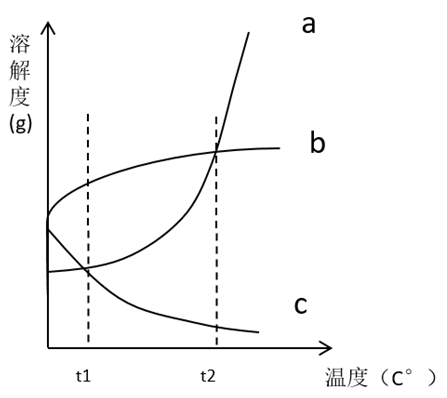

根据上图，下列表述正确的是（ ）。

①在t1～t2温度范围内，同一温度时，上述三种物质配制成的饱和溶液的浓度不可能全部相同

②温度升高时，有两种物质的饱和溶液质量（溶质析出后不计入溶液质量，下同）会减少

③将温度为t2时溶质质量相同的饱和溶液降温到t1，三种物质的溶液的质量关系是c＞b＞a

A. ①

B. ②③

C. ①③

D. ①②③

第 76 题 · 答案与解析

**参考答案（粉笔题库参考内容）**

C

**解析**

①溶解度是物质在一定的温度和压力下，溶质在一定量的溶剂中达到饱和时溶解的质量，一般以100克溶剂中能溶解溶质的质量来表示，饱和溶液浓度可以通过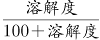计算。观察t1～t2 温度范围内，a、b、c三条温度曲线没有交点，因此，饱和溶液的浓度不可能全部相同；正确。

②c物质的溶解度随着温度的升高而减小，部分溶质会从溶液中析出，因此c物质的饱和溶液质量减小；而a、b两种物质的溶解度随着温度的升高而增大，不会有溶质从溶液中析出，因此a、b两种物质的溶液质量不变；错误。

③将温度为t2时溶质质量相同的饱和溶液降温到t1, 温度在t2时三种物质的溶解度由图可知为a=b＞c，在溶质相同的情况下，a、b饱和溶液质量相同，而c需要溶剂的量更多，溶液质量也更大，所以在t2时，三种物质的溶液质量关系为c＞a=b。当温度下降到t1时，c物质的溶解度增大，无溶质从溶液中析出，溶液质量与t2时相同。a、b物质的溶解度减小，溶质析出，溶液的质量也随之减小，而a物质溶解度减小的幅度大于b物质，a物质从溶液中析出的质量更多，溶液质量也减小得更多，所以在t1时，三种物质的溶液质量关系为c＞b＞a；正确。

故正确答案为C。

### 第 77 题

如图所示，长方体木块竖放在水平地板上，地板的粗糙程度相同。在木块的正中间施加一个缓慢增大的水平向右的力，则该木块会（ ）。

①静止一段时间后逐渐增速

②由静止突然快速移动

③在快速移动时突然向右倒下

④受到的摩擦力逐渐减少

A. ①③

B. ②③

C. ①③④

D. ②③④

第 77 题 · 答案与解析

**参考答案（粉笔题库参考内容）**

A

**解析**

水平向右的力缓慢增大，一开始力较小时，木块与地板之间存在摩擦，由于拉力较小，木块此时静止，此时木块受静摩擦力，静摩擦力随着拉力增大而逐渐增大。一段时间后，当拉力缓慢增大，大于木板和木块之间的最大静摩擦力时，此时木块在拉力的作用下由静止开始向右运动，此时木块受滑动摩擦力。滑动摩擦力大小只与接触面压力和动摩擦因数有关，由于木块的质量不变，对地板压力不变，且地板的粗糙程度相同，动摩擦因数不变，故木块受到的滑动摩擦力不变，在拉力逐渐增大的过程中，木块逐渐增速，不会突然快速移动，故①正确、②④错误。

由于拉力逐渐增大，在拉力大到一定程度时，由于向右拉力作用于木块中间，而木块底部受到向左的摩擦力，在力的作用下，木块会向右倾倒，故③正确。

故正确答案为A。

### 第 78 题

将一个圆锥体由腰部正中间截断成M1、M2，放在天平如图所示的位置。如果要使天平保持平衡，则M1需要（ ）。

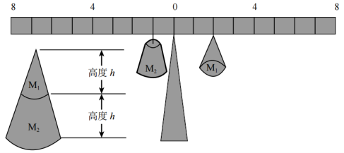

A. 右移5格

B. 右移4格

C. 右移1格

D. 左移1格

第 78 题 · 答案与解析

**参考答案（粉笔题库参考内容）**

A

**解析**

天平可以看成一个杠杆，杠杆平衡时，支点两侧，力与力臂的乘积相等。圆锥体的体积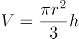 ，其中r是圆锥体底面半径，h是圆锥体高度。若小圆锥体M1的底面圆半径是整个大锥体的底面圆半径的一半，小圆锥体的高度是整个大锥体的高度的一半，则依据公式，小圆锥体积是整个大锥体的。因此大圆锥体被截断为M1和M2后，M2的质量是M1的7倍，M2的重力是M1的7倍。图中杠杆上，左侧M2的力臂为1格长度，因此右侧M1的力矩应为7格长度，才能达到平衡，M1需向右移动5格。

故正确答案为A。

### 第 79 题

为了研究唾液对淀粉的消化作用，实验员往装有5ml淀粉液的试管1和试管2中分别加入2ml清水和2ml唾液，再将试管1和试管2同时放入37℃的温水中水浴10分钟，冷却后往两支试管中滴入等量的碘液，则可以观察到（ ）。

A. 两支试管的溶液均为蓝色

B. 两支试管的溶液均为无色

C. 试管1的溶液为无色，试管2的溶液为蓝色

D. 试管1的溶液为蓝色，试管2的溶液为无色

第 79 题 · 答案与解析

**参考答案（粉笔题库参考内容）**

D

**解析**

唾液中含有唾液淀粉酶，能够分解淀粉。试管2的淀粉中加入了唾液，在接近人体温度的条件下，试管中的淀粉会被唾液淀粉酶分解。冷却后往两支试管中滴入等量的碘液，试管1中淀粉遇碘，溶液会变成蓝色，试管2中淀粉已分解，遇碘后溶液不会变蓝。

故正确答案为D。

### 第 80 题

声控灯是通过环境声音来控制开关的灯，当环境光线充足时，环境声音对灯不起作用；当光线较弱时，环境声音能够控制灯的开关。下图是声控灯的电路原理图，则在光线强、有声音的环境下，以下描述可能正确的是（ ）。

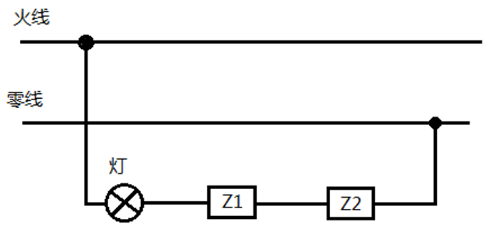

A. Z1是光敏元件，电阻很小；Z2是声敏元件，电阻很小

B. Z1是光敏元件，电阻很小；Z2是声敏元件，电阻无限大

C. Z1是声敏元件，电阻很小；Z2是光敏元件，电阻无限大

D. Z1是声敏元件，电阻无限大；Z2是光敏元件，电阻无限大

第 80 题 · 答案与解析

**参考答案（粉笔题库参考内容）**

C

**解析**

依据题意，结合声控灯原理图，环境光线充足时，环境声音对灯不起作用，说明此时光敏元件阻值无限大，造成电路断路；而光线较弱时，环境声音能够控制灯的开关，说明此时光敏元件阻值较小。环境有声音时，应该灯亮，电路是通路，说明此时声敏元件阻值很小；无声音时，应该灯灭，电路是断路，说明此时声敏元件阻值无限大。

所以在光线强、有声音的环境下，光敏元件电阻无限大，声敏元件电阻很小。

故正确答案为C。

### 第 81 题

如图所示，一人站立在小车上，小车静止于光滑的平面上，当此人将手中的篮球连续抛向小车右侧的护栏并接回，则小车会（ ）。

A. 保持静止

B. 向右匀速运动

C. 向右加速度运动

D. 左右摆动

第 81 题 · 答案与解析

**参考答案（粉笔题库参考内容）**

D

**解析**

方法一：

向右抛球时，篮球受人给它的向右作用力而向右运动，由于力的作用是相互的，人站在车上，作为一个整体，受到篮球向左的作用力，由于平面光滑，小车与平面没有摩擦力，因而人和小车会在向左的力的作用下运动。

当篮球与护栏碰撞并弹回时，篮球受到护栏向左的作用力，与此同时，篮球会给护栏向右的作用力，此时人和小车在这个力的作用下，会向右运动。

当人接到篮球并再次抛出时，将重复上述动作，因此小车会出现左右摆动的情况。

方法二：

将人、车、篮球三者看成整体，由于该整体所受合外力为零，因此满足动量守恒定律。刚开始整体静止于光滑平面上，其总动量为零，则在接下来的每一个瞬间，总动量都必须为零，因此若篮球具有向右的动量（即向右运动），则人与车必然具有向左的动量（即向左运动），这样才能使总动量为零。根据题意，篮球被连续抛出并接回，因此人与车也会左右摆动。

故正确答案为D。

### 第 82 题

一个边长为a的正方体木块漂浮在水池中，木块底部距离水面10厘米。如果将一个边长为2a的相同材质的正方体木块也放入该水池，则这一木块底部应距离水面（ ）。

A. 5厘米

B. 10厘米

C. 20厘米

D. 40厘米

第 82 题 · 答案与解析

**参考答案（粉笔题库参考内容）**

C

**解析**

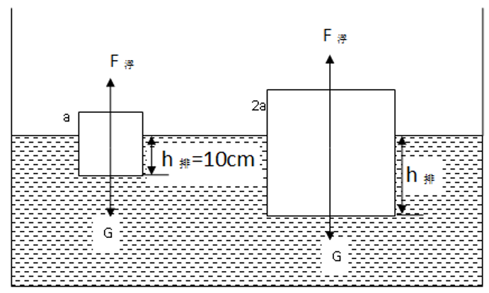

根据题意，正方体木块漂浮在水池中，其受到重力G和浮力F浮大小相等。根据浮力公式，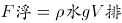，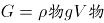。h排表示正方体底部与水面距离，则排开水的体积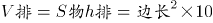，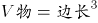，可得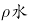：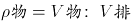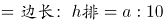。现在将边长为2a的相同材质正方体木块放入水中，木块同样漂浮，由于水和木块的密度都没有变，当木块边长为2a时，根据边长：h排=a:10，此时底部距离水面h排=20厘米。

故正确答案为C。

### 第 83 题

如图所示，以下说法正确的是（ ）。

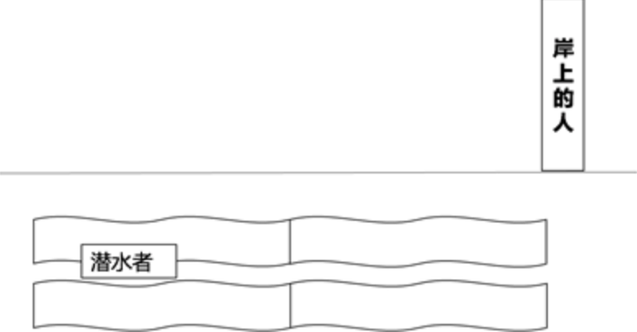

A. 潜水者看到的岸上的人比实际中更高；岸上的人看到的潜水者位置比实际更深

B. 潜水者看到的岸上的人比实际中更高；岸上的人看到的潜水者位置比实际更浅

C. 潜水者看到的岸上的人比实际中更矮；岸上的人看到的潜水者位置比实际更深

D. 潜水者看到的岸上的人比实际中更矮；岸上的人看到的潜水者位置比实际更浅

第 83 题 · 答案与解析

**参考答案（粉笔题库参考内容）**

B

**解析**

根据题干描述画出光路图如下：

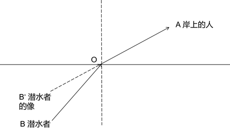

图一

如图一所示，潜水者发出的光线沿BO入射，在水与空气的交界面处O点发生折射，折射角大于入射角，进入空气中后，沿OA进入岸上的人的眼睛，岸上的人眼睛看到的像在AO延长线上B’处，所以岸上的人看到的潜水者的位置，比实际更浅。

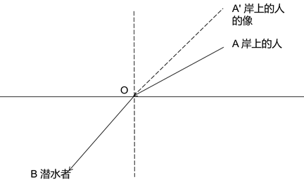

图二

如图二所示，岸上的人发出的光线沿AO入射，在空气与水的交界面处O点发生折射，折射角小于入射角，进人水中后，沿OB进入潜水者的眼睛，潜水者眼睛看到的像在BO做延长线上A’处，所以潜水者看到的岸上的人比实际中更高。

故正确答案为B。

### 第 84 题

一辆汽车沿着笔直的公路行驶，其速度v随时间t的变化关系如图所示。下列选项表述正确的是（ ）。

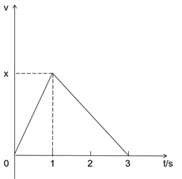

A. 0～1s内的加速度大于2～3s内的加速度

B. 0～1s内的位移大于1～2s内的位移

C. 0～2s内的平均速度等于1～3s内的平均速度

D. 0～3s内汽车的运动方向出现过变化

第 84 题 · 答案与解析

**参考答案（粉笔题库参考内容）**

A

**解析**

汽车沿笔直公路行驶，由题图可知，0～1s，速度均匀增加，汽车做匀加速直线运动，1～3s，速度均匀减少，汽车做匀减速直线运动。

A项， 0～1s，速度由0增加为x用时1秒，加速度大小为x，1～3s，速度由x减少为0用时2秒，加速度大小为，所以2～3s加速度大小为，0～1s内加速度大于2～3s内加速度，正确；

B项，则0～1s内的位移如图一中阴影部分面积，即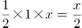；

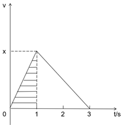

图一

则1～2s内的位移如图二中阴影部分面积，由于汽车在1～3s内做匀减速运动，则2s时的速度为，则1～2s内的位移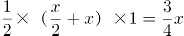；

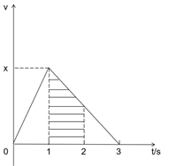

图二

0～1s内的位移小于1～2s内位移，错误；

C项，0～2s内的平均速度为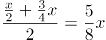，1～3s内的平均速度为，0～2s内的平均速度大于1～3s内的平均速度，错误；

D项，0～3s汽车的速度均为正值，说明汽车的运动方向未发生变化，错误。

故正确答案为A。

### 第 85 题

研究者在某地区调查A物种的生存状况，结果发现A物种在暗处和明处均有分布，其外表有深色和浅色之分。研究者在调查后推断，该地区A物种的天敌可能是利用视觉捕食A物种。下图中最有可能反映研究者调查结果的是（ ）。

A. 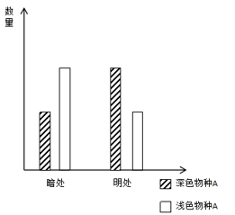

B. 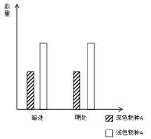

C. 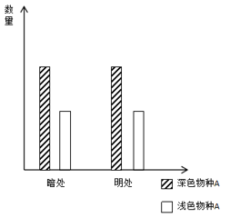

D. 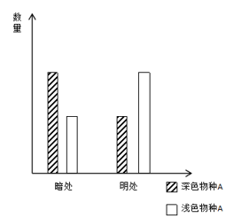

第 85 题 · 答案与解析

**参考答案（粉笔题库参考内容）**

D

**解析**

A物种的天敌可能是利用视觉来捕食A物种，那么在暗处的深色A物种，在明处的浅色A物种更易生存。因此暗处A物种应当深色多，明处A物种应当浅色多，观察选项，只有D选项符合。

故正确答案为D。

## 材料 1

近年来，随着互联网、云计算、大数据以及社交媒体应用的快速发展，我国电子政务也发展迅速。2018年我国电子政务市场规模3106.9亿元，同比2017年的2861.8亿元增长了8.6%。

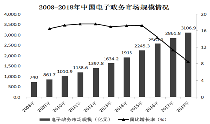

我国电子政务市场主要有硬件、网络设备、软件以及服务等四个细分市场。近年来，我国电子政务市场整体呈现硬件市场规模占比不断下降，而软件及服务市场占比不断上升的趋势。

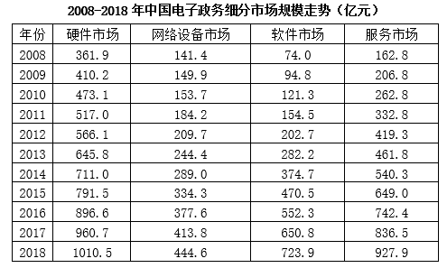

### 第 86 题

根据2018年的增长率预测，2019年我国电子政务市场的规模约为（ ）亿元。

A. 3270

B. 3370

C. 3470

D. 3570

第 86 题 · 答案与解析

**参考答案（粉笔题库参考内容）**

B

**解析**

由题干“根据2018年的增长率预测，2019年我国电子政务市场的规模约为多少亿元”，判定本题为现期计算问题。结合文字材料第一段，2018年我国电子政务市场规模3106.9亿元，同比增长8.6%。则2019年我国电子政务市场的规模约为3106.9×（1+8.6%）≈3106.9+30×8.6≈3365亿元，与B项最为接近。

故正确答案为B。

### 第 87 题

2018年，中国电子政务四个细分市场中，占比最大的是（ ）。

A. 硬件市场

B. 网络设备市场

C. 软件市场

D. 服务市场

第 87 题 · 答案与解析

**参考答案（粉笔题库参考内容）**

A

**解析**

由题干“2018年，电子政务四个细分市场中，占比最大的是”，判定本题为现期比重问题。结合表格，可得2018年，硬件市场、网络设备市场、软件市场、服务市场规模分别为：1010.5亿元、444.6亿元、723.9亿元、927.9亿元。因2018年中国电子政务市场规模为定值，故上述四个细分市场规模越大，占比越大，则硬件市场占比最大。

故正确答案选A。

### 第 88 题

下列选项能够正确反映当年四个细分市场占比的是（ ）。

A. 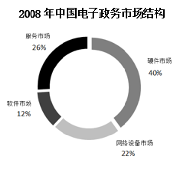

B. 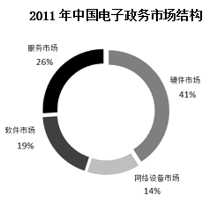

C. 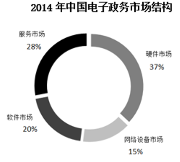

D. 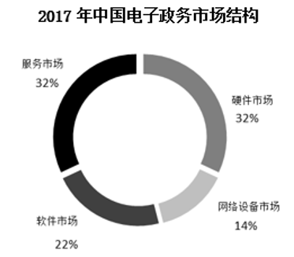

第 88 题 · 答案与解析

**参考答案（粉笔题库参考内容）**

C

**解析**

由题干“下列哪项能够正确反映当年四个细分市场占比的是”，判定本题为现期比重问题。结合图形和表格材料，代入选项验证：

A项：2008年中国电子政务市场规模740亿元，软件市场规模74亿元，占比应为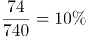，并非12%，错误；

B项：2011年中国电子政务市场中网络设备市场规模184.2亿元、软件市场规模154.5亿元，网络设备市场占比应大于软件市场，而选项中14%<19%，错误；

C项：2014年中国电子政务市场规模1915亿元，硬件市场规模711亿元，占比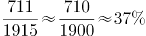；网络设备市场规模289亿元，占比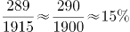；软件市场规模374.7亿元，占比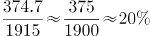；服务市场规模540.3亿元，占比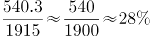，全部符合，正确；

D项：2017年中国硬件市场规模960.7亿元，服务市场规模863.5亿元。2017年硬件市场规模和服务市场规模不同，则在中国电子政务市场规模中的占比应不同，而图中两者占比均为32%，错误。

故正确答案选C。

### 第 89 题

下列选项中，能够正确反映四个细分市场同比增长率的是（ ）。

A. 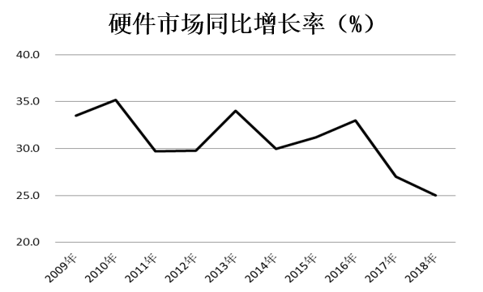

B. 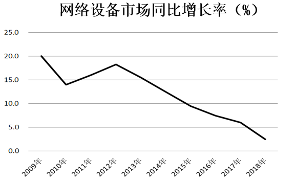

C. 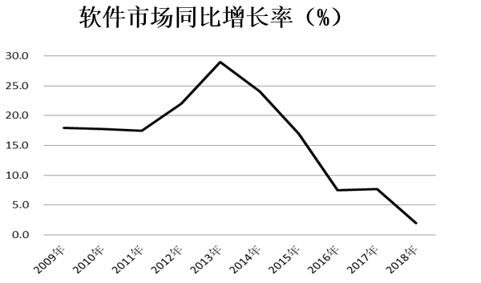

D. 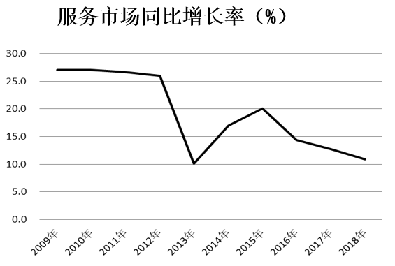

第 89 题 · 答案与解析

**参考答案（粉笔题库参考内容）**

D

**解析**

由题干“能够正确反映四个细分市场同比增长率的是”，判定本题为一般增长率问题。结合表格材料，代入选项验证：

A项：硬件市场同比增长率，2008年硬件市场规模361.9亿元，2009年硬件市场规模410.2亿元，则2009年硬件市场同比增长率为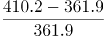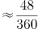，与图形表述不符，错误；

B项：网络设备市场同比增长率，2008年网络设备市场规模141.4亿元，2009年网络设备市场规模149.9亿元，则2009年网络设备市场同比增长率为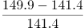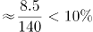，与图形表述不符，错误；

C项：软件市场同比增长率，2008年软件市场规模74.0亿元，2009年软件市场规模94.8亿元，则2009年软件市场同比增长率为，与图形表述不符，错误。

A、B、C三项均错误，D项不需逐年验证，利用排除法可知D项正确。

故正确答案选D。

### 第 90 题

下列说法错误的是（ ）。

A. 2015年，我国电子政务市场首次突破两千亿元大关

B. 从2013年开始，软件市场的规模始终大于网络设备市场

C. 2008—2018年，我国电子政务市场的年均复合增长率约为19%

D. 2008—2018年，硬件市场与服务市场规模差距最小的一年是2018年

第 90 题 · 答案与解析

**参考答案（粉笔题库参考内容）**

C

**解析**

A项：结合图形材料，2009 -2015年，我国电子政务市场规模逐年递增，到2015年时，市场规模达到2245.3亿元，首次超过两千亿元，正确；

B项：结合表格材料，2008年-2012年，软件市场的规模低于网络设备市场，从2013年开始，软件市场的规模一直高于网络设备市场，正确；

C项：结合图形材料，2008年我国电子政务市场规模740亿元，2018年我国电子政务市场规模3106.9亿元，年份差为2018-2008=10，代入年均增长率公式：，可得。若r=19%，，，，，与4.2相差较多，错误；

D项：结合表格材料，2018年硬件市场与服务市场规模差距为1010.5-927.9<100亿元，2008-2017年，硬件市场与服务市场规模差距均超过100亿元，故硬件市场与服务市场规模差距最小的一年是2018年，正确。

本题为选非题，故正确答案选C。

## 材料 2

近年来，我国海洋经济呈现总体平稳的发展态势，总量再上新台阶，产业结构不断优化，新兴产业和新业态快速成长。

2018年，我国主要海洋产业保持稳步增长，全年实现产值33609亿元，比上年增长4.0%。滨海旅游业、海洋交通运输业和海洋渔业作为海洋经济发展的支柱产业，其产值占主要海洋产业产值的比重分别为47.8%、19.4%和14.3%。海洋生物医药业、海洋电力业这两个新兴产业产值增速领先，分别达9.6%、12.8%。

注释：部分数据因四舍五入，存在着总计与分项合计不等的情况。

### 第 91 题

2018年我国海洋生产总值较2015年增加了约（ ）。

A. 8.7%

B. 19.7%

C. 27.3%

D. 37.4%

第 91 题 · 答案与解析

**参考答案（粉笔题库参考内容）**

C

**解析**

由题干“2018年······较2015年增加了约”，结合选项为百分数，可判定本题为一般增长率计算问题。定位图形材料，2015年、2018年全国海洋生产总值分别为65534亿元、83415亿元。根据公式：增长率，则所求，与C项最接近。

故正确答案为C。

### 第 92 题

2018年，我国海洋经济发展支柱产业产值约为（ ）万亿元。

A. 1.61

B. 2.36

C. 2.74

D. 3.32

第 92 题 · 答案与解析

**参考答案（粉笔题库参考内容）**

C

**解析**

方法一：由题干“2018年，我国海洋经济发展支柱产业产值约为······”，结合材料中给出海洋经济发展支柱产业的占比，可判定本题为现期比重计算问题。定位文字材料第二段，可知2018年主要海洋产业产值为33609亿元，滨海旅游业、海洋交通运输业、海洋渔业等海洋经济发展支柱产业的产值占主要海洋产业产值的比重分别为47.8%、19.4%、14.3%。根据公式：部分量=总体量×比重，则所求=主要海洋产业产值×海洋经济发展支柱产业的占比=33609×(47.8%+19.4%+14.3%)=33609×81.5%≈34000×80%=27200亿元=2.72万亿元，与C项最接近。

方法二：定位文字材料第二段，可知滨海旅游业、海洋交通运输业和海洋渔业是海洋经济发展的支柱产业，定位表格材料，可知2018年滨海旅游业、海洋交通运输业、海洋渔业的产值分别为16078、6522、4801亿元，则所求=16078+6522+4801≈16100+6500+4800=27400亿元=2.74万亿。

故正确答案为C。

### 第 93 题

2017年，我国海洋船舶工业产值约比海洋化工业产值（ ）亿元。

A. 少50

B. 少20

C. 多50

D. 多20

第 93 题 · 答案与解析

**参考答案（粉笔题库参考内容）**

D

**解析**

由题干“2017年，······比······亿元”，结合材料时间为2018年，可判定本题为基期和差问题。定位表格材料，可知2018年我国海洋船舶工业与海洋化工业的产值分别为997亿元与1119亿元，同比增速分别为-9.8%与3.1%。根据公式：基期量，则所求=2017年我国海洋船舶工业产值-2017年我国海洋化工业产值=≈1100-1080=20亿元，即多20亿元。

故正确答案为D。

### 第 94 题

如果2019年我国海洋新兴产业保持2018年的增速，则2019年我国海洋新兴产业产值将比2017年多约（ ）。

A. 22%

B. 27%

C. 32%

D. 37%

第 94 题 · 答案与解析

**参考答案（粉笔题库参考内容）**

A

**解析**

由题干“······，2019年······比2017年多约”，结合选项为百分数，可判定本题为间隔增长率计算问题。定位文字材料第二段可知，海洋生物医药业与海洋电力业为我国海洋新兴产业；定位表格材料，可知2018年海洋生物医药业与海洋电力业的产值分别为413亿元与172亿元，同比增速分别为9.6%与12.8%。

方法一：设我国海洋新兴产业2018年同比增速为r，且其由2018年海洋生物医药业与海洋电力业的同比增速混合得到。根据线段法，距离与量成反比，则，解得r≈10.9%。若2019年我国海洋新兴产业保持2018年的增速，即均为10.9%，根据公式：间隔增长率，则所求=10.9%+10.9%+10.9%×10.9%≈21.8%+11%×11%=21.8%+1.21%=23.01%，与A项最接近。

备注：此处 用现期之比代替基期比进行计算。

方法二：如果2019年保持2018年的增速，结合间隔增长率，2019年海洋生物医药业产值比2017年增长率为9.6%+9.6%+9.6%×9.6%≈19.2%；2019年海洋电力业产值比2017年增长率为12.8%+12.8%+12.8%×12.8%≈27.0%。根据混合增长率的口诀，总体增长率居中，且偏向基数较大的。故我国海洋新兴产业2019年比2017年的增长率在19.2%—27.0%之间，且较接近19.2%，仅22%满足。

故正确答案为A。

### 第 95 题

以下说法正确的是（ ）。

A. 2017年，我国主要海洋产业中产值最小的是海洋盐业

B. 2015—2018年，我国海洋生产总值增量最少的是2016年

C. 2014—2018年，我国海洋经济在国民经济中的比重越来越大

D. 2018年，我国海洋科研教育管理服务业产值比上年增长超过0.2万亿元

第 95 题 · 答案与解析

**参考答案（粉笔题库参考内容）**

B

**解析**

A项：定位表格材料，可知2018年主要海洋产业的产值情况。根据公式：基期量，则2017年海洋盐业产值，而2017年海水利用业产值，2017年海洋盐业产值不是最小，错误；

B项：定位图形材料，可知2014年-2018年全国海洋生产总值。2015年全国海洋生产总值增量=65534-60699=4835亿元；2016年=69694-65534=4160亿元；2017年=76749-69694=7055亿元；2018年=83415-76749=6666亿元。2016年全国海洋生产总值同比增量最少，正确；

C项：定位图形材料，可知2014年与2015年我国海洋经济在国民经济中的比重持平，并非越来越大，错误；

D项：定位表格材料，可知2018年我国海洋科研教育管理服务业产值为19356亿元，同比增长10.2%。根据公式：增长量，则2018年我国海洋科研教育管理服务业产值同比增量亿元=0.176万亿元＜0.2万亿元，错误。

故正确答案为B。

## 材料 3

2018年，广东实现地区生产总值97277.77亿元，按可比价格计算，同比增长6.8%，人均生产总值为86412元，比全国平均水平多21891元，按年平均汇率折算，达到13058.30美元。全省经济运行保持在合理区间。

分产业看，广东省第一产业实现生产值3831.44亿元，同比增长4.2%，增幅同比提高0.7个百分点；第二产业实现生产值40695.15亿元，同比增长5.9%，增幅同比回落0.8个百分点；第三产业实现生产值52751.18亿元，同比增长7.8%，增幅同比回落0.8个百分点。三大产业结构约为4.0：41.8：54.2。

### 第 96 题

2017年广东规模以上工业增加值约占全国的（ ）。

A. 6.6%

B. 8.6%

C. 10.6%

D. 12.6%

第 96 题 · 答案与解析

**参考答案（粉笔题库参考内容）**

C

**解析**

由题干“2017年广东···占全国···”，结合材料时间为2018年，可判定本题为基期比重计算问题。定位表格材料，2018年广东规模以上工业增加值为3.23万亿元（A），同比增长6.3%（a）；全国规模以上工业增加值为30.52万亿元（B），同比增长6.2%（b）。根据基期比重公式：，可计算出2017年广东规模以上工业增加值约占全国比重10%，与C项最接近。

故正确答案为C。

### 第 97 题

2018年，广东社会消费品零售总额同比增幅较全国平均水平约（ ）。

A. 高0.1个百分点

B. 低0.2个百分点

C. 低4.6个百分点

D. 高4.8个百分点

第 97 题 · 答案与解析

**参考答案（粉笔题库参考内容）**

B

**解析**

定位表格材料，2018年，广东社会消费品零售总额同比增长8.8%；全国平均水平为同比增长9.0%。可以计算出8.8%-9.0%=-0.2%，即2018年，广东社会消费品零售总额同比增幅较全国平均水平约低0.2个百分点。

故正确答案为B。

### 第 98 题

2018年全国进出口总额较2017年增加约（ ）万亿元。

A. 1.2

B. 2.7

C. 4.2

D. 5.7

第 98 题 · 答案与解析

**参考答案（粉笔题库参考内容）**

B

**解析**

由题干“2018年···较2017年增加···万亿元”，可判定本题为增长量计算问题。定位表格材料，2018年全国进出口总额为30.51万亿元，同比增长9.7%。根据增长量公式：，可计算出2018年全国进出口总额较2017年的增长量万亿元，与B项最接近。

故正确答案为B。

### 第 99 题

2016年广东省三大产业结构约为（ ）。

A. 4.2：42.6：53.2

B. 4.1：41.6：54.3

C. 3.9：42.2：53.9

D. 无法推测

第 99 题 · 答案与解析

**参考答案（粉笔题库参考内容）**

A

**解析**

由题干“2016年广东省三大产业结构···”，结合材料时间是2018年，选项为比例，可判定本题为间隔基期量比值计算问题。定位文字材料第二段，广东省第一产业实现生产值3831.44亿元，同比增长4.2%，增幅同比提高0.7个百分点；第二产业实现生产值40695.15亿元，同比增长5.9%，增幅同比回落0.8个百分点；第三产业实现生产值52751.18亿元，同比增长7.8%，增幅同比回落0.8个百分点。三大产业结构约为4.0：41.8：54.2。

方法一：

根据间隔基期量公式：，可计算出：

2016年第一产业实现生产值亿元；

2016年第二产业实现生产值亿元；

2016年第三产业实现生产值亿元。

又比重，由此可以计算出第一产业的比重，只有A项满足，故2016年广东省三大产业结构约为3560：36100：45300≈4.2：42.6：53.2。

方法二：

首先根据所给数据可以通过间隔基期计算出相关数据，可以推出，排除D项。三个产业的结构之比就是三个产业分别占GDP的比重。材料第二段给出2018年三个产业的比例，通过计算出三个产业间隔增长率，第一产业增长率a最小，根据混合增长率的结论，一定小于总体增长率b，又根据两期比重的结论，2018年的比重＜2016年的比重，即2016年比重肯定大于2018年的4%，排除C项；同理，第三产业增长率最高，所以2018年的比重＞2016年的比重，即2016年占比小于2018年的54.2%，排除B项。只有A项满足。

故正确答案为A。

### 第 100 题

①②③④描述的均为客观事实，其中能够从材料中得出的有（ ）。

①2018年广东省GDP占全国比重较2017年有所增加

②2018年全年人民币兑美元平均汇率约为6.6

③2018年中国总人口约为13.95亿

④以可比价格计算，2017年广东省GDP同比增长率达7.5%

A. ①

B. ①③

C. ①②③

D. ①②③④

第 100 题 · 答案与解析

**参考答案（粉笔题库参考内容）**

D

**解析**

根据题干表述，四个说法均为客观事实，因此无需置疑数据，本题只需要分析材料中是否有相关数据能支持该表述即可。

①定位表格材料，2018年广东省GDP为9.73万亿元，同比增长6.8%（a）；全国GDP为90.03万亿元，同比增长6.6%（b）。根据两期比重的结论，分子增长率a（6.8%）＞分母增长率b（6.6%），则2018年广东省GDP占全国比重较2017年有所增加。正确；

②定位文字材料第一段，2018年，······人均生产总值为86412元，······按年平均汇率折算，达到13058.30美元。故人民币兑美元平均汇率。正确；

③定位文字材料第一段，2018年，广东······人均生产总值为86412元，比全国平均水平多21891元······；定位表格材料，2018年全国GDP为90.03万亿元。根据人均生产总值，则2018年中国总人口。正确；

④定位文字材料第一段，2018年，广东实现地区生产总值97277.77亿元，按可比价格计算，同比增长6.8%，则2017年广东省GDP；定位文字材料第二段，分产业看，广东省第一产业实现生产值3831.44亿元，同比增长4.2%，增幅同比提高0.7个百分点；第二产业实现生产值40695.15亿元，同比增长5.9%，增幅同比回落0.8个百分点；第三产业实现生产值52751.18亿元，同比增长7.8%，增幅同比回落0.8个百分点。全省GDP=第一产业+第二产业+第三产业实现生产值，则2016年广东省GDP，2017年广东省GDP同比增长率。正确。

综上，正确的是①②③④。

故正确答案为D。

