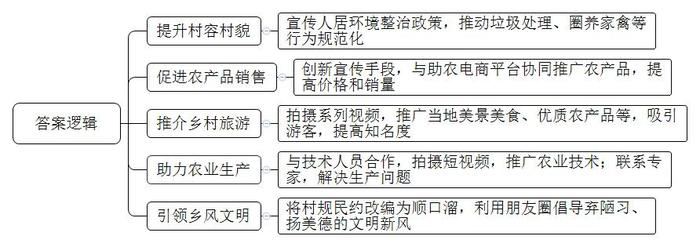
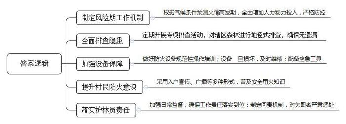
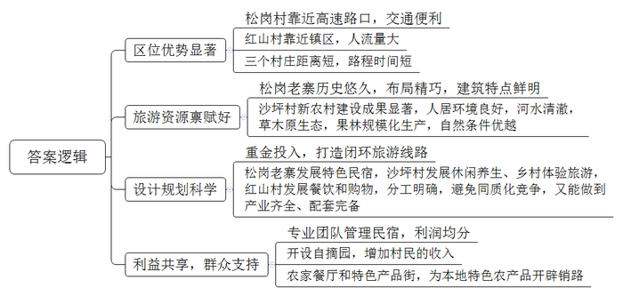
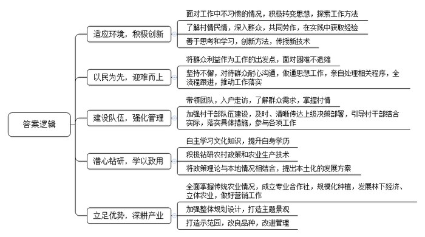

# 2021年广东省公考《申论》题（乡镇）

> 候选采集稿。参考答案及解析来自粉笔页面，不代表官方答案或真实高分答卷；来源使用许可与原卷对应关系仍需人工核实。

## 给定材料

### 材料 material-6347d1e091bd968d

“脱贫摘帽不是终点，而是新生活、新奋斗的起点。”在全国脱贫攻坚总结表彰大会上，习近平总书记强调“我们没有任何理由骄傲自满、松劲歇脚，必须乘势而上、再接再厉、接续奋斗”。民族要复兴，乡村必振兴。全面建设社会主义现代化国家，实现中华民族伟大复兴，最艰巨最繁重的任务依然在农村，最广泛最深厚的基础依然在农村。巩固拓展脱贫攻坚成果，接续推进乡村振兴，就是要全面推进乡村产业、人才、文化、生态、组织振兴，促进农业高质高效、乡村宜居宜业、农民富裕富足，为全面建设社会主义现代化国家开好局、起好步提供有力支撑。广大乡镇基层干部在乡村振兴中发挥着重要作用，小江（化名）就是其中的一员。小江在松岭镇党政办工作，并且驻点联系南津村。自2019年入职以来，小江养成了写日记的习惯，记录自己的工作、生活。以下摘录了小江的几篇日记。

### 材料 material-69b00254e38ff159

2020年12月4日 星期五 晴

好久没有下雨了，晴朗的天气加上干冷的北风，森林防灭火的形势异常严峻。

真是怕什么来什么，南津村罗书记突然来了电话，说村民报告岗南自然村山林地发生了山火，浓烟很远就能看到，看起来火势不小。我问罗书记，前几天镇里刚组织了森林防灭火隐患排查，为什么这个风险隐患点没有报上来？罗书记说，当时主要排查了偏远的地方，漏掉了这个点。我让他赶紧组织人员，带上打火工具，前往灭火。

我边打电话给林副镇长汇报山火的基本情况，边赶往现场。林副镇长说他正在往现场赶，让我马上通知镇林业站、消防队等赶紧去。

路上，我给镇林业站叶站长打了电话，他正带着镇上的护林员赶往现场，但问题是没有灭火用的风机。我一听就急了，前几天不是刚配了两台新的风机吗？这可是灭火的必备工具。叶站长解释道，前几天搞防灭火演练的时候，由于新来的护林员还没经过培训，操作不当把仅有的两台风机弄坏了，没来得及修。

我赶到现场时，林副镇长正带着大家救火，消防队带着3台风机过来了，火很快就被扑灭了。从现场看，起火的原因是村民以为焚烧秸秆应该不会发生多大的问题，不小心把旁边的杂草烧起来了。

林副镇长质问道，烧秸秆没有人看护会引起山火，难道你们不知道吗？护林员去哪了？难道没有巡查？叶站长解释说护林员是新来的，对这边地理环境不熟悉，可能没有巡到这里。

救完火回到村委会，林副镇长提出了严厉的批评，虽然这次有惊无险，但也暴露出我们日常工作中存在的一些问题，要认真反思，吸取教训。

森林灭火工作，真的是任重而道远啊。

### 材料 material-c528c0da2c1a207a

2019年11月6日 星期三 多云

到松岭镇党政办工作已经两个月了。副主任李姐告诉我，党政办是综合性部门，新来的公务员一般都会被安排在党政办工作一段时间，这样可以更好地了解乡镇工作，更快进入工作状态。

两个月来，我对松岭镇有了更多了解。松岭镇是一个山区镇，以农业种植为主，人口4.7万。全镇7万多亩山地，种有4.4万亩，是一个山清水秀的地方。实施乡村振兴战略以来，镇里做了很多工作，发展很快，下一步还谋划打造具有浓厚乡村特色的松岗—沙坪—红山乡村旅游示范片区：紧紧围绕荔枝这一主导产业，从种植—加工—销售全产业链发力，加大联农惠农力度，全面推动农业增产和农民增收，打造荔枝重镇。

上周，我被安排驻点联系南津村。这些天，我只要一有时间就去村里走走看看，协助南津村罗书记工作。村里的工作，对我来说，仿佛打开了一扇新世界的大门。

### 材料 material-63f10471ccea0e89

2021年1月22日 星期五 多云

很快就要过年了。目前的疫情防控形势总让人有些担心。

这几天，每天都要去一趟南津村，协助罗书记做好返乡人员登记管理工作，村干部都在联系在外地的村民，告诉他们返乡政策，倡导留在当地过年。在我们的倡导下，有不少村民打消了回村过年的念头，决定留在当地。当然，也有人放心不下家里的老人孩子，准备回来。

回到镇上，我接到珠三角一家企业打来的电话。原来，我们镇有不少村民在这家企业工作，企业要为过年不回家职工的家人送上“年货大礼包”，近期将通过专车送来，希望我们协助派发。真暖心！

今天，我还陪同欧书记到镇上企业，了解春节期间员工就地过年情况。食品加工厂厂长介绍，厂里有部分员工是外地的，春节大多数都选择留在松岭过年。厂里本来安排了聚餐，因为疫情防控要求，取消了。但是食堂会照常开放，保障他们的日常饮食，还根据镇里的倡议，为他们准备了丰富的年货。

每逢佳节倍思亲，团聚是中国人骨子里的文化信仰，更是不可替代的情感需要。很多人选择就地过年，是为自己为家人的健康着想，更是响应国家号召。

### 材料 material-3ec8fa1f845ba11f

2021年3月2日 星期二 小雨

今天，参加了镇里召开的年轻干部座谈会。会上，几位优秀干部做了交流发言，分享了他们的工作体会和经验做法。他们各有特点，都在自己的工作岗位上干得很好。

老东村书记助理刘涛：家在市里，2018年大学毕业后考了选调生，被安排到老东村任书记助理。他刚到村里的时候，有点不习惯，很茫然。在镇里组织委员的帮助下，很快转变思想，找到了工作方法，一头扎进了基层工作。他积极了解老东村的村情民情，和村里的老农在不同季节一起去施肥喷药，经常和乡亲们一起研究果树种植的事。慢慢地，他对村里的发展有了自己的思考，提出不少新方法，他自学后，还将不少种植新技术介绍给了果农。

东新村陈书记：当初村里准备修建文体广场的时候，广场周围有几间房子要拆迁，几分田要占用，还有个小作坊要搬迁，这几户人家都不同意，一时很难解决，大家都劝陈书记多一事不如少一事。但他认为，文体广场建起来后，不仅使村民有了休闲、运动的好去处，村容村貌也会得到改观，这是一件好事，再大的困难也要解决。后来，陈书记跑这家跑那家，反复做工作，跑镇里跑县里走程序，最终把文体广场给建起来了。

松岗村驻村工作组组长东哥：驻村后，他带着工作组几个人经常挨家进户，跟村民拉家常，了解群众所想所盼，熟悉村里的情况。及时把上级决策部署、工作传达给村干部，力求让每个干部都弄清楚，一同结合实际情况，落实具体措施，积极参与到村各项工作中，指导做好人居环境整治、消防安全、山林防火等。松岗村的各项社会管理工作都排在全镇前列。

镇农业推广中心刘副主任：农校毕业后，自学读了本科。一直在农业技术推广战线“钻研政策、钻研荔枝”。无论是“三农”工作的各项政策，还是农业生产的各种技术，他都能侃侃而谈。特别是广东省印发了荔枝产业高质量发展三年行动计划后，他潜心钻研，结合本镇实际，提出了镇荔枝产业三年发展方案。其中的措施得到了镇里的充分肯定。

农业赵副镇长：对全镇荔枝种植情况了如指掌，对松岭的荔枝发展有很多想法和做法。他引导果农成立荔枝合作社，进行规模化种植和营销，发展荔枝园套种中药材、林下养鸡、养蜂蜜等多种林下经济。对镇农场200多亩荔枝林进行规划设计，建设一个荔枝公园；圈定30亩荔枝园进行提升改造，改良品种，改进管理，打造一个良种示范园。他多次被评为市、县“优秀共产党员”。

## 题目

### 第 1 题

**根据给定材料，简要说明****“乡村新闻官”在推动农业农村发展中的作用。（****15****分）**

关联材料：材料 material-6347d1e091bd968d

作答要求：

要求：紧扣材料，分析全面，表达准确；篇幅不超过200字。

### 第 2 题

**根据给定材料，针对****2020****年****12****月****4****日南津村火情暴露出的问题，提出解决建议。（****15****分）**

关联材料：材料 material-69b00254e38ff159

作答要求：

要求：符合实际，切实可行，有针对性；篇幅不超过200字。

### 第 3 题

**根据给定材料，你认为松岭镇打造松岗****—沙坪—红山乡村旅游示范片区具有哪些有利条件？（****20****分）**

关联材料：材料 material-c528c0da2c1a207a

作答要求：

要求：考虑全面，分析透彻，条理清晰；篇幅不超过300字。

### 第 4 题

**根据给定材料，总结松岭镇在春节期间引导群众就地过年，做好服务保障工作方面的主要做法。（20分）**

关联材料：材料 material-63f10471ccea0e89

作答要求：

要求：概括全面，符合实际，条理清晰；篇幅不超过300字。

### 第 5 题

**2021****年****3****月****2****日座谈会上，几位优秀干部做了交流发言。假如你是小江，你从他们身上可以学到什么？根据给定材料简要说明。（****30****分）**

关联材料：材料 material-3ec8fa1f845ba11f

作答要求：

要求：观点正确，理解深刻，条理清晰；篇幅不超过400字。

## 答案与解析

第 1 题

**参考答案（粉笔题库参考内容）**

1.提升村容村貌。宣传人居环境整治政策，推动垃圾处理、圈养家禽等行为规范化。

2.促进农产品销售。创新宣传手段，与助农电商平台协同推广农产品，提高价格和销量。

3.推介乡村旅游。拍摄系列视频，推广当地美景美食、优质农产品等，吸引游客，提高知名度。

4.助力农业生产。与技术人员合作，拍摄短视频，推广农业技术；联系专家，解决生产问题。

5.引领乡风文明。将村规民约改编为顺口溜，利用朋友圈倡导弃陋习、扬美德的文明新风。

**解析**

**参考答案说明：**本参考答案在内容上，从“提升村容村貌”“促进农产品销售”“推介乡村旅游”“助力农业生产”“引领乡风文明”等不同方面进行了分条撰写，各条答案要点之间在内容上相互并列，没有交叉。

**考点**：考点影响类

**来源**：来源2021年广东省公考《申论》题（乡镇）

粉笔申论页面对本题只提供「解析视频」入口，该入口是会员推广位，页面无视频地址与文字解析。

第 2 题

**参考答案（粉笔题库参考内容）**

1.制定风险期工作机制。根据气候条件预测火情高发期，全面增加人力物力投入，严格防控。

2.全面排查隐患。定期开展专项排查活动，对辖区森林进行地毯式排查，确保无遗漏。

3.加强设备保障。做好防火设备规范性操作培训；设备一旦损坏，及时维修；配备应急工具。

4.提升村民防火意识。采用入户宣传、广播等多种形式，普及安全用火知识。

5.落实护林员责任。加强日常监督，确保工作责任落实到位；制定问责机制，对失职者严肃惩处。

**解析**

**参考答案说明：**本参考答案从“制定风险期工作机制”“全面排查隐患”“加强设备保障”“提升村民防火意识”“落实护林员责任”五个方面进行了分条撰写。各条要点之间在内容上相互并列，没有交叉。

**考点**：考点提出对策类

**来源**：来源2021年广东省公考《申论》题（乡镇）

粉笔申论页面对本题只提供「解析视频」入口，该入口是会员推广位，页面无视频地址与文字解析。

第 3 题

**参考答案（粉笔题库参考内容）**

1.区位优势显著。松岗村靠近高速路口，交通便利；红山村靠近镇区，人流量大；三个村庄距离短，路程时间短。

2.旅游资源禀赋好。松岗老寨历史悠久，布局精巧，建筑特点鲜明；沙坪村新农村建设成果显著，人居环境良好，河水清澈，草木原生态，果林规模化生产，自然条件优越。

3.设计规划科学。重金投入，打造闭环旅游线路；松岗老寨发展特色民宿，沙坪村发展休闲养生、乡村体验旅游，红山村发展餐饮和购物，分工明确，避免同质化竞争，又能做到产业齐全、配套完备。

4.利益共享，群众支持。专业团队管理民宿，利润均分；开设自摘园，增加村民的收入；农家餐厅和特色产品街，为本地特色农产品开辟销路。

**解析**

**参考答案说明：**本参考答案从“区位优势显著”“旅游资源禀赋好”“设计规划科学”“利益共享，群众支持”四个方面进行了分条撰写。各条答案要点之间在内容上相互并列，没有交叉。

**考点**：考点原因类

**来源**：来源2021年广东省公考《申论》题（乡镇）

粉笔申论页面对本题只提供「解析视频」入口，该入口是会员推广位，页面无视频地址与文字解析。

第 4 题

**参考答案（粉笔题库参考内容）**

1.鼓励就地过年。联系在外村民，告知返乡政策，倡导留在当地过年，并协助村民所在企业，为职工家属派发年货礼包；了解外地员工情况，开放企业食堂，保障饮食供给，倡导企业提供丰富年货。

2.开展慰问服务。组织党群志愿者服务队，走访留守儿童、空巢老人等特殊人群，通过送礼物、聊天等形式，给予上门服务和精神关怀。

3.保障物资供应。了解市场、超市运营情况，关注商品价格变动，确保货物种类丰富、备货充足、补货及时，保障群众需求。

4.开展疫情防控。对返乡人员登记、摸查；宣传防疫知识；引导群众减少聚集性活动，开展线上传统民俗活动；避免过度防疫，确保村民出行方便。

**解析**

**参考答案说明：**本参考答案从“鼓励就地过年”“开展慰问服务”“保障物资供应”“开展疫情防控”等四个方面进行了分条撰写。各条答案要点之间在内容上相互并列，没有交叉。

**考点**：考点概括措施类

**来源**：来源2021年广东省公考《申论》题（乡镇）

粉笔申论页面对本题只提供「解析视频」入口，该入口是会员推广位，页面无视频地址与文字解析。

第 5 题

**参考答案（粉笔题库参考内容）**

一、适应环境，积极创新。面对工作中不习惯的情况，积极转变思想，探索工作方法；了解村情民情，深入群众，共同劳作，在实践中获取经验；善于思考和学习，创新方法，传授新技术。

二、以民为先，迎难而上。将群众利益作为工作的出发点，面对困难不退缩；坚持不懈，对待群众耐心沟通，做通思想工作，亲自处理相关程序，全流程跟进，推动工作落实。

三、建设队伍，强化管理。带领团队，入户走访，了解群众需求，掌握村情；加强村干部队伍建设，及时、清晰传达上级决策部署，引导村干部结合实际，落实具体措施，参与各项工作。

四、潜心钻研，学以致用。自主学习文化知识，提升自身学历；积极钻研农村政策和农业生产技术；将政策理论与本地情况相结合，提出本土化的发展方案。

五、立足优势，深耕产业。全面掌握传统农业情况，成立专业合作社，规模化种植，发展林下经济、立体农业，做好营销工作；加强整体规划设计，打造主题景观；打造示范园，改良品种，改进管理。

**解析**

**参考答案说明：**本参考答案从“适应环境，积极创新”“以民为先，迎难而上”“建设队伍，强化管理”“潜心钻研，学以致用”“立足优势，深耕产业”这五个方面展开。各条答案要点之间在内容上相互并列，没有交叉。

**考点**：考点经验启示类

**来源**：来源2021年广东省公考《申论》题（乡镇）

粉笔申论页面对本题只提供「解析视频」入口，该入口是会员推广位，页面无视频地址与文字解析。

