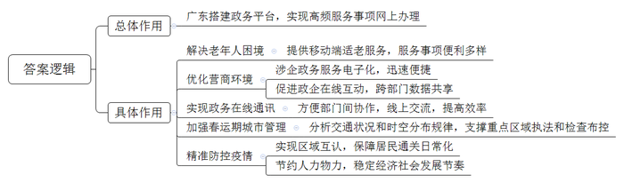
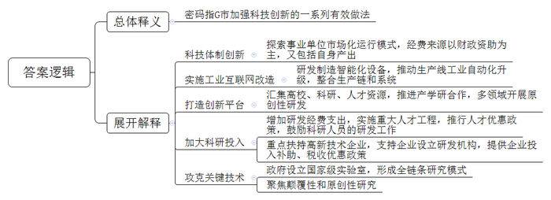
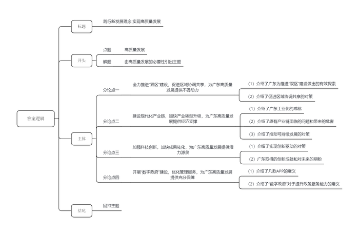

# 2021年广东省公考《申论》题（县级）

> 候选采集稿。参考答案及解析来自粉笔页面，不代表官方答案或真实高分答卷；来源使用许可与原卷对应关系仍需人工核实。

## 给定材料

### 材料 material-8fb69ceb213c627a

“十三五”期间，广东省大力开展“数字政府”建设，推进数据共享，流程再造，管理创新，推出“粤省事”“粤商通”“粤政易”系列平台，高频服务事项基本实现“指尖办理”，网上政务服务能力跃居全国首位。

面对“银发族”触网的烦恼，广东最早行动。“粤省事”平台上线全国首个移动端适老化老年人服务专区，为老年人提供8类便利化服务，38个服务事项。

65岁的曾伯前往就医时，将身份证放在读卡器上，不到2秒钟，工作人员的电脑就显示他的健康码为绿色。“我的眼睛不好使，现在用身份证一刷健康码信息就有了，真的又快又省事！”曾伯为此点赞。

近年来，为深入贯彻落实国家关于深化“放管服”改革要求，广东省各地依托“数字政府”建设，不断优化涉企政务服务，为企业经营营造良好环境。

对于首次创业的深圳青年小张来说，迅速而便捷地办好了公司的“身份证”，意味着他顺利迈出了创业之路的第一步。

“整个过程还不到一个小时吧，材料提交全程电子化。”小张回忆，下载“粤商通”APP，点击“开办企业”，按要求上传材料，就实现了企业开办全程“指尖办”。

目前，“粤商通”已成为政府和企业的互动平台，而“粤商码”是“粤商通”进一步优化升级的亮点。

“以前办理企业证照、缴纳税费时，要在不同部门之间来回跑，现在‘粤商码’就像企业的身份证，从工商、税务到社区，所有数据都在一个码里，基本上所有涉企业务，足不出户就能办理。”某贸易公司经理说。

“粤政易”平台构建了政务在线通讯系统，推动了办文、办会、办事等功能。

政务服务大厅里，工作人员小李正在忙碌地为企业办理业务，需要找一些文件进行对照，小李通过“粤政易”向市场监管部门发出调阅请求。没过几分钟，相关人员就将检索到的文件信息通过“粤政易”发了过来。

“以前调阅一些文件，找相关部门，一般需要发函，有时几天才能拿到，现在通过‘粤政易’就能很轻松找到各部门人员，文件实时加密传送，还可以线上交流，大大提高了工作效率。”小李说。

2021年2月2日，春运第6天，广州火车站的广州地区春运指挥部，占据整面墙的大屏幕上数据跳动。这是今年投入广州春运综合保障中的视频智能化综合分析平台——“交通慧眼”，平台汇集了广州市8万余路高清视频和卡口信息，覆盖了机场、车站、主次干道等重要交通管理区域。

“平台运用人工智能技术对视频监控进行分析，通过实时捕捉车辆监控视频，智能识别营运车辆视觉特征，再综合行业管理数据比对分析。”春运指挥部工作人员介绍，“通过平台，能迅速将交通状况和时空分布规律分析出来，支撑重点区域执法和检查布控，进一步加强了春运期间的城市管理。”

当前，在新冠肺炎疫情防控中，“数字政府”的作用脱颖而出。

珠海横琴与澳门仅有一水之隔，随着公共服务融通，出现越来越多的“琴澳人”。小王在澳门工作，住在横琴，疫情防控初期，因两地防疫要求和措施的差异化，小王在家焦急地等待上班通知，“澳门朋友打电话给我，说我很久没有参加他们的聚会活动了。”小王苦恼却也无可奈何。

依托数字政府平台，粤澳两地迅速搭建“粤康码”与“澳门健康码”互认系统，保障粤澳两地居民通关日常化。在口岸工作人员指导下，小王顺利通关。“这样我就可以约澳门朋友宵夜啦！”小王开心地说。

“如果没有信息化手段，精准防控根本无法想象。不仅要耗费大量人力物力，还会拖累经济社会发展节奏。”省政务服务数据管理局有关人员说，“‘数字政府’改革成果派上了大用场，正是依托此前4年多的改革积累，才得以在短时间内上线多项功能。”

### 材料 material-0cfe084bce9d2fe4

近年，G市深入贯彻落实科技强国战略，不断加强城市创新能力建设，有力地推动了经济社会的高质量发展。《G市城市创新指数报告2020》显示，2010—2019年，G市创新指数年均增长10.86%，清晰勾勒出城市创新能力的“上扬曲线”。在经济由高速增长转向高质量发展阶段，G市加强创新驱动，率先实现质量变革、效率变革、动力变革的“密码”是什么？

走进位于G市A高新产业园区一家“四不像”的实验室——G城实验室，二楼机房的超级计算机指示灯不停闪烁，每一秒的闪烁，意味着可以完成百亿亿次计算，这是实验室交出的最新成果——城市云脑。

“云脑就是一台既算得快，又能支持人工智能的超高速计算机。”

实验室主任介绍，云脑建设运行以来，平均每天运行500多个科研任务，支撑数百名科研人员的研究，已经形成了一系列有国际影响力的科研成果。

这个“四不像”实验室，是G市科技体制创新“闯”出来的结果。刚刚成立一年多，就取得了许多优秀的成果。它不像一般的企业和科研机构，虽是事业单位，却实行市场化运行模式，工作人员没有级别、编制；经费来源以财政资助为主，又鼓励知识产权授权、技术转移等。

与实验室一墙之隔的M集团无人工厂，机器人“大军”正有条不紊地组装、切割，对外观进行划痕检测。这家工厂经过一系列工业互联网改造，成效显著：原材料库存减少80%，生产整体效率提高17%，故障率减少36%。

“M集团以科技创新为转型驱动力，致力于研发制造智能化家电设备和推动生产线的工业自动化升级，重新整合整个家居产品生产链和系统。”集团负责人介绍说。

A高新产业园区正是G市落实省委科技创新战略的重点抓手。目前，园区40多平方公里的范围内，汇集了众多的高校、科研和人才资源，在互联网与云计算、大数据、人工智能、新一代信息技术等领域形成一批原创性研发成果，2020年中国珠峰高程测量登山队成功登顶珠峰用到的高原冰雪探测雷达系统、北斗接收机VNet8、觇标等正是来自A高新产业园区的技术创造。除A高新产业园区外，G市还在谋划中国科学院科学园、国际生物岛、人工智能与数字经济实验区等一批重点创新平台，将极大聚合G市的科研力量。

近年来，G市一直在科研投入上“加码”，2020年全市社会研发经费支出总额达677.74亿元，较上年增长12.92%，占GDP的比重为2.87%，为区域科技创新发展奠定了坚实的物质基础。值得注意的是，2020年全市地方财政科技支出达243.95亿元，较上年增长49.05%，其中，80%以上直接用于扶持高新技术企业和科研人员的研发工作，极大地提升了G市的人才吸引力，激发了企业创新活力。

为了打造创新人才高地，G市近年大力实施了“高端人才计划”等重大人才工程，全面推行人才优惠政策，吸引了国内外大量优秀人才，为高质量发展提供了人才支撑。2020年，G市每万名从业人员中研发人数为133.76人，较上年提升9.86%；高级职称专业技术人才数量达到20.8万人，科技创新人才队伍建设成效显著。

在G市，近半数规模以上工业企业中设有研发机构，占比高出全国平均水平15个百分点。这得益于政府大力支持企业建设工程技术研究中心、企业重点实验室等研发机构，实施企业研发经费投入后补助、税收优惠等政策。截至2020年底，全市国家科技型中小企业备案入库9283家，连续两年在全国城市中排名第一。

从“4个90%”可以感知G市企业的创新活力：研发投入近90%来源于企业；研发人员近90%来源于企业；研发机构数量大约有90%来源于企业；发明专利近90%来源于企业。企业成为了G市创新发展中当仁不让的“主角”。

特别值得一提的还有G市首批国家实验室——G市新材料实验室。目前，实验室的18个高水平研究团队正围绕生物科技、新能源等领域的关键材料开展集中攻关。该实验室由G市政府、中科院共建，将布局公共技术平台和大科学装置、前沿研究板块、创新样板工厂、粤港澳交叉科学中心四大核心板块，形成“前沿基础研究—应用基础研究—产业技术研究—产业转化”的全链条研究模式，努力解决一系列“卡脖子”技术难题。

“谁掌握了材料，谁就掌握了未来。”实验室理事长表示，实验室将立足于成为有国际影响力的新材料研发基地，聚焦原创性和颠覆性研究，自主创新，打造大湾区的创新高地。

目前实验室已经取得了诸多成果，还在国际权威学术期刊上发表了数篇文章。“接下来，实验室将强化关键核心技术攻关，抢占科技竞争和未来发展制高点。”理事长说。

2021年是“十四五”开局之年。据了解，G市正加大力度，加快推进科学城、国家实验室等建设，并组织动员全市科研力量，围绕芯片等更多领域的“卡脖子”核心关键技术，开展科研攻关，争取“十四五”期间取得更多更大的创新成就。

### 材料 material-0ad7ac0981cebca6

推进粤港澳大湾区建设和支持深圳建设中国特色社会主义先行示范区，是习近平总书记亲自谋划、亲自部署、亲自推动的重大国家战略。

“准确把握、全面贯彻中央战略意图，举全省之力推进粤港澳大湾区建设和支持深圳建设先行示范区，深化粤港澳高水平互利合作，把‘双区’打造成为现代化建设的主引擎。”2020年12月，中共广东省委十二届十二次全体会议强调，要加快“双区”建设，为广东高质量发展提供强大牵引。

俯瞰湾区大地，公路、水路、轨道交通建设高歌猛进，人畅其行，物畅其流；抬头仰望“湾区蓝”国际一流湾区和世界级城市群正振翅高飞，顶级湾区的战略格局骨架已然形成，大湾区城市群人们的工作圈、生活圈、朋友圈越来越近。“早上广州叹早茶，下午深圳谈生意，晚上澳门看夜景”早已不是新鲜事。

以港珠澳大桥和广深港高铁为代表的粤港澳大湾区“硬联通”，加速大湾区城市群融合，基础设施互联互通建设“牛劲”十足。而以一系列制度、规则衔接为重点的“软连接”也正稳步推进，成为大湾区高质量发展的新动能。

在金融互联互通方面，大湾区先后推出了合格机构投资者、沪深港通、基金互认、债券通等，金融市场双向开放取得积极进展，2020年广东跨境人民币结算金额达4.12万亿元，同比增长26.2%，目前人民币已是广东第二大跨境结算货币。

2021年2月，中国人民银行、银保监会、证监会、国家外汇管理局与香港金融管理局、香港证监会、澳门金融管理局签署了《关于在粤港澳大湾区开展“跨境理财通”业务试点的谅解备忘录》，大湾区居民将可以更深刻、广泛地参与国际金融市场活动。

在其他方面，2020年7月，广州市品牌质量创新促进会和香港品质保证局共同打造“湾区制造”品牌，并已为广州首批12家企业颁证。对此，香港品质保证局副主席认为，“湾区制造”项目是一个良好的开端，大湾区的制造业优势与香港国际化认证标准体系的强强互补，将实现“1+1＞2”，向国际输出优质湾区制造品牌。

2020年11月，香港特别行政区政府公布“香港医管局在粤患者复诊治疗服务香港大学深圳医院支援计划”，使得深港两地首次实现了病历互通，成为大湾区医疗融合的里程碑之一。

2021年2月28日，广东省人民政府印发《广东省进一步推动竞争政策在粤港澳大湾区先行落地的实施方案》，提出组建广东省竞争政策委员会，并邀请香港、澳门竞争执法机构参与委员会的相关事务，建立三地竞争执法机构执法会商机制，定期会谈开展交流合作等。这将助力大湾区提升市场一体化水平，形成符合国际标准的市场体系。

有学者指出，粤港澳大湾区建设率先探索与港澳经贸规划对接，将带动提升大湾区整体制度型开放，推动广东迈向更高水平的对外开放。

## 题目

### 第 1 题

**请根据材料**2**，概括“数字政府”建设在优化政府管理与服务中的作用。（20分）**

关联材料：material-8fb69ceb213c627a

作答要求：

要求：概括全面、准确，条理清晰；篇幅不超过200字。

### 第 2 题

**材料**5**中提到，“在经济由高速增长转向高质量发展阶段，G市加强创新驱动，率先实现质量变革、效率变革、动力变革的‘密码’是什么？”请谈谈你对材料中“密码”的理解。（30分）**

关联材料：material-0cfe084bce9d2fe4

作答要求：

要求：紧扣材料，条理清晰，表达准确；篇幅不超过300字。

### 第 3 题

**请根据全部给定材料（仅限给定材料），围绕****“站在新起点，迈向新征程，推动广东高质量发展”主题，自拟题目，撰写一篇议论文。（50分）**

关联材料：material-0ad7ac0981cebca6

作答要求：

要求：

（1）文章主题与给定材料联系紧密，思想性强；

（2）论点鲜明，论据确凿，论证严密；

（3）结构完整，条理清晰，行文流畅；

（4）篇幅在800—1000字。

## 答案与解析

第 1 题

**参考答案（粉笔题库参考内容）**

广东搭建政务平台，实现高频服务事项网上办理：

1.解决老年人困境。提供移动端适老服务，服务事项便利多样。2.优化营商环境。涉企政务服务电子化，迅速便捷；促进政企在线互动，跨部门数据共享。3.实现政务在线通讯。方便部门间协作，线上交流，提高效率。4.加强春运期城市管理。分析交通状况和时空分布规律，支撑重点区域执法和检查布控。5.精准防控疫情。实现区域互认，保障居民通关日常化；节约人力物力，稳定经济社会发展节奏。

**解析**

**参考答案说明**：本参考答案整体按照“总分”逻辑呈现，先给出总体作用“广东搭建政务平台，实现高频服务事项网上办理”，然后从“解决老年人困境”“优化营商环境”“实现政务在线通讯”“加强春运期城市管理”“精准防控疫情”五个方面给出具体作用，各条要点在内容上是无交叉的。

**考点**：考点影响类

**来源**：来源2021年广东省公考《申论》题（县级）

粉笔申论页面对本题只提供「解析视频」入口，该入口是会员推广位，页面无视频地址与文字解析。

第 2 题

**参考答案（粉笔题库参考内容）**

密码指G市加强科技创新的一系列有效做法。1.科技体制创新。探索事业单位市场化运行模式，经费来源以财政资助为主，又包括自身产出。2.实施工业互联网改造。研发制造智能化设备，推动生产线工业自动化升级，整合生产链和系统。3.打造创新平台。汇集高校、科研、人才资源，推进产学研合作，多领域开展原创性研发。4.加大科研投入。增加研发经费支出，实施重大人才工程，推行人才优惠政策，鼓励科研人员的研发工作；重点扶持高新技术企业，支持企业设立研发机构，提供企业投入补助、税收优惠政策。5.攻克关键技术。政府设立国家级实验室，形成全链条研究模式；聚焦颠覆性和原创性研究。

**解析**

**参考答案说明：**本参考答案一方面从思路上先对“密码”进行了总体释义；然后从“科技体制创新”“工业互联网改造”“打造创新平台”“加大科研投入”“攻克关键技术”这五方面展开解释了G市如何实现系列变革。另一方面，形式上，本参考答案做到了分条撰写，整体上条理较为清晰。

**考点**：考点词句解释类

**来源**：来源2021年广东省公考《申论》题（县级）

粉笔申论页面对本题只提供「解析视频」入口，该入口是会员推广位，页面无视频地址与文字解析。

第 3 题

**参考答案（粉笔题库参考内容）**

**践行新发展理念 实现高质量发展**

改革开放四十年来，广东敢闯敢试，谱写了一曲感天动地、气壮山河的奋斗赞歌。身处时代变局，推动高质量发展，既是保持经济持续健康发展的必然要求，也是保持广东改革走在全国前列的必然要求。中流击水，奋楫者进，新发展理念的时代号角已经吹响，广东正扬帆起航，谱写高质量发展的南粤新篇。

**全力推进“双区”建设，促进区域协调共享，为广东高质量发展提供不竭动力。**广东为推进“双区”建设做出了一系列卓有成效的探索，基础设施、金融领域互联互通，品牌制造强强联合，公共资源优势互补，以硬联通和软连接相结合推动大湾区形成开放共享新格局。面对当前区域发展仍存在差距问题，广东持续发力，在各领域实现优势互补，形成合力，促进高质量发展行稳致远。

**建设现代化产业链，加快产业转型升级，为广东高质量发展提供经济支撑。**广东发展目前已步入工业化后期，成为全球价值链的重要供应者，基础加工业、商品制造业都享誉全球。然而在新工业革命的冲击下，原有的产业链已经不能适应发展需求，进而影响到我国的产业安全和经济地位。为此，只有加快构建现代化产业链，推动产业优化升级，才能逐步完善现代化经济体系，为广东可持续发展打下坚实基础。

**加强科技创新，加快成果转化，为广东高质量发展提供活力源泉。**广东正在从科技大省迈向科技强省，只有加大科技投入，构建创新型人才队伍与高质量科研平台，才能突破“卡脖子”的技术瓶颈，真正实现创新驱动。近年来，广东高新产业园区逐步落成，人才政策层出不穷，资金支持力度持续加大，企业创新活力不断增强，必将在“十四五”期间取得更多更大的创新成就。

**开展“数字政府”建设，优化管理服务，为广东高质量发展提供充分保障。**从“粤省事”到“粤商通”再到“交通慧眼”，不仅解决了“银发族”的触网烦恼，还让企业办事流程简化，更让交通管理愈加有序。信息化手段为推进数据共享、流程再造、管理创新节省了大量人力物力，让广东的网上政务服务能力跃居全国首位。

所当乘者势也，不可失者时也。站在“两个一百年”奋斗目标的历史交汇点上，广东踏上了“十四五”发展新征程，大力推进区域协调发展，做好产业规划顶层设计，强化创新服务能力，书写高质量发展新篇章，必将为全国发展大局作出新贡献！

**解析**

**文章分析**

**践行新发展理念** **实现高质量发展**

【**标题的优点：**首先范文的标题“践行新发展理念 实现高质量发展”突出了“高质量发展”这一主题。其次，形式上采用了对称式结构，前半句点出对策，后半句点出意义，使标题更加完整、饱满。富有逻辑性。】

（1）改革开放四十年来，广东敢闯敢试，谱写了一曲感天动地、气壮山河的奋斗赞歌。（2）身处时代变局，推动高质量发展，既是保持经济持续健康发展的必然要求，也是保持广东改革走在全国前列的必然要求。（3）中流击水，奋楫者进，新发展理念的时代号角已经吹响，广东正扬帆起航，谱写高质量发展的南粤新篇。

【**开头的优点：**★内容方面。范文的开头是紧扣“高质量发展”这一主题展开的。首先，开头在段首处点出主题，做到了主题明确。其次，对该主题进行了分析阐述，指出了（1）广东改革开放以来的发展成就；（2）高质量发展的必要性；（3）重申主题，广东要高质量发展。★文字表达方面：使用了“既是……也是”等连接词，使语言表达有逻辑性。】

**全力推进****“双区”建设，促进区域协调共享，为广东高质量发展提供不竭动力。**（1）广东为推进“双区”建设做出了一系列卓有成效的探索，基础设施、金融领域互联互通，品牌制造强强联合，公共资源优势互补，以硬联通和软连接相结合推动大湾区形成开放共享新格局。（2）面对当前区域发展仍存在差距问题，广东持续发力，在各领域实现优势互补，形成合力，促进高质量发展行稳致远。

【**论述段****1的优点：**★观点句。范文的观点句是紧扣“高质量发展”这一主题提出的。形式上，它在段首处直接写出，位置突出，容易发现。内容上，关键词突出，内容要点明确，可以明显看出它从“‘双区’建设”“区域协调共享”这两个角度入手来推动高质量发展。★论述内容：（1）介绍了广东为推进“双区”建设做出的有效探索；（2）介绍了促进区域协调共享的对策。以上两个方面都是紧扣“全力推进‘双区’建设，促进区域协调共享，为广东高质量发展提供不竭动力”这个观点进行分析论述的，层次清晰，论述的针对性强。最后，在论述方法上主要采用了讲道理、举例子相结合，做到了丰富多样。】

**建设现代化产业链，加快产业转型升级，为广东高质量发展提供经济支撑。**（1）广东发展目前已步入工业化后期，成为全球价值链的重要供应者，基础加工业、商品制造业都享誉全球。（2）然而在新工业革命的冲击下，原有的产业链已经不能适应发展需求，进而影响到我国的产业安全和经济地位。（3）为此，只有加快构建现代化产业链，推动产业优化升级，才能逐步完善现代化经济体系，为广东可持续发展打下坚实基础。

【**论述段****2的优点：**★观点句。范文的观点句是紧扣“高质量发展”这一主题提出的。形式上，它在段首处直接写出，位置突出，容易发现。内容上，关键词突出，内容要点明确，可以明显看出它从“产业转型升级”的个角度入手来推动高质量发展。★论述内容：（1）介绍了广东工业化的成就；（2）介绍了原有产业链面临的问题和带来的危害；（3）介绍了推动可持续发展的对策。以上三个方面都是紧扣“建设现代化产业链，加快产业转型升级，为广东高质量发展提供经济支撑”这个观点进行分析论述的，层次清晰，论述的针对性强。】

**加强科技创新，加快成果转化，为广东高质量发展提供活力源泉。**（1）广东正在从科技大省迈向科技强省，只有加大科技投入，构建创新型人才队伍与高质量科研平台，才能突破“卡脖子”的技术瓶颈，真正实现创新驱动。（2）近年来，广东高新产业园区逐步落成，人才政策层出不穷，资金支持力度持续加大，企业创新活力不断增强，必将在“十四五”期间取得更多更大的创新成就。

【**论述段****3的优点：**★观点句。范文的观点句是紧扣“高质量发展”这一主题提出的。形式上，它在段首处直接写出，位置突出，容易发现。内容上，关键词突出，内容要点明确，可以明显看出它从“科技创新”的角度入手来推动高质量发展。★论述内容：（1）介绍了实现创新驱动的对策；（2）广东取得的创新成就和对未来的期盼。以上两个方面都是紧扣“加强科技创新，加快成果转化，为广东高质量发展提供活力源泉”这个观点进行分析论述的，层次清晰，论述的针对性强。最后，在论述方法上主要采用了讲道理、举例子相结合，做到了丰富多样。】

**开展****“数字政府”建设，优化管理服务，为广东高质量发展提供充分保障。**（1）从“粤省事”到“粤商通”再到“交通慧眼”，不仅解决了“银发族”的触网烦恼，还让企业办事流程简化，更让交通管理愈加有序。（2）信息化手段为推进数据共享、流程再造、管理创新节省了大量人力物力，让广东的网上政务服务能力跃居全国首位。

【**论述段****4的优点：**★观点句。范文的观点句是紧扣“高质量发展”这一主题提出的。形式上，它在段首处直接写出，位置突出，容易发现。内容上，关键词突出，内容要点明确，可以明显看出它从“数字政府”这个角度入手来推动高质量发展。★论述内容：（1）介绍了几款APP的意义；（2）介绍了“数字政府”对于提升政务服务能力的意义。以上两个方面都是紧扣“开展‘数字政府’建设，优化管理服务，为广东高质量发展提供充分保障”这个观点进行分析论述的，层次清晰，论述的针对性强。最后，在论述方法上主要采用了讲道理、举例子相结合，做到了丰富多样。】

【**论述段之间的关系**：★内容的内在逻辑：范文的论述段都是从“对策”的角度展开的。论述段1先写了“全力推进‘双区’建设，促进区域协调共享，为广东高质量发展提供不竭动力”，论述段2再写了“建设现代化产业链，加快产业转型升级，为广东高质量发展提供经济支撑”，论述段3接着写了“加强科技创新，加快成果转化，为广东高质量发展提供活力源泉”，论述段4最后写了“开展‘数字政府’建设，优化管理服务，为广东高质量发展提供充分保障”。】

所当乘者势也，不可失者时也。站在“两个一百年”奋斗目标的历史交汇点上，广东踏上了“十四五”发展新征程，大力推进区域协调发展，做好产业规划顶层设计，强化创新服务能力，书写高质量发展新篇章，必将为全国发展大局作出新贡献！

【**结尾的优点**：范文的结尾回扣了“高质量发展”这一主题，语言精悍富有文采，不拖沓。】

**考点**：考点文章写作题

**来源**：来源2021年广东省公考《申论》题（县级）

粉笔申论页面对本题只提供「解析视频」入口，该入口是会员推广位，页面无视频地址与文字解析。

